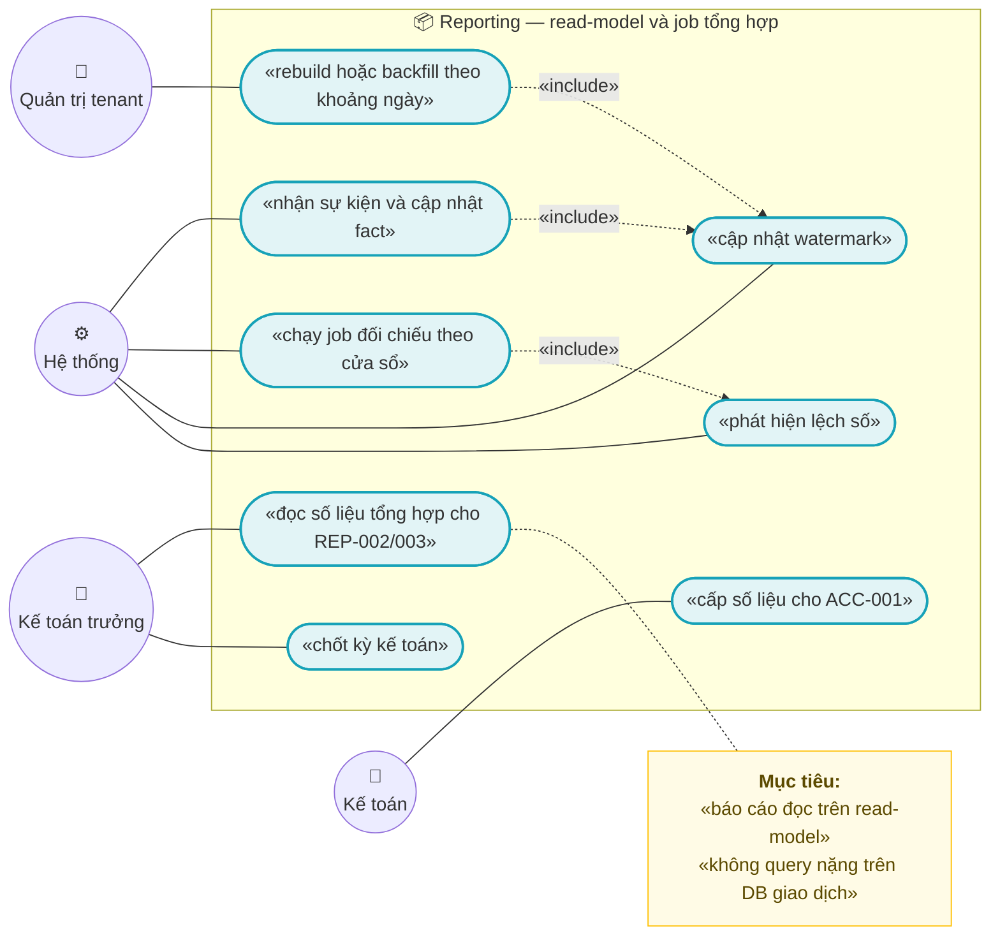
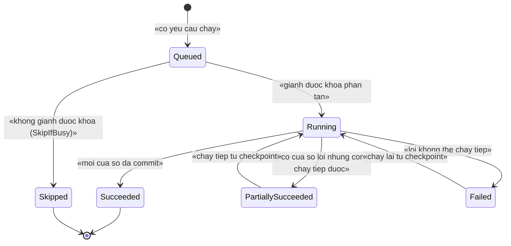
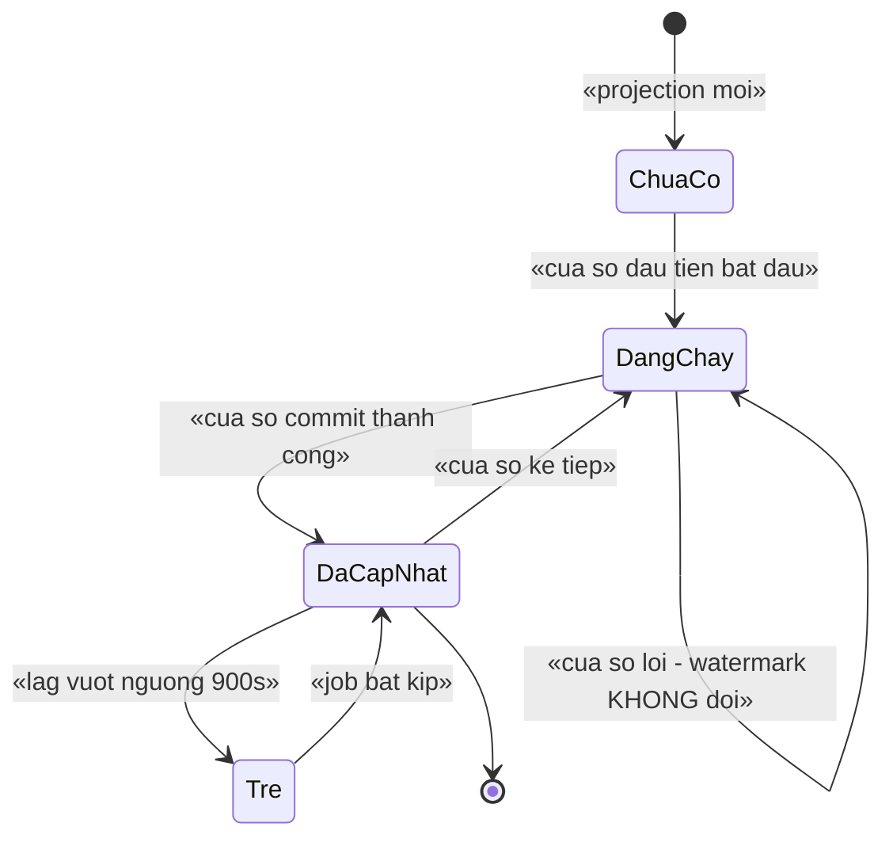
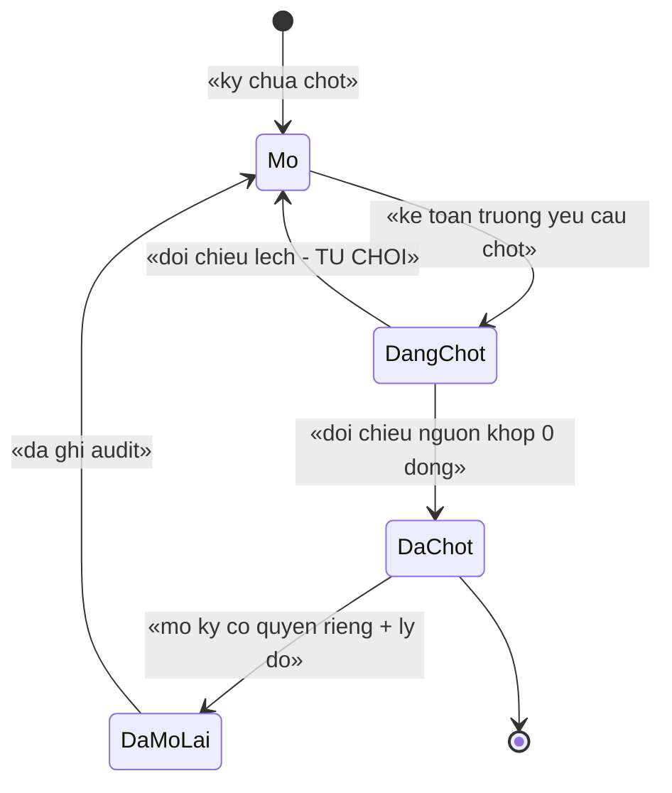
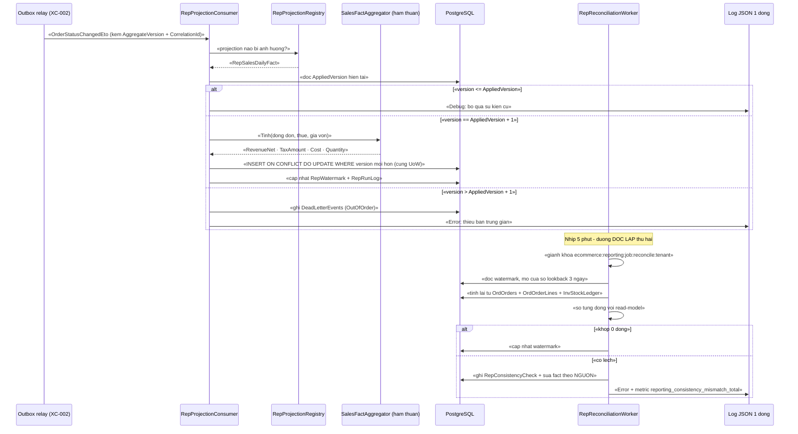
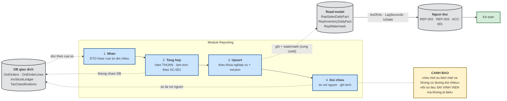
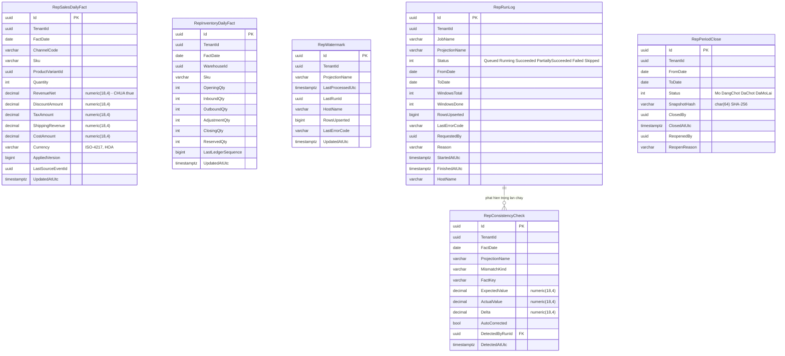

# `REP-001` — Read-model và job tổng hợp

| Thuộc tính | Nội dung |
|---|---|
| **Mã** | `REP-001` |
| **Module** | **Reporting** (module mới — `modules/Reporting/…`) |
| **Giai đoạn** | **GĐ3 — Điều hành** (xem `docs/implementation-plan.md:114` và `:213`) |
| **Ưu tiên** | **Must have** — là **nền** của `REP-002`, `REP-003`, `ACC-001` |
| **Trạng thái** | 🟡 `Draft` — chờ review |
| **Người viết / người review** | *(điền)* / **Kiến trúc trưởng + Kế toán** |
| **Phiên bản / ngày** | `v0.1 — 13/10/2026` |
| **Tài liệu liên quan** | `XC-001` (Money/làm tròn) · `XC-002` (outbox/inbox, ETO, `AggregateVersion`) · `XC-003` (khoá phân tán) · `XC-005` (log/metric) · `XC-006` (thuế GTGT, Mẫu 01) · `REP-002` · `REP-003` · `ACC-001` · `INV-001` (ledger append-only) · `SHP-002/003/004` (nguồn dữ liệu COD — có cảnh báo bảo mật) · `docs/implementation-plan.md` · `docs/structure-and-techstack.md` |

---

## 0. Tóm tắt & quyết định thiết kế

**Tóm tắt:** `REP-001` dựng **read-model riêng** cho Reporting và **job tổng hợp** nuôi nó, để **mọi báo cáo đọc trên bảng tổng hợp** thay vì
query nặng trên **DB giao dịch**. Tài liệu này chốt: mô hình dữ liệu (bảng fact + watermark + nhật ký chạy), cơ chế cập nhật
(**sự kiện tăng dần** + **job đối chiếu định kỳ** — hai đường độc lập, có thể kiểm chứng lẫn nhau), hợp đồng API, khoá phân tán,
idempotency, và cách phát hiện **lệch số** thay vì để nó im lặng.

**Vì sao phải có tài liệu này (yêu cầu đã chốt ở kế hoạch):**

| Nguồn | Yêu cầu nguyên văn |
|---|---|
| `docs/implementation-plan.md:436` | `REP-001` — Read-model & job tổng hợp (**không query nặng trên DB giao dịch**) |
| `docs/implementation-plan.md:213` | Reporting: read-model riêng (bảng tổng hợp cập nhật bằng event/job) … **Không** báo cáo nào query trực tiếp trên bảng giao dịch; có test số liệu khớp với dữ liệu gốc |
| `docs/structure-and-techstack.md:79` | `Reporting/  C1  read-model báo cáo (không query nặng trên DB giao dịch)  (P3)` |
| `docs/features/cross-cutting/XC-006-phan-loai-thue-gtgt.md:689` | Q7: **CÓ** báo cáo **đối chiếu phân loại ↔ doanh thu theo SKU** ⇒ **giao cho module `REP-*`** |

**Hiện trạng thật của code (đã kiểm bằng `read`/`grep`/`glob` — không viết theo trí nhớ):**

| Hạng mục | Hiện trạng | Bằng chứng |
|---|---|---|
| Module `Reporting` | ❌ **chưa có** — chỉ có `ChannelHub`, `PaymentHub`, `Tax` | `eCommerce.slnx`, `modules/` |
| Bảng read-model / báo cáo | ❌ **chưa có** — `grep` cho `Report|Aggregat|ReadModel|Dashboard` trên `*.cs` **không** ra entity nào | chỉ ra `eSalesDbContextModelSnapshot` (trùng chuỗi `Snapshot`) |
| Job tổng hợp định kỳ | ❌ **chưa có** — pattern định kỳ duy nhất đang dùng là supervisor của ChannelHub | `modules/ChannelHub/eCommerce.ChannelHub.Application/Sync/ChannelSyncSupervisorWorker.cs:27` |
| Entity nguồn (`Order`, `OrderLine`) | ✅ có, **có snapshot giá** nhưng **CHƯA có snapshot thuế** (`TaxRate`, `TaxClassificationId`) | `src/eCommerce.Domain/Entities/Orders/Order.cs:118-149` |
| Sổ cái kho (append-only) | ✅ có — nguồn sự thật để dựng báo cáo luân chuyển | `src/eCommerce.Domain/Entities/Inventory/StockLedger.cs:84` |
| Phân loại thuế + Mẫu 01 Phụ lục III (Phần II) | ✅ có (hàm thuần) | `modules/Tax/eCommerce.Tax.Domain/Mau01/Mau01Part2Calculator.cs:58` |
| Metric | ✅ 12 metric **đã có nơi phát**, **nhưng chưa có metric nào cho projection** | `shared/eCommerce.Kernel/Observability/eCommerceMetrics.cs:38-52` |
| Độ chính xác tiền | ✅ `numeric(18,4)` cho mọi cột tiền | `src/eCommerce.EntityFrameworkCore/eCommerceDbContext.cs:173-178` |

⇒ 🔴 **Hệ quả:** `REP-001` **viết mới hoàn toàn** (module + bảng + job + API). Không có gì để tái dùng ngoài `Order`/`OrderLine`/`StockLedger`/`TaxRateResolver`
làm **nguồn dữ liệu**, `eCommerceMetrics` làm **nơi phát metric**, và `ChannelSyncSupervisorWorker` làm **khuôn mẫu worker định kỳ**.

**Phạm vi:**
- ✅ **Mô hình read-model** (bảng fact theo ngày/kênh/SKU + bảng watermark + nhật ký chạy job).
- ✅ **Job tổng hợp** hai đường: (a) **tăng dần theo sự kiện** `OrderStatusChangedEto` / `OrderPlacedEto` / `PaymentSucceededEto` / `Stock*Eto`;
  (b) **đối chiếu định kỳ** (reconciliation) quét lại nguồn theo cửa sổ và **so số** với read-model.
- ✅ **Hợp đồng API** cho `REP-002`/`REP-003`/`ACC-001` đọc (`IReportFactReader` + app service chỉ-đọc).
- ✅ **Khoá phân tán, idempotency, watermark, cách ly tenant, phân quyền, metric, test**.
- ✅ **Rebuild có checkpoint** (không phải chạy lại từ đầu khi job đứt giữa đường).
- ✅ **Phát hiện lệch số** (`RepConsistencyCheck`) — biến lỗi im lặng thành **dữ liệu quan sát được**.

**Không nằm trong phạm vi:**
- ❌ **Nội dung báo cáo** (doanh thu, lãi gộp, tồn kho luân chuyển, hiệu suất kênh) — thuộc `REP-002` / `REP-003`.
- ❌ **Định dạng file xuất kế toán** (Excel/CSV, ánh xạ tài khoản, Mẫu 01) — thuộc `ACC-001`. `REP-001` **chỉ cấp số liệu** qua API.
- ❌ **Đối soát với NCC ngoài** (settlement sàn, COD của hãng vận chuyển) — thuộc `REC-002` / `REC-003`.
- ❌ **Định nghĩa luật phân loại thuế** — thuộc `XC-006`. `REP-001` chỉ **phản chiếu** kết quả phân giải thuế của Sales.
- ❌ **Hạ tầng BI/dashboard ngoài** (Grafana, Metabase, Power BI) — `REP-001` chỉ chốt **hợp đồng dữ liệu**.
- ❌ **Ghi ngược vào module nguồn** — **cấm tuyệt đối** (xem BR-REP-001-010).

### 0.1 Quyết định thiết kế (ADR ngắn)

| # | Quyết định | Phương án đã cân nhắc | Lý do chọn | Hệ quả |
|---|---|---|---|---|
| **D1** | **Read-model là BẢNG THẬT trong module `Reporting`**, không phải `VIEW`/`MATERIALIZED VIEW` | (a) query thẳng `OrdOrders` · (b) `VIEW` · (c) `MATERIALIZED VIEW` · (d) **bảng thật do module sở hữu** | (a) **bị cấm** bởi `implementation-plan.md:213`. (b)/(c): `REFRESH MATERIALIZED VIEW` **khoá bảng** ⇒ chặn cả đọc; không theo dõi được **watermark**; không có chỗ ghi **nhật ký chạy**; và **không** kiểm soát được tenant filter (`VIEW` chạy dưới quyền người tạo) | Cần thêm bảng + migration + job. Đổi lại: cập nhật **tăng dần**, có **watermark**, có **nhật ký**, và **không** khoá DB giao dịch |
| **D2** | **Sổ đăng ký sự kiện (`RepProjectionRegistry`) là cấu hình trong code**, không phải suy luận ngầm | (a) consumer tự quyết định ghi gì · (b) **registry tường minh**: mỗi ETO → danh sách projection bị ảnh hưởng | (a) ⇒ thêm sự kiện mới thì **không ai biết** read-model nào cũ đi ⇒ **số liệu sai im lặng** (đúng lớp lỗi đã gặp ở `XC-003` F1: hai nơi định nghĩa khoá, không có lỗi biên dịch) | Thêm sự kiện mới **phải** khai báo projection. Có test `TC-07` chặn ETO "mồ côi" (có consumer nhưng không khai báo projection nào) |
| **D3** | **Hai đường cập nhật độc lập**: (a) **tăng dần theo sự kiện**, (b) **đối chiếu định kỳ** quét lại nguồn theo cửa sổ | (a) chỉ sự kiện · (b) chỉ job quét toàn bộ · (c) **cả hai** | (a) một mình: **mất 1 sự kiện ⇒ sai số vĩnh viễn**. (b) một mình: quét toàn bộ mỗi nhịp ⇒ **đúng cái ta đang trốn** (tải nặng trên DB giao dịch) | Read-model có **hai đường kiểm chứng nhau**; đường (b) chạy **cửa sổ ngắn** (mặc định **3 ngày**) nên tải nhỏ. Chi phí: phải viết hàm tổng hợp **thuần** dùng chung cho cả hai đường |
| **D4** | **Tổng hợp theo `AggregateVersion`** (kế thừa `XC-002` D6/BR-014) | (a) ghi đè theo `OrderId` · (b) bỏ sự kiện cũ hơn `AppliedVersion` | (a) với at-least-once + **không đảm bảo thứ tự**, một bản cũ đến muộn sẽ **ghi đè số mới hơn** ⇒ số liệu **lùi về quá khứ** | Mỗi bảng fact của một aggregate mang `AppliedVersion`; sự kiện `version <= AppliedVersion` ⇒ **bỏ qua + log + metric** (không phải lỗi); `version > AppliedVersion + 1` ⇒ **DLQ `OutOfOrder` + cảnh báo** |
| **D5** | **Chỉ lưu số liệu CỘNG ĐƯỢC (additive)**; tỉ lệ/lãi gộp/trung bình **tính lúc truy vấn** | (a) lưu sẵn `GrossMarginPercent`, `Aov` · (b) lưu `Revenue`, `Cost`, `Quantity` rồi chia khi đọc | (a) tỉ lệ **không cộng được** qua các nhóm ⇒ tổng theo kênh **lệch** tổng theo ngày (bẫy kinh điển của báo cáo) | Mọi cột trong bảng fact **phải** cộng dồn được từ dòng lên tổng. Chia/trung bình **chỉ** ở tầng đọc. Có test `TC-12` chứng minh `Σ theo kênh == Σ theo ngày` |
| **D6** | **Ghi read-model bằng "upsert theo khoá nghiệp vụ + version"**, không dùng `Read` rồi `Insert/Update` hai bước | (a) đọc-rồi-ghi · (b) `INSERT … ON CONFLICT … DO UPDATE … WHERE excluded.version > fact.version` | (a) hai luồng job song song ⇒ **race** tạo dòng trùng hoặc mất số; (b) là **một câu lệnh nguyên tử** ở DB ⇒ khoá phân tán chỉ còn là **tối ưu**, DB mới là **hàng rào cuối** (đúng `XC-003` D2) | Cần unique index `(TenantId, FactDate, ChannelCode, Sku, WarehouseId)` để `ON CONFLICT` bám vào. Ghi không đi qua `DbContext` cho đường nóng ⇒ **vẫn** phải nằm trong Unit of Work (xem D12) |
| **D7** | **Mọi phản hồi báo cáo mang `AsOfUtc` + `LagSeconds` + `IsStale`** | (a) trả số "trần" · (b) trả kèm **tuổi dữ liệu** | (a) người dùng **không biết** số liệu đã cũ ⇒ ra quyết định trên dữ liệu thiếu; đây là loại sai **không ai phát hiện** | UI **bắt buộc** hiển thị `AsOfUtc`. `IsStale = true` khi `LagSeconds > ngưỡng` (mặc định **900 s**) ⇒ UI hiện **cảnh báo vàng** (xem §10) |
| **D8** | **Chốt kỳ (`RepPeriodClose`) bất biến hoá số liệu đã xuất** | (a) không chốt, xuất lại luôn · (b) **chốt kỳ + hash số liệu** | `ACC-001` xuất liệu cho kế toán ⇒ nếu lần xuất sau **khác** lần trước (do event đến muộn/rebuild) thì kế toán **không biết tin bản nào**, và việc giải trình thuế (`XC-006` BR-008) mất căn cứ | Kỳ đã chốt ⇒ job **không ghi** vào khoảng ngày đó nữa; muốn sửa **phải** mở kỳ (có quyền riêng + audit). Số liệu chốt được lưu kèm `SnapshotHash` |
| **D9** | **Rebuild có CHECKPOINT**, không "xoá sạch rồi chạy lại" | (a) `TRUNCATE` rồi chạy lại · (b) chạy theo cửa sổ, ghi `RepRunLog` sau mỗi cửa sổ | (a) job đứt giữa đường (500k dòng) ⇒ **bảng rỗng** = báo cáo trắng cho tới khi xong; và **không** biết đang ở đâu | Có `RepRunLog` + `RepWatermark` để **chạy tiếp**. Cần thao tác vận hành "rebuild" được **kiểm soát** (D10) |
| **D10** | **Rebuild/backfill là thao tác CÓ QUYỀN RIÊNG + CÓ AUDIT + bắt buộc mô tả khoảng ngày** | (a) cho job tự rebuild khi phát hiện lệch · (b) chỉ người có quyền, có audit | (a) job tự sửa ⇒ khi công thức sai thì nó **ghi lại sai** trên toàn bộ lịch sử **mà không ai biết**; đây là cách phá dữ liệu nhanh nhất | Người dùng **phải** khai `FromDate`/`ToDate` tường minh; **cấm** rebuild khoảng mở. Mọi lần gọi ghi audit (`XC-004`) + `RepRunLog` |
| **D11** | **Truy vấn read-model bằng Dapper/SQL thô, projection là `DomainService`** | (a) EF Core cho cả đọc và ghi fact · (b) **Dapper cho upsert + đọc**, EF cho metadata | Upsert hàng loạt ~100k dòng qua change tracker của EF là **sai công cụ** (bộ nhớ, N+1, chậm). Báo cáo là truy vấn tổng hợp — SQL mô tả đúng hơn `LINQ` | ⚠️ **Chưa có gói `Dapper` trong `Directory.Packages.props`** ⇒ phải thêm **1 dòng** PackageVersion (xem §11 và §15 Q3). **Cấm** dựng SQL bằng nối chuỗi (BR-REP-001-015) |
| **D12** | **Mọi thao tác ghi của job đi qua Unit of Work của ABP** (kể cả khi câu lệnh là SQL thô) | (a) mở connection riêng, tự `BeginTransaction` · (b) `IUnitOfWorkManager` + `IDbConnectionProvider` của ABP | (a) tạo **transaction thứ hai** ngoài UoW ⇒ nếu transaction ngoài rollback thì dữ liệu read-model **đã ghi** ⇒ **lệch âm thầm**. Quy ước bất biến của dự án: *mọi thao tác ghi đi qua Unit of Work* (`structure-and-techstack.md:145`) | Dùng `_unitOfWorkManager.Begin(requiresNew: true)` cho **từng cửa sổ** (để cửa sổ trước **commit** rồi mới sang cửa sổ sau ⇒ checkpoint có nghĩa) |
| **D13** | **Bảng fact có `DbSet` trên DbContext hợp nhất** | (a) DbContext riêng cho Reporting · (b) `DbSet` trên `eCommerceDbContext` | `AddDefaultRepositories(includeAllEntities: true)` **chỉ** tạo `IRepository<T>` cho entity **có `DbSet`** — lỗi này **đã gặp thật** ở Phase 0 với `ChannelShop` | Phải khai `DbSet` cho **mọi** entity read-model (`eCommerceDbContext.cs:48-52`). Module `Reporting` **không** tham chiếu DbContext của app (giữ nguyên khuôn `Tax`) |
| **D14** | **Bảng fact KHÔNG có khoá ngoại tới bảng giao dịch**; liên kết bằng `OrderId`/`Sku` dạng **giá trị tham chiếu mềm** | (a) FK tới `OrdOrders` · (b) tham chiếu mềm + tra chi tiết qua API của module nguồn | (a) FK biến read-model thành **vật cản** cho module nguồn (xoá/soft-delete đơn, dọn dữ liệu, tách DB sau này) và tạo **khoá ngoại chéo miền** — trái nguyên tắc module sở hữu entity của mình ⇒ khi tách microservice (GĐ4) **không thể** giữ FK | Đọc chi tiết **phải** gọi API/module nguồn ⇒ nếu bản ghi nguồn đã xoá mềm thì read-model **vẫn còn** số liệu, và UI **phải** ghi rõ "chứng từ nguồn không còn truy cập được" thay vì hiện lỗi |

> 📌 **Ghi rõ phương án BỊ LOẠI:** *"dùng `VIEW`/`MATERIALIZED VIEW` cho nhanh"* — bị loại vì `REFRESH` khoá bảng, không có watermark,
> không ghi được nhật ký chạy, và **không** cô lập được tenant ở tầng dữ liệu. Đây **không** phải lựa chọn "rẻ hơn" mà là
> lựa chọn **thiếu kiểm soát** cho một feature phục vụ kế toán.

---

## 1. Use Case Specification

| Thuộc tính | Nội dung |
|---|---|
| **Use Case ID** | `REP-001` |
| **Use Case Name** | Nuôi read-model tổng hợp và cấp số liệu **có kiểm chứng** cho báo cáo & xuất liệu kế toán |
| **Description** | *"Là kế toán trưởng/người điều hành, tôi muốn báo cáo trả lời **trong vài trăm ms** trên read-model, **không** làm chậm DB bán hàng, và **biết rõ số liệu đang cũ tới mức nào** — để tôi không ra quyết định hay lập tờ khai trên số liệu thiếu."* |
| **Actor(s)** | **Kế toán** (lập tờ khai, đối chiếu) · **Kế toán trưởng** (xem doanh thu/lãi gộp, chốt kỳ) · **Quản trị tenant** (chốt kỳ, chạy rebuild) · **Hệ thống** (job tăng dần + job đối chiếu + watermark + DLQ) |
| **Priority** | **Must have** (là điều kiện để `REP-002/003` và `ACC-001` bắt đầu) |
| **Trigger** | (a) **sự kiện nghiệp vụ** tới (`OrderPlacedEto`, `OrderStatusChangedEto`, `PaymentSucceededEto`, `StockReservedEto`/`StockReleasedEto`); (b) **nhịp job đối chiếu** (mặc định **5 phút**); (c) người dùng mở báo cáo; (d) người có quyền yêu cầu **rebuild/backfill**; (e) cuối kỳ kế toán **chốt kỳ** |
| **Pre-Condition(s)** | • **Tenant hiện tại** (`TenantId` từ `ICurrentTenant`) — mọi bảng read-model là `IMultiTenant` có query filter; **cấm** đọc xuyên tenant.<br>• **`ChannelCode`** có trong mọi fact doanh thu (đơn web = `web`; đơn sàn = mã sàn) — đây là chiều phân tích chính, và cũng là chiều `XC-002 §5.2.3` đã bổ sung so với eShop.<br>• **Đã có `DbSet`** cho mọi entity read-model trên `eCommerceDbContext` (D13).<br>• **Redis 7** sẵn sàng cho khoá phân tán; **nếu Redis chết** thì job vẫn **không** sai dữ liệu nhờ unique index + `ON CONFLICT … WHERE` (D6, `XC-003` D2).<br>• **Outbox của ABP đang chạy** (`XC-002`) — nếu relay chết thì read-model **đứng yên** và bị phát hiện qua watermark (BR-REP-001-006).<br>• Múi giờ nghiệp vụ = **Asia/Ho_Chi_Minh**; mọi mốc ngày của fact tính theo `FactDate` **đã quy đổi** (xem §5.2.1). |
| **Post-Condition(s)** | • Mọi thay đổi doanh thu/kho/thuế **có** dòng fact tương ứng, **hoặc** có bản ghi trong `RepConsistencyCheck` giải thích vì sao chưa.<br>• `RepWatermark` của mỗi projection được cập nhật **sau** khi cửa sổ commit.<br>• Mọi lần chạy (thành công/thất bại) có dòng trong `RepRunLog`.<br>• Tổng theo **mọi** cách nhóm **bằng nhau** (D5) — có test `TC-12`.<br>• Sự kiện trùng ⇒ **0** thay đổi số liệu (idempotent, BR-REP-001-005). |
| **Basic Flow** | 1. **Đường sự kiện:** consumer nhận `OrderStatusChangedEto` (qua inbox, đã chống trùng ở `XC-002`) ⇒ tra `RepProjectionRegistry` để biết **projection nào bị ảnh hưởng**.<br>2. Mở UoW; bỏ qua nếu `AggregateVersion <= AppliedVersion` (D4).<br>3. Gọi hàm tổng hợp **thuần** `SalesFactAggregator.Tinh(...)` ⇒ tính `RevenueNet`, `TaxAmount`, `Cost`, `Quantity` **theo từng dòng**, làm tròn theo `XC-001`.<br>4. `upsert` vào `RepSalesDailyFact` bằng `INSERT … ON CONFLICT … DO UPDATE … WHERE excluded.applied_version > fact.applied_version` (D6).<br>5. Cập nhật `RepWatermark`, ghi `RepRunLog`; **commit** UoW.<br>6. **Đường đối chiếu (nhịp 5 phút):** với mỗi projection, lấy cửa sổ `[watermark − lookback, now]` (**mặc định lookback 3 ngày**), **tính lại** bằng **cùng hàm thuần**, so với read-model.<br>7. Lệch ⇒ ghi `RepConsistencyCheck` + metric + log `Error`; **sửa** fact theo nguồn (nguồn là sự thật) và ghi rõ số dòng đã sửa.<br>8. Người dùng gọi `GET /api/reporting/sales-daily` ⇒ đọc **chỉ** trên read-model, trả kèm `AsOfUtc`/`LagSeconds`/`IsStale` (D7). |
| **Alternative Flow** | **A1: Sự kiện đến muộn (đúng thứ tự nhưng trễ ngày)** — ghi vào `FactDate` **theo `OccurredOn` của sự kiện**, không theo ngày nhận; nếu `FactDate` rơi vào **kỳ đã chốt** ⇒ **không ghi**, ghi `RepConsistencyCheck` loại `LateEventInClosedPeriod` + **cảnh báo** cho kế toán (D8).<br>**A2: Rebuild/backfill** — người có quyền `eCommerce.Reporting.Rebuild` khai `FromDate`/`ToDate` + lý do ⇒ tạo `RepRunLog` (trạng thái `Running`) ⇒ chạy **theo cửa sổ ngày**, commit từng cửa sổ, ghi checkpoint ⇒ đứt thì chạy tiếp (D9/D10).<br>**A3: Kỳ đã chốt** — job bỏ qua mọi ghi vào ngày thuộc kỳ đã chốt; **không** ném lỗi (đây là hành vi **đúng**), nhưng **phải** log + metric `reporting_fact_skipped_total{reason=closed_period}`.<br>**A4: Redis chết** — **fail-open**: job vẫn chạy (DB chặn trùng); log `Error` + metric (`XC-003` E2).<br>**A5: Bảng fact rỗng (lần đầu)** — trả **mảng rỗng + `AsOfUtc = null`**; **không** phải lỗi (§12). |
| **Exception Flow** | **E1:** không giành được khoá job ⇒ **bỏ qua nhịp + log + metric** (`SkipIfBusy`, `XC-003` A1) — job định kỳ **không** ném lỗi.<br>**E2:** ghi fact vi phạm unique index (2 instance song song) ⇒ bắt `DbUpdateException`/`ON CONFLICT` ⇒ **không** coi là lỗi; đếm `reporting_upsert_conflict_total`.<br>**E3:** phát hiện **lệch số** ⇒ `BusinessException` `eCommerce:Reporting:0002` **chỉ khi** người dùng yêu cầu *"chốt kỳ"*; với job thì ghi `RepConsistencyCheck` + metric (không ném để job không chết vì dữ liệu cũ).<br>**E4:** `Rebuild` thiếu `FromDate`/`ToDate` hoặc khoảng > **366 ngày** ⇒ `eCommerce:Reporting:0003` + **từ chối** (D10).<br>**E5:** ghi vào **kỳ đã chốt** khi người dùng yêu cầu sửa trực tiếp ⇒ `eCommerce:Reporting:0004` (phải **mở kỳ** trước).<br>**E6:** `RepProjectionRegistry` **không** khai báo projection cho một ETO nghiệp vụ ⇒ **`InvalidOperationException`** khi khởi động (fail-fast, không để lọt ra production) — test `TC-07`. |
| **Business Rules** | Phát biểu đầy đủ ở §8.1 (BR-REP-001-001 … 015) — mục này chỉ liệt kê mã: **BR-001** sở hữu read-model · **BR-002** cấm query trên DB giao dịch · **BR-003** cách ly tenant · **BR-004** tiền `decimal` + không so `==` · **BR-005** idempotent theo khoá nghiệp vụ + version · **BR-006** watermark bắt buộc · **BR-007** khoá phân tán + `SkipIfBusy` · **BR-008** mọi ghi qua UoW · **BR-009** fact append-only theo version · **BR-010** một chiều, không ghi ngược · **BR-011** rebuild có quyền + audit + tường minh · **BR-012** số liệu lệch phải **lộ ra** · **BR-013** `AggregateVersion` chống ghi đè · **BR-014** D7 (`AsOfUtc`) bắt buộc · **BR-015** cấm SQL nối chuỗi + cấm PII trong read-model. |
| **Non-Functional Requirement** | Phát biểu đầy đủ ở §13 (NFR-REP-001-001 … 010) — mục này chỉ liệt kê mã: **001** hiệu năng job · **002** độ trễ API báo cáo · **003** độ trễ watermark · **004** khớp số với nguồn · **005** idempotent 1.000 lần · **006** mở rộng ngang · **007** quan sát được (metric/log) · **008** cách ly tenant · **009** khả năng chạy tiếp/rebuild · **010** kích thước read-model. |

---

## 2. Sơ đồ Use Case



### Chú giải

| Ký hiệu | Ý nghĩa |
|---|---|
| ⭕ Xanh lá | Actor |
| 🟦 Bầu dục xanh dương | Use Case |
| 🟨 Khung vàng | Note |
| `───` | Liên kết Actor ↔ Use Case |
| `-.«include».->` | Quan hệ bao hàm |

---

## 3. Sơ đồ trạng thái (state machine)

`REP-001` có **ba** vòng đời độc lập. Cả ba **phải ném lỗi** khi chuyển trạng thái sai — không có nhánh "bỏ qua im lặng".

### 3.1 Vòng đời `RepRunLog` (một lần chạy job / rebuild)



| Từ | Sang | Guard (điều kiện cho phép) | Hành động kèm theo | Nếu guard sai thì? |
|---|---|---|---|---|
| `Queued` | `Running` | Giành được khoá `ecommerce:reporting:job:{jobName}:{tenantId}` trong timeout (mặc định **30 s**) | ghi `StartedAtUtc`, `HostName` | Sang `Skipped` + log `Information` + metric `lock_skipped_total{module=reporting}` (`XC-003` A1) |
| `Queued` | `Skipped` | **Chỉ** job định kỳ (`SkipIfBusy`) | log + metric (**bắt buộc** — thiếu là vi phạm `XC-003` BR-010) | Vi phạm BR-REP-001-007 |
| `Running` | `Succeeded` | **Mọi** cửa sổ đã commit + watermark đã cập nhật | ghi `FinishedAtUtc`, `RowsUpserted`, `WindowsDone` | Ở lại `Running` |
| `Running` | `PartiallySucceeded` | Có cửa sổ lỗi **và** còn cửa sổ chưa chạy | ghi `LastErrorCode`, `FailedWindows`, giữ checkpoint | — |
| `Running` | `Failed` | Lỗi hạ tầng (mất DB) hoặc lỗi không xác định | ghi `LastErrorCode` + log `Error` | — |
| `PartiallySucceeded`/`Failed` | `Running` | Người có quyền `Rebuild` gọi *chạy tiếp* (`resumeFromCheckpoint = true`) | tiếp tục từ `RepWatermark.LastProcessedUtc` | **Cấm** chạy tiếp nếu checkpoint **rỗng** ⇒ phải `Rebuild` tường minh (`eCommerce:Reporting:0003`) |
| `Succeeded` | `[*]` | — | trạng thái **hấp thụ** (absorbing) | Mọi chuyển khỏi `Succeeded` ⇒ `InvalidOperationException` (lỗi lập trình) |

### 3.2 Vòng đời `RepWatermark` (con trỏ của một projection)



| Từ | Sang | Guard | Hành động | Nếu guard sai thì? |
|---|---|---|---|---|
| `ChuaCo` | `DangChay` | Có yêu cầu chạy | ghi `StartedAtUtc` | — |
| `DangChay` | `DaCapNhat` | UoW của cửa sổ **commit thành công** | `LastProcessedUtc = windowTo`; `RowsUpserted += n` | ⚠️ **Cấm** cập nhật watermark **trước** commit — sẽ mất dữ liệu vĩnh viễn khi rollback |
| `DangChay` | `DangChay` | Cửa sổ lỗi | **giữ nguyên** watermark; ghi `LastErrorCode`; metric | — |
| `DaCapNhat` | `Tre` | `now − LastProcessedUtc > 900 s` | log `Warning` + metric `reporting_watermark_lag_seconds` + `IsStale = true` trên API | Không phát hiện ⇒ vi phạm BR-REP-001-006 |

> ⚠️ **`DangChay` là trạng thái nguy hiểm nhất:** nếu job **chết** ở đây mà **không** có `HostName`/timestamp thì lần chạy sau **không biết** cửa sổ nào đã commit.
> Vì vậy `RepWatermark` **bắt buộc** có `LastProcessedUtc` + `LastRunId` + `HostName`, và job chạy tiếp **luôn** xuất phát từ `LastProcessedUtc` (D9).
> **Cấm** suy ra điểm chạy tiếp từ `MAX(FactDate)` của bảng fact — vì bảng fact có thể **thiếu** dòng do cửa sổ lỗi, và `FactDate` không đơn điệu theo thời gian nhận.

### 3.3 Vòng đời `RepPeriodClose` (kỳ kế toán)



| Từ | Sang | Guard | Hành động | Nếu guard sai thì? |
|---|---|---|---|---|
| `Mo` | `DangChot` | Có quyền `eCommerce.Reporting.PeriodClose` + `FromDate <= ToDate` | tạo bản ghi, tính `SnapshotHash` | `403` |
| `DangChot` | `DaChot` | Job đối chiếu trên **toàn bộ** khoảng ngày trả **lệch 0 dòng** | lưu `SnapshotHash`, `ClosedBy`, `ClosedAtUtc` | về `Mo` + **`BusinessException` `eCommerce:Reporting:0002`** (D8). **Cấm** chốt khi còn lệch |
| `DaChot` | `DaMoLai` | Có quyền `eCommerce.Reporting.PeriodReopen` **và** lý do ≥ 20 ký tự | ghi audit (ai/lý do/khi nào); mọi job được phép ghi lại khoảng ngày | `403`; thiếu lý do ⇒ `eCommerce:Reporting:0005` |
| bất kỳ ghi fact | — | `FactDate` **không** thuộc kỳ `DaChot` | ghi bình thường | Nếu thuộc kỳ `DaChot` ⇒ **không ghi**, ghi `RepConsistencyCheck` loại `LateEventInClosedPeriod` + metric (A3) |

> 📌 **Vì sao cần chốt kỳ:** `XC-006` BR-008 yêu cầu **xuất Mẫu 01 Phụ lục III** khớp dữ liệu **đã phát hành trong kỳ**.
> Nếu kỳ không chốt được thì lần xuất sau **có thể khác** lần trước (do sự kiện đến muộn hoặc rebuild) ⇒ kế toán **không biết tin bản nào**.

---

## 4. Sequence Diagram & luồng dữ liệu

### 4.1 Sequence — sự kiện tăng dần **và** job đối chiếu (hai đường độc lập)



### 4.2 DFD — đường đi của **một con số** từ giao dịch tới báo cáo



---

## 5. Mô hình dữ liệu

### 5.1 ERD



> 📌 **Không có quan hệ FK tới bảng giao dịch** — theo **D14**. `RepSalesDailyFact.Sku`/`ProductVariantId` là **tham chiếu mềm**;
> muốn xem chi tiết chứng từ thì gọi API của module nguồn (`Sales`, `Catalog`).

### 5.2 Bảng & cột (Data Dictionary)

#### 5.2.1 Bảng `RepSalesDailyFact` — *fact doanh thu theo ngày × kênh × SKU*

| Cột | Kiểu | Null? | Nguồn / ý nghĩa | Ghi chú |
|---|---|---|---|---|
| `Id` | `uuid` | ✖ | `IGuidGenerator` | khoá chính |
| `TenantId` | `uuid` | ✖ | `ICurrentTenant` | `IMultiTenant` + **query filter** (BR-003) |
| `FactDate` | `date` | ✖ | `OccurredOn` của sự kiện **quy đổi sang `Asia/Ho_Chi_Minh`** | ⚠️ **không** dùng ngày nhận sự kiện; đây là chiều chốt kỳ (D8) |
| `ChannelCode` | `varchar(32)` | ✖ | `Order.ChannelCode` | khớp `eCommerceDbContext.cs:168`; `web`/`shopee`/`lazada`… |
| `Sku` | `varchar(64)` | ✖ | `OrderLine.Sku` | khớp `eCommerceDbContext.cs:199` |
| `ProductVariantId` | `uuid` | ✔ | `OrderLine.ProductVariantId` | có thể `null` với dòng đơn sàn chưa map SKU |
| `Quantity` | `int` | ✖ | `Σ OrderLine.Quantity` | **bất biến:** chỉ tính dòng đơn ở trạng thái **đã xác nhận** (không tính `Pending`, trừ `Cancelled`/`Returned`) |
| `RevenueNet` | `numeric(18,4)` | ✖ | `Σ (UnitPrice × Quantity − DiscountAmount)` | **chưa thuế** (`XC-001` D5: lưu net + tax riêng) |
| `DiscountAmount` | `numeric(18,4)` | ✖ | `Σ OrderLine.DiscountAmount` | giữ riêng để báo cáo khuyến mãi (`PRO-*`) |
| `TaxAmount` | `numeric(18,4)` | ✖ | `Σ OrderLine.TaxAmount` (thuế **đã chốt** vào dòng) | liên kết `XC-001` BR-010/BR-011 và `XC-006` BR-002 |
| `ShippingRevenue` | `numeric(18,4)` | ✖ | phần `Order.ShippingTotal` phân bổ về dòng | phân bổ theo `XC-001` BR-006 (**bảo toàn tổng**) |
| `CostAmount` | `numeric(18,4)` | ✖ | giá vốn tại thời điểm bán — nguồn: `Pricing.CostPrice` (GĐ1, **chưa có trong code**) | ⚠️ **chưa có trong code** — kế hoạch **GĐ1** (`PRC-001`/`PRC-002`). Khi chưa có ⇒ ghi `0` và **bật cờ** trong `RepConsistencyCheck` loại `CostMissing` (**không** im lặng coi lãi gộp = 100%) |
| `Currency` | `varchar(8)` | ✖ | `Order.Currency` | khớp `eCommerceDbContext.cs:170`. `XC-001` Q4: hiện chỉ **VND**; **cấm** ghi khác `Order.Currency` |
| `AppliedVersion` | `bigint` | ✖ | `AggregateVersion` lớn nhất đã áp | **D4** — cơ sở chống ghi đè bởi sự kiện cũ |
| `LastSourceEventId` | `uuid` | ✖ | `EventId` của ETO đã áp | truy vết |
| `UpdatedAtUtc` | `timestamptz` | ✖ | `IClock.Now` | |

**Index & ràng buộc**

| Loại | Cột | Mục đích |
|---|---|---|
| **UNIQUE** | `(TenantId, FactDate, ChannelCode, Sku)` | ⭐ **hàng rào của `ON CONFLICT`** (D6) — chống 2 instance ghi 2 dòng cho cùng một ô số liệu |
| INDEX | `(TenantId, FactDate, ChannelCode)` | báo cáo doanh thu theo kênh (`REP-002`) |
| INDEX | `(TenantId, Sku, FactDate)` | báo cáo hiệu suất SKU (`REP-003`) |
| CHECK | `Quantity >= 0` | bất biến ở tầng DB |
| CHECK | `Currency ~ '^[A-Z]{3}$'` | kế thừa khuyến nghị `XC-001` §5.2 |
| CHECK | `AppliedVersion > 0` | bắt buộc có version (D4) |
| — | **KHÔNG** FK tới `OrdOrders` | **D14** |

#### 5.2.2 Bảng `RepInventoryDailyFact` — *fact luân chuyển kho theo ngày × kho × SKU*

| Cột | Kiểu | Null? | Nguồn / ý nghĩa | Ghi chú |
|---|---|---|---|---|
| `Id` | `uuid` | ✖ | | |
| `TenantId` | `uuid` | ✖ | | `IMultiTenant` |
| `FactDate` | `date` | ✖ | ngày của bút toán kho | |
| `WarehouseId` | `uuid` | ✖ | `StockLedgerEntry.WarehouseId` | |
| `Sku` | `varchar(64)` | ✖ | `StockLedgerEntry.Sku` | |
| `OpeningQty` / `ClosingQty` | `int` | ✖ | tồn đầu/cuối ngày | dựng **từ chuỗi ledger append-only**, không từ `InvItems` (snapshot dễ lệch) |
| `InboundQty` / `OutboundQty` / `AdjustmentQty` | `int` | ✖ | `Σ` theo `StockMovementType` | ánh xạ ở §5.3 |
| `ReservedQty` | `int` | ✖ | tồn **đang giữ chỗ** cuối ngày | từ `StockMovementType.Reservation` − `ReservationRelease` |
| `LastLedgerSequence` | `bigint` | ✖ | **con trỏ** bút toán cuối đã tổng hợp | ⚠️ thay cho version vì ledger **append-only**; dùng `(OccurredAtUtc, Id)` làm khoá sắp xếp **xác định** (vì `OccurredAtUtc` **không** đơn trị) |
| `UpdatedAtUtc` | `timestamptz` | ✖ | | |

**Index & ràng buộc**

| Loại | Cột | Mục đích |
|---|---|---|
| **UNIQUE** | `(TenantId, FactDate, WarehouseId, Sku)` | hàng rào `ON CONFLICT` |
| INDEX | `(TenantId, FactDate, WarehouseId)` | báo cáo luân chuyển (`REP-003`) |
| CHECK | `OpeningQty + InboundQty - OutboundQty + AdjustmentQty = ClosingQty` | ⭐ **bất biến số học ở tầng DB** — nếu công thức tổng hợp sai thì **DB chặn** (đúng tinh thần `XC-003` D2) |
| CHECK | `ReservedQty >= 0` | |

#### 5.2.3 Bảng `RepWatermark` — *con trỏ của từng projection (BR-006)*

| Cột | Kiểu | Null? | Ý nghĩa | Ghi chú |
|---|---|---|---|---|
| `Id` | `uuid` | ✖ | | |
| `TenantId` | `uuid` | ✖ | | `IMultiTenant` |
| `ProjectionName` | `varchar(64)` | ✖ | `RepSalesDailyFact` / `RepInventoryDailyFact` | |
| `LastProcessedUtc` | `timestamptz` | ✔ | mốc **đã commit** xong | `null` = projection **mới**, chưa chạy |
| `LastRunId` | `uuid` | ✔ | `RepRunLog.Id` | truy vết |
| `HostName` | `varchar(128)` | ✔ | instance đang/đã chạy | chẩn đoán job treo |
| `RowsUpserted` | `bigint` | ✖ | tổng luỹ kế số dòng đã upsert | metric `reporting_rows_upserted_total` |
| `LastErrorCode` | `varchar(64)` | ✔ | mã lỗi gần nhất | |
| `UpdatedAtUtc` | `timestamptz` | ✖ | | |

| Loại | Cột | Mục đích |
|---|---|---|
| **UNIQUE** | `(TenantId, ProjectionName)` | một con trỏ cho một projection (chống 2 worker tạo 2 con trỏ) |
| INDEX | `(LastProcessedUtc)` | job cảnh báo "watermark cũ" |

#### 5.2.4 Bảng `RepRunLog` — *nhật ký mọi lần chạy (D9)*

| Cột | Kiểu | Null? | Ý nghĩa | Ghi chú |
|---|---|---|---|---|
| `Id` | `uuid` | ✖ | | |
| `TenantId` | `uuid` | ✖ | | `IMultiTenant` |
| `JobName` | `varchar(64)` | ✖ | `projection-forward` / `reconcile` / `rebuild` | |
| `ProjectionName` | `varchar(64)` | ✖ | | |
| `Status` | `int` | ✖ | theo §3.1 | |
| `FromDate` / `ToDate` | `date` | ✔ | khoảng ngày (chỉ job `rebuild`) | **D10**: rebuild **bắt buộc** có |
| `WindowsTotal` / `WindowsDone` | `int` | ✖ | số cửa sổ ngày | chính là **checkpoint** |
| `RowsUpserted` | `bigint` | ✖ | | |
| `LastErrorCode` | `varchar(64)` | ✔ | | |
| `RequestedBy` | `uuid` | ✔ | người yêu cầu (`null` = job định kỳ) | **D10** + audit |
| `Reason` | `varchar(512)` | ✔ | lý do rebuild | **bắt buộc** với `JobName = rebuild` |
| `StartedAtUtc` / `FinishedAtUtc` | `timestamptz` | ✔ | | |
| `HostName` | `varchar(128)` | ✖ | | |
| `RowVersion` | `xmin` | ✖ | optimistic concurrency | tránh 2 người "chạy tiếp" cùng lúc |

| Loại | Cột | Mục đích |
|---|---|---|
| INDEX | `(TenantId, JobName, StartedAtUtc)` | màn hình vận hành "lần chạy gần nhất" |
| INDEX | `(TenantId, Status)` | tìm lần chạy đang `Running`/`Failed` |
| **UNIQUE có filter** | `(TenantId, JobName, ProjectionName) WHERE Status IN (0,1)` | ⭐ **chỉ một lần chạy đang hoạt động** cho mỗi (job, projection) — **hàng rào DB** bổ sung cho khoá phân tán (D6) |
| CHECK | `FinishedAtUtc IS NULL OR FinishedAtUtc >= StartedAtUtc` | |
| CHECK | `JobName <> 'rebuild' OR (FromDate IS NOT NULL AND ToDate IS NOT NULL)` | ⭐ **D10 ở tầng DB**: không thể tạo rebuild thiếu khoảng ngày |

#### 5.2.5 Bảng `RepConsistencyCheck` — *lệch số phải LỘ RA (BR-012)*

| Cột | Kiểu | Null? | Ý nghĩa | Ghi chú |
|---|---|---|---|---|
| `Id` | `uuid` | ✖ | | |
| `TenantId` | `uuid` | ✖ | | `IMultiTenant` |
| `FactDate` | `date` | ✖ | ngày bị lệch | |
| `ProjectionName` | `varchar(64)` | ✖ | | |
| `MismatchKind` | `int` | ✖ | `ValueMismatch=0` · `MissingInReadModel=1` · `ExtraInReadModel=2` · `CostMissing=3` · `LateEventInClosedPeriod=4` · `OutOfOrder=5` | phân loại để biết **có tự sửa được không** |
| `FactKey` | `varchar(256)` | ✖ | khoá nghiệp vụ (`2026-10-13\|shopee\|SP-001`) | |
| `ExpectedValue` / `ActualValue` / `Delta` | `numeric(18,4)` | ✔ | nguồn · read-model · lệch | ⚠️ **so bằng `Delta` theo `numeric`, KHÔNG so `==`** (`XC-001` BR-003) |
| `AutoCorrected` | `bool` | ✖ | job đã sửa fact theo nguồn chưa | `MismatchKind = OutOfOrder`/`LateEventInClosedPeriod` ⇒ **luôn `false`** (cần người xử lý) |
| `DetectedByRunId` | `uuid` | ✖ | FK → `RepRunLog.Id` | |
| `DetectedAtUtc` | `timestamptz` | ✖ | | |

| Loại | Cột | Mục đích |
|---|---|---|
| **UNIQUE** | `(TenantId, FactDate, ProjectionName, FactKey, MismatchKind)` | job chạy lại ⇒ **1 dòng lệch**, không phình bảng (cùng lý do như `DeadLetterEvents` ở `XC-002` §5.2.4) |
| INDEX | `(TenantId, DetectedAtUtc)` | màn hình "lệch đang mở" |
| INDEX | `(TenantId, AutoCorrected)` | lọc các lệch **cần người xử lý** |

#### 5.2.6 Bảng `RepPeriodClose` — *chốt kỳ (D8)*

| Cột | Kiểu | Null? | Ý nghĩa |
|---|---|---|---|
| `Id` | `uuid` | ✖ | |
| `TenantId` | `uuid` | ✖ | |
| `FromDate` / `ToDate` | `date` | ✖ | khoảng ngày của kỳ |
| `Status` | `int` | ✖ | `Mo=0` · `DangChot=1` · `DaChot=2` · `DaMoLai=3` |
| `SnapshotHash` | `char(64)` | ✔ | SHA-256 số liệu đã chốt — phát hiện sửa đổi về sau |
| `ClosedBy` / `ClosedAtUtc` | `uuid` / `timestamptz` | ✔ | |
| `ReopenedBy` / `ReopenReason` | `uuid` / `varchar(512)` | ✔ | |
| `RowVersion` | `xmin` | ✖ | optimistic concurrency |

| Loại | Cột | Mục đích |
|---|---|---|
| **EXCLUDE** | `(TenantId WITH =, daterange(FromDate, ToDate, '[]') WITH &&) WHERE Status = 2` | ⭐ **chặn 2 kỳ đã chốt chồng nhau** (kỹ thuật đã dùng ở `XC-006` §5.2) |
| CHECK | `ToDate >= FromDate` | |

### 5.3 Ánh xạ `StockMovementType` → cột fact kho

| `StockMovementType` | Nguồn | Ánh xạ vào cột |
|---|---|---|
| `Receipt` (0) | `src/eCommerce.Domain.Shared/Enums.cs:29` | `InboundQty` |
| `Reservation` (1) | `:33` | `ReservedQty` (**tăng**) — **không** vào `OutboundQty` |
| `ReservationRelease` (2) | `:35` | `ReservedQty` (**giảm**) |
| `Sale` (3) | `:38` | `OutboundQty` |
| `CustomerReturn` (4) | `:41` | `InboundQty` |
| `Adjustment` (5) | `:44` | `AdjustmentQty` (có thể âm) |
| `Transfer` (6) | `:47` | `AdjustmentQty` **trong kho này** (âm ở kho xuất, dương ở kho nhập) |

> ⚠️ **`Transfer` là chỗ dễ sai nhất:** một bút toán `Transfer` **không** nói kho nào nhận. Nếu `INV-001` không ghi 2 bút toán đối ứng
> (`Adjustment` âm ở kho xuất + `Adjustment` dương ở kho nhập) thì `ClosingQty` của **cả hai** kho sẽ sai. **Kiểm ở review `INV-001`; nếu sai ⇒ ghi rõ vào §15 Q1** *(chưa kiểm chứng được ở `REP-001`)*.

---

## 6. Hợp đồng API

### 6.1 Application Service

| Mục | Giá trị |
|---|---|
| Interface | `IReportingAppService` — đặt tại `modules/Reporting/eCommerce.Reporting.Application.Contracts` |
| Interface (nội bộ, cho `REP-002/003/ACC-001`) | `IReportFactReader` — đặt tại `modules/Reporting/eCommerce.Reporting.Domain` |
| Implementation | `ReportingAppService` · `ReportFactReader` — tại `modules/Reporting/eCommerce.Reporting.Application` / `.Domain` |
| `[Authorize]` | ⭐ **cấp CLASS** (`[Authorize]` trần) + permission cụ thể ở từng method — **bắt buộc**, vì ABP **không** tự bảo vệ app service (bài học `ChannelAppService.cs:21-27`) |
| Mapping | **map tay** (không AutoMapper — `Directory.Packages.props` đã bỏ vì advisory) |

| Method | Input (DTO) | Output (DTO) | Permission | Ghi chú |
|---|---|---|---|---|
| `GetSalesDailyAsync` | `GetSalesDailyInput` (`FromDate`, `ToDate`, `ChannelCode?`, `Sku?`, `GroupBy`) | `SalesDailyReportDto` | `eCommerce.Reporting.Sales.View` | **chỉ** đọc `RepSalesDailyFact` |
| `GetInventoryMovementAsync` | `GetInventoryMovementInput` | `InventoryMovementReportDto` | `eCommerce.Reporting.Inventory.View` | **chỉ** đọc `RepInventoryDailyFact` |
| `GetDataQualityAsync` | `GetDataQualityInput` | `DataQualityDto` | `eCommerce.Reporting.Operations.View` | số liệu **cần cảnh báo**: SKU chưa phân loại thuế, đơn chưa `Paid`, lệch đang mở — mỗi số kèm `AsOfUtc` |
| `GetWatermarkAsync` | — | `WatermarkDto[]` | `eCommerce.Reporting.Operations.View` | vận hành |
| `RunReconciliationAsync` | `RunReconciliationInput` (`ProjectionName`, `LookbackDays = 3`) | `RepRunDto` | `eCommerce.Reporting.Reconcile` | chạy lại đường đối chiếu theo yêu cầu |
| `StartRebuildAsync` | `StartRebuildInput` (`ProjectionName`, `FromDate`, `ToDate`, `Reason`) | `RepRunDto` | ⭐ `eCommerce.Reporting.Rebuild` | **D10** — `FromDate`/`ToDate` **bắt buộc** |
| `ResumeRebuildAsync` | `ResumeRebuildInput` (`RunId`) | `RepRunDto` | `eCommerce.Reporting.Rebuild` | chạy tiếp từ checkpoint |
| `ClosePeriodAsync` | `ClosePeriodInput` (`FromDate`, `ToDate`) | `PeriodCloseDto` | ⭐ `eCommerce.Reporting.PeriodClose` | guard: đối chiếu lệch **0** (§3.3) |
| `ReopenPeriodAsync` | `ReopenPeriodInput` (`Id`, `Reason`) | `PeriodCloseDto` | ⭐ `eCommerce.Reporting.PeriodReopen` | lý do ≥ 20 ký tự + audit |

**Hợp đồng `IReportFactReader`** *(dùng bởi `REP-002`, `REP-003`, `ACC-001` — **cấm** các module này tự query bảng giao dịch)*

```csharp
namespace eCommerce.Reporting;

/// Cổng vào DUY NHẤT để đọc số liệu tổng hợp. Mọi báo cáo phải đi qua đây (BR-REP-001-002).
public interface IReportFactReader
{
    /// <param name="groupBy">Ngày · Kênh · SKU · Kho — tập ĐÓNG, không nhận chuỗi tự do (chống SQL injection, D11).</param>
    Task<ReportFactPage> GetSalesAsync(SalesFactQuery query, CancellationToken ct = default);

    Task<ReportFactPage> GetInventoryAsync(InventoryFactQuery query, CancellationToken ct = default);

    /// Tuổi dữ liệu của một projection — UI BẮT BUỘC hiển thị (D7 · BR-REP-001-014).
    Task<WatermarkSnapshot> GetWatermarkAsync(string projectionName, CancellationToken ct = default);
}

/// Mọi phản hồi mang theo "tuổi dữ liệu" — KHÔNG có ngoại lệ (D7).
public sealed record WatermarkSnapshot(
    string ProjectionName,
    DateTimeOffset? AsOfUtc,
    double LagSeconds,
    bool IsStale,
    long RowsUpserted,
    string? LastErrorCode);

public enum ReportGroupBy { Day = 0, Channel = 1, Sku = 2, Warehouse = 3 }
```

### 6.2 REST endpoint

| Method | Route | Quyền | Mô tả |
|---|---|---|---|
| `GET` | `/api/reporting/sales-daily` | `eCommerce.Reporting.Sales.View` | doanh thu theo ngày/kênh/SKU |
| `GET` | `/api/reporting/inventory-movement` | `eCommerce.Reporting.Inventory.View` | luân chuyển kho |
| `GET` | `/api/reporting/data-quality` | `eCommerce.Reporting.Operations.View` | số liệu cần cảnh báo |
| `GET` | `/api/reporting/watermarks` | `eCommerce.Reporting.Operations.View` | tuổi dữ liệu từng projection |
| `POST` | `/api/reporting/reconcile` | `eCommerce.Reporting.Reconcile` | chạy đối chiếu theo yêu cầu |
| `POST` | `/api/reporting/rebuild` | `eCommerce.Reporting.Rebuild` | rebuild theo khoảng ngày (**có audit**) |
| `POST` | `/api/reporting/rebuild/{runId}/resume` | `eCommerce.Reporting.Rebuild` | chạy tiếp từ checkpoint |
| `POST` | `/api/reporting/periods/close` | `eCommerce.Reporting.PeriodClose` | chốt kỳ |
| `POST` | `/api/reporting/periods/{id}/reopen` | `eCommerce.Reporting.PeriodReopen` | mở lại kỳ (**có audit**) |

**Response mẫu — `GET /api/reporting/sales-daily?fromDate=2026-10-01&toDate=2026-10-13&groupBy=Channel`**

```json
{
  "fromDate": "2026-10-01",
  "toDate": "2026-10-13",
  "groupBy": "Channel",
  "asOfUtc": "2026-10-13T08:41:12Z",
  "lagSeconds": 47,
  "isStale": false,
  "currency": "VND",
  "rows": [
    { "key": "web",    "quantity": 412, "revenueNet": 128400000, "discountAmount": 4200000, "taxAmount": 10272000, "shippingRevenue": 1800000, "costAmount": 0 },
    { "key": "shopee", "quantity": 158, "revenueNet":  47200000, "discountAmount": 5200000, "taxAmount":  3776000, "shippingRevenue":  600000, "costAmount": 0 }
  ],
  "warnings": [
    { "code": "CostMissing", "message": "Chưa có giá vốn (PRC-001/PRC-002 chưa xong) — lãi gộp không tính được." }
  ]
}
```

> ⚠️ **Ghi rõ:** `costAmount = 0` **không** có nghĩa là "lãi gộp 100%". Vì vậy response **bắt buộc** có `warnings[]`,
> và `REP-002` (§ lãi gộp) **phải** từ chối hiển thị lãi gộp khi có cảnh báo này — thay vì hiển thị một con số sai.

**Mã lỗi nghiệp vụ**

| Mã | HTTP | Khi nào | Thông điệp |
|---|---|---|---|
| `eCommerce:Reporting:0001` | `400` | Tham số khoảng ngày sai (`FromDate > ToDate`, khoảng > 366 ngày, hoặc `groupBy` không thuộc tập đóng) | `Khoảng ngày hoặc cách nhóm không hợp lệ.` |
| `eCommerce:Reporting:0002` | `409` | Chốt kỳ khi đối chiếu còn lệch | `Không thể chốt kỳ: còn {count} dòng lệch so với dữ liệu nguồn.` |
| `eCommerce:Reporting:0003` | `400` | Rebuild thiếu `FromDate`/`ToDate`, hoặc chạy tiếp khi checkpoint rỗng | `Rebuild bắt buộc khai khoảng ngày tường minh.` |
| `eCommerce:Reporting:0004` | `409` | Ghi/sửa số liệu thuộc kỳ **đã chốt** khi chưa mở kỳ | `Kỳ {from}–{to} đã chốt; hãy mở kỳ trước khi sửa.` |
| `eCommerce:Reporting:0005` | `400` | Mở lại kỳ thiếu lý do (hoặc lý do < 20 ký tự) | `Mở lại kỳ bắt buộc có lý do (tối thiểu 20 ký tự).` |
| `eCommerce:Reporting:0006` | `409` | Không giành được khoá khi người dùng yêu cầu rebuild/reconcile **thủ công** (chế độ `ThrowOnTimeout`) | `Một tiến trình khác đang tổng hợp dữ liệu, vui lòng thử lại.` |

> 📌 Tiền tố `eCommerce:Reporting:*` theo đúng quy ước mã lỗi của dự án (`eCommerce:<Module>:<nnnn>`), nhất quán với
> `eCommerce:Money:*` (`XC-001`), `eCommerce:Lock:*` (`XC-003`), `eCommerce:Tax:*` (`XC-006`), `eCommerce:Channel:*`
> (`ChannelHubErrorCodes`, `modules/ChannelHub/eCommerce.ChannelHub.Domain/ChannelHubConsts.cs:36-42`).

### 6.3 ⚠️ Không có write endpoint nào trên bảng fact

**Cố ý.** Bảng fact **chỉ** được ghi bởi job/projection. **Không** expose API `POST /sales-fact`.
Lý do: một bảng số liệu sửa tay được thì **không còn** là read-model — và mọi báo cáo dựa trên nó mất giá trị kiểm chứng.
Muốn sửa số liệu ⇒ **mở kỳ + rebuild** (đường có audit).

---

## 7. Sự kiện, tích hợp ngoài & idempotency

### 7.1 Sự kiện tiêu thụ (ETO nhận vào)

> 📌 `REP-001` **không phát** ETO nghiệp vụ nào. Nó **tiêu thụ** ETO của module khác — và vì read-model **không phải nguồn sự thật**,
> không module nào được phép phụ thuộc vào nó để quyết định nghiệp vụ (kế thừa `XC-005` §7: *"cấm dùng metric để quyết định nghiệp vụ"*).

| ETO | Thuộc | Khi nào | Projection bị ảnh hưởng | Cần `AggregateVersion`? | Chống trùng bằng |
|---|---|---|---|---|---|
| `OrderPlacedEto` | `SAL-002` | sau khi đơn được tạo & commit | `RepSalesDailyFact` | ✅ có (theo `OrderId`) | `InboxRecords` unique `(TenantId, EventType, IdempotencyKey)` (`XC-002` §5.2.3) + `AppliedVersion` |
| `OrderStatusChangedEto` | `SAL-003` | mỗi lần đổi trạng thái 1 trong **4 trục** | `RepSalesDailyFact` | ✅ **bắt buộc** — `XC-002` §7.1 ghi rõ *"đây đúng là ca eShop bị trừ kho 2 lần"* | như trên; `version <= AppliedVersion` ⇒ bỏ qua |
| `OrderCancelledEto` / `OrderReturnedEto` | `SAL-004` / `SAL-006` | huỷ đơn / trả hàng | `RepSalesDailyFact` (**ghi âm**) | ✅ có | như trên |
| `PaymentSucceededEto` | `PaymentHub` | IPN đã xác thực chữ ký | `RepSalesDailyFact` (cột **đối soát tiền**, `REP-002` mới dùng) | ✅ có | `IIdempotencyGuard` khoá `Pay:{orderId}:{providerTransactionId}` |
| `StockReservedEto` / `StockReleasedEto` | `INV-002` | giữ/nhả chỗ | `RepInventoryDailyFact` | ✅ có | ledger append-only + `LastLedgerSequence` |
| `StockChangedEto` | `INV-001` | nhập/chuyển/kiểm kê | `RepInventoryDailyFact` | ✅ có | như trên |
| `TaxClassificationApprovedEto` | `XC-006` | phân loại thuế được duyệt | **KHÔNG** projection nào (read-model **không** tính lại thuế quá khứ) | ❌ | — |
| `TaxRateScheduleChangedEto` | `XC-006` | đổi khung hiệu lực thuế suất | **KHÔNG** — nhưng **phải ghi nhận**: số thuế đã **chốt** trên dòng đơn **không đổi** (`XC-006` BR-002) | ❌ | ghi `RepConsistencyCheck` loại `CostMissing`-tương tự? **Không** — chỉ log `Information` + **không** sửa fact |

> 🚨 **Quy tắc quan trọng nhất của §7.1 (BR-REP-001-012):** `TaxClassificationApprovedEto` và `TaxRateScheduleChangedEto` **cố ý**
> **không** kích hoạt tính lại số liệu. Lý do: thuế đã **chốt (snapshot)** vào dòng đơn theo `XC-006` D3/BR-002 —
> *"thay đổi cấu hình không làm đổi chứng từ cũ"*. Nếu `REP-001` tính lại thuế theo cấu hình **hiện tại** thì báo cáo quá khứ
> sẽ **lệch** hoá đơn đã phát hành ⇒ phá vỡ `XC-006` BR-008 và `XC-001` BR-010/BR-011. **Đây là bẫy thiết kế, không phải chi tiết nhỏ.**

### 7.2 Sự kiện / webhook nhận vào từ **bên ngoài**

**Không áp dụng — lý do:** `REP-001` **không** nhận webhook của NCC nào. Nó là **consumer nội bộ** (đã qua outbox của ABP).
Mọi biên vào từ ngoài (webhook sàn `SAL-005`, IPN `PaymentHub`, webhook vận đơn `SHP-002`) **đã** được chống trùng ở tầng của module đó
(`XC-002` §7.2) **trước khi** sự kiện nội bộ được phát ra. `REP-001` **thừa hưởng** tính idempotent đó, **không** dựng lại.

> ⚠️ **Nhưng phải ghi rõ hệ quả chất lượng dữ liệu:** `REP-001` phản chiếu dữ liệu từ `SHP-*`, mà `SHP-*` có **hai cảnh báo bảo mật/độ tin cậy đã biết**:
> 1. **`SHP-002` / `SHP-004` — webhook GHTK KHÔNG có HMAC.** GHTK chỉ có `hash` trên URL ⇒ không xác thực được nguồn gọi.
>    Biện pháp bù đã chốt ở `docs/implementation-plan.md:425`: **IP allowlist + đối soát chủ động**. Với Reporting, hệ quả là:
>    trạng thái vận đơn/COD từ GHTK **có thể bị giả** ⇒ **cấm** dùng dữ liệu GHTK làm **nguồn sự thật duy nhất** cho báo cáo COD;
>    báo cáo COD phải kèm `REC-003` (đối soát file Excel theo "phiên").
> 2. **`SHP-003` — đổi COD ở GHN cần OTP** (xem `docs/implementation-plan.md:426`). Nghĩa là thay đổi số tiền thu hộ **không** thể hoàn tất
>    tự động ⇒ read-model COD **phải** có trạng thái "chờ xác nhận OTP" và **không** được cộng vào doanh thu thu hộ cho tới khi xác nhận.
>
> 📌 Hai cảnh báo này **thuộc** `SHP-002/003/004`, **không** thuộc `REP-001`; `REP-001` chỉ ghi lại như **điều kiện chất lượng dữ liệu đầu vào**
> khi thêm projection COD (kế hoạch **GĐ2→GĐ3**). Xem §11 (phạm vi triển khai) và §15 (Q4).

### 7.3 Gọi API ra ngoài

**Không áp dụng — lý do:** `REP-001` **không** gọi NCC nào. Nó đọc DB nội bộ và ghi DB nội bộ.
Đường "ra ngoài" duy nhất là **file xuất kế toán**, và việc đó do `ACC-001` làm (dựa trên `IReportFactReader`).

**Idempotency key**

| Đối tượng | Cách sinh khoá | ⚠️ Lưu ý |
|---|---|---|
| Sự kiện tăng dần | `{EventType}:{AggregateId}` (kế thừa `XC-002` §7.3) | **Không** tự sinh khoá riêng — dùng `IIdempotencyGuard` của `XC-002` |
| Job đối chiếu / job tăng dần định kỳ | `Report:Projection:{projectionName}:{tenantId}:{windowEndUtc:O}` | Kỳ/cửa sổ **xác định được** — **cấm** dùng `DateTime.Now` làm khoá (`XC-002` §7.3) |
| Rebuild | `Report:Rebuild:{projectionName}:{tenantId}:{fromDate}:{toDate}:{sha256(reason)}` | Gọi lại **cùng khoảng ngày + cùng lý do** ⇒ trả về `RepRunLog` cũ kèm cờ `AlreadyRequested` (**không** tạo lần chạy thứ hai) |
| Chốt kỳ | `Report:PeriodClose:{tenantId}:{fromDate}:{toDate}` | Chốt lại cùng kỳ ⇒ trả bản ghi cũ, **không** tạo kỳ trùng |

> 📌 **Vì sao rebuild cũng phải idempotent:** người dùng bấm nút hai lần (hoặc mạng chập chờn rồi thử lại) là **chuyện thường**.
> Nếu mỗi lần bấm tạo một lần chạy thì hai job sẽ **tranh nhau ghi** cùng khoảng ngày — khoá phân tán **có** chặn, nhưng
> hàng rào đúng là **unique index** `(TenantId, JobName, ProjectionName) WHERE Status IN (0,1)` ở §5.2.4 (D6).

---

## 8. Bất biến & xử lý đồng thời

### 8.1 Bất biến & Business Rules

| Mã | Bất biến / quy tắc (phát biểu **kiểm chứng được**) | Cơ chế bảo vệ | Test |
|---|---|---|---|
| **BR-REP-001-001** | Read-model **thuộc sở hữu** module `Reporting`; **chỉ** job/projection được ghi. Không app service nào ghi trực tiếp | Không có write endpoint (§6.3) + review + `[Authorize]` cấp class | TC-13 |
| **BR-REP-001-002** | 🚨 **Cấm** mọi báo cáo query **bảng giao dịch** (`OrdOrders`, `OrdOrderLines`, `InvStockLedger`, `InvItems`) trực tiếp | Test quét mã nguồn `TC-02`: chỉ `Reporting` được tham chiếu các tập này, **và** chỉ trong job/projection | **TC-02** |
| **BR-REP-001-003** | Mọi entity read-model là `IMultiTenant` + query filter; `TenantId` **không** bao giờ `null` | `IMultiTenant` + CHECK `TenantId IS NOT NULL` | TC-06, TC-20 |
| **BR-REP-001-004** | Tiền là `numeric(18,4)` + `Currency` riêng; **cấm** `double`/`float`; **cấm** so tiền bằng `==` — so `Delta` | Kế thừa `XC-001` BR-003/BR-008; cột theo §5.2 | TC-14 |
| **BR-REP-001-005** | Ghi fact **idempotent** theo `(TenantId, FactDate, ChannelCode, Sku)` + version: cùng sự kiện xử lý **N lần** ⇒ **1** dòng, số liệu **không đổi** | UNIQUE index + `INSERT … ON CONFLICT … DO UPDATE … WHERE` (D6) | **TC-03**, TC-11 |
| **BR-REP-001-006** | Mọi projection **phải** có dòng `RepWatermark`; watermark **chỉ** được cập nhật **sau** khi UoW commit | Code (D12) + test `TC-05` (giả lập lỗi sau upsert ⇒ watermark **không** đổi) | **TC-05** |
| **BR-REP-001-007** | Mọi job tổng hợp chạy dưới **khoá phân tán** `ecommerce:reporting:job:{jobName}:{tenantId}`; job định kỳ dùng `SkipIfBusy` **và bắt buộc** log + metric | `XC-003` D10/BR-010; tên khoá theo `XC-003` §5 | TC-04 |
| **BR-REP-001-008** | Mọi thao tác ghi đi qua **Unit of Work** của ABP, kể cả câu lệnh SQL thô (D12) | `IUnitOfWorkManager.Begin(requiresNew: true)` theo **từng cửa sổ** | TC-09 (kiểm transaction) |
| **BR-REP-001-009** | Bảng fact là **append-only theo phiên bản**: dòng **không** bị xoá; thay đổi = `upsert` có `AppliedVersion` **tăng**. **Cấm** `DELETE` trên bảng fact | Không có API xoá; test quét mã nguồn tìm `DELETE FROM Rep…` | TC-16 |
| **BR-REP-001-010** | 🚨 **Một chiều**: module nguồn (`Sales`, `Inventory`, `PaymentHub`, `Catalog`) **cấm** tham chiếu entity/bảng của `Reporting`. Phụ thuộc chỉ được `Reporting → nguồn` | Test reflection quét assembly nguồn tìm kiểu `eCommerce.Reporting.*` | **TC-15** |
| **BR-REP-001-011** | Rebuild/backfill **bắt buộc**: có quyền riêng, khai `FromDate`/`ToDate`, có `Reason`, ghi audit + `RepRunLog`. **Cấm** rebuild khoảng mở | D10 + CHECK ở §5.2.4 + audit `XC-004` | TC-10, TC-22 |
| **BR-REP-001-012** | Lệch giữa nguồn và read-model **phải lộ ra**: mỗi lần phát hiện ghi `RepConsistencyCheck` + metric + log ≥ `Warning`. **Cấm** nuốt im lặng | Code + metric + `XC-005` BR-013 | **TC-05**, TC-19 |
| **BR-REP-001-013** | Sự kiện đến muộn/cũ **không** ghi đè số liệu mới hơn: `version <= AppliedVersion` ⇒ bỏ qua; `version > AppliedVersion + 1` ⇒ DLQ `OutOfOrder` | D4 + `XC-002` §7.4 | **TC-03b**, TC-18 |
| **BR-REP-001-014** | Mọi phản hồi báo cáo **phải** mang `AsOfUtc` + `LagSeconds` + `IsStale`; UI **phải** hiển thị | D7 + test `TC-17` | **TC-17** |
| **BR-REP-001-015** | **Cấm** dựng SQL bằng nối chuỗi; `groupBy`/sắp xếp **chỉ** nhận tập giá trị **đóng** (enum). **Cấm** PII/token trong bảng read-model | D11 + enum `ReportGroupBy`; test quét `TC-21` | **TC-21** |

### 8.2 Xử lý đồng thời

| # | Tình huống | Cơ chế |
|---|---|---|
| 1 | 2 instance cùng chạy job **tăng dần** cho cùng tenant | Khoá `ecommerce:reporting:job:projection-forward:{tenantId}` + unique `(TenantId, ProjectionName)` ở `RepWatermark` |
| 2 | 2 instance cùng chạy job **đối chiếu** | Khoá `ecommerce:reporting:job:reconcile:{tenantId}` + unique filter `(TenantId, JobName, ProjectionName) WHERE Status IN (0,1)` |
| 3 | 2 người cùng bấm **Rebuild** cùng khoảng ngày | Idempotency key `Report:Rebuild:…` (§7.3) + unique filter §5.2.4 (**DB chặn**, không chỉ lock) |
| 4 | Job ghi fact **trong khi** người dùng đọc báo cáo | Ghi bằng `ON CONFLICT` trên **một dòng** ⇒ không khoá bảng; đọc thấy phiên bản **đã commit** (không đọc dở dang) |
| 5 | Sự kiện đổi trạng thái đơn đến **sai thứ tự** | `AggregateVersion` + `AppliedVersion` (D4) — **không** dựa vào `CreationTime` (`XC-002` §7.4 đã chứng minh không đủ) |
| 6 | **Redis chết** | Fail-open: job vẫn chạy; DB (`ON CONFLICT` + unique index) là hàng rào cuối (D6 + `XC-003` D2) |
| 7 | Người dùng **chốt kỳ** trong khi job đang chạy | `RepPeriodClose` có guard đối chiếu lệch 0 (§3.3); job ghi vào khoảng vừa chốt ⇒ bị **từ chối** + ghi `RepConsistencyCheck` (A3) |
| 8 | Job **đứt** giữa đường rồi chạy lại | Checkpoint `RepWatermark.LastProcessedUtc` + `WindowsDone` (D9) — **không** dựa vào `MAX(FactDate)` |

**Khoá phân tán dùng trong feature** *(tên chính xác — theo quy ước `XC-003` §5; module đoạn khoá = `reporting`)*

| Tên khoá | Phạm vi | Vì sao cần | TTL đề xuất |
|---|---|---|---|
| `ecommerce:reporting:job:projection-forward:{tenantId}` | theo tenant | chỉ 1 instance cập nhật tăng dần cho một tenant | **120 s** |
| `ecommerce:reporting:job:reconcile:{tenantId}` | theo tenant | chỉ 1 instance đối chiếu (tránh 2 job cùng sửa fact) | **300 s** |
| `ecommerce:reporting:rebuild:{tenantId}:{projectionName}` | theo tenant + projection | rebuild là thao tác **nặng** và **nguy hiểm** ⇒ tuyệt đối không chạy chồng | **1800 s** (rebuild dài; **bắt buộc** metric `lock_ttl_exceeded_total`) |
| `ecommerce:reporting:period-close:{tenantId}` | theo tenant | 2 người không chốt kỳ cùng lúc | **60 s** |

> ⚠️ **Nhắc lại `XC-003` D2:** mất Redis ⇒ **mất khoá** ⇒ **không** được dựa **duy nhất** vào lock. Ba bất biến dưới đây vẫn **đúng** khi Redis chết:
> (a) *một dòng fact cho một ô số liệu* — nhờ UNIQUE index; (b) *một lần chạy hoạt động cho mỗi (job, projection)* — nhờ UNIQUE filter;
> (c) *số liệu đúng* — nhờ đường **đối chiếu** phát hiện lệch và sửa theo **nguồn**.

**Idempotency key:** xem §7.3 (bảng đầy đủ).

### 8.3 Bảng ánh xạ module → đoạn khoá

| Module / project | Đoạn `<module>` trong khoá |
|---|---|
| `modules/Reporting/*` | `reporting` |

> 📌 Bổ sung dòng này vào **bảng ánh xạ module → đoạn khoá** của `XC-003` §5 khi tài liệu này được duyệt (quy tắc vàng: sửa tài liệu trước).

---

## 9. Phân quyền

| Permission | Nhóm | Method được gán | Vai trò mặc định | Ghi chú |
|---|---|---|---|---|
| `eCommerce.Reporting.Sales.View` | Reporting | `GetSalesDailyAsync` | Kế toán · Kế toán trưởng · Admin tenant | |
| `eCommerce.Reporting.Inventory.View` | Reporting | `GetInventoryMovementAsync` | Kế toán · Admin tenant | |
| `eCommerce.Reporting.Operations.View` | Reporting | `GetDataQualityAsync`, `GetWatermarkAsync` | Admin tenant · Nhân viên vận hành | |
| `eCommerce.Reporting.Reconcile` | Reporting | `RunReconciliationAsync` | Admin tenant | thao tác **có tải** trên DB giao dịch |
| `eCommerce.Reporting.Rebuild` | Reporting | `StartRebuildAsync`, `ResumeRebuildAsync` | ⭐ **Admin tenant** (không cấp cho vai trò chỉ-xem) | ⚠️ **thao tác nguy hiểm nhất** — ghi lại số liệu lịch sử |
| `eCommerce.Reporting.PeriodClose` | Reporting | `ClosePeriodAsync` | **Kế toán trưởng** | ảnh hưởng `ACC-001` |
| `eCommerce.Reporting.PeriodReopen` | Reporting | `ReopenPeriodAsync` | ⭐ **Kế toán trưởng + Admin tenant** | mở kỳ = cho phép sửa số đã công bố ⇒ cần **2 vai trò** |

**Cách khai báo (bắt buộc, theo khuôn có sẵn):**

| Việc | File | Lưu ý |
|---|---|---|
| Khai hằng số permission | `src/eCommerce.Domain.Shared/eCommerceConsts.cs` — thêm `public static class Reporting` vào `Permissions` (khuôn hiện có ở `:58-73`) | ⚠️ **chưa có trong code** — kế hoạch **GĐ3**. Hoặc đặt trong `ReportingErrorCodes`/consts của module nếu muốn giữ nguyên nguyên tắc "module sở hữu hằng số của mình" |
| Đăng ký permission | `src/eCommerce.Application.Contracts/Permissions/eCommercePermissionDefinitionProvider.cs` — thêm khối như `:50-59` | 🚨 **BẮT BUỘC**: permission **không** được định nghĩa ⇒ ABP **luôn** từ chối ⇒ `403` kể cả admin (lỗi đã ghi trong XML doc của file này) |
| `[Authorize]` cấp class | `ReportingAppService` | ⭐ **BẮT BUỘC** — lỗi đã xảy ra thật ở `ChannelAppService` (`:21-27`) |

> 📌 **Ghi chú kế thừa:** `XC-004` yêu cầu **test quét mã nguồn** chứng minh mọi `*AppService` có `[Authorize]` cấp class
> (`docs/implementation-plan.md:170`). `ReportingAppService` **phải** nằm trong phạm vi test đó.

---

## 10. UI Mockup & mapping dữ liệu

**Có UI** (thuộc `eCommerce.Web`, do `WEB-*` thực thi). Ba màn hình.

| Vùng UI | Thành phần | Dữ liệu hiển thị | Nguồn (DTO / trường) | Quy tắc |
|---|---|---|---|---|
| **Banner tuổi dữ liệu** *(mọi màn hình báo cáo)* | dòng chữ + chip màu | "Số liệu tính đến `asOfUtc` (cách đây `lagSeconds`)" | `WatermarkSnapshot.AsOfUtc/LagSeconds/IsStale` | ⭐ **BẮT BUỘC** (D7/BR-014). `IsStale = true` ⇒ chip **vàng** + chữ *"dữ liệu có thể chưa đầy đủ"*; **không** hiện số "trần" |
| **Báo cáo doanh thu** | bảng + biểu đồ | `FactDate`, `ChannelCode`, `Sku`, `Quantity`, `RevenueNet`, `TaxAmount`, `CostAmount` | `SalesDailyReportDto` | tổng **phải** bằng Σ dòng đã hiển thị; `CostMissing` ⇒ **cột lãi gộp bị ẩn** kèm tooltip giải thích |
| **Báo cáo luân chuyển kho** | bảng | `OpeningQty`, `InboundQty`, `OutboundQty`, `AdjustmentQty`, `ClosingQty`, `ReservedQty` | `InventoryMovementReportDto` | hiện công thức `Đầu + Nhập − Xuất + Điều chỉnh = Cuối` **ngay trên header cột** để người dùng tự kiểm |
| **Cảnh báo chất lượng dữ liệu** | danh sách + số đếm | SKU chưa phân loại thuế · đơn đã thu tiền nhưng chưa `Paid` · lệch đang mở | `DataQualityDto` | mỗi con số kèm **`asOf` riêng** (chúng đến từ nguồn khác nhau, **không** cùng mốc thời gian) |
| **Màn hình vận hành tổng hợp** | bảng + nút | `RepRunLog` gần nhất, `RepWatermark`, `RepConsistencyCheck` đang mở | `RepRunDto`, `WatermarkDto` | nút **Rebuild** mở hộp thoại **bắt buộc** nhập `FromDate`/`ToDate` + `Reason`, **và** ghi rõ *"sẽ ghi lại N ngày số liệu; hoá đơn đã phát hành không đổi"* |
| **Bảng kỳ kế toán** | bảng + nút | `FromDate`–`ToDate`, `Status`, `ClosedBy`, `ClosedAtUtc`, `SnapshotHash` (rút gọn) | `PeriodCloseDto` | nút **Chốt kỳ** bị **vô hiệu hoá** khi còn dòng lệch, tooltip chỉ rõ *"còn N dòng lệch"* |

> 📌 **Ghi rõ chênh lệch (thói quen tốt của tài liệu SRS gốc — bắt buộc theo `design-doc-guidelines.md` §5 quy tắc 9):**
> 1. **`AsOfUtc` của read-model ≠ thời điểm hiện tại.** Báo cáo **luôn** là ảnh chụp **trễ** một khoảng. Nếu UI hiện *"hôm nay"* mà số liệu là của 8 giờ trước thì người dùng **hiểu sai** — đây là loại sai phổ biến nhất của mọi hệ báo cáo.
> 2. **Tổng theo nhóm ≠ Σ dòng hiển thị** khi có bộ lọc SKU/kênh. UI **phải** ghi *"đang lọc: N/M dòng"* — nếu không, người dùng tưởng báo cáo thiếu dữ liệu.
> 3. **`TaxAmount` trong read-model là thuế ĐÃ CHỐT vào dòng đơn**, không phải thuế tính lại theo cấu hình hiện tại (`XC-006` BR-002). Khi kế toán đổi phân loại thuế, con số ở đây **không đổi** — UI phải có ghi chú, nếu không sẽ bị báo là "lỗi".
> 4. **`CostAmount` (giá vốn) hiện là `0`** vì `PRC-001/PRC-002` chưa xong. UI **phải ẩn** lãi gộp — **cấm** hiển thị `0` như một con số thật.

**Trạng thái rỗng:** khi read-model **chưa có dòng nào** (lần đầu, chưa chạy job) ⇒ hiện hướng dẫn *"Dữ liệu tổng hợp chưa được khởi tạo — chạy `Reconciliation` hoặc `Rebuild`"*,
**không** hiện bảng trống, và **không** hiện lỗi (đây **không phải** lỗi — theo nguyên tắc *"không có dữ liệu ≠ lỗi"*).

---

## 11. Migration & seed

| Mục | Nội dung |
|---|---|
| Migration (dự kiến) | `Added_Reporting_ReadModel` — trong `src/eCommerce.EntityFrameworkCore/Migrations` (khuôn: `20261013012648_Add_Tax_Module`) |
| Bảng tạo mới | `RepSalesDailyFact`, `RepInventoryDailyFact`, `RepWatermark`, `RepRunLog`, `RepConsistencyCheck`, `RepPeriodClose` (6 bảng — §5.2) |
| ⚠️ **Bắt buộc trước khi migration chạy được** | (1) Tạo `modules/Reporting/eCommerce.Reporting.Domain` + `.EntityFrameworkCore` theo đúng khuôn 3 project (`structure-and-techstack.md:87-98`); (2) thêm `builder.ConfigureReporting();` vào `eCommerceDbContext.OnModelCreating` (khuôn `:76-78`); (3) ⭐ **khai `DbSet` cho cả 6 entity** trong `eCommerceDbContext` — **thiếu `DbSet` thì `IRepository<T>` KHÔNG được đăng ký** (`eCommerceDbContext.cs:48-52`, lỗi đã gặp thật ở Phase 0); (4) thêm project vào `eCommerce.slnx`; (5) thêm `PackageVersion` cho `Dapper` vào `Directory.Packages.props` (D11 — **một file duy nhất**, quy ước #15) |
| ⚠️ **Ràng buộc `EXCLUDE` của `RepPeriodClose`** | Cần extension `btree_gist`. **Tiền lệ:** `XC-006` §5.2 dùng đúng kỹ thuật này và ghi rõ: *"sinh migration nhưng **CHƯA chạy thử** — máy dev không có PostgreSQL/Docker ⇒ SQL thô này chưa được kiểm chứng thực tế"* (`XC-006` §14.5). **Kế thừa nguyên trạng cảnh báo đó** — xem §15 Q2 |
| Seed | **Không** seed dữ liệu nghiệp vụ. Chỉ: (a) seed **permission** `eCommerce.Reporting.*` (idempotent, ABP tự xử lý); (b) **không** seed `RepWatermark` — projection **mới** phải ở trạng thái "chưa chạy" để job tự quyết định (`LastProcessedUtc = null` ⇒ chạy full theo D9) |
| Ảnh hưởng dữ liệu cũ | ⚠️ **Cần backfill** khi triển khai lần đầu: read-model **rỗng** trong khi DB giao dịch **đã có** dữ liệu. Cách làm: `StartRebuildAsync` theo **từng tháng** (không một phát cả năm — giới hạn 366 ngày ở `eCommerce:Reporting:0001`), ghi `RepRunLog` cho mỗi lần. **Không** backfill bằng script SQL rời (sẽ bỏ qua công thức + watermark) |
| Rollback | `Down()` xoá 6 bảng. ✅ **An toàn**: đây là **read-model**, xoá đi **không** mất dữ liệu nghiệp vụ (nguồn sự thật nằm ở `OrdOrders`/`InvStockLedger`). ⚠️ **Nhưng** `RepPeriodClose` chứa `SnapshotHash` đã dùng cho `ACC-001` ⇒ **trước khi rollback** phải **xuất file** các kỳ đã chốt (nếu không, mất căn cứ đối chiếu) |
| Kiểm chứng | Migration **phải** chạy được **từ DB trống** *và* trên **DB đã có dữ liệu** (`XC-002` §11) |

> 📌 **Phạm vi triển khai theo giai đoạn — ghi rõ vì "chưa có trong code":**
>
> | Giai đoạn | Việc | Trạng thái |
> |---|---|---|
> | **GĐ1** | `Sales` ghi **snapshot thuế** (`TaxRate`, `TaxClassificationId`) lên `OrderLine` — `REP-001` **cần** trường này để tổng hợp thuế đúng | ⚠️ **chưa có trong code** (`Order.cs:118-149` chưa có trường nào); kế hoạch **GĐ1** (`SAL-002`) |
> | **GĐ1** | `Pricing.CostPrice` — nguồn `CostAmount` | ⚠️ **chưa có trong code**; kế hoạch **GĐ1** (`PRC-001`) |
> | **GĐ1** | `IIdempotencyGuard` + `InboxRecords` (`XC-002`) | ⚠️ **chưa có trong code**; kế hoạch **GĐ1** (`implementation-plan.md:166`) |
> | **GĐ1** | `StockReservation` + `StockAllotment` (`INV-002/003`) | ⚠️ **chưa có trong code**; kế hoạch **GĐ1** |
> | **GĐ2** | COD/settlement (`SHP-003`, `REC-002/003`) — nguồn cho projection COD | ⚠️ **chưa có**; kế hoạch **GĐ2** |
> | **GĐ3** | **`REP-001`** — module Reporting + 6 bảng + job + API | ⬜ **chưa có gì** |
> | **GĐ3** | `REP-002`, `REP-003`, `ACC-001` — nội dung báo cáo/xuất liệu | ⬜ chưa có |

---

## 12. Xử lý lỗi & trường hợp biên

| Tình huống | Nguyên nhân | Hành vi hệ thống | Phản hồi tới client |
|---|---|---|---|
| **Read-model rỗng** (chưa chạy job lần nào) | triển khai mới | trả **mảng rỗng** + `asOfUtc = null` + `lagSeconds = 0` + `isStale = true` | `200` — **không phải lỗi** (A5, §10 trạng thái rỗng) |
| **Khoảng ngày không có dữ liệu** (ngày lễ, chưa bán) | bình thường | trả **các dòng fact đã có**; nếu **không có dòng nào** ⇒ mảng rỗng | `200` — **không phải lỗi** |
| `FromDate > ToDate` hoặc khoảng > 366 ngày | tham số sai | **từ chối** | `400` + `eCommerce:Reporting:0001` |
| `groupBy` không thuộc tập đóng | tham số sai / cố tình | **từ chối** (không ghép vào SQL) | `400` + `eCommerce:Reporting:0001` |
| **Sự kiện tới lần thứ 2** | at-least-once (`XC-002`) — bình thường | `version <= AppliedVersion` ⇒ **bỏ qua**, **0** thay đổi; log `Debug` | — *(không có client)* |
| **Sự kiện tới sai thứ tự** (thiếu bản trung gian) | mất sự kiện / batch bị cắt | ghi `DeadLetterEvents` (`OutOfOrder`) qua `XC-002` + log `Error` + metric | — |
| **Sự kiện tới muộn vào kỳ ĐÃ CHỐT** | sự kiện trễ | **không ghi**; ghi `RepConsistencyCheck` loại `LateEventInClosedPeriod` + metric + **cảnh báo kế toán** | — *(hiện ở màn hình chất lượng dữ liệu)* |
| **Lệch số giữa nguồn và read-model** | bỏ sót sự kiện / công thức sai / ghi lỗi | ghi `RepConsistencyCheck` + log `Error` + metric; **sửa fact theo NGUỒN** (nguồn là sự thật); đếm số dòng sửa | — |
| **Lệch số khi người dùng bấm "Chốt kỳ"** | chưa đối chiếu xong | **từ chối chốt** | `409` + `eCommerce:Reporting:0002` |
| **Ghi vào kỳ đã chốt** | job chạy muộn / rebuild | **không ghi** + `RepConsistencyCheck`; nếu là yêu cầu **người dùng** ⇒ **từ chối** | `409` + `eCommerce:Reporting:0004` |
| **Ghi fact vi phạm UNIQUE** (2 instance) | job chạy song song khi Redis chết | `ON CONFLICT … WHERE` ⇒ **1** dòng, giữ bản version cao hơn; đếm `reporting_upsert_conflict_total` | — |
| **Redis chết** | sự cố hạ tầng | **fail-open**: job vẫn chạy; DB chặn trùng; log `Error` + metric (A4, `XC-003` E2) | bình thường |
| **Không giành được khoá (job định kỳ)** | instance khác đang chạy | **bỏ qua nhịp** + log `Information` + metric `lock_skipped_total{module=reporting}` | — |
| **Không giành được khoá (người dùng bấm rebuild)** | có job đang chạy | **ném lỗi** (chế độ `ThrowOnTimeout`, `XC-003` D10) | `409` + `eCommerce:Reporting:0006` |
| **Job đứt giữa đường** (process bị kill) | deploy / hết bộ nhớ | watermark **không** đổi cho cửa sổ dở ⇒ chạy tiếp từ checkpoint; `RepRunLog` ở `PartiallySucceeded`/`Failed` + `HostName` để chẩn đoán | — |
| **Bảng nguồn ghi rất nhanh (giờ cao điểm)** | mùa sale | job **tăng dần** chỉ xử lý cửa sổ ngắn; watermark **tụt lại** nhưng **có** `IsStale` ⇒ người dùng **biết** | `200` + `isStale: true` |
| **Đơn bị xoá mềm ở module nguồn** | dọn dữ liệu / huỷ | read-model **vẫn còn** số liệu (D14 — không FK); UI chi tiết **phải** ghi *"chứng từ nguồn không còn truy cập được"* | `200` + ghi chú |
| **`CostAmount = 0` do thiếu giá vốn** | `PRC-*` chưa xong | ghi fact với `0` + `RepConsistencyCheck` loại `CostMissing` + `warnings[]` trong response | `200` + cảnh báo; **cấm** hiện lãi gộp |
| **Thiếu `DbSet` cho entity read-model** | lỗi lập trình | 🚨 **lỗi khởi động/lúc chạy**: `"The requested service 'IRepository<RepSalesDailyFact, Guid>' has not been registered."` | `500` — **phải** phát hiện bằng test `TC-01` |
| **Lỗi runtime DB (deadlock, timeout)** | tải | **rollback** UoW của **cửa sổ đó** (các cửa sổ trước **đã commit** ⇒ không mất); log `Error` + `CorrelationId`; `RepRunLog` ghi `LastErrorCode` | `500` (với API đồng bộ) |

**Chiến lược transaction:**
- **Job/projection:** `IUnitOfWorkManager.Begin(requiresNew: true)` cho **từng cửa sổ ngày** (D12) ⇒ cửa sổ trước **commit** rồi mới sang cửa sổ sau ⇒ **checkpoint có nghĩa**.
  ⚠️ **Cố ý KHÔNG** dùng một transaction cho cả lần rebuild: một transaction dài 500k dòng sẽ **giữ lock + phình WAL** và **mất hết** nếu đứt ở dòng cuối.
- **Đường sự kiện:** dùng **UoW sẵn có** của consumer (không mở UoW mới) — vì `InboxRecords` (`XC-002`) **phải** cùng transaction với việc ghi fact, nếu không sẽ có ca *"đã đánh dấu đã xử lý nhưng fact chưa ghi"*.
- **API chỉ đọc:** `IUnitOfWorkManager` mặc định (read-only, `AbpUnitOfWorkDefaultOptions.TransactionBehavior` không bật cho query) — **không** mở transaction ghi.
- **Chốt kỳ:** 1 transaction cho `RepPeriodClose` + việc kiểm tra đối chiếu (đọc) — để **không** chốt trên trạng thái đã đổi giữa chừng.

---

## 13. Phi chức năng

| Mã | Yêu cầu | Ngưỡng đo được | Cách kiểm chứng |
|---|---|---|---|
| **NFR-REP-001-001** | Hiệu năng job tổng hợp | **100.000** dòng đơn ⇒ < **60 s** (p95, máy dev) | integration test với Testcontainers PostgreSQL + dữ liệu sinh sẵn |
| **NFR-REP-001-002** | Độ trễ API báo cáo | p95 < **300 ms** cho khoảng **90 ngày** trên read-model | benchmark; đo trong integration test |
| **NFR-REP-001-003** | Độ trễ watermark (tuổi dữ liệu) | < **300 s** ở trạng thái bình thường; **cảnh báo** khi > **900 s** | metric `reporting_watermark_lag_seconds` (`XC-005`) |
| **NFR-REP-001-004** | Số liệu khớp dữ liệu gốc | lệch **0 đồng** trên mẫu **1.000** dòng đơn; **0** dòng trong `RepConsistencyCheck` chưa xử lý ở trạng thái bình thường | test `TC-05` + `TC-19`; query kiểm tra |
| **NFR-REP-001-005** | Idempotent | xử lý lại cùng sự kiện **1.000** lần ⇒ số liệu **không đổi** (1 dòng, giá trị giống hệt) | test `TC-03` lặp 1.000 vòng |
| **NFR-REP-001-006** | Mở rộng ngang | **3** instance chạy song song ⇒ **0** dòng trùng, tổng **bằng** chạy 1 instance | integration test 3 tiến trình (hoặc 3 UoW song song + ước lượng) |
| **NFR-REP-001-007** | Quan sát được | **100 %** lần chạy job có `CorrelationId` + dòng `RepRunLog`; mọi lệch có metric + log ≥ `Warning` | `XC-005` TC-04 + test đọc `RepRunLog` |
| **NFR-REP-001-008** | Cách ly tenant | tenant A **không** thấy **1** dòng nào của tenant B (mọi endpoint) | integration test 2 tenant `TC-06` |
| **NFR-REP-001-009** | Khả năng chạy tiếp | rebuild **1 năm** bị đứt ở tháng thứ **7** ⇒ chạy tiếp **không** tính lại 6 tháng đầu (**0** cửa sổ chạy lại) | test `TC-10` (giả lập lỗi) |
| **NFR-REP-001-010** | Kích thước read-model | ≤ **3×** số dòng giao dịch nguồn cho cùng kỳ (không phình do ghi lại) | so `COUNT(*)` giữa fact và `OrdOrderLines` |

**Metric — ⚠️ đây là phần cần thay đổi registry của `XC-005` (đọc kỹ trước khi code)**

Hiện tại `shared/eCommerce.Kernel/Observability/eCommerceMetrics.cs` phát **đúng 12** metric, và test
`test/eCommerce.Tests/Observability/MetricsTests.cs:39-47` (`TC06_phat_ra_DUNG_12_metric_da_dang_ky`) **chốt cứng con số 12**.
Đồng thời file `:112-127` có test **bắt buộc** hậu tố tên metric thuộc `{_total, _seconds, _size, _pending, _skus}`.
⇒ `REP-001` **đề xuất 3 metric mới** (đặt tên **theo đúng** quy tắc hậu tố đó để không phải sửa test quy tắc):

| Metric đề xuất | Loại | Nhãn (hữu hạn) | Ý nghĩa / ngưỡng | Vì sao tên này hợp lệ với test hiện có |
|---|---|---|---|---|
| `reporting_watermark_lag_seconds` | Gauge | `projection` | tuổi dữ liệu; **cảnh báo > 900 s** | kết thúc `_seconds` ✅ |
| `reporting_projection_failed_total` | Counter | `projection`, `reason` | số lần projection/đối chiếu thất bại | kết thúc `_total` ✅ |
| `reporting_rows_upserted_total` | Counter | `projection` | số dòng đã upsert (theo dõi thông lượng) | kết thúc `_total` ✅ |
| `reporting_upsert_conflict_total` | Counter | `projection` | số lần `ON CONFLICT` phải giành (2 instance/Redis chết) | kết thúc `_total` ✅ |

**Ba việc bắt buộc khi thêm metric (quy tắc vàng: sửa tài liệu trước, rồi mới code):**

| # | Việc | File | Bằng chứng hiện trạng |
|---|---|---|---|
| 1 | Bổ sung tên vào `eCommerceMetricNames` + `All` | `shared/eCommerce.Kernel/Observability/eCommerceMetrics.cs:38-52` | hiện `All` có **12** phần tử (`:39-52`) |
| 2 | Tạo instrument trong constructor | cùng file, `:137-165` | mỗi metric hiện được tạo tường minh ở đây |
| 3 | ⚠️ **Sửa `TC-06` từ 12 → 16** | `test/eCommerce.Tests/Observability/MetricsTests.cs:39` (tên test) + `:64` (`Assert.Equal(12, …)`) | **nếu quên ⇒ CI đỏ**, và đó là **chủ ý** của test |
| 4 | Thêm nhãn `projection` vào danh sách cho phép | `eCommerceMetrics.cs:62-78` (`eCommerceMetricTags.Allowed`) | nhãn **không** nằm trong `Allowed` ⇒ vi phạm `XC-005` BR-009 |
| 5 | Cập nhật bảng đăng ký metric `XC-005` §5.1 | `docs/features/cross-cutting/XC-005-observability-log-metric.md:183-196` | hiện bảng có **12** dòng |

> 📌 **Cấm dùng nhãn cardinality cao** cho các metric này (`XC-005` BR-009): **không** `sku`, **không** `orderId`, **không** `tenantId` ở đây
> (nhãn **duy nhất** là `projection` — tập hữu hạn **2** giá trị). Cần truy vết theo SKU ⇒ **dùng log** (đã có `CorrelationId`).

**Log (theo `XC-005`):**

| Sự kiện | Mức | Trường bắt buộc |
|---|---|---|
| Job bắt đầu / kết thúc | `Information` | `JobName`, `ProjectionName`, `RunId`, `WindowsDone`, `RowsUpserted`, `DurationMs`, `CorrelationId` |
| Sự kiện trùng (bỏ qua) | `Debug` | `EventName`, `AggregateId`, `AppliedVersion` |
| Sự kiện sai thứ tự | `Error` | `EventName`, `AggregateId`, `ExpectedVersion`, `ErrorMessage` |
| Phát hiện lệch số | `Error` | `ProjectionName`, `FactDate`, `MismatchKind`, `Delta`, `AutoCorrected` |
| Ghi vào kỳ đã chốt (bỏ qua) | `Warning` | `FactDate`, `PeriodFrom`, `PeriodTo` |
| 🔒 **Cấm** | — | **Không** log payload thô, **không** log PII/token (`XC-005` BR-005) |
| 🔒 **Cấm** log trong vòng lặp nóng | — | `XC-005` BR-004: **không** log `Information` cho **từng** cửa sổ/dòng — chỉ log **tổng kết** mỗi lần chạy |

---

## 14. Test cases & Acceptance Criteria

### 14.1 Danh sách test case

| ID | Mục tiêu | Loại | Input chính | Expected | Phủ |
|---|---|---|---|---|---|
| **TC-01** | `IRepository<RepSalesDailyFact, Guid>` **đăng ký được** (mọi entity có `DbSet`) | Unit (DI) | resolve `IRepository<T>` cho **6** entity | **0** exception | BR-001, D13 |
| **TC-02** | 🚨 **Không** báo cáo nào query bảng giao dịch | Unit (quét mã nguồn) | `grep OrdOrders\|OrdOrderLines\|InvStockLedger` ngoài `Reporting` | **0** match trong `Application`/`Application.Contracts` của `REP-*` | **BR-002** |
| **TC-03** | Idempotent: cùng sự kiện **1.000 lần** | Unit/Integration | `OrderStatusChangedEto` (cùng `EventId`, cùng version) × 1.000 | **1** dòng fact; các cột **không đổi** | **BR-005**, NFR-005 |
| **TC-03b** | Sự kiện **cũ** hơn không ghi đè | Unit | version 7 rồi version 5 | fact giữ version 7; **có** log `Debug` | **BR-013**, D4 |
| **TC-04** | Job định kỳ khi **đang bận** ⇒ bỏ qua **có** log + metric | Unit | `SkipIfBusy`, khoá đã bị giữ | **không** ném lỗi; **có** log **và** `lock_skipped_total` | **BR-007** (`XC-003` BR-010) |
| **TC-05** | Lệch số **phải lộ ra** + sửa theo **nguồn** | Integration | sửa thẳng DB nguồn 1 dòng (giả lập mất sự kiện) | `RepConsistencyCheck` có **1** dòng, `MismatchKind = MissingInReadModel`, fact được sửa lại khớp nguồn | **BR-012**, NFR-004 |
| **TC-05b** | Watermark **không** đổi khi UoW rollback | Integration | ném lỗi **sau** khi upsert trong cùng cửa sổ | fact **không** có dòng mới; `LastProcessedUtc` **giữ nguyên** | **BR-006**, D12 |
| **TC-06** | Cách ly tenant | Integration | tenant A đọc, dữ liệu của B có sẵn | **0** dòng của B; `403` khi thiếu permission | **BR-003**, **NFR-008** |
| **TC-07** | Mọi ETO nghiệp vụ **có** khai báo projection | Unit (reflection) | so `RepProjectionRegistry` với danh sách consumer ETO | **0** ETO "mồ côi"; thiếu ⇒ **lỗi khởi động** | E6, D2 |
| **TC-08** | Hiệu năng job | **Integration** (Testcontainers) | 100.000 dòng đơn | < **60 s** | **NFR-001** |
| **TC-09** | Mọi cửa sổ **commit độc lập** (checkpoint) | Integration | lỗi ở cửa sổ 3/10 | cửa sổ 1–2 **đã commit**; `WindowsDone = 2`; metric/log đúng | **BR-008**, D9/D12 |
| **TC-10** | Rebuild **chạy tiếp** không tính lại | Integration | rebuild 12 tháng, đứt ở tháng 7, gọi `Resume` | 6 tháng đầu **không** chạy lại (**0** upsert cho cửa sổ cũ) | **NFR-009** |
| **TC-11** | Idempotency của **Rebuild** | Integration | gọi `StartRebuild` **2 lần** cùng khoảng + cùng lý do | **1** `RepRunLog`; lần 2 trả `AlreadyRequested` | §7.3, **BR-005** |
| **TC-12** | Tổng **bằng nhau** qua mọi cách nhóm (D5) | Unit | cùng dữ liệu, `groupBy = Day` vs `Channel` vs `Sku` | **Σ RevenueNet bằng nhau chính xác** (so `Delta`, **không** `==`) | **BR-004**, D5 |
| **TC-13** | **Không** có write endpoint trên bảng fact | Unit (reflection) | quét route của `ReportingAppService` | **0** route `POST/PUT/DELETE` trên fact | **BR-001** |
| **TC-14** | Không `double`/`float` trong read-model | Unit (reflection) | duyệt assembly `eCommerce.Reporting.Domain` | **0** xuất hiện | **BR-004** (`XC-001` BR-008) |
| **TC-15** | ⭐ **Một chiều**: module nguồn **không** tham chiếu `Reporting` | Unit (reflection) | quét assembly `Sales`/`Inventory`/`PaymentHub`/`Catalog` | **0** kiểu `eCommerce.Reporting.*` | **BR-010** |
| **TC-16** | Bảng fact **append-only theo phiên bản** | Unit (quét mã nguồn) | tìm `DELETE FROM Rep` trong mã nguồn | **0** match | **BR-009** |
| **TC-17** | Mọi response có `AsOfUtc`/`LagSeconds`/`IsStale` | Unit | gọi từng endpoint đọc | **100 %** response có 3 trường | **BR-014**, D7 |
| **TC-18** | Sự kiện **sai thứ tự** ⇒ DLQ `OutOfOrder` | Integration | version 7 rồi 9 (thiếu 8) | `DeadLetterEvents` có dòng `FailureKind = OutOfOrder` | **BR-013**, `XC-002` §7.4 |
| **TC-19** | Chốt kỳ khi **còn lệch** ⇒ **từ chối** | Integration | có 1 dòng `RepConsistencyCheck` mở | `eCommerce:Reporting:0002` | §3.3, D8 |
| **TC-20** | Mọi entity read-model là `IMultiTenant` + có CHECK `TenantId NOT NULL` | Unit (reflection + migration) | duyệt 6 entity | **6/6** là `IMultiTenant`; `TenantId` **không** nullable | **BR-003** |
| **TC-21** | Không SQL nối chuỗi; `groupBy` là enum | Unit (quét mã nguồn) | tìm `$"SELECT` / `+ "SELECT"` trong module | **0** match; `ReportGroupBy` là `enum` | **BR-015**, D11 |
| **TC-22** | **Cấm** rebuild khoảng mở + **bắt buộc** lý do | Unit + Integration | `StartRebuild` thiếu `ToDate`, hoặc `Reason` rỗng | `eCommerce:Reporting:0003`; **và** CHECK ở DB chặn | **BR-011**, D10 |
| **TC-23** | Ghi vào kỳ **đã chốt** ⇒ không ghi + ghi nhận | Integration | chốt kỳ 01–30/09, rồi đẩy sự kiện ngày 15/09 | **0** thay đổi fact; `RepConsistencyCheck` loại `LateEventInClosedPeriod` | A3, D8 |

**Tổng:** **23** test case · phủ **15** BR và **10** NFR.

### 14.2 Fixture skeleton (xUnit)

```csharp
// test/eCommerce.Tests/Reporting/SalesFactProjectionTests.cs
// Khuôn: test HIỆN CÓ là unit test KHÔNG cần DB (xem test/eCommerce.Tests/Observability/MetricsTests.cs)
// ⇒ TC-03/05/12/17/21 chạy được NGAY; các TC cần DB phải chờ Testcontainers (GĐ1, xem implementation-plan.md:167).

using eCommerce.Reporting;
using eCommerce.Reporting.Sales;

namespace eCommerce.Tests.Reporting;

public class SalesFactProjectionTests
{
    /// TC-12 — tổng PHẢI bằng nhau qua mọi cách nhóm (D5).
    /// ⚠️ So bằng Delta, KHÔNG so == trên decimal (XC-001 BR-003).
    [Fact]
    public void TC12_tong_bang_nhau_qua_moi_cach_nhom()
    {
        var facts = TaoFactMau();

        var theoNgay    = SalesFactAggregator.Tong(facts, ReportGroupBy.Day);
        var theoKenh    = SalesFactAggregator.Tong(facts, ReportGroupBy.Channel);
        var theoCongThuc = facts.Sum(f => f.RevenueNet);

        Assert.Equal(0m, theoNgay.RevenueNet - theoKenh.RevenueNet);
        Assert.Equal(0m, theoKenh.RevenueNet - theoCongThuc);
    }

    /// TC-03b — sự kiện CŨ hơn KHÔNG được ghi đè (D4 · BR-013).
    [Fact]
    public void TC03b_su_kien_cu_hon_khong_ghi_de()
    {
        var dong = new SalesFactRow(AppliedVersion: 7, RevenueNet: 1_000_000m);

        var ketQua = SalesFactUpsertQuyetDinh.Ap(dong, versionMoi: 5, revenueMoi: 999m);

        Assert.Equal(1_000_000m, ketQua.RevenueNet);
        Assert.Equal(7, ketQua.AppliedVersion);
    }

    /// TC-17 — MỌI phản hồi phải mang tuổi dữ liệu (D7 · BR-014).
    [Fact]
    public void TC17_moi_phan_hoi_co_tuoi_du_lieu()
    {
        var wm = new WatermarkSnapshot("RepSalesDailyFact",
            AsOfUtc: DateTimeOffset.Parse("2026-10-13T08:41:12Z"),
            LagSeconds: 47, IsStale: false, RowsUpserted: 12_345, LastErrorCode: null);

        Assert.NotNull(wm.AsOfUtc);
        Assert.True(wm.LagSeconds >= 0);
        Assert.False(wm.IsStale);
    }
}
```

> 📌 **Ghi rõ giới hạn hiện tại (không được che):** hạ tầng test hiện có là **unit test thuần, không DB**
> (`test/eCommerce.Tests/eCommerce.Tests.csproj` — chỉ `xunit` + `Microsoft.NET.Test.Sdk`, **không** có Testcontainers).
> Các test đánh dấu **Integration** ở §14.1 (TC-05, TC-05b, TC-06, TC-08, TC-09, TC-10, TC-11, TC-18, TC-19, TC-23)
> **chưa chạy được** cho tới khi có `test/eCommerce.IntegrationTests` + Testcontainers PostgreSQL — việc đó là **GĐ1**
> (`docs/implementation-plan.md:167`). **Không** được coi là "đã pass" khi chưa chạy.

### 14.3 Acceptance Criteria (Definition of Done)

- [ ] **23** test case ở §14.1 pass (Integration chạy được trên PostgreSQL thật), phủ **hết 15 BR** và **10 NFR**
- [ ] **6** bảng read-model đã tạo bằng migration; migration chạy được **từ DB trống** *và* trên **DB đã có dữ liệu**
- [ ] ⭐ `DbSet` cho **cả 6** entity đã khai trên `eCommerceDbContext`; `TC-01` xanh
- [ ] **`TC-02` xanh**: **0** query bảng giao dịch trong tầng Application của `REP-*`
- [ ] **`TC-15` xanh**: **0** module nguồn tham chiếu `eCommerce.Reporting.*` (một chiều)
- [ ] **`TC-03` xanh**: xử lý lại sự kiện **1.000** lần ⇒ số liệu **không đổi**
- [ ] **`TC-05` xanh**: lệch số **phát hiện được** và **sửa theo nguồn**; có dòng `RepConsistencyCheck`
- [ ] **`TC-05b` xanh**: rollback ⇒ watermark **không** đổi (BR-006)
- [ ] **`TC-17` xanh**: **100 %** response có `AsOfUtc`/`LagSeconds`/`IsStale`
- [ ] **`[Authorize]` ở cấp CLASS** trên `ReportingAppService` + **7 permission** đã khai trong `eCommercePermissionDefinitionProvider`; test `401`/`403` xanh
- [ ] **4 metric đề xuất** đã đăng ký + phát thật; ⚠️ **`TC-06` của `XC-005` đã sửa 12 → 16** và **bảng §5.1 của `XC-005` đã cập nhật**
- [ ] **Job chạy được trên 3 instance** ⇒ **0** dòng trùng (NFR-006)
- [ ] **Rebuild/backfill** đã chạy **thật** trên môi trường có dữ liệu, có audit + `RepRunLog`
- [ ] ⚠️ **Ghi rõ việc còn nợ**: `CostAmount` (giá vốn) và `TaxRate`/`TaxClassificationId` snapshot **chưa có** ở GĐ1 ⇒ phải quay lại bổ sung khi `PRC-*`/`SAL-002` xong
- [ ] Ràng buộc `EXCLUDE` của `RepPeriodClose` **đã chạy thử** trên PostgreSQL thật (không chỉ sinh migration) — kế thừa cảnh báo `XC-006` §14.5
- [ ] Tài liệu này cập nhật khớp code sau khi code

### 14.4 Definition of Ready (trước khi bắt đầu code)

- [ ] Tài liệu đã được **review và Approved** (Kiến trúc trưởng + Kế toán)
- [x] ✅ Vị trí module đã chốt: **`modules/Reporting/eCommerce.Reporting.{Domain,EntityFrameworkCore,Application,Application.Contracts}`**
- [x] ✅ Đã kiểm hiện trạng: **chưa có** module Reporting, **chưa có** bảng read-model, **chưa có** job tổng hợp
- [x] ✅ Đã xác định danh sách ETO nguồn (§7.1) và **cách** lấy version (`XC-002` D6/BR-014)
- [x] ✅ Đã xác định 12 metric hiện có và **đề xuất 4 metric mới** kèm **đúng 5 việc phải sửa** (§13)
- [ ] **Q1** — `INV-001` có ghi **2 bút toán đối ứng** cho `Transfer` không? (§5.3) — **cần dev Inventory**
- [ ] **Q2** — `EXCLUDE USING gist` cho `RepPeriodClose` có chạy được trên PostgreSQL 17 thật? — **cần môi trường DB**
- [ ] **Q3** — Chấp thuận thêm gói **`Dapper`** vào `Directory.Packages.props`? (D11) — **cần Kiến trúc trưởng**
- [ ] **Q4** — Chốt **nhịp job** (đối chiếu **5 phút**, lookback **3 ngày**) và **ngưỡng stale** (**900 s**) — **cần Vận hành + Kế toán**
- [ ] **Q5** — Chốt **đơn vị ngày** của `FactDate` (**Asia/Ho_Chi_Minh**) và xử lý ca đơn tạo **23:59** giờ VN — **cần Kế toán**

---

## 15. Câu hỏi mở, giả định & lịch sử thay đổi

### 15.1 Câu hỏi mở

| # | Câu hỏi | Cần ai | Trạng thái | Ảnh hưởng nếu chưa trả lời |
|---|---|---|---|---|
| **Q1** | `INV-001` ghi bút toán `Transfer` thế nào — **2 bút toán đối ứng** (kho xuất âm + kho nhập dương) hay **1 bút toán có `ReferenceId` của kho đối ứng**? | Dev Inventory + Kiến trúc trưởng | `Open` — **chưa kiểm chứng được** (bảng `InvStockLedger` đã có ở `src/eCommerce.Domain/Entities/Inventory/StockLedger.cs:84` nhưng **logic ghi** thuộc `INV-001`, **chưa code**) | Nếu chỉ 1 bút toán ⇒ `ClosingQty` của **cả hai** kho **sai** ⇒ báo cáo luân chuyển (`REP-003`) sai ⇒ quyết định nhập hàng sai |
| **Q2** | `EXCLUDE USING gist` + `btree_gist` cho `RepPeriodClose` có chạy được trên PostgreSQL 17 (Docker) không? | Dev + Vận hành | `Open` — kế thừa cảnh báo **chưa kiểm chứng** của `XC-006` §14.5 (*"máy dev không có PostgreSQL/Docker"*) | Không có ràng buộc DB ⇒ **2 kỳ chốt chồng nhau** có thể tồn tại ⇒ số liệu kế toán mơ hồ |
| **Q3** | Có được thêm gói **`Dapper`** vào `Directory.Packages.props` không? (D11) | Kiến trúc trưởng | `Open` — **chưa có trong code**: `Directory.Packages.props` hiện **0** gói Dapper | Nếu **không** ⇒ phải làm upsert hàng loạt bằng EF Core ⇒ **khó đạt** NFR-001 (100k dòng < 60 s) ⇒ phải hạ ngưỡng hoặc dùng `ExecuteSqlRaw` của EF (kém an toàn hơn) |
| **Q4** | Nhịp job đối chiếu (**5 phút**) + lookback (**3 ngày**) + ngưỡng `IsStale` (**900 s**) có phù hợp với lưu lượng thật? | Vận hành + Kế toán | `Open` | Nhịp quá dày ⇒ tải trên DB giao dịch; quá thưa ⇒ báo cáo cũ mà người dùng không biết |
| **Q5** | `FactDate` chốt theo **giờ VN** — đơn tạo **23:59 ngày 30/09** nhưng sự kiện `Paid` tới **00:05 ngày 01/10** thì tính vào kỳ nào? | Kế toán trưởng | `Open` | 🔴 Ảnh hưởng **trực tiếp** tờ khai thuế GTGT theo kỳ (`XC-006` BR-008) — lệch **1 ngày** có thể đẩy doanh thu sang **kỳ sau** |
| **Q6** | Projection **COD** (`SHP-003`/`REC-003`) có cần `REP-001` không, hay để `REC-003` tự lo bảng riêng? | Kiến trúc trưởng + Kế toán | `Open` — ⚠️ liên quan **cảnh báo bảo mật đã biết**: webhook GHTK **không có HMAC** (`implementation-plan.md:425`) và đổi COD ở GHN **cần OTP** (`:426`) | Nếu đưa vào `REP-001` mà **không** kèm `REC-003` đối chiếu ⇒ báo cáo COD **có thể bị giả** (không xác thực được nguồn) |
| **Q7** | `CostAmount` (giá vốn): lấy giá vốn **tại thời điểm bán** (snapshot) hay **bình quân gia quyền** theo kỳ? | Kế toán trưởng + Kiến trúc trưởng | `Open` — `Pricing.CostPrice` **chưa có trong code** (kế hoạch **GĐ1**) | Hai cách cho **lãi gộp khác nhau** ⇒ `REP-002` không chốt được công thức |
| **Q8** | Có cần **bảng fact theo giờ** (`RepSalesHourlyFact`) cho báo cáo flash-sale không? | Kế toán trưởng + BA | `Open` — **chưa có gì trong code** | Thêm bảng ⇒ thêm job + thêm dung lượng; **không** thêm ⇒ báo cáo flash-sale phải chờ tới hết ngày |

### 15.2 🚨 Phát hiện / khoảng trống đã kiểm chứng

| # | Vấn đề | Bằng chứng | Mức độ | Xử lý |
|---|---|---|---|---|
| **F1** | **Chưa có module `Reporting` và chưa có bảng read-model nào** — toàn bộ `REP-001` là **viết mới** | `eCommerce.slnx` (chỉ có `ChannelHub`/`PaymentHub`/`Tax`); `grep Report\|Aggregat\|ReadModel\|Dashboard` trên `*.cs` **0** entity | 🟠 Trung bình (đúng kế hoạch GĐ3, không phải lỗi) | ✅ Đã ghi rõ **phạm vi triển khai theo giai đoạn** ở §11 |
| **F2** | **`OrderLine` CHƯA có snapshot thuế** (`TaxRate`, `TaxClassificationId`) — `XC-006` D3/BR-002 yêu cầu có | `src/eCommerce.Domain/Entities/Orders/Order.cs:118-149` — chỉ có `UnitPrice`, `DiscountAmount`, `TaxAmount`, **không** có `TaxRate`/`TaxClassificationId` | 🔴 **Cao** — `REP-001` **không thể** xuất được báo cáo theo **thuế suất** và **không thể** đối chiếu Mẫu 01 theo từng mức thuế (`XC-006` BR-008) | ⬜ **Chưa sửa** — thuộc `SAL-002` (**GĐ1**). `REP-001` phải **chờ**; ghi vào §11/§15 Q |
| **F3** | **Chưa có giá vốn** ⇒ `CostAmount` **không** có nguồn | `grep` không có `CostPrice` trong code; kế hoạch ở `implementation-plan.md:178` (`Pricing.CostPrice`) | 🟠 Trung bình — `REP-002` (lãi gộp) bị **chặn** | ✅ Đã xử lý **trong thiết kế**: ghi `0` + `RepConsistencyCheck` loại `CostMissing` + `warnings[]`; **cấm** hiện lãi gộp (§6.2, §10) |
| **F4** | **12 metric hiện tại KHÔNG có metric nào cho projection** ⇒ khi read-model tụt lại thì **không có gì cảnh báo** | `shared/eCommerce.Kernel/Observability/eCommerceMetrics.cs:39-52` — 12 tên, **0** tên có tiền tố `reporting_` | 🔴 **Cao** (mù vận hành — đúng lớp lỗi `XC-005` F1) | ✅ Đã đề xuất **4 metric mới** + **5 việc phải sửa** ở §13 (kèm chỗ phải sửa **`TC-06` 12 → 16**) |
| **F5** | **Có thư mục module "mồ côi"** từ lần đổi tiền tố (`ChannelHub.Domain`, `PaymentHub.Domain`) — chỉ còn `obj/`, **không** nằm trong solution | `modules/ChannelHub/ChannelHub.Domain/obj/…` và `modules/PaymentHub/PaymentHub.Domain/obj/…`; `eCommerce.slnx` **không** tham chiếu (chỉ `eCommerce.ChannelHub.*`) | 🟡 Thấp (không ảnh hưởng build) | ⬜ **Chưa dọn** — ghi nhận; khi tạo `modules/Reporting` **phải** dùng đúng tiền tố `eCommerce.Reporting.*` để không lặp lại |
| **F6** | **Test hiện tại KHÔNG cần DB** ⇒ mọi test Integration của `REP-001` **chưa chạy được** | `test/eCommerce.Tests/eCommerce.Tests.csproj` — chỉ `xunit`/`Microsoft.NET.Test.Sdk`/`coverlet`, **0** Testcontainers | 🟠 Trung bình — nguy cơ "test xanh trên giấy" | ✅ Đã ghi rõ ở §14.2 **kèm danh sách 10 test chưa chạy được** |
| **F7** | Ràng buộc `EXCLUDE` là kỹ thuật **chưa từng chạy thật** trong dự án này | `XC-006` §14.5: *"sinh migration nhưng **CHƯA chạy thử**… chưa được kiểm chứng thực tế"* | 🟠 Trung bình | ⬜ Kế thừa cảnh báo; đưa vào **Q2** + DoD §14.3 |

### 15.3 Giả định

| # | Giả định | Nếu giả định SAI thì sao |
|---|---|---|
| 1 | **Báo cáo chấp nhận dữ liệu trễ** vài phút (near-real-time **không** bắt buộc) | Phải chuyển sang tổng hợp **đồng bộ trong transaction** đặt hàng ⇒ **tăng thời gian checkout** và **phá** mục tiêu "không query nặng trên DB giao dịch" |
| 2 | Mọi số tiền là **VND**, `Currency = 'VND'` (`XC-001` Q4: đa tiền tệ **chưa hoạt động**) | Bảng fact có `Currency` sẵn nhưng **mọi** phép tổng hợp phải nhóm thêm theo `Currency`; `SUM` không nhóm ⇒ **cộng VND với USD** ⇒ số liệu vô nghĩa |
| 3 | **Múi giờ nghiệp vụ duy nhất** là `Asia/Ho_Chi_Minh` | `FactDate` sẽ **lệch 1 ngày** cho đơn tạo gần nửa đêm ⇒ **sai kỳ thuế** (`XC-006` BR-008) |
| 4 | `AggregateVersion` **có** trong ETO của `SAL-002/003` và **tăng đơn điệu** theo aggregate (`XC-002` D6/BR-014) | Mất khả năng chống ghi đè (D4) ⇒ sự kiện đến muộn **ghi đè** số mới hơn ⇒ số liệu **lùi về quá khứ**; phải chuyển sang so `OccurredOn` (kém tin cậy — `XC-002` §7.4 đã chứng minh `CreationTime` **không** đủ) |
| 5 | **Read-model chấp nhận được việc mất** và dựng lại được từ nguồn bất cứ lúc nào | Nếu bảng fact trở thành **nguồn sự thật** (ví dụ module khác bắt đầu ghi dựa vào nó) ⇒ **phá** BR-REP-001-010 và không thể rebuild an toàn |
| 6 | `XC-002` (outbox/inbox + relay) **đã xong** trước GĐ3 | Đường **tăng dần** không có nguồn ⇒ chỉ còn đường **đối chiếu** ⇒ phải tăng tần suất quét ⇒ **tải nặng trên DB giao dịch** (đúng cái ta trốn) |
| 7 | Bảng nguồn ghi **không** vượt vài nghìn dòng/ngày/kênh | Cửa sổ lookback 3 ngày quét quá lớn ⇒ vượt NFR-001; phải giảm lookback và chấp nhận phát hiện lệch **chậm hơn** |

### 15.4 Lịch sử thay đổi

| Phiên bản | Ngày | Người | Thay đổi |
|---|---|---|---|
| `v0.1` | 13/10/2026 | *(điền)* | Bản nháp đầu — lập **hiện trạng từ code thật** (chưa có module Reporting/bảng read-model/job tổng hợp); chốt **14 ADR**; phát hiện **F2** (`OrderLine` thiếu snapshot thuế ⇒ chặn báo cáo theo mức thuế) và **F4** (12 metric hiện có **0** metric cho projection ⇒ mù vận hành); đề xuất **4 metric mới** kèm 5 việc phải sửa (gồm `TC-06` của `XC-005`: 12 → 16) |
