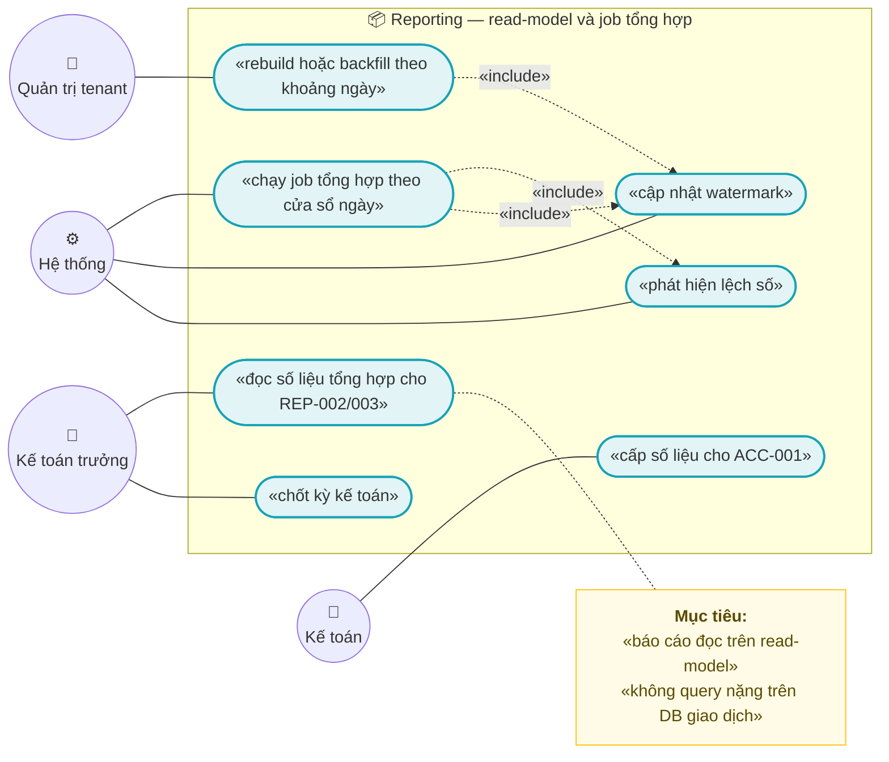
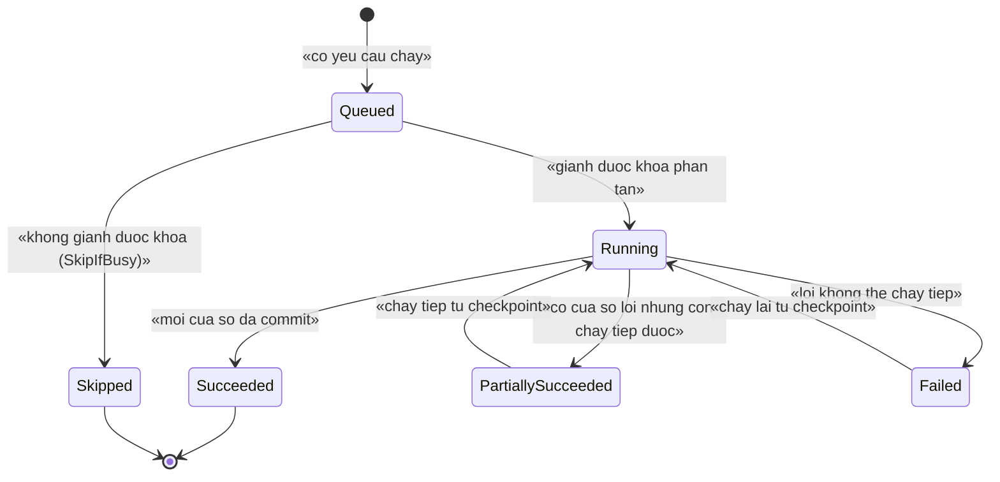
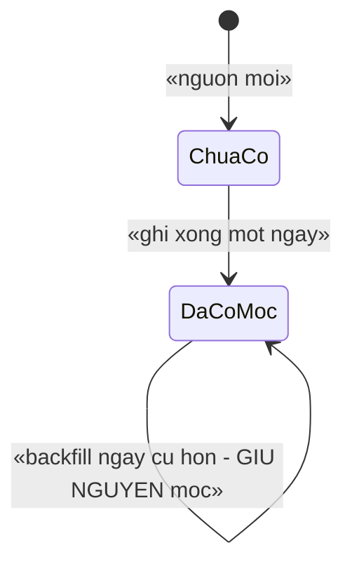
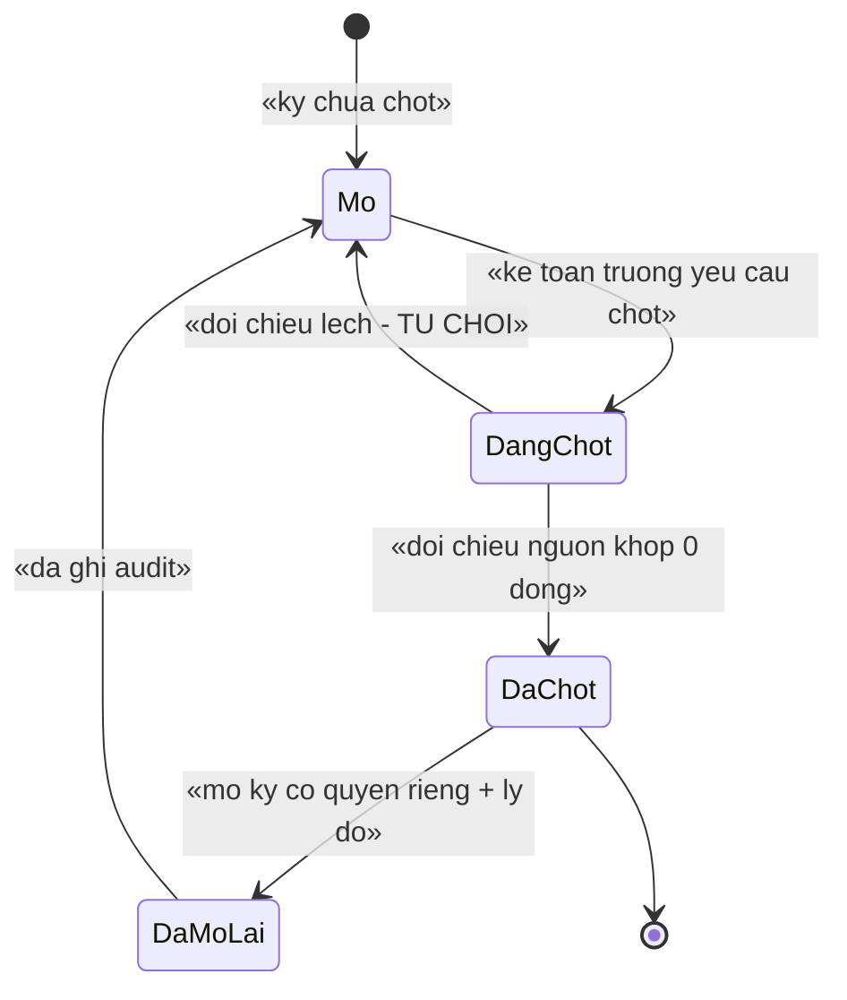
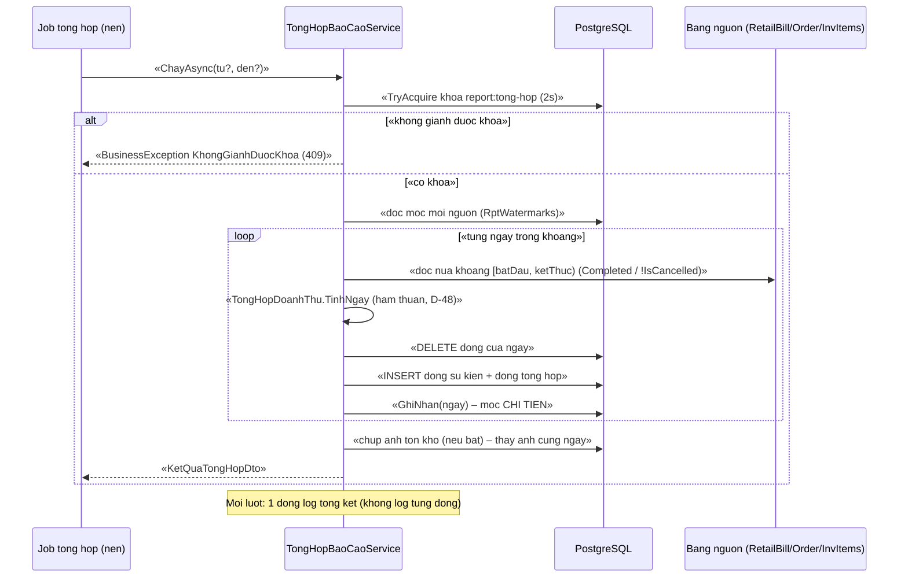
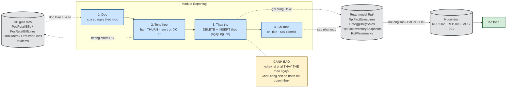
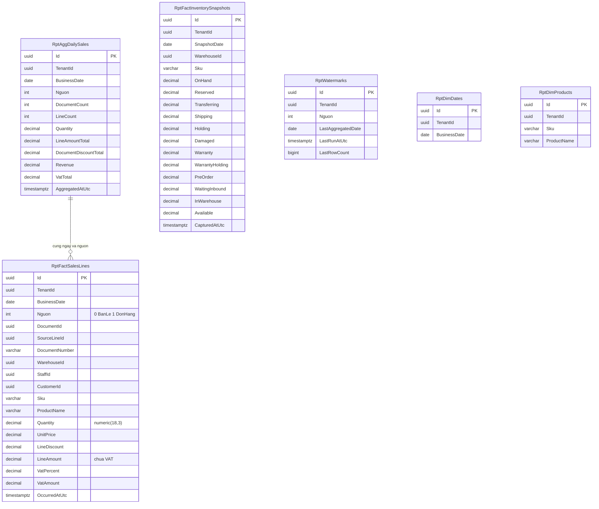

# `REP-001` — Read-model và job tổng hợp

| Thuộc tính | Nội dung |
|---|---|
| **Mã** | `REP-001` |
| **Module** | **Reporting** (module mới — `modules/Reporting/…`) |
| **Giai đoạn** | **GĐ3 — Điều hành** (xem `docs/implementation-plan.md:114` và `:213`) |
| **Ưu tiên** | **Must have** — là **nền** của `REP-002`, `REP-003`, `ACC-001` |
| **Trạng thái** | 🟡 `Draft` — chờ review |
| **Người viết / người review** | *(điền)* / **Kiến trúc trưởng + Kế toán** |
| **Phiên bản / ngày** | `v0.1 — 13/10/2026` |
| **Tài liệu liên quan** | `XC-001` (Money/làm tròn) · `XC-002` (outbox/inbox, ETO, `AggregateVersion`) · `XC-003` (khoá phân tán) · `XC-005` (log/metric) · `XC-006` (thuế GTGT, Mẫu 01) · `REP-002` · `REP-003` · `ACC-001` · `INV-001` (ledger append-only) · `SHP-002/003/004` (nguồn dữ liệu COD — có cảnh báo bảo mật) · `docs/implementation-plan.md` · `docs/structure-and-techstack.md` |

---

## 0. Tóm tắt & quyết định thiết kế

**Tóm tắt:** `REP-001` dựng **read-model riêng** cho Reporting và **job tổng hợp** nuôi nó, để **mọi báo cáo đọc trên bảng tổng hợp** thay vì
query nặng trên **DB giao dịch**. Tài liệu này chốt: mô hình dữ liệu (bảng fact + watermark + nhật ký chạy), cơ chế cập nhật
(**batch thay thế theo `(ngày, nguồn)`** — job đọc thẳng bảng nguồn theo cửa sổ ngày, **không** tiêu thụ ETO; D-47), hợp đồng API, khoá phân tán,
idempotency, và cách phát hiện **lệch số** thay vì để nó im lặng.

**Vì sao phải có tài liệu này (yêu cầu đã chốt ở kế hoạch):**

| Nguồn | Yêu cầu nguyên văn |
|---|---|
| `docs/implementation-plan.md:436` | `REP-001` — Read-model & job tổng hợp (**không query nặng trên DB giao dịch**) |
| `docs/implementation-plan.md:213` | Reporting: read-model riêng (bảng tổng hợp cập nhật bằng event/job) … **Không** báo cáo nào query trực tiếp trên bảng giao dịch; có test số liệu khớp với dữ liệu gốc |
| `docs/structure-and-techstack.md:79` | `Reporting/  C1  read-model báo cáo (không query nặng trên DB giao dịch)  (P3)` |
| `docs/features/cross-cutting/XC-006-phan-loai-thue-gtgt.md:689` | Q7: **CÓ** báo cáo **đối chiếu phân loại ↔ doanh thu theo SKU** ⇒ **giao cho module `REP-*`** |

**Hiện trạng thật của code (đã kiểm bằng đồ thị + `read`, đối chiếu 24/11/2026 — không viết theo trí nhớ):**

| Hạng mục | Hiện trạng | Bằng chứng (`file:dòng`) |
|---|---|---|
| Module `Reporting` | ✅ **đã có** (`WP-08`) — 4 project `.Domain`/`.EntityFrameworkCore`/`.Application`/`.Application.Contracts` | `modules/Reporting/…` |
| Bảng read-model | ✅ **8 bảng `Rpt*`** đã tạo bằng migration | `src/eCommerce.EntityFrameworkCore/Migrations/20261104033300_Wp08_BaoCao_Reporting.cs` |
| `DbSet` cho entity read-model | ✅ đủ 8 `DbSet` trên DbContext hợp nhất (D13) | `src/eCommerce.EntityFrameworkCore/eCommerceDbContext.cs:260-274` |
| Job tổng hợp + mốc | ✅ `TongHopBaoCaoService` chạy theo **mốc mỗi nguồn**, **thay thế** theo `(ngày, nguồn)` | `modules/Reporting/eCommerce.Reporting.Application/TongHopBaoCaoService.cs:108-245` |
| Hàm thuần định nghĩa tiền | ✅ `TongHopDoanhThu.TinhDoanhThuChungTu` = `Σ thành tiền dòng − chiết khấu chứng từ` (D-48) | `modules/Reporting/eCommerce.Reporting.Domain/BaoCao/TongHopDoanhThu.cs:72-100` |
| Mapping nguồn (POS + đơn) | ✅ `AnhXaNguonBanHang` — POS `RetailBillLine`, đơn `OrderLine` (loại VAT khỏi thành tiền dòng) | `modules/Reporting/eCommerce.Reporting.Application/AnhXaNguonBanHang.cs:29-120` |
| API báo cáo | ✅ `ReportAppService` — `/api/v1/reports/**`, quyền `eCommerce.Reports` | `modules/Reporting/eCommerce.Reporting.Application/ReportAppService.cs:10,26` |
| Mã lỗi | ✅ `eCommerce:Reports:0001…0009` | `modules/Reporting/eCommerce.Reporting.Domain/ReportingErrorCodes.cs:11-38` |
| Entity nguồn thô | ✅ `Order`/`OrderLine`, `RetailBill`/`RetailBillLine`, `InventoryItem` | `modules/Sales/eCommerce.Sales.Domain/Order.cs:808`, `modules/Pos/eCommerce.Pos.Domain/RetailBill.cs:400` |
| Snapshot thuế trên dòng đơn | ⚠️ `OrderLine` có `TaxAmount`; **chưa có** `TaxRate`/`TaxClassificationId` | `modules/Sales/eCommerce.Sales.Domain/Order.cs:832-840` |
| Giá vốn | ✅ entity `Pricing.CostPrice` **đã có** (PRC-001) + `DbSet`; **nhưng** bảng fact **chưa có cột giá vốn** | `src/eCommerce.EntityFrameworkCore/eCommerceDbContext.cs:128`, `modules/Pricing/eCommerce.Pricing.Domain/CostPrice.cs` |
| Metric cho projection | ⚠️ `All` hiện **16** metric, **0** metric `reporting_*` | `shared/eCommerce.Kernel/Observability/eCommerceMetrics.cs:81-107` |

⇒ 🔴 **Hệ quả:** phần **lõi** (bảng fact + tổng hợp + mốc + API đọc) **đã có** — mô tả **as-built** ở §5–§6.
Phần **vận hành GĐ3 còn lại** (rebuild/backfill có audit, chốt kỳ, đối chiếu lộ lệch, metric projection) hiện **chưa có trong code** ⇒ ghi rõ "kế hoạch" ở các mục tương ứng.

**Phạm vi:**
- ✅ **(đã có)** **Mô hình read-model** 8 bảng `Rpt*`: dòng sự kiện **grain = dòng chứng từ nguồn**, tổng hợp theo `(ngày, nguồn)`, mốc mỗi nguồn, ảnh tồn kho, 4 bảng chiều (D-47).
- ✅ **(đã có)** **Job tổng hợp theo mốc**: đọc nguồn theo cửa sổ ngày, **thay thế** toàn bộ dòng của ngày đó (`DELETE` + `INSERT` trong một lượt), tính lại bằng **hàm thuần** chung (D-47/D-48).
- ✅ **(đã có)** **Hợp đồng API đọc** (`IReportAppService` + `ReportAppService`) cho FE / `REP-002`/`REP-003`/`ACC-001`.
- ✅ **(đã có)** **Khoá phân tán `report:tong-hop`**, idempotency theo unique index, mốc chỉ tiến, cách ly tenant, phân quyền, test.
- ⬜ **(kế hoạch GĐ3)** **Rebuild/backfill có checkpoint + audit** và **chốt kỳ** (khoảng ngày tường minh).
- ⬜ **(kế hoạch GĐ3)** **Đối chiếu lộ lệch** (`RepConsistencyCheck`) — biến lỗi im lặng thành **dữ liệu quan sát được**.

**Không nằm trong phạm vi:**
- ❌ **Nội dung báo cáo** (doanh thu, lãi gộp, tồn kho luân chuyển, hiệu suất kênh) — thuộc `REP-002` / `REP-003`.
- ❌ **Định dạng file xuất kế toán** (Excel/CSV, ánh xạ tài khoản, Mẫu 01) — thuộc `ACC-001`. `REP-001` **chỉ cấp số liệu** qua API.
- ❌ **Đối soát với NCC ngoài** (settlement sàn, COD của hãng vận chuyển) — thuộc `REC-002` / `REC-003`.
- ❌ **Định nghĩa luật phân loại thuế** — thuộc `XC-006`. `REP-001` chỉ **phản chiếu** kết quả phân giải thuế của Sales.
- ❌ **Hạ tầng BI/dashboard ngoài** (Grafana, Metabase, Power BI) — `REP-001` chỉ chốt **hợp đồng dữ liệu**.
- ❌ **Ghi ngược vào module nguồn** — **cấm tuyệt đối** (xem BR-REP-001-010).
- ❌ **Báo cáo flash-sale / báo cáo doanh thu theo giờ** — ngoài **12 báo cáo** `D-05`; flash sale **chưa có** trong v1 (`D-156`, nợ `CR-P2`) nên GĐ3 **không** có dữ liệu để báo cáo theo giờ, và **không** thêm bảng fact giờ (`D-174`). Chỉ mở lại khi **đủ cả ba**: `CR-P2` xong **và** báo cáo được đưa vào phạm vi đã cam kết **và** truy vấn giờ trên `RptFactSalesLines` vượt `NFR-REP-001-010`.

### 0.1 Quyết định thiết kế (ADR ngắn)

> 🔁 **Đối chiếu 24/11/2026:** các quyết định `v0.1` (tăng dần theo sự kiện + `AggregateVersion` + upsert `ON CONFLICT` + Dapper) **đã bị `D-47`/`D-48` thay thế** bằng **job tổng hợp theo mốc, thay thế theo `(ngày, nguồn)`**. Bảng dưới là trạng thái **as-built**; mã `D1…D14` giữ nguyên để không gãy tham chiếu ở §14.

| # | Quyết định (as-built / kế hoạch) | Trạng thái | Cơ sở / code thật |
|---|---|---|---|
| **D1** | Read-model là **bảng thật `Rpt*`** trong module `Reporting`, không `VIEW`/`MATERIALIZED VIEW` | ✅ đã có | `modules/Reporting/eCommerce.Reporting.Domain/BangTongHop/AggDailySales.cs:19`; `implementation-plan.md:213` |
| **D2** | **Grain = MỘT dòng chứng từ nguồn**; unique `(TenantId, Nguon, SourceLineId)` | ✅ đã có (D-47 ①) | `modules/Reporting/eCommerce.Reporting.EntityFrameworkCore/ReportingDbContextModelCreatingExtensions.cs:110`; `FactSalesLine.cs:138-144` |
| **D3** | **Thay thế theo `(ngày, nguồn)`**: `DELETE` toàn bộ dòng của ngày rồi `INSERT` trong một lượt; **không** cộng dồn/upsert từng dòng (thay cho "hai đường sự kiện + đối chiếu" của v0.1) | ✅ đã có (D-47 ②) | `TongHopBaoCaoService.cs:154-166` |
| **D4** | **Idempotent theo unique index + thay thế theo ngày**: chạy lại cùng ngày ⇒ cùng số dòng, **không** nhân đôi (thay cho version guard của v0.1) | ✅ đã có (D-47 ①) | unique model:110; `TongHopBaoCaoService.cs:154-166` |
| **D5** | Chỉ lưu **số cộng được**; tỉ lệ/lãi gộp/trung bình **tính lúc đọc** | ✅ đã có | `RptAggDailySales` (`Revenue`/`Quantity` cộng dồn); test `TC-12` |
| **D6** | **Một công thức doanh thu**: `Σ thành tiền dòng − chiết khấu chứng từ`; **loại** chứng từ huỷ; VAT tách riêng; **không** dùng `TotalPayment` | ✅ đã có (D-48) | `TongHopDoanhThu.cs:72-100`; `TongHopBaoCaoService.cs:255-259` |
| **D7** | Phản hồi nói **"chưa tổng hợp" ≠ 0** (`DaTongHop`/`DaCoDuLieu`); `AsOfUtc`/`LagSeconds`/`IsStale` **bổ sung sau** | 🔶 một phần / ⬜ kế hoạch | `ReportAppService.cs:16-19` (as-built); D7 đầy đủ chưa có |
| **D8** | Chốt kỳ + `SnapshotHash` (bất biến hoá số đã xuất) | ⬜ **kế hoạch GĐ3** | chưa có bảng trong code |
| **D9** | Rebuild/backfill có checkpoint | ⬜ **kế hoạch GĐ3** | chưa có `RepRunLog` |
| **D10** | Rebuild có quyền riêng + audit + `FromDate`/`ToDate` tường minh | ⬜ **kế hoạch GĐ3** | chưa có |
| **D11** | Đọc/ghi bằng **EF `IRepository`** (`Delete` + `InsertMany`); **không** dùng Dapper; **cấm** nối chuỗi SQL | ✅ đã có (đóng Q3) | `TongHopBaoCaoService.cs:154-166` |
| **D12** | Mọi ghi qua **UoW**; từng cửa sổ ngày commit rồi mới sang ngày sau | ✅ đã có | `TongHopBaoCaoService.cs:150-166` |
| **D13** | **`DbSet` trên DbContext hợp nhất** cho mọi entity read-model | ✅ đã có | `src/eCommerce.EntityFrameworkCore/eCommerceDbContext.cs:260-274` |
| **D14** | **Không FK** tới bảng giao dịch; tham chiếu mềm bằng `DocumentId`/`Sku` | ✅ đã có | `FactSalesLine.cs:138-144` |

> 📌 **Ghi rõ phương án BỊ LOẠI:** *"dùng `VIEW`/`MATERIALIZED VIEW` cho nhanh"* — bị loại vì `REFRESH` khoá bảng, không có watermark,
> không ghi được nhật ký chạy, và **không** cô lập được tenant ở tầng dữ liệu. Đây **không** phải lựa chọn "rẻ hơn" mà là
> lựa chọn **thiếu kiểm soát** cho một feature phục vụ kế toán.

---

## 1. Use Case Specification

| Thuộc tính | Nội dung |
|---|---|
| **Use Case ID** | `REP-001` |
| **Use Case Name** | Nuôi read-model tổng hợp và cấp số liệu **có kiểm chứng** cho báo cáo & xuất liệu kế toán |
| **Description** | *"Là kế toán trưởng/người điều hành, tôi muốn báo cáo trả lời **trong vài trăm ms** trên read-model, **không** làm chậm DB bán hàng, và **biết rõ số liệu đang cũ tới mức nào** — để tôi không ra quyết định hay lập tờ khai trên số liệu thiếu."* |
| **Actor(s)** | **Kế toán** (lập tờ khai, đối chiếu) · **Kế toán trưởng** (xem doanh thu/lãi gộp, chốt kỳ — kế hoạch) · **Quản trị tenant** (tổng hợp lại/rebuild — kế hoạch) · **Hệ thống** (job tổng hợp theo mốc + watermark) |
| **Priority** | **Must have** (là điều kiện để `REP-002/003` và `ACC-001` bắt đầu) |
| **Trigger** | (a) **nhịp job tổng hợp theo mốc** (mỗi nguồn; job nền — xem §4); (b) người dùng mở báo cáo (đọc read-model); (c) người có quyền yêu cầu **tổng hợp lại** một khoảng ngày — **kế hoạch GĐ3** (rebuild/backfill, chốt kỳ). **Không** có đường sự kiện tăng dần: `D-47` đã thay bằng batch thay thế theo `(ngày, nguồn)`. |
| **Pre-Condition(s)** | • **Tenant hiện tại** (`TenantId` từ `ICurrentTenant`) — mọi bảng read-model là `IMultiTenant` có query filter; **cấm** đọc xuyên tenant.<br>• **Nguồn dữ liệu** sẵn sàng: `Order`/`OrderLine` (kể cả đơn sàn), `RetailBill`/`RetailBillLine` (POS, `D-18`/`D-42`), `InventoryItem` (tồn 9 chiều, `D-27`).<br>• **Đã có `DbSet`** cho mọi entity read-model trên `eCommerceDbContext` (D13).<br>• **Redis 7** cho khoá `report:tong-hop`; **nếu Redis chết** job vẫn **không** nhân đôi nhờ unique index + thay thế theo ngày (D-47 ①, `XC-003` D2).<br>• Múi giờ nghiệp vụ = **Asia/Ho_Chi_Minh**; ngày kinh doanh = `CreationTime` quy đổi UTC+7 (D-47 ④, `NgayKinhDoanh.TuUtc`). |
| **Post-Condition(s)** | • Mỗi ngày đã tổng hợp có dòng trong `RptFactSalesLines`/`RptAggDailySales`, **đúng bằng** nguồn của ngày đó (thay thế theo ngày).<br>• `RptWatermarks` của mỗi nguồn **chỉ tiến**, cập nhật **sau** khi ngày đó ghi xong.<br>• Tổng theo **mọi** cách nhóm **bằng nhau** (D5) — test `TC-12`.<br>• Chạy lại cùng ngày ⇒ **0** thay đổi ròng / **không** nhân đôi (idempotent, BR-REP-001-005/013). |
| **Basic Flow** | 1. **Job tổng hợp** (nền, định kỳ) gọi `TongHopBaoCaoService.ChayAsync` ⇒ giành khoá `report:tong-hop` (D-3/BR-007).<br>2. Xác định khoảng ngày từ **mốc mỗi nguồn** (`RptWatermarks.LastAggregatedDate`) + tham số (mặc định tới hôm nay).<br>3. Với **từng ngày**: đọc nguồn theo **nửa khoảng** `[bắt đầu, kết thúc)` (POS `Completed`, đơn `!IsCancelled`); bỏ qua chứng từ 0 dòng + log `Warning` (D-48 ⑥).<br>4. Tính bằng hàm thuần `TongHopDoanhThu.TinhNgay` ⇒ dòng sự kiện + dòng tổng hợp `(ngày, nguồn)`, làm tròn theo `XC-001`.<br>5. **Thay thế**: `DELETE` mọi dòng của ngày rồi `INSERT` (một lượt); cập nhật mốc nguồn **sau** khi ghi.<br>6. Ảnh tồn kho (nếu bật): chụp **trạng thái hiện tại** của `InventoryItem`, thay ảnh cùng ngày (D-47 ⑦).<br>7. Người dùng gọi `GET /api/v1/reports/revenue` ⇒ đọc **chỉ** trên read-model, trả cờ `DaTongHop`/`DaCoDuLieu`. |
| **Alternative Flow** | **A1: Ngày không có chứng từ** — không tạo dòng; mốc vẫn tiến khi chạy theo khoảng; báo cáo không suy từ `MAX(BusinessDate)` mà dựa trên `RptWatermarks`.<br>**A2: Tổng hợp lại một khoảng** — **kế hoạch GĐ3**: người có quyền khai `FromDate`/`ToDate` + lý do, ghi audit (D9/D10).<br>**A3: Kỳ đã chốt** — **kế hoạch GĐ3**: job bỏ qua ngày thuộc kỳ đã chốt + log/metric (D8).<br>**A4: Redis chết** — **fail-open**: job vẫn chạy; DB (unique index + thay thế theo ngày) chặn nhân đôi (`XC-003` E2).<br>**A5: Chưa tổng hợp** — trả **"chưa tổng hợp"** (`DaTongHop = false`), **không** trả `0` (§12). |
| **Exception Flow** | **E1:** không giành được khoá `report:tong-hop` ⇒ `eCommerce:Lock:0001` (`KhongGianhDuocKhoa`; `TongHopBaoCaoService.cs:116`, `eCommerceConsts.cs:545`); API trả `409`, job nền bỏ nhịp + log.<br>**E2:** chạy lại cùng ngày ⇒ `DELETE` + `INSERT` thay thế, **không** nhân đôi (D-47 ①).<br>**E3:** chiết khấu chứng từ > tổng tiền dòng ⇒ `eCommerce:Reports:0004` (**không** làm tròn về 0 — D-48 ⑤).<br>**E4:** dòng mồ côi (không thuộc chứng từ nào) ⇒ `eCommerce:Reports:0005`.<br>**E5:** ảnh tồn kho có chiều âm ⇒ `eCommerce:Reports:0006` (không ghi ảnh xấu).<br>**E6:** khoảng > **366 ngày** ⇒ `eCommerce:Reports:0003` + chia nhỏ. |
| **Business Rules** | Phát biểu đầy đủ ở §8.1 (BR-REP-001-001 … 015) — mục này chỉ liệt kê mã: **BR-001** sở hữu read-model · **BR-002** cấm query DB giao dịch ngoài job · **BR-003** cách ly tenant · **BR-004** tiền `decimal` + không so `==`, số lượng `decimal(18,3)` · **BR-005** idempotent theo unique index + thay thế theo ngày · **BR-006** mốc (watermark) bắt buộc, chỉ tiến · **BR-007** khoá phân tán `report:tong-hop` · **BR-008** mọi ghi qua UoW · **BR-009** thay thế theo `(ngày, nguồn)`, không xoá lẻ · **BR-010** một chiều, không ghi ngược · **BR-011** rebuild có quyền + audit + tường minh (kế hoạch) · **BR-012** số liệu lệch phải **lộ ra** (kế hoạch) · **BR-013** chạy lại không nhân đôi · **BR-014** "chưa tổng hợp" ≠ 0 · **BR-015** cấm SQL nối chuỗi + cấm PII trong read-model. |
| **Non-Functional Requirement** | Phát biểu đầy đủ ở §13 (NFR-REP-001-001 … 010) — mục này chỉ liệt kê mã: **001** hiệu năng job · **002** độ trễ API báo cáo · **003** độ trễ watermark · **004** khớp số với nguồn · **005** idempotent 1.000 lần · **006** mở rộng ngang · **007** quan sát được (metric/log) · **008** cách ly tenant · **009** khả năng chạy tiếp/rebuild · **010** kích thước read-model. |

---

## 2. Sơ đồ Use Case



### Chú giải

| Ký hiệu | Ý nghĩa |
|---|---|
| ⭕ Xanh lá | Actor |
| 🟦 Bầu dục xanh dương | Use Case |
| 🟨 Khung vàng | Note |
| `───` | Liên kết Actor ↔ Use Case |
| `-.«include».->` | Quan hệ bao hàm |

---

## 3. Sơ đồ trạng thái (state machine)

`REP-001` có **hai** vòng đời **as-built** (mốc nguồn · chạy job) và **hai** vòng đời **kế hoạch GĐ3** (nhật ký chạy, chốt kỳ). Mọi chuyển trạng thái sai **phải ném lỗi** — không có nhánh "bỏ qua im lặng".

### 3.1 Vòng đời `RepRunLog` (một lần chạy job / rebuild) — ⬜ **kế hoạch GĐ3 (chưa có trong code)**



| Từ | Sang | Guard (điều kiện cho phép) | Hành động kèm theo | Nếu guard sai thì? |
|---|---|---|---|---|
| `Queued` | `Running` | Giành được khoá `report:tong-hop` trong timeout (mặc định **30 s**) | ghi `StartedAtUtc`, `HostName` | Sang `Skipped` + log `Information` + metric `lock_skipped_total{module=reporting}` (`XC-003` A1) |
| `Queued` | `Skipped` | **Chỉ** job định kỳ (`SkipIfBusy`) | log + metric (**bắt buộc** — thiếu là vi phạm `XC-003` BR-010) | Vi phạm BR-REP-001-007 |
| `Running` | `Succeeded` | **Mọi** cửa sổ đã commit + watermark đã cập nhật | ghi `FinishedAtUtc`, `RowsUpserted`, `WindowsDone` | Ở lại `Running` |
| `Running` | `PartiallySucceeded` | Có cửa sổ lỗi **và** còn cửa sổ chưa chạy | ghi `LastErrorCode`, `FailedWindows`, giữ checkpoint | — |
| `Running` | `Failed` | Lỗi hạ tầng (mất DB) hoặc lỗi không xác định | ghi `LastErrorCode` + log `Error` | — |
| `PartiallySucceeded`/`Failed` | `Running` | Người có quyền `Rebuild` gọi *chạy tiếp* (`resumeFromCheckpoint = true`) | tiếp tục từ `RptWatermarks.LastAggregatedDate` | **Cấm** chạy tiếp nếu checkpoint **rỗng** ⇒ phải `Rebuild` tường minh (`eCommerce:Reports:0003`) |
| `Succeeded` | `[*]` | — | trạng thái **hấp thụ** (absorbing) | Mọi chuyển khỏi `Succeeded` ⇒ `InvalidOperationException` (lỗi lập trình) |

### 3.2 Vòng đời `RptWatermarks` (mốc mỗi nguồn — as-built)



| Từ | Sang | Guard | Hành động | Nếu guard sai thì? |
|---|---|---|---|---|
| `ChuaCo` | `DaCoMoc` | Ghi xong một ngày thành công | `LastAggregatedDate = ngày`; `LastRowCount = n`; `LastRunAtUtc = now` | — |
| `DaCoMoc` | `DaCoMoc` | Ghi xong ngày **mới hơn** mốc | mốc **tiến** tới ngày đó | — |
| `DaCoMoc` | `DaCoMoc` | Backfill ngày **cũ hơn** mốc | mốc **GIỮ NGUYÊN** (D-47 ⑤) | Hạ mốc ⇒ lượt sau làm lại khoảng đã xong / mốc tụt về quá khứ |

> ⚠️ Mốc là **"đã tổng hợp tới ngày nào"**, **không** phải `MAX(BusinessDate)` của bảng fact — ngày không có chứng từ sẽ khiến `MAX()` đứng yên (D-47 ⑤). Mốc cập nhật **sau** khi ngày đó ghi xong.

### 3.3 Vòng đời `RepPeriodClose` (kỳ kế toán) — ⬜ **kế hoạch GĐ3 (chưa có trong code)**



| Từ | Sang | Guard | Hành động | Nếu guard sai thì? |
|---|---|---|---|---|
| `Mo` | `DangChot` | Có quyền `eCommerce.Reporting.PeriodClose` + `FromDate <= ToDate` | tạo bản ghi, tính `SnapshotHash` | `403` |
| `DangChot` | `DaChot` | Job đối chiếu trên **toàn bộ** khoảng ngày trả **lệch 0 dòng** | lưu `SnapshotHash`, `ClosedBy`, `ClosedAtUtc` | về `Mo` + **từ chối** (D8, ⬜ kế hoạch). **Cấm** chốt khi còn lệch |
| `DaChot` | `DaMoLai` | Có quyền `eCommerce.Reporting.PeriodReopen` **và** lý do ≥ 20 ký tự | ghi audit (ai/lý do/khi nào); mọi job được phép ghi lại khoảng ngày | `403`; thiếu lý do ⇒ **từ chối** (⬜ kế hoạch) |
| bất kỳ ghi fact | — | `FactDate` **không** thuộc kỳ `DaChot` | ghi bình thường | Nếu thuộc kỳ `DaChot` ⇒ **không ghi**, ghi `RepConsistencyCheck` loại `LateEventInClosedPeriod` + metric (A3) |

> 📌 **Vì sao cần chốt kỳ:** `XC-006` BR-008 yêu cầu **xuất Mẫu 01 Phụ lục III** khớp dữ liệu **đã phát hành trong kỳ**.
> Nếu kỳ không chốt được thì lần xuất sau **có thể khác** lần trước (do sự kiện đến muộn hoặc rebuild) ⇒ kế toán **không biết tin bản nào**.

---

## 4. Sequence Diagram & luồng dữ liệu

### 4.1 Sequence — job tổng hợp theo mốc, thay thế theo `(ngày, nguồn)`



### 4.2 DFD — đường đi của **một con số** từ giao dịch tới báo cáo



---

## 5. Mô hình dữ liệu

### 5.1 ERD (as-built — họ `Rpt*`, `WP-08`)



> 📌 **As-built (D-47):** `RptFactSalesLines` là **sổ dòng chứng từ** (grain = dòng nguồn, unique `(TenantId, Nguon, SourceLineId)`);
> `RptAggDailySales` là tổng hợp **ngày × nguồn** được **xoá + ghi lại cùng lượt** — **không** phải nguồn sự thật thứ hai (đừng cộng lại ở tầng đọc).
> Ảnh tồn kho là **ảnh chụp trạng thái hiện tại**, **không** phải lịch sử luân chuyển (D-47 ⑦). 4 bảng `RptDim*` là chiều.
> **Không có FK** tới bảng giao dịch (D14) — liên kết mềm bằng `DocumentId`/`Sku`; muốn xem chứng từ thì gọi API module nguồn.

### 5.2 Bảng & cột (Data Dictionary)

#### 5.2.1 Bảng `RptFactSalesLines` — *dòng doanh thu (grain = dòng chứng từ nguồn)*

| Cột | Kiểu | Null? | Nguồn / ý nghĩa | Ghi chú |
|---|---|---|---|---|
| `Id` | `uuid` | ✖ | `IGuidGenerator` | khoá chính |
| `TenantId` | `uuid` | ✔ (DB) | `ICurrentTenant` | `IMultiTenant` + filter; index dùng `NULLS NOT DISTINCT` (D-47 ①) |
| `BusinessDate` | `date` | ✖ | `CreationTime` chứng từ quy đổi **UTC+7** | D-47 ④; `NgayKinhDoanh.TuUtc` |
| `Nguon` | `int` | ✖ | `0 = BanLe` (POS) · `1 = DonHang` | `NguonBaoCao` (D-17: chỉ append) |
| `DocumentId` | `uuid` | ✖ | `RetailBill.Id` / `Order.Id` | tham chiếu mềm (D14) |
| `SourceLineId` | `uuid` | ✖ | `RetailBillLine.Id` / `OrderLine.Id` | **grain** — unique cùng `TenantId`, `Nguon` |
| `DocumentNumber` | `varchar(64)` | ✖ | số chứng từ | bắt buộc (D-48) |
| `WarehouseId` / `StaffId` / `CustomerId` | `uuid` | ✔ | chiều kho / nhân viên / khách | |
| `Sku` | `varchar(64)` | ✖ | `RetailBillLine.Sku` / `OrderLine.Sku` | **không** dùng `ProductVariantId` (D-07) |
| `ProductName` | `varchar(256)` | ✔ | POS có tên; đơn để `null`, tra từ `RptDimProducts` | không bịa tên bằng SKU |
| `Quantity` | `numeric(18,3)` | ✖ | số lượng dòng | **decimal** (D-31); `OrderLine.Quantity` còn `int` |
| `UnitPrice` | `numeric(18,2)` | ✖ | đơn giá snapshot | `HasPrecision(18,2)` (`ReportingDbContextModelCreatingExtensions.cs:103`) |
| `LineDiscount` | `numeric(18,2)` | ✖ | chiết khấu **dòng** | `:104` |
| `LineAmount` | `numeric(18,2)` | ✖ | **thành tiền dòng CHƯA VAT** | đơn: `UnitPrice×Qty − Discount` (**không** `LineTotal` vì nó cộng thuế — D-48 ③); `:105` |
| `VatPercent` | `numeric(18,2)` | ✔ | % VAT dòng | `:106` |
| `VatAmount` | `numeric(18,2)` | ✖ | tiền VAT dòng | **tách riêng** (D-48); `:107` |
| `OccurredAtUtc` | `timestamptz` | ✖ | `CreationTime` (UTC) | để đối chiếu chứng từ |

**Index & ràng buộc**

| Loại | Cột | Mục đích |
|---|---|---|
| **UNIQUE** (NND) | `(TenantId, Nguon, SourceLineId)` | ⭐ **hàng rào chống nhân đôi** (D-47 ①) |
| INDEX | `(TenantId, BusinessDate, Nguon)` | thay thế + đọc theo ngày/nguồn |
| INDEX | `(TenantId, Sku)` | hiệu suất SKU (`REP-003`) |
| CHECK | `Quantity >= 0` | bất biến DB |
| — | **KHÔNG** FK tới chứng từ nguồn | **D14** |

#### 5.2.2 Bảng `RptFactInventorySnapshots` — *ảnh tồn kho theo ngày × kho × SKU*

| Cột | Kiểu | Null? | Nguồn / ý nghĩa | Ghi chú |
|---|---|---|---|---|
| `Id` | `uuid` | ✖ | | |
| `TenantId` | `uuid` | ✔ | | `IMultiTenant` |
| `SnapshotDate` | `date` | ✖ | ngày chụp | **ảnh mới nhất**, **không** phải lịch sử (D-47 ⑦) |
| `WarehouseId` | `uuid` | ✖ | `InventoryItem.WarehouseId` | |
| `Sku` | `varchar(64)` | ✖ | `InventoryItem.Sku` | |
| `OnHand` · `Reserved` · `Transferring` · `Shipping` · `Holding` · `Damaged` · `Warranty` · `WarrantyHolding` · `PreOrder` · `WaitingInbound` | `numeric(18,3)` | ✖ | **9–10 chiều tồn** lấy nguyên từ `InventoryItem` (D-27) | chiều âm ⇒ **NÉM** `Reports:0006` (không ghi ảnh xấu) |
| `InWarehouse` | `numeric(18,3)` | ✖ | `OnHand − Transferring` (tính sẵn) | D-27 |
| `Available` | `numeric(18,3)` | ✖ | `OnHand − Reserved − Transferring − Holding − Damaged` (tính sẵn) | D-27 |
| `CapturedAtUtc` | `timestamptz` | ✖ | | |

**Index & ràng buộc**

| Loại | Cột | Mục đích |
|---|---|---|
| **UNIQUE** (NND) | `(TenantId, SnapshotDate, WarehouseId, Sku)` | thay ảnh cùng ngày (chạy lại không nhân đôi) |
| INDEX | `(TenantId, SnapshotDate)` | đọc ảnh mới nhất |
| CHECK | mọi chiều `>= 0` | chặn ảnh xấu ở DB |

#### 5.2.3 Bảng `RptWatermarks` — *mốc tổng hợp mỗi nguồn (BR-006)*

| Cột | Kiểu | Null? | Ý nghĩa | Ghi chú |
|---|---|---|---|---|
| `Id` | `uuid` | ✖ | | |
| `TenantId` | `uuid` | ✔ | | `IMultiTenant` |
| `Nguon` | `int` | ✖ | `0=BanLe` · `1=DonHang` · `2=TonKho` | một mốc/nguồn |
| `LastAggregatedDate` | `date` | ✔ | ngày **lớn nhất đã tổng hợp** | `null` = chưa chạy; **chỉ tiến** (D-47 ⑤) |
| `LastRunAtUtc` | `timestamptz` | ✔ | lần chạy gần nhất | phân biệt *"chạy không có việc"* vs *"không chạy"* |
| `LastRowCount` | `bigint` | ✖ | số dòng lượt gần nhất | metric thông lượng |

| Loại | Cột | Mục đích |
|---|---|---|
| **UNIQUE** (NND) | `(TenantId, Nguon)` | một mốc/nguồn |
| — | mốc **chỉ tiến** | `GhiNhan` giữ nguyên nếu ngày cũ hơn |

#### 5.2.4 Bảng `RepRunLog` — *nhật ký mọi lần chạy* — ⬜ **kế hoạch GĐ3 (chưa có trong code)**

Bảng dự kiến cho **rebuild/backfill có checkpoint + audit** (D9/D10). Cột chính: `TenantId`, `JobName`, `ProjectionName`, `Status`, `FromDate`/`ToDate`, `WindowsTotal`/`WindowsDone`, `RowsUpserted`, `RequestedBy`, `Reason`, `StartedAtUtc`/`FinishedAtUtc`, `HostName`. Ràng buộc dự kiến: UNIQUE filter *"một lần chạy hoạt động /(job, projection)"*; CHECK `rebuild` **phải** có `FromDate`/`ToDate`. **Chưa có entity/migration.**

#### 5.2.5 Bảng `RepConsistencyCheck` — *lệch số phải LỘ RA (BR-012)* — ⬜ **kế hoạch GĐ3 (chưa có trong code)**

As-built: job **thay thế** theo ngày từ nguồn nên số liệu khớp tại thời điểm tổng hợp; bảng này dự kiến để **lộ lệch** khi nguồn đổi **sau** tổng hợp. Cột chính: `FactDate`, `ProjectionName`, `MismatchKind`, `FactKey`, `ExpectedValue`/`ActualValue`/`Delta`, `AutoCorrected`, `DetectedByRunId`. ⚠️ So tiền bằng `Delta` theo `numeric`, **KHÔNG** so `==` (`XC-001` BR-003). **Chưa có entity/migration.**

#### 5.2.6 Bảng `RepPeriodClose` — *chốt kỳ (D8)* — ⬜ **kế hoạch GĐ3 (chưa có trong code)**

Cột chính: `FromDate`/`ToDate`, `Status` (`Mo`/`DangChot`/`DaChot`/`DaMoLai`), `SnapshotHash` (SHA-256), `ClosedBy`/`ClosedAtUtc`, `ReopenedBy`/`ReopenReason`. Ràng buộc (`D-171`): `CREATE EXTENSION IF NOT EXISTS btree_gist` + `EXCLUDE USING gist` trên `daterange("FromDate", "ToDate", '[]')` với `&&` (khuôn `EX_TaxClassifications_ChongChongKhung` — **đã chạy thật** trên `postgres:17-alpine`). Ba điểm bắt buộc: (i) `EXCLUDE` **không** có mệnh đề `WHERE` ⇒ phải mã hoá `Status` vào khoá (`Status WITH =` **hoặc** cột biểu thức quy `Mo`/`DangChot`/`DaMoLai` về một giá trị và `DaChot` giá trị riêng) để **chỉ** chặn hai kỳ `DaChot` chồng nhau; (ii) `TenantId` nullable ⇒ `COALESCE("TenantId", '000…0'::uuid)` như Tax; (iii) `FromDate`/`ToDate` là `date`, `daterange(..., '[]')` đóng hai đầu (UTC+7, `D-114` P4). **Điều kiện bắt buộc trước `migrations add`:** 4 ca integration (đỏ trước, xanh sau) — constraint đích danh tồn tại; hai kỳ `DaChot` chồng nhau ⇒ `23P01`; hai kỳ **liền kề** ⇒ nhận; ca đối chứng cách mã hoá `Status` (vd `Mo` chồng `DaChot` ⇒ kết quả **đã định**). Ca nào đỏ ⇒ **fallback** `UNIQUE` + trigger/guard trong cùng PR, **không** hạ xuống "chỉ kiểm ở app". **Chưa có entity/migration.**

> 📌 **Không có bảng fact theo giờ** (`D-174`): `RptFactSalesLines.OccurredAtUtc` đã có trên từng dòng fact ⇒ tổng hợp theo giờ là **truy vấn lúc đọc** `GROUP BY date_trunc('hour', "OccurredAtUtc")` (quy UTC+7 bằng `ReportingOptions.GioLechUtc`); **không** thêm bảng/job giờ ở GĐ3.

### 5.3 Ảnh tồn kho — nguồn và công thức (as-built)

`REP-001` **không** dựng fact luân chuyển (Opening/Inbound/Outbound/Closing) từ `StockLedgerEntry`. As-built chụp **ảnh trạng thái hiện tại** từ `InventoryItem` với 9–10 chiều (`OnHand`, `Reserved`, `Transferring`, `Shipping`, `Holding`, `Damaged`, `Warranty`, `WarrantyHolding`, `PreOrder`, `WaitingInbound`) — D-27, D-47 ⑦. Hai cột dẫn xuất:
`InWarehouse = OnHand − Transferring`; `Available = OnHand − Reserved − Transferring − Holding − Damaged`.

> ⚠️ **Hệ quả:** báo cáo **luân chuyển kho** theo lịch sử **không** thuộc `REP-001`; nếu `REP-003` cần thì đọc `StockLedger` (append-only) hoặc bổ sung fact riêng. **`Q1` đã đóng — `D-170`:** `INV-001` ghi **đúng hai** bút toán đối ứng (`TransferOut` kho nguồn + `TransferIn` kho đích, cùng `ReferenceLineId`, cùng UoW); `REP-003` phải tính `ClosingQty` **theo từng** `(WarehouseId, Sku)` = `OpeningQty + Σ QuantityDelta` của **chính kho đó**, đếm `TransferInQty`/`TransferOutQty` **riêng** (không cộng gộp một dòng net), **cấm** dùng `StockMovementType.Transfer` (=6, legacy) cho chứng từ mới, số lượng `numeric(18,3)` (D-31). **Việc chéo (cùng nhánh, ngoài `REP-001`):** `rep-003` §5.2 dòng 256 đang ghi `int` và `Transfer` ⇒ BA `REP-003` phải sửa theo `D-170` **trước** WP code `REP-003`; đây là **nợ** còn mở.

---

## 6. Hợp đồng API

### 6.1 Application Service

| Mục | Giá trị |
|---|---|
| Interface | `IReportAppService` — `modules/Reporting/eCommerce.Reporting.Application.Contracts` |
| Implementation | `ReportAppService` — `modules/Reporting/eCommerce.Reporting.Application` |
| `[Authorize]` | ⭐ **cấp CLASS** `[Authorize(eCommerceConsts.Permissions.Reports.Default)]` (`ReportAppService.cs:26`) — ABP **không** tự bảo vệ app service |
| Mapping | **map tay** (không AutoMapper) |

| Method (as-built) | Input (DTO) | Output (DTO) | Permission | Đọc |
|---|---|---|---|---|
| `GetDoanhThuAsync` | `DoanhThuInput` (`TuNgay?`, `DenNgay?`, `Nguon?`, `TheoThang`) | `BaoCaoDoanhThuDto` | `eCommerce.Reports` | `RptAggDailySales` ✅ |
| `GetTongQuanDonHangAsync` | `TongQuanDonInput` (`TuNgay?`, `DenNgay?`) | `TongQuanDonHangDto` | `eCommerce.Reports` | `OrdOrders` + `OrdOrderLines` (as-built đọc trực tiếp) |
| `GetTongQuanTonKhoAsync` | `TongQuanTonKhoInput` (`Ngay?`) | `TongQuanTonKhoDto` | `eCommerce.Reports` | ảnh tồn `RptFactInventorySnapshot` ✅ |
| `GetDashboardAsync` | — | `TongQuanDashboardDto` | `eCommerce.Reports` | `RptAggDailySales` + ảnh tồn ✅ |
| `ChayTongHopAsync` | `ChayTongHopInput` (`TuNgay?`, `DenNgay?`, `GhiAnhTonKho`) | `KetQuaTongHopDto` | `eCommerce.Reports.Aggregate` | ghi read-model ✅ |
| ⬜ `StartRebuild`/`ClosePeriod`/`RunReconciliation` | — | — | `eCommerce.Reporting.Rebuild`/`PeriodClose`/… | ⬜ kế hoạch GĐ3 |

**Hợp đồng đọc** *(as-built — `IReportAppService`; `REP-002`/`REP-003`/`ACC-001` đọc qua API, **cấm** tự query bảng giao dịch)*

```csharp
namespace eCommerce.Reporting;

// As-built: modules/Reporting/eCommerce.Reporting.Application.Contracts
public interface IReportAppService
{
    Task<BaoCaoDoanhThuDto> GetDoanhThuAsync(DoanhThuInput input);
    Task<TongQuanDonHangDto> GetTongQuanDonHangAsync(TongQuanDonInput input);
    Task<TongQuanTonKhoDto> GetTongQuanTonKhoAsync(TongQuanTonKhoInput input);
    Task<TongQuanDashboardDto> GetDashboardAsync();
    Task<KetQuaTongHopDto> ChayTongHopAsync(ChayTongHopInput input);
}

public enum NguonBaoCao { BanLe = 0, DonHang = 1, TonKho = 2 }
```

> 📌 DTO thật: `BaoCaoDoanhThuDto` · `DiemDoanhThuDto` · `TongQuanDashboardDto` · `KetQuaTongHopDto` (`modules/Reporting/eCommerce.Reporting.Application.Contracts/ReportingDtos.cs`). `WatermarkSnapshot`/`ReportGroupBy`/`AsOfUtc`/`LagSeconds`/`IsStale` là **kế hoạch GĐ3** (D7) — as-built dùng `DaTongHop`/`DaCoDuLieu` + `ReportingConsts.DinhNghiaDoanhThu`.

### 6.2 REST endpoint (as-built — `/api/v1/reports/**`)

| Method | Route | Quyền | Mô tả | Trạng thái |
|---|---|---|---|---|
| `GET` | `/api/v1/reports/**` | `eCommerce.Reports` | báo cáo doanh thu / tồn kho / dashboard (đọc read-model) | ✅ as-built |
| `POST` | `/api/v1/reports/aggregate` | `eCommerce.Reports.Aggregate` | tổng hợp lại (ghi read-model) | ✅ as-built |
| `POST` | `/api/v1/reports/…` (rebuild, chốt kỳ, đối chiếu) | ⬜ kế hoạch | rebuild / chốt kỳ / đối chiếu | ⬜ GĐ3 |

**Response mẫu (rút gọn — theo `DiemDoanhThuDto`)**

```json
{
  "tuNgay": "2026-10-01",
  "denNgay": "2026-10-13",
  "daTongHop": true,
  "dinhNghiaTien": "Doanh thu = Σ thành tiền dòng (CHƯA gồm VAT) − chiết khấu chứng từ. CHƯA trừ hàng trả lại; hoá đơn đã huỷ và đơn đã huỷ KHÔNG được tính.",
  "diem": [
    { "nhan": "2026-10-13", "tuNgay": "2026-10-13", "denNgay": "2026-10-13",
      "doanhThuBanLe": 128400000, "doanhThuDonHang": 47200000, "tongDoanhThu": 175600000, "tienVat": 14048000, "soChungTu": 57 }
  ]
}
```

> ⚠️ **`daTongHop = false` ≠ `0`:** chưa chạy tổng hợp là **chưa biết**, không phải "không bán được" (D7). Cột giá vốn/lãi gộp **chưa có** trong read-model (D-114 P2, còn nợ) ⇒ **cấm** hiện lãi gộp như số thật.

**Mã lỗi nghiệp vụ** (as-built — `ReportingErrorCodes`)

| Mã | Hằng | Khi nào |
|---|---|---|
| `eCommerce:Reports:0001` | `NguonKhongHopLe` | Dùng nguồn không hợp lệ (vd `TonKho` cho sổ doanh thu) |
| `eCommerce:Reports:0002` | `KhoangKhongHopLe` | `từ > đến` |
| `eCommerce:Reports:0003` | `KhoangQuaDai` | Khoảng > **366 ngày** một lượt ⇒ chia nhỏ |
| `eCommerce:Reports:0004` | `DoanhThuAm` | Chiết khấu chứng từ > tổng tiền dòng ⇒ doanh thu âm (**không** làm tròn về 0 — D-48 ⑤) |
| `eCommerce:Reports:0005` | `DongMoCoi` | Dòng không thuộc chứng từ đang xét (lỗi ghép dữ liệu) |
| `eCommerce:Reports:0006` | `TonKhoAm` | Ảnh tồn kho có chiều **âm** (dữ liệu kho sai từ trước) |
| `eCommerce:Reports:0007` | `ChuaTongHop` | Chưa có lượt tổng hợp cho khoảng ngày hỏi (báo cáo **rỗng**, không phải `0`) |
| `eCommerce:Reports:0008` | `DongTrung` | Một dòng nguồn xuất hiện **hai lần** trong cùng lượt ⇒ doanh thu nhân đôi |
| `eCommerce:Reports:0009` | `ChungTuKhongCoDong` | Chứng từ có chiết khấu nhưng **không** có dòng nào |
| `eCommerce:*` (khoá) | `KhongGianhDuocKhoa` | Không giành được khoá `report:tong-hop` khi người dùng gọi tổng hợp thủ công |

> 📌 Bằng chứng: `modules/Reporting/eCommerce.Reporting.Domain/ReportingErrorCodes.cs:11-38`. Mọi mã **phải** được map sang HTTP status ở Host (`AbpExceptionHttpStatusCodeOptions`), nếu không ABP trả `403` (bài học `INV-003` `0042`).

### 6.3 ⚠️ Không có write endpoint nào trên bảng fact

**Cố ý.** Bảng fact **chỉ** được ghi bởi job/projection. **Không** expose API `POST /sales-fact`.
Lý do: một bảng số liệu sửa tay được thì **không còn** là read-model — và mọi báo cáo dựa trên nó mất giá trị kiểm chứng.
Muốn sửa số liệu ⇒ **mở kỳ + rebuild** (đường có audit).

---

## 7. Sự kiện, tích hợp ngoài & idempotency

### 7.1 Nguồn dữ liệu (as-built — batch đọc bảng, không tiêu thụ ETO)

**Không có bảng ETO tiêu thụ.** As-built (`D-47`) **không** cập nhật tăng dần theo sự kiện; job tổng hợp **đọc thẳng bảng nguồn** theo cửa sổ ngày (`TongHopBaoCaoService.TinhNgayAsync`, `TongHopBaoCaoService.cs:248-327`):

| Nguồn | Bảng | Lọc | `NguonBaoCao` |
|---|---|---|---|
| POS (`D-18`/`D-42`) | `RetailBill` / `RetailBillLine` | `Status == Completed` | `BanLe = 0` |
| Đơn giao vận (kể cả đơn sàn) | `Order` / `OrderLine` | `!IsCancelled` | `DonHang = 1` |
| Tồn kho (`D-27`) | `InventoryItem` | — (chụp ảnh) | `TonKho = 2` |

> 📌 v0.1 từng đề xuất đường **sự kiện tăng dần** (`OrderPlacedEto`, `OrderStatusChangedEto`, `PaymentSucceededEto`, `Stock*Eto`) + `AggregateVersion` + DLQ `OutOfOrder`. `D-47` đã **thay bằng** batch **thay thế theo `(ngày, nguồn)`** ⇒ bảng ETO của v0.1 **không còn hiệu lực** (xem "Đối chiếu mô hình Nhanh" cuối tài liệu).

> 🚨 **Thuế KHÔNG tính lại theo cấu hình hiện tại:** số thuế đã **chốt** vào dòng (`TaxAmount`/`VatAmount`). Thay đổi cấu hình thuế (`XC-006` D3/BR-002) **không** làm đổi chứng từ cũ ⇒ read-model phản chiếu đúng số đã chốt (thành tiền dòng đơn **trừ** `TaxAmount` — D-48 ③).

### 7.2 Sự kiện / webhook nhận vào từ **bên ngoài**

**Không áp dụng — lý do:** `REP-001` **không** nhận webhook của NCC nào. Job tổng hợp **đọc bảng nội bộ** (`RetailBill*`, `Order*`, `InventoryItem`).
Mọi biên vào từ ngoài (webhook sàn `SAL-005`, IPN `PaymentHub`, webhook vận đơn `SHP-002`) **đã** được chống trùng ở tầng module đó
(`XC-002` §7.2) **trước khi** ghi bảng nguồn. `REP-001` **thừa hưởng** tính idempotent đó, **không** dựng lại.

> ⚠️ **Nhưng phải ghi rõ hệ quả chất lượng dữ liệu:** `REP-001` phản chiếu dữ liệu từ `SHP-*`, mà `SHP-*` có **hai cảnh báo bảo mật/độ tin cậy đã biết**:
> 1. **`SHP-002` / `SHP-004` — webhook GHTK KHÔNG có HMAC.** GHTK chỉ có `hash` trên URL ⇒ không xác thực được nguồn gọi.
>    Biện pháp bù đã chốt ở `docs/implementation-plan.md:425`: **IP allowlist + đối soát chủ động**. Với Reporting, hệ quả là:
>    trạng thái vận đơn/COD từ GHTK **có thể bị giả** ⇒ **cấm** dùng dữ liệu GHTK làm **nguồn sự thật duy nhất** cho báo cáo COD;
>    báo cáo COD phải kèm `REC-003` (đối soát file Excel theo "phiên").
> 2. **`SHP-003` — đổi COD ở GHN cần OTP** (xem `docs/implementation-plan.md:426`). Nghĩa là thay đổi số tiền thu hộ **không** thể hoàn tất
>    tự động ⇒ read-model COD **phải** có trạng thái "chờ xác nhận OTP" và **không** được cộng vào doanh thu thu hộ cho tới khi xác nhận.
>
> 📌 Hai cảnh báo này **thuộc** `SHP-002/003/004`, **không** thuộc `REP-001`. **`Q6` đã đóng — `D-173`:** `REP-001` **không** thêm bảng/cột/job COD; số COD (khi báo cáo cần) lấy từ bảng đối soát `REC-003` (`D-121`/`D-123`), **chỉ** dùng dòng **đã khớp/đã xử lý**, dòng chưa đối soát mang cờ `CodUnreconciled` ở `REP-003` và **không** cộng vào doanh thu; số "chờ OTP" của GHN **không** phải nguồn sự thật. Dòng này **không** tạm duyệt `REC-003` (vẫn đỏ cứng hồ sơ §2.1).

### 7.3 Gọi API ra ngoài

**Không áp dụng — lý do:** `REP-001` **không** gọi NCC nào. Nó đọc DB nội bộ và ghi DB nội bộ.
Đường "ra ngoài" duy nhất là **file xuất kế toán**, và việc đó do `ACC-001` làm (đọc qua `IReportAppService`).

**Idempotency key**

| Đối tượng | Cách sinh khoá | ⚠️ Lưu ý |
|---|---|---|
| Job tổng hợp theo mốc | Khoá `report:tong-hop` + unique `(TenantId, Nguon, SourceLineId)` + **thay thế theo ngày** | Chạy lại cùng ngày ⇒ cùng số dòng, **không** nhân đôi (D-47 ①) |
| Rebuild (kế hoạch GĐ3) | `Report:Rebuild:{projectionName}:{tenantId}:{fromDate}:{toDate}:{sha256(reason)}` | Gọi lại **cùng khoảng + cùng lý do** ⇒ trả lần chạy cũ (`AlreadyRequested`), **không** tạo lần thứ hai |
| Chốt kỳ (kế hoạch GĐ3) | `Report:PeriodClose:{tenantId}:{fromDate}:{toDate}` | Chốt lại cùng kỳ ⇒ trả bản ghi cũ, **không** tạo kỳ trùng |

> 📌 **Vì sao job phải idempotent:** người dùng gọi tổng hợp lại (hoặc job nền chạy lại sau khi đứt) là **chuyện thường**.
> Hàng rào đúng là **unique index** `(TenantId, Nguon, SourceLineId)` **+ xoá-và-ghi-lại theo ngày** (`TongHopBaoCaoService.cs:154-166`), khoá phân tán chỉ là tối ưu (D-47 ①).

---

## 8. Bất biến & xử lý đồng thời

### 8.1 Bất biến & Business Rules

| Mã | Bất biến / quy tắc (phát biểu **kiểm chứng được**) | Cơ chế bảo vệ | Test |
|---|---|---|---|
| **BR-REP-001-001** | Read-model **thuộc sở hữu** module `Reporting`; **chỉ** job/tổng hợp được ghi. Không app service nào ghi trực tiếp | Không có write endpoint (§6.3) + `[Authorize]` cấp class | TC-13 |
| **BR-REP-001-002** | 🚨 **Cấm** báo cáo/API đọc query **bảng giao dịch** để lấy **số liệu đã tổng hợp**; **chỉ** job tổng hợp được đọc nguồn. **Ngoại lệ as-built có kiểm:** `GetTongQuanDonHangAsync` đọc thẳng `OrdOrders`/`OrdOrderLines` (chỉ đọc, tenant filter giữ nguyên) vì chưa có read-model cho phân bố trạng thái đơn; mọi truy vấn bảng giao dịch **khác** ⇒ TC-02 đỏ | Test quét mã nguồn `TC-02` (allow-list **đúng một** method) | **TC-02** |
| **BR-REP-001-003** | Mọi entity read-model là `IMultiTenant` + query filter | `IMultiTenant` + index `NULLS NOT DISTINCT` | TC-06, TC-20 |
| **BR-REP-001-004** | Tiền `numeric(18,2)`; **số lượng `numeric(18,3)`**; **cấm** `double`/`float`; **cấm** so tiền bằng `==` — so `Delta` | Kế thừa `XC-001` BR-003/BR-008; cột theo §5.2 | TC-14 |
| **BR-REP-001-005** | Ghi **idempotent** theo unique `(TenantId, Nguon, SourceLineId)` + **thay thế theo `(ngày, nguồn)`**: chạy lại N lần ⇒ cùng số dòng, số liệu **không đổi** | UNIQUE index + `DELETE`/`INSERT` theo ngày (D-47 ①) | **TC-03**, TC-11 |
| **BR-REP-001-006** | Mỗi nguồn **phải** có dòng `RptWatermarks`; mốc **chỉ tiến**, cập nhật **sau** khi ngày đó ghi xong | Code (D-47 ⑤) + test `TC-05` | **TC-05** |
| **BR-REP-001-007** | Mọi job tổng hợp chạy dưới **khoá phân tán** `report:tong-hop`; không giành được ⇒ ném `KhongGianhDuocKhoa` (không chạy chồng) | `IAbpDistributedLock` (`XC-003`) | TC-04 |
| **BR-REP-001-008** | Mọi thao tác ghi đi qua **Unit of Work**; từng ngày commit rồi mới sang ngày sau | `TongHopBaoCaoService.cs:150-166` (D-47 ②) | TC-09 |
| **BR-REP-001-009** | **Thay thế theo `(ngày, nguồn)`**: dòng cũ của ngày bị xoá rồi ghi lại; **cấm** xoá lẻ ngoài lượt thay thế | Code + test quét `TC-16` | TC-16 |
| **BR-REP-001-010** | 🚨 **Một chiều**: module nguồn (`Sales`, `Pos`, `Inventory`, `Catalog`) **cấm** tham chiếu entity/bảng của `Reporting` | Test reflection quét assembly nguồn | **TC-15** |
| **BR-REP-001-011** | Rebuild/backfill **bắt buộc**: quyền riêng, `FromDate`/`ToDate`, `Reason`, audit + nhật ký (**kế hoạch GĐ3**) | D10 + §5.2.4 | TC-10, TC-22 |
| **BR-REP-001-012** | Lệch giữa nguồn và read-model **phải lộ ra**: `RepConsistencyCheck` + metric + log ≥ `Warning` (**kế hoạch GĐ3**); **cấm** nuốt im lặng | Code + `XC-005` BR-013 | **TC-05**, TC-19 |
| **BR-REP-001-013** | Chạy lại **cùng ngày** ⇒ **không** nhân đôi (thay thế theo ngày — thay cho version guard của v0.1) | `DELETE`/`INSERT` (D-47 ①) | **TC-03b**, TC-18 |
| **BR-REP-001-014** | **"Chưa tổng hợp" ≠ 0**: phản hồi mang `DaTongHop`/`DaCoDuLieu`; `AsOfUtc`/`LagSeconds`/`IsStale` **bổ sung sau** | D7 + test `TC-17` | **TC-17** |
| **BR-REP-001-015** | **Cấm** dựng SQL bằng nối chuỗi; nhóm/sắp xếp **chỉ** nhận tập **đóng** (enum). **Cấm** PII/token trong bảng read-model | D11 + enum; test quét `TC-21` | **TC-21** |

### 8.2 Xử lý đồng thời

| # | Tình huống | Cơ chế |
|---|---|---|
| 1 | 2 instance cùng chạy job tổng hợp cho cùng tenant | Khoá `report:tong-hop` (`TongHopBaoCaoService.cs:44,112`) |
| 2 | Job tổng hợp chạy lại **cùng ngày** | `DELETE` toàn bộ dòng ngày rồi `INSERT` — cùng số dòng, **không** nhân đôi (D-47 ①) |
| 3 | Người dùng gọi tổng hợp thủ công khi job nền đang chạy | Cùng khoá `report:tong-hop`; không giành được ⇒ `KhongGianhDuocKhoa` (`TongHopBaoCaoService.cs:112-118`) |
| 4 | Job ghi trong khi người dùng đọc báo cáo | Đọc thấy phiên bản **đã commit**; ghi theo ngày không khoá cả bảng |
| 5 | Hai nguồn cùng ngày | Tổng hợp chung một lượt; `RptAggDailySales` unique `(TenantId, BusinessDate, Nguon)` |
| 6 | **Redis chết** | Fail-open: job vẫn chạy; DB (unique index + thay thế theo ngày) là hàng rào cuối (D-47 ①, `XC-003` D2) |
| 7 | Người dùng **chốt kỳ** trong khi job đang chạy | **Kế hoạch GĐ3** (`RepPeriodClose` §3.3) |
| 8 | Job **đứt** giữa đường rồi chạy lại | Mốc `RptWatermarks.LastAggregatedDate` (chỉ tiến) + chạy tiếp từ mốc |

**Khoá phân tán dùng trong feature** *(tên chính xác — as-built dùng `report:`; **không** tự thêm tiền tố `ecommerce:` vì `AbpDistributedLockOptions.KeyPrefix` đã thêm — `TongHopBaoCaoService.cs:41-44`)*

| Tên khoá | Phạm vi | Vì sao cần | Trạng thái / TTL |
|---|---|---|---|
| `report:tong-hop` | toàn cục (một lượt) | một lượt tổng hợp tại một thời điểm (D-47 ⑥) | ✅ as-built; `TryAcquire` chờ **2 s** |
| `report:rebuild:{tenantId}:{projectionName}` | tenant + projection | rebuild nặng, không chạy chồng | ⬜ **kế hoạch GĐ3** |
| `report:period-close:{tenantId}` | tenant | 2 người không chốt kỳ cùng lúc | ⬜ **kế hoạch GĐ3** |

> ⚠️ **Nhắc lại `XC-003` D2:** mất Redis ⇒ **mất khoá**, nhưng bất biến *"chạy lại không nhân đôi"* vẫn **đúng** nhờ **unique index** + **thay thế theo ngày** (D-47 ①).

**Idempotency key:** xem §7.3 (bảng đầy đủ).

### 8.3 Bảng ánh xạ module → đoạn khoá

| Module / project | Đoạn khoá |
|---|---|
| `modules/Reporting/*` | `report` (as-built: `report:tong-hop`; **không** tiền tố `ecommerce:`) |

> 📌 Tên khoá as-built dùng tiền tố `report:`; khi cập nhật bảng ánh xạ `XC-003` §5 thì ghi nhận đúng tiền tố này (quy tắc vàng: sửa tài liệu trước).

---

## 9. Phân quyền

| Permission | Nhóm | Method / route | Trạng thái |
|---|---|---|---|
| `eCommerce.Reports` | Reports | `GET /api/v1/reports/**` (đọc read-model) | ✅ as-built (`ReportAppService.cs:26`, `eCommerceConsts.cs:340-343`) |
| `eCommerce.Reports.Aggregate` | Reports | `POST /api/v1/reports/aggregate` (**ghi** read-model) | ✅ as-built (doc của `ReportAppService.cs:24`) |
| `eCommerce.Reporting.Rebuild` | Reporting | rebuild/backfill + resume | ⬜ **kế hoạch GĐ3** |
| `eCommerce.Reporting.PeriodClose` | Reporting | chốt kỳ | ⬜ **kế hoạch GĐ3** |
| `eCommerce.Reporting.PeriodReopen` | Reporting | mở lại kỳ | ⬜ **kế hoạch GĐ3** |

> 📌 **Quyền báo cáo tách riêng** vì báo cáo là số liệu **toàn tenant** cho người có `eCommerce.Reports` — **chưa** áp phạm vi dữ liệu `D-46` (`ReportAppService.cs:20-22`).

**Cách khai báo (bắt buộc, theo khuôn có sẵn):**

| Việc | File | Lưu ý |
|---|---|---|
| Khai hằng số permission | `src/eCommerce.Domain.Shared/eCommerceConsts.cs:340-343` (`Permissions.Reports`) | ✅ đã có `eCommerce.Reports`; `Reports.Aggregate` theo doc service |
| Đăng ký permission | `src/eCommerce.Application.Contracts/Permissions/eCommercePermissionDefinitionProvider.cs` | 🚨 **BẮT BUỘC**: permission không được định nghĩa ⇒ ABP luôn từ chối ⇒ `403` kể cả admin |
| `[Authorize]` cấp class | `modules/Reporting/eCommerce.Reporting.Application/ReportAppService.cs:26` | ⭐ **BẮT BUỘC** — lỗi đã xảy ra thật ở `ChannelAppService` |

> 📌 **Ghi chú kế thừa:** `XC-004` yêu cầu **test quét mã nguồn** chứng minh mọi `*AppService` có `[Authorize]` cấp class
> (`docs/implementation-plan.md:170`). `ReportAppService` **phải** nằm trong phạm vi test đó.

---

## 10. UI Mockup & mapping dữ liệu

**Có UI** (thuộc `eCommerce.Web`, do `WEB-*` thực thi). Ba màn hình.

| Vùng UI | Thành phần | Dữ liệu hiển thị | Nguồn (DTO) | Quy tắc |
|---|---|---|---|---|
| **Báo cáo doanh thu** | bảng + biểu đồ | `BusinessDate`, `Nguon`, `Revenue`, `LineAmountTotal`, `DocumentDiscountTotal`, `VatTotal`, `Quantity` | `BaoCaoDoanhThuDto` / `DiemDoanhThuDto` | đọc `RptAggDailySales`; in nguyên `ReportingConsts.DinhNghiaDoanhThu`; tổng = Σ dòng (chỉ số cộng được) |
| **Báo cáo tồn kho** | bảng | `SnapshotDate`, `WarehouseId`, `Sku`, `OnHand`, `Reserved`, `Available`, `InWarehouse` (… 9–10 chiều) | `TongQuanTonKhoDto` / `DongTonKhoDto` | đọc `RptFactInventorySnapshots` — **ảnh mới nhất**, **không** phải lịch sử (D-47 ⑦) |
| **Banner "chưa tổng hợp"** | dòng chữ | "Báo cáo chưa được tổng hợp" khi `DaTongHop = false` | `DaTongHop`/`DaCoDuLieu` | ⭐ `0` ≠ "chưa tổng hợp"; **cấm** hiện `0` khi chưa chạy (D7) |
| **Banner tuổi dữ liệu** — ⬜ kế hoạch | chip màu | `asOfUtc` · `lagSeconds` · `isStale` | *(chưa có — D7 bổ sung)* | ⬜ kế hoạch GĐ3 |
| **Màn hình vận hành + chốt kỳ** — ⬜ kế hoạch | bảng + nút | `RepRunLog` · `RepConsistencyCheck` · `RepPeriodClose` | *(chưa có)* | ⬜ kế hoạch GĐ3 |

> 📌 **Ghi rõ chênh lệch (bắt buộc theo `design-doc-guidelines.md` §5 quy tắc 9):**
> 1. **`0` ≠ "chưa tổng hợp".** As-built trả `DaTongHop`/`DaCoDuLieu`; `AsOfUtc`/`LagSeconds`/`IsStale` là **kế hoạch GĐ3** (D7).
> 2. **Tổng theo nhóm ≠ Σ dòng hiển thị** khi có bộ lọc. UI **phải** ghi *"đang lọc: N/M dòng"*.
> 3. **VAT là số đã chốt vào chứng từ** (`VatAmount`/`VatPercent`), không tính lại theo cấu hình hiện tại (`XC-006` BR-002).
> 4. **Bảng fact chưa có cột giá vốn** ⇒ lãi gộp **chưa** tính được; **cấm** hiện lãi gộp như số thật (D-114 P2, còn nợ).

**Trạng thái rỗng:** khi read-model **chưa có dòng nào** (lần đầu, chưa chạy job) ⇒ hiện hướng dẫn *"Dữ liệu tổng hợp chưa được khởi tạo — chạy `Reconciliation` hoặc `Rebuild`"*,
**không** hiện bảng trống, và **không** hiện lỗi (đây **không phải** lỗi — theo nguyên tắc *"không có dữ liệu ≠ lỗi"*).

---

## 11. Migration & seed

| Mục | Nội dung |
|---|---|
| Migration (as-built) | `20261104033300_Wp08_BaoCao_Reporting` — `src/eCommerce.EntityFrameworkCore/Migrations/20261104033300_Wp08_BaoCao_Reporting.cs` |
| Bảng đã tạo | **8 bảng `Rpt*`**: `RptFactSalesLines`, `RptAggDailySales`, `RptFactInventorySnapshots`, `RptWatermarks`, `RptDimDates`, `RptDimProducts`, `RptDimStores`, `RptDimStaffs` (§5.2) |
| `DbSet` | ✅ đã khai đủ 8 trên `eCommerceDbContext.cs:260-274`; `ConfigureReporting` gọi ở `:448` |
| Dapper | ❌ **không** dùng — as-built `Delete` + `InsertMany` qua EF `IRepository` (D11; **đóng Q3**) |
| Kế hoạch GĐ3 | `RepRunLog`, `RepConsistencyCheck`, `RepPeriodClose` **chưa có** — cần migration mới khi làm rebuild/chốt kỳ; `EXCLUDE` của `RepPeriodClose` dùng `btree_gist` **đã chạy thật** trên PostgreSQL 17 (khuôn Tax — `D-171`), nhưng vẫn phải đạt **4 ca** ở §5.2.6 **trước** `migrations add` |
| Seed | **Không** seed dữ liệu nghiệp vụ. Chỉ seed permission `eCommerce.Reports` (ABP idempotent); **không** seed `RptWatermarks` — mốc `null` = chưa chạy |
| Ảnh hưởng dữ liệu cũ | Backfill bằng job tổng hợp **theo khoảng ngày** (không script SQL rời); mỗi lượt giới hạn **366 ngày** (`Reports:0003`) |
| Rollback | `Down()` xoá **8 bảng `Rpt*`**. ✅ An toàn: read-model; nguồn sự thật ở `OrdOrders`/`PosRetailBills`/`InvItems` |
| Kiểm chứng | Migration **phải** chạy được **từ DB trống** *và* trên **DB đã có dữ liệu** (`XC-002` §11) |

> 📌 **Phạm vi triển khai theo giai đoạn:**
>
> | Giai đoạn | Việc | Trạng thái |
> |---|---|---|
> | **GĐ1** | `OrderLine.TaxAmount` (thuế đã chốt trên dòng) | ✅ có; `TaxRate`/`TaxClassificationId` **chưa có** (kế hoạch) |
> | **GĐ1** | `Pricing.CostPrice` (nguồn giá vốn) | ✅ entity + `DbSet` đã có; **fact chưa có cột giá vốn** |
> | **GĐ3** | **`REP-001`** — module + 8 bảng + job + API đọc | ✅ **đã có (WP-08)** |
> | **GĐ3** | rebuild/chốt kỳ/đối chiếu lộ lệch (`RepRunLog`/`RepPeriodClose`/`RepConsistencyCheck`) | ⬜ kế hoạch |
> | **GĐ3** | `REP-002`, `REP-003`, `ACC-001` — nội dung báo cáo/xuất liệu | ⬜ chưa có |

---

## 12. Xử lý lỗi & trường hợp biên

| Tình huống | Nguyên nhân | Hành vi hệ thống | Phản hồi tới client |
|---|---|---|---|
| **Chưa tổng hợp** (read-model trống) | triển khai mới | trả `DaTongHop = false`, **không** trả `0` | `200`/`409` tuỳ endpoint — **không phải lỗi** (`Reports:0007`) |
| **Khoảng ngày không có dữ liệu** | ngày lễ, chưa bán | trả các dòng đã có; không có ⇒ rỗng | `200` |
| `từ > đến` | tham số sai | từ chối | `400` + `Reports:0002` |
| Khoảng > 366 ngày | tham số sai | từ chối + chia nhỏ | `400` + `Reports:0003` |
| **Chạy lại cùng ngày** | job nền / người dùng | `DELETE` + `INSERT` **thay thế**, không nhân đôi | — |
| Chiết khấu > tổng tiền dòng | dữ liệu chứng từ sai | **NÉM** (không làm tròn về 0) | `409` + `Reports:0004` |
| Dòng mồ côi (không thuộc chứng từ) | lỗi ghép dữ liệu | **NÉM** | `409` + `Reports:0005` |
| Ảnh tồn kho có chiều âm | dữ liệu kho sai | **NÉM**, không ghi ảnh xấu | `409` + `Reports:0006` |
| Dòng nguồn xuất hiện 2 lần | dữ liệu trùng | **NÉM** (doanh thu nhân đôi) | `409` + `Reports:0008` |
| Chứng từ có chiết khấu nhưng 0 dòng | chứng từ hỏng | **NÉM** | `409` + `Reports:0009` |
| Chứng từ 0 dòng (không chiết khấu) | dữ liệu nhập hỏng | **bỏ qua + log `Warning`**, không chết cả lượt (D-48 ⑥) | — |
| **Redis chết** | sự cố hạ tầng | **fail-open**: job vẫn chạy; DB (unique + thay thế ngày) chặn trùng | bình thường |
| Không giành được khoá | instance khác đang chạy | **ném** `KhongGianhDuocKhoa` (API `409`; job nền bỏ nhịp) | `409` |
| Job đứt giữa đường | deploy / hết bộ nhớ | mốc **không** đổi cho ngày dở ⇒ chạy tiếp từ mốc | — |
| Đơn bị xoá mềm ở module nguồn | dọn dữ liệu / huỷ | read-model **vẫn còn** số liệu (D14) | `200` + ghi chú |
| **Thiếu `DbSet`** cho entity read-model | lỗi lập trình | DI nổ khi resolve `IRepository<Rpt*, Guid>` | `500` — test `TC-01` |
| Lỗi runtime DB (deadlock, timeout) | tải | rollback UoW của **ngày đó** (ngày trước đã commit) | `500` |
| Chốt kỳ · rebuild · đối chiếu lộ lệch | — | ⬜ **kế hoạch GĐ3** (`RepRunLog`/`RepPeriodClose`/`RepConsistencyCheck`) | — |

**Chiến lược transaction:**
- **Job tổng hợp:** mỗi ngày một lượt — `DELETE` rồi `INSERT` rồi cập nhật mốc, commit xong mới sang ngày sau (`TongHopBaoCaoService.cs:150-166`, D-47 ②).
  ⚠️ **Cố ý KHÔNG** dùng một transaction cho cả lượt dài: transaction lớn giữ lock + phình WAL và **mất hết** nếu đứt.
- **API chỉ đọc:** **không** mở transaction ghi.
- **Chốt kỳ / rebuild:** ⬜ kế hoạch GĐ3.

---

## 13. Phi chức năng

| Mã | Yêu cầu | Ngưỡng đo được | Cách kiểm chứng |
|---|---|---|---|
| **NFR-REP-001-001** | Hiệu năng job tổng hợp | **100.000** dòng đơn ⇒ < **60 s** (p95, máy dev) | integration test với Testcontainers PostgreSQL + dữ liệu sinh sẵn |
| **NFR-REP-001-002** | Độ trễ API báo cáo | p95 < **300 ms** cho khoảng **90 ngày** trên read-model | benchmark; đo trong integration test |
| **NFR-REP-001-003** | Độ trễ watermark (tuổi dữ liệu) | < **300 s** ở trạng thái bình thường; **cảnh báo** khi > **900 s** | metric `reporting_watermark_lag_seconds` (`XC-005`) |
| **NFR-REP-001-004** | Số liệu khớp dữ liệu gốc | lệch **0 đồng** trên mẫu **1.000** dòng đơn; **0** dòng trong `RepConsistencyCheck` chưa xử lý ở trạng thái bình thường | test `TC-05` + `TC-19`; query kiểm tra |
| **NFR-REP-001-005** | Idempotent | chạy lại cùng **lượt tổng hợp** **1.000** lần ⇒ số liệu **không đổi** (cùng số dòng, giá trị giống hệt) | test `TC-03` lặp 1.000 vòng |
| **NFR-REP-001-006** | Mở rộng ngang | **3** instance chạy song song ⇒ **0** dòng trùng, tổng **bằng** chạy 1 instance | integration test 3 tiến trình (hoặc 3 UoW song song + ước lượng) |
| **NFR-REP-001-007** | Quan sát được | **100 %** lần chạy job có `CorrelationId` + dòng `RepRunLog`; mọi lệch có metric + log ≥ `Warning` | `XC-005` TC-04 + test đọc `RepRunLog` |
| **NFR-REP-001-008** | Cách ly tenant | tenant A **không** thấy **1** dòng nào của tenant B (mọi endpoint) | integration test 2 tenant `TC-06` |
| **NFR-REP-001-009** | Khả năng chạy tiếp | rebuild **1 năm** bị đứt ở tháng thứ **7** ⇒ chạy tiếp **không** tính lại 6 tháng đầu (**0** cửa sổ chạy lại) | test `TC-10` (giả lập lỗi) |
| **NFR-REP-001-010** | Kích thước read-model | ≤ **3×** số dòng giao dịch nguồn cho cùng kỳ (không phình do ghi lại) | so `COUNT(*)` giữa fact và `OrdOrderLines` |

**Metric — hiện trạng 24/11/2026**

`shared/eCommerce.Kernel/Observability/eCommerceMetrics.cs` phát **16** metric (`All` ở `:81-107`); **0** metric `reporting_*`.
Test `MetricsTests` **không còn** chốt cứng 12 — đã chuyển sang `Assert.Equal(All.Count, All.Distinct().Count())` (`test/eCommerce.Tests/Observability/MetricsTests.cs:39-73`); hậu tố hợp lệ `{_total, _seconds, _size, _pending, _skus}`.
⇒ `REP-001` **đề xuất 4 metric mới** (as-built **chưa có**), đặt tên đúng hậu tố:

| Metric đề xuất | Loại | Nhãn (hữu hạn) | Ý nghĩa |
|---|---|---|---|
| `reporting_watermark_lag_seconds` | Gauge | `projection` | tuổi dữ liệu (cảnh báo > 900 s) |
| `reporting_projection_failed_total` | Counter | `projection`, `reason` | số lần tổng hợp/đối chiếu thất bại |
| `reporting_rows_upserted_total` | Counter | `projection` | số dòng đã ghi (thông lượng) |
| `reporting_upsert_conflict_total` | Counter | `projection` | số lần chạm unique/thay thế |

**Việc bắt buộc khi thêm metric (quy tắc vàng: sửa tài liệu trước, rồi mới code):**

| # | Việc | File / vị trí | Bằng chứng hiện trạng |
|---|---|---|---|
| 1 | Bổ sung tên vào `eCommerceMetricNames.All` | `shared/eCommerce.Kernel/Observability/eCommerceMetrics.cs:81-107` | hiện **16** phần tử |
| 2 | Tạo instrument trong constructor | cùng file, `:305-355` | mỗi metric tạo tường minh |
| 3 | Thêm nhãn `projection` vào `Allowed` | `eCommerceMetrics.cs:212` | nhãn ngoài `Allowed` ⇒ vi phạm `XC-005` BR-009 |
| 4 | Cập nhật bảng đăng ký metric `XC-005` §5.1 | `docs/features/cross-cutting/XC-005-observability-log-metric.md` | hiện 16 dòng |

> 📌 **Cấm nhãn cardinality cao** (`XC-005` BR-009): **không** `sku`, **không** `orderId`, **không** `tenantId` (nhãn duy nhất `projection` — tập hữu hạn). Truy vết theo SKU ⇒ **dùng log**.

**Log (theo `XC-005`):**

| Sự kiện | Mức | Trường bắt buộc |
|---|---|---|
| Job chạy xong | `Information` | `Nguon`, `TuNgay`, `DenNgay`, `SoDongSuKien`, `SoDongTongHop`, `DurationMs` |
| Chứng từ 0 dòng (bỏ qua) | `Warning` | `Ngay`, `SoChungTu` |
| Phát hiện lệch số (kế hoạch GĐ3) | `Error` | `ProjectionName`, `FactDate`, `MismatchKind`, `Delta` |
| Ảnh tồn kho chiều âm (chặn) | `Error` | `Kho`, `Sku`, `OnHand` |
| 🔒 **Cấm** | — | **Không** log payload thô, **không** log PII/token (`XC-005` BR-005) |
| 🔒 **Cấm** log trong vòng lặp nóng | — | `XC-005` BR-004: **không** log `Information` cho **từng** ngày/dòng — chỉ log **tổng kết** mỗi lượt |

---

## 14. Test cases & Acceptance Criteria

### 14.1 Danh sách test case

| ID | Mục tiêu | Loại | Input chính | Expected | Phủ |
|---|---|---|---|---|---|
| **TC-01** | `IRepository<Rpt*, Guid>` **đăng ký được** (mọi entity có `DbSet`) | Unit (DI) | resolve `IRepository<T>` cho **8** entity | **0** exception | BR-001, D13 |
| **TC-02** | 🚨 **Không** báo cáo nào query bảng giao dịch **để lấy số đã tổng hợp** | Unit (quét mã nguồn) | `grep 'OrdOrders\|OrdOrderLines\|RetailBill\|InvItems\|InventoryItems\|InvStockLedger'` + `IRepository<(Order\|OrderLine\|RetailBill\|RetailBillLine\|InventoryItem)>` trong `Application`/`Application.Contracts` của `REP-*` | allow-list **đúng một** method `GetTongQuanDonHangAsync` (đọc `Order`/`OrderLine`, **không** ghi); mọi lời gọi **khác** ⇒ **đỏ** | **BR-002** |
| **TC-03** | Idempotent: chạy lại **batch** **1.000 lần** ⇒ số liệu không đổi | Unit/Integration | `TinhNgay` + thay thế theo `(ngày, nguồn)` × 1.000 (cùng ngày) | cùng số dòng; số liệu **không đổi** (D-47 ①) | **BR-005**, NFR-005 |
| **TC-03b** | Chạy lại **cùng ngày** không nhân đôi | Unit | `TinhNgay` + thay thế 2 lần cùng ngày | cùng số dòng & cùng số liệu (D-47 ①) | **BR-013**, D4 |
| **TC-04** | Job định kỳ khi **đang bận** ⇒ bỏ qua **có** log + metric | Unit | `SkipIfBusy`, khoá đã bị giữ | **không** ném lỗi; **có** log **và** `lock_skipped_total` | **BR-007** (`XC-003` BR-010) |
| **TC-05** | Sửa **nguồn** rồi chạy lại ⇒ read-model khớp nguồn; đối chiếu lộ lệch là **kế hoạch GĐ3** | Integration | sửa thẳng DB nguồn 1 dòng rồi chạy lại ngày | fact khớp nguồn sau lượt thay thế; (`RepConsistencyCheck` ⬜ GĐ3) | **BR-012**, NFR-004 |
| **TC-05b** | Mốc **không** tiến khi ghi ngày lỗi | Integration | ném lỗi **sau** khi `INSERT` trong cùng ngày | `LastAggregatedDate` **giữ nguyên** (D-47 ⑤) | **BR-006**, D12 |
| **TC-06** | Cách ly tenant | Integration | tenant A đọc, dữ liệu của B có sẵn | **0** dòng của B; `403` khi thiếu permission | **BR-003**, **NFR-008** |
| **TC-07** | Nguồn khai báo hợp lệ: `NguonBaoCao` chỉ có `BanLe`/`DonHang` cho doanh thu, `TonKho` chỉ cho mốc/ảnh | Unit (reflection/enum) | nguồn của dòng sự kiện | không có dòng sự kiện mang `TonKho`; `TonKho` không hợp lệ ⇒ `Reports:0001` | E6, D2 |
| **TC-08** | Hiệu năng job | **Integration** (Testcontainers) | 100.000 dòng đơn | < **60 s** | **NFR-001** |
| **TC-09** | Mọi cửa sổ **commit độc lập** (checkpoint) | Integration | lỗi ở cửa sổ 3/10 | cửa sổ 1–2 **đã commit**; `WindowsDone = 2`; metric/log đúng | **BR-008**, D9/D12 |
| **TC-10** | Rebuild **chạy tiếp** không tính lại | Integration | rebuild 12 tháng, đứt ở tháng 7, gọi `Resume` | 6 tháng đầu **không** chạy lại (**0** upsert cho cửa sổ cũ) | **NFR-009** |
| **TC-11** | Idempotency của **Rebuild** | Integration | gọi `StartRebuild` **2 lần** cùng khoảng + cùng lý do | **1** `RepRunLog`; lần 2 trả `AlreadyRequested` | §7.3, **BR-005** |
| **TC-12** | Doanh thu = `Σ thành tiền dòng − chiết khấu chứng từ`; tổng theo dòng = tổng theo ngày (D5/D-48) | Unit | cùng dữ liệu gọi `TinhNgay` | **Σ `DoanhThu` bằng nhau** (so `Delta`, **không** `==`) | **BR-004**, D5 |
| **TC-13** | **Không** có write endpoint trên bảng fact | Unit (reflection) | quét route của `ReportAppService` | **0** route `POST/PUT/DELETE` trên fact | **BR-001** |
| **TC-14** | Không `double`/`float` trong read-model | Unit (reflection) | duyệt assembly `eCommerce.Reporting.Domain` | **0** xuất hiện | **BR-004** (`XC-001` BR-008) |
| **TC-15** | ⭐ **Một chiều**: module nguồn **không** tham chiếu `Reporting` | Unit (reflection) | quét assembly `Sales`/`Inventory`/`PaymentHub`/`Catalog` | **0** kiểu `eCommerce.Reporting.*` | **BR-010** |
| **TC-16** | Chỉ **xoá trong lượt thay thế** theo `(ngày, nguồn)`; **cấm** xoá lẻ | Unit (quét mã nguồn) | mọi `DeleteAsync`/`DeleteManyAsync` trên `IRepository<Rpt*>` | chỉ có ở `TongHopBaoCaoService`, lọc `BusinessDate == ngày`; **0** lời gọi xoá lẻ / API xoá | **BR-009**, D-47 ② |
| **TC-17** | Phản hồi nói **"chưa tổng hợp" ≠ 0** | Unit | gọi endpoint khi mốc `null` | `DaTongHop = false`; **không** trả `0` (`AsOfUtc` ⬜ GĐ3) | **BR-014**, D7 |
| **TC-18** | Dòng nguồn **trùng** ⇒ `Reports:0008` | Unit | 2 dòng cùng `SourceLineId` trong một ngày | ném `eCommerce:Reports:0008` | **BR-013** |
| **TC-19** | Chốt kỳ khi **còn lệch** ⇒ **từ chối** (⬜ GĐ3) | Integration | có 1 dòng `RepConsistencyCheck` mở | từ chối chốt | §3.3, D8 |
| **TC-20** | Mọi entity read-model là `IMultiTenant` + `TenantId` nullable có unique index dùng `NULLS NOT DISTINCT` | Unit (reflection + migration) | duyệt 8 entity; đọc migration | **8/8** là `IMultiTenant`; `TenantId` **nullable** (`Guid?`) + unique index `NULLS NOT DISTINCT` | **BR-003** |
| **TC-21** | Không SQL nối chuỗi; tham số nhóm/sắp xếp **chỉ** tập đóng | Unit (quét mã nguồn) | tìm `$"SELECT` / `+ "SELECT"` trong module | **0** match; tham số nhóm là enum/tập đóng | **BR-015**, D11 |
| **TC-22** | **Cấm** rebuild khoảng mở + **bắt buộc** lý do (⬜ GĐ3) | Unit + Integration | `StartRebuild` thiếu `ToDate`, hoặc `Reason` rỗng | `eCommerce:Reports:0003`; **và** CHECK ở DB chặn | **BR-011**, D10 |
| **TC-23** | Ghi vào kỳ **đã chốt** ⇒ không ghi + ghi nhận | Integration | chốt kỳ 01–30/09, rồi đẩy sự kiện ngày 15/09 | **0** thay đổi fact; `RepConsistencyCheck` loại `LateEventInClosedPeriod` | A3, D8 |

**Tổng:** **23** test case · phủ **15** BR và **10** NFR.

### 14.2 Fixture skeleton (xUnit)

```csharp
// test/eCommerce.Tests/Reporting/TongHopDoanhThuTests.cs
// Unit test KHÔNG cần DB (khuôn: test/eCommerce.Tests/Observability/MetricsTests.cs)
// ⇒ TC-03b/TC-12/TC-17 chạy được NGAY; test cần DB chạy trong test/eCommerce.IntegrationTests (Testcontainers).

using eCommerce.Reporting;

namespace eCommerce.Tests.Reporting;

public class TongHopDoanhThuTests
{
    /// TC-12 — doanh thu = Σ thành tiền dòng − chiết khấu chứng từ (D-48).
    /// ⚠️ So bằng Delta, KHÔNG so == trên decimal (XC-001 BR-003).
    [Fact]
    public void TC12_tong_khop_cong_thuc_duy_nhat()
    {
        var chungTu = new[] { new ChungTuBanHangNguon(NguonBaoCao.BanLe,
            Guid.NewGuid(), "HD-1", new DateOnly(2026, 11, 4), DateTime.UtcNow,
            null, null, null, ChietKhauChungTu: 50_000m) };
        var dong = new[] { new DongBanHangNguon(Guid.NewGuid(), chungTu[0].ChungTuId,
            "SP-1", null, 2m, 100_000m, 0m, 200_000m, 10m, 20_000m) };

        var ketQua = TongHopDoanhThu.TinhNgay(chungTu, dong);

        Assert.Equal(0m, ketQua.TongDoanhThu - 150_000m); // 200.000 − 50.000
    }

    /// TC-17 — "chưa tổng hợp" ≠ 0: mốc null ⇒ chưa biết, KHÔNG phải 0 (D7 · BR-014).
    [Fact]
    public void TC17_chua_tong_hop_khac_khong()
    {
        var moc = new RptWatermark(Guid.NewGuid(), NguonBaoCao.DonHang);
        Assert.Null(moc.LastAggregatedDate);
    }
}
```

> 📌 **Hạ tầng test (as-built):** unit test thuần ở `test/eCommerce.Tests` (`xunit` + `Microsoft.NET.Test.Sdk`, **không** DB)
> và **integration test PostgreSQL thật** ở `test/eCommerce.IntegrationTests` (`Testcontainers.PostgreSql 4.16.0`, vào solution `eCommerce.slnx`;
> vd `PostgreSqlWp08BaoCaoTests.cs` chèn `TenantId = NULL` để kiểm unique `NULLS NOT DISTINCT`). Các test đánh dấu **Integration** ở §14.1
> (TC-05, TC-05b, TC-06, TC-08, TC-09, TC-10, TC-11, TC-18, TC-19, TC-23) chạy được trên hạ tầng này — **không** được coi là "đã pass" khi chưa chạy.

### 14.3 Acceptance Criteria (Definition of Done)

- [ ] **23** test case ở §14.1 pass (Integration chạy được trên PostgreSQL thật), phủ **hết 15 BR** và **10 NFR**
- [x] ✅ **8 bảng `Rpt*`** đã tạo bằng migration `20261104033300_Wp08_BaoCao_Reporting`; chạy được **từ DB trống** *và* trên **DB đã có dữ liệu**
- [x] ✅ ⭐ `DbSet` cho **8** entity đã khai trên `eCommerceDbContext.cs:260-274`; `TC-01` xanh
- [ ] **`TC-02` xanh**: **0** query bảng giao dịch ngoài job tổng hợp
- [ ] **`TC-15` xanh**: **0** module nguồn tham chiếu `eCommerce.Reporting.*` (một chiều)
- [ ] **`TC-03` xanh**: chạy lại cùng ngày **1.000** lần ⇒ số liệu **không đổi**
- [ ] **`TC-13` xanh**: **0** write endpoint trên bảng fact
- [ ] **`[Authorize]` ở cấp CLASS** trên `ReportAppService` + quyền `eCommerce.Reports` đã khai; test `401`/`403` xanh
- [ ] **4 metric đề xuất** đã đăng ký + phát thật; ⚠️ bảng §5.1 của `XC-005` cập nhật (hiện `All` = 16, thêm 4 ⇒ **20**; test **không** còn chốt cứng số)
- [ ] **Job chạy được trên 3 instance** ⇒ **0** dòng trùng (NFR-006)
- [ ] ⚠️ **Ghi rõ việc còn nợ**: cột **giá vốn** (`CostAmount`) và snapshot `TaxRate`/`TaxClassificationId` **chưa có** ⇒ quay lại bổ sung khi `PRC-*`/`SAL-002` xong
- [ ] ⬜ **Kế hoạch GĐ3**: rebuild/backfill đã chạy **thật** có audit; chốt kỳ `RepPeriodClose` đạt **4 ca** §5.2.6 (kỹ thuật `EXCLUDE` đã chứng minh trên PG17 — `D-171`); đối chiếu lộ lệch
- [ ] Tài liệu này cập nhật khớp code sau khi code

### 14.4 Definition of Ready (trước khi bắt đầu code)

- [ ] Tài liệu đã được **review và Approved** (Kiến trúc trưởng + Kế toán)
- [x] ✅ Vị trí module đã chốt: **`modules/Reporting/eCommerce.Reporting.{Domain,EntityFrameworkCore,Application,Application.Contracts}`**
- [x] ✅ Đã kiểm hiện trạng: module + **8 bảng `Rpt*`** + job + API **đã có (WP-08)**
- [x] ✅ Đã xác định danh sách **nguồn** (§7.1): POS + đơn + `InventoryItem`
- [x] ✅ Đã xác định **16** metric hiện có và **đề xuất 4 metric mới** (§13)
- [x] ✅ **Q1** — `Closed (D-170)`: `INV-001` ghi **2 bút toán đối ứng** (`TransferOut` + `TransferIn`); hệ quả cho `REP-003` ghi ở §5.3 (việc chéo còn nợ)
- [x] ✅ **Q2** — `Closed (D-171)`: `EXCLUDE USING gist` + `btree_gist` **đã chạy thật** trên `postgres:17-alpine` (Tax migration + `PostgreSqlSchemaTests` 96/96); điều kiện 4 ca + fallback ở §5.2.6
- [ ] **Q3** — Chấp thuận thêm gói **`Dapper`** vào `Directory.Packages.props`? (D11) — **cần Kiến trúc trưởng**
- [x] ✅ **Q4** — `Closed (D-172)`: mặc định **Setting theo tenant** — job **5 phút**, lookback **3 ngày**, `IsStale` **900 s**; đo lại sau pilot. ⚠️ Code hiện `NhipMacDinhPhut = 15` (`ReportingOptions.cs:17-18`, `ReportingAggregationWorker.cs:31`) là **chỗ lệch cần sửa**; một `Timer.Period` ⇒ chạy nhịp nhỏ nhất và bỏ qua tenant chưa tới hạn, **cấm** cache Setting lúc khởi động
- [ ] **Q5** — Chốt **đơn vị ngày** của `FactDate` (**Asia/Ho_Chi_Minh**) và xử lý ca đơn tạo **23:59** giờ VN — **cần Kế toán**

---

## 15. Câu hỏi mở, giả định & lịch sử thay đổi

### 15.1 Câu hỏi mở

| # | Câu hỏi | Cần ai | Trạng thái | Ảnh hưởng nếu chưa trả lời |
|---|---|---|---|---|
| **Q1** | `INV-001` ghi bút toán `Transfer` thế nào — **2 bút toán đối ứng** (kho xuất âm + kho nhập dương) hay **1 bút toán có `ReferenceId` của kho đối ứng**? | Dev Inventory + Kiến trúc trưởng | `Closed (D-170)` — `INV-001` ghi **2 bút toán đối ứng** (`TransferOut` + `TransferIn`, cùng `ReferenceLineId`, cùng UoW); `REP-001` không bị chặn (dùng ảnh tồn kho); hệ quả `ClosingQty`/`TransferInQty`/`TransferOutQty` cho `REP-003` ở §5.3 | — |
| **Q2** | `EXCLUDE USING gist` + `btree_gist` cho `RepPeriodClose` có chạy được trên PostgreSQL 17 (Docker) không? | Dev + Vận hành | `Closed (D-171)` — **đã chạy thật** trên `postgres:17-alpine` (Tax migration `20261013012648_Add_Tax_Module.cs:118-130` + `PostgreSqlSchemaTests` **96/96**); cảnh báo `XC-006` §14.5 *"chưa chạy thử"* nay **lạc hậu**; bảng mới vẫn phải đạt 4 ca + fallback ở §5.2.6 | — |
| **Q3** | Có được thêm gói **`Dapper`** vào `Directory.Packages.props` không? (D11) | Kiến trúc trưởng | ✅ `Đã chốt — code`: as-built dùng EF `Delete` + `InsertMany`, **không** Dapper (`TongHopBaoCaoService.cs:154-166`) ⇒ không cần thêm gói | — |
| **Q4** | Nhịp job đối chiếu (**5 phút**) + lookback (**3 ngày**) + ngưỡng `IsStale` (**900 s**) có phù hợp với lưu lượng thật? | Vận hành + Kế toán | `Closed (D-172)` — **Setting theo tenant**: job **5 phút**, lookback **3 ngày**, `IsStale` **900 s** (= 3× nhịp), đo lại sau pilot. ⚠️ Code hiện `NhipMacDinhPhut = 15` (`ReportingOptions.cs:17-18`, `ReportingAggregationWorker.cs:31`) là **chỗ lệch cần sửa**, **không** phải chuẩn; một `Timer.Period` ⇒ chạy nhịp nhỏ nhất + bỏ qua tenant chưa tới hạn qua `ISettingProvider`, **cấm** cache Setting lúc khởi động | — |
| **Q5** | `FactDate` chốt theo **giờ VN** — đơn tạo **23:59 ngày 30/09** nhưng sự kiện `Paid` tới **00:05 ngày 01/10** thì tính vào kỳ nào? | Kế toán trưởng | ✅ `Đã chốt — D-114 (P4)`: kỳ = **ngày UTC+7 của sự kiện**; ghi nhận khi `Delivered` đã đối soát; kỳ đã chốt **không sửa**, lệch điều chỉnh **kỳ sau**. ⚠️ as-built tính ngày từ `CreationTime` (D-47 ④); chuyển mốc ghi nhận sang `Delivered` là việc **còn lại của GĐ3** | — |
| **Q6** | Projection **COD** (`SHP-003`/`REC-003`) có cần `REP-001` không, hay để `REC-003` tự lo bảng riêng? | Kiến trúc trưởng + Kế toán | `Closed (D-173)` — `REP-001` **không** thêm bảng/cột/job COD; số COD lấy từ bảng đối soát `REC-003` (**chỉ** dòng đã khớp/đã xử lý), dòng chưa đối soát mang cờ `CodUnreconciled` ở `REP-003`; **không** tạm duyệt `REC-003`. Chi tiết §7.2 | — |
| **Q7** | `CostAmount` (giá vốn): lấy giá vốn **tại thời điểm bán** (snapshot) hay **bình quân gia quyền** theo kỳ? | Kế toán trưởng + Kiến trúc trưởng | ✅ `Đã chốt — D-114 (P2)`: **bình quân gia quyền di động, chụp vào fact lúc bán**, có cấu hình; **chặn release** tới khi kế toán duyệt. ⚠️ fact **chưa có cột giá vốn** — cần bổ sung (còn nợ) | — |
| **Q8** | Có cần **bảng fact theo giờ** (`RepSalesHourlyFact`) cho báo cáo flash-sale không? | Kế toán trưởng + BA | `Closed (D-174)` — **không** thêm bảng/job giờ ở GĐ3; tổng hợp giờ = `GROUP BY date_trunc('hour', "OccurredAtUtc")` trên `RptFactSalesLines`; flash-sale ngoài phạm vi GĐ3, điều kiện mở lại ở §0 | — |

### 15.2 🚨 Phát hiện / khoảng trống đã kiểm chứng

| # | Vấn đề | Bằng chứng | Mức độ | Xử lý |
|---|---|---|---|---|
| **F1** | ✅ **ĐÃ GIẢI QUYẾT** — module `Reporting` (WP-08) + **8 bảng `Rpt*`** + job tổng hợp + API **đã có** | `modules/Reporting/…`; `eCommerceDbContext.cs:260-274`; migration `20261104033300_Wp08_BaoCao_Reporting` | ✅ (đúng kế hoạch) | Ghi ở §0/§5/§11 |
| **F2** | **`OrderLine` CHƯA có snapshot thuế** (`TaxRate`, `TaxClassificationId`) — `XC-006` D3/BR-002 yêu cầu có; hiện chỉ có `TaxAmount` | `modules/Sales/eCommerce.Sales.Domain/Order.cs:832-840` | 🔴 **Cao** — `REP-001` **không** xuất được báo cáo theo **thuế suất** / đối chiếu Mẫu 01 theo từng mức thuế (`XC-006` BR-008) | ⬜ **Chưa sửa** — thuộc `SAL-002`; ghi vào §11/§15 Q |
| **F3** | Giá vốn: entity `Pricing.CostPrice` **đã có** (PRC-001) + `DbSet`; **nhưng** bảng fact **chưa có cột giá vốn** | `eCommerceDbContext.cs:128`; `modules/Pricing/eCommerce.Pricing.Domain/CostPrice.cs` | 🟠 Trung bình — `REP-002` (lãi gộp) bị **chặn** | ⬜ Cần bổ sung cột giá vốn vào fact + chụp theo P2 (D-114); **cấm** hiện lãi gộp khi thiếu |
| **F4** | **16 metric hiện tại KHÔNG có metric nào cho projection** ⇒ read-model tụt lại thì **không có gì cảnh báo** | `shared/eCommerce.Kernel/Observability/eCommerceMetrics.cs:81-107` — 16 tên, **0** tên `reporting_` | 🔴 **Cao** (mù vận hành — đúng lớp lỗi `XC-005` F1) | ✅ Đề xuất **4 metric mới** + việc phải sửa ở §13 |
| **F5** | **Có thư mục module "mồ côi"** từ lần đổi tiền tố (`ChannelHub.Domain`, `PaymentHub.Domain`) — chỉ còn `obj/`, **không** nằm trong solution | `modules/ChannelHub/ChannelHub.Domain/obj/…` và `modules/PaymentHub/PaymentHub.Domain/obj/…`; `eCommerce.slnx` **không** tham chiếu (chỉ `eCommerce.ChannelHub.*`) | 🟡 Thấp (không ảnh hưởng build) | ⬜ **Chưa dọn** — ghi nhận; khi tạo `modules/Reporting` **phải** dùng đúng tiền tố `eCommerce.Reporting.*` để không lặp lại |
| **F6** | ✅ **ĐÃ GIẢI QUYẾT** — hạ tầng integration test PostgreSQL thật đã có | `test/eCommerce.IntegrationTests` (vào solution `eCommerce.slnx`) dùng `Testcontainers.PostgreSql 4.16.0`; `PostgreSqlWp08BaoCaoTests.cs` kiểm `TenantId = NULL` + index `NULLS NOT DISTINCT` | ✅ (đúng kế hoạch) | Ghi ở §14.2 |
| **F7** | ✅ **ĐÃ ĐÓNG phần kỹ thuật** — `EXCLUDE USING gist` + `btree_gist` **đã chạy thật** trên `postgres:17-alpine`: migration Tax `20261013012648_Add_Tax_Module.cs:118-130` + `PostgreSqlSchemaTests` **96/96** (`D-171`) | `D-171` ①; cảnh báo `XC-006` §14.5 *"CHƯA chạy thử"* nay **lạc hậu** (BA `XC-006` cập nhật — ngoài WP-14) | ✅ (kỹ thuật) | Bảng `RepPeriodClose` vẫn phải đạt **4 ca** + fallback ở §5.2.6 trước `migrations add` |

### 15.3 Giả định

| # | Giả định | Nếu giả định SAI thì sao |
|---|---|---|
| 1 | **Báo cáo chấp nhận dữ liệu trễ** vài phút (near-real-time **không** bắt buộc) | Phải chuyển sang tổng hợp **đồng bộ trong transaction** đặt hàng ⇒ **tăng thời gian checkout** và **phá** mục tiêu "không query nặng trên DB giao dịch" |
| 2 | Mọi số tiền là **VND** (`XC-001` Q4: đa tiền tệ **chưa hoạt động**); fact **không** có cột `Currency` | Nếu đa tiền tệ ⇒ phải thêm chiều `Currency` và nhóm theo `Currency`; `SUM` không nhóm ⇒ **cộng VND với USD** vô nghĩa |
| 3 | **Múi giờ nghiệp vụ duy nhất** là `Asia/Ho_Chi_Minh`; ngày kinh doanh = `CreationTime` quy đổi UTC+7 (D-47 ④) | `BusinessDate` sẽ **lệch 1 ngày** cho chứng từ gần nửa đêm ⇒ **sai kỳ thuế** (`XC-006` BR-008) |
| 4 | Job tổng hợp **đọc thẳng bảng nguồn** cùng DB (monolith); chạy lại luôn khớp nguồn | Nếu tách DB vi mô ⇒ phải nhận dữ liệu qua ETO/outbox thay vì đọc repo |
| 5 | **Read-model chấp nhận được việc mất** và dựng lại được từ nguồn bất cứ lúc nào | Nếu bảng fact trở thành **nguồn sự thật** ⇒ **phá** BR-REP-001-010 và không thể rebuild an toàn |
| 6 | Mốc chạy **hàng ngày**; một lượt tổng hợp chỉ xử lý cửa sổ ngày ngắn | Lượng dữ liệu mỗi ngày quá lớn ⇒ vượt NFR-001; phải chia nhỏ khoảng (giới hạn 366 ngày) |
| 7 | **Redis 7** sẵn sàng; mất Redis vẫn an toàn nhờ unique index + thay thế theo ngày (D-47 ①) | Nếu không có unique index đúng ⇒ Redis chết có thể ghi trùng ⇒ doanh thu nhân đôi |

### 15.4 Lịch sử thay đổi

| Phiên bản | Ngày | Người | Thay đổi |
|---|---|---|---|
| `v0.1` | 13/10/2026 | *(điền)* | Bản nháp đầu — lập **hiện trạng từ code thật** (chưa có module Reporting/bảng read-model/job tổng hợp); chốt **14 ADR**; phát hiện **F2** (`OrderLine` thiếu snapshot thuế ⇒ chặn báo cáo theo mức thuế) và **F4** (12 metric hiện có **0** metric cho projection ⇒ mù vận hành); đề xuất **4 metric mới** kèm 5 việc phải sửa (gồm `TC-06` của `XC-005`: 12 → 16) |
| `v0.2` | 24/11/2026 | *(điền)* | **Đối chiếu mô hình Nhanh (WP-14)**: sửa thân theo `D-47`/`D-48` (grain dòng chứng từ, thay thế theo `(ngày, nguồn)`, doanh thu `Σ thành tiền dòng − chiết khấu chứng từ`, VAT tách, loại chứng từ huỷ); thêm POS `RetailBill` làm nguồn (D-18/D-42); bỏ `ProductVariantId` khỏi fact (D-07), tồn 9–10 chiều (D-27), số lượng `numeric(18,3)` (D-31); cập nhật hiện trạng (module + 8 bảng đã có), mã lỗi `eCommerce:Reports:*`, quyền `eCommerce.Reports`; đóng Q3 (code), Q5 (**D-114 P4**), Q7 (**D-114 P2**) |
| `v0.3` | 24/11/2026 | *(điền)* | **Áp quyết định WP-14 (đợt C)**: đóng Q1 (**D-170** — `INV-001` 2 bút toán, hệ quả §5.3), Q2 (**D-171** — `EXCLUDE`/`btree_gist` đã chạy thật, điều kiện 4 ca ở §5.2.6), Q4 (**D-172** — Setting 5 phút/3 ngày/900 s), Q6 (**D-173** — không COD trong `REP-001`, nguồn `REC-003`, §7.2), Q8 (**D-174** — không bảng fact giờ, §0/§5.2); không đổi NFR/BR đã chốt |

---

## Đối chiếu mô hình Nhanh (24/11/2026)

Đối chiếu bằng `codegraph_explore` + `read` trên `modules/Reporting/**`, `modules/Sales/**`, `modules/Pos/**`, `modules/Pricing/**`, `src/eCommerce.EntityFrameworkCore/**`. Bảng dưới là các chỗ lệch **đã sửa trong thân**; phần **chưa có trong code** ghi rõ "kế hoạch GĐ3".

> 🔁 **Vòng DOCREV 24/11/2026:** sửa hợp đồng as-built đúng code (`ChayTongHopAsync(ChayTongHopInput)`, `GetTongQuanDonHangAsync`/`GetTongQuanTonKhoAsync`, `ReportAppService`, `eCommerce:Lock:0001`, khoá `report:*`) và đồng bộ §2/TC-03/TC-16/TC-20 với `D-47` (bỏ đường `OrderStatusChangedEto`).

| D-xx | Tài liệu cũ nói (§mục) | Đã sửa thành (§mục) | Code thật (`file:dòng`) / kế hoạch |
|---|---|---|---|
| D-07 | §5.2.1: cột `ProductVariantId` trong fact doanh thu | §5.2.1: khoá theo `Sku`; `ProductVariantId` chỉ còn legacy trên `OrderLine` | `modules/Sales/eCommerce.Sales.Domain/Order.cs:816,827`; `FactSalesLine.cs:144` |
| D-18/D-42 | Nguồn dữ liệu chỉ có `Order` (thiếu POS) | §7.1: POS `RetailBill`/`RetailBillLine` = nguồn `BanLe` | `TongHopBaoCaoService.cs:255-293`; `AnhXaNguonBanHang.cs:29` |
| D-27 | §5.2.2/§5.3: fact luân chuyển Opening/Inbound/Outbound/Closing từ ledger, "tồn một số" | §5.2.2/§5.3: ảnh tồn **9–10 chiều** + `InWarehouse`/`Available`; không dựng fact luân chuyển | `FactInventorySnapshot.cs:69-131`; `TongHopBaoCaoService.cs:330-361` |
| D-31 | §5.2.1: `Quantity` kiểu `int` | §5.2.1: `numeric(18,3)` | `AggDailySales.cs:32`; `FactSalesLine.cs:146` |
| D-47 | §5.1/§5.2: `RepSalesDailyFact` grain (ngày, kênh, SKU), upsert `ON CONFLICT` + `AggregateVersion` | §5: `RptFactSalesLines` grain **dòng chứng từ nguồn**, **thay thế** theo `(ngày, nguồn)` | `ReportingDbContextModelCreatingExtensions.cs:110`; `TongHopBaoCaoService.cs:154-166` |
| D-47 | §3.2/§8: `RepWatermark` theo **projection** + `LastProcessedUtc` | §5.2.3: `RptWatermarks` theo **nguồn**, `LastAggregatedDate` **chỉ tiến** | `AggDailySales.cs:103-150` |
| D-48 | §5.2.1: `RevenueNet = Σ(UnitPrice×Qty − Discount)`; không nói loại chứng từ huỷ | §0 D6/§5.2.1: `Σ thành tiền dòng − chiết khấu chứng từ`; **loại** `IsCancelled`/`Voided`; VAT tách riêng | `TongHopDoanhThu.cs:72-100`; `TongHopBaoCaoService.cs:255-259` |
| D-48 | §5.2.1: dòng đơn tính thành tiền (nguy cơ dùng `LineTotal` gồm VAT) | §5.2.1: thành tiền dòng = `UnitPrice×Qty − Discount` (**trừ** VAT, không dùng `LineTotal`) | `AnhXaNguonBanHang.cs:108-120`; `Order.cs:840` |
| — (code) | §0 hiện trạng: "module Reporting/bảng read-model **chưa có**" | §0: module + **8 bảng `Rpt*`** + job + API **đã có (WP-08)** | `eCommerceDbContext.cs:260-274`; migration `20261104033300_Wp08_BaoCao_Reporting` |
| — (code) | §6/§9: mã lỗi `eCommerce:Reporting:*`, quyền `eCommerce.Reporting.*` | §6/§9: `eCommerce:Reports:*`, `eCommerce.Reports`/`.Aggregate` | `ReportingErrorCodes.cs:11-38`; `eCommerceConsts.cs:340-343` |
| — (Q) | §15 Q3/Q5/Q7 `Open` | Đóng Q3 (code), Q5/Q7 (**D-114 P2/P4**) | `TongHopBaoCaoService.cs:154-166`; `docs/agents/uy-quyen-chu-du-an.md` §3 |
| D-03/D-45/D-17 | Không thiết kế sổ cái kép; không tự ghi công nợ; enum chỉ append | **Không lệch** — `REP-001` chỉ đọc/ghi read-model | `ReportAppService.cs`; `DongBanHang.cs:13-27` |
| D-170 (Q1) | §5.3: Q1 `Open`, chưa rõ `INV-001` ghi mấy bút toán | §5.3/§15.1: `INV-001` ghi **2 bút toán**; `REP-003` đọc theo từng `(WarehouseId, Sku)`, cấm `Transfer=6` | `StockPostingService.cs:128-143,172-197`; `TinhButToanChungTu.cs:43-55` |
| D-171 (Q2) | §5.2.6/§15.2 F7: `EXCLUDE` "chưa từng chạy thật" | §5.2.6/§15.1 Q2/F7: `EXCLUDE` + `btree_gist` **đã chạy thật** (96/96); 4 ca + fallback trước migration | `20261013012648_Add_Tax_Module.cs:118-130`; `PostgreSqlSchemaTests.cs:824-868` |
| D-172 (Q4) | §15.1 Q4: nhịp/lookback/`IsStale` `Open` | §15.1/§14.4: `Closed` — Setting 5 phút/3 ngày/900 s; code 15 phút là **lệch cần sửa** | `ReportingOptions.cs:17-18`; `ReportingAggregationWorker.cs:31` |
| D-173 (Q6) | §7.2/§15.1 Q6: projection COD còn bỏ ngỏ | §7.2/§15.1: `REP-001` **không** có bảng/cột/job COD; nguồn `REC-003`, cờ `CodUnreconciled` ở `REP-003` | kế hoạch (0 code COD trong `modules/Reporting` — `D-173`) |
| D-174 (Q8) | §15.1 Q8: cân nhắc `RepSalesHourlyFact` | §0/§5.2/§15.1: **không** bảng giờ; tổng hợp giờ = `date_trunc('hour', OccurredAtUtc)` lúc đọc | `FactSalesLine.cs:60-61,152` |

---

## Trạng thái triển khai (WP-26 / N89 — BE, `D-270`..`D-274`)

> Cập nhật cuối phiên N89 (27/11/2026), vai `be`, nhánh `feat/gd3-wp26-read-model`.

**Đã làm (W26-2 BE):**
- Domain `Reporting`: 4 enum (`RepProjection`/`RepRunStatus`/`RepPeriodStatus`/`RepMismatchKind`, `smallint` + CHECK), 3 aggregate `RepRunLog`/`RepConsistencyCheck`/`RepPeriodClose` (máy trạng thái NÉM `0015`), hàm thuần `SoDoiChieu`/`BamKyChot`/`KhoangChot`, `RepIdempotency`, `ReportingLockKeys`, mã lỗi `0010–0017`.
- Application.Contracts: `IReportAdminAppService` + DTO §4.1 (map tay, enum số, 0 PII).
- Application: `ReportAdminAppService` (rebuild/resume/get/list · close/reopen/get/list · reconcile/getLech), `ReportRebuildWorker` (`ICurrentTenant.Change` trước UoW, mỗi ngày một UoW + `GhiCuaSo` cùng commit, terminal UoW riêng, resume từ `CheckpointDate+1`), `TongHopBaoCaoService.ChayKhoangAsync` (không giành khoá toàn cục).
- EF: 3 entity config + 3 `DbSet`; migration `20261126181842_Wp26_VanHanh_BaoCao` do EF sinh, sửa tay 4 unique index `NULLS NOT DISTINCT` (partial đúng §5.2/§5.3/§5.4) + `btree_gist` + `EXCLUDE USING gist` (§5.5). Expand-only (chỉ CREATE TABLE/INDEX/CHECK + EXTENSION/EXCLUDE).
- Permission `eCommerce.Reports.{Rebuild,PeriodClose,PeriodReopen,Reconcile}` (hằng + `AddChild`); `[Authorize]` cấp class + method ghi quyền hẹp.
- 4 metric (`reporting_watermark_lag_seconds`/`reporting_projection_failed_total`/`reporting_rows_written_total`/`reporting_replace_conflict_total`), `All` 26→30, nhãn `projection`; `XC-005` §5.1 cập nhật.
- Endpoint §4.2 (10 route mới trên `ReportsController`) + map 8 mã lỗi ở Host §4.3.
- Test: unit 2283→2336 (+53) gồm domain thuần/máy trạng thái/0013/0014/0016/0017/idempotency/enum/metric/endpoint metadata; integration 122/122 gồm 4 ca `EXCLUDE` (§10.2: EX-1..EX-5) + 4 unique NND + dòng hệ thống 2 lượt không `23505` + `UX_DangChay`.
- Migration đã áp dev DB bằng `DbMigrator` (sau `pg_dump` `artifacts/pg-dump/N89-W26-2.dump`, 497829 byte); kiểm `__EFMigrationsHistory` + 3 bảng + `EXCLUDE` (`contype='x'`) + 4 NND index.

**Chưa làm / để phiên sau:**
- Đo `EXPLAIN` index mới (NFR-003/007), test 3 instance (NFR-006), TC-06 cách ly 2 tenant/TC-10 resume đầy đủ — để QA ở G4.
- `D-172` (nhịp 5 phút/lookback/`IsStale`) vẫn ngoài `WP-26` (`D-273`); giữ 15 phút as-built.
- Báo cáo `TonKho` đối chiếu chỉ so được hôm nay (ảnh là trạng thái hiện tại — `D-47` ⑦).

**Lệch đã báo (docDeviation):** không có lệch mới ở W26-2 BE; 10 mục `docDeviation #1..#10` của `-arch` §12.1 vẫn chờ BA sửa SRS cùng chuỗi (W26 BA).
