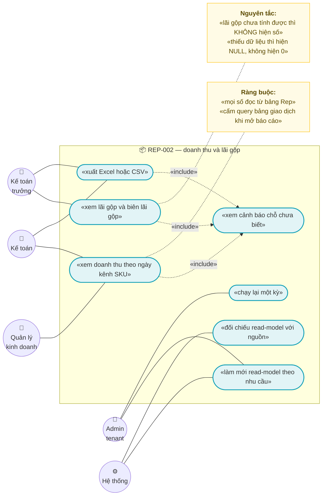
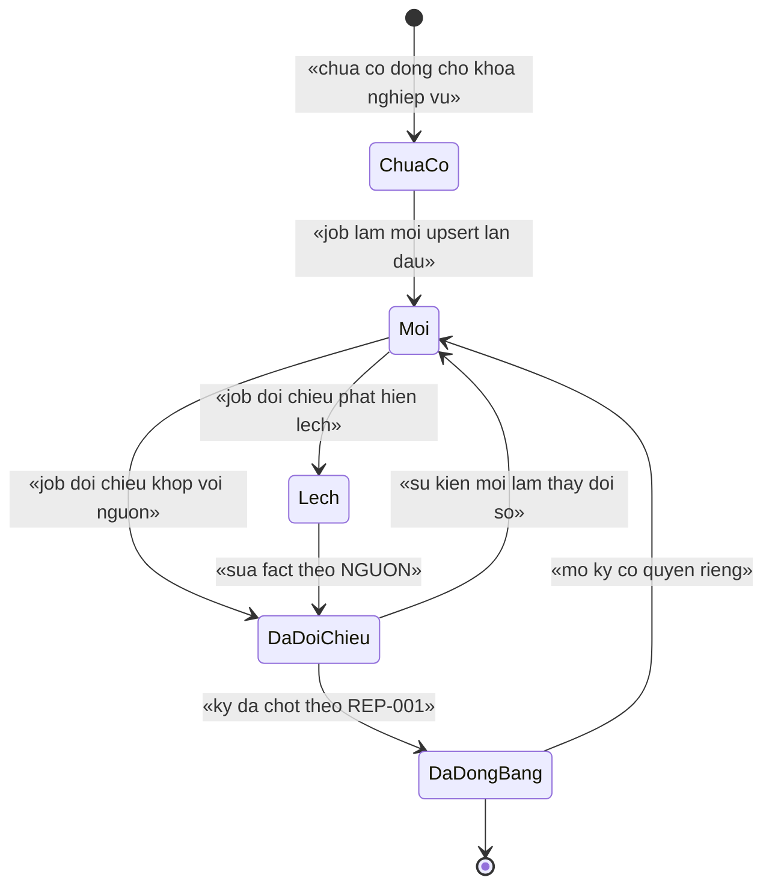
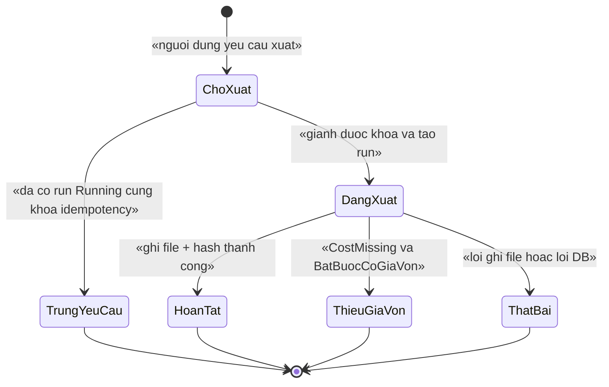
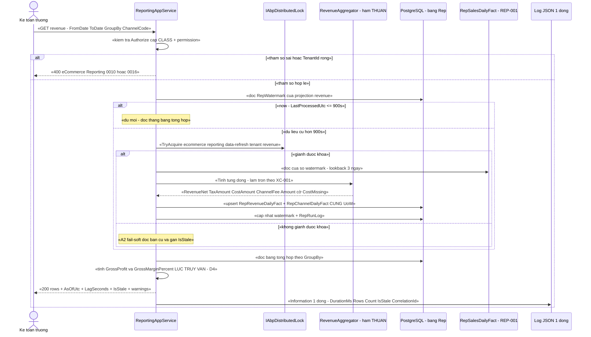
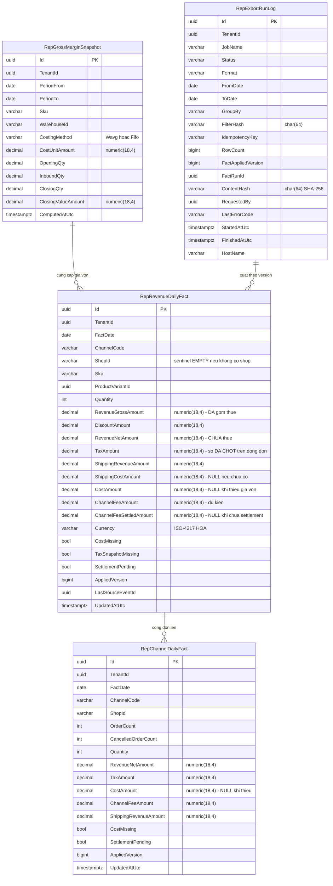

# `REP-002` — Báo cáo doanh thu và lãi gộp

| Thuộc tính | Nội dung |
|---|---|
| **Mã** | `REP-002` |
| **Module** | **Reporting** (`modules/Reporting/…`) — ⚠️ **chưa tồn tại trong code** (bằng chứng ở §0, bảng "Hiện trạng thật") |
| **Giai đoạn** | **GĐ3 — Điều hành** — `docs/implementation-plan.md:437` |
| **Ưu tiên** | **Must have** — là báo cáo số 1 mà kế toán trưởng/điều hành mở mỗi ngày |
| **Trạng thái** | 🟡 `Draft` — chờ review |
| **Người viết / người review** | *(điền)* / **Kế toán trưởng + Kiến trúc trưởng** |
| **Phiên bản / ngày** | `v0.1 — 15/10/2026` |
| **Tài liệu liên quan** | `REP-001` (**tài liệu nền — bắt buộc Approved trước**) · `REP-003` · `ACC-001` · `XC-001` (Money/làm tròn) · `XC-003` (khoá phân tán) · `XC-005` (log/metric) · `XC-006` (thuế GTGT) · `CHN-001`/`CHN-003` (ChannelHub **đã có code**) · `PRC-001`/`PRC-002` (giá vốn — **chưa có code**) · `SAL-002`/`SAL-003`/`SAL-006` · `REC-002`/`REC-003` · `docs/implementation-plan.md` · `docs/structure-and-techstack.md` |

---

## 0. Tóm tắt & quyết định thiết kế

**Tóm tắt:** `REP-002` trả lời hai câu hỏi tiền bạc: **doanh thu thuần** và **lãi gộp** — theo **ngày × kênh × shop** và
theo **ngày × SKU**. Hai chỉ tiêu này **không** được tính lúc người dùng mở báo cáo và **không** được query trên DB giao dịch:
số liệu đọc từ **read-model của `REP-001`** (`RepSalesDailyFact`) đã được job tổng hợp nuôi và **đối chiếu** với nguồn.
Tài liệu này chốt **công thức từng chỉ tiêu**, **cách xử lý chỗ chưa biết** (giá vốn **chưa có trong code**, snapshot thuế **chưa có trong code**),
**cách phát hiện số liệu lệch** thay vì để nó im lặng, và **cách từ chối trả số sai** (không bao giờ hiện `0` thay cho "không biết").

**Vì sao phải có tài liệu riêng cho `REP-002` (không gộp vào `REP-001`):** `REP-001` chốt **hạ tầng** read-model;
`REP-002` chốt **ngữ nghĩa kế toán** của doanh thu và lãi gộp. Ngữ nghĩa này là nơi dễ sai nhất và **sai thì không ai phát hiện** —
ví dụ *"lãi gộp = 0 vì chưa có giá vốn"* trông y như *"hoà vốn"*.

**Hiện trạng thật của code (đã kiểm bằng `read`/`grep`/`glob` — không viết theo trí nhớ):**

| Hạng mục | Hiện trạng | Bằng chứng (đường dẫn thật) |
|---|---|---|
| Module `Reporting` | ❌ **chưa có** — `modules/` chỉ có `ChannelHub`, `PaymentHub`, `Tax` | `eCommerce.slnx` (liệt kê 3 module) · `modules/` |
| Bảng read-model (`Rep*`) | ❌ **chưa có** — không có `DbSet` nào tên `Rep*` | `src/eCommerce.EntityFrameworkCore/eCommerceDbContext.cs:36-64` |
| Entity nguồn `Order` / `OrderLine` | ✅ **có** — có **snapshot giá** (`UnitPrice`, `DiscountAmount`), `TaxAmount`, `Currency`, `ChannelCode` | `src/eCommerce.Domain/Entities/Orders/Order.cs:118-149` |
| Snapshot **thuế suất** trên dòng đơn (`TaxRate`, `TaxClassificationId`) | ❌ **chưa có** | `src/eCommerce.Domain/Entities/Orders/Order.cs:135-139` (chỉ có `DiscountAmount`, `TaxAmount`) |
| **Giá vốn** (`CostPrice`/`Cost`) | ❌ **chưa có ở BẤT KỲ entity nào** — `grep 'Cost\|Margin\|Profit'` trên `*.cs` chỉ ra `TokenRefreshSafetyMargin` (không liên quan) | `grep` toàn repo: 6 match, **0** match giá vốn |
| `Money` / `eCommerce.Kernel` (XC-001) | ❌ **chưa có** — `grep 'CostPrice\|eCommerce\.Kernel\|readonly record struct Money'` trên `src/` = **0 match** | `src/` |
| Nguồn dữ liệu kênh (`ChannelShop`, `Channel`, `ChannelListing`) | ✅ **có**, đã có `DbSet` | `modules/ChannelHub/eCommerce.ChannelHub.Domain/Entities/ChannelEntities.cs` · `eCommerceDbContext.cs:53-55` |
| Đồng bộ sàn (CHN-001/CHN-003) | ✅ **có** — supervisor + worker động + token manager + connector Shopee | `modules/ChannelHub/eCommerce.ChannelHub.Application/Sync/ChannelSyncSupervisorWorker.cs:123` · `…/Sync/ChannelShopSyncer.cs:42` · `…/Sync/ChannelTokenManager.cs:55` · `…/Connectors/ShopeeConnector.cs:48` |
| Khoá lock kênh (thật) | ✅ có — tên khoá **do module sinh, KHÔNG chứa tiền tố**; tiền tố đến từ `AbpDistributedLockOptions.KeyPrefix = "ecommerce:"` | `…/Domain/ChannelHubConsts.cs:22-31` · `src/eCommerce.HttpApi.Host/eCommerceHttpApiHostModule.cs:115-128` |
| Thuế GTGT: phân giải thuế suất + Mẫu 01 Phần II | ✅ **có** (hàm thuần) | `modules/Tax/eCommerce.Tax.Domain/Classifications/TaxRateResolver.cs` · `modules/Tax/eCommerce.Tax.Domain/Mau01/Mau01Part2Calculator.cs:58` |
| Metric | ✅ **12 metric** đã có nơi phát; test **chốt cứng số 12** | `shared/eCommerce.Kernel/Observability/eCommerceMetrics.cs:38-52` · `test/eCommerce.Tests/Observability/MetricsTests.cs:62-66` |
| `[Authorize]` cấp CLASS (khuôn đúng) | ✅ có 1 tiền lệ | `src/eCommerce.Application/Channels/ChannelAppService.cs:27` |
| Test hạ tầng | ⚠️ có `eCommerce.Tests` (unit) **và** `eCommerce.IntegrationTests` (có fixture PostgreSQL/schema) | `test/eCommerce.Tests/…` · `test/eCommerce.IntegrationTests/PostgreSqlSchemaTests.cs` |

⇒ 🔴 **Hệ quả thẳng:** `REP-002` **viết mới hoàn toàn** và **bị chặn một phần** bởi hai phụ thuộc **chưa có trong code**:
**(a) giá vốn** (`PRC-001`/`PRC-002`, kế hoạch GĐ1) ⇒ **lãi gộp không tính được**; **(b) snapshot thuế suất trên dòng đơn** (`XC-006` D3, kế hoạch GĐ1)
⇒ **không tách được doanh thu theo thuế suất**. Tài liệu này **không** che hai khoảng trống đó: chúng trở thành **cờ dữ liệu** + **lỗi từ chối** (§2, §6, §12).

**Phạm vi:**
- ✅ **Định nghĩa chỉ tiêu** (doanh thu gộp/ròng, giảm giá, thuế, phí sàn, giá vốn, lãi gộp, biên lãi gộp) — công thức tường minh, có mã `BR-nn`.
- ✅ **Read-model báo cáo** `RepRevenueDailyFact` (ngày × kênh × shop × SKU) + `RepChannelDailyFact` (ngày × kênh × shop) + `RepGrossMarginSnapshot` (kỳ × SKU) + `RepExportRunLog` (nhật ký xuất).
- ✅ **Job làm mới + job đối chiếu** (kế thừa khung `REP-001`), **khoá phân tán**, **idempotency**, **UoW**.
- ✅ **Hợp đồng API** chỉ-đọc + **xuất Excel/CSV** (dùng lại số liệu đã kiểm thử — khuôn hàm thuần của `Mau01Part2Calculator`).
- ✅ **Xử lý "chưa biết"**: `CostMissing`, `TaxSnapshotMissing`, `SettlementPending` ⇒ `null` + cờ + **cảnh báo trên response**, **cấm** ghi `0`.
- ✅ **Từ chối trả lãi gộp** khi thiếu giá vốn (lỗi có mã) — thay vì trả một con số sai.
- ✅ Metric/log theo `XC-005`, tiền theo `XC-001`.

**Không nằm trong phạm vi:**
- ❌ **Hạ tầng read-model** (bảng `RepWatermark`/`RepRunLog`/`RepConsistencyCheck`/`RepPeriodClose`, registry, watermark, rebuild) — thuộc **`REP-001`**; tài liệu này **giả định `REP-001` Approved**.
- ❌ **Báo cáo tồn kho luân chuyển & hiệu suất kênh** — thuộc `REP-003` (⚠️ `REP-003` dùng tiền tố bảng `Rpt*`, `REP-001` dùng `Rep*`; xem §15.1 **Q1** — cần chốt **một** tiền tố trước khi code).
- ❌ **Định giá tồn kho theo FIFO/bình quân** — thuộc `INV-001`/`PRC-001`; `REP-002` chỉ **tiêu thụ** giá vốn.
- ❌ **Settlement sàn thật** (phí sàn thực tế, tiền sàn trả) — thuộc `REC-002`; chưa có ⇒ `SettlementPending`.
- ❌ **Đối soát COD** (import file Excel) — thuộc `REC-003`.
- ❌ **Phát hành hoá đơn / Mẫu 01 đầy đủ** — thuộc `EINV-001`/`ACC-001`/`XC-006`.
- ❌ **Ghi ngược vào module nguồn** — **cấm** (`BR-REP-002-011`).
- ❌ **Dashboard BI ngoài** (Metabase/Grafana/Power BI) — chỉ chốt **hợp đồng dữ liệu**.

### 0.1 Quyết định thiết kế (ADR ngắn)

| # | Quyết định | Phương án đã cân nhắc | Lý do chọn | Hệ quả |
|---|---|---|---|---|
| **D1** | **Đọc từ read-model của `REP-001`** (`RepSalesDailyFact`) + **bảng tổng hợp riêng** `RepChannelDailyFact`/`RepRevenueDailyFact`; **cấm** query `OrdOrders`/`OrdOrderLines` từ tầng Application | (a) query thẳng `OrdOrders` khi mở báo cáo · (b) view/materialized view · (c) read-model + bảng tổng hợp | (a) bị **cấm** bởi `docs/implementation-plan.md:213`. (b) `REFRESH` khoá bảng, không có watermark/nhật ký — đã bị loại ở `REP-001` D1. (c) kế thừa hạ tầng đã thiết kế | Báo cáo **có độ trễ** (mặc định 5 phút) ⇒ **bắt buộc** hiện `AsOfUtc`/`IsStale` (D6) |
| **D2** | **Tính lại số liệu CHỈ KHI `REP-001` báo cờ `ReportFactRefreshed`** (hoặc `LastQueryAt` cũ > ngưỡng), **không** tính ở mỗi request | (a) tính/đọc thẳng mỗi request · (b) job làm mới theo nhịp · (c) **làm mới theo nhu cầu có khoá phân tán** | (a) request đầu tiên sau mỗi lần sự kiện lại phải quét ⇒ p95 không đoán được. (b) đốt CPU khi không ai đọc; nhịp cố định vẫn có thể cũ. (c) đáp ứng đúng "báo cáo đọc là có số", CPU chỉ dùng khi có người đọc, và lock bảo đảm **một** tiến trình làm mới | Request đồng thời: **một** tiến trình làm mới, các tiến trình khác đọc **bản cũ** + `IsStale` (BR-013) |
| **D3** | **Hai tầng số liệu**: `RepRevenueDailyFact` (ngày × kênh × shop × SKU) → `RepChannelDailyFact` (ngày × kênh × shop) | (a) một bảng chi tiết, gộp lúc đọc bằng SQL · (b) bảng chi tiết **+** bảng gộp sẵn | (a) `GROUP BY` trên 90 ngày × 50.000 SKU ở mỗi lần mở báo cáo ⇒ đúng loại truy vấn nặng cần tránh. (b) tổng theo kênh là truy vấn **phổ biến nhất** ⇒ đáng trả giá lưu thêm | Phải giữ **bất biến hai tầng khớp nhau** (BR-003) + **test** `TC-03`; job làm mới phải ghi **cả hai** trong **cùng UoW** |
| **D4** | **Lưu CHỈ số liệu CỘNG ĐƯỢC**; `GrossProfitAmount`, `GrossMarginPercent`, `Aov` tính **lúc truy vấn** | (a) lưu sẵn `GrossMarginPercent`/`Aov` · (b) lưu `Revenue`/`Cost`/`Quantity` rồi chia khi đọc | Tỉ lệ **không cộng được** qua các nhóm ⇒ tổng theo kênh **lệch** tổng theo ngày (bẫy kinh điển của mọi báo cáo) | **Cấm** thêm cột tỉ lệ vào bảng fact (BR-004); test `TC-04` chứng minh `Σ theo kênh == Σ theo ngày` |
| **D5** | **Thiếu giá vốn ⇒ lãi gộp là `NULL` + cờ `CostMissing`, TUYỆT ĐỐI không ghi `0`** | (a) `0` (coi như hoà vốn) · (b) chặn cả báo cáo doanh thu · (c) `NULL` + cờ + **cảnh báo trên response** | (a) `0` **không** phân biệt được với "hoà vốn thật" ⇒ người đọc ra quyết định trên số sai. (b) doanh thu vẫn đúng và vẫn cần xem ⇒ chặn cả là phản tác dụng | UI **ẩn** cột lãi gộp, hiện nhãn *"chưa có giá vốn — xem PRC-001"*; API `GET` vẫn `200` + `warnings[]` |
| **D6** | **Xuất file kế toán TỪ CHỐI khi thiếu giá vốn** (`BatBuocCoGiaVon = true`, mặc định) | (a) xuất kèm cột trống · (b) xuất `0` · (c) **từ chối + mã lỗi** | File đã xuất sẽ được **lưu, gửi, in, ký**; một cột `0` trong file là **sai vĩnh viễn** không ai phát hiện. "Từ chối rõ ràng" tốt hơn "số 0 sai" (kế thừa tinh thần `XC-001` Q6 và `REP-003` E9) | Cần `eCommerce:Reporting:0011`; người dùng vẫn xem được trên màn hình (chỉ `null` + nhãn) |
| **D7** | **Doanh thu ròng tách khỏi thuế; KHÔNG tính lại thuế theo cấu hình hiện tại** | (a) tính lại `TaxAmount` theo `TaxRateSchedule` hiện hành · (b) dùng `TaxAmount` **đã chốt** trên dòng đơn | (a) phá `XC-006` BR-002/D3: *"thay đổi cấu hình không làm đổi chứng từ cũ"* ⇒ báo cáo quá khứ **lệch** hoá đơn đã phát hành ⇒ `XC-006` BR-008 mất căn cứ | Số `TaxAmount` của `REP-002` **luôn** khớp hoá đơn đã phát hành; đổi phân loại thuế **không** làm đổi báo cáo cũ — UI phải ghi chú (§10) |
| **D8** | **Tiền = `decimal` + `Money`; so sánh bằng minor units; CẤM `==`** | (a) `double` · (b) so `decimal` bằng `==` | Kế thừa `XC-001` BR-003/BR-008 (bài học EShop vỡ với VND/payOS khi lệch làm tròn) | ⚠️ **`Money` CHƯA có trong code** (`grep` = 0 match) ⇒ `REP-002` **phụ thuộc `XC-001` xong trước GĐ3**. Trong thời gian chờ: `decimal` + so `Delta`, **0** `double` |
| **D9** | **Không làm tròn lại ở tầng báo cáo** — cộng số **đã chốt** trên dòng đơn | (a) làm tròn tổng theo kỳ · (b) `Σ` các dòng đã làm tròn | Kế thừa `XC-001` BR-005: *thuế/VAT làm tròn theo TỪNG DÒNG; tổng đơn = tổng các dòng đã làm tròn*. Làm tròn lại ở báo cáo ⇒ số báo cáo **khác** số hoá đơn | Báo cáo `REP-002` và Mẫu 01 (`XC-006`) dùng **cùng** số ⇒ `ACC-001` xuất được không cần bù trừ |
| **D10** | **Job đối chiếu chạy NGOÀI cửa sổ bán hàng** (mặc định **01:00–05:00** giờ VN) | (a) chạy bất kỳ lúc nào · (b) khung giờ đêm | Đường đối chiếu là **đường duy nhất** được phép đọc bảng giao dịch ⇒ phải **không** tranh tài nguyên với bán hàng | Lệch số phát hiện **chậm nhất 1 ngày**; có đường chạy tay cho vận hành khi cần (có quyền riêng) |
| **D11** | **Cách ly tenant ở TẦNG DỮ LIỆU**, `TenantId` **không** nullable | (a) lọc ở tầng service · (b) `IMultiTenant` + query filter + CHECK DB | (a) quên một `WHERE` ⇒ rò dữ liệu **im lặng** — loại lỗi không thể phát hiện bằng test thủ công | Mọi entity `REP-002` là `IMultiTenant` (BR-010); `TenantId` rỗng ⇒ **ném lỗi tham số** |
| **D12** | **Chiều phân tích là TẬP ĐÓNG** (`ChannelCode`, `Sku`, `ShopId`, `FactDate`) — truyền bằng enum/tham số **có kiểu**, **cấm** ghép vào SQL | (a) nhận chuỗi `groupBy` tự do · (b) enum `ReportGroupBy` + tham số hoá | (a) là đường SQL injection + là đường "ghép nhầm cột" không ai thấy. Khuôn đã có: `Mau01Part2Calculator` là hàm thuần nhận record **có kiểu** (`modules/Tax/eCommerce.Tax.Domain/Mau01/Mau01Part2Calculator.cs:13-18`) | Thêm chiều phân tích mới = sửa **enum** + migration ⇒ **chủ ý** để review thấy |
| **D13** | **Phí sàn và phí vận chuyển là hai cột RIÊNG; chỉ cấn trừ vào lãi gộp khi có nguồn** | (a) cộng hết vào giá vốn · (b) cột riêng + cờ chờ settlement | (a) `Order.ChannelFeeAmount` là **dự kiến** (`src/eCommerce.Domain/Entities/Orders/Order.cs:50`), settlement thật thuộc `REC-002` — trộn hai loại vào một con số ⇒ **không giải trình được** với kế toán | `RepRevenueDailyFact` có `ChannelFeeAmount` (dự kiến) và `ChannelFeeSettledAmount` (`NULL` + `SettlementPending`) |
| **D14** | **Công thức chỉ tiêu nằm trong một `DomainService` THUẦN**, có fixture xUnit chạy **không cần DB** | (a) công thức rải trong app service · (b) công thức trong SQL · (c) hàm thuần + test đơn vị | (a)/(b): công thức là thứ **hay đổi nhất** mà lại **khó test nhất**; khuôn hàm thuần đã chứng minh ở `Mau01Part2Calculator` (tài liệu của nó ghi rõ: *"hàm thuần … dùng chung cho mọi định dạng xuất"*) | Test công thức chạy **ngay** trong `test/eCommerce.Tests`; DB chỉ cần cho test tích hợp |

> 📌 **Ghi rõ phương án BỊ LOẠI:** *"tính doanh thu/lãi gộp bằng một câu SQL `GROUP BY` trên `OrdOrders` khi người dùng mở báo cáo"* —
> bị loại vì **hai** lý do độc lập: (1) **cấm** bởi `docs/implementation-plan.md:213`;
> (2) với `numeric(18,4)` và 90 ngày × 50.000 SKU, đây đúng là truy vấn **làm chậm bán hàng** mà cả GĐ3 tồn tại để tránh.

---

## 1. Use Case Specification

| Thuộc tính | Nội dung |
|---|---|
| **Use Case ID** | `REP-002` |
| **Use Case Name** | Xem và xuất **doanh thu & lãi gộp** trên read-model đã đối chiếu, **nói rõ chỗ chưa biết** |
| **Description** | *"Là kế toán trưởng/người điều hành, tôi muốn biết **kỳ này bán được bao nhiêu tiền thật** và **lãi bao nhiêu** theo từng ngày/kênh/SKU — với con số khớp dữ liệu gốc, nói rõ phần nào chưa biết (giá vốn, phí sàn), và **từ chối** hiển thị lãi gộp nếu chưa tính được — để tôi không ra quyết định trên số sai."* |
| **Actor(s)** | **Kế toán trưởng** (xem + xuất) · **Kế toán** (xem + đối chiếu) · **Quản lý kinh doanh/kênh** (xem doanh thu theo kênh) · **Admin tenant** (chạy đối chiếu/làm mới) · **Hệ thống** (job làm mới + job đối chiếu + watermark) |
| **Priority** | **Must have** |
| **Trigger** | (a) người dùng mở màn hình báo cáo; (b) người dùng bấm **Xuất Excel/CSV**; (c) `REP-001` phát `ReportFactRefreshedEto` (read-model nền vừa đổi) ⇒ **đánh dấu cũ**; (d) nhịp job đối chiếu (mặc định **01:00–05:00** giờ VN); (e) người có quyền yêu cầu **làm mới ngay** |
| **Pre-Condition(s)** | • **Tenant hiện tại** (`TenantId` từ `ICurrentTenant`) — **bắt buộc**; `TenantId` rỗng ⇒ **ném lỗi tham số** (host không xem dữ liệu nghiệp vụ của tenant — `BR-REP-002-016`).<br>• **`ChannelCode`** là chiều phân tích **bắt buộc có** trong mọi dòng doanh thu; đơn web dùng `web` (khớp `src/eCommerce.Domain/Entities/Orders/Order.cs:17-18`).<br>• **`REP-001` đã Approved và đã có** `RepSalesDailyFact` + `RepWatermark` + `IReportFactReader` (`docs/features/reporting/rep-001-read-model-job-tong-hop.md:613-640`).<br>• Mọi entity mới có `DbSet` trên `eCommerceDbContext` — **thiếu `DbSet` thì `IRepository<T>` KHÔNG được đăng ký** (lỗi đã gặp thật, ghi tại `src/eCommerce.EntityFrameworkCore/eCommerceDbContext.cs:48-52`).<br>• **Redis 7** sẵn sàng cho khoá phân tán; nếu Redis chết thì **vẫn không sai số** nhờ UNIQUE index + `ON CONFLICT … WHERE` (`REP-001` D6, `XC-003` D2).<br>• Múi giờ nghiệp vụ **Asia/Ho_Chi_Minh** — `FactDate` đã quy đổi (kế thừa `REP-001` §5.2.1).<br>• ⚠️ **Giá vốn có thể CHƯA có** (thực tế hiện nay) ⇒ luồng vẫn chạy, nhưng **cờ `CostMissing`** bật và lãi gộp = `NULL` (D5). |
| **Post-Condition(s)** | • Mọi số trả ra **chỉ** đến từ bảng `Rep*`; **0** truy vấn `OrdOrders`/`OrdOrderLines` trong đường đọc (BR-001).<br>• Mọi phản hồi mang `AsOfUtc` + `LagSeconds` + `IsStale` + `warnings[]` (BR-013).<br>• `Σ` theo mọi cách nhóm **bằng nhau chính xác** (BR-004 + test `TC-04`).<br>• Chỗ chưa biết hiển thị **`null` + nhãn lý do**, **không** hiển thị `0` (BR-002).<br>• Mọi lần **xuất file** có dòng `RepExportRunLog` kèm `ContentHash` + `RunId` của lần làm mới đã dùng (BR-015).<br>• Chạy lại cùng kỳ ⇒ số liệu **không đổi** (idempotent, BR-006). |
| **Basic Flow** | 1. Người dùng gọi `GET /api/reporting/revenue` với `FromDate`, `ToDate`, `GroupBy`, `ChannelCode?`, `Sku?`.<br>2. App service kiểm **quyền** + **validate tham số** (khoảng ngày, tập đóng `GroupBy`, tenant) ⇒ sai thì `eCommerce:Reporting:0010`.<br>3. Đọc `RepWatermark` (của `REP-001`): nếu `now − LastProcessedUtc > Rep002Options.StaleAfterSeconds` (mặc định **900 s**) ⇒ thử giành khoá `ecommerce:reporting:data-refresh:{tenantId}:revenue` và **làm mới** (bước 4).<br>4. **Làm mới (trong UoW):** đọc `RepSalesDailyFact` theo cửa sổ `[watermark − lookback, now]` ⇒ gọi **hàm thuần** `RevenueAggregator.Tinh(...)` ⇒ `upsert` vào `RepRevenueDailyFact` **và** `RepChannelDailyFact` ⇒ cập nhật watermark ⇒ **commit**.<br>5. Đọc bảng tổng hợp theo `GroupBy`; tính `GrossProfitAmount = RevenueNet − TaxAmount − CostAmount − ChannelFeeAmount − ShippingCostAmount` **lúc truy vấn** (D4); tính `GrossMarginPercent = GrossProfitAmount / RevenueNet` **chỉ khi** `RevenueNet <> 0` **và** `CostMissing = false`.<br>6. Trả DTO kèm `AsOfUtc`/`LagSeconds`/`IsStale` + `warnings[]` (`CostMissing`/`TaxSnapshotMissing`/`SettlementPending`/`NoData`).<br>7. Người dùng bấm **Xuất**: nếu `CostMissing` **và** `BatBuocCoGiaVon = true` ⇒ **từ chối** `eCommerce:Reporting:0011`; ngược lại ghi `RepExportRunLog` (`Queued → Running → Completed`) + file + hash. |
| **Alternative Flow** | **A1: Redis chết** — **fail-open**: job làm mới vẫn chạy, DB (`ON CONFLICT` + UNIQUE) là hàng rào cuối; log `Error` + metric (`XC-003` E2).<br>**A2: Không giành được khoá làm mới** — **đọc bản hiện có**, gắn `IsStale` theo `LagSeconds`; **không** ném lỗi (người dùng vẫn cần số) — khác `XC-003` D10 vì đây **không** phải job định kỳ mà là đường đọc.<br>**A3: Read-model nền rỗng (lần đầu)** — trả **mảng rỗng** + `asOfUtc = null` + `isStale = true` + `warnings[NoData]`; **không** phải lỗi (§12).<br>**A4: Kỳ đã chốt (`REP-001`)** — **không** ghi vào khoảng ngày đã chốt; báo cáo **vẫn đọc** được số đã chốt; nếu yêu cầu **làm mới** khoảng đã chốt ⇒ `REP-001` từ chối `eCommerce:Reporting:0004` (không phải lỗi của `REP-002`).<br>**A5: `TaxSnapshotMissing`** — vẫn tính doanh thu/lãi gộp; `TaxAmount` = `Σ OrderLine.TaxAmount` đã chốt (đúng, vì đó là **số đã ghi trên chứng từ**), nhưng **báo cáo tách theo thuế suất** (`GroupBy = TaxRate`) bị **chặn** `eCommerce:Reporting:0014` cho tới khi `SAL-002` ghi snapshot `TaxRate` lên dòng đơn.<br>**A6: `SettlementPending`** — `ChannelFeeSettledAmount` = `NULL`; lãi gộp dùng phí **dự kiến** và gắn cờ; UI ghi *"phí sàn là dự kiến — chưa đối soát settlement (`REC-002`)"`. |
| **Exception Flow** | **E1:** `FromDate > ToDate`, khoảng > **366 ngày**, hoặc `GroupBy` ngoài tập đóng ⇒ `BusinessException` `eCommerce:Reporting:0010` (`400`).<br>**E2:** yêu cầu **xuất lãi gộp** khi `CostMissing` **và** `BatBuocCoGiaVon` ⇒ `eCommerce:Reporting:0011` (`409`) — **không** xuất file sai (D6).<br>**E3:** yêu cầu tách theo **thuế suất** khi thiếu snapshot thuế ⇒ `eCommerce:Reporting:0014` (`409`).<br>**E4:** `TenantId` rỗng ⇒ ném lỗi tham số `eCommerce:Reporting:0016` (`400`) — **cấm** báo cáo toàn cục (D11).<br>**E5:** không giành được khoá khi người dùng yêu cầu **làm mới ngay** (`ThrowOnTimeout`) ⇒ `eCommerce:Reporting:0006` (`409`, dùng mã của `REP-001`).<br>**E6:** **gọi lại cùng khoá xuất** trong khi một lần xuất đang `Running` ⇒ **trả bản ghi cũ** kèm `AlreadyRequested` (**không** tạo lần xuất thứ hai, **không** ném lỗi).<br>**E7:** ghi read-model vi phạm UNIQUE (2 instance khi Redis chết) ⇒ `ON CONFLICT … WHERE excluded.applied_version > fact.applied_version` ⇒ **1** dòng; đếm `reporting_upsert_conflict_total`; **không** coi là lỗi.<br>**E8:** lệch số giữa nguồn và read-model ⇒ ghi `RepConsistencyCheck` (`REP-001`) + metric `reporting_consistency_mismatch_total` + log `Error`; **sửa fact theo NGUỒN**. **Cấm** nuốt im lặng (BR-008). |
| **Business Rules** | Mục này chỉ liệt kê mã; phát biểu đầy đủ ở §8.1 (BR-REP-002-001 … 016): **001** chỉ đọc read-model · **002** thiếu dữ liệu ⇒ `null` + cờ, cấm `0` · **003** hai tầng khớp nhau · **004** chỉ lưu số cộng được · **005** tiền `decimal`/`Money`, cấm `==` · **006** idempotent theo khoá nghiệp vụ + `AppliedVersion` · **007** mọi làm mới dưới khoá phân tán · **008** lệch số phải lộ ra · **009** công thức trong hàm thuần · **010** cách ly tenant · **011** một chiều, cấm ghi ngược · **012** cấm SQL nối chuỗi, chiều phân tích là tập đóng · **013** mọi phản hồi có `AsOfUtc`/`LagSeconds`/`IsStale` · **014** thuế dùng **số đã chốt**, không tính lại · **015** mọi lần xuất có `RepExportRunLog` + hash · **016** `TenantId` rỗng ⇒ ném lỗi. |
| **Non-Functional Requirement** | Mã: **001** hiệu năng API · **002** hiệu năng xuất file · **003** hiệu năng job · **004** lệch số = 0 · **005** idempotent 1.000 lần · **006** cách ly tenant · **007** quan sát được · **008** không chặn bán hàng · **009** kích thước read-model · **010** không `double`/`float`. Phát biểu đầy đủ ở §13. |

---

## 2. Sơ đồ Use Case



### Chú giải

| Ký hiệu | Ý nghĩa |
|---|---|
| ⭕ Xanh lá | Actor |
| 🟦 Bầu dục xanh dương | Use Case |
| 🟨 Khung vàng | Note |
| `───` | Liên kết Actor ↔ Use Case |
| `-.«include».->` | Quan hệ bao hàm |

---

## 3. Sơ đồ trạng thái (state machine)

`REP-002` có **hai** vòng đời độc lập. Cả hai **phải ném lỗi** khi chuyển trạng thái sai — không có nhánh "bỏ qua im lặng".

### 3.1 Vòng đời một dòng fact (`RepRevenueDailyFact` / `RepChannelDailyFact`)



| Từ | Sang | Guard (điều kiện cho phép) | Hành động kèm theo | Nếu guard sai thì? |
|---|---|---|---|---|
| `ChuaCo` | `Moi` | Khoá nghiệp vụ `(TenantId, FactDate, ChannelCode, Sku)` chưa tồn tại | `INSERT` với `AppliedVersion = 1`, `CostMissing` theo nguồn giá vốn | — |
| `Moi` | `DaDoiChieu` | Job đối chiếu tính lại từ nguồn và **lệch 0 đồng** | ghi `RepRunLog` (`REP-001`) kết quả khớp; metric `reporting_fact_rows_verified_total` | Sang `Lech` |
| `Moi` | `Lech` | `Delta` tiền **khác 0** (so `Delta`, **cấm** `==`) | ghi `RepConsistencyCheck` + log `Error` + metric | Không được bỏ qua (BR-008) |
| `Lech` | `DaDoiChieu` | Sửa fact **theo NGUỒN** và ghi số dòng đã sửa | `AutoCorrected = true` | Nếu lệch do `OutOfOrder`/`LateEventInClosedPeriod` ⇒ **ở lại `Lech`** + cần người xử lý |
| `DaDoiChieu` | `Moi` | Có dòng mới trong `RepSalesDailyFact` với `AppliedVersion` **lớn hơn** `AppliedVersion` đang lưu | `upsert` (`ON CONFLICT … WHERE excluded.applied_version > fact.applied_version`) | `AppliedVersion` cũ hơn ⇒ **bỏ qua** + log `Debug` |
| `DaDoiChieu` | `DaDongBang` | `FactDate` thuộc kỳ `DaChot` của `REP-001` | **không** ghi nữa; báo cáo **vẫn đọc** được | Nếu cố ghi ⇒ `REP-001` **từ chối** `eCommerce:Reporting:0004` |
| `DaDongBang` | `Moi` | Có quyền `eCommerce.Reporting.PeriodReopen` + lý do ≥ 20 ký tự (`REP-001` §3.3) | ghi audit; job được phép ghi lại khoảng ngày | `403`; thiếu lý do ⇒ `eCommerce:Reporting:0005` |
| `DaDongBang` | `[*]` | — | trạng thái **hấp thụ** theo kỳ | Mọi chuyển khác ⇒ **`InvalidOperationException`** (lỗi lập trình) |

> ⚠️ **`Lech` là trạng thái nguy hiểm nhất:** một dòng ở `Lech` nghĩa là **báo cáo đang nói số khác nguồn sự thật**.
> Vì vậy `Lech` **phải** để lại `RepConsistencyCheck` (nhìn thấy được trên màn hình vận hành), **và** báo cáo
> **phải** mang cảnh báo tương ứng — người đọc phải biết số đang nghi vấn, thay vì tin một con số "trơn".

### 3.2 Vòng đời một lần xuất file (`RepExportRunLog`)



| Từ | Sang | Guard | Hành động kèm theo | Nếu guard sai thì? |
|---|---|---|---|---|
| `ChoXuat` | `DangXuat` | Giành được khoá `ecommerce:reporting:export:{tenantId}:revenue-margin` trong timeout **30 s** | tạo `RepExportRunLog` `Status = Running`, `RequestedBy` | Sang `TrungYeuCau` |
| `ChoXuat` | `TrungYeuCau` | Khoá idempotency `Report:Export:revenue:{tenantId}:{from}:{to}:{groupBy}:{sha256(filter)}` đã có run `Running` **hoặc** `Completed` | trả bản ghi cũ + `AlreadyRequested = true`; **không** tạo run mới | — (đây là hành vi **đúng**, không phải lỗi) |
| `DangXuat` | `HoanTat` | Ghi file + `ContentHash` (SHA-256) thành công **và** `CostMissing = false` (hoặc `BatBuocCoGiaVon = false`) | `Status = Completed`, `RowCount`, `RunId` của lần làm mới đã dùng | — |
| `DangXuat` | `ThieuGiaVon` | `CostMissing = true` **và** `BatBuocCoGiaVon = true` | `Status = RejectedCostMissing` + `LastErrorCode = eCommerce:Reporting:0011`; **KHÔNG** tạo file | Đây **không** phải lỗi hệ thống ⇒ log `Warning`, **không** `Error` |
| `DangXuat` | `ThatBai` | Lỗi ghi file/DB | `Status = Failed` + `LastErrorCode` + log `Error` + `CorrelationId`; **xoá file dở dang** | — |
| `HoanTat`/`ThieuGiaVon`/`ThatBai` | `[*]` | — | trạng thái **hấp thụ** | Mọi chuyển khỏi 3 trạng thái này ⇒ **`InvalidOperationException`** |

> 📌 **Vì sao `ThieuGiaVon` là trạng thái KẾT THÚC (không phải lỗi):** đây là **quyết định thiết kế** (D6) —
> hệ thống **chủ động từ chối** tạo chứng từ sai. Người dùng phải nhận thông điệp **nghiệp vụ** rõ ràng
> (`eCommerce:Reporting:0011` + *"chưa có giá vốn — xem PRC-001"*), **không** phải lỗi `500`.

---

## 4. Sequence Diagram & luồng dữ liệu

### 4.1 Sequence — một lần mở báo cáo (làm mới theo nhu cầu + đọc)



### 4.2 Luồng dữ liệu — đường đi của **một đồng lãi gộp** từ giao dịch tới báo cáo

```mermaid
graph LR
    classDef actor fill:#d4edda,stroke:#155724,stroke-width:2px;
    classDef process fill:#cce5ff,stroke:#004085,stroke-width:2px;
    classDef datastore fill:#e2e3e5,stroke:#383d41,stroke-width:2px;
    classDef warn fill:#fff3cd,stroke:#856404,stroke-width:2px;

    SRC[("<b>DB giao dich</b><br/>OrdOrders · OrdOrderLines<br/>ChnChannels · ChnChannelShops")]
    RM[("<b>Read-model REP-001</b><br/>RepSalesDailyFact · RepWatermark")]
    R2[("<b>Read-model REP-002</b><br/>RepRevenueDailyFact<br/>RepChannelDailyFact<br/>RepGrossMarginSnapshot")]
    OUT[("<b>Nguoi doc</b><br/>Ke toan truong · ACC-001 · EINV-001")]
    KTT["Ke toan truong"]
    EXT[("<b>PRC-001 PRC-002</b><br/>gia von - CHUA CO trong code")]

    class KTT actor;
    class SRC,RM,R2,OUT,EXT datastore;

    subgraph R2G["Module Reporting - tang REP-002"]
        P1["1. <b>Nhan</b><br/>cua so tu watermark"]
        P2["2. <b>Tong hop</b><br/>ham THUAN - lam tron XC-001"]
        P3["3. <b>Upsert</b><br/>khoa nghiep vu + AppliedVersion"]
        P4["4. <b>Doc + tinh ti le</b><br/>lai gop chi tinh luc truy van"]
        class P1,P2,P3,P4 process;
        P1 --> P2 --> P3 --> P4
    end

    SRC -. "chi qua REP-001, khong doc truc tiep" .-> RM
    RM -. "doc theo cua so" .-> P1
    P3 -. "ghi + watermark cung UoW" .-> R2
    EXT -. "gia von theo ky - khi co" .-> P2
    P4 -- "AsOfUtc LagSeconds IsStale warnings" --> OUT
    OUT --> KTT

    W["<b>CANH BAO</b><br/>«thieu gia von ma ghi 0»<br/>«thi bao cao noi HOA VON - sai khong ai biet»"]
    class W warn;
    P2 -.- W
```



---

## 5. Mô hình dữ liệu

> ⚠️ **Ghi rõ tiền tố bảng:** tài liệu này dùng tiền tố **`Rep*`** theo `REP-001` (`docs/features/reporting/rep-001-read-model-job-tong-hop.md:430`).
> `REP-003` lại dùng **`Rpt*`** (`docs/features/reporting/rep-003-bao-cao-ton-kho-hieu-suat-kenh.md:23`). Đây là **mâu thuẫn thật giữa hai tài liệu**
> ⇒ xem §15.1 **Q1**; **phải chốt trước khi code** (không cần sửa nếu coi `Rep*` là chuẩn vì `REP-001` là tài liệu nền).

### 5.1 ERD



> 📌 **Không có FK tới bảng giao dịch** (kế thừa `REP-001` D14). `Sku`/`ProductVariantId`/`ShopId` là **tham chiếu mềm**;
> muốn xem chi tiết chứng từ thì gọi API của module nguồn. **Cố ý:** FK sẽ biến read-model thành **vật cản** cho module nguồn
> (xoá mềm đơn, dọn dữ liệu) và chặn đường tách microservice ở GĐ4.

### 5.2 Bảng & cột (Data Dictionary)

#### 5.2.1 Bảng `RepRevenueDailyFact` — *fact doanh thu & lãi gộp theo ngày × kênh × shop × SKU*

| Cột | Kiểu | Null? | Nguồn / ý nghĩa | Ghi chú |
|---|---|---|---|---|
| `Id` | `uuid` | ✖ | `IGuidGenerator` | khoá chính |
| `TenantId` | `uuid` | ✖ | `ICurrentTenant` | `IMultiTenant` + query filter (BR-010, D11) |
| `FactDate` | `date` | ✖ | `OccurredOn` của sự kiện, quy đổi **Asia/Ho_Chi_Minh** | ⚠️ **không** dùng ngày nhận sự kiện |
| `ChannelCode` | `varchar(32)` | ✖ | `Order.ChannelCode` (`src/eCommerce.Domain/Entities/Orders/Order.cs:18`) | khớp `eCommerceDbContext.cs:168`; `web`/`shopee`/… |
| `ShopId` | `varchar(64)` | ✖ | `ChannelShop.ExternalShopId` (đơn sàn) hoặc **sentinel `"EMPTY"`** (đơn web) | ⚠️ **sentinel, không `NULL`** — vì UNIQUE index với cột `NULL` **không** chặn trùng trên PostgreSQL (bài học `REP-003` D5, `docs/features/rep-003-bao-cao-ton-kho-hieu-suất-kenh.md:63`) |
| `Sku` | `varchar(64)` | ✖ | `OrderLine.Sku` (`Order.cs:124`) | khớp `eCommerceDbContext.cs:199` |
| `ProductVariantId` | `uuid` | ✔ | `OrderLine.ProductVariantId` | có thể `null` với dòng đơn sàn chưa map SKU |
| `Quantity` | `int` | ✖ | `Σ OrderLine.Quantity` của dòng **đã xác nhận** | loại `Cancelled`/`Returned` (BR-016 không áp dụng — xem §8.1 BR-003 nghiệp vụ âm) |
| `RevenueGrossAmount` | `numeric(18,4)` | ✖ | `Σ OrderLine.LineTotal` = `(UnitPrice × Quantity) − DiscountAmount + TaxAmount` | khớp công thức thật ở `src/eCommerce.Domain/Entities/Orders/Order.cs:139` |
| `DiscountAmount` | `numeric(18,4)` | ✖ | `Σ OrderLine.DiscountAmount` | giữ riêng để báo cáo khuyến mãi (`PRO-*`) |
| `RevenueNetAmount` | `numeric(18,4)` | ✖ | `RevenueGrossAmount − TaxAmount` | **chưa thuế** (`XC-001` D5: lưu net + tax riêng) |
| `TaxAmount` | `numeric(18,4)` | ✖ | `Σ OrderLine.TaxAmount` — **số ĐÃ CHỐT** trên chứng từ | 🔒 Liên kết `XC-001` BR-010/BR-011 và `XC-006` BR-002 (`docs/features/cross-cutting/XC-006-phan-loai-thue-gtgt.md:77`) |
| `ShippingRevenueAmount` | `numeric(18,4)` | ✖ | phần `Order.ShippingTotal` phân bổ về dòng | phân bổ theo `XC-001` BR-006 (**bảo toàn tổng**) |
| `ShippingCostAmount` | `numeric(18,4)` | ✔ | phí vận chuyển thực trả NCC | ⚠️ **chưa có trong code** — cần `SHP-001` (GĐ2); `NULL` + không cấn trừ ⇒ ghi rõ ở `warnings[]` |
| `CostAmount` | `numeric(18,4)` | ✔ | giá vốn **tại thời điểm bán** — nguồn: `Pricing.CostPrice` / `RepGrossMarginSnapshot` | 🚨 **CHƯA CÓ trong code** (`grep Cost\|Margin\|Profit` = 0 match giá vốn) ⇒ **kế hoạch GĐ1** (`PRC-001`); khi chưa có ⇒ `NULL` + `CostMissing = true` (**cấm** ghi `0`) |
| `ChannelFeeAmount` | `numeric(18,4)` | ✖ | `Order.ChannelFeeAmount` (**dự kiến**) — `Order.cs:50` | 0 với đơn web |
| `ChannelFeeSettledAmount` | `numeric(18,4)` | ✔ | phí sàn **thực tế** từ settlement | ⚠️ **chưa có** — thuộc `REC-002` (GĐ2) ⇒ `NULL` + `SettlementPending` (D13) |
| `Currency` | `varchar(8)` | ✖ | `Order.Currency` (`Order.cs:36`) | khớp `eCommerceDbContext.cs:170`; `XC-001` Q4: hiện chỉ **VND** |
| `CostMissing` | `bool` | ✖ | cờ **lý do**, không phải số | ⭐ là cơ chế thực thi BR-002 ở tầng dữ liệu |
| `TaxSnapshotMissing` | `bool` | ✖ | `true` khi dòng đơn **không** có `TaxRate`/`TaxClassificationId` | ⚠️ hiện **luôn `true`** vì `Order.cs:135-139` chưa có 2 trường đó (kế hoạch GĐ1, `SAL-002`) |
| `SettlementPending` | `bool` | ✖ | `true` khi `ChannelFeeSettledAmount IS NULL` | |
| `AppliedVersion` | `bigint` | ✖ | `AggregateVersion` lớn nhất đã áp | cơ sở chống ghi đè bởi sự kiện cũ (`REP-001` D4) |
| `LastSourceEventId` | `uuid` | ✖ | `EventId` của ETO đã áp | truy vết |
| `RowVersion` | `xmin` | ✖ | optimistic concurrency của Npgsql | chống 2 job ghi đè lẫn nhau |
| `UpdatedAtUtc` | `timestamptz` | ✖ | `IClock.Now` | |

**Index & ràng buộc**

| Loại | Cột | Mục đích |
|---|---|---|
| **UNIQUE** | `(TenantId, FactDate, ChannelCode, ShopId, Sku)` | ⭐ **hàng rào của `ON CONFLICT`** (§3.1) — chống 2 instance ghi 2 dòng cho cùng một ô số liệu |
| INDEX | `(TenantId, FactDate, ChannelCode)` | báo cáo doanh thu theo ngày × kênh (**đường đọc chính**) |
| INDEX | `(TenantId, Sku, FactDate)` | báo cáo lãi gộp theo SKU |
| INDEX | `(TenantId, CostMissing) WHERE CostMissing` | ⭐ **truy vấn vận hành:** *"còn bao nhiêu dòng chưa có giá vốn?"* — biến khoảng trống dữ liệu thành **số đếm được** |
| CHECK | `Quantity >= 0` | bất biến ở tầng DB |
| CHECK | `Currency ~ '^[A-Z]{3}$'` | kế thừa khuyến nghị `XC-001` §5.2 |
| CHECK | `AppliedVersion > 0` | bắt buộc có version |
| CHECK | `RevenueNetAmount = RevenueGrossAmount − TaxAmount` | ⭐ **bất biến số học ở tầng DB** — công thức sai thì **DB chặn** (tinh thần `XC-003` D2) |
| CHECK | `CostMissing = (CostAmount IS NULL)` | ⭐ cờ **phải** khớp dữ liệu ⇒ không thể "quên bật cờ" |
| — | **KHÔNG** FK tới `OrdOrders` | kế thừa `REP-001` D14 |

> 📌 **Vì sao có CHECK `CostMissing = (CostAmount IS NULL)`:** đây là cách **cưỡng chế bằng DB** điều mà tài liệu chỉ nói được bằng lời
> (D5: *"thiếu giá vốn thì `NULL` + cờ"*). Nếu lập trình viên ghi `0` mà quên cờ ⇒ **DB từ chối**; nếu bật cờ mà vẫn ghi số ⇒ **DB từ chối**.
> Đúng nguyên tắc `XC-003` D2: *"bỏ lock/validation ở tầng app đi, DB có chặn không?"*

#### 5.2.2 Bảng `RepChannelDailyFact` — *tổng hợp theo ngày × kênh × shop (tầng đọc nhanh)*

| Cột | Kiểu | Null? | Nguồn / ý nghĩa | Ghi chú |
|---|---|---|---|---|
| `Id` | `uuid` | ✖ | | |
| `TenantId` | `uuid` | ✖ | | `IMultiTenant` |
| `FactDate` | `date` | ✖ | | |
| `ChannelCode` | `varchar(32)` | ✖ | | |
| `ShopId` | `varchar(64)` | ✖ | sentinel `"EMPTY"` cho đơn web | như §5.2.1 |
| `OrderCount` | `int` | ✖ | số đơn **tính vào doanh thu** | loại đơn đã huỷ |
| `CancelledOrderCount` | `int` | ✖ | số đơn huỷ/hoàn trong ngày | giữ để **đối chiếu**, không trừ vào `OrderCount` |
| `Quantity` | `int` | ✖ | `Σ` từ tầng chi tiết | |
| `RevenueNetAmount` / `TaxAmount` / `CostAmount` / `ChannelFeeAmount` / `ShippingRevenueAmount` | `numeric(18,4)` | `CostAmount` ✔ | cộng từ tầng chi tiết | |
| `CostMissing` / `SettlementPending` | `bool` | ✖ | **`true` nếu BẤT KỲ dòng con nào** có cờ | ⭐ cờ **lan lên**: một dòng thiếu giá vốn ⇒ cả ô tổng bị đánh dấu (không được "trung bình hoá" thành số trông hợp lý) |
| `AppliedVersion` | `bigint` | ✖ | **`MAX(AppliedVersion)` của các dòng con cùng khoá** | dùng để chống ghi đè |
| `RowVersion` | `xmin` | ✖ | | |
| `UpdatedAtUtc` | `timestamptz` | ✖ | | |

| Loại | Cột | Mục đích |
|---|---|---|
| **UNIQUE** | `(TenantId, FactDate, ChannelCode, ShopId)` | hàng rào `ON CONFLICT` |
| INDEX | `(TenantId, FactDate)` | tổng theo ngày (**báo cáo mặc định**) |
| CHECK | `OrderCount >= 0` **và** `CancelledOrderCount >= 0` | |
| CHECK | `CostMissing = (CostAmount IS NULL)` | cùng lý do §5.2.1 |

#### 5.2.3 Bảng `RepGrossMarginSnapshot` — *giá vốn theo kỳ × SKU (nguồn của lãi gộp)*

| Cột | Kiểu | Null? | Ý nghĩa | Ghi chú |
|---|---|---|---|---|
| `Id` | `uuid` | ✖ | | |
| `TenantId` | `uuid` | ✖ | | `IMultiTenant` |
| `PeriodFrom` / `PeriodTo` | `date` | ✖ | kỳ tính giá vốn | `REP-002` tra theo `FactDate` |
| `Sku` | `varchar(64)` | ✖ | | |
| `WarehouseId` | `uuid` | ✔ | `NULL` = giá vốn **bình quân toàn tenant** | |
| `CostingMethod` | `int` | ✖ | `Wavg = 0` · `Fifo = 1` | 🔒 **phụ thuộc `PRC-001`** — xem §15.1 **Q2**; **chưa kiểm chứng** vì `PRC-*` **chưa có trong code** |
| `CostUnitAmount` | `numeric(18,4)` | ✖ | giá vốn đơn vị | |
| `OpeningQty` / `InboundQty` / `ClosingQty` | `numeric(18,4)` | ✖ | số lượng để **kiểm chứng** phương pháp | ⚠️ `decimal` (không `int`) vì đơn vị đo có thể lẻ (kg, m) — khác `RepInventoryDailyFact` của `REP-001` dùng `int` (`docs/features/reporting/rep-001-read-model-job-tong-hop.md:352-366`) |
| `ClosingValueAmount` | `numeric(18,4)` | ✖ | giá trị tồn cuối kỳ | |
| `ComputedAtUtc` | `timestamptz` | ✖ | | |

| Loại | Cột | Mục đích |
|---|---|---|
| **UNIQUE** | `(TenantId, PeriodFrom, PeriodTo, Sku, WarehouseId, CostingMethod)` | chống 2 job ghi 2 giá vốn cho cùng kỳ |
| **EXCLUDE** | `(TenantId WITH =, Sku WITH =, daterange(PeriodFrom, PeriodTo, '[]') WITH &&) WHERE CostingMethod = 0` | ⭐ chặn **2 khung giá vốn chồng nhau** cho cùng SKU — kỹ thuật đã dùng ở `XC-006` §5.2 và `REP-001` §5.2.6. ⚠️ cần extension `btree_gist`; **chưa chạy thử** trên PostgreSQL thật (kế thừa cảnh báo `XC-006` §14.5) |
| INDEX | `(TenantId, Sku, PeriodFrom)` | tra giá vốn theo ngày bán |
| CHECK | `PeriodTo >= PeriodFrom` | |

#### 5.2.4 Bảng `RepExportRunLog` — *nhật ký mọi lần xuất file (BR-015)*

| Cột | Kiểu | Null? | Ý nghĩa | Ghi chú |
|---|---|---|---|---|
| `Id` | `uuid` | ✖ | | |
| `TenantId` | `uuid` | ✖ | | `IMultiTenant` |
| `JobName` | `varchar(64)` | ✖ | `revenue-margin-export` | |
| `Status` | `int` | ✖ | theo §3.2 | |
| `Format` | `int` | ✖ | `Csv = 0` · `Xlsx = 1` | |
| `FromDate` / `ToDate` | `date` | ✖ | khoảng ngày xuất | **bắt buộc** (kế thừa `REP-001` D10) |
| `GroupBy` | `int` | ✖ | enum `ReportGroupBy` | tập **đóng** (D12) |
| `FilterHash` | `char(64)` | ✖ | SHA-256 của bộ lọc | phần của khoá idempotency |
| `IdempotencyKey` | `varchar(256)` | ✖ | `Report:Export:revenue:{tenantId}:{from}:{to}:{groupBy}:{filterHash}` | ⚠️ **cấm** dùng `DateTime.Now` làm khoá |
| `RowCount` | `bigint` | ✖ | số dòng đã ghi | |
| `FactAppliedVersion` | `bigint` | ✖ | version read-model đã dùng | ⭐ để trả lời *"file này in từ bản số liệu nào"* |
| `FactRunId` | `uuid` | ✔ | `RepRunLog.Id` của `REP-001` | truy vết |
| `ContentHash` | `char(64)` | ✔ | SHA-256 nội dung file | phát hiện sửa file sau khi xuất |
| `RequestedBy` | `uuid` | ✔ | người yêu cầu | audit (`XC-004`) |
| `LastErrorCode` | `varchar(64)` | ✔ | | |
| `StartedAtUtc` / `FinishedAtUtc` | `timestamptz` | ✔ | | |
| `HostName` | `varchar(128)` | ✖ | | chẩn đoán job treo |

| Loại | Cột | Mục đích |
|---|---|---|
| **UNIQUE** | `(TenantId, IdempotencyKey)` | ⭐ gọi lại cùng bộ lọc ⇒ **1** lần xuất (BR-006) |
| **UNIQUE có filter** | `(TenantId, JobName) WHERE Status = 1` (`Running`) | ⭐ **chỉ một lần xuất hoạt động** cho mỗi tenant — **hàng rào DB** bổ sung cho khoá phân tán (D7 tinh thần `REP-003`) |
| INDEX | `(TenantId, StartedAtUtc)` | màn hình "lần xuất gần nhất" |
| CHECK | `ToDate >= FromDate` | |
| CHECK | `FinishedAtUtc IS NULL OR FinishedAtUtc >= StartedAtUtc` | |

### 5.3 Ánh xạ `GroupBy` → nguồn dữ liệu (tập **đóng**, D12)

| `ReportGroupBy` | Bảng đọc | Cột gộp | Độ trễ dữ liệu |
|---|---|---|---|
| `Day = 0` | `RepChannelDailyFact` | `FactDate` | ≤ 5 phút |
| `Channel = 1` | `RepChannelDailyFact` | `ChannelCode` | ≤ 5 phút |
| `Shop = 2` | `RepChannelDailyFact` | `ChannelCode, ShopId` | ≤ 5 phút |
| `Sku = 3` | `RepRevenueDailyFact` | `Sku` | ≤ 5 phút |
| `TaxRate = 4` | `RepRevenueDailyFact` | `TaxRate` (⚠️ **cột chưa tồn tại**) | ❌ **KHÔNG chạy được** cho tới khi `SAL-002` ghi snapshot thuế ⇒ `eCommerce:Reporting:0014` |

---

## 6. Hợp đồng API

### 6.1 Application Service

| Mục | Giá trị |
|---|---|
| Interface | `IRevenueReportAppService` — đặt tại `modules/Reporting/eCommerce.Reporting.Application.Contracts` (khuôn 4 project: `docs/structure-and-techstack.md:87-98`) |
| Implementation | `RevenueReportAppService` — `modules/Reporting/eCommerce.Reporting.Application` |
| Hàm thuần tính chỉ tiêu | `RevenueAggregator` — `modules/Reporting/eCommerce.Reporting.Domain` (D14) |
| Port đọc fact | `IRevenueFactReader` — `modules/Reporting/eCommerce.Reporting.Domain` (kế thừa `IReportFactReader` của `REP-001`, `docs/features/reporting/rep-001-read-model-job-tong-hop.md:619-628`) |
| `[Authorize]` | ⭐ **cấp CLASS** (`[Authorize]` trần) + permission cụ thể ở từng method — **bắt buộc**, tiền lệ thật: `src/eCommerce.Application/Channels/ChannelAppService.cs:27` |
| Mapping | **map tay** (không AutoMapper — `Directory.Packages.props` đã bỏ vì advisory) |

| Method | Input (DTO) | Output (DTO) | Permission | Ghi chú |
|---|---|---|---|---|
| `GetRevenueAsync` | `GetRevenueInput` (`FromDate`, `ToDate`, `GroupBy`, `ChannelCode?`, `Sku?`, `ShopId?`) | `RevenueReportDto` | `eCommerce.Reporting.Revenue.View` | **chỉ** đọc `RepRevenueDailyFact`/`RepChannelDailyFact`; làm mới theo nhu cầu nếu cũ (D2) |
| `GetGrossMarginAsync` | `GetGrossMarginInput` (`FromDate`, `ToDate`, `GroupBy`, `Sku?`, `BatBuocCoGiaVon = true`) | `GrossMarginReportDto` | `eCommerce.Reporting.GrossMargin.View` | khi `CostMissing` **và** `BatBuocCoGiaVon` ⇒ `eCommerce:Reporting:0011` |
| `GetDataQualityAsync` | `GetDataQualityInput` (`FromDate`, `ToDate`) | `RevenueDataQualityDto` | `eCommerce.Reporting.Operations.View` | số **cần cảnh báo**: số dòng `CostMissing`, `TaxSnapshotMissing`, `SettlementPending`, lệch đang mở |
| `RefreshAsync` | `RefreshInput` (`FromDate`, `ToDate`) | `RepRunDto` | `eCommerce.Reporting.Refresh` | **làm mới ngay**; khoá bận ⇒ `eCommerce:Reporting:0006` (`ThrowOnTimeout`) |
| `ExportAsync` | `ExportInput` (`FromDate`, `ToDate`, `GroupBy`, `Format`, `BatBuocCoGiaVon = true`) | `ExportResultDto` | ⭐ `eCommerce.Reporting.Export` | idempotent theo `IdempotencyKey` (§3.2, §7.3) |

**Mã lỗi nghiệp vụ** *(⚠️ **cố ý** bắt đầu từ `0010` — `REP-001` đã dùng `0001`–`0006` trong **cùng** namespace `eCommerce:Reporting:*`
(`docs/features/reporting/rep-001-read-model-job-tong-hop.md:684-689`) ⇒ đánh số lại từ `0001` sẽ **đụng mã**. Xem §15.1 **Q3**.)*

| Mã | HTTP | Khi nào | Thông điệp |
|---|---|---|---|
| `eCommerce:Reporting:0010` | `400` | Tham số sai: `FromDate > ToDate`, khoảng > 366 ngày, `GroupBy` ngoài tập đóng | `Khoảng ngày hoặc cách nhóm không hợp lệ.` |
| `eCommerce:Reporting:0011` | `409` | Yêu cầu **lãi gộp/xuất file** khi thiếu giá vốn (`CostMissing`) | `Chưa có giá vốn nên không thể xuất lãi gộp. Xem PRC-001/PRC-002.` |
| `eCommerce:Reporting:0012` | `409` | Bộ lọc không khớp bất kỳ dòng nào **nhưng** khoảng ngày có dữ liệu (dấu hiệu lọc sai) | `Không có dòng nào khớp bộ lọc; kiểm tra lại kênh/SKU.` |
| `eCommerce:Reporting:0013` | `409` | Xuất file **thiếu giá vốn** đã bị từ chối (dùng ở trạng thái `ThieuGiaVon`) | `Lần xuất đã bị từ chối do thiếu giá vốn.` |
| `eCommerce:Reporting:0014` | `409` | Yêu cầu tách theo **thuế suất** khi thiếu snapshot thuế trên dòng đơn | `Chưa có snapshot thuế suất trên dòng đơn nên không tách được theo thuế suất.` |
| `eCommerce:Reporting:0015` | `403` | Người dùng không có quyền xuất liệu kế toán | `Bạn không có quyền xuất liệu kế toán.` |
| `eCommerce:Reporting:0016` | `400` | `TenantId` rỗng (host không xem dữ liệu nghiệp vụ của tenant) | `Thiếu ngữ cảnh tenant.` |
| `eCommerce:Reporting:0017` | `409` | Lần **làm mới** bị bỏ qua vì có tiến trình khác (đường người dùng **không** dùng `ThrowOnTimeout`) | *(không trả cho client — chỉ log + metric)* |

### 6.2 REST endpoint

| Method | Route | Quyền | Mô tả |
|---|---|---|---|
| `GET` | `/api/reporting/revenue` | `eCommerce.Reporting.Revenue.View` | doanh thu theo ngày/kênh/shop/SKU |
| `GET` | `/api/reporting/gross-margin` | `eCommerce.Reporting.GrossMargin.View` | lãi gộp + biên lãi gộp |
| `GET` | `/api/reporting/revenue/data-quality` | `eCommerce.Reporting.Operations.View` | số liệu cần cảnh báo |
| `POST` | `/api/reporting/revenue/refresh` | `eCommerce.Reporting.Refresh` | làm mới ngay (có khoá) |
| `POST` | `/api/reporting/revenue/export` | `eCommerce.Reporting.Export` | xuất CSV/XLSX (**có audit**, `RepExportRunLog`) |

**Response mẫu — `GET /api/reporting/revenue?fromDate=2026-10-01&toDate=2026-10-13&groupBy=Channel`**

```json
{
  "fromDate": "2026-10-01",
  "toDate": "2026-10-13",
  "groupBy": "Channel",
  "asOfUtc": "2026-10-13T08:41:12Z",
  "lagSeconds": 47,
  "isStale": false,
  "currency": "VND",
  "rows": [
    { "key": "web",    "orderCount": 182, "quantity": 412,
      "revenueGrossAmount": 138672000, "discountAmount": 4200000, "taxAmount": 10272000,
      "revenueNetAmount": 128400000, "shippingRevenueAmount": 1800000,
      "channelFeeAmount": 0, "channelFeeSettledAmount": null,
      "costAmount": null, "grossProfitAmount": null, "grossMarginPercent": null },
    { "key": "shopee", "orderCount": 74,  "quantity": 158,
      "revenueGrossAmount": 50976000, "discountAmount": 5200000, "taxAmount": 3776000,
      "revenueNetAmount": 47200000, "shippingRevenueAmount": 600000,
      "channelFeeAmount": 2360000, "channelFeeSettledAmount": null,
      "costAmount": null, "grossProfitAmount": null, "grossMarginPercent": null }
  ],
  "totals": { "quantity": 570, "revenueNetAmount": 175600000, "taxAmount": 14048000,
              "costAmount": null, "grossProfitAmount": null, "grossMarginPercent": null },
  "warnings": [
    { "code": "CostMissing", "count": 2,
      "message": "Chưa có giá vốn (PRC-001/PRC-002 chưa xong) — lãi gộp và biên lãi gộp không tính được." },
    { "code": "TaxSnapshotMissing", "count": 2,
      "message": "Dòng đơn chưa có snapshot thuế suất — thuế lấy theo số đã chốt trên chứng từ, không tách được theo thuế suất." },
    { "code": "SettlementPending", "count": 1,
      "message": "Phí sàn là DỰ KIẾN — chưa đối soát settlement (REC-002)." }
  ]
}
```

> ⚠️ **Điểm quan trọng nhất của response này:** `costAmount`, `grossProfitAmount`, `grossMarginPercent` là **`null`**, **không** phải `0`.
> *"Lãi gộp = 0"* và *"lãi gộp = chưa biết"* là **hai chuyện hoàn toàn khác nhau**; gộp chúng lại là cách tạo ra báo cáo sai mà không ai phát hiện (D5).
> UI **phải** hiện `—` + tooltip, **không** hiện `0` (`docs/features/reporting/rep-001-read-model-job-tong-hop.md:677-678`).

### 6.3 Công thức chỉ tiêu (chốt tại đây, code ở `RevenueAggregator` — D14)

Với `VND` (`XC-001` BR-009: 0 chữ số thập phân, làm tròn `AwayFromZero`):

| Chỉ tiêu | Công thức | Ghi chú |
|---|---|---|
| `RevenueGrossAmount` | `Σ ((UnitPrice × Quantity) − DiscountAmount + TaxAmount)` | khớp `Order.cs:139` |
| `RevenueNetAmount` | `RevenueGrossAmount − TaxAmount` | `XC-001` D5: net + tax riêng |
| `TaxAmount` | `Σ OrderLine.TaxAmount` | **số đã chốt** — **cấm** tính lại (D7) |
| `CostAmount` | `Σ (Quantity × giá vốn đơn vị hiệu lực tại FactDate)` | `NULL` nếu **bất kỳ** dòng không có giá vốn |
| `ChannelFeeAmount` | `Σ Order.ChannelFeeAmount` | **dự kiến** (D13) |
| `ChannelFeeSettledAmount` | `Σ` settlement thật | `NULL` khi chưa có `REC-002` |
| `GrossProfitAmount` | `RevenueNetAmount − TaxAmount − CostAmount − ChannelFeeAmount − ShippingCostAmount` | ⚠️ xem **Q4** §15.1: công thức này **cần kế toán trưởng xác nhận** (thuế GTGT đầu ra **không** phải chi phí của doanh nghiệp ⇒ có thể **không** trừ lần hai) |
| `GrossMarginPercent` | `GrossProfitAmount / RevenueNetAmount` | chỉ khi `RevenueNetAmount <> 0` **và** `CostMissing = false`; **cấm** chia khi mẫu = 0 ⇒ trả `null` |
| `Aov` | `RevenueNetAmount / OrderCount` | chỉ khi `OrderCount > 0`; **không** lưu vào bảng fact (D4) |

> 🚨 **Tự chỉ ra một điểm chưa chắc trong chính công thức:** nếu `RevenueNetAmount` **đã** là *"chưa thuế"* thì việc trừ tiếp `TaxAmount`
> là **trừ hai lần**. Công thức đúng **phải** do kế toán trưởng chốt ⇒ ghi thành **Q4** (§15.1), **không** tự quyết.
> Đây là ví dụ của loại lỗi mà tài liệu này tồn tại để chặn: một dấu trừ sai ⇒ **lãi gộp sai toàn hệ thống**, và **không có lỗi biên dịch nào**.

---

## 7. Sự kiện, tích hợp ngoài & idempotency

### 7.1 Sự kiện phát ra (ETO)

| ETO | Khi nào phát | Trường dữ liệu | Ai tiêu thụ | Idempotent? |
|---|---|---|---|---|
| `RevenueFactRefreshedEto` | sau khi job/`RefreshAsync` commit thành công | `TenantId`, `FromDate`, `ToDate`, `FactAppliedVersion`, `CostMissing`, `RowsUpserted`, `RefreshedAtUtc`, `CorrelationId` | `ACC-001`, màn hình vận hành | ✅ theo `(TenantId, FromDate, ToDate, FactAppliedVersion)` |

> 📌 `REP-002` **không phát** sự kiện nghiệp vụ nào vào module khác. Nó là **consumer**; và vì read-model **không phải nguồn sự thật**,
> **cấm** module nào phụ thuộc vào nó để quyết định nghiệp vụ (kế thừa `XC-005` §7: *"cấm dùng metric để quyết định nghiệp vụ"*).

### 7.2 Sự kiện **tiêu thụ** (nguồn dữ liệu)

| ETO | Thuộc | Ảnh hưởng `RepRevenueDailyFact` | Cần `AggregateVersion`? | Chống trùng bằng |
|---|---|---|---|---|
| `OrderPlacedEto` | `SAL-002` | tạo/khởi tạo dòng | ✅ | inbox `XC-002` + `AppliedVersion` |
| `OrderStatusChangedEto` | `SAL-003` | đổi số lượng/doanh thu theo 4 trục | ✅ **bắt buộc** | như trên |
| `OrderCancelledEto` / `OrderReturnedEto` | `SAL-004`/`SAL-006` | **ghi âm** doanh thu | ✅ | như trên |
| `PaymentSucceededEto` | `PaymentHub` | cột đối soát tiền | ✅ | `XC-002` §7.3 |
| `TaxClassificationApprovedEto` | `XC-006` | ❌ **KHÔNG** projection nào | ❌ | chỉ log `Information` |
| `TaxRateScheduleChangedEto` | `XC-006` | ❌ **KHÔNG** — số thuế đã chốt **không đổi** | ❌ | chỉ log `Information` |
| `ReportFactRefreshedEto` | `REP-001` | **đánh dấu cũ** (`RepWatermark` đã đổi) | ❌ | theo `(projectionName, LastProcessedUtc)` |
| `ChannelOrderPulledEto` | **ChannelHub — ĐÃ CÓ CODE** (định nghĩa `modules/ChannelHub/eCommerce.ChannelHub.Application.Contracts/Events/ChannelEvents.cs:17`; phát tại `modules/ChannelHub/eCommerce.ChannelHub.Application/Sync/ChannelShopSyncer.cs:69`) | **GIÁN TIẾP** — app subscribe và tạo `Order` của mình, rồi `Order` mới sinh sự kiện đơn cho `REP-002`. ⚠️ **Đọc kỹ:** ETO này có `ChannelDiscount` nhưng **KHÔNG** có trường thuế ⇒ dòng đơn từ sàn hiện **không** mang `TaxAmount` từ nguồn (`ChannelEvents.cs:17-40`) ⇒ đây là **một nguyên nhân gốc** của `TaxSnapshotMissing` | ❌ (chưa có `AggregateVersion` trên ETO này) | inbox `XC-002` + UNIQUE `(TenantId, ChannelCode, ExternalOrderId)` (đã có thật: `src/eCommerce.EntityFrameworkCore/eCommerceDbContext.cs:184-186`) |
| `ChannelShopTokenRefreshedEto` | **ChannelHub — ĐÃ CÓ CODE** (phát tại `modules/ChannelHub/eCommerce.ChannelHub.Application/Sync/ChannelTokenManager.cs:116`, định nghĩa trong `ChannelEvents.cs:44`) | ❌ không ảnh hưởng doanh thu | ❌ | — *(ghi vào đây để chứng minh đã kiểm: sự kiện này **không** phải nguồn doanh thu)* |

> 🚨 **Quy tắc quan trọng nhất của §7.2:** hai ETO thuế **cố ý** không kích hoạt tính lại số liệu — vì thuế đã **snapshot** vào dòng đơn
> (`XC-006` D3/BR-002: *"thay đổi cấu hình không làm đổi chứng từ cũ"*, `docs/features/cross-cutting/XC-006-phan-loai-thue-gtgt.md:37`).
> Nếu `REP-002` tính lại thuế theo cấu hình hiện tại thì báo cáo quá khứ **lệch** hoá đơn đã phát hành ⇒ phá `XC-006` BR-008.

### 7.3 Sự kiện / webhook nhận vào từ **bên ngoài**

**Không áp dụng — lý do:** `REP-002` **không** nhận webhook của NCC nào. Nó chỉ đọc DB **nội bộ** đã qua outbox của ABP.
Mọi biên vào từ ngoài (webhook sàn `SAL-005`/`CHN-001`, IPN `PaymentHub`) **đã** được chống trùng ở tầng module đó (`XC-002` §7.2)
**trước khi** sự kiện nội bộ được phát ra ⇒ `REP-002` **thừa hưởng** tính idempotent đó, **không** dựng lại.

### 7.4 Gọi API ra ngoài

**Không áp dụng — lý do:** `REP-002` không gọi NCC nào. Đường "ra ngoài" duy nhất là **file xuất kế toán**, và việc gửi file đó thuộc `ACC-001`.

**Idempotency key** *(mọi biên vào của feature này)*

| Đối tượng | Cách sinh khoá | ⚠️ Lưu ý |
|---|---|---|
| Sự kiện tiêu thụ | `{EventType}:{AggregateId}` (kế thừa `XC-002` §7.3) | **Không** tự sinh khoá riêng — dùng `IIdempotencyGuard` của `XC-002` |
| Làm mới theo cửa sổ | `Report:Revenue:Refresh:{tenantId}:{windowEndUtc:O}` | Cửa sổ **xác định được** ⇒ **cấm** dùng `DateTime.Now` (`XC-002` §7.3) |
| Xuất file | `Report:Export:revenue:{tenantId}:{from}:{to}:{groupBy}:{sha256(filter)}` | Gọi lại **cùng bộ lọc** ⇒ trả bản ghi cũ + `AlreadyRequested` (§3.2, E6) |
| Ghi fact | `(TenantId, FactDate, ChannelCode, ShopId, Sku)` + `AppliedVersion` | ⭐ **hàng rào thật**: UNIQUE index + `ON CONFLICT … WHERE` (không chỉ lock) |
| Tổng hợp kênh | `(TenantId, FactDate, ChannelCode, ShopId)` + `AppliedVersion` | như trên |
| Giá vốn | `(TenantId, PeriodFrom, PeriodTo, Sku, WarehouseId, CostingMethod)` | + `EXCLUDE` chặn khung chồng |

---

## 8. Bất biến & xử lý đồng thời

### 8.1 Bất biến & Business Rules

| Mã | Bất biến / quy tắc (phát biểu **kiểm chứng được**) | Cơ chế bảo vệ | Test |
|---|---|---|---|
| **BR-REP-002-001** | 🚨 **Cấm** mọi truy vấn `OrdOrders`/`OrdOrderLines`/`InvStockLedger` trong tầng Application/Contracts của `REP-002`; số liệu **chỉ** đọc từ bảng `Rep*` | Test **quét mã nguồn** `TC-02`; kiến trúc module (app → module hợp lệ, `REP-002` → `REP-001` hợp lệ) | **TC-02** |
| **BR-REP-002-002** | Thiếu dữ liệu (giá vốn, phí sàn thật, snapshot thuế suất) ⇒ cột tương ứng `NULL` + cờ lý do. **CẤM** ghi `0` thay cho "không biết" | CHECK `CostMissing = (CostAmount IS NULL)` ở §5.2.1/§5.2.2 + `warnings[]` trong response + UI ẩn cột | **TC-05**, **TC-16** |
| **BR-REP-002-003** | `Σ RepRevenueDailyFact` theo mọi cách nhóm **bằng** `Σ RepChannelDailyFact` tương ứng — **chính xác**, so bằng `Delta` | Ghi **cả hai** trong **cùng UoW** (D3); CHECK số học; test `TC-03` | **TC-03** |
| **BR-REP-002-004** | Bảng fact **chỉ** chứa số liệu **cộng được**. **Cấm** lưu `GrossMarginPercent`, `Aov`, tỉ lệ, trung bình | Review schema + test `TC-04` (`Σ theo kênh == Σ theo ngày`); `GroupBy` enum (D12) | **TC-04** |
| **BR-REP-002-005** | Tiền là `numeric(18,4)` + `Currency` riêng; **cấm** `double`/`float`; **cấm** so tiền bằng `==` (so `Delta`/minor units) | Kế thừa `XC-001` BR-003/BR-008 (`docs/features/cross-cutting/XC-001-money-currency-lam-tron.md:64`); test reflection `TC-34` | **TC-34**, NFR-010 |
| **BR-REP-002-006** | Ghi fact **idempotent** theo khoá nghiệp vụ + `AppliedVersion`: cùng sự kiện xử lý **N lần** ⇒ **1** dòng, số liệu **không đổi**; version cũ hơn ⇒ **bỏ qua** | UNIQUE index + `INSERT … ON CONFLICT … DO UPDATE … WHERE` (`REP-001` D6); test `TC-06` lặp 1.000 lần | **TC-06** |
| **BR-REP-002-007** | Mọi lần **làm mới / đối chiếu / xuất file** chạy dưới **khoá phân tán**; đường **job** dùng `SkipIfBusy` + log + metric; đường **người dùng yêu cầu** dùng `ThrowOnTimeout` | `XC-003` D10/BR-010 + bảng khoá §8.2 | **TC-09**, **TC-10** |
| **BR-REP-002-008** | Lệch giữa nguồn và read-model **phải lộ ra**: mỗi lần phát hiện ghi `RepConsistencyCheck` (`REP-001`) + metric + log ≥ `Warning`. **Cấm** nuốt im lặng | Code + metric + `XC-005` BR-013; biên nhận `warnings[]` | **TC-05**, **TC-22** |
| **BR-REP-002-009** | Mọi công thức chỉ tiêu nằm trong **hàm THUẦN** (`RevenueAggregator`), **không** DI/DB/thời gian hệ thống — để test được toàn bộ và dùng chung cho mọi định dạng xuất | Khuôn đã chứng minh: `Mau01Part2Calculator` (`modules/Tax/eCommerce.Tax.Domain/Mau01/Mau01Part2Calculator.cs:52-57`); test chạy trong `test/eCommerce.Tests` | **TC-01**, **TC-21** |
| **BR-REP-002-010** | Cách ly tenant **100 %**: mọi entity `IMultiTenant`; `TenantId` **không** nullable; **cấm** đọc xuyên tenant, kể cả qua bộ lọc/sắp xếp/export | `IMultiTenant` + query filter + CHECK DB (D11) | **TC-12**, NFR-006 |
| **BR-REP-002-011** | 🚨 **Một chiều**: module nguồn (`Sales`, `Inventory`, `PaymentHub`, `Catalog`, `ChannelHub`) **cấm** tham chiếu kiểu/entity của `eCommerce.Reporting.*` | Test reflection quét assembly nguồn (`REP-001` BR-010 khuôn) | **TC-32** |
| **BR-REP-002-012** | **Cấm** dựng SQL bằng nối chuỗi; `GroupBy`/sắp xếp **chỉ** nhận **tập đóng** (enum) | D12 + test quét mã nguồn `TC-13` | **TC-13** |
| **BR-REP-002-013** | Mọi phản hồi báo cáo **phải** mang `AsOfUtc` + `LagSeconds` + `IsStale` + `warnings[]`; UI **phải** hiển thị | D2/D5 + test `TC-07` | **TC-07** |
| **BR-REP-002-014** | 🔒 **Thuế dùng số ĐÃ CHỐT** trên dòng đơn; **cấm** tính lại theo `TaxRateSchedule` hiện tại | D7 + `XC-006` BR-002 (`docs/features/cross-cutting/XC-006-phan-loai-thue-gtgt.md:77`) + test `TC-23` | **TC-23** |
| **BR-REP-002-015** | Mọi lần **xuất file** có dòng `RepExportRunLog` kèm `ContentHash` + `FactAppliedVersion` + `FactRunId` + `RequestedBy`; **cấm** xuất file không có nhật ký | §3.2 + `TC-08` | **TC-08** |
| **BR-REP-002-016** | Doanh thu **ròng** loại đơn `Cancelled`/`Returned`, **nhưng** số đơn gộp **vẫn** hiển thị để đối chiếu (`CancelledOrderCount`) | Công thức `RevenueAggregator` + test `TC-30`; khớp tinh thần `REP-003` BR-011 (`docs/features/rep-003-bao-cao-ton-kho-hieu-suất-kenh.md:89`) | **TC-30** |

> 📌 **`TenantId` rỗng ⇒ ném lỗi** (không phải một BR riêng mà là **tiền điều kiện**, ghi ở §1 Pre-Condition và E4 `eCommerce:Reporting:0016`).
> **Cấm** báo cáo "toàn hệ thống" cho host — vì mọi bảng đều là `IMultiTenant` (D11).

### 8.2 Xử lý đồng thời

| # | Tình huống | Cơ chế |
|---|---|---|
| 1 | 2 instance cùng **làm mới** một tenant | Khoá `ecommerce:reporting:data-refresh:{tenantId}:revenue` + UNIQUE index ở `RepWatermark` (`REP-001` §8.2) |
| 2 | **Redis chết** | **Fail-open**: job vẫn chạy; hàng rào cuối là UNIQUE index + `ON CONFLICT … WHERE` (E7) |
| 3 | 2 người cùng bấm **Xuất** cùng bộ lọc | Khoá idempotency `Report:Export:revenue:…` + UNIQUE `(TenantId, IdempotencyKey)` + UNIQUE filter `(TenantId, JobName) WHERE Status = Running` (**DB chặn**, không chỉ lock) |
| 4 | Sự kiện đổi trạng thái đơn đến **sai thứ tự** | `AggregateVersion` + `AppliedVersion` (`REP-001` D4) — **không** dựa vào `CreationTime` |
| 5 | Người dùng đọc **trong khi** job đang ghi fact | Ghi bằng `ON CONFLICT` trên **một dòng** ⇒ không khoá bảng; người đọc thấy bản **đã commit** |
| 6 | Job ghi `RepRevenueDailyFact` nhưng `RepChannelDailyFact` lỗi | **Cùng UoW** ⇒ rollback cả hai ⇒ hai tầng **không bao giờ** lệch (BR-003) |
| 7 | Người dùng yêu cầu **làm mới ngay** khi job đang chạy | `ThrowOnTimeout` ⇒ `eCommerce:Reporting:0006` (`409`) — **không** im lặng bỏ qua (`XC-003` D10) |
| 8 | 2 process cùng ghi **giá vốn** cho cùng kỳ | UNIQUE `(TenantId, PeriodFrom, PeriodTo, Sku, WarehouseId, CostingMethod)` + `EXCLUDE` chặn khung chồng |

**Khoá phân tán dùng trong feature** *(tên chính xác — theo quy ước `XC-003` §5; đoạn khoá module = `reporting`)*

| Tên khoá | Phạm vi | Vì sao cần | TTL đề xuất |
|---|---|---|---|
| `ecommerce:reporting:data-refresh:{tenantId}:revenue` | theo tenant | chỉ 1 instance làm mới một tenant (tránh 2 job cùng upsert) | **120 s** |
| `ecommerce:reporting:job:reconcile:{tenantId}` | theo tenant | chỉ 1 instance đối chiếu (kế thừa `REP-001` §8.2) | **300 s** |
| `ecommerce:reporting:export:{tenantId}:revenue-margin` | theo tenant | chỉ 1 lần xuất file hoạt động cho mỗi tenant | **300 s** |

> ⚠️ **Nhắc lại `XC-003` D2 và bài học `F5`/`F6` của nó:** (a) **tên khoá do module sinh KHÔNG chứa tiền tố** `ecommerce:` —
> tiền tố do `AbpDistributedLockOptions.KeyPrefix = "ecommerce:"` ghép vào, xem `src/eCommerce.HttpApi.Host/eCommerceHttpApiHostModule.cs:115-128`
> (đã bị lỗi thật và **đã sửa** 13/10/2026; bằng chứng `redis-cli MONITOR` ghi tại `docs/features/cross-cutting/XC-003-khoa-phan-tan-quy-uoc.md:230-261`).
> ⇒ `REP-002` **phải** viết `reporting:data-refresh:…` (không `ecommerce:reporting:…`) khi gọi `TryAcquireAsync`; viết đủ tiền tố sẽ thành **tiền tố đôi** `ecommerce:ecommerce:reporting:…`.
> (b) **Thao tác vượt TTL** ⇒ metric `lock_ttl_exceeded_total`, đã có nơi phát: `shared/eCommerce.Kernel/Observability/eCommerceMetrics.cs:145`.
> (c) TTL **thực đo** của khoá token-refresh hiện là **30 s** (không phải 60 s như bảng `XC-003` §5 ghi ban đầu) ⇒ mọi TTL dưới đây là **đề xuất**, **chưa đo** cho `REP-002`.

**Idempotency key:** xem §7.4 (bảng đầy đủ).

### 8.3 Bảng ánh xạ module → đoạn khoá

| Module / project | Đoạn `<module>` trong khoá |
|---|---|
| `modules/Reporting/*` | `reporting` |

> 📌 Dòng này **đã** được `REP-001` §8.3 đề xuất (`docs/features/reporting/rep-001-read-model-job-tong-hop.md:813-819`). Cần **bổ sung vào bảng ánh xạ
> của `XC-003` §5** khi tài liệu này được duyệt (quy tắc vàng: **sửa tài liệu trước, rồi mới code**).

---

## 9. Phân quyền

| Permission | Nhóm | Method được gán | Vai trò mặc định | Ghi chú |
|---|---|---|---|---|
| `eCommerce.Reporting.Revenue.View` | Reporting | `GetRevenueAsync` | Kế toán · Kế toán trưởng · Quản lý kinh doanh · Admin tenant | |
| `eCommerce.Reporting.GrossMargin.View` | Reporting | `GetGrossMarginAsync` | ⭐ **Kế toán trưởng · Admin tenant** | ⚠️ lãi gộp là dữ liệu **nhạy cảm** (giá vốn) ⇒ không cấp cho vai trò chỉ-xem doanh thu |
| `eCommerce.Reporting.Operations.View` | Reporting | `GetDataQualityAsync` | Admin tenant · Nhân viên vận hành | |
| `eCommerce.Reporting.Refresh` | Reporting | `RefreshAsync` | Admin tenant | thao tác **có tải** trên read-model nền |
| `eCommerce.Reporting.Export` | Reporting | `ExportAsync` | **Kế toán trưởng · Kế toán** | file xuất là **chứng từ** ⇒ có audit |

**Cách khai báo (bắt buộc):**

| Việc | File | Hiện trạng thật |
|---|---|---|
| Khai hằng số permission | `src/eCommerce.Domain.Shared/eCommerceConsts.cs` — thêm `public static class Reporting` vào `Permissions` | ⚠️ **chưa có** — hiện `Permissions` chỉ có `Products`, `Inventory`, `Channels`, `Orders`, `Payments`, `TaxClassification`, `TaxRateSchedule` (`src/eCommerce.Domain.Shared/eCommerceConsts.cs:15-74`) |
| Đăng ký permission | `src/eCommerce.Application.Contracts/Permissions/eCommercePermissionDefinitionProvider.cs` | 🚨 **BẮT BUỘC** — permission **không** được định nghĩa ⇒ ABP **luôn** từ chối ⇒ `403` kể cả admin |
| `[Authorize]` cấp class | `RevenueReportAppService` | ⭐ **BẮT BUỘC** — tiền lệ thật và lý do đã ghi tại `src/eCommerce.Application/Channels/ChannelAppService.cs:21-27` (*"ABP KHÔNG tự bảo vệ application service"*) |
| Audit cho lần **xuất** | bảng audit có sẵn của ABP + `RepExportRunLog` | |

> 📌 **Ghi chú kế thừa:** `XC-004` yêu cầu **test quét mã nguồn** chứng minh mọi `*AppService` có `[Authorize]` cấp class
> (`docs/implementation-plan.md:170`). `RevenueReportAppService` **phải** nằm trong phạm vi test đó ⇒ `TC-33`.

---

## 10. UI Mockup & mapping dữ liệu

**Có UI** (thuộc `eCommerce.Web`, do `WEB-*` thực thi). Bốn vùng.

| Vùng UI | Thành phần | Dữ liệu hiển thị | Nguồn (DTO / trường) | Quy tắc |
|---|---|---|---|---|
| **Banner tuổi dữ liệu** *(mọi màn hình)* | dòng chữ + chip | *"Số liệu tính đến «asOfUtc» (cách đây «lagSeconds»)"* | `RevenueReportDto.AsOfUtc/LagSeconds/IsStale` | ⭐ **BẮT BUỘC** (BR-013). `IsStale = true` ⇒ chip **vàng** + *"dữ liệu có thể chưa đầy đủ"* |
| **Bảng doanh thu** | bảng + biểu đồ | `FactDate`, `ChannelCode`, `ShopId`, `OrderCount`, `Quantity`, `RevenueGrossAmount`, `DiscountAmount`, `RevenueNetAmount`, `TaxAmount`, `ShippingRevenueAmount` | `RevenueReportDto.Rows` | tổng **phải** bằng Σ dòng đã hiển thị; khi có lọc ⇒ ghi *"đang lọc: N/M dòng"* |
| **Bảng lãi gộp** | bảng + cột tỉ lệ | `CostAmount`, `ChannelFeeAmount`, `GrossProfitAmount`, `GrossMarginPercent` | `GrossMarginReportDto.Rows` | ⭐ cột lãi gộp **hiện `—`** (không `0`) khi `CostMissing`; tooltip *"chưa có giá vốn — xem PRC-001"*; `SettlementPending` ⇒ nhãn *"phí sàn dự kiến"* |
| **Bảng chất lượng dữ liệu** | danh sách + số đếm | số dòng `CostMissing`, `TaxSnapshotMissing`, `SettlementPending`, lệch đang mở | `RevenueDataQualityDto` | mỗi con số kèm **`asOf` riêng**; có liên kết tới màn hình vận hành `REP-001` |
| **Hộp thoại Xuất** | form + nút | `Format`, `FromDate`, `ToDate`, `GroupBy`, `BatBuocCoGiaVon` | `ExportInput` | nút **Xuất** bị **vô hiệu hoá** khi `CostMissing` **và** `BatBuocCoGiaVon`, tooltip chỉ rõ *"chưa có giá vốn (N dòng) — bỏ yêu cầu bắt buộc giá vốn nếu chỉ cần doanh thu"* |

> 📌 **Ghi rõ bốn chênh lệch mà UI **phải** nói ra (thói quen tốt của tài liệu SRS gốc, `design-doc-guidelines.md` §5 quy tắc 9):**
> 1. **`AsOfUtc` ≠ thời điểm hiện tại.** Báo cáo **luôn** là ảnh chụp trễ. UI hiện *"hôm nay"* mà số của 8 giờ trước ⇒ người dùng **hiểu sai**.
> 2. **Tổng theo nhóm ≠ Σ dòng hiển thị** khi có bộ lọc ⇒ UI **phải** ghi *"đang lọc: N/M dòng"*.
> 3. **`TaxAmount` là thuế ĐÃ CHỐT vào dòng đơn**, không phải thuế tính lại theo cấu hình hiện tại (BR-014). Kế toán đổi phân loại thuế ⇒ con số ở đây **không đổi** — UI phải ghi chú, nếu không sẽ bị báo là "lỗi".
> 4. **`CostAmount = null`, không phải `0`** (BR-002). UI **cấm** hiển thị `0` — vì `0` đọc là *"hoà vốn"*, một kết luận sai hoàn toàn.

**Trạng thái rỗng:** read-model **chưa có dòng nào** ⇒ hiện hướng dẫn *"Dữ liệu tổng hợp chưa được khởi tạo — chạy Làm mới"*,
**không** hiện bảng trống, **không** hiện lỗi (đây **không** phải lỗi — theo nguyên tắc *"không có dữ liệu ≠ lỗi"*).

---

## 11. Migration & seed

| Mục | Nội dung |
|---|---|
| Migration (dự kiến) | `Added_Reporting_RevenueMargin` — trong `src/eCommerce.EntityFrameworkCore/Migrations` |
| ⚠️ **Phụ thuộc migration của `REP-001`** | `REP-002` **cần** các bảng `RepWatermark`/`RepRunLog`/`RepConsistencyCheck`/`RepPeriodClose`/`RepSalesDailyFact` của `REP-001` **đã tồn tại** ⇒ thứ tự migration **bắt buộc**: `REP-001` trước, `REP-002` sau |
| Bảng tạo mới | `RepRevenueDailyFact`, `RepChannelDailyFact`, `RepGrossMarginSnapshot`, `RepExportRunLog` (4 bảng — §5.2) |
| ⚠️ **Bắt buộc trước khi migration chạy được** | (1) Tạo `modules/Reporting/eCommerce.Reporting.{Domain,EntityFrameworkCore,Application,Application.Contracts}` theo khuôn 3–4 project (`docs/structure-and-techstack.md:87-98`); (2) thêm `builder.ConfigureReporting();` vào `eCommerceDbContext.OnModelCreating` (khuôn `src/eCommerce.EntityFrameworkCore/eCommerceDbContext.cs:76-78`); (3) ⭐ **khai `DbSet` cho CẢ 4 entity** — **thiếu `DbSet` thì `IRepository<T>` KHÔNG được đăng ký**, lỗi này **đã gặp thật** ở Phase 0 (ghi rõ tại `eCommerceDbContext.cs:48-52`); (4) thêm project vào `eCommerce.slnx`; (5) **KHÔNG** cần thêm gói NuGet nào cho 4 bảng này |
| ⚠️ **Ràng buộc `EXCLUDE` của `RepGrossMarginSnapshot`** | Cần extension `btree_gist`. **Tiền lệ:** `XC-006` §5.2 dùng đúng kỹ thuật này và ghi rõ *"sinh migration nhưng **CHƯA chạy thử**"* (`docs/features/cross-cutting/XC-006-phan-loai-thue-gtgt.md` §14.5) — `REP-001` §11 kế thừa cảnh báo đó. **Kế thừa nguyên trạng** cho `REP-002` ⇒ xem §15.1 **Q5** |
| Seed | **Không** seed dữ liệu nghiệp vụ. Chỉ: (a) seed **permission** `eCommerce.Reporting.*` (idempotent, ABP tự xử lý); (b) **không** seed `RepGrossMarginSnapshot` — bảng **rỗng** cho tới khi `PRC-001`/`PRC-002` chạy ⇒ đúng thực tế "**chưa có giá vốn**" và buộc hệ thống phải nói ra (D5) |
| Ảnh hưởng dữ liệu cũ | ⚠️ **Cần backfill** khi triển khai lần đầu: read-model **rỗng** trong khi DB giao dịch **đã có** dữ liệu. Cách làm: `REP-001` `StartRebuildAsync` theo **từng tháng** (giới hạn 366 ngày ở `eCommerce:Reporting:0001`), ghi `RepRunLog` cho mỗi lần; `REP-002` sau đó **làm mới** trên read-model nền. **Cấm** backfill bằng script SQL rời (bỏ qua công thức + watermark + đối chiếu) |
| Rollback | `Down()` xoá 4 bảng. ✅ **An toàn**: đây là **read-model**, xoá **không** mất dữ liệu nghiệp vụ (nguồn sự thật ở `OrdOrders`/`InvStockLedger`). ⚠️ **Nhưng** `RepExportRunLog` chứa `ContentHash` của file **đã gửi kế toán** ⇒ **trước khi rollback** phải xuất/lưu lại nhật ký xuất (nếu không, mất căn cứ trả lời *"file này in từ bản số liệu nào"*) |

> 📌 **Phạm vi triển khai theo giai đoạn — ghi rõ vì "chưa có trong code":**
>
> | Giai đoạn | Việc | Trạng thái |
> |---|---|---|
> | **GĐ1** | `XC-001` — `Money`/`Currency`/`MoneyAllocator` (`docs/features/cross-cutting/XC-001-money-currency-lam-tron.md`) | ⚠️ **chưa có trong code** (`grep eCommerce.Kernel` trên `src/` = 0 match) — `REP-002` **phụ thuộc** (D8) |
> | **GĐ1** | `PRC-001`/`PRC-002` — **giá vốn** | ⚠️ **chưa có trong code** (`grep 'CostPrice'` toàn repo = **0 match**) ⇒ **lãi gộp không tính được** |
> | **GĐ1** | `SAL-002` — ghi **snapshot thuế** (`TaxRate`, `TaxClassificationId`) lên `OrderLine` theo `XC-006` D3 | ⚠️ **chưa có trong code** (`src/eCommerce.Domain/Entities/Orders/Order.cs:135-139` chỉ có `TaxAmount`) ⇒ không tách được theo thuế suất (A5) |
> | **GĐ1** | `SHP-001` — **phí vận chuyển thực trả** | ⚠️ **chưa có** ⇒ `ShippingCostAmount` = `NULL` |
> | **GĐ2** | `REC-002` — settlement sàn (phí sàn **thật**) | ⚠️ **chưa có** ⇒ `ChannelFeeSettledAmount` = `NULL` + `SettlementPending` |
> | **GĐ3** | **`REP-001`** — module Reporting + read-model nền + job + watermark | ⬜ **chưa có** — tài liệu `Draft` |
> | **GĐ3** | **`REP-002`** — 4 bảng + công thức + API + xuất file | ⬜ **chưa có gì** (tài liệu này) |
> | **GĐ4** | `CHN-001`/`CHN-003` — OAuth + connector Lazada (**đã có nền**) | 🟡 `ChannelHub` **đã có code** (`modules/ChannelHub/…`), phần OAuth/live call còn khuyết (`ShopeeConnector.cs:13-15`: *"TODO: phần gọi HTTP thật"*) |

---

## 12. Xử lý lỗi & trường hợp biên

| Tình huống | Nguyên nhân | Hành vi hệ thống | Phản hồi tới client |
|---|---|---|---|
| **Read-model rỗng** (chưa chạy lần nào) | triển khai mới | trả **mảng rỗng** + `asOfUtc = null` + `isStale = true` + `warnings[NoData]` | `200` — **không phải lỗi** |
| **Khoảng ngày không có dữ liệu** (ngày lễ) | bình thường | trả các dòng đã có; không có dòng nào ⇒ mảng rỗng | `200` — **không phải lỗi** |
| **Bộ lọc không khớp dòng nào** nhưng khoảng ngày **có** dữ liệu | lọc sai kênh/SKU | trả rỗng **kèm cảnh báo lọc** (khác hẳn "kỳ rỗng") | `200` + `warnings[FilterMatchedNothing]`; nếu người dùng yêu cầu chặt ⇒ `eCommerce:Reporting:0012` |
| `FromDate > ToDate`, khoảng > 366 ngày, `GroupBy` ngoài tập đóng | tham số sai | **từ chối** | `400` + `eCommerce:Reporting:0010` |
| **Thiếu giá vốn** (`CostMissing`) khi xem | `PRC-*` chưa xong | cột lãi gộp = `null` + cờ; **0** thay đổi doanh thu | `200` + `warnings[CostMissing]` |
| **Thiếu giá vốn** khi **xuất** với `BatBuocCoGiaVon = true` | như trên | **từ chối tạo file**; ghi `RepExportRunLog` `RejectedCostMissing`; log `Warning` (không `Error`) | `409` + `eCommerce:Reporting:0011` |
| **Thiếu snapshot thuế** khi tách theo thuế suất | `SAL-002` chưa xong | **từ chối** nhóm theo thuế suất | `409` + `eCommerce:Reporting:0014` |
| **Chưa settlement sàn** | `REC-002` chưa xong | dùng phí **dự kiến** + cờ `SettlementPending` | `200` + `warnings[SettlementPending]` |
| **Sự kiện tới lần thứ 2** | at-least-once (`XC-002`) — bình thường | `version <= AppliedVersion` ⇒ **bỏ qua**, **0** thay đổi; log `Debug` | — *(không có client)* |
| **Sự kiện tới sai thứ tự** | mất sự kiện / batch bị cắt | ghi `DeadLetterEvents` (`OutOfOrder`) qua `XC-002` + log `Error` + metric | — |
| **Sự kiện tới muộn vào kỳ ĐÃ CHỐT** | sự kiện trễ | **không ghi**; ghi `RepConsistencyCheck` loại `LateEventInClosedPeriod` + metric | hiện trên **chất lượng dữ liệu** |
| **Lệch số nguồn ↔ read-model** | bỏ sót sự kiện / công thức sai | ghi `RepConsistencyCheck` + log `Error` + metric; **sửa fact theo NGUỒN** | hiện trên **chất lượng dữ liệu** |
| **Ghi fact vi phạm UNIQUE** (2 instance, Redis chết) | job song song | `ON CONFLICT … WHERE` ⇒ **1** dòng, giữ version cao hơn; đếm `reporting_upsert_conflict_total` | — |
| **Redis chết** | sự cố hạ tầng | **fail-open**: job vẫn chạy; DB chặn trùng; log `Error` + metric | bình thường (`200` + có thể `isStale`) |
| **Không giành được khoá (job định kỳ)** | instance khác đang chạy | **bỏ qua nhịp** + log `Information` + metric `lock_skipped_total{module=reporting}` | — |
| **Không giành được khoá (người dùng bấm Làm mới)** | job đang chạy | **ném lỗi** (`ThrowOnTimeout`) | `409` + `eCommerce:Reporting:0006` |
| **Không giành được khoá làm mới (đường ĐỌC)** | request khác đang làm mới | **đọc bản hiện có** + `IsStale` theo `LagSeconds`; log `Debug` + metric | `200` + `isStale: true` (A2) |
| **Trạng thái `RepExportRunLog` chuyển sai** | lỗi lập trình | **`InvalidOperationException`** (`InvalidStateTransition`) — **cấm** no-op im lặng (`REP-003` BR-005 tinh thần, `XC-006` §3 bài học eShop `SetPaidStatus()`) | `500` (lỗi lập trình, không phải nghiệp vụ) |
| **2 người cùng xuất cùng bộ lọc** | bấm đúp / retry | trả bản ghi **cũ** + `AlreadyRequested = true` | `200` |
| **`TenantId` rỗng** | thiếu ngữ cảnh tenant | **từ chối** — **cấm** báo cáo toàn cục | `400` + `eCommerce:Reporting:0016` |
| **Thiếu quyền `GrossMargin.View`** | phân quyền | **chặn** (kể cả khi có `Revenue.View`) | `403` |
| **Thiếu `DbSet` cho entity mới** | lỗi lập trình | 🚨 lỗi **lúc chạy**: `"The requested service 'IRepository<RepRevenueDailyFact, Guid>' has not been registered."` | `500` — **phải** phát hiện bằng test `TC-24` |
| **Lỗi runtime DB** (deadlock, timeout) | tải | **rollback** UoW của cửa sổ đó; các cửa sổ trước **đã commit** ⇒ không mất; log `Error` + `CorrelationId` | `500` |

**Chiến lược transaction:**
- **Job làm mới:** `IUnitOfWorkManager.Begin(requiresNew: true)` cho **từng cửa sổ ngày** ⇒ cửa sổ trước **commit** rồi mới sang cửa sổ sau.
  Ghi `RepRevenueDailyFact` **và** `RepChannelDailyFact` **và** watermark **trong cùng** UoW (BR-003 + `REP-001` BR-005/BR-006).
- **Đường đọc:** **không** mở transaction ghi khi chỉ đọc; nếu phải làm mới ⇒ mở UoW **riêng** cho phần ghi, rồi đọc lại.
- **Xuất file:** 1 UoW cho `RepExportRunLog` (`ChoXuat → DangXuat`), **đóng** UoW **trước khi** ghi file (không giữ transaction trong lúc I/O),
  rồi 1 UoW cho `Completed`/`Failed`. **Cố ý:** ghi file **không** nằm trong transaction — file hệ thống không rollback được cùng DB.
- **Đối chiếu:** 1 UoW cho mỗi cửa sổ; **sửa fact** và **ghi `RepConsistencyCheck`** cùng transaction ⇒ không có ca *"đã sửa nhưng không có dấu vết"*.

---

## 13. Phi chức năng

| Mã | Yêu cầu | Ngưỡng đo được | Cách kiểm chứng |
|---|---|---|---|
| **NFR-REP-002-001** | Độ trễ API báo cáo (đọc read-model, dữ liệu **đủ mới**) | p95 **< 800 ms** cho **90 ngày** × **50.000 SKU** | benchmark + integration test (PostgreSQL thật) |
| **NFR-REP-002-002** | Độ trễ **xuất file** | **12 tháng × 20 kênh** < **60 s**; **1 tháng × 50.000 SKU** < **30 s** | integration test đo thời gian |
| **NFR-REP-002-003** | Hiệu năng **job làm mới** | **100.000** dòng fact ⇒ < **60 s** (p95, máy dev) | integration test với dữ liệu sinh sẵn |
| **NFR-REP-002-004** | Số liệu **khớp** dữ liệu gốc | lệch tiền **0 đồng** trên mẫu **1.000** dòng; `Σ` hai tầng **bằng nhau chính xác** | `TC-03`; so bằng `Delta`, **cấm** `==` |
| **NFR-REP-002-005** | Idempotent | xử lý lại cùng sự kiện **1.000** lần ⇒ số liệu **không đổi**; chạy lại job 10 lần ⇒ **hash không đổi** | `TC-06` lặp 1.000 vòng |
| **NFR-REP-002-006** | Cách ly tenant | tenant A **không** thấy **1** dòng nào của tenant B (mọi endpoint + file xuất) | integration test 2 tenant `TC-12` |
| **NFR-REP-002-007** | Quan sát được | **100 %** lần làm mới/xuất có `CorrelationId` + dòng `RepRunLog`/`RepExportRunLog`; mọi lệch có metric + log ≥ `Warning`; **1 dòng log JSON** cho mỗi request (không log theo dòng dữ liệu) | `XC-005` TC-04 + test đọc nhật ký |
| **NFR-REP-002-008** | **Không** chặn bán hàng | **0** truy vấn trên `OrdOrders`/`OrdOrderLines` từ đường đọc; đối chiếu **chỉ** chạy trong khung **01:00–05:00** giờ VN | `TC-02` (quét mã nguồn) + `TC-35` (kiểm khung giờ) |
| **NFR-REP-002-009** | Kích thước read-model | ≤ **3×** số dòng giao dịch nguồn cho cùng kỳ (không phình do ghi lại) | so `COUNT(*)` giữa `RepRevenueDailyFact` và `OrdOrderLines` |
| **NFR-REP-002-010** | **0** `double`/`float` trong assembly read-model | **0** lần xuất hiện | test reflection `TC-34` (kế thừa `XC-001` NFR-004) |

**Metric — ⚠️ đây là phần **phải** sửa registry của `XC-005` (đọc kỹ trước khi code)**

Hiện tại `shared/eCommerce.Kernel/Observability/eCommerceMetrics.cs:38-52` phát **đúng 12** metric và **có test chốt cứng**:
`test/eCommerce.Tests/Observability/MetricsTests.cs:62-66` (`Assert.Equal(12, eCommerceMetricNames.All.Count)`) và test hậu tố tên ở `:111-127`
(bắt buộc kết thúc bằng `_total · _seconds · _size · _pending · _skus`). ⇒ `REP-002` **đề xuất 3 metric mới**, đặt tên **theo đúng** quy tắc hậu tố đó:

| Metric đề xuất | Loại | Nhãn (hữu hạn) | Ý nghĩa / ngưỡng | Vì sao tên này hợp lệ với test hiện có |
|---|---|---|---|---|
| `reporting_export_failed_total` | Counter | `reason` | số lần xuất file thất bại / bị từ chối | kết thúc `_total` ✅ |
| `reporting_gross_margin_missing_total` | Counter | `projection`, `reason` | số lần yêu cầu **lãi gộp** nhưng thiếu giá vốn (bị từ chối) | kết thúc `_total` ✅ |
| `reporting_revenue_refresh_seconds` | Histogram | — | độ trễ job làm mới doanh thu | kết thúc `_seconds` ✅ |

> ⚠️ **Cảnh báo trùng lặp giữa hai tài liệu:** `REP-001` §13 **đã** đề xuất 4 metric (`reporting_watermark_lag_seconds`,
> `reporting_projection_failed_total`, `reporting_rows_upserted_total`, `reporting_upsert_conflict_total`) và viết rõ *"sửa `TC-06` từ 12 → 16"*
> (`docs/features/reporting/rep-001-read-model-job-tong-hop.md:959-968`). Nếu **cả** `REP-001` (4) **và** `REP-002` (3) **và** `REP-003` (3) đều được duyệt,
> con số trong `MetricsTests.cs:64` phải thành **12 + 10 = 22** — **không** phải 16. ⇒ xem §15.1 **Q6**.

**Bốn việc bắt buộc khi thêm metric (quy tắc vàng: sửa tài liệu trước, rồi mới code):**

| # | Việc | File | Bằng chứng hiện trạng |
|---|---|---|---|
| 1 | Bổ sung tên vào `eCommerceMetricNames` + `All` | `shared/eCommerce.Kernel/Observability/eCommerceMetrics.cs:38-52` | hiện `All` có **12** phần tử |
| 2 | Tạo instrument trong constructor | cùng file, `:127-166` | mỗi metric hiện được tạo tường minh ở đây |
| 3 | ⚠️ **Sửa test đếm metric** | `test/eCommerce.Tests/Observability/MetricsTests.cs:62` (tên test) + `:64` (`Assert.Equal(12, …)`) | **nếu quên ⇒ CI đỏ**, và đó là **chủ ý** của test |
| 4 | Thêm nhãn `projection` vào danh sách cho phép (nếu dùng) | `eCommerceMetrics.cs:62-78` (`eCommerceMetricTags.Allowed`) | nhãn **không** nằm trong `Allowed` ⇒ vi phạm `XC-005` BR-009 |
| 5 | Cập nhật bảng đăng ký metric `XC-005` §5.1 | `docs/features/cross-cutting/XC-005-observability-log-metric.md:183-196` | hiện bảng có **12** dòng |

> 📌 **Cấm dùng nhãn cardinality cao** (`XC-005` BR-009): **không** `sku`, **không** `orderId`, **không** `customerId`, **không** `tenantId`
> (danh sách **BỊ CẤM** đã có trong code: `eCommerceMetrics.cs:81-84`). Nhãn hợp lệ: `module`, `reason`, `kind`, `status`, `result`, `projection`.
> Cần truy vết theo SKU/đơn ⇒ **dùng log** (đã có `CorrelationId`).

**Log (theo `XC-005`, `docs/features/cross-cutting/XC-005-observability-log-metric.md:201-216`):**

| Sự kiện | Mức | Trường bắt buộc |
|---|---|---|
| Mở báo cáo (1 dòng/request) | `Information` | `FromDate`, `ToDate`, `GroupBy`, `RowCount`, `IsStale`, `LagSeconds`, `DurationMs`, `CorrelationId` |
| Làm mới doanh thu | `Information` | `RunId`, `FactAppliedVersion`, `RowsUpserted`, `CostMissingRows`, `DurationMs`, `CorrelationId` |
| Yêu cầu lãi gộp khi thiếu giá vốn (**từ chối**) | `Warning` | `FromDate`, `ToDate`, `CostMissingRows`, `ErrorCode = eCommerce:Reporting:0011` |
| Xuất file | `Information` | `ExportRunId`, `Format`, `RowCount`, `ContentHash`, `FactAppliedVersion`, `DurationMs`, `RequestedBy` |
| Sự kiện trùng (bỏ qua) | `Debug` | `EventName`, `AggregateId`, `AppliedVersion` |
| Phát hiện lệch số | `Error` | `ProjectionName`, `FactDate`, `MismatchKind`, `Delta`, `AutoCorrected` |
| 🔒 **Cấm** | — | **Không** log payload thô, **không** log PII/token (`XC-005` BR-005). **Không** log `Information` cho **từng** dòng dữ liệu (`XC-005` BR-004) |

---

## 14. Test cases & Acceptance Criteria

### 14.1 Danh sách test case

| ID | Mục tiêu | Loại | Input chính | Expected | Phủ |
|---|---|---|---|---|---|
| **TC-01** | Công thức doanh thu ròng & thuế trên **1 dòng đơn** | Unit (hàm thuần) | 1 dòng: `UnitPrice=100.000`, `Qty=2`, `Discount=10.000`, `Tax=15.200` | `RevenueGross=205.200`, `RevenueNet=190.000`, `Tax=15.200` (so bằng `Delta`) | **BR-005**, D9, D14 |
| **TC-02** | 🚨 **Không** báo cáo nào query bảng giao dịch | Unit (**quét mã nguồn**) | `grep 'OrdOrders\|OrdOrderLines\|InvStockLedger\|InvItems'` trong `modules/Reporting/**/Application*` | **0** match | **BR-001**, NFR-008 |
| **TC-03** | **Hai tầng khớp nhau**: `Σ` chi tiết == `Σ` tổng hợp | Unit + Integration | 1.000 dòng chi tiết ngẫu nhiên | `Delta = 0` ở **mọi** cột tiền và số lượng | **BR-003**, NFR-004 |
| **TC-04** | Tổng **bằng nhau qua mọi cách nhóm** (D4) | Unit | cùng dữ liệu, `GroupBy = Day` vs `Channel` vs `Sku` | `Σ RevenueNet` **bằng nhau chính xác** (so `Delta`, **không** `==`) | **BR-004** |
| **TC-05** | Lệch số **phải lộ ra** + sửa theo **nguồn** | Integration | sửa thẳng `RepSalesDailyFact` 1 dòng (giả lập mất sự kiện) | `RepConsistencyCheck` có **1** dòng; fact được sửa khớp nguồn; metric tăng | **BR-008**, NFR-004 |
| **TC-06** | Idempotent: cùng sự kiện **1.000 lần** | Unit/Integration | cùng `EventId` + cùng `AppliedVersion` × 1.000 | **1** dòng fact; các cột **không đổi** | **BR-006**, NFR-005 |
| **TC-07** | Mọi response có `AsOfUtc`/`LagSeconds`/`IsStale`/`warnings[]` | Unit | gọi từng endpoint đọc | **100 %** response có 4 trường | **BR-013** |
| **TC-08** | Mọi lần **xuất** có `RepExportRunLog` + hash | Integration | `ExportAsync` thành công | **1** dòng `Completed` với `ContentHash` (64 hex) + `FactAppliedVersion` | **BR-015** |
| **TC-09** | Làm mới **1.000 lần** ⇒ số liệu không đổi | Integration | lặp làm mới cùng cửa sổ | hash read-model **không đổi**; **0** dòng trùng | **BR-006**, NFR-005 |
| **TC-10** | Job định kỳ khi **đang bận** ⇒ bỏ qua **có** log + metric | Unit | `SkipIfBusy`, khoá đã bị giữ | **không** ném lỗi; **có** log **và** `lock_skipped_total` | **BR-007** (`XC-003` BR-010) |
| **TC-11** | Người dùng **Làm mới** khi khoá bận ⇒ **ném** lỗi | Unit | `ThrowOnTimeout` | `BusinessException` `eCommerce:Reporting:0006` | **BR-007** |
| **TC-12** | Cách ly tenant | Integration | tenant A đọc; dữ liệu B có sẵn | **0** dòng của B (cả API và file xuất); `403` khi thiếu permission | **BR-010**, NFR-006 |
| **TC-13** | Không SQL nối chuỗi; `GroupBy` là **enum tập đóng** | Unit (**quét mã nguồn**) | tìm `$"SELECT` / `+ "SELECT"` trong module | **0** match; `ReportGroupBy` là `enum` | **BR-012**, D12 |
| **TC-14** | `FromDate > ToDate` / khoảng > 366 ngày / `groupBy` lạ | Unit | tham số sai | `eCommerce:Reporting:0010` | E1 |
| **TC-15** | Kỳ rỗng ⇒ **mảng rỗng, KHÔNG lỗi** | Unit + Integration | tenant mới, chưa chạy job | `200`, `rows = []`, `warnings[NoData]` | §12 |
| **TC-16** | ⭐ **Thiếu giá vốn ⇒ `NULL` + cờ, KHÔNG `0`** | Unit + Integration | dòng không có giá vốn | `CostAmount IS NULL`, `CostMissing = true`, `GrossProfitAmount IS NULL`; **DB chặn** nếu ghi `0` + không cờ | **BR-002** |
| **TC-17** | Yêu cầu **xuất** khi thiếu giá vốn ⇒ **từ chối** | Integration | `BatBuocCoGiaVon = true`, `CostMissing` | `eCommerce:Reporting:0011`; `RepExportRunLog.Status = RejectedCostMissing`; **0** file | E2, D6 |
| **TC-18** | Xuất với `BatBuocCoGiaVon = false` ⇒ xuất doanh thu, **không** có cột lãi gộp | Integration | cùng dữ liệu | file có cột `revenueNetAmount`, **không** có `grossProfitAmount` | D6 |
| **TC-19** | Khoá làm mới bận ⇒ **đọc bản cũ + `IsStale`**, **không** ném | Unit | giữ khoá, gọi `GetRevenueAsync` | `200`; `isStale = true` khi lag > 900 s | A2, **BR-013** |
| **TC-20** | Chạy lại xuất cùng bộ lọc ⇒ **không** tạo lần thứ hai | Integration | cùng `FromDate/ToDate/GroupBy/filter` 2 lần | **1** `RepExportRunLog`; lần 2 `AlreadyRequested = true` | **BR-006**, E6 |
| **TC-21** | Hàm thuần: cùng input ⇒ cùng output **qua 1.000 lần** | Unit | dữ liệu mẫu | `GrossProfitAmount` **giống hệt** mọi lần; **không** phụ thuộc thời gian hệ thống | **BR-009** |
| **TC-22** | Cờ **lan lên** tầng tổng hợp | Unit | 1 dòng con `CostMissing` trong 10 dòng | `RepChannelDailyFact.CostMissing = true` | **BR-003**, §5.2.2 |
| **TC-23** | 🔒 **Đổi `TaxRateSchedule` KHÔNG làm đổi số báo cáo cũ** | Integration | tính báo cáo, đổi khung thuế suất, tính lại | `TaxAmount` **không đổi** | **BR-014**, D7 |
| **TC-24** | `IRepository<T>` cho **4** entity đăng ký được (mọi entity có `DbSet`) | Unit (DI) | resolve `IRepository<T>` cho 4 entity | **0** exception | §11 |
| **TC-25** | Giá vốn hiệu lực **đúng khung kỳ** | Unit | 2 snapshot giá vốn 2 kỳ liền nhau | dòng ngày 10/10 dùng giá vốn kỳ chứa nó | §5.2.3 |
| **TC-26** | **2 instance** cùng làm mới ⇒ **0** dòng trùng | Integration | 2 luồng song song | `COUNT(*)` = `COUNT(DISTINCT khoá nghiệp vụ)`; tổng **bằng** chạy 1 mình | **BR-006**, NFR-005 |
| **TC-27** | Không giành được khoá ⇒ UNIQUE vẫn chặn (Redis chết) | Integration | khoá vô hiệu | `ON CONFLICT` ⇒ **1** dòng; metric `reporting_upsert_conflict_total` tăng | **BR-006**, `XC-003` D2 |
| **TC-28** | NFR độ trễ đọc | **Integration** (benchmark) | 90 ngày × 50.000 SKU, dữ liệu đủ mới | p95 **< 800 ms** | **NFR-001** |
| **TC-29** | NFR độ trễ xuất | **Integration** | 12 tháng × 20 kênh | < **60 s** | **NFR-002** |
| **TC-30** | Đơn `Cancelled`/`Returned` **không** tính vào doanh thu ròng, **vẫn** hiện trong `CancelledOrderCount` | Unit | 3 đơn, 1 huỷ, 1 hoàn | doanh thu ròng **chỉ** 1 đơn; `CancelledOrderCount = 2` | **BR-016** |
| **TC-31** | `TenantId` rỗng ⇒ **từ chối** | Unit | `ICurrentTenant` rỗng | `eCommerce:Reporting:0016` | E4, D11 |
| **TC-32** | ⭐ **Một chiều**: module nguồn **không** tham chiếu `Reporting` | Unit (reflection) | quét assembly `eCommerce.Domain`, `eCommerce.ChannelHub.*`, `eCommerce.PaymentHub.*`, `eCommerce.Tax.*` | **0** kiểu `eCommerce.Reporting.*` | **BR-011** |
| **TC-33** | `[Authorize]` **cấp CLASS** trên `RevenueReportAppService` | Unit (reflection) + Integration | quét attribute; gọi không token / thiếu permission | có `[Authorize]`; `401` không token; `403` thiếu permission | §9, NFR-007 |
| **TC-34** | Không `double`/`float` trong assembly read-model | Unit (reflection) | duyệt assembly `eCommerce.Reporting.Domain` | **0** xuất hiện | **BR-005**, NFR-010 |
| **TC-35** | Đối chiếu **chỉ** chạy trong khung cho phép | Unit | gọi job lúc 14:00 giờ VN | **từ chối** + log `Warning` (**trừ** khi gọi tay có quyền `Refresh`) | **NFR-008**, D10 |

**Tổng: 35 test case · phủ 16 BR và 10 NFR.**

### 14.2 Fixture skeleton (xUnit)

```csharp
// test/eCommerce.Tests/Reporting/RevenueAggregatorTests.cs
// Khuôn: test HIỆN CÓ là unit test KHÔNG cần DB (xem test/eCommerce.Tests/Tax/Mau01Part2CalculatorTests.cs
// và test/eCommerce.Tests/Observability/MetricsTests.cs) ⇒ các TC-01/04/16/21/30 chạy được NGAY.
// Các TC cần DB (Integration) dùng test/eCommerce.IntegrationTests (đã có fixture PostgreSQL:
// test/eCommerce.IntegrationTests/PostgreSqlSchemaFixture.cs).

using eCommerce.Reporting.Revenue;

namespace eCommerce.Tests.Reporting;

public class RevenueAggregatorTests
{
    /// TC-01 — công thức doanh thu ròng & thuế, so bằng Delta (XC-001 BR-003: CẤM so == trên tiền).
    [Fact]
    public void TC01_cong_thuc_doanh_thu_rong_va_thue()
    {
        var dong = new RevenueLineInput(
            UnitPrice: 100_000m, Quantity: 2, DiscountAmount: 10_000m,
            TaxAmount: 15_200m, ShippingRevenue: 0m,
            CostAmount: null, ChannelFeeAmount: 0m, Currency: "VND");

        var kq = RevenueAggregator.Tinh(dong);

        Assert.Equal(0m, kq.RevenueGrossAmount - 205_200m);
        Assert.Equal(0m, kq.RevenueNetAmount - 190_000m);
        Assert.Equal(0m, kq.TaxAmount - 15_200m);
    }

    /// TC-16 — thiếu giá vốn ⇒ NULL + cờ, KHÔNG được là 0 (D5 · BR-002).
    [Fact]
    public void TC16_thieu_gia_von_thi_null_chu_khong_phai_khong()
    {
        var dong = new RevenueLineInput(100_000m, 1, 0m, 10_000m, 0m,
            CostAmount: null, ChannelFeeAmount: 0m, Currency: "VND");

        var kq = RevenueAggregator.Tinh(dong);

        Assert.Null(kq.CostAmount);
        Assert.True(kq.CostMissing);
        Assert.Null(kq.GrossProfitAmount);
        Assert.Null(kq.GrossMarginPercent);
    }

    /// TC-04 — tổng theo mọi cách nhóm phải BẰNG nhau (D4 · BR-004).
    [Fact]
    public void TC04_tong_bang_nhau_qua_moi_cach_nhom()
    {
        var facts = TaoFactMau();

        var theoNgay = RevenueAggregator.Tong(facts, ReportGroupBy.Day);
        var theoKenh = RevenueAggregator.Tong(facts, ReportGroupBy.Channel);

        Assert.Equal(0m, theoNgay.RevenueNetAmount - theoKenh.RevenueNetAmount);
    }

    /// TC-30 — đơn huỷ/hoàn KHÔNG vào doanh thu ròng nhưng VẪN đếm (BR-016).
    [Fact]
    public void TC30_don_huy_khong_vao_doanh_thu_nhung_van_dem()
    {
        var kq = RevenueAggregator.Tong(DonCoMotHuyMotHoan(), ReportGroupBy.Channel);

        Assert.Equal(1, kq.OrderCount);
        Assert.Equal(2, kq.CancelledOrderCount);
    }
}
```

> 📌 **Ghi rõ giới hạn hiện tại (không được che):** `test/eCommerce.Tests` là unit test (xUnit) **không** cần DB;
> `test/eCommerce.IntegrationTests` **đã có** fixture PostgreSQL (`test/eCommerce.IntegrationTests/PostgreSqlSchemaFixture.cs`, `PostgreSqlSchemaTests.cs`, asset `schema.sql`)
> ⇒ các test **Integration** ở §14.1 **có thể** chạy, nhưng **chưa** xác nhận được cơ chế Testcontainers hay kết nối DB thật
> ⇒ **chưa kiểm chứng**; **không** được coi là "đã pass" khi chưa chạy.

### 14.3 Acceptance Criteria (Definition of Done)

- [ ] **35** test case ở §14.1 pass (Integration chạy trên PostgreSQL thật), phủ **hết 16 BR** và **10 NFR**
- [ ] **4** bảng mới tạo bằng migration; migration chạy được **từ DB trống** *và* trên **DB đã có dữ liệu**
- [ ] ⭐ `DbSet` cho **cả 4** entity đã khai trên `eCommerceDbContext`; `TC-24` xanh
- [ ] **`TC-02` xanh**: **0** query bảng giao dịch trong tầng Application của `REP-002`
- [ ] **`TC-16` xanh**: thiếu giá vốn ⇒ `NULL` + cờ; **CHECK ở DB** chặn ghi `0` mà không bật cờ
- [ ] **`TC-17` xanh**: xuất file khi thiếu giá vốn ⇒ **từ chối** `eCommerce:Reporting:0011`, **0** file
- [ ] **`TC-03`/`TC-04` xanh**: hai tầng và mọi cách nhóm **bằng nhau chính xác**
- [ ] **`TC-23` xanh**: đổi khung thuế suất **không** làm đổi số báo cáo cũ (BR-014)
- [ ] **`TC-32` xanh**: **0** module nguồn tham chiếu `eCommerce.Reporting.*` (một chiều)
- [ ] **`[Authorize]` ở cấp CLASS** trên `RevenueReportAppService` + **5 permission** đã khai trong `eCommercePermissionDefinitionProvider`; test `401`/`403` xanh
- [ ] **3 metric đề xuất** đã đăng ký + phát thật; ⚠️ **số đếm trong `MetricsTests.cs:62-64` đã cập nhật** và **bảng §5.1 của `XC-005` đã cập nhật** (xem **Q6** §15.1 để biết con số đúng)
- [ ] **Làm mới trên 3 instance** ⇒ **0** dòng trùng (NFR-005)
- [ ] ⚠️ **Ghi rõ việc còn nợ**: `CostAmount` (giá vốn) và `TaxRate`/`TaxClassificationId` snapshot **chưa có** ở GĐ1 ⇒ phải quay lại bổ sung khi `PRC-*`/`SAL-002` xong
- [ ] Ràng buộc `EXCLUDE` của `RepGrossMarginSnapshot` **đã chạy thử** trên PostgreSQL thật (không chỉ sinh migration) — kế thừa cảnh báo `XC-006` §14.5
- [ ] **Q4** §15.1 (công thức lãi gộp có trừ `TaxAmount` hai lần?) **đã được kế toán trưởng chốt** — **chặn** việc code công thức
- [ ] Tài liệu này cập nhật khớp code sau khi code

### 14.4 Definition of Ready (trước khi bắt đầu code)

- [ ] Tài liệu đã được **review và Approved** (Kiến trúc trưởng + Kế toán trưởng)
- [x] ✅ Vị trí module đã chốt: `modules/Reporting/eCommerce.Reporting.{Domain,EntityFrameworkCore,Application,Application.Contracts}`
- [x] ✅ Đã kiểm hiện trạng: **chưa có** module Reporting, **chưa có** bảng `Rep*`, **chưa có** `Money`, **chưa có** giá vốn
- [ ] **`REP-001` đã Approved** (tài liệu nền — `REP-002` **không** bắt đầu được nếu chưa có bảng nền + watermark)
- [ ] **Q1** §15.1 — chốt **một** tiền tố bảng (`Rep*` hay `Rpt*`) giữa `REP-001`/`REP-002`/`REP-003`
- [ ] **Q2** §15.1 — chốt **phương pháp giá vốn** (bình quân gia quyền vs FIFO theo thời điểm bán) với kế toán trưởng + Kiến trúc trưởng
- [ ] **Q4** §15.1 — chốt **công thức lãi gộp** (có trừ `TaxAmount` không)
- [ ] **Q6** §15.1 — chốt **số metric** sau khi cộng dồn `REP-001` + `REP-002` + `REP-003`
- [ ] Chốt nhịp làm mới (**5 phút**), `lookback` (**3 ngày**), ngưỡng stale (**900 s**), khung đối chiếu (**01:00–05:00** giờ VN)
- [ ] Thống nhất: mã lỗi `REP-002` bắt đầu từ **`0010`** trong cùng namespace `eCommerce:Reporting:*` (Q3)

---

## 15. Câu hỏi mở, giả định & lịch sử thay đổi

### 15.1 Câu hỏi mở

| # | Câu hỏi | Cần ai | Trạng thái | Ảnh hưởng nếu chưa trả lời |
|---|---|---|---|---|
| **Q1** | **Tiền tố bảng read-model là `Rep*` hay `Rpt*`?** `REP-001` dùng `Rep*` (`docs/features/reporting/rep-001-read-model-job-tong-hop.md:430`), `REP-003` dùng `Rpt*` (`docs/features/reporting/rep-003-bao-cao-ton-kho-hieu-suat-kenh.md:23`) — **hai tài liệu mâu thuẫn** | Kiến trúc trưởng | `Open` | Nếu `REP-002` chọn sai ⇒ **3 tài liệu, 3 tiền tố**, migration chồng nhau, và mọi truy vấn vận hành phải nhớ ngoại lệ. Đây **đúng lớp lỗi** `XC-003` F1 (hai nơi định nghĩa một khái niệm) |
| **Q2** | **Giá vốn lấy theo phương pháp nào**: bình quân gia quyền theo kỳ (`Wavg`) hay **giá vốn tại thời điểm bán** (`Fifo`/snapshot)? | Kế toán trưởng + Kiến trúc trưởng | `Open` — `REP-001` **Q7** đã nêu cùng câu hỏi và ghi *"`Pricing.CostPrice` **chưa có trong code**"* (`docs/features/reporting/rep-001-read-model-job-tong-hop.md:1131`) | **Hai cách cho lãi gộp khác nhau** ⇒ không chốt được công thức ⇒ không code được `RevenueAggregator` |
| **Q3** | Mã lỗi `REP-002` đánh số **tiếp** `REP-001` (từ `0010`) hay tách namespace `eCommerce:Reporting.Revenue:*`? | Kiến trúc trưởng | `Open` — **đề xuất:** đánh tiếp từ `0010` (giữ nguyên namespace, dễ tra cứu một chỗ) | Nếu tách namespace ⇒ phải sửa `REP-001` §6.2 (đang dùng `eCommerce:Reporting:*`) |
| **Q4** | 🔴 **Công thức lãi gộp có trừ `TaxAmount` hai lần không?** Nếu `RevenueNetAmount` **đã** là *"chưa thuế"* thì `GrossProfit = RevenueNet − Cost − Fee` (không trừ thuế nữa) | Kế toán trưởng | `Open` — **tài liệu này tự chỉ ra điểm chưa chắc** (§6.3) | Một dấu trừ sai ⇒ **lãi gộp sai toàn hệ thống** và **không có lỗi biên dịch nào**. Phải chốt **trước** khi code |
| **Q5** | `EXCLUDE USING gist` cho `RepGrossMarginSnapshot` có chạy được trên PostgreSQL thật (cần `btree_gist`) không? | Dev + môi trường DB | `Open` — **chưa kiểm chứng**; `XC-006` §14.5 và `REP-001` §15 Q2 đã nợ câu này | Nếu không chạy ⇒ phải thay bằng unique index + kiểm ở tầng app ⇒ **yếu hơn** (vi phạm tinh thần `XC-003` D2) |
| **Q6** | **Tổng số metric** sau khi cộng `REP-001` (4) + `REP-002` (3) + `REP-003` (3) là **22**? Và **một** PR nào chịu trách nhiệm sửa `MetricsTests.cs:64`? | Kiến trúc trưởng | `Open` — `REP-001` §13 ghi *"sửa `TC-06` từ 12 → 16"*, tức **chỉ** tính metric của `REP-001` | Hai tài liệu cùng hứa sửa **một** con số ⇒ **CI đỏ** ở PR thứ hai, hoặc tệ hơn: sửa số cho **khớp test** thay vì cho **đúng** |
| **Q7** | Phí sàn **dự kiến** (`Order.ChannelFeeAmount`) có được **cấn trừ** vào lãi gộp khi chưa có settlement (`REC-002`) không? | Kế toán trưởng | `Open` — **đề xuất:** **có**, nhưng **bắt buộc** cờ `SettlementPending` + nhãn trên UI | Nếu cấn trừ ⇒ lãi gộp **có thể bị thấp hơn thực tế**; nếu không ⇒ **cao hơn thực tế**. Cả hai đều sai nếu không nói ra |
| **Q8** | Khung giờ đối chiếu **01:00–05:00** giờ VN có đủ cho khối lượng thật không? | Vận hành | `Open` | Nếu job không xong trước 05:00 ⇒ nó **vẫn chạy vào giờ bán** ⇒ đúng cái `NFR-008` tồn tại để tránh |
| **Q9** | Báo cáo doanh thu có cần **bản "tạm tính trong ngày"** (dữ liệu < 5 phút) **tách nhãn** khỏi bản chính thức không? | Kế toán trưởng | `Open` | Nếu trộn ⇒ người dùng **không biết** đang đọc số tạm tính hay số chốt — đúng loại sai mà D2/BR-013 tồn tại để chặn |

### 15.2 Giả định

| # | Giả định | Nếu SAI |
|---|---|---|
| 1 | `REP-001` **được Approved trước** `REP-002` và cung cấp `RepSalesDailyFact` + `RepWatermark` + `IReportFactReader` | `REP-002` phải **tự** dựng read-model ⇒ trùng lặp hạ tầng, và **hai** watermark cho cùng một dữ liệu ⇒ lệch |
| 2 | `Order.ChannelCode` **luôn** có giá trị (`web` cho đơn website) | Dòng fact không có kênh ⇒ `GROUP BY ChannelCode` ra nhóm rỗng ⇒ **mất doanh thu** khỏi mọi báo cáo theo kênh |
| 3 | `OrderLine.TaxAmount` là **số đã chốt đúng** trên chứng từ | Báo cáo vẫn khớp hoá đơn (vì cùng nguồn) nhưng **cả hai** cùng sai ⇒ phải kiểm ở `SAL-002`, **không** phải ở `REP-002` |
| 4 | Giá vốn (khi có) tra được theo **khoảng ngày hiệu lực** cho mọi SKU đã bán | Dòng không tra được ⇒ `NULL` + `CostMissing` ⇒ **lãi gộp không tính được** cho phần đó (BR-002 vẫn đúng, nhưng báo cáo bị khuyết nhiều) |
| 5 | Redis sẵn sàng; khi Redis chết thì UNIQUE index + `ON CONFLICT … WHERE` vẫn bảo vệ | Nếu **không** có UNIQUE index ⇒ Redis chết = **dòng trùng** ⇒ báo cáo **cộng đôi doanh thu** (đúng lý do `XC-003` D2 yêu cầu ràng buộc DB) |
| 6 | `AbortOnConnectFail = false` đã được đặt (đã có trong code: `src/eCommerce.HttpApi.Host/eCommerceHttpApiHostModule.cs:141`) | Redis chết ⇒ **app không start được** thay vì chỉ mất khoá |
| 7 | Múi giờ nghiệp vụ **Asia/Ho_Chi_Minh** và `FactDate` đã quy đổi | Đơn tạo 23:59 giờ VN rơi sang ngày hôm sau ⇒ báo cáo ngày **lệch** |

### 15.3 Lịch sử thay đổi

| Phiên bản | Ngày | Người | Thay đổi |
|---|---|---|---|
| v0.1 | 15/10/2026 | *(điền)* | Bản nháp đầu — lập từ **code thật**: xác nhận `ChannelHub`/`Tax` **đã có code**, xác nhận **giá vốn** và **snapshot thuế suất** **chưa có**; chốt công thức chỉ tiêu (§6.3) + cơ chế `NULL`+cờ (D5) + từ chối xuất file (D6); ghi 9 câu hỏi mở, trong đó **Q4** (công thức lãi gộp) là **chặn code** |
