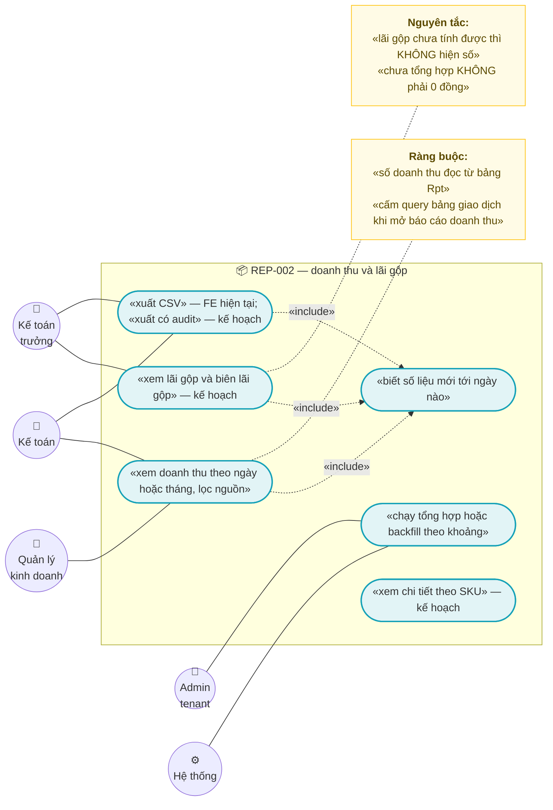
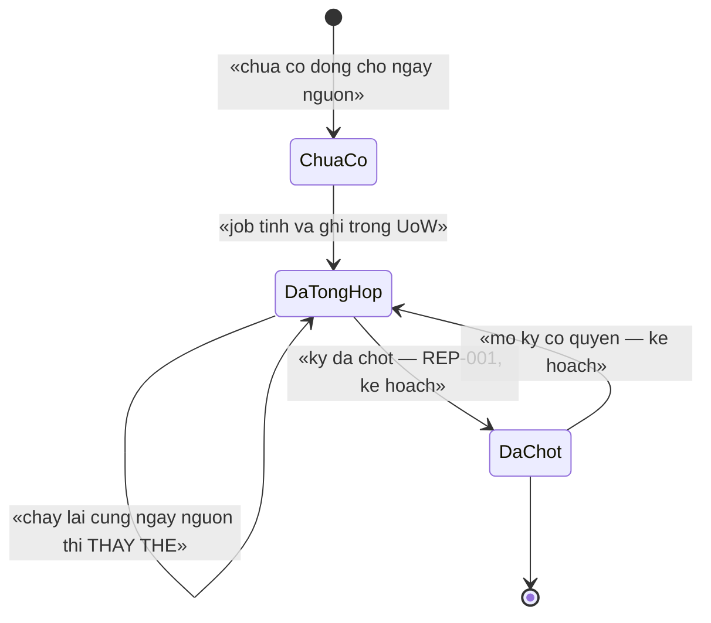
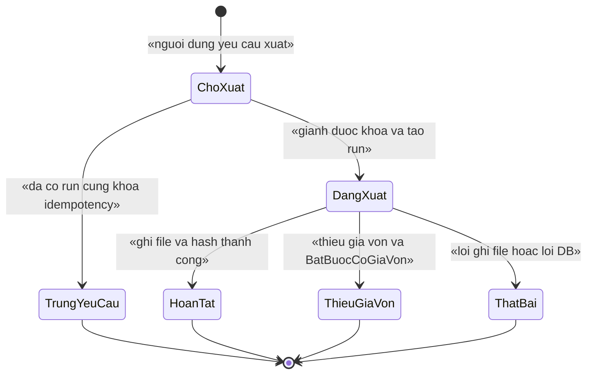
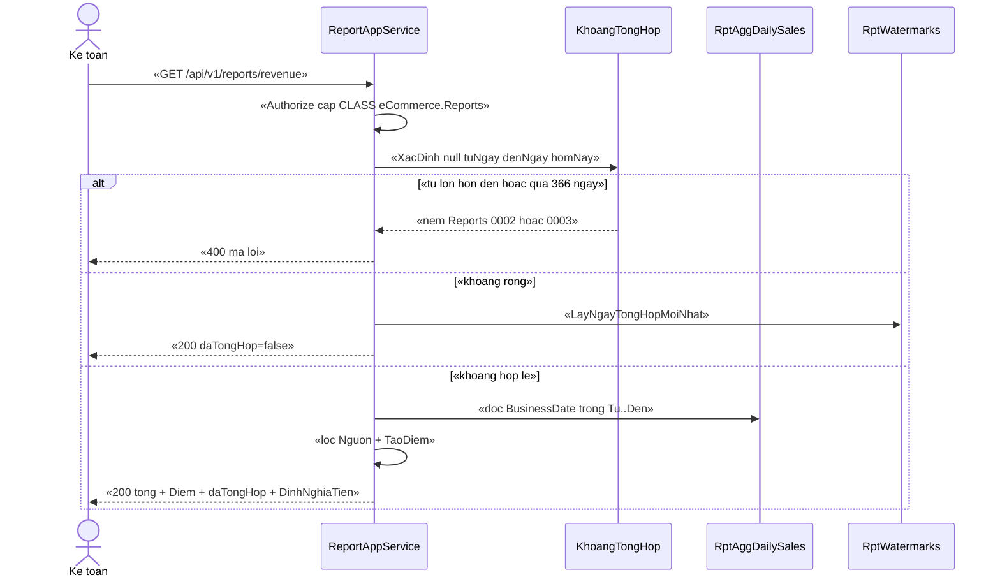
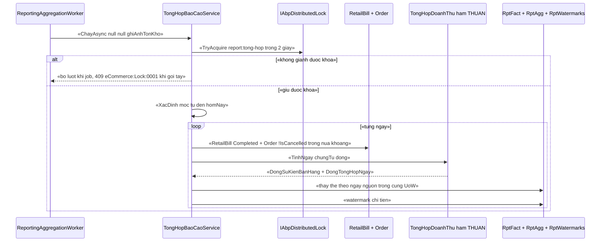
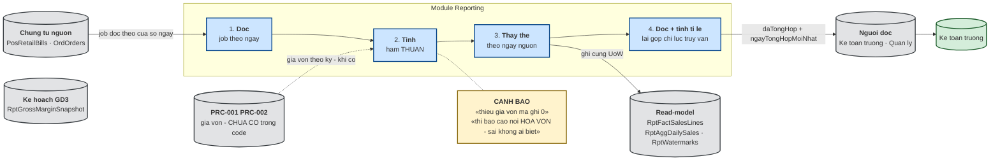
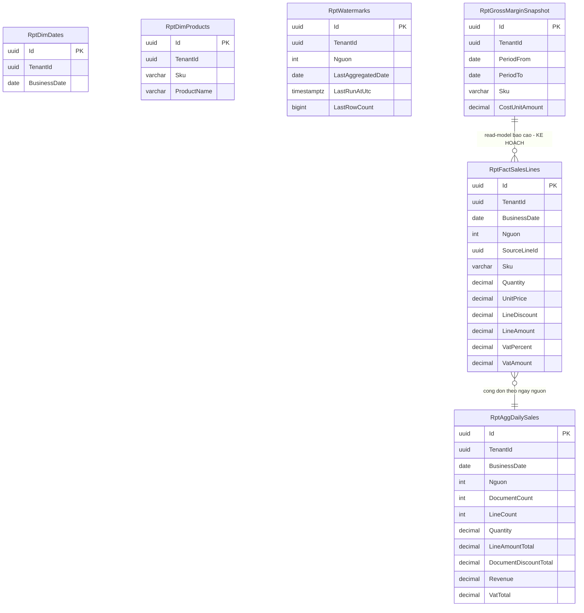

# `REP-002` — Báo cáo doanh thu và lãi gộp

| Thuộc tính | Nội dung |
|---|---|
| **Mã** | `REP-002` |
| **Module** | **Reporting** (`modules/Reporting/…`) — ✅ **đã có code** (`WP-08`): **doanh thu** đã chạy; **lãi gộp** ⬜ chưa có |
| **Giai đoạn** | **GĐ3 — Điều hành** — `docs/implementation-plan.md:437` |
| **Ưu tiên** | **Must have** — báo cáo số 1 mà kế toán trưởng/điều hành mở mỗi ngày |
| **Trạng thái** | 🟡 `Draft` — chờ review (**đỏ cứng** `D-114` §2.1: **không** code mới khi chưa duyệt) |
| **Người viết / người review** | *(điền)* / **Kế toán trưởng + Kiến trúc trưởng** |
| **Phiên bản / ngày** | `v0.3 — 24/11/2026` (áp kết quả decider `D-114` P2–P4 + `D-172`/`D-175`; xem §15.3) |
| **Tài liệu liên quan** | `REP-001` (read-model nền — **đã có code**) · `REP-003` · `ACC-001` · `XC-001` · `XC-003` · `XC-005` · `XC-006` · `PRC-001`/`PRC-002` (giá vốn — **đã có bảng đọc `PrcCostPrices`**, chưa có cửa ghi) · `SAL-002`/`SAL-003`/`SAL-006` · `REC-002`/`REC-003` · `docs/implementation-plan.md` |

---

## 0. Tóm tắt & quyết định thiết kế

**Tóm tắt:** `REP-002` trả lời hai câu hỏi tiền bạc: **doanh thu thuần** và **lãi gộp** — theo **ngày/tháng × nguồn** (bán lẻ · đơn hàng)
và (kế hoạch) theo **ngày × SKU**. Số liệu **không** tính lúc người dùng mở báo cáo: đọc **read-model `Rpt*`** của `REP-001`.
Tài liệu chốt **công thức từng chỉ tiêu**, **cách xử lý chỗ chưa biết** (giá vốn **chỉ có bảng đọc `PrcCostPrices`, chưa có cửa ghi**, snapshot thuế suất **chưa có trên dòng đơn**),
và **cách từ chối trả số sai** (không bao giờ hiện `0` thay cho *chưa biết*).

**Vì sao phải có tài liệu riêng (không gộp vào `REP-001`):** `REP-001` chốt **hạ tầng** read-model;
`REP-002` chốt **ngữ nghĩa kế toán** của doanh thu và lãi gộp. Ngữ nghĩa này là nơi dễ sai nhất và **sai thì không ai phát hiện** —
ví dụ *lãi gộp = 0 vì chưa có giá vốn* trông y như *hoà vốn*.

**Hiện trạng thật của code** (đối chiếu `codegraph_explore` + `Read` ngày 24/11/2026 — nguồn ở mục *Đối chiếu mô hình Nhanh* cuối tài liệu):

| Hạng mục | Hiện trạng | Bằng chứng (đường dẫn thật) |
|---|---|---|
| Module `Reporting` | ✅ 4 project, worker đã đăng ký | `modules/Reporting/eCommerce.Reporting.Application/ReportingApplicationModule.cs:16-37` |
| Bảng read-model | ✅ **8 bảng `Rpt*`** + migration đã sinh | `src/eCommerce.EntityFrameworkCore/eCommerceDbContext.cs:260-274` · `Migrations/20261104033300_Wp08_BaoCao_Reporting` |
| API doanh thu | ✅ `GET /api/v1/reports/revenue` | `src/eCommerce.HttpApi/Controllers/ReportsController.cs:35-37` |
| DTO doanh thu | ✅ `BaoCaoDoanhThuDto` + `DiemDoanhThuDto` + `DinhNghiaTien` | `modules/Reporting/eCommerce.Reporting.Application.Contracts/ReportingDtos.cs:20-70` |
| Tiền / số lượng | ✅ `numeric(18,2)` / `numeric(18,3)` trên fact | `modules/Reporting/eCommerce.Reporting.EntityFrameworkCore/ReportingDbContextModelCreatingExtensions.cs:102-107` |
| Nguồn doanh thu | ✅ POS `RetailBill` (`Status = Completed`) + `Order` (`!IsCancelled`) | `modules/Reporting/eCommerce.Reporting.Application/TongHopBaoCaoService.cs:255-259` |
| Công thức doanh thu | ✅ `Σ thành tiền dòng − chiết khấu chứng từ`, VAT tách riêng | `modules/Reporting/eCommerce.Reporting.Domain/BaoCao/TongHopDoanhThu.cs:72-100` · `ReportingConsts.cs:13-15` |
| Job tổng hợp | ✅ thay thế theo `(ngày, nguồn)`; nhịp as-built **15 phút** | `TongHopBaoCaoService.cs:107-140` · `ReportingOptions.cs:17-18` |
| Khoá phân tán | ✅ `report:tong-hop` (module sinh, không tiền tố) | `TongHopBaoCaoService.cs:44,112` |
| **Giá vốn (nguồn)** | 🔶 bảng đọc `PrcCostPrices` **đã có**; **chưa có cửa ghi** (câu hỏi mở `Q2` của `PRC`) | `modules/Pricing/eCommerce.Pricing.Domain/CostPrice.cs:36` · `eCommerce.Pricing.Application/CostPriceAppService.cs:24-82` · 4 project `eCommerce.slnx:71-75` |
| **Lãi gộp** | ❌ **chưa có** trong Reporting — không cột, không hàm tính lãi gộp | `modules/Reporting/**` không có `GrossProfit`/`CostAmount` |
| Chiều **kênh / shop** | ❌ không có trong read-model (chỉ `Nguon` 3 giá trị) | `modules/Reporting/eCommerce.Reporting.Domain/BaoCao/DongBanHang.cs:13-27` |
| Snapshot **thuế suất** dòng đơn | 🔶 có `VatPercent`/`VatAmount` trên fact; `OrderLine` **không** có `TaxRate`/`TaxClassificationId` | `FactSalesLine.cs:56-58` · `AnhXaNguonBanHang.cs:87-103` |
| **Xuất file** | 🔶 CSV dựng ở **FE**; **không** endpoint/nhật ký server | `apps/admin-web/lib/report.ts:81,93` |
| Độ tươi dữ liệu | 🔶 có `DaTongHop` + `NgayTongHopMoiNhat`; **chưa** có `AsOfUtc`/`LagSeconds`/`IsStale` | `ReportingDtos.cs:60-64` · `ReportAppService.cs:56-106` |
| Mã lỗi | ✅ `eCommerce:Reports:0001–0009` | `modules/Reporting/eCommerce.Reporting.Domain/ReportingErrorCodes.cs:11-38` |
| Quyền | ✅ `eCommerce.Reports` + `eCommerce.Reports.Aggregate` | `src/eCommerce.Domain.Shared/eCommerceConsts.cs:340-347` |

⇒ 🔴 **Hệ quả thẳng:** `REP-002` **đã có một nửa**. **Doanh thu** là **as-built** (2 nguồn, ngày/tháng — **chưa** có chiều SKU/kênh/shop);
**lãi gộp** là **kế hoạch** — nhưng **nguồn giá vốn đã tồn tại**: `REP-002` **tiêu thụ** giá vốn từ **`PrcCostPrices`** (`PRC-001`/`PRC-002` **đã có** bảng đọc, chưa có cửa ghi), **KHÔNG** dựng nguồn giá vốn thứ hai; `RptGrossMarginSnapshot` chỉ là **read-model báo cáo**, không phải nguồn giá vốn. Snapshot thuế suất (`SAL-002` **chưa có**) chỉ cần cho **chiều tách thuế suất** (A5), **KHÔNG** cho công thức lãi gộp (`Q4` đã đóng — `D-48` + `D-114` P3).
Tài liệu **không** che các khoảng trống: chúng là **cờ dữ liệu** + **lỗi từ chối** (§6, §12).

**Phạm vi:**
- ✅ **Chỉ tiêu doanh thu** (thành tiền dòng, chiết khấu chứng từ, doanh thu, VAT) — as-built, công thức một chỗ.
- ✅ **Read-model đang dùng**: `RptFactSalesLines` → `RptAggDailySales`; API đọc bảng gộp.
- ✅ **Job tổng hợp** thay thế theo `(ngày, nguồn)`, khoá phân tán, idempotent (thuộc `REP-001`).
- ⬜ **Lãi gộp** (giá vốn, lãi gộp, biên lãi gộp) — **kế hoạch**: tiêu thụ giá vốn từ **`PrcCostPrices`**, chụp snapshot tại thời điểm bán (kế toán đã chốt `D-114` P2/P3).
- ⬜ **Tầng ngày × SKU** + read-model lãi gộp (`RptGrossMarginSnapshot` — **read-model báo cáo**, không phải nguồn giá vốn) — **kế hoạch**.
- ⬜ **Xuất có nhật ký server** — **thuộc `ACC-001`**, **không** trong `REP-002`; as-built chỉ CSV ở FE.
- 🔶 **Chỗ chưa biết** (`CostMissing`, `TaxSnapshotMissing`, `SettlementPending`) ⇒ `null` + cờ + cảnh báo — **kế hoạch**; as-built đã có nguyên tắc *chưa tổng hợp ≠ 0 đồng* (`DaTongHop`).

**Không nằm trong phạm vi:** hạ tầng read-model (`REP-001`); tồn kho/hiệu suất kênh (`REP-003`); định giá tồn kho (`PRC-001`);
settlement sàn (`REC-002`); đối soát COD (`REC-003`, `D-173`); báo cáo theo giờ/flash-sale (`D-174`, `D-156`); hoá đơn/Mẫu 01 (`EINV-001`/`ACC-001`);
ghi ngược module nguồn (**cấm**); dashboard BI ngoài (chỉ chốt hợp đồng dữ liệu).

### 0.1 Quyết định thiết kế (ADR ngắn)

| # | Quyết định | Phương án đã cân nhắc | Lý do chọn | Hệ quả |
|---|---|---|---|---|
| **D1** | Đường đọc doanh thu chỉ chạm `RptAggDailySales`; **cấm** query `PosRetailBills`/`OrdOrders` trong đường đọc doanh thu | (a) query nguồn khi mở báo cáo · (b) view · (c) read-model | (a) bị cấm bởi `docs/implementation-plan.md:213`; (b) `REFRESH` khoá bảng, không watermark; (c) as-built | Báo cáo có **độ trễ theo job** ⇒ phải hiện `DaTongHop`/`NgayTongHopMoiNhat` |
| **D2** | **Độ tươi do JOB quyết định** — đường đọc không kích hoạt tổng hợp | (a) làm mới khi mở · (b) job theo nhịp · (c) job + nút chạy tay | (a) request đầu tiên phải quét nguồn ⇒ p95 không đoán được, tranh tài nguyên bán hàng; (b)+(c) as-built | `asOfUtc`/`IsStale` là **kế hoạch GĐ3** (D-172/Q9 theo D-114) — additive, nullable |
| **D3** | **Hai tầng**: `RptFactSalesLines` (dòng chứng từ) → `RptAggDailySales` (ngày × nguồn) | (a) một bảng, gộp lúc đọc · (b) chi tiết + gộp sẵn | (a) `GROUP BY` mỗi lần mở ⇒ nặng; (b) as-built | Ghi cả hai cùng UoW; test đẳng thức tổng báo cáo = Σ chứng từ |
| **D4** | **Chỉ lưu số CỘNG ĐƯỢC**; tỉ lệ (biên lãi, AOV) tính **lúc truy vấn** | (a) lưu sẵn tỉ lệ · (b) lưu tiền/SL rồi chia | Tỉ lệ **không cộng được** qua nhóm ⇒ tổng tháng lệch tổng ngày | Cấm thêm cột tỉ lệ vào fact |
| **D5** | Thiếu giá vốn ⇒ lãi gộp `NULL` + cờ `CostMissing`, **TUYỆT ĐỐI không ghi `0`** | (a) `0` · (b) chặn cả báo cáo · (c) `NULL` + cờ | `0` không phân biệt được với *hoà vốn thật* | ⬜ kế hoạch; UI ẩn cột, hiện nhãn *chưa có giá vốn — xem PRC-001* |
| **D6** | Xuất lãi gộp **TỪ CHỐI** khi thiếu giá vốn (`BatBuocCoGiaVon = true`) | (a) cột trống · (b) `0` · (c) từ chối + mã lỗi | File đã xuất được lưu/gửi/in/ký; cột `0` là sai vĩnh viễn | ⬜ kế hoạch; `Q11` đã đóng: CSV ở FE **không** xuất cột lãi gộp khi `CostMissing`; xuất có audit thuộc `ACC-001` |
| **D7** | Doanh thu tách khỏi thuế; **KHÔNG** tính lại thuế theo cấu hình hiện tại | (a) tính lại theo `TaxRateSchedule` · (b) dùng số đã chốt | (a) phá `XC-006` D3/BR-002: đổi cấu hình không làm đổi chứng từ cũ | Số VAT luôn khớp chứng từ |
| **D8** | Tiền `decimal`; cấm `==` trên tiền; cấm `double`/`float` | (a) `double` · (b) so `==` | Kế thừa `XC-001` BR-003/BR-008 | Reporting as-built dùng `decimal` + `Math.Round(..., 2, AwayFromZero)`; `eCommerce.Kernel.Money.Money` **đã có** (`shared/eCommerce.Kernel/Money/Money.cs:23`) — dùng cho phần lãi gộp (kế hoạch) |
| **D9** | Không làm tròn lại ở tầng báo cáo — cộng số đã chốt | (a) làm tròn tổng kỳ · (b) `Σ` dòng đã làm tròn | Làm tròn lại ⇒ báo cáo khác chứng từ | Báo cáo và Mẫu 01 dùng cùng số |
| **D10** | Fact khoá `(TenantId, Nguon, SourceLineId)` (chống nhân đôi) + **thay thế** theo `(ngày, nguồn)` | (a) upsert có version · (b) xoá–chèn theo ngày | (b) as-built: chạy lại không nhân đôi | Mất lịch sử từng lần sửa trong ngày (nguồn sự thật ở chứng từ) |
| **D11** | Cách ly tenant ở tầng dữ liệu (`IMultiTenant` + query filter) | (a) lọc ở service · (b) `IMultiTenant` | (a) quên một `WHERE` ⇒ rò dữ liệu im lặng | Không có báo cáo toàn cục cho host |
| **D12** | Chiều phân tích là **tập đóng** — as-built `NguonBaoCao` (enum) + `TheoThang` | (a) chuỗi `groupBy` tự do · (b) enum có kiểu | (a) là đường SQL injection + ghép nhầm cột | Thêm chiều = sửa enum + migration |
| **D13** | Phí sàn và phí vận chuyển là **hai cột riêng**; cấn trừ **số dự kiến** khi chưa settlement (D-114 P3) | (a) cộng hết vào giá vốn · (b) cột riêng + cờ | `Order.ChannelFeeAmount` là **dự kiến** (`modules/Sales/eCommerce.Sales.Domain/Order.cs:167`), settlement thuộc `REC-002` | `ChannelFeeSettledAmount` chỉ là **ghi chú kế hoạch** ở đây; cột phí thật (`ChannelFeeEstimatedAmount`/`ChannelFeeActualAmount`) thuộc read-model `REP-003` — **không** thêm cột trùng nghĩa |
| **D14** | Công thức chỉ tiêu nằm trong **hàm THUẦN**, test không cần DB | (a) rải trong app service · (b) trong SQL · (c) hàm thuần | Công thức hay đổi nhất mà khó test nhất | ✅ as-built: `TongHopDoanhThu` + `AnhXaNguonBanHang`, test trong `Wp08BaoCaoTests` |
| **D15** | CSV ở FE là **tiện ích màn hình**, không phải chứng từ | (a) coi CSV FE là bản chính thức · (b) endpoint server + nhật ký | (a) không có `ContentHash`/`RequestedBy`; (b) là việc mới | `Q11` đã đóng (`D-03`/`D-36`): CSV FE là tiện ích, file có audit thuộc `ACC-001` |

> 📌 **Phương án BỊ LOẠI:** *tính doanh thu/lãi gộp bằng một câu SQL `GROUP BY` trên `OrdOrders` khi mở báo cáo* — bị loại vì
> (1) **cấm** bởi `docs/implementation-plan.md:213`; (2) với 90 ngày × 50.000 SKU, đây đúng là truy vấn **làm chậm bán hàng**.
>
> ⚠️ **Nợ as-built đã biết:** `ReportAppService.GetTongQuanDonHangAsync` (`ReportAppService.cs:109-168`) **đọc `Order`/`OrderLine`** —
> báo cáo **tổng quan đơn** nằm ngoài `REP-002` nhưng cùng lớp app service ⇒ `BR-REP-002-001` phải **giới hạn đúng phạm vi**
> (đường doanh thu/lãi gộp) và đóng bằng `REP-002-Q12` (`Closed — D-175`: ngoại lệ **ngoài** phạm vi `REP-002`).

---

## 1. Use Case Specification

| Thuộc tính | Nội dung |
|---|---|
| **Use Case ID** | `REP-002` |
| **Use Case Name** | Xem **doanh thu** (as-built) và **lãi gộp** (kế hoạch) trên read-model `Rpt*`, nói rõ chỗ chưa biết |
| **Description** | *Là kế toán trưởng/người điều hành, tôi muốn biết kỳ này bán được bao nhiêu tiền thật và lãi bao nhiêu theo từng ngày/tháng/nguồn/SKU — với con số khớp dữ liệu gốc, nói rõ phần chưa biết (giá vốn, phí sàn), và từ chối hiển thị lãi gộp nếu chưa tính được — để tôi không ra quyết định trên số sai.* |
| **Actor(s)** | **Kế toán trưởng** (xem + xuất) · **Kế toán** (xem) · **Quản lý kinh doanh** (xem doanh thu) · **Admin tenant** (chạy tổng hợp/backfill) · **Hệ thống** (worker tổng hợp) |
| **Priority** | **Must have** |
| **Trigger** | (a) `GET /api/v1/reports/revenue`; (b) xuất CSV ở FE; (c) `ReportingAggregationWorker` theo nhịp (`NhipJobPhut`, as-built **15**; mục tiêu **5** theo `D-172`); (d) `POST /api/v1/reports/aggregate` |
| **Pre-Condition(s)** | • **Tenant hiện tại** (`ICurrentTenant`); mọi entity `IMultiTenant`.<br>• **8 bảng `Rpt*`** + `DbSet` đã khai (`eCommerceDbContext.cs:260-274`); thiếu `DbSet` ⇒ `IRepository<T>` không đăng ký.<br>• `ReportingAggregationWorker` đã đăng ký (`ReportingApplicationModule.cs:34-37`) — thiếu thì job không bao giờ chạy, không có lỗi biên dịch.<br>• Múi giờ **Asia/Ho_Chi_Minh** (`ReportingOptions.GioLechUtc = 7`).<br>• Redis cho khoá `report:tong-hop`; Redis chết vẫn không sai số nhờ UNIQUE index.<br>• ⚠️ **Giá vốn có thể chưa có** ⇒ doanh thu vẫn chạy; lãi gộp **chưa** tồn tại trong code. |
| **Post-Condition(s)** | • Số doanh thu chỉ đến từ `RptAggDailySales`; **0** truy vấn nguồn trong đường đọc doanh thu (BR-001).<br>• Mỗi ngày/tháng trong khoảng **đều có điểm**, kể cả 0 đồng (`TaoDiem`, `ReportAppService.cs:265-349`).<br>• Phản hồi mang `DaTongHop` + `NgayTongHopMoiNhat` + `DinhNghiaTien`; `DaTongHop = false` nghĩa là **chưa tổng hợp**, không phải **0 đồng** (BR-013).<br>• Chứng từ huỷ không vào doanh thu: `RetailBill.Status = Completed`, `Order.IsCancelled = false`.<br>• Chạy lại cùng khoảng ⇒ số liệu không đổi (BR-006).<br>• ⬜ Lãi gộp: `null` + cờ khi thiếu giá vốn — chưa có trong code. |
| **Basic Flow** | 1. `GET /api/v1/reports/revenue?tuNgay=&denNgay=&nguon=&theoThang=` (`ReportsController.cs:35-37`).<br>2. `KhoangTongHop.XacDinh` xác định khoảng: `từ > đến` ⇒ `Reports:0002`; `> 366 ngày` ⇒ `Reports:0003`; ngày tương lai bị kẹp về hôm nay; khoảng rỗng ⇒ `Rong = true` (`KhoangTongHop.cs:37-73`).<br>3. `Rong` ⇒ trả `DaTongHop = false` + `NgayTongHopMoiNhat` (**không** ném lỗi).<br>4. Đọc `RptAggDailySales` trong `[Tu, Den]`; lọc `Nguon` ở bộ nhớ nếu có (`ReportAppService.cs:78-88`).<br>5. `TaoDiem` dựng điểm theo ngày (hoặc gộp tháng bằng cách cộng từng ngày, để không mất tháng 0 đồng).<br>6. Trả tổng + `DinhNghiaTien`.<br>**Nhánh kế hoạch (lãi gộp):** `GET /gross-margin` đọc fact dòng + tiêu thụ **giá vốn từ `PrcCostPrices`** (chụp snapshot tại thời điểm bán), tính lãi gộp lúc truy vấn; thiếu giá vốn ⇒ `null` + cờ + từ chối xuất (D5/D6). |
| **Alternative Flow** | **A1: Redis chết** — job vẫn chạy; UNIQUE + thay thế theo ngày là hàng rào cuối; log `Error` + metric.<br>**A2: Khoảng rỗng** ⇒ `DaTongHop = false`, không phải lỗi (`KhoangTongHop.cs:66-72`).<br>**A3: Read-model rỗng lần đầu** ⇒ `TaoDiem` vẫn dựng đủ ngày với `0`; `DaTongHop = false`, `NgayTongHopMoiNhat = null`; UI hiện *chưa tổng hợp*, không hiện *0 đồng*.<br>**A4: Ngày tương lai** ⇒ kẹp về hôm nay (`Khoang_ngay_TUONG_LAI_bi_KEP_ve_hom_nay`).<br>**A5: Tách theo thuế suất** ⇒ **không** làm được: `OrderLine` chưa có `TaxRate`/`TaxClassificationId`; fact dòng chỉ có `VatPercent`/`VatAmount`.<br>**A6: Lãi gộp** (kế hoạch) — phí sàn **dự kiến** + cờ `SettlementPending`. |
| **Exception Flow** | **E1:** `từ > đến` ⇒ `eCommerce:Reports:0002`.<br>**E2:** khoảng > 366 ngày ⇒ `Reports:0003` — ném, không tự cắt.<br>**E3:** chiết khấu chứng từ > tổng tiền dòng ⇒ `Reports:0004` — không làm tròn về 0.<br>**E4:** dòng mồ côi / dòng nguồn trùng / chứng từ có chiết khấu mà không có dòng ⇒ `Reports:0005`/`0008`/`0009`.<br>**E5:** `POST /aggregate` khi lượt khác đang chạy ⇒ `409` `eCommerce:Lock:0001` (`ReportsController.cs:60`).<br>**E6:** nguồn `TonKho` cho sổ doanh thu ⇒ `Reports:0001`.<br>**E7:** (kế hoạch) lãi gộp/xuất khi thiếu giá vốn ⇒ `eCommerce:Reports:0010` (`409`). |
| **Business Rules** | Phát biểu đầy đủ ở §8.1: **`BR-REP-002-001`** chỉ đọc read-model · **`BR-REP-002-002`** thiếu dữ liệu ⇒ `null` + cờ, cấm `0` · **`BR-REP-002-003`** hai tầng khớp nhau · **`BR-REP-002-004`** chỉ lưu số cộng được · **`BR-REP-002-005`** tiền `numeric(18,2)`, SL `numeric(18,3)`, cấm `double`/`float` (tiền lãi gộp qua `Money`) · **`BR-REP-002-006`** idempotent theo `(ngày, nguồn)` · **`BR-REP-002-007`** mọi lượt tổng hợp dưới khoá `report:tong-hop` · **`BR-REP-002-008`** dữ liệu bất thường phải ném/lộ ra · **`BR-REP-002-009`** công thức trong hàm thuần · **`BR-REP-002-010`** cách ly tenant · **`BR-REP-002-011`** một chiều, cấm ghi ngược · **`BR-REP-002-012`** cấm SQL nối chuỗi · **`BR-REP-002-013`** phản hồi mang `DaTongHop`/`NgayTongHopMoiNhat` · **`BR-REP-002-014`** thuế dùng số đã chốt · **`BR-REP-002-015`** xuất chứng từ có nhật ký + hash (thuộc `ACC-001`) · **`BR-REP-002-016`** thiếu ngữ cảnh tenant ⇒ từ chối · **`BR-REP-002-017`** nguồn `DonHang` chỉ ghi doanh thu khi giao **đã đối soát** (D-114 P4) · **`BR-REP-002-018`** chứng từ huỷ không vào doanh thu. |
| **Non-Functional Requirement** | **001** hiệu năng API · **002** hiệu năng xuất · **003** hiệu năng job · **004** lệch số = 0 · **005** idempotent 1.000 lần · **006** cách ly tenant · **007** quan sát được · **008** không chặn bán hàng · **009** kích thước read-model · **010** không `double`/`float`. Đầy đủ ở §13. |

---

## 2. Sơ đồ Use Case



| Ký hiệu | Ý nghĩa |
|---|---|
| ⭕ Xanh lá | Actor |
| 🟦 Bầu dục xanh dương | Use Case |
| 🟨 Khung vàng | Note |
| `───` | Liên kết Actor ↔ Use Case |
| `-.«include».->` | Quan hệ bao hàm |

---

## 3. Sơ đồ trạng thái (state machine)

`REP-002` có **hai** vòng đời: dòng fact là **as-built**; xuất file là **kế hoạch**. Mọi chuyển sai **phải ném lỗi**.

### 3.1 Vòng đời một ngày × nguồn (`RptFactSalesLines` + `RptAggDailySales`)



| Từ | Sang | Guard | Hành động kèm theo | Nếu guard sai thì? |
|---|---|---|---|---|
| `ChuaCo` | `DaTongHop` | Giành khoá `report:tong-hop` (chờ 2 s); `XacDinh` cho ngày hợp lệ | Đọc `RetailBill` (`Completed`) + `Order` (`!IsCancelled`) — **as-built**; đích GĐ3 (Q10/BR-017): `DonHang` chỉ khi `Delivered` + đối soát xác nhận; `TinhNgay`; ghi fact + gộp + watermark **cùng UoW** | Không giành khoá ⇒ bỏ lượt (job) / `409 eCommerce:Lock:0001` (gọi tay); tham số sai ⇒ `Reports:0002`/`0003` |
| `DaTongHop` | `DaTongHop` | Chạy lại cùng `(ngày, nguồn)` | **Xoá rồi chèn lại** phần ngày/nguồn (`GopTongHopTheoNgay`, `TongHopDoanhThu.cs:229-242`) ⇒ không cộng dồn | Dòng nguồn trùng ⇒ `Reports:0008`; dòng mồ côi ⇒ `0005` |
| `DaTongHop` | `DaChot` | ⬜ `BusinessDate` thuộc kỳ đã chốt — **chưa có** bảng `RepPeriodClose`; kỹ thuật `EXCLUDE` đã chốt `D-171` | Không ghi nữa; báo cáo vẫn đọc được | Cố ghi ⇒ `REP-001` từ chối (khi có bảng) |
| `DaChot` | `DaTongHop` | ⬜ có quyền mở kỳ + lý do ≥ 20 ký tự (`REP-001` §3.3) | Ghi audit; job được ghi lại khoảng | `403` / từ chối |
| `DaChot` | `[*]` | — | Hấp thụ theo kỳ | Mọi chuyển khác ⇒ **`InvalidOperationException`** |

> ⚠️ **Khác v0.1:** as-built **không** có `Lech`/`RepConsistencyCheck`/`RepRunLog`. Với **chứng từ nguồn 0 dòng**, job **bỏ qua + log `Warning`**
> (`TongHopBaoCaoService.cs:284-287,314-317`) — **không** làm chết cả ngày; `Reports:0009` chỉ là **hàng rào của hàm thuần** `TongHopDoanhThu` khi test gọi trực tiếp, **không** phải cơ chế phát hiện của job.
> Lỗi còn lại (`0004` doanh thu âm, `0005` dòng mồ côi, `0008` dòng trùng) **ném ngay lúc tổng hợp** — fail-closed, không ghi số nghi vấn. *Job đối chiếu độc lập* của v0.1 **chưa** có (xem `REP-002-Q8`).

### 3.2 Vòng đời một lần xuất có audit (`RptExportRunLog`) — ⬜ **không thực hiện trong `REP-002`** (thuộc `ACC-001`)



| Từ | Sang | Guard | Hành động kèm theo | Nếu guard sai thì? |
|---|---|---|---|---|
| `ChoXuat` | `DangXuat` | Giành khoá `report:export:{tenantId}` | Tạo `RptExportRunLog` `Running` + `RequestedBy` | Sang `TrungYeuCau` |
| `ChoXuat` | `TrungYeuCau` | Cùng khoá idempotency đã có run `Running`/`Completed` | Trả bản ghi cũ + `AlreadyRequested = true`; không tạo run mới | — (hành vi đúng) |
| `DangXuat` | `HoanTat` | Ghi file + `ContentHash` (SHA-256) thành công | `Completed`, `RowCount`, `RequestedBy` | — |
| `DangXuat` | `ThieuGiaVon` | `CostMissing` **và** `BatBuocCoGiaVon` | `RejectedCostMissing` + `eCommerce:Reports:0010`; **KHÔNG** tạo file | log `Warning`, không `Error` |
| `DangXuat` | `ThatBai` | Lỗi ghi file/DB | `Failed` + `LastErrorCode` + `CorrelationId`; xoá file dở dang | — |
| 3 trạng thái cuối | `[*]` | — | Hấp thụ | Mọi chuyển khác ⇒ **`InvalidOperationException`** |

> 📌 **As-built không có vòng đời này:** `apps/admin-web/lib/report.ts:81` dựng CSV ở trình duyệt; không endpoint, không nhật ký, không `ContentHash`.
> **Q11 đã đóng** (`D-03` + `D-36`): CSV ở FE là **tiện ích màn hình**, không phải chứng từ; `RptExportRunLog` **không** thực hiện trong `REP-002` —
> mọi file liệu kế toán có audit (`Excel`/`MISA`/`CSV`, `SHA-256`, `RequestedBy`, chỉ kỳ đã chốt) thuộc `ACC-001` (`AccExportRuns`/`AccExportArtifacts`).

---

## 4. Sequence Diagram & luồng dữ liệu

### 4.1 Một lần mở báo cáo doanh thu (as-built, chỉ đọc)



> 📌 Đường đọc **không** kích hoạt tổng hợp, **không** giành khoá, **không** ném khi dữ liệu cũ (D2).

### 4.2 Job tổng hợp một ngày (as-built)



> ⚠️ **As-built vs đích của `DonHang` (Q10 / D-114 P4):** as-built đọc `Order` (`!IsCancelled`) và lấy **`CreationTime`** làm mốc ngày
> (`ReportAppService`/`TongHopBaoCaoService.cs:255-259`). Đích: chỉ ghi doanh thu khi `FulfillmentStatus = Delivered` **và** đối soát vận đơn đã xác nhận
> (`Source = Reconciliation`, `ConfirmedAtUtc <> null`); `BusinessDate` = ngày UTC+7 của **`Shipment.DeliveredAtUtc`**, không phải `Order.CreationTime` (BR-017).
> `Nguồn BanLe` (POS) giữ as-built: chỉ hoá đơn `Completed`, ngày UTC+7 lúc tạo. **Không** đổi code/migration ở WP-14 (`modules/Shipping` chưa vào `eCommerce.slnx`).

### 4.3 Luồng dữ liệu — doanh thu (as-built) và lãi gộp (kế hoạch)



---

## 5. Mô hình dữ liệu

> ⚠️ **Tiền tố bảng:** as-built dùng **`Rpt*`** cho cả 8 bảng (`REP-001`/`REP-003` cùng tiền tố). Bản v0.1 dùng `Rep*` là **cũ**;
> `D-47` (ĐÃ CHỐT) + `D-174` mô tả đúng 8 bảng `Rpt*`. **Không** dựng thêm bảng `Rep*`.

### 5.1 ERD (as-built + kế hoạch)



> 📌 **Không FK tới bảng giao dịch** (`REP-001` D14). `Sku`/`WarehouseId`/`StaffId`/`CustomerId` là tham chiếu mềm.
> `RptGrossMarginSnapshot` là **kế hoạch** (chưa có bảng) — **read-model báo cáo**, **không** phải nguồn giá vốn; `RptFactInventorySnapshots`/`RptDimStores`/`RptDimStaffs` tồn tại nhưng **không** thuộc `REP-002`.

### 5.2 Bảng & cột

#### 5.2.1 `RptAggDailySales` — *doanh thu theo ngày × nguồn (đường đọc chính)*

| Cột | Kiểu | Nguồn / ý nghĩa |
|---|---|---|
| `Id` / `TenantId` | `uuid` | `IGuidGenerator` / `IMultiTenant` |
| `BusinessDate` | `date` | ngày kinh doanh (UTC+7), từ `NgayKinhDoanh.TuUtc` |
| `Nguon` | `int` | `NguonBaoCao`: `BanLe = 0`, `DonHang = 1`; `TonKho = 2` **bị chặn** cho doanh thu |
| `DocumentCount` | `int` | số chứng từ có ít nhất một dòng |
| `LineCount` / `Quantity` | `int` / `numeric(18,3)` | số dòng / Σ số lượng |
| `LineAmountTotal` | `numeric(18,2)` | Σ thành tiền dòng (**chưa** VAT) |
| `DocumentDiscountTotal` | `numeric(18,2)` | Σ chiết khấu cấp chứng từ |
| `Revenue` | `numeric(18,2)` | `LineAmountTotal − DocumentDiscountTotal` — **cột đã ghi**, không tính lại khi đọc |
| `VatTotal` | `numeric(18,2)` | Σ VAT của các dòng |
| `AggregatedAtUtc` | `timestamptz` | lúc tổng hợp |

| Loại | Cột | Mục đích |
|---|---|---|
| **UNIQUE** | `(TenantId, BusinessDate, Nguon)` | khoá thay thế theo ngày/nguồn |
| INDEX | `(TenantId, BusinessDate)` | truy vấn theo khoảng (đường đọc chính) |
| CHECK | `Revenue >= 0`, `DocumentCount >= 0` | bất biến ở DB |

> ⚠️ `BusinessDate` của nguồn `DonHang`: as-built = ngày UTC+7 của **`Order.CreationTime`**; đích GĐ3 (D-114 P4) = ngày UTC+7 của **`Shipment.DeliveredAtUtc` đã đối soát** (`Source = Reconciliation`, `ConfirmedAtUtc <> null`) — xem BR-017.

#### 5.2.2 `RptFactSalesLines` — *grain = một dòng chứng từ nguồn*

| Cột | Kiểu | Ghi chú |
|---|---|---|
| `TenantId` / `BusinessDate` / `Nguon` | `uuid` / `date` / `int` | như §5.2.1 |
| `DocumentId` / `SourceLineId` / `DocumentNumber` | `uuid` / `uuid` / `varchar(64)` | chứng từ + dòng nguồn |
| `WarehouseId` / `StaffId` / `CustomerId` | `uuid?` | chiều phân tích **có sẵn ở dữ liệu**, **chưa** có API nhóm theo các chiều này |
| `Sku` / `ProductName` | `varchar(64)` / `varchar(256)` | `Sku` là khoá; **không** dùng `ProductVariantId` (D-07) |
| `Quantity` | `numeric(18,3)` | D-31 |
| `UnitPrice` / `LineDiscount` / `LineAmount` | `numeric(18,2)` | `LineAmount` **chưa** VAT |
| `VatPercent` / `VatAmount` | `numeric(18,2)?` / `numeric(18,2)` | snapshot thuế của dòng |
| `OccurredAtUtc` | `timestamptz` | mốc phát sinh; đủ để `GROUP BY` theo giờ lúc đọc (`D-174`) |

| Loại | Cột | Mục đích |
|---|---|---|
| **UNIQUE** | `(TenantId, Nguon, SourceLineId)` | ⭐ hàng rào chống nhân đôi |
| INDEX | `(TenantId, BusinessDate, Nguon)` · `(TenantId, Sku)` | báo cáo theo ngày/nguồn/SKU |
| CHECK | tiền/SL **không âm**; `Nguon IN (0,1)` | tiền âm = ghi sai dấu |

#### 5.2.3 `RptWatermarks` — *mốc tổng hợp theo nguồn*

| Cột | Kiểu | Ý nghĩa |
|---|---|---|
| `Nguon` | `int` | `BanLe` / `DonHang` / `TonKho` |
| `LastAggregatedDate` | `date?` | ngày lớn nhất **đã** tổng hợp; **chỉ tiến** (`GhiNhan`, `AggDailySales.cs:130-150`) |
| `LastRunAtUtc` / `LastRowCount` | `timestamptz?` / `bigint` | phân biệt *chạy mà không có việc* với *không chạy* |

#### 5.2.4 `RptGrossMarginSnapshot` — ⬜ **kế hoạch** (read-model lãi gộp; **không** phải nguồn giá vốn)

| Cột | Kiểu | Ý nghĩa |
|---|---|---|
| `PeriodFrom` / `PeriodTo` | `date` | kỳ hiệu lực giá vốn |
| `Sku` / `WarehouseId?` | `varchar(64)` / `uuid?` | `NULL` = bình quân toàn tenant |
| `CostUnitAmount` | `numeric(18,2)` | giá vốn đơn vị **đã chụp** (snapshot) tại thời điểm bán — bất biến |
| `CostingMethod` | `int` | `Wavg = 0` (**bình quân gia quyền DI ĐỘNG**, mặc định) / `Fifo = 1` thêm ở **cuối dải** (D-17); **không** có nhánh FIFO (D-114 P2) |

| Loại | Cột | Mục đích |
|---|---|---|
| **UNIQUE** | `(TenantId, PeriodFrom, PeriodTo, Sku, WarehouseId, CostingMethod)` | chống 2 job ghi 2 giá vốn cùng kỳ |
| **EXCLUDE** | `(TenantId WITH =, Sku WITH =, daterange(PeriodFrom, PeriodTo, '[]') WITH &&)` | chặn khung chồng — kỹ thuật `btree_gist` **đã chạy thật** trên PG17 (`D-171`); **chưa** áp cho bảng này ⇒ 4 ca test trước `migrations add` |

> ⚠️ **Nguồn giá vốn là `PrcCostPrices`** (`PRC-001`/`PRC-002` **đã có**, chỉ đọc — `modules/Pricing/eCommerce.Pricing.Domain/CostPrice.cs:36`): `REP-002` **tiêu thụ**, **KHÔNG** dựng nguồn giá vốn thứ hai; bảng này chỉ là **read-model báo cáo** để chụp giá vốn tại thời điểm bán. Bảng này **không** được tạo trước khi kế toán **duyệt lô** phương pháp (D-114 P2 — Wavg di động, mặc định; cấu hình theo tenant).
> Giá vốn đơn vị được **chụp vào fact lúc bán**; báo cáo đọc số đã chụp, **không** tra lại bảng kỳ rồi tính lại — sửa bảng giá vốn sau ngày bán **không** đổi lãi gộp kỳ cũ.
> 📌 **Phí sàn thật KHÔNG ở bảng này:** `ChannelFeeSettledAmount` chỉ là ghi chú kế hoạch §0.1 D13; cột phí thật (`ChannelFeeEstimatedAmount`/`ChannelFeeActualAmount`) thuộc read-model `REP-003` — **không** thêm cột trùng nghĩa ở hai bảng.

#### 5.2.5 `RptExportRunLog` — ⬜ **không thực hiện trong `REP-002`** (thuộc `ACC-001`)

| Cột | Kiểu | Ý nghĩa |
|---|---|---|
| `JobName` / `Status` / `Format` | `varchar` / `int` / `int` | `revenue-margin-export`; trạng thái §3.2; `Csv = 0`/`Xlsx = 1` |
| `FromDate` / `ToDate` / `GroupBy` | `date` / `date` / `int` | bộ lọc; `GroupBy` là enum tập đóng |
| `IdempotencyKey` / `FilterHash` | `varchar(256)` / `char(64)` | khoá chống xuất trùng; SHA-256 bộ lọc |
| `RowCount` / `ContentHash` | `bigint` / `char(64)?` | số dòng / SHA-256 nội dung file |
| `RequestedBy` / `LastErrorCode` | `uuid?` / `varchar(64)?` | audit / mã lỗi |
| `StartedAtUtc` / `FinishedAtUtc` / `HostName` | `timestamptz` / `timestamptz?` / `varchar` | chẩn đoán |

| Loại | Cột | Mục đích |
|---|---|---|
| **UNIQUE** | `(TenantId, IdempotencyKey)` | gọi lại cùng bộ lọc ⇒ **1** lần xuất |
| **UNIQUE có filter** | `(TenantId, JobName) WHERE Status = 1` | chỉ một lần xuất hoạt động mỗi tenant |
| CHECK | `ToDate >= FromDate` · `FinishedAtUtc IS NULL OR FinishedAtUtc >= StartedAtUtc` | |

> 📌 **Q11 đã đóng** (`D-03` + `D-36`): bảng này **không** dựng trong `REP-002`. Mọi file liệu kế toán có audit (`Excel`/`MISA`/`CSV`, `SHA-256`, `RequestedBy`, chỉ kỳ đã chốt) thuộc `ACC-001` (`AccExportRuns`/`AccExportArtifacts`).

### 5.3 Ánh xạ chiều phân tích (tập đóng, D12)

| Chiều | As-built | Ghi chú |
|---|---|---|
| `Nguon` | ✅ `DoanhThuInput.Nguon` (`BanLe`/`DonHang`/null = cả hai) | lọc **ở bộ nhớ** để tránh LINQ dịch sai |
| `Ngày` / `Tháng` | ✅ `TheoThang` (bool) | gộp tháng bằng cộng từng ngày |
| `Sku` | ⬜ **kế hoạch** | cần endpoint đọc `RptFactSalesLines`; dữ liệu **đã có** `Sku` |
| `Kênh` / `Shop` | ❌ **không có** trong read-model | `NguonBaoCao` chỉ 3 giá trị; cần bảng/chiều mới + `D-xx` |
| `TaxRate` | ❌ **không chạy được** | `OrderLine` chưa có `TaxRate`/`TaxClassificationId` (`SAL-002`) |

---

## 6. Hợp đồng API

### 6.1 Application Service (as-built)

| Mục | Giá trị |
|---|---|
| Interface | `IReportAppService` — `modules/Reporting/eCommerce.Reporting.Application.Contracts/IReportAppService.cs:13-29` |
| Implementation | `ReportAppService` — `modules/Reporting/eCommerce.Reporting.Application/ReportAppService.cs:26-393` |
| Controller | `ReportsController` — `src/eCommerce.HttpApi/Controllers/ReportsController.cs:20-65` |
| Hàm thuần tính chỉ tiêu | `TongHopDoanhThu` + `AnhXaNguonBanHang` (Domain/Application) |
| `[Authorize]` | ✅ **cấp CLASS** `eCommerce.Reports`; `POST /aggregate` override `eCommerce.Reports.Aggregate` |

| Method | Input | Output | Permission | Trạng thái |
|---|---|---|---|---|
| `GetDoanhThuAsync` | `DoanhThuInput { TuNgay?, DenNgay?, Nguon?, TheoThang }` | `BaoCaoDoanhThuDto` | `eCommerce.Reports` | ✅ as-built |
| `ChayTongHopAsync` | `ChayTongHopInput { TuNgay?, DenNgay?, GhiAnhTonKho }` | `KetQuaTongHopDto` | `eCommerce.Reports.Aggregate` | ✅ as-built |
| `GetTongQuanDonHangAsync` | `TongQuanDonInput` | `TongQuanDonHangDto` | `eCommerce.Reports` | ✅ as-built — **ngoài** phạm vi `REP-002` (`Q12`) |
| `GetTongQuanTonKhoAsync` | `TongQuanTonKhoInput` | `TongQuanTonKhoDto` | `eCommerce.Reports` | ✅ as-built — **ngoài** phạm vi |
| `GetDashboardAsync` | — | `TongQuanDashboardDto` | `eCommerce.Reports` | ✅ as-built — **ngoài** phạm vi |
| `GetGrossMarginAsync` | `{ TuNgay, DenNgay, Sku?, BatBuocCoGiaVon = true }` | `GrossMarginReportDto` | `eCommerce.Reports` | ⬜ kế hoạch |
| `GetDataQualityAsync` | `{ TuNgay, DenNgay }` | số dòng `CostMissing`/`TaxSnapshotMissing`/`SettlementPending` | `eCommerce.Reports` | ⬜ kế hoạch |
| `ExportAsync` | `{ TuNgay, DenNgay, Format, BatBuocCoGiaVon }` | `ExportResultDto` | `eCommerce.Reports.Aggregate` (đề xuất) | ⬜ **không** thực hiện trong `REP-002` — thuộc `ACC-001` (`Q11` = `D-03`/`D-36`) |

### 6.2 REST endpoint (as-built)

| Method | Route | Quyền | Mô tả |
|---|---|---|---|
| `GET` | `/api/v1/reports/revenue` | `eCommerce.Reports` | doanh thu theo ngày/tháng, lọc nguồn |
| `GET` | `/api/v1/reports/orders/summary` | `eCommerce.Reports` | tổng quan đơn (**ngoài** phạm vi `REP-002`) |
| `GET` | `/api/v1/reports/inventory/summary` | `eCommerce.Reports` | tổng quan tồn (**ngoài** phạm vi) |
| `GET` | `/api/v1/reports/dashboard` | `eCommerce.Reports` | 4 KPI (**ngoài** phạm vi) |
| `POST` | `/api/v1/reports/aggregate` | `eCommerce.Reports.Aggregate` | chạy tổng hợp/backfill |

> Test khẳng định controller có **đủ 5 route** và quyền đọc ở cấp class: `Wp08BaoCaoTests.cs:430`.

**Response mẫu `GET /api/v1/reports/revenue?tuNgay=2026-11-01&denNgay=2026-11-03`**

```json
{
  "tuNgay": "2026-11-01",
  "denNgay": "2026-11-03",
  "tongDoanhThu": 175600000,
  "doanhThuBanLe": 128400000,
  "doanhThuDonHang": 47200000,
  "tongTienVat": 14048000,
  "tongSoChungTu": 256,
  "daTongHop": true,
  "ngayTongHopMoiNhat": "2026-11-03",
  "dinhNghiaTien": "Doanh thu = Σ thành tiền dòng (CHƯA gồm VAT) − chiết khấu chứng từ. CHƯA trừ hàng trả lại; hoá đơn đã huỷ và đơn đã huỷ KHÔNG được tính.",
  "diem": [
    { "nhan": "2026-11-01", "tuNgay": "2026-11-01", "denNgay": "2026-11-01",
      "doanhThuBanLe": 42000000, "doanhThuDonHang": 15000000,
      "tongDoanhThu": 57000000, "tienVat": 4560000, "soChungTu": 88 }
  ]
}
```

> ⚠️ `daTongHop = false` là **chưa tổng hợp** — UI **không** được hiện `0 đồng`. `dinhNghiaTien` do **server** trả, FE in nguyên câu
> (`ReportingConsts.cs:5-15`: ba nơi hiển thị không được nói ba định nghĩa khác nhau).
>
> ⬜ **KẾ HOẠCH GĐ3 (Q9 / `D-172` theo `D-114`):** `BaoCaoDoanhThuDto` thêm `asOfUtc` (`DateTime?`, UTC) = thời điểm lượt tổng hợp **THÀNH CÔNG** gần nhất của ngày lớn nhất đã tổng hợp — **additive, nullable**.
> **As-built** (`ReportingDtos.cs:44-70`) **chỉ** có `DaTongHop` + `NgayTongHopMoiNhat` (`DateOnly?`) ⇒ **không** trình bày `asOfUtc` như đã có. Nhãn *"tạm tính"* là thuộc tính **suy ra** ở tầng đọc/FE cho điểm có ngày kinh doanh = hôm nay (UTC+7); **cấm** thêm bảng/DTO/endpoint/snapshot riêng cho "bản chính thức".

### 6.3 Công thức chỉ tiêu

| Chỉ tiêu | Công thức | Trạng thái |
|---|---|---|
| Thành tiền dòng (POS) | `RetailBillLine.Amount` = `SL × đơn giá − chiết khấu dòng` | ✅ as-built |
| Thành tiền dòng (đơn) | `UnitPrice × Quantity − DiscountAmount` (**trừ** `TaxAmount`, không dùng `LineTotal`) | ✅ as-built (`AnhXaNguonBanHang.cs:108-120`) |
| Doanh thu chứng từ | `Σ thành tiền dòng − chiết khấu chứng từ`, làm tròn 2 chữ số `AwayFromZero` | ✅ as-built (`TongHopDoanhThu.cs:72-100`) |
| Doanh thu báo cáo | `Σ Revenue` của `RptAggDailySales` trong khoảng | ✅ as-built |
| VAT | `Σ VatAmount` của dòng | ✅ as-built |
| Giá vốn (`CostAmount`) | `Σ (Quantity × giá vốn đã chụp tại thời điểm bán)` — nguồn **`PrcCostPrices`**; đọc số **snapshot**, không tra lại bảng kỳ rồi tính lại | ⬜ kế hoạch (D-114 P2) |
| `RevenueNet` (DT ròng) | `Revenue` của `RptAggDailySales` **hoặc** `LineAmount` (chưa VAT) của `RptFactSalesLines`; **cấm** `LineTotal`/`TotalPayment` (đã gồm VAT) | ⬜ kế hoạch (D-48) |
| `CostMissing` | `true` khi không có giá vốn ⇒ `CostAmount`/`GrossProfitAmount` = `NULL`; **tuyệt đối không** ghi `0` | ⬜ kế hoạch (BR-002) |
| Phí sàn (`ChannelFeeAmount`) | `Order.ChannelFeeAmount` (số **DỰ KIẾN**) khi chưa settlement; kỳ chưa đối soát ⇒ `SettlementPending = true`, `ChannelFeeSettledAmount` (số thực) = `NULL`; đơn không phải sàn / `NULL` ⇒ **không** cấn trừ, không bịa `0` | ⬜ kế hoạch (D-114 P3 / Q7) |
| Lãi gộp (`GrossProfitAmount`) | `RevenueNet − CostAmount − ChannelFeeAmount − ShippingFeeActual` — **không** có số hạng `TaxAmount`/`VatAmount`. Phí ship trừ là **phí thực trả HVC** `Order.ShippingFeeActual` (`modules/Sales/eCommerce.Sales.Domain/Order.cs:127`), **không** phải `ShippingFeeCustomer` (phí báo khách); đơn không có số ⇒ không cấn trừ, không bịa `0` | ⬜ kế hoạch (D-114 P3 / Q4) |
| Biên lãi gộp (`GrossMarginPercent`) | `GrossProfitAmount / RevenueNet` khi `RevenueNet <> 0` **và** `CostMissing = false`; ngược lại `NULL` + cờ | ⬜ kế hoạch |

> ✅ **Q4 đã đóng (`D-48` + `D-114` P3):** `RevenueNet` đã là *chưa VAT* nên **KHÔNG** trừ VAT lần nữa; `VatAmount`/`VatPercent` chỉ để hiển thị/tách thuế suất.
> ✅ **Q7 đã đóng (`D-114` P3):** phí sàn **dự kiến** (`Order.ChannelFeeAmount`, `Order.cs:167`) **có** cấn trừ, kèm cờ `SettlementPending`; số thực lấy khi `REC-002` có settlement, chênh lệch điều chỉnh kỳ sau.

### 6.4 Mã lỗi

| Mã | Hằng số | Khi nào | HTTP |
|---|---|---|---|
| `eCommerce:Reports:0001` | `NguonKhongHopLe` | nguồn `TonKho` cho sổ doanh thu | `400` 🔶 |
| `eCommerce:Reports:0002` | `KhoangKhongHopLe` | `từ > đến` | `400` 🔶 |
| `eCommerce:Reports:0003` | `KhoangQuaDai` | khoảng > 366 ngày | `400` 🔶 |
| `eCommerce:Reports:0004` | `DoanhThuAm` | chiết khấu > tổng tiền dòng | `409` 🔶 |
| `eCommerce:Reports:0005` | `DongMoCoi` | dòng không thuộc chứng từ đang xét | `409` 🔶 |
| `eCommerce:Reports:0006` | `TonKhoAm` | ảnh tồn có chiều âm | `409` 🔶 |
| `eCommerce:Reports:0007` | `ChuaTongHop` | chưa có lượt tổng hợp cho khoảng | `200` + `daTongHop=false` |
| `eCommerce:Reports:0008` | `DongTrung` | dòng nguồn trùng trong một lượt | `409` 🔶 |
| `eCommerce:Reports:0009` | `ChungTuKhongCoDong` | chứng từ có chiết khấu mà không có dòng | `409` 🔶 |
| `eCommerce:Reports:0010` | *(kế hoạch)* `ThieuGiaVon` | lãi gộp/xuất khi thiếu giá vốn | `409` |
| `eCommerce:Reports:0011` | *(kế hoạch)* `XuatThieuGiaVon` | lần xuất đã bị từ chối (thuộc `ACC-001`) | `409` |
| `eCommerce:Reports:0012` | *(kế hoạch)* `TaxSnapshotMissing` | tách theo thuế suất khi thiếu snapshot | `409` |

> 🔶 **HTTP status chưa đối chiếu từng mã** trong `AbpExceptionHttpStatusCodeOptions` ở Host — mã nào không map sẽ thành `403`
> (`ReportingErrorCodes.cs:8-9`). Việc map là điều kiện của WP code, **chưa** kiểm trong tài liệu này.

---

## 7. Sự kiện, tích hợp ngoài & idempotency

### 7.1 Sự kiện phát ra (ETO)

**Không áp dụng — as-built:** `REP-002` không phát ETO nào. Read-model **không phải nguồn sự thật**; **cấm** module khác
phụ thuộc vào nó để quyết định nghiệp vụ (kế thừa `XC-005` §7). Bản v0.1 đề xuất `RevenueFactRefreshedEto` — **không còn hiệu lực**.

### 7.2 Sự kiện **tiêu thụ** (nguồn dữ liệu)

**Không áp dụng — as-built:** job **đọc thẳng** repository của module nguồn theo cửa sổ ngày, **không** tiêu thụ ETO (`D-47` đã chốt hướng này):

| Nguồn | Bảng / entity | Điều kiện lọc | Module chủ | Hợp đồng |
|---|---|---|---|---|
| Bán lẻ | `RetailBill` + `RetailBillLine` | `Status = Completed` | `Pos` | project reference tới Domain (`ReportingApplicationModule.cs:12-14`) |
| Đơn hàng | `Order` + `OrderLine` | `!IsCancelled` | `Sales` | như trên |
| Tồn kho | `InventoryItem` | chỉ cho ảnh tồn (**ngoài** `REP-002`) | `Inventory` | như trên |

> 🚨 **Nợ kiến trúc đã biết:** đọc entity module khác qua **project reference tới Domain** — không qua `*.Application.Contracts`/ETO (`XC-002`/L9).
> Đây là lựa chọn **có chủ ý** của `WP-08` (chú thích `ReportingApplicationModule.cs:12-14`): tránh kéo tầng Application của 3 module vào mọi test.
> `REP-002` **không** mở lại; `Q12` đã đóng (`Closed — D-175`, ngoại lệ ngoài phạm vi); nếu cần đổi, đó là quyết định kiến trúc mới.
>
> 📌 Hệ quả dữ liệu: `ChannelHub` **không** đẩy đơn trực tiếp vào read-model — đơn sàn phải thành `Order` của `Sales` trước, đúng `D-47`.
> Thuế của dòng đơn sàn đến từ `OrderLine.TaxAmount`; ETO sàn **không** mang trường thuế ⇒ đây là gốc của `TaxSnapshotMissing`.

### 7.3 Webhook / API ra ngoài

**Không áp dụng — lý do:** `REP-002` không nhận webhook NCC và không gọi NCC. Mọi biên vào từ ngoài đã được chống trùng ở module nguồn
(`XC-002` §7.2) **trước khi** ghi bảng nguồn; read-model thừa hưởng tính idempotent đó.

**Idempotency key:**

| Đối tượng | Cách sinh khoá | Lưu ý |
|---|---|---|
| Dòng fact | `(TenantId, Nguon, SourceLineId)` | ⭐ UNIQUE ở DB — hàng rào thật khi 2 lượt chồng nhau |
| Thay thế theo ngày | `(TenantId, BusinessDate, Nguon)` | xoá–chèn cả ô ⇒ chạy lại không nhân đôi |
| Lượt tổng hợp | khoá phân tán `report:tong-hop` | **không** thay cho UNIQUE; Redis chết vẫn đúng |
| Xuất file (⬜) | `Report:Export:revenue:{tenantId}:{from}:{to}:{hash(filter)}` | **cấm** dùng `DateTime.Now` làm khoá |

---

## 8. Bất biến & xử lý đồng thời

### 8.1 Bất biến & Business Rules

| Mã | Bất biến / quy tắc (kiểm chứng được) | Cơ chế bảo vệ | Test |
|---|---|---|---|
| **BR-REP-002-001** | Đường đọc **doanh thu/lãi gộp** chỉ chạm `Rpt*`; **cấm** query `PosRetailBills`/`OrdOrders` trong đường đọc doanh thu. Ngoại lệ as-built **ngoài phạm vi** `REP-002`: **đúng một** method `GetTongQuanDonHangAsync` (D-175) | `ReportAppService.GetDoanhThuAsync` chỉ dùng `IRepository<RptAggDailySales>`; test quét mã nguồn allow-list đúng một method | **TC-02** |
| **BR-REP-002-002** | Thiếu giá vốn ⇒ `CostAmount`/`GrossProfitAmount` = `NULL` + cờ `CostMissing`; thiếu phí sàn thật ⇒ `ChannelFeeSettledAmount` = `NULL` + cờ `SettlementPending`; **cấm** `0` thay cho *không biết* | ⬜ kế hoạch: CHECK `CostMissing = (CostAmount IS NULL)` + `warnings[]` | **TC-16**, **TC-36**, **TC-40**, **TC-41** |
| **BR-REP-002-003** | Tổng báo cáo **=** `Σ` chứng từ nguồn (bán lẻ + đơn), sai lệch 0 đồng | `TongHopDoanhThu` + test đẳng thức | **TC-03** |
| **BR-REP-002-004** | Bảng fact **chỉ** chứa số cộng được; **cấm** lưu tỉ lệ/trung bình | Review schema; test gộp tháng = Σ ngày | **TC-04** |
| **BR-REP-002-005** | Tiền `numeric(18,2)`, số lượng `numeric(18,3)`; **cấm** `double`/`float`; tiền lãi gộp **phải** qua `eCommerce.Kernel.Money.Money`. Vế "cấm so tiền bằng `==`" chỉ là **quy ước review** — **chưa** có test tự động (ghi rõ, không hứa máy kiểm) | `HasPrecision` trong `ConfigureReporting`; test reflection `double`/`float` (TC-34); `Money` cho tiền lãi gộp (kế hoạch) | **TC-34**, NFR-010 |
| **BR-REP-002-006** | Chạy lại cùng `(ngày, nguồn)` ⇒ số liệu **không đổi**, **0** dòng trùng | Thay thế theo ngày + UNIQUE `(TenantId, Nguon, SourceLineId)` | **TC-06**, **TC-09** |
| **BR-REP-002-007** | Mọi lượt tổng hợp chạy dưới khoá `report:tong-hop` (chờ 2 s) | `TongHopBaoCaoService.cs:112` | **TC-10**, **TC-11** |
| **BR-REP-002-008** | Dữ liệu nguồn bất thường **phải ném/lộ ra**: doanh thu âm, dòng mồ côi, dòng trùng, chứng từ rỗng | `ReportingErrorCodes` + `TongHopDoanhThu` | **TC-05** |
| **BR-REP-002-009** | Mọi công thức nằm trong **hàm THUẦN**, không DI/DB/đồng hồ | `TongHopDoanhThu`, `AnhXaNguonBanHang`, `KhoangTongHop` | **TC-01**, **TC-21** |
| **BR-REP-002-010** | Cách ly tenant 100 %: mọi entity `IMultiTenant`; **cấm** đọc xuyên tenant | query filter của ABP | **TC-12** |
| **BR-REP-002-011** | **Một chiều**: module nguồn **cấm** tham chiếu `eCommerce.Reporting.*` | test reflection quét assembly nguồn | **TC-32** |
| **BR-REP-002-012** | **Cấm** dựng SQL nối chuỗi; chiều phân tích là tập đóng (`NguonBaoCao`/enum) | LINQ + enum; test quét mã nguồn | **TC-13** |
| **BR-REP-002-013** | Mọi phản hồi doanh thu mang `DaTongHop` + `NgayTongHopMoiNhat` + `DinhNghiaTien`; `DaTongHop=false` **không** được hiện `0` | DTO + UI | **TC-15**, **TC-07** |
| **BR-REP-002-014** | Thuế dùng **số ĐÃ CHỐT** trên dòng; **cấm** tính lại theo cấu hình hiện tại; lãi gộp **độc lập VAT** (không trừ VAT lần nữa) | `AnhXaNguonBanHang` lấy `VatAmount`/`TaxAmount` sẵn có; hàm thuần lãi gộp không có số hạng `Tax`/`Vat` | **TC-23**, **TC-38**, **TC-39** |
| **BR-REP-002-015** | Mọi lần xuất **chứng từ** có nhật ký + `ContentHash` + `RequestedBy` — **thuộc `ACC-001`**, **không** thực hiện trong `REP-002`; CSV ở FE **không** tính | kế hoạch `ACC-001` (`AccExportRuns`/`AccExportArtifacts`); §3.2 | **TC-08** |
| **BR-REP-002-016** | Thiếu ngữ cảnh tenant / không có quyền ⇒ **từ chối**, không trả dữ liệu | `[Authorize]` cấp class + query filter | **TC-31**, **TC-33** |
| **BR-REP-002-017** | Nguồn `DonHang` **chỉ** ghi doanh thu khi `FulfillmentStatus = Delivered` **và** đối soát vận đơn đã xác nhận (`Source = Reconciliation`, `ConfirmedAtUtc <> null`); webhook `Delivered` đơn thuần **KHÔNG** sinh dòng fact. `BusinessDate`/`OccurredAtUtc` = ngày UTC+7 của **`Shipment.DeliveredAtUtc`**, **không** phải `Order.CreationTime` (D-114 P4) | Luồng tổng hợp đọc mốc giao đã xác nhận; kỳ đã chốt không sửa, lệch điều chỉnh kỳ sau (giữ `D-47` ④) | **TC-42** |
| **BR-REP-002-018** | **Chứng từ huỷ/không hoàn tất KHÔNG vào doanh thu**: chỉ `RetailBill.Status = Completed` và `Order.IsCancelled = false` sinh dòng fact; chứng từ huỷ không bao giờ xuất hiện trong `Rpt*` | Bộ lọc nguồn `TongHopBaoCaoService.cs:255-259` | **TC-30** |

> 📌 **Giới hạn phạm vi BR-001 (Q12 = `Closed (D-175)`):** `GetTongQuanDonHangAsync` (báo cáo **tổng quan đơn**, `ReportAppService.cs:109-168`,
> đọc `Order`/`OrderLine` tại `:125-135`) là ngoại lệ as-built **NGOÀI** phạm vi `REP-002` (thuộc `WP-08`). `TC-02` quét `modules/Reporting/**`
> với allow-list **đúng một** method `GetTongQuanDonHangAsync`; mọi `IRepository<Order>`/`<OrderLine>` hay chuỗi `OrdOrders`/`OrdOrderLines` khác ⇒ **đỏ**.

### 8.2 Xử lý đồng thời

| # | Tình huống | Cơ chế |
|---|---|---|
| 1 | 2 instance cùng tổng hợp | Khoá `report:tong-hop` + UNIQUE fact |
| 2 | **Redis chết** | Job vẫn chạy; UNIQUE + thay thế theo ngày là hàng rào cuối (`XC-003` D2) |
| 3 | 2 lượt cùng ghi một ngày/nguồn | Xoá–chèn trong cùng UoW ⇒ kết quả là **một** phiên bản |
| 4 | Người đọc trong khi job đang ghi | Đọc bản **đã commit**; không khoá bảng (thay thế theo ô) |
| 5 | Job ghi fact nhưng gộp lỗi | **Cùng UoW** ⇒ rollback cả hai ⇒ hai tầng không lệch (BR-003) |
| 6 | Người dùng bấm chạy khi job đang chạy | `409 eCommerce:Lock:0001` — **không** im lặng bỏ qua |
| 7 | ⬜ 2 người cùng xuất | UNIQUE `(TenantId, IdempotencyKey)` khi có bảng |

**Khoá phân tán (as-built):**

| Tên khoá | Phạm vi | Vì sao cần | Chờ / TTL |
|---|---|---|---|
| `report:tong-hop` | toàn cụm | chỉ 1 lượt tổng hợp ghi cùng lúc | chờ **2 s** (`TongHopBaoCaoService.cs:44,112`) |
| `report:export:{tenantId}` | theo tenant | ⬜ chỉ 1 lần xuất hoạt động | chờ **30 s** (kế hoạch) |

> ⚠️ **Tên khoá KHÔNG chứa tiền tố** `ecommerce:` — tiền tố do `AbpDistributedLockOptions.KeyPrefix` ghép vào
> (`src/eCommerce.HttpApi.Host/eCommerceHttpApiHostModule.cs:115-128`). Viết đủ tiền tố ⇒ **tiền tố đôi**.

### 8.3 Bảng ánh xạ module → đoạn khoá

| Module / project | Đoạn `<module>` trong khoá | As-built |
|---|---|---|
| `modules/Reporting/*` | `report` | ✅ `report:tong-hop` |

---

## 9. Phân quyền

| Permission | Method được gán | Vai trò đề xuất | As-built |
|---|---|---|---|
| `eCommerce.Reports` | `GET` doanh thu / đơn / tồn / dashboard | Kế toán · Kế toán trưởng · Quản lý · Admin tenant | ✅ cấp **CLASS** (`ReportsController.cs:21`) |
| `eCommerce.Reports.Aggregate` | `POST /aggregate` | Admin tenant | ✅ override ở method (`ReportsController.cs:63`) |
| `eCommerce.Reports.Export` | ⬜ `ExportAsync` (thuộc `ACC-001`) | Kế toán trưởng/Kế toán | ⬜ chưa có — **không** trong `REP-002` |

**Bắt buộc:** khai hằng ở `eCommerceConsts.cs:340-347` **và** định nghĩa trong `eCommercePermissionDefinitionProvider` — thiếu một nơi
⇒ ABP từ chối **mọi** người (`403`). Thêm permission **không** tự cấp cho role `admin` — phải chạy `DbMigrator`.

---

## 10. UI Mockup & mapping dữ liệu

**Có UI** (`apps/admin-web`) — vùng doanh thu; lãi gộp ⬜:

| Vùng | Dữ liệu | Nguồn (DTO) | Quy tắc |
|---|---|---|---|
| Chọn kỳ + nguồn + gộp tháng | `tuNgay`, `denNgay`, `nguon`, `theoThang` | `DoanhThuInput` | mặc định 30 ngày (`lastDays`) |
| Số liệu tổng | `tongDoanhThu`, `doanhThuBanLe`, `doanhThuDonHang`, `tongTienVat`, `tongSoChungTu` | `BaoCaoDoanhThuDto` | tổng = Σ điểm hiển thị |
| Biểu đồ | từng `nhan`, `tongDoanhThu` | `DiemDoanhThuDto` | **đủ mọi ngày** trong kỳ, kể cả 0 đồng |
| Banner độ tươi | *Số liệu mới tới «ngayTongHopMoiNhat»* + (khi có) `asOfUtc` quy UTC+7 `dd/MM/yyyy HH:mm` | `NgayTongHopMoiNhat`, `AsOfUtc` (⬜ GĐ3) | hai thông tin **độc lập** ("đang xem bản nào" vs "bản đó cũ bao lâu"); cảnh báo *số cũ* khi `now − asOfUtc > 900 s`; `daTongHop=false` ⇒ *chưa tổng hợp*, **không** hiện `0 đồng` (BR-013) |
| Nhãn *tạm tính* | điểm có ngày kinh doanh = hôm nay (UTC+7) | suy ra ở tầng đọc/FE (⬜ GĐ3) | **thuộc tính suy ra**, không thêm bảng/DTO/endpoint; điểm ngày đã qua **không** mang nhãn |
| Chú thích công thức | `dinhNghiaTien` | `DinhNghiaTien` | in nguyên câu của server, FE **không** viết lại |
| Xuất CSV | `buildCsv` + `csvFileName` | FE | tiện ích màn hình, **không** phải chứng từ (D15/Q11); file có audit thuộc `ACC-001` |
| ⬜ Cột lãi gộp | `grossProfitAmount`, `grossMarginPercent`, phí sàn dự kiến + cờ `SettlementPending` | kế hoạch | hiện `—`/nhãn *"phí sàn dự kiến — chờ settlement (REC-002)"* khi thiếu giá vốn/chưa đối soát, **không** `0` |

**Trạng thái rỗng:** `daTongHop = false` ⇒ hướng dẫn *chạy tổng hợp* (nếu có quyền), **không** hiện bảng trống, **không** hiện lỗi.

---

## 11. Migration & seed

| Mục | Nội dung |
|---|---|
| Migration as-built | ✅ `20261104033300_Wp08_BaoCao_Reporting` — 8 bảng `Rpt*` + index/CHECK |
| Migration kế hoạch | ⬜ `RptGrossMarginSnapshot` — **chưa** tạo; sau khi có **cửa ghi** giá vốn (`PrcCostPrices` đã có bảng đọc) và kế toán **duyệt lô** (`Q2`/`Q4` đã chốt `D-114` P2/P3). `RptExportRunLog` **không** thuộc `REP-002` (→ `ACC-001`) |
| Đăng ký `DbSet` | ✅ 8 `DbSet` (`eCommerceDbContext.cs:260-274`) — **thiếu `DbSet` thì `IRepository<T>` KHÔNG đăng ký** |
| Thứ tự | `REP-001` (read-model) **trước**; `REP-002` (margin/export) **sau** |
| Ràng buộc `EXCLUDE` | ⬜ `btree_gist` **đã chạy thật** trên PG17 (`D-171`); trước `migrations add` phải có **4 ca** (constraint tồn tại, chồng ⇒ `23P01`, liền kề ⇒ nhận, ca đối chứng `Status`) |
| Seed | **Không** seed dữ liệu nghiệp vụ. Seed permission do ABP xử lý; read-model lãi gộp **rỗng** và `PrcCostPrices` **chưa có cửa ghi** ⇒ đúng thực tế *chưa có dữ liệu giá vốn* |
| Backfill | ✅ as-built: `POST /aggregate` theo từng tháng; **cấm** backfill bằng script SQL rời (bỏ công thức + watermark) |
| Rollback | Read-model xoá **không** mất dữ liệu nghiệp vụ. ⬜ Nếu có nhật ký xuất (thuộc `ACC-001`): **trước** rollback phải lưu nhật ký xuất |

**Phạm vi theo giai đoạn:**

| Giai đoạn | Việc | Trạng thái |
|---|---|---|
| GĐ3 | `REP-001` — read-model + job + watermark | ✅ **đã có code** |
| GĐ3 | `REP-002` — doanh thu (ngày/tháng/nguồn) | ✅ **đã có code** |
| GĐ3 | `REP-002` — lãi gộp + SKU | ⬜ **kế hoạch**, chờ `PRC-001`/`PRC-002` + kế toán |
| GĐ3 | **Nợ (Q10 / D-114 P4):** nguồn fact `DonHang` chuyển sang **sự kiện giao đã xác nhận** (`Delivered` + `Source = Reconciliation`); cửa sổ job tính theo **mốc giao/`ConfirmedAtUtc`** chứ **không** theo `CreationTime` | ⬜ **chưa có** (`modules/Shipping` chưa vào `eCommerce.slnx`) |
| GĐ1/2 | `PRC-001`/`PRC-002` (giá vốn — **đã có** bảng đọc `PrcCostPrices`, chưa có cửa ghi), `SAL-002` (snapshot thuế), `REC-002` (settlement) | 🔶 PRC đã có bảng đọc; SAL-002/REC-002 ⚠️ **chưa có code** |

---

## 12. Xử lý lỗi & trường hợp biên

| Tình huống | Hành vi hệ thống | Phản hồi |
|---|---|---|
| Read-model rỗng lần đầu | `TaoDiem` dựng đủ ngày `0`; `DaTongHop = false`, `NgayTongHopMoiNhat = null` | `200` — **không phải lỗi** |
| Khoảng rỗng (mốc đã ở cuối) | trả `DaTongHop = false` | `200` (`KhoangTongHop.cs:66-72`) |
| Ngày tương lai | kẹp về hôm nay | `200` |
| `từ > đến` | ném `Reports:0002` | `400` |
| Khoảng > 366 ngày | ném `Reports:0003` — **không** tự cắt | `400` |
| Chiết khấu > tổng tiền dòng | ném `Reports:0004` — **không** về 0 | `409` |
| Dòng mồ côi / dòng trùng | ném `0005`/`0008`; cả ngày đó **không** commit | `409`/`500` |
| Chứng từ nguồn **không có dòng** | job **bỏ qua + log `Warning`**, không làm chết cả ngày (`TongHopBaoCaoService.cs:284-287,314-317`); `Reports:0009` chỉ là **hàng rào của hàm thuần** `TongHopDoanhThu` khi gọi trực tiếp | `200` (lượt sau) |
| Không giành khoá `report:tong-hop` (job) | bỏ lượt + log + metric | — |
| Không giành khoá khi gọi tay | `409 eCommerce:Lock:0001` | `409` |
| Redis chết | job vẫn chạy; DB chặn trùng; log `Error` | `200` |
| Ghi fact vi phạm UNIQUE | `23505` — lượt đó rollback; **không** sinh dòng thứ hai | `500` / bỏ lượt |
| Thiếu giá vốn khi xem | ⬜ cột lãi gộp `null` + cờ; doanh thu **không** đổi | `200` + `warnings` |
| Thiếu giá vốn khi xuất | ⬜ từ chối, không tạo file | `409` `Reports:0010` |
| Thiếu snapshot thuế khi tách thuế suất | ⬜ từ chối | `409` `Reports:0012` |
| Thiếu `DbSet` | 🚨 lỗi lúc chạy: `IRepository<T>` không đăng ký | `500` — phát hiện bằng **TC-24** |

**Chiến lược transaction:** job mở UoW cho **từng ngày**; ghi dòng fact + dòng gộp + watermark **cùng UoW**; cửa sổ trước commit rồi mới sang cửa sổ sau.
Đường đọc **không** mở transaction ghi. ⬜ Xuất file: 1 UoW cho trạng thái, **đóng trước khi** ghi file (file hệ thống không rollback cùng DB).

---

## 13. Phi chức năng

| Mã | Yêu cầu | Ngưỡng đo được | Cách kiểm chứng | Trạng thái |
|---|---|---|---|---|
| **NFR-REP-002-001** | Độ trễ API doanh thu | p95 < **800 ms** cho **366 ngày × 2 nguồn** | integration test | 🔶 as-built đọc bảng gộp (rất nhỏ) — chưa đo |
| **NFR-REP-002-002** | Độ trễ xuất | 12 tháng × 20 kênh < **60 s**; 1 tháng × 50.000 SKU < **30 s** | integration test | ⬜ |
| **NFR-REP-002-003** | Hiệu năng job | **100.000** dòng fact < **60 s** (p95, máy dev) | integration test | ⬜ **chưa đo** |
| **NFR-REP-002-004** | Khớp dữ liệu gốc | lệch **0 đồng** trên mẫu **1.000** dòng; tổng báo cáo = Σ chứng từ | TC-03, so `Delta` | ✅ có test đẳng thức |
| **NFR-REP-002-005** | Idempotent | xử lý lại **1.000** lần ⇒ số liệu không đổi | TC-06/TC-09 | ✅ có test chạy lại |
| **NFR-REP-002-006** | Cách ly tenant | tenant A **0** dòng của B | integration 2 tenant | ⬜ |
| **NFR-REP-002-007** | Quan sát được | 100 % lượt tổng hợp có log + `CorrelationId`; lệch ≥ `Warning` | `XC-005` TC-04 | 🔶 |
| **NFR-REP-002-008** | Không chặn bán hàng | **0** truy vấn `OrdOrders` từ **đường đọc doanh thu** (allow-list đúng một `GetTongQuanDonHangAsync` ngoài phạm vi) | TC-02 | 🔶 ngoại lệ allow-list ngoài đường đọc doanh thu (D-175) |
| **NFR-REP-002-009** | Kích thước read-model | ≤ **3×** số dòng nguồn cho cùng kỳ | `COUNT(*)` fact vs nguồn | ⬜ |
| **NFR-REP-002-010** | **0** `double`/`float` | **0** lần xuất hiện trong assembly Reporting | test reflection | ⬜ |

**Metric đề xuất (⬜ chưa có):**

| Metric | Loại | Nhãn | Ý nghĩa |
|---|---|---|---|
| `reporting_export_failed_total` | Counter | `reason` | xuất thất bại/bị từ chối |
| `reporting_gross_margin_missing_total` | Counter | `reason` | yêu cầu lãi gộp bị từ chối vì thiếu giá vốn |
| `reporting_revenue_refresh_seconds` | Histogram | — | độ trễ job tổng hợp |

> 📌 **Registry metric KHÔNG còn đếm cứng:** test cũ `Assert.Equal(12, …)` đã bị bỏ có chủ ý (`test/eCommerce.Tests/Observability/MetricsTests.cs:61-74`).
> Thêm metric = (1) hằng số + `All` trong `shared/eCommerce.Kernel/Observability/eCommerceMetrics.cs:81`; (2) instrument trong constructor; (3) dòng trong bảng `XC-005` §5.1.
> **Cấm** nhãn cardinality cao (`sku`, `orderId`, `tenantId`); dùng `module`, `reason`, `kind`, `status`, `result`.

**Log (theo `XC-005`):**

| Sự kiện | Mức | Trường bắt buộc |
|---|---|---|
| Mở báo cáo (1 dòng/request) | `Information` | `TuNgay`, `DenNgay`, `Nguon`, `TheoThang`, `SoDiem`, `DaTongHop`, `DurationMs`, `CorrelationId` |
| Lượt tổng hợp | `Information` | `TuNgay`, `DenNgay`, `SoDongSuKien`, `SoDongTongHop`, `MocBanLe`, `MocDonHang`, `DurationMs` |
| Chứng từ nguồn không có dòng | `Warning` | `Ngay`, `SoChungTu` |
| Phát hiện dữ liệu bất thường | `Error` | `Ngay`, `Nguon`, `ErrorCode`, `CorrelationId` |
| 🔒 Cấm | — | payload thô, PII/token; log `Information` cho **từng dòng** dữ liệu |

---

## 14. Test cases & Acceptance Criteria

### 14.1 Danh sách test case

| ID | Mục tiêu | Loại | Expected | Phủ | Trạng thái |
|---|---|---|---|---|---|
| **TC-01** | Công thức doanh thu chứng từ = Σ dòng − chiết khấu | Unit | `DoanhThu_chung_tu_bang_tien_dong_TRU_chiet_khau_chung_tu` xanh | **BR-009**, **BR-003**, D14 | ✅ có |
| **TC-02** | Đường đọc **doanh thu/lãi gộp** không query bảng nguồn | Unit (quét mã nguồn) | quét `modules/Reporting/**` allow-list **đúng một** method `GetTongQuanDonHangAsync`; mọi `IRepository<Order>`/`<OrderLine>`/`OrdOrders`/`OrdOrderLines` khác ⇒ **đỏ** | **BR-001**, NFR-008 | ⬜ |
| **TC-03** | Tổng báo cáo = Σ chứng từ bán lẻ + đơn | Unit | `DoD_doanh_thu_bao_cao_BANG_tong_chung_tu_ban_le_va_don_hang` | **BR-003**, NFR-004 | ✅ có |
| **TC-04** | Gộp tháng = Σ ngày | Unit | `TaoDiem` tháng = cộng điểm ngày | **BR-004** | ⬜ |
| **TC-05** | Dữ liệu bất thường phải ném | Unit | `0004`/`0005`/`0008`/`0009` | **BR-008** | ✅ có |
| **TC-06** | Chạy lại không nhân đôi | Unit | `DoD_chay_lai_HAI_lan_KHONG_nhan_doi_du_lieu` | **BR-006**, NFR-005 | ✅ có |
| **TC-07** | Phản hồi đủ trường độ tươi + nhãn tạm tính | Unit | `daTongHop` + `ngayTongHopMoiNhat` + `dinhNghiaTien`; ⬜ `asOfUtc` (plan, nullable) + nhãn *tạm tính* chỉ cho điểm ngày hôm nay + cảnh báo *số cũ* khi `now − asOfUtc > 900 s`; `daTongHop=false` **không** hiện `0` | **BR-013** | 🔶 |
| **TC-08** | Nhật ký xuất có audit — **thuộc `ACC-001`**, không kiểm trong `REP-002` | Integration (`ACC-001`) | 1 dòng `Completed` + `ContentHash` 64 hex (khi `ACC-001` có) | **BR-015** | ⬜ |
| **TC-09** | Watermark **chỉ tiến** | Unit | `Moc_CHI_TIEN__backfill_khoang_cu_KHONG_ha_moc` | **BR-006** | ✅ có |
| **TC-10** | Job bận ⇒ bỏ lượt + log + metric | Unit | không ném; có `lock_skipped_total` | **BR-007** | ⬜ |
| **TC-11** | Gọi tay khi bận ⇒ 409 | Unit | `eCommerce:Lock:0001` | **BR-007** | ⬜ |
| **TC-12** | Cách ly tenant | Integration | 0 dòng của tenant B | **BR-010**, NFR-006 | ⬜ |
| **TC-13** | Không SQL nối chuỗi; chiều là enum | Unit (quét mã nguồn) | 0 `SELECT` ghép chuỗi; `NguonBaoCao` là enum | **BR-012** | ⬜ |
| **TC-14** | Khoảng sai / quá dài | Unit | `0002`/`0003` (`Khoang_tu_LON_HON_den_thi_NEM_Reports_0002`, `Khoang_qua_366_ngay…`) | E1/E2 | ✅ có |
| **TC-15** | Khoảng rỗng ⇒ `daTongHop=false` | Unit | `Khoang_da_o_cuoi_thi_RONG_va_KHONG_phai_loi` | **BR-013** | ✅ có |
| **TC-16** | Thiếu giá vốn ⇒ `NULL` + `CostMissing`, **không** `0` | Unit + Integration | `CostAmount IS NULL`, `GrossProfitAmount IS NULL`, `CostMissing = true` | **BR-002** | ⬜ |
| **TC-17** | Thiếu giá vốn ⇒ file **không** xuất cột lãi gộp (D6; xuất có audit thuộc `ACC-001`) | Integration (FE/`ACC-001`) | cột `grossProfit` vắng; không ghi `0` | E7, D6 | ⬜ |
| **TC-18** | `BatBuocCoGiaVon=false` ⇒ không cột lãi gộp (thuộc `ACC-001` khi có xuất server) | Integration (`ACC-001`) | file không có `grossProfit` | D6 | ⬜ |
| **TC-19** | Đọc trong khi job ghi ⇒ thấy bản đã commit | Integration | không deadlock, không dòng dở | §8.2 | ⬜ |
| **TC-20** | Xuất trùng ⇒ 1 lần — **thuộc `ACC-001`**, không kiểm trong `REP-002` | Integration (`ACC-001`) | `AlreadyRequested = true` | **BR-006** | ⬜ |
| **TC-21** | Hàm thuần tất định | Unit | cùng input ⇒ cùng output 1.000 lần | **BR-009** | 🔶 |
| **TC-22** | Cờ thiếu giá vốn lan lên tầng gộp | Unit | dòng con `CostMissing` ⇒ ô gộp `CostMissing` | **BR-003** | ⬜ |
| **TC-23** | Đổi `TaxRateSchedule` không đổi báo cáo cũ | Integration | VAT không đổi | **BR-014** | ⬜ |
| **TC-24** | 8 entity có `DbSet` ⇒ resolve được `IRepository<T>` | Unit (DI) | 0 exception | §11 | 🔶 |
| **TC-25** | Giá vốn **chụp** tại thời điểm bán, bất biến | Unit | ngày 10/10 dùng **giá vốn đã chụp**; sửa/điều chỉnh bảng giá vốn **sau** ngày bán ⇒ lãi gộp kỳ cũ **không** đổi | §5.2.4, **BR-002** | ⬜ |
| **TC-26** | 2 instance ⇒ 0 dòng trùng | Integration | `COUNT(*) = COUNT(DISTINCT khoá)` | **BR-006** | ⬜ |
| **TC-27** | Redis chết ⇒ UNIQUE vẫn chặn | Integration | `23505`, 0 dòng thêm | **BR-006** | ⬜ |
| **TC-28** | NFR độ trễ đọc | Benchmark | p95 < 800 ms | **NFR-001** | ⬜ |
| **TC-29** | NFR độ trễ xuất | Integration | < 60 s | **NFR-002** | ⬜ |
| **TC-30** | Chứng từ huỷ không vào doanh thu | Unit/Integration | `RetailBill.Status=Completed`, `Order !IsCancelled` | **BR-018** | 🔶 |
| **TC-31** | Thiếu ngữ cảnh tenant ⇒ từ chối | Unit | không trả dữ liệu | **BR-016** | ⬜ |
| **TC-32** | Một chiều: module nguồn không tham chiếu Reporting | Unit (reflection) | 0 kiểu `eCommerce.Reporting.*` | **BR-011** | ⬜ |
| **TC-33** | `[Authorize]` cấp CLASS | Unit + Integration | `AppService_PHAI_co_Authorize_cap_CLASS_voi_quyen_DOC`, `Controller_bao_cao_PHAI_co_du_5_route…` | §9, **BR-016** | ✅ có |
| **TC-34** | Không `double`/`float` | Unit (reflection) | 0 xuất hiện | **BR-005**, NFR-010 | ⬜ |
| **TC-35** | Nhịp job đọc từ Setting (5 phút) | Unit | trống ⇒ 300 s; đổi giữa 2 lượt có hiệu lực (`D-172`) | NFR-007 | ⬜ |
| **TC-36** | Giá vốn **snapshot** tại thời điểm bán | Unit | sửa/điều chỉnh bảng giá vốn **sau** ngày bán ⇒ lãi gộp kỳ cũ **KHÔNG** đổi | **BR-002**, **BR-009** | ⬜ |
| **TC-37** | Cấu hình `CostingMethod` theo tenant | Unit | trống ⇒ `Wavg` (bình quân gia quyền di động); `Wavg = 0`/`Fifo = 1` ở **cuối dải**; **không** có nhánh FIFO | **BR-002** | ⬜ |
| **TC-38** | Lãi gộp **độc lập VAT** | Unit | hai chứng từ cùng tiền trước VAT, `VatPercent` 0 vs 10 ⇒ **cùng** lãi gộp | **BR-014** | ⬜ |
| **TC-39** | Lãi gộp **không** trừ VAT lần nữa | Unit (quét mã nguồn) | `GrossProfitAmount = DT − giá vốn − phí` khi `VatAmount <> 0`; hàm thuần lãi gộp **không** chứa `TaxAmount`/`VatAmount` | **BR-009**, **BR-014** | ⬜ |
| **TC-40** | Phí sàn **dự kiến** chưa settlement | Unit | đơn sàn `ChannelFeeAmount = 20.000` không settlement ⇒ `LG2 = LG1 − 20.000`, `SettlementPending = true`, `ChannelFeeSettledAmount = null`; serializer/UI trả cờ + nhãn *"phí sàn dự kiến — chờ settlement (REC-002)"*, **không** trả `0` | **BR-002** | ⬜ |
| **TC-41** | Phí sàn có settlement | Unit | dùng **số thực** + `SettlementPending = false`; chênh lệch dự kiến-vs-thực điều chỉnh **kỳ sau** | **BR-002** | ⬜ |
| **TC-42** | Ghi nhận doanh thu chỉ khi giao **đã đối soát** | Unit/Integration | `DonHang` chỉ sinh fact khi `Delivered` + `Source = Reconciliation` + `ConfirmedAtUtc <> null`; webhook `Delivered` đơn thuần **không** sinh fact; `BusinessDate` = ngày UTC+7 của `Shipment.DeliveredAtUtc` (không phải `CreationTime`) | **BR-017** | ⬜ |
| **TC-43** | `asOfUtc` + nhãn *tạm tính* suy ra | Unit + Integration | `asOfUtc` nullable (plan); điểm ngày hôm nay mang nhãn *tạm tính*, ngày đã qua **không**; cảnh báo *số cũ* khi `now − asOfUtc > 900 s` | **BR-013**, NFR-007 | ⬜ |

**Tổng: 43 test case · phủ 18 BR và 10 NFR.** Đếm theo cột Trạng thái: ✅ **8** · 🔶 **4** · ⬜ **31**. Không được coi ⬜/🔶 là đã pass.

### 14.2 Fixture hiện có

- Unit (không cần DB): `test/eCommerce.Tests/Reporting/Wp08BaoCaoTests.cs` — khoảng ngày, công thức doanh thu, thay thế, watermark, ảnh tồn, quyền.
  Chạy: `dotnet test test/eCommerce.Tests --filter FullyQualifiedName~Wp08BaoCaoTests`.
- Integration (PostgreSQL thật): `test/eCommerce.IntegrationTests` với `PostgreSqlSchemaFixture` — dùng cho tenant cách ly, UNIQUE, `EXCLUDE` (khi có bảng).
- Test lãi gộp (**kế hoạch**) viết cùng WP khi có cửa ghi giá vốn (`PrcCostPrices` đã có bảng đọc); `Q2`/`Q4` đã chốt (`D-114` P2/P3) — chưa cam kết chữ ký hàm cho tới khi chốt hợp đồng đọc giá vốn.

### 14.3 Acceptance Criteria (Definition of Done)

- [x] ✅ Doanh thu: API + job + 8 bảng + quyền as-built chạy được; test `Wp08BaoCaoTests` xanh
- [x] ✅ Tổng báo cáo = Σ chứng từ (TC-03) và thay thế không nhân đôi (TC-06)
- [x] ✅ Khoảng sai/quá dài ném đúng mã (TC-14), khoảng rỗng không phải lỗi (TC-15)
- [ ] ⬜ **TC-02** xanh: đường đọc **doanh thu** không chạm bảng nguồn
- [ ] ⬜ Lãi gộp: `NULL` + cờ khi thiếu giá vốn; **CHECK ở DB** chặn ghi `0` không cờ
- [ ] ⬜ Xuất lãi gộp thiếu giá vốn ⇒ từ chối `Reports:0010`, 0 file
- [ ] ⬜ Cách ly tenant (TC-12), một chiều (TC-32), không `double` (TC-34)
- [ ] ⬜ Nhịp job theo `D-172` (5 phút/900 s) — hiện code **15 phút**, sửa ở WP `REP-001`
- [x] ✅ **Q2/Q4/Q7/Q10** đã chốt (`D-114` P2/P3/P4) — điều kiện "chốt trước khi code lãi gộp" đã thoả; code còn ⬜
- [x] ✅ **Q9** (`D-114` + `D-172`), **Q11** (`D-03` + `D-36`), **Q12** (`D-175`) đã đóng
- [ ] ⬜ Ràng buộc `EXCLUDE` của `RptGrossMarginSnapshot` chạy thử PG17 + 4 ca (D-171) trước `migrations add`
- [ ] Tài liệu cập nhật khớp code sau mỗi WP

### 14.4 Definition of Ready (trước khi code phần lãi gộp)

- [ ] Tài liệu được review + Approved (**đỏ cứng**: cần biên bản người ký)
- [x] ✅ Module + vị trí project đã chốt
- [x] ✅ Hiện trạng đã kiểm: doanh thu **có**; giá vốn **có bảng đọc** `PrcCostPrices` (`PRC-001`/`PRC-002`, chưa có cửa ghi); chiều kênh/SKU **chưa**
- [ ] Có **nguồn ghi** giá vốn (`PrcCostPrices` đã có bảng đọc — `PRC-001`/`PRC-002`) + `SAL-002` có snapshot thuế
- [x] ✅ **Q2** (Wavg di động, snapshot), **Q4** (không trừ VAT lần nữa), **Q7** (phí sàn dự kiến + cờ), **Q10** (giao đã đối soát) — đã chốt `D-114` P2/P3/P4
- [ ] Mã lỗi mới `Reports:0010+` được duyệt (nối tiếp as-built)

---

## 15. Câu hỏi mở, giả định & lịch sử thay đổi

### 15.1 Câu hỏi mở

| # | Câu hỏi | Cần ai | Trạng thái | Ảnh hưởng nếu chưa trả lời |
|---|---|---|---|---|
| **REP-002-Q1** | Tiền tố bảng read-model là `Rep*` hay `Rpt*`? | Kiến trúc trưởng | **Đã chốt — as-built `Rpt*`** (8 bảng); `D-47`/`D-174` mô tả đúng | — |
| **REP-002-Q2** | Giá vốn theo **bình quân gia quyền kỳ** (`Wavg`) hay **giá vốn tại thời điểm bán** (`Fifo`)? | Kế toán trưởng | **Closed — `D-114` P2**: **bình quân gia quyền DI ĐỘNG** (không phải bình quân cuối kỳ, không FIFO); giá vốn đơn vị **chụp** tại thời điểm bán, bất biến; cấu hình theo tenant mặc định `Wavg`; enum `Wavg = 0`/`Fifo = 1` ở **cuối dải**, **không** nhánh FIFO | — |
| **REP-002-Q3** | Namespace mã lỗi: `eCommerce:Reporting:*` hay `eCommerce:Reports:*`? | Kiến trúc trưởng | **Đã chốt — as-built `eCommerce:Reports:0001–0009`**; mã mới nối từ `0010` | — |
| **REP-002-Q4** | 🔴 **Công thức lãi gộp có trừ `TaxAmount` hai lần không?** Nếu doanh thu **đã** chưa thuế thì `Lãi gộp = Doanh thu − Giá vốn − Phí` | Kế toán trưởng | **Closed — `D-48` + `D-114` P3**: **KHÔNG** trừ VAT lần nữa; `GrossProfitAmount = RevenueNet − CostAmount − ChannelFeeAmount − ShippingFeeActual` (không có số hạng `Tax`/`Vat`); `RevenueNet` = `Revenue`/`LineAmount` (chưa VAT); **cấm** `LineTotal`/`TotalPayment` | — |
| **REP-002-Q5** | `EXCLUDE USING gist` có chạy trên PostgreSQL thật? | Kiến trúc trưởng | **Đã chốt — `D-171`**: `btree_gist` + `EXCLUDE` đã chạy 96/96 trên PG17; **chưa** áp cho `RptGrossMarginSnapshot` (read-model lãi gộp) ⇒ vẫn cần 4 ca trước migration | — |
| **REP-002-Q6** | Tổng số metric sau khi cộng `REP-001` + `REP-002` + `REP-003`? | Kiến trúc trưởng | **Đã chốt — as-built**: test **không** còn đếm cứng (`MetricsTests.cs:61-74`); thêm metric chỉ cần hằng + `All` + instrument + bảng `XC-005` | — |
| **REP-002-Q7** | Phí sàn **dự kiến** (`Order.ChannelFeeAmount`) có được cấn trừ vào lãi gộp khi chưa có settlement? | Kế toán trưởng | **Closed — `D-114` P3**: **CÓ** cấn trừ (`Order.ChannelFeeAmount`, `Order.cs:167`); kỳ chưa đối soát ⇒ `SettlementPending = true`, `ChannelFeeSettledAmount` = `NULL`; có settlement (`REC-002`) ⇒ dùng số thực + tắt cờ; đơn không phải sàn/`NULL` ⇒ không cấn trừ, không bịa `0` | Cột phí thật ở read-model `REP-003` (`ChannelFeeEstimatedAmount`/`ChannelFeeActualAmount`), không thêm cột trùng nghĩa |
| **REP-002-Q8** | Có cần **job đối chiếu độc lập** ngoài job tổng hợp (và khung 01:00–05:00)? | Kiến trúc trưởng | **Đã đóng theo as-built** — **không** có job đối chiếu; phát hiện sai bằng **ném lúc tổng hợp**. Mở lại nếu cần kiểm chứng độc lập | — |
| **REP-002-Q9** | Có cần **bản tạm tính trong ngày** tách nhãn khỏi số chính thức? | Kế toán trưởng | **Closed — `D-114` + `D-172`**: **CÓ** nhãn *tạm tính* + `asOfUtc` (⬜ plan, additive, nullable), **KHÔNG** tách bảng/bản riêng; nhãn là thuộc tính **suy ra** ở tầng đọc/FE cho điểm ngày hôm nay (UTC+7) | Cấm thêm bảng/DTO/endpoint/snapshot "bản chính thức"; không mở rộng lookback 3 ngày |
| **REP-002-Q10** | 🔴 **Ghi nhận doanh thu theo ngày nào:** ngày tạo chứng từ (as-built: `CreationTime`, bỏ huỷ) hay ngày giao thành công đã đối soát? | Kế toán trưởng | **Closed — `D-114` P4** (áp cho **mọi đơn giao vận**, không chỉ COD): chỉ ghi khi `Delivered` + đối soát xác nhận (`Source = Reconciliation`, `ConfirmedAtUtc <> null`); `BusinessDate` = ngày UTC+7 của `Shipment.DeliveredAtUtc`; kỳ chốt không sửa, lệch điều chỉnh kỳ sau | — |
| **REP-002-Q11** | CSV ở FE đủ cho GĐ3, hay cần **endpoint xuất server có audit** (`RptExportRunLog`)? | Kiến trúc trưởng | **Closed — `D-03` + `D-36`**: giữ CSV dựng ở **FE** (một định nghĩa cột, BOM UTF-8) làm tiện ích màn hình; **KHÔNG** endpoint xuất, **KHÔNG** `RptExportRunLog` trong `REP-002`; file có audit thuộc `ACC-001` | — |
| **REP-002-Q12** | `GetTongQuanDonHangAsync` đọc `Order`/`OrderLine` — chấp nhận, hay chuyển sang read-model? | Kiến trúc trưởng | **Closed — `D-175`**: **CHẤP NHẬN** ngoại lệ, ghi rõ **ngoài phạm vi** `REP-002` (báo cáo tổng quan đơn thuộc `WP-08`); giữ code as-built; `TC-02` allow-list **đúng một** method | — |

### 15.2 Giả định

| # | Giả định | Nếu SAI |
|---|---|---|
| 1 | `REP-001` có 8 bảng `Rpt*` + job + watermark (đã có code) | `REP-002` phải tự dựng hạ tầng ⇒ trùng lặp |
| 2 | Mỗi chứng từ nguồn có `Sku` trên dòng | Dòng fact không có SKU ⇒ `AnhXaNguonBanHang`/`TuSuKien` **ném** (`FactSalesLine.cs:93-97`) ⇒ cả ngày không commit |
| 3 | `VatAmount`/`TaxAmount` trên chứng từ là số đã chốt đúng | Báo cáo vẫn khớp chứng từ nhưng **cả hai** cùng sai ⇒ phải kiểm ở `SAL-002` |
| 4 | Giá vốn (khi có) tra được theo khoảng hiệu lực cho mọi SKU đã bán | Dòng không tra được ⇒ `NULL` + `CostMissing` ⇒ lãi gộp khuyết nhiều |
| 5 | UNIQUE index tồn tại ở DB | Redis chết ⇒ dòng trùng ⇒ **cộng đôi doanh thu** |
| 6 | `AbortOnConnectFail = false` đã đặt | Redis chết ⇒ app không start thay vì chỉ mất khoá |
| 7 | Múi giờ nghiệp vụ UTC+7 và `BusinessDate` đã quy đổi | Đơn 23:59 rơi sang ngày hôm sau ⇒ báo cáo ngày lệch |

### 15.3 Lịch sử thay đổi

| Phiên bản | Ngày | Người | Thay đổi |
|---|---|---|---|
| v0.1 | 15/10/2026 | *(điền)* | Bản nháp đầu — lập từ code thật; xác nhận **giá vốn** và **snapshot thuế suất** chưa có; chốt công thức chỉ tiêu + `NULL`+cờ (D5) + từ chối xuất (D6); 9 câu hỏi mở |
| v0.2 | 24/11/2026 | *(điền)* | **Đối chiếu mô hình Nhanh (WP-14)**: sửa toàn bộ theo as-built `WP-08` — 8 bảng `Rpt*`, route `/api/v1/reports/revenue`, DTO `BaoCaoDoanhThuDto`, `numeric(18,2)`/`numeric(18,3)`, mã lỗi `eCommerce:Reports:*`, quyền `eCommerce.Reports`; bỏ chiều kênh/shop (không có), bỏ `ProductVariantId` (D-07), bỏ job đối chiếu/sự kiện ETO (D-47); đóng Q1/Q3/Q5/Q6/Q8 theo as-built + `D-171`; thêm Q10 (thời điểm ghi nhận, `D-114` P4), Q11 (xuất có audit), Q12 (orders-summary đọc bảng nguồn) |
| v0.3 | 24/11/2026 | *(điền)* | **Áp kết quả decider N57** (`D-114` P2–P4, `D-48`, `D-03`/`D-36`, `D-172`, `D-175`): Q2 = Wavg **di động** + giá vốn **snapshot**; Q4 = **không** trừ VAT lần nữa; Q7 = phí sàn **dự kiến** có cấn trừ + `SettlementPending`; Q9 = nhãn *tạm tính* suy ra + `asOfUtc` (plan); Q10 = ghi nhận khi giao **đã đối soát** (mọi đơn giao vận), thêm BR-REP-002-017; Q11 = CSV FE, audit thuộc `ACC-001`; Q12 = chấp nhận ngoại lệ (D-175). Thêm TC-36…TC-43, cập nhật TC-02/07/08/16/17/18/20/25 |

---

## Đối chiếu mô hình Nhanh (24/11/2026)

Đối chiếu bằng **`mcp__codegraph__codegraph_explore`** + `Read` trên `modules/Reporting/**`, `src/eCommerce.HttpApi/Controllers/ReportsController.cs`,
`src/eCommerce.EntityFrameworkCore/eCommerceDbContext.cs`, `apps/admin-web/lib/report.ts`.

**Nguồn (truy vấn đồ thị, 24/11/2026):**

- `graph: mcp__codegraph__codegraph_explore "Reporting ReportAppService ReportsController ReportingOptions ReportingDtos DinhNghiaTien FactSalesLine revenue report Rpt"` → 42 ký hiệu / 7 tệp; `ReportAppService`, `IReportAppService`, `ReportingOptions`, `RptFactSalesLine`.
- `graph: mcp__codegraph__codegraph_explore "BaoCaoDoanhThuDto DiemDoanhThuDto DoanhThuInput DinhNghiaTien GetDoanhThuAsync TaoDiem ReportingDtos"` → `DinhNghiaTien` tại `ReportingDtos.cs:67`; `GetDoanhThuAsync` `ReportAppService.cs:56`; `TaoDiem` `:265`.
- `graph: mcp__codegraph__codegraph_explore "ReportingErrorCodes NguonBaoCao TongHopBaoCaoService KhoangTongHop RptWatermark RptFactSalesLine cost price GrossProfit"` → `GrossProfit` **không có** trong chỉ mục; `NguonBaoCao` 3 giá trị; `ReportingErrorCodes` 9 mã.
- `graph: mcp__codegraph__codegraph_explore "GetTongQuanDonHangAsync AnhXaNguonBanHang TuDonHang TuHoaDonBanLe TongHopDoanhThu TinhDoanhThuChungTu"` → `TongHopBaoCaoService.cs:255-259` lọc `Completed`/`!IsCancelled`; `AnhXaNguonBanHang.cs:108-120` thành tiền dòng.
- `graph: mcp__codegraph__codegraph_explore "ReportingDtos.cs BaoCaoDoanhThuDto DiemDoanhThuDto DoanhThuInput TongQuanDonHangDto"` → `BaoCaoDoanhThuDto` tại `ReportingDtos.cs:44-70` chỉ có `DaTongHop`/`NgayTongHopMoiNhat` (`DateOnly?`) — **không** có `asOfUtc`; xác nhận Q9 là kế hoạch.
- `graph: mcp__codegraph__codegraph_explore "Order ChannelFeeAmount ShippingCostAmount FulfillmentStatus DeliveredAtUtc Shipment Reconciliation ConfirmedAtUtc"` → `Order.ChannelFeeAmount` (`Order.cs:167`), `OrderLine.LineTotal` gồm `TaxAmount` (`Order.cs:840`); `ShippingCostAmount`/`DeliveredAtUtc` **chưa có** trong chỉ mục (kế hoạch GĐ3).
- `graph: mcp__codegraph__codegraph_explore "CostPrice CostPriceAppService PrcCostPrices PricingDbContextModelCreatingExtensions PricingApplicationModule eCommerce.Pricing.Domain"` → **có** `CostPrice` (`modules/Pricing/eCommerce.Pricing.Domain/CostPrice.cs:36`) map `PrcCostPrices`, `CostPriceAppService` (`CostPriceAppService.cs:24-82`), `CostPriceTests`; 4 project `eCommerce.slnx:71-75`.
- `graph: mcp__codegraph__codegraph_explore "Order ShippingFeeActual ShippingFeeCustomer ChannelFeeAmount LineTotal TaxAmount OrderLine"` → `ShippingFeeActual` (`Order.cs:127` — phí **thực trả HVC**), `ShippingFeeCustomer` (`Order.cs:124` — phí báo khách), `LineTotal` (`Order.cs:840`); `ShippingCostAmount` **không tồn tại**.

| D-xx | Tài liệu cũ nói (§mục) | Đã sửa thành (§mục) | Code thật / kế hoạch |
|---|---|---|---|
| — (code) | §0: module/bảng `Rep*` **chưa có**; viết mới hoàn toàn | §0/§5: module + **8 bảng `Rpt*`** + job + API **đã có** (`WP-08`); doanh thu ✅, lãi gộp ⬜ | `eCommerceDbContext.cs:260-274`; `20261104033300_Wp08_BaoCao_Reporting` |
| D-47 | §5: `RepSalesDailyFact` grain (ngày, kênh, SKU), upsert `AppliedVersion` | §5: `RptFactSalesLines` grain **dòng chứng từ**, **thay thế theo `(ngày, nguồn)`**; doanh thu = Σ dòng − chiết khấu; VAT tách | `TongHopDoanhThu.cs:72-100`; `TongHopBaoCaoService.cs:107-140,229-242` |
| D-47 | §7.2: tiêu thụ 8 ETO (`OrderPlaced`, `OrderStatusChanged`, …) | §7.2: **không tiêu thụ ETO**; job đọc thẳng `RetailBill`/`Order` theo cửa sổ ngày | `TongHopBaoCaoService.cs:248-327` |
| D-18/D-42 | §7.2: nguồn chỉ có `Order` | §7.2: POS `RetailBill` (`Completed`) là nguồn `BanLe` | `AnhXaNguonBanHang.cs:29-65` |
| D-07 | §5.1/§5.2.1: cột `ProductVariantId` | §5.2.2: khoá theo `Sku`; không dùng `ProductVariantId` | `FactSalesLine.cs:43`; `D-07` |
| D-27/D-31 | §5.2.1/§5.2.2: `Quantity` kiểu `int`; tồn "một số" | §5.2.1/§5.2.2: `numeric(18,3)`; tiền `numeric(18,2)` | `ReportingDbContextModelCreatingExtensions.cs:102-107` |
| D-08/D-48 | §5.2.1: fact theo kênh/shop, `OrderLine.LineTotal` gồm thuế | §5.3: chỉ chiều `Nguon`; thành tiền dòng **trừ** VAT, không dùng `LineTotal` | `AnhXaNguonBanHang.cs:108-120`; `DongBanHang.cs:13-27` |
| D-172 | §1/§4.1: làm mới khi mở + `IsStale` 900 s; nhịp 5 phút | §1/§4.1: as-built **chỉ đọc**, `DaTongHop`/`NgayTongHopMoiNhat`; nhịp code **15**, mục tiêu 5/900 s | `ReportingOptions.cs:17-18`; `ReportAppService.cs:56-106` |
| D-171 | §5.2.3: `EXCLUDE` "chưa chạy thử" | §5.2.4: kỹ thuật `btree_gist` **đã chạy thật** PG17 (96/96); **chưa** áp cho `RptGrossMarginSnapshot` ⇒ 4 ca trước migration | `D-171`; `PostgreSqlSchemaTests.cs:824-868` |
| D-173 | §0: "đối soát COD thuộc REC-003" (không nói read-model) | §0: read-model doanh thu **không** có cột COD; báo cáo COD dùng số đã đối soát + cờ | `D-173` |
| D-174 | (không có §) | §5.2.2: `OccurredAtUtc` đủ để gộp giờ lúc đọc; **không** bảng fact giờ | `FactSalesLine.cs:60-61` |
| D-03 | §0 từng thiết kế sổ cái kép/xuất kế toán | §0/§11: GĐ3 = doanh thu + file; xuất kế toán thuộc `ACC-001`; CSV FE không phải chứng từ | `D-03`; `apps/admin-web/lib/report.ts:81` |
| D-45 | — | **Không lệch**: `REP-002` không ghi điểm/công nợ; chỉ đọc read-model | `ReportAppService.cs` |
| — (Q) | §15 Q1/Q3/Q5/Q6/Q8 `mở` | Đóng Q1 (as-built `Rpt*`), Q3 (`eCommerce:Reports:*`), Q5 (`D-171`), Q6 (test không đếm cứng), Q8 (không job đối chiếu) | `MetricsTests.cs:61-74`; `ReportingErrorCodes.cs:11-38` |
| D-114 P2 | §15 Q2 `mở`; §5.2.4 `CostingMethod` **chưa chốt** | §15 Q2 Closed; §5.2.4/§6.3: Wavg **di động** + giá vốn **snapshot** tại lúc bán; enum cuối dải, không nhánh FIFO | kế hoạch `PRC-001`/`PRC-002` |
| D-48 / D-114 P3 | §6.3 cảnh báo *nguy cơ trừ VAT hai lần*; §15 Q4 `mở` | §6.3: `GrossProfitAmount = RevenueNet − CostAmount − ChannelFeeAmount − ShippingFeeActual` (không số hạng VAT); Q4 Closed | `AnhXaNguonBanHang.cs:108-120`; `ReportingDtos.cs:44-70` |
| D-114 P3 | §15 Q7 `mở`; §0.1 D13 ghi `ChannelFeeSettledAmount` | §15 Q7 Closed; phí sàn **dự kiến** cấn trừ + `SettlementPending`; cột thật ở `REP-003` | `Order.cs:167` |
| D-114 P4 | §15 Q10 `mở`; nguồn fact theo `CreationTime`; chú thích "(P4 cho COD)" | §15 Q10 Closed (**mọi** đơn giao vận); BR-017: fact chỉ khi `Delivered` + `Source = Reconciliation`; ngày = `Shipment.DeliveredAtUtc` | as-built `TongHopBaoCaoService.cs:255-259`; `Shipment` **chưa có** trong `eCommerce.slnx` |
| D-114 + D-172 | §15 Q9 `mở`; §0.1 D2 *chưa có AsOfUtc/IsStale* | §15 Q9 Closed; nhãn *tạm tính* suy ra + `asOfUtc` (plan, nullable); không tách bảng/bản | `ReportingDtos.cs:44-70`; `D-172` |
| D-03 / D-36 | §15 Q11 `mở`; §3.2/§5.2.5 `RptExportRunLog` kế hoạch | §15 Q11 Closed; CSV ở FE, không endpoint/`RptExportRunLog`; audit thuộc `ACC-001` | `apps/admin-web/lib/report.ts:81` |
| D-175 | §15 Q12 `mở`; NFR-008 nhãn *nợ* | §15 Q12 Closed; ngoại lệ allow-list **đúng một** `GetTongQuanDonHangAsync` **ngoài** phạm vi; NFR-008 bỏ *nợ* | `ReportAppService.cs:32,41-42,125-135` |
| — (as-built PRC) | §0/§5.2.4/§11/§14.4: PRC-001/PRC-002 "**chưa có code**", "0 ký hiệu" | §0/§5.2.4/§11/§14.4: PRC **đã có** bảng đọc `PrcCostPrices` (chưa có cửa ghi); `REP-002` **tiêu thụ**, không dựng nguồn thứ hai; `RptGrossMarginSnapshot` chỉ là read-model | `CostPrice.cs:36`; `CostPriceAppService.cs:24-82`; `eCommerce.slnx:71-75` |
| — (as-built 0009) | §3.1/§12: `Reports:0009` là cơ chế phát hiện của job | §3.1/§12: job **bỏ qua + `Warning`** chứng từ 0 dòng; `0009` chỉ là hàng rào hàm thuần | `TongHopBaoCaoService.cs:284-287,314-317` |
| — (Money) | §0.1 D8: `Money` **chưa có** | §0.1 D8: `eCommerce.Kernel.Money.Money` **đã có**, dùng cho lãi gộp | `shared/eCommerce.Kernel/Money/Money.cs:23` |
| — (phí ship) | §6.3: trừ `ShippingCostAmount` (không tồn tại) | §6.3/§15 Q4: trừ **`Order.ShippingFeeActual`** (phí thực trả HVC) | `Order.cs:127` |
| — (BR huỷ) | §14.1 TC-30 phủ nhầm **BR-016** | Thêm **BR-REP-002-018** (chứng từ huỷ không vào doanh thu); TC-30 phủ BR-018 | `TongHopBaoCaoService.cs:255-259` |
