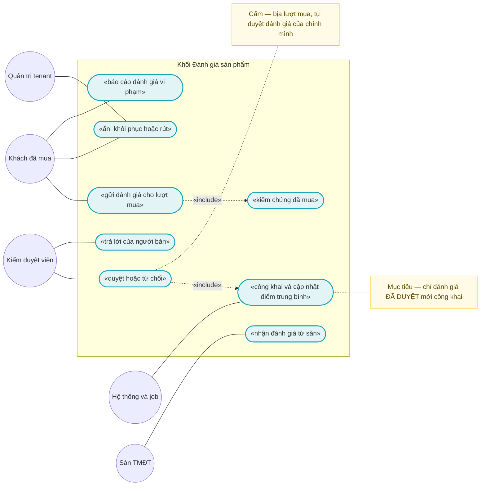
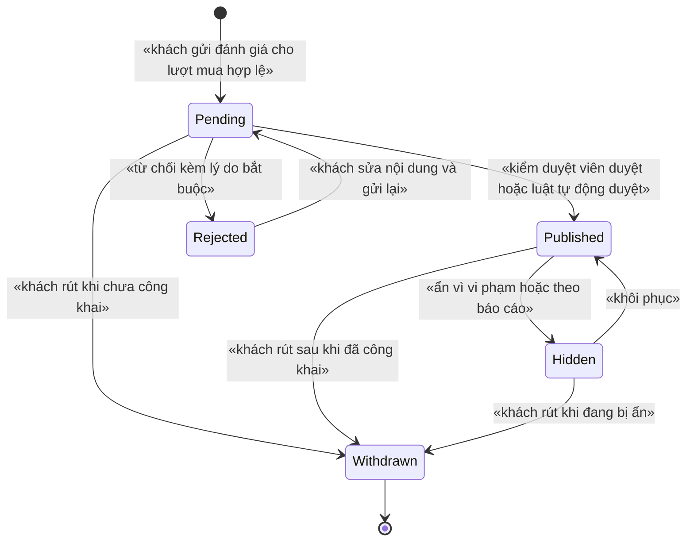
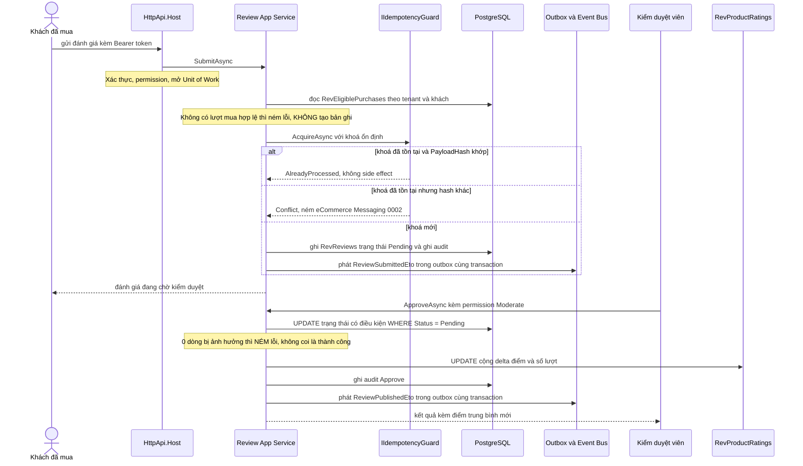

# `REV-001` — Đánh giá sản phẩm (có kiểm duyệt)

| Thuộc tính | Nội dung |
|---|---|
| **Mã** | `REV-001` |
| **Module** | **Reviews** — `modules/Review/eCommerce.Review.Domain` · `.Application` · `.Application.Contracts` · `.EntityFrameworkCore` |
| **Giai đoạn** | **GĐ4 — Tăng trưởng** (theo `docs/implementation-plan.md` §5 và Phụ lục A.3) |
| **Ưu tiên** | **Should have** (không chặn bán hàng; là đòn tăng chuyển đổi trên PDP) |
| **Trạng thái** | 🟡 `Draft` — chờ review |
| **Người viết / người review** | *(điền)* / **Kiến trúc trưởng + BA** |
| **Phiên bản / ngày** | `v0.1 — 13/10/2026` |
| **Tài liệu liên quan** | `XC-001` (Money — **không áp dụng**, xem §5.4) · `XC-002` (outbox/inbox + idempotency — **phụ thuộc chặn**) · `XC-003` (khoá phân tán) · `XC-004` (permission + tenant) · `XC-005` (observability/metric) · `CAT-001` (Product/ProductVariant) · `SAL-002`/`SAL-003` (đơn hoàn tất — nguồn "đã mua") · `CUS-001` (khách hàng) · `CHN-002` (connector Shopee — nguồn đánh giá từ sàn) · `LOY-001` (điểm thưởng — anh em cùng GĐ4) |

---

## 0. Tóm tắt & quyết định thiết kế

**Tóm tắt:** `REV-001` cho phép **khách đã mua** gửi đánh giá (sao + nội dung + ảnh/video) cho **đúng lượt mua của mình**,
đưa mọi đánh giá qua **hàng đợi kiểm duyệt**, và chỉ **công khai** đánh giá đã được duyệt. Điểm trung bình của sản phẩm
được giữ trong một bảng tổng hợp riêng và cập nhật bằng **UPDATE delta nguyên tử ở tầng DB** — không đọc-sửa-ghi.

**Vì sao phải viết tài liệu này trước khi code:** đây là feature có **state machine** (duyệt/từ chối/ẩn/rút) — đúng loại
feature mà dự án đã ghi nhận là nơi phát sinh lỗi nghiệp vụ nhiều nhất, và đúng loại lỗi **im lặng** đã xảy ra thật:

| Bài học đã kiểm chứng trong repo | Hệ quả bắt buộc cho `REV-001` |
|---|---|
| Guard trạng thái kiểu `SetPaidStatus()` của eShop **no-op im lặng** ⇒ sự kiện rơi không dấu vết (ghi ở `XC-002` §0 và `docs/design-doc-guidelines.md` §2.3) | Mọi chuyển trạng thái sai **NÉM LỖI** có mã (`eCommerce:Review:0003`) — **BR-004** |
| Webhook sàn là **at-least-once** (ghi trong `modules/ChannelHub/eCommerce.ChannelHub.Application.Contracts/Connectors/IChannelConnector.cs` dòng 93; `.../Connectors/ShopeeConnector.cs` dòng 22) | Đánh giá từ sàn **phải** idempotent theo `(TenantId, ChannelCode, ExternalReviewId)` — **BR-003** |
| Ở chế độ 1 tenant, unique index `(TenantId, …)` **mất tác dụng** khi `TenantId = NULL` — đã chứng minh bằng PostgreSQL thật ở `src/eCommerce.EntityFrameworkCore/Migrations/20261013024226_Fix_NullableTenantId_UniqueIndexes.cs` dòng 14–17 | Mọi unique index của module **phải** `NULLS NOT DISTINCT` — **BR-019** |
| `[Authorize]` thiếu ở cấp class làm endpoint chạy khi chưa xác thực (ghi ở `src/eCommerce.Application/Channels/ChannelAppService.cs` dòng 21–26) | `[Authorize]` **cấp class** + allowlist chặt cho 2 ngoại lệ — **BR-017/BR-018** |

**Phạm vi:**

- ✅ Gửi / sửa-gửi lại / rút đánh giá của **khách đã mua** (website), kèm ảnh/video.
- ✅ **Kiểm chứng "đã mua"** bằng bảng snapshot do module Review **tự sở hữu**, nạp từ sự kiện đơn hoàn tất (xem **D2**).
- ✅ **Kiểm duyệt trước khi công khai** (pre-moderation) + hàng đợi + duyệt/từ chối/ẩn/khôi phục + duyệt hàng loạt.
- ✅ **Điểm trung bình sản phẩm** (bảng tổng hợp + UPDATE delta) + job đối soát lại.
- ✅ **Đánh giá đến từ sàn** qua webhook (idempotent) + trả lời của người bán.
- ✅ Báo cáo vi phạm của khách + phiếu "hữu ích" (Should have).
- ✅ Permission mới, metric mới, migration + seed.

**Không nằm trong phạm vi:**

- ❌ **Điểm thưởng khi đánh giá** (khách được cộng điểm) — thuộc `LOY-001`; `REV-001` chỉ phát sự kiện `ReviewPublishedEto`.
- ❌ **Gọi API thật của sàn** để kéo/đẩy đánh giá — thuộc `CHN-002`; connector hiện là **PoC** (`ShopeeConnector.EnableLiveCalls = false`, xem §15.2 **F6**).
- ❌ **Sửa ảnh/video** (crop, watermark) và CDN — chỉ lưu URL + hash (**D7**).
- ❌ **Hạ tầng outbox/inbox/DLQ** — thuộc `XC-002`; tài liệu này **dùng lại** hợp đồng `IIdempotencyGuard`.
- ❌ **Đánh giá ẩn danh / khách vãng lai** — chủ ý **không** làm ở v1 (**D6**, xem Q1 §15).
- ❌ **Read-model báo cáo** (thống kê đánh giá theo thời gian) — thuộc `REP-*`.

### 0.1 Quyết định thiết kế (ADR ngắn)

| # | Quyết định | Phương án đã cân nhắc | Lý do chọn | Hệ quả |
|---|---|---|---|---|
| **D1** | Review là **module riêng** `modules/Review/*` (khuôn 4 project của ChannelHub/Tax) | (a) entity trong `src/eCommerce.Domain` như `Catalog`/`Orders` hiện tại · (b) module riêng | GĐ4 là lúc `src/` đang được tách thành module (`src/eCommerce.EntityFrameworkCore/eCommerceDbContext.cs` dòng 93–96 ghi rõ "khi domain này lớn lên, tách thành `modules/…`"). Để trong `src/` ⇒ module khác **không** tiêu thụ được entity của Review mà không vi phạm quy ước "module gọi app BỊ CẤM" | Phải khai `DbSet` + `builder.ConfigureReview()` trong DbContext hợp nhất (đúng cách ChannelHub/Tax đang làm — cùng file, dòng 47–64 và 76–78) |
| **D2** | **Kiểm chứng "đã mua" bằng bảng snapshot `RevEligiblePurchases` do Review sở hữu**, nạp từ ETO đơn hoàn tất | (a) Review tham chiếu `eCommerce.Domain` để query `OrdOrders` tại chỗ · (b) gọi HTTP sang API nội bộ của app · (c) **bảng snapshot + sự kiện** | (a) vi phạm quy ước #3/#4 (module không được tham chiếu `src/` — chính là lý do `ChannelHubConsts` tồn tại, xem `ChannelHubConsts.cs` dòng 8–11) và chặn tách microservice; (b) thêm phụ thuộc runtime + điểm chết. (c) đúng khuôn đã dùng thật: ChannelHub phát `ChannelOrderPulledEto`, app subscribe (`ChannelShopSyncer.cs` dòng 13–18) | Có độ trễ ≤ nhịp relay outbox (`XC-002` D1: `PeriodTimeSpan` mặc định 2 s) ⇒ khách vừa nhận hàng có thể chưa đánh giá được ngay; **bù** bằng job đối soát (§7.4) và thông báo "chưa tới lượt" rõ ràng |
| **D3** | **Pre-moderation**: đánh giá mặc định `Pending`, chỉ `Published` mới công khai | (a) post-moderation (đăng ngay, gỡ sau) · (b) pre-moderation | Nội dung do người ngoài viết, công khai trên website thương hiệu ⇒ post-moderation tạo rủi ro pháp lý/nhãn hiệu **không sửa được** (đã đăng là đã bị chụp lại) | Có hàng đợi + **SLA** kiểm duyệt (NFR-009); có luật auto-approve (A1 §1) để không nghẽn — nhưng **mọi** auto-approve **phải** ghi log + metric |
| **D4** | **Điểm trung bình cập nhật bằng UPDATE delta nguyên tử ở DB**, **không** dùng distributed lock cho mỗi lượt duyệt | (a) đọc-sửa-ghi trong bộ nhớ · (b) distributed lock cho mọi lượt duyệt · (c) `UPDATE … SET RatingSum = RatingSum + @delta, ReviewCount = ReviewCount + 1 WHERE …` | (a) lost update khi 2 kiểm duyệt viên duyệt 2 đánh giá cùng sản phẩm — đúng loại lỗi 2 luồng cùng sửa một bản ghi đã gặp thật ở Phase 0; (b) `XC-003` D9 nói rõ **không** dùng lock cho việc mà DB đã bảo vệ được (chậm hơn + ảo giác an toàn khi Redis chết) | Delta **phải** tính theo cờ `CountsForRating` (chỉ `Published` = true) để mọi chuyển dịch `Pending↔Published↔Hidden↔Withdrawn` đều cộng/trừ đúng **một lần**; `UPDATE` 0 dòng ⇒ **NÉM LỖI** |
| **D5** | **Idempotency key ổn định** ở **mọi** biên vào (gửi, webhook, consumer, job) | (a) `Guid.NewGuid()` mỗi lần · (b) khoá sinh từ dữ liệu nghiệp vụ | (a) retry = bản ghi mới ⇒ **2 đánh giá cho 1 lượt mua** (đúng bài học `D7` của `XC-002`, và đã có test thật ở `test/eCommerce.Tests/Domain/OrderAndInventoryTests.cs` dòng 102–113) | Khoá **phải** nằm trong `InboxRecords` và **phải** ổn định qua retry (§8.4) |
| **D6** | **Không** làm đánh giá ẩn danh ở v1 | (a) endpoint `[AllowAnonymous]` cho khách vãng lai · (b) yêu cầu xác thực | (a) phải mở rộng allowlist của `XC-004` (allowlist hiện chỉ `/connect/*`, `/api/abp/application-configuration`, `/health-status`, Swagger dev) ⇒ thêm **bề mặt tấn công** + spam không kiểm chứng được "đã mua" | Khách vãng lai không đánh giá được; nếu BA cần ⇒ mở lại ở GĐ sau (**Q1** §15) |
| **D7** | Ảnh/video lưu ở **object storage**, DB chỉ giữ **URL + hash + kích thước** | (a) lưu blob/base64 trong DB · (b) URL ra ngoài | `XC-002` **E5** cấm payload > 100 KB và cấm nhét blob vào ETO/outbox; lưu blob trong DB làm phình bảng và backup | Phải có storage + xử lý "ảnh mồ côi"; **cấm** đưa URL ảnh vào ETO (chỉ id) |
| **D8** | Webhook đánh giá từ sàn **xác thực HMAC**; payload thô lưu **đã che PII**, cắt **8.000 ký tự** | (a) tin IP allowlist · (b) chữ ký HMAC + che dữ liệu | Đã có tiền lệ thật trong repo: `ShopeeConnector.Sign` (HMAC-SHA256, `ShopeeConnector.cs` dòng 48–68) và `PaymentTransaction.MaskSensitiveData` + `Truncate(…, 8000)` (`modules/PaymentHub/eCommerce.PaymentHub.Domain/Entities/PaymentTransaction.cs` dòng 94, 147) | Sàn không có webhook review ⇒ phải có job pull (**F6**, thuộc `CHN-002`); lưu raw giúp điều tra nhưng **không** được chứa PII chưa che |
| **D9** | **Một lượt mua = một bản ghi đánh giá** (kể cả sau khi bị từ chối — khách **gửi lại** trên cùng bản ghi) | (a) cho tạo bản ghi mới mỗi lần gửi lại · (b) một bản ghi + `ResubmitCount` | (a) phá bất biến "1 lượt mua 1 đánh giá", làm điểm trung bình và audit không đối soát được | `ResubmitCount` giới hạn **3** (**BR-015**); lịch sử đầy đủ nằm ở `RevReviewModerationLog` |
| **D10** | **Metric mới phải đăng ký ở bảng đăng ký metric**, **cấm** nhãn cardinality cao | (a) gắn `productId`/`sku`/`userId` để lọc cho tiện · (b) chỉ nhãn trong allowlist | `shared/eCommerce.Kernel/Observability/eCommerceMetrics.cs` dòng 62–85: danh sách nhãn **bị cấm** gồm `sku`, `userId`, `orderId`, `email`, `phone`, `correlationId`, `lockKey`; mỗi giá trị nhãn = một chuỗi thời gian riêng ⇒ nổ bộ nhớ metric | Muốn truy vết theo sản phẩm ⇒ dùng **log** (đã có `CorrelationId`), **không** dùng metric |
| **D11** | **Không có trường tiền tệ** trong `REV-001` ⇒ quy ước tiền của `XC-001` **không áp dụng**; nhưng **cấm** `double`/`float` và **cấm** so sánh `==` trên điểm trung bình | (a) dùng `double` cho điểm trung bình cho "nhẹ" · (b) `numeric` + so sánh có sai số | Quy ước bất biến của dự án: tiền/giá trị số nghiệp vụ dùng `decimal`, **không bao giờ** so sánh `==`; đã có tiền lệ ở `ProductVariant.Price` (`src/eCommerce.Domain/Entities/Catalog/Product.cs` dòng 67–71) và `Order` (`Order.cs` dòng 38) | Nếu `LOY-001` sau này gắn **giá trị điểm** cho đánh giá ⇒ giá trị đó **phải** là `decimal` + `Money` của `XC-001` (hiện `eCommerce.Kernel` **chưa tồn tại trong code** — §15.2 **F3**) |
| **D12** | **Mọi thao tác ghi qua Unit of Work**; phạm vi khoá (nếu có) **bao ngoài** UoW | (a) `SaveChanges` rời rạc · (b) UoW | Quy ước bất biến #9 và `XC-003` §12: khoá phải được nhả **sau** khi transaction kết thúc | Job dài phải chia lô, mỗi lô một UoW — không giữ một transaction cho cả job |

> Ghi lại cả phương án **BỊ LOẠI** và lý do — để 6 tháng sau không ai hỏi lại "sao không làm cách kia".

---

## 1. Use Case Specification

| Thuộc tính | Nội dung |
|---|---|
| **Use Case ID** | `REV-001` |
| **Use Case Name** | Khách đã mua gửi đánh giá — kiểm duyệt — công khai & cập nhật điểm trung bình |
| **Description** | *"Là khách đã mua hàng, tôi muốn đánh giá sản phẩm tôi đã nhận để chia sẻ trải nghiệm; là kiểm duyệt viên, tôi muốn duyệt/từ chối trước khi công khai để nội dung vi phạm không bao giờ lên website; và là chủ shop, tôi muốn điểm trung bình luôn khớp số đánh giá đã công khai."* |
| **Actor(s)** | **Khách đã mua** (đã xác thực, có `CustomerId`) · **Kiểm duyệt viên** (nhân viên có `eCommerce.Reviews.Moderate`) · **Quản trị tenant** · **Hệ thống** (job đối soát/auto-approve, event bus) · **Sàn TMĐT** (webhook đánh giá) |
| **Priority** | **Should have** |
| **Trigger** | (a) khách bấm "Viết đánh giá" trên PDP hoặc trong "Đơn hàng của tôi"; (b) kiểm duyệt viên mở hàng đợi; (c) sàn gửi webhook đánh giá mới; (d) job định kỳ đối soát điểm trung bình |
| **Pre-Condition(s)** | • **Tenant hiện tại** (`TenantId` từ `ICurrentTenant`; ở chế độ 1 tenant hiện nay có thể **NULL** — xem §15.2 **F1**) — **bắt buộc** trên mọi bảng của module.<br>• **`ChannelCode`**: `web` cho đánh giá trên website; **mã sàn** (`shopee`, `lazada`…) cho đánh giá đến từ sàn. Đánh giá website **không** gắn shop, đánh giá sàn **bắt buộc** có `ChannelShopId`+`ExternalReviewId`.<br>• Khách **đã xác thực** và có permission `eCommerce.Reviews.Create` (**D6**).<br>• Tồn tại dòng `RevEligiblePurchases` **hợp lệ** cho `(TenantId, CustomerId, ProductVariantId, OrderId)` và **còn trong cửa sổ đánh giá** (**BR-001**).<br>• `Product`/`ProductVariant` tồn tại (tham chiếu **mềm** bằng `Guid` — module **không** có khoá ngoại sang bảng của module khác).<br>• **`XC-002` đã sẵn sàng** (đường ghi outbox + `IIdempotencyGuard`) — **phụ thuộc chặn**, hiện **chưa có trong code** (§15.2 **F2**).<br>• Mọi permission dùng trong `[Authorize]` **đã** được định nghĩa (`XC-004` D2 — thiếu ⇒ `403` cho **mọi** người). |
| **Post-Condition(s)** | • Bản ghi đánh giá ở **đúng một** trạng thái trong 5 trạng thái §3; **không** có trạng thái trung gian.<br>• Mọi chuyển trạng thái có **một dòng audit** append-only (`RevReviewModerationLog`) trong **cùng** transaction (**BR-011**).<br>• `RevProductRatings` **khớp** số đánh giá `Published` của sản phẩm (**BR-007**, NFR-005).<br>• API công khai **chỉ** trả đánh giá `Published` (**BR-014**).<br>• **Không** có 2 bản ghi cho cùng một lượt mua; **không** có 2 bản ghi cho cùng `(sàn, ExternalReviewId)` (**BR-002/BR-003**). |
| **Basic Flow** | 1. Khách mở PDP, bấm "Viết đánh giá"; UI gọi `GetMyEligiblePurchasesAsync` ⇒ danh sách lượt mua chưa đánh giá.<br>2. Khách chọn lượt mua, nhập số sao (1–5), tiêu đề, nội dung, đính kèm ảnh/video (tải lên storage trước, chỉ gửi URL).<br>3. Client gọi `POST /api/app/reviews` kèm `Idempotency-Key` (hoặc khoá do server sinh từ dữ liệu nghiệp vụ).<br>4. App service kiểm `[Authorize]` (cấp class) + permission `Create`; validate kích thước/định dạng.<br>5. Tra `RevEligiblePurchases` ⇒ **không** có ⇒ ném `eCommerce:Review:0002` (E2).<br>6. Gọi `IIdempotencyGuard.AcquireAsync` với khoá **ổn định** (§8.4) ⇒ `Proceed` / `AlreadyProcessed` / `Conflict`.<br>7. Tạo `RevReviews` trạng thái `Pending`, ghi `ResubmitCount = 0`, `IsVerifiedPurchase = true`; ghi dòng audit `Submit`.<br>8. Đóng UoW → phát `ReviewSubmittedEto` **qua outbox trong cùng transaction** (`XC-002` BR-001).<br>9. Kiểm duyệt viên mở hàng đợi, `ApproveAsync` ⇒ guard `Pending → Published`, ghi audit, cập nhật delta điểm, phát `ReviewPublishedEto`.<br>10. PDP hiển thị đánh giá `Published` + điểm trung bình mới. |
| **Alternative Flow** | **A1: Auto-approve** — job/luật cấu hình duyệt tự động đánh giá "sạch" (không có từ khoá bị chặn, không có URL, `Rating` bất kỳ, nội dung ≥ 20 ký tự) ⇒ chuyển `Pending → Published` **không** cần người; **bắt buộc** ghi audit với `ActorType = System` + log + metric (**BR-011**, D3).<br>**A2: Đánh giá từ sàn** — webhook được xác thực HMAC (D8) ⇒ ghi bản ghi `Source = Marketplace` ở `Published` **hoặc** `Pending` theo cấu hình tenant; **không** kiểm chứng được "đã mua" của ta ⇒ `IsVerifiedPurchase = false` và UI ghi rõ "đánh giá từ sàn".<br>**A3: Kiểm duyệt hàng loạt** — kiểm duyệt viên chọn nhiều bản ghi ⇒ 2 bước (xem trước số lượng → xác nhận), **giữ khoá phân tán** `review:moderation:{tenantId}` trong lúc chạy, tối đa **200** bản ghi/lần.<br>**A4: Trả lời của người bán** — nhân viên có `eCommerce.Reviews.Reply` trả lời **một** lần cho mỗi đánh giá; trả lời **không** làm đổi điểm và **không** cần duyệt lại.<br>**A5: Khách sửa và gửi lại** — bản ghi ở `Rejected`, khách sửa nội dung ⇒ `Rejected → Pending`, `ResubmitCount++` (tối đa 3). |
| **Exception Flow** | **E1: Gửi trùng** — khoá idempotency đã tồn tại và `PayloadHash` **khớp** ⇒ trả bản ghi cũ + cờ `AlreadyReviewed`, **không** side effect (mã log `eCommerce:Messaging:0001`).<br>**E2: Chưa mua / ngoài cửa sổ** ⇒ `eCommerce:Review:0002` (chưa có lượt mua) hoặc `eCommerce:Review:0010` (hết hạn đánh giá), HTTP **`409`**.<br>**E3: Guard trạng thái sai** (ví dụ duyệt một đánh giá đã `Rejected`) ⇒ **NÉM** `eCommerce:Review:0003` — **cấm** no-op im lặng (**BR-004**).<br>**E4: Trùng khoá nhưng khác `PayloadHash`** ⇒ ném `eCommerce:Messaging:0002` (xung đột khoá, phải điều tra thủ công — `XC-002` **E1**).<br>**E5: Chữ ký webhook sai / thiếu** ⇒ `eCommerce:Review:0009`, HTTP **`401`**, ghi metric `review_webhook_rejected_total`, **không** ghi bản ghi đánh giá.<br>**E6: Nội dung vượt ngưỡng** (nội dung > 4.000 ký tự, > 5 ảnh, > 1 video, `Rating` ngoài 1..5) ⇒ `eCommerce:Review:0005`, HTTP **`400`**.<br>**E7: `UPDATE` delta điểm ảnh hưởng 0 dòng** ⇒ **NÉM** `eCommerce:Review:0008` (**BR-006**) — coi là vi phạm bất biến, không phải lỗi tạm thời.<br>**E8: Từ chối/ẩn thiếu lý do** ⇒ `eCommerce:Review:0006`, HTTP **`400`**.<br>**E9: Kiểm duyệt viên tự duyệt đánh giá của chính mình** ⇒ `eCommerce:Review:0012`, HTTP **`403`** (**BR-009**). |
| **Business Rules** | • **BR-REV-001-001**: Chỉ đánh giá được lượt mua có trạng thái `Completed` (`eCommerce.OrderStatus.Completed`, `src/eCommerce.Domain.Shared/Enums.cs` dòng 56) và **còn trong cửa sổ đánh giá** (mặc định **90 ngày** kể từ `OrderCompletedAtUtc`).<br>• **BR-REV-001-002**: Một lượt mua ⇒ **tối đa một** bản ghi `RevReviews`; gửi trùng ⇒ trả bản ghi cũ + cờ `AlreadyReviewed`, **không** tạo mới.<br>• **BR-REV-001-003**: Đánh giá từ sàn idempotent theo **`(TenantId, ChannelCode, ExternalReviewId)`**; webhook gửi lại 100 lần ⇒ **1** bản ghi.<br>• **BR-REV-001-004**: Mọi chuyển trạng thái **phải** qua guard §3; guard sai ⇒ **NÉM LỖI** `eCommerce:Review:0003`; **cấm** no-op im lặng.<br>• **BR-REV-001-005**: `Rating` là **số nguyên 1..5** (CHECK ở DB); ngoài khoảng ⇒ `eCommerce:Review:0005`, không lưu.<br>• **BR-REV-001-006**: **Chỉ** `Published` tính vào điểm trung bình; mọi chuyển dịch đổi cờ đó **phải** cập nhật `RevProductRatings` **cùng transaction** bằng `UPDATE` delta nguyên tử; 0 dòng ⇒ **NÉM** `eCommerce:Review:0008`.<br>• **BR-REV-001-007**: `RevProductRatings` **phải** khớp dữ liệu `RevReviews`; lệch ⇒ cảnh báo + sửa bằng job `review:rating-recompute`.<br>• **BR-REV-001-008**: `RatingSum` là `bigint`; `AverageRating = RatingSum / ReviewCount` lưu `numeric(4,3)`; **so sánh bằng sai số ≥ 0,0005** — **cấm** `==`.<br>• **BR-REV-001-009**: **Cấm** kiểm duyệt viên duyệt/từ chối/ẩn đánh giá do **chính mình** viết ⇒ `eCommerce:Review:0012`.<br>• **BR-REV-001-010**: Từ chối/ẩn **bắt buộc** có lý do ≥ **10 ký tự**; thiếu ⇒ `eCommerce:Review:0006`; lý do hiển thị cho khách **không** chứa PII của người khác.<br>• **BR-REV-001-011**: Mọi chuyển trạng thái **phải** ghi **một** dòng `RevReviewModerationLog` **append-only** trong **cùng** transaction; không ghi được ⇒ rollback toàn bộ.<br>• **BR-REV-001-012**: Nội dung ≤ **4.000** ký tự, tiêu đề ≤ **200**, tối đa **5 ảnh** + **1 video** (≤ 50 MB); **cấm** lưu blob/base64 trong DB — chỉ URL + hash + kích thước (D7).<br>• **BR-REV-001-013**: **Cấm** PII trong ETO (tên/email/điện thoại khách); ETO chỉ mang `ReviewId`, `ProductId`, `ProductVariantId`, `Rating`, `Status`, `AggregateVersion` (`XC-002` BR-021).<br>• **BR-REV-001-014**: **Chỉ** `Published` được trả ra API công khai; `Pending`/`Rejected`/`Hidden`/`Withdrawn` **không bao giờ** xuất hiện.<br>• **BR-REV-001-015**: Gửi lại sau khi bị từ chối tối đa **3** lần; vượt ⇒ `eCommerce:Review:0007`.<br>• **BR-REV-001-016**: `Withdrawn` là trạng thái **hấp thụ**; muốn đánh giá lại lượt mua đó phải do **quản trị tenant** mở khoá (thao tác riêng, có audit) — **Q4** §15.<br>• **BR-REV-001-017**: `[Authorize]` ở **cấp class** cho **mọi** app service của module; mọi permission dùng trong `[Authorize]` **phải** được định nghĩa trong `eCommercePermissionDefinitionProvider` (`XC-004` BR-001/002). **Cấm** magic string.<br>• **BR-REV-001-018**: **Chỉ** 2 ngoại lệ `[AllowAnonymous]` (đọc công khai PDP + webhook sàn) và **phải** nằm trong allowlist `XC-004`; ngoại lệ phải có biện pháp bù (chỉ `Published`, không PII; webhook **bắt buộc** HMAC) — **cấm** mở rộng thêm.<br>• **BR-REV-001-019**: Mọi unique index có `TenantId` của module **phải** `NULLS NOT DISTINCT` (`XC-004` BR-009) — **bắt buộc** vì `TenantId` có thể `NULL` ở chế độ 1 tenant.<br>• **BR-REV-001-020**: Mọi thao tác ghi qua **Unit of Work**; phạm vi khoá **bao ngoài** UoW (`XC-003` §12).<br>• **BR-REV-001-021**: Package ABP thêm cho module **phải** dùng đúng **10.7.0** trong `Directory.Packages.props` (central package management — `ManagePackageVersionsCentrally = true`); **cấm** khai `Version` rời trong `.csproj`. |
| **Non-Functional Requirement** | • **NFR-REV-001-001**: Đọc danh sách đánh giá PDP (10 dòng/trang, tenant có **50.000** đánh giá) p95 **< 200 ms**.<br>• **NFR-REV-001-002**: Hàng đợi kiểm duyệt (10.000 bản ghi `Pending`) p95 **< 300 ms**.<br>• **NFR-REV-001-003**: Gửi đánh giá p95 **< 500 ms** (gồm ghi DB + outbox).<br>• **NFR-REV-001-004**: Webhook sàn gửi lại **100 lần** ⇒ **đúng 1** bản ghi, **0** side effect lần 2.<br>• **NFR-REV-001-005**: `RatingSum`/`ReviewCount` khớp **100 %** số đánh giá `Published` trên **10.000** lượt chuyển trạng thái (kiểm bằng job đối soát) — **0** lệch.<br>• **NFR-REV-001-006**: **100 %** chuyển trạng thái có dòng audit + `CorrelationId`.<br>• **NFR-REV-001-007**: **0** PII trong ETO (test reflection) và **0** `double`/`float` trong entity/ETO của module.<br>• **NFR-REV-001-008**: Cách ly tenant: tenant A **không** đọc/ghi được đánh giá của tenant B (integration 2 tenant — cần PostgreSQL).<br>• **NFR-REV-001-009**: Đánh giá `Pending` quá **24 h** ⇒ **cảnh báo**; metric `review_moderation_pending` phải có.<br>• **NFR-REV-001-010**: Metric mới **phải** nằm trong `eCommerceMetricNames` + danh sách `All`; **0** metric dùng nhãn bị cấm (`sku`, `userId`, `email`, `phone` — `eCommerceMetrics.cs`).<br>• **NFR-REV-001-011**: **0** mất đánh giá khi kill tiến trình sau commit và trước relay (10.000 lượt, nhờ outbox của `XC-002`). |

---

## 2. Sơ đồ Use Case



### Chú giải

| Ký hiệu | Ý nghĩa |
|---|---|
| ⭕ Xanh lá | Actor (người dùng + hệ thống ngoài) |
| 🟦 Bầu dục xanh dương | Use Case |
| 🟨 Khung vàng | Note (ràng buộc/mục tiêu) |
| `───` | Liên kết Actor ↔ Use Case |
| `-.«include».->` | Quan hệ bao hàm |

---

## 3. Sơ đồ trạng thái (state machine)



**Bảng chuyển trạng thái & guard — mọi chuyển sai **phải ném lỗi**, không im lặng (`eCommerce:Review:0003`):**

| # | Từ → Sang | Ai được chuyển | Guard | Hành động kèm theo (cùng transaction) | Nếu guard sai |
|---|---|---|---|---|---|
| 1 | `[*]` → `Pending` | Khách (`Reviews.Create`) | Có `RevEligiblePurchases` hợp lệ + chưa quá cửa sổ + chưa có bản ghi cho lượt mua đó + nội dung hợp lệ | Ghi `RevReviews` + audit `Submit` + outbox `ReviewSubmittedEto` | `0002`/`0010`/`0005`; trùng ⇒ trả bản ghi cũ (**BR-002**) |
| 2 | `Pending` → `Published` | Kiểm duyệt viên (`Moderate`) **hoặc** hệ thống (A1) | `Status = Pending` **và** (`ModeratedBy ≠ CreatedByCustomer`) | Audit `Approve`/`AutoApprove` + **delta +1** vào `RevProductRatings` + outbox `ReviewPublishedEto` | `0003` (sai trạng thái) / `0012` (tự duyệt) |
| 3 | `Pending` → `Rejected` | Kiểm duyệt viên (`Moderate`) | `Status = Pending` **và** `Reason ≥ 10` ký tự | Audit `Reject` + lưu `RejectReason` + outbox `ReviewRejectedEto` (**không** đổi điểm) | `0003` / `0006` |
| 4 | `Pending` → `Withdrawn` | Khách (chủ bản ghi) | `Status = Pending` **và** người gọi là chủ bản ghi | Audit `Withdraw` (không đổi điểm — chưa từng tính) | `0003` / `404` |
| 5 | `Rejected` → `Pending` | Khách (chủ bản ghi) | `Status = Rejected` **và** `ResubmitCount < 3` **và** nội dung mới hợp lệ | Audit `Resubmit` + `ResubmitCount++` + outbox `ReviewSubmittedEto` | `0007` (quá số lần) / `0003` |
| 6 | `Published` → `Hidden` | Kiểm duyệt viên (`Moderate`) | `Status = Published` **và** `Reason ≥ 10` ký tự | Audit `Hide` + **delta −1** + outbox `ReviewHiddenEto` | `0003` / `0006` |
| 7 | `Hidden` → `Published` | Kiểm duyệt viên (`Moderate`) | `Status = Hidden` **và** `Reason ≥ 10` ký tự | Audit `Restore` + **delta +1** + outbox `ReviewPublishedEto` | `0003` / `0006` |
| 8 | `Published` → `Withdrawn` | Khách (chủ bản ghi) | `Status = Published` **và** người gọi là chủ bản ghi | Audit `Withdraw` + **delta −1** + outbox `ReviewWithdrawnEto` | `0003` / `404` |
| 9 | `Hidden` → `Withdrawn` | Khách (chủ bản ghi) | `Status = Hidden` **và** người gọi là chủ bản ghi | Audit `Withdraw` + **delta 0** (điểm đã trừ ở bước 6) | `0003` / `404` |
| 10 | Bất kỳ → bất kỳ | **Không ai** | **Không** có guard nào cho phép | — | 🚫 `Withdrawn` là trạng thái **hấp thụ**: mọi chuyển dịch ra khỏi nó ⇒ **NÉM** `eCommerce:Review:0003` (mở khoá là thao tác quản trị riêng — **BR-016**) |

> ⚠️ **Quy tắc bất di bất dịch #11: guard sai phải NÉM LỖI (hoặc ghi log có cấu trúc), không im lặng.**
> **Cờ quyết định điểm:** `CountsForRating ≡ (Status == Published)`. Vì vậy **mọi** chuyển dịch đều tính
> `delta = (CountsForRating_mới ? 1 : 0) − (CountsForRating_cũ ? 1 : 0)` rồi áp dụng **một** `UPDATE` delta nguyên tử (**BR-006**).
> Cách này làm cho các ca "ẩn rồi rút", "ẩn rồi khôi phục" **không** cộng/trừ hai lần — đây là lớp lỗi im lặng
> khó phát hiện nhất của feature này (điểm trung bình lệch dần mà không có exception nào).
>
> 📌 **Ai ghi audit:** mọi chuyển dịch ⇒ **một** dòng `RevReviewModerationLog` (`ActorType = User` hoặc `System`).
> **Trạng thái hấp thụ:** `Withdrawn`. `Rejected` **không** hấp thụ (còn đường gửi lại — **BR-015**).

---

## 4. Sequence Diagram & luồng dữ liệu

### 4.1 Sequence — gửi, kiểm duyệt, công khai



### 4.2 DFD — luồng dữ liệu (trình bày dạng bảng)

> 📌 **Không vẽ sơ đồ thứ 4:** quy ước của tài liệu này giới hạn **tối đa 3 sơ đồ Mermaid** (xem §2, §3, §4.1),
> nên DFD được mô tả bằng bảng dưới đây.

| # | Nguồn | Dữ liệu vào | Xử lý | Ghi ở đâu | Ra ngoài |
|---|---|---|---|---|---|
| 1 | Khách (PDP / Đơn của tôi) | `rating`, `title`, `content`, `mediaUrls` | validate → kiểm idempotency → tạo `Pending` | `RevReviews` + `RevReviewModerationLog` + outbox | `ReviewSubmittedEto` |
| 2 | Sales (module khác) | `OrderCompletedEto` | kiểm idempotency theo `(OrderId, ProductVariantId, CustomerId)` → ghi snapshot | `RevEligiblePurchases` | — (job thông báo mời đánh giá về sau) |
| 3 | Kiểm duyệt viên | `reviewId`, `action`, `reason` | guard §3 → `UPDATE` trạng thái → delta điểm → audit | `RevReviews` + `RevProductRatings` + `RevReviewModerationLog` + outbox | `ReviewPublishedEto` / `ReviewHiddenEto` |
| 4 | Sàn TMĐT (webhook) | payload đánh giá + chữ ký | xác thực HMAC → chuẩn hoá → idempotency theo `ExternalReviewId` | `RevReviews` (raw **đã che PII** trong `ExtraProperties`) | `ReviewSubmittedEto` nếu để `Pending` |
| 5 | Job đối soát (định kỳ) | `RevReviews` `Published` | tính lại `RatingSum`/`ReviewCount` → so với `RevProductRatings` | ghi đè `RevProductRatings` khi lệch + metric cảnh báo | log + metric |
| 6 | Job hết hạn lượt mua | `RevEligiblePurchases` quá `ExpiresAtUtc` | chuyển `Expired` (không xoá — giữ đối soát) | `RevEligiblePurchases` | metric `review_eligible_expired_total` |

> ⚠️ **Điểm dễ sai:** luồng 2 (snapshot lượt mua) **không** đồng bộ với luồng 1. Khách vừa nhận hàng có thể chưa
> thấy lượt mua để đánh giá. UI **phải** nói rõ "đang cập nhật, thử lại sau ít phút", **không** hiển thị như lỗi hệ thống
> (theo tinh thần `XC-003` §10).

---

## 5. Mô hình dữ liệu

### 5.1 ERD — mô tả quan hệ dạng bảng

> 📌 Cũng vì giới hạn 3 sơ đồ, ERD dùng bảng quan hệ dưới đây thay cho `erDiagram`.

| Từ | Quan hệ | Đến | Ghi chú |
|---|---|---|---|
| `RevReviews` | 1 → 0..n | `RevReviewMedia` | ảnh/video của đánh giá; **cascade delete** ở DB nhưng **cấm** xoá cứng bản ghi đánh giá |
| `RevReviews` | 1 → 0..1 | `RevReviewReplies` | người bán trả lời **một** lần cho mỗi đánh giá |
| `RevReviews` | 1 → 1..n | `RevReviewModerationLog` | append-only; **không** FK cứng tới `AbpUsers` (người dùng có thể bị xoá mềm) |
| `RevReviews` | 1 → 0..n | `RevReviewReports` | khách báo cáo vi phạm |
| `RevReviews` | 1 → 0..n | `RevReviewHelpfulVotes` | phiếu "hữu ích" (Should have) |
| `RevEligiblePurchases` | 1 → 0..1 | `RevReviews` | tham chiếu **mềm** bằng `(TenantId, CustomerId, OrderId, ProductVariantId)` — **không** FK (Review sở hữu cả hai bảng) |
| `RevProductRatings` | n → 1 | `Product` (Catalog) | tham chiếu **mềm** `ProductId`; module **không** FK sang bảng module khác |
| `RevReviews` | n → 1 | `ProductVariant` (Catalog) | tham chiếu **mềm** `ProductVariantId` + `Sku` (snapshot) |

### 5.2 Bảng & cột (Data Dictionary)

**Bảng `RevReviews`** — aggregate root, một dòng cho mỗi đánh giá.

| Cột | Kiểu | Null? | Nguồn / ý nghĩa | Ghi chú |
|---|---|---|---|---|
| `Id` | `uuid` | ✖ | khoá chính | |
| `TenantId` | `uuid` | ✔ | tenant sở hữu | `IMultiTenant`; **có thể NULL** ở chế độ 1 tenant (§15.2 **F1**) |
| `Source` | `int` | ✖ | `Website = 1` · `Marketplace = 2` | quyết định bộ khoá chống trùng nào áp dụng |
| `ChannelCode` | `varchar(32)` | ✖ | `web`, `shopee`, `lazada`… | **bắt buộc** (mọi đánh giá đều thuộc một kênh) |
| `ChannelShopId` | `uuid` | ✔ | shop của sàn | **bắt buộc** khi `Source = Marketplace` (CHECK) |
| `ExternalReviewId` | `varchar(128)` | ✔ | id đánh giá do sàn cấp | **bắt buộc** khi `Source = Marketplace`; nằm trong khoá unique chống trùng webhook |
| `ProductId` | `uuid` | ✖ | sản phẩm được đánh giá | tham chiếu **mềm** (không FK) |
| `ProductVariantId` | `uuid` | ✖ | biến thể được đánh giá | tham chiếu **mềm** |
| `Sku` | `varchar(64)` | ✖ | SKU tại thời điểm đánh giá | **snapshot** — SKU có thể đổi (bài học `OrderLine.Sku`, `Order.cs` dòng 114–117) |
| `CustomerId` | `uuid` | ✔ | khách viết đánh giá | `null` với đánh giá từ sàn (không map được sang khách của ta) |
| `OrderId` | `uuid` | ✔ | lượt mua được đánh giá | **bắt buộc** khi `Source = Website` |
| `IsVerifiedPurchase` | `bool` | ✖ | đã kiểm chứng bằng `RevEligiblePurchases` | `false` với đánh giá từ sàn (**A2**) |
| `Rating` | `smallint` | ✖ | 1..5 | **số nguyên**; CHECK ở DB (**BR-005**) |
| `Title` | `varchar(200)` | ✔ | tiêu đề | |
| `Content` | `varchar(4000)` | ✖ | nội dung | giới hạn theo **BR-012** |
| `Status` | `smallint` | ✖ | `Pending=0` · `Published=1` · `Rejected=2` · `Hidden=3` · `Withdrawn=4` | §3 |
| `RejectReason` | `varchar(512)` | ✔ | lý do từ chối/ẩn gần nhất | hiển thị cho khách (**BR-010**) |
| `ModeratedBy` | `uuid` | ✔ | người duyệt/từ chối/ẩn gần nhất | dùng cho **BR-009** (không tự duyệt) |
| `ModeratedAtUtc` | `timestamptz` | ✔ | thời điểm kiểm duyệt gần nhất | |
| `ResubmitCount` | `int` | ✖ | số lần gửi lại | mặc định `0`; trần **3** (**BR-015**) |
| `HelpfulCount` | `int` | ✖ | số phiếu hữu ích | tăng bằng UPDATE nguyên tử |
| `ReportCount` | `int` | ✖ | số lần bị báo cáo | mở hàng đợi ưu tiên khi ≥ ngưỡng |
| `SubmittedAtUtc` | `timestamptz` | ✖ | thời điểm gửi | |
| `PublishedAtUtc` | `timestamptz` | ✔ | thời điểm công khai (lần đầu) | |
| `CorrelationId` | `varchar(64)` | ✔ | truy vết end-to-end | liên kết `XC-005` |
| `RowVersion` | `xmin` (ánh xạ `uint`) | ✖ | optimistic concurrency | Npgsql `IsRowVersion()` ⇒ cột hệ thống `xmin`, không thêm cột thật |
| `ExtraProperties` | `jsonb` | ✔ | payload thô **đã che PII** của webhook sàn (≤ 8.000 ký tự) | khuôn `PaymentTransaction.MaskSensitiveData` (D8) |

**Bảng `RevReviewMedia`** — ảnh/video (không lưu blob).

| Cột | Kiểu | Null? | Ý nghĩa | Ghi chú |
|---|---|---|---|---|
| `Id` | `uuid` | ✖ | khoá chính | |
| `TenantId` | `uuid` | ✔ | tenant | |
| `ReviewId` | `uuid` | ✖ | đánh giá | FK nội bộ module |
| `Kind` | `smallint` | ✖ | `Image = 0` · `Video = 1` | trần **5 ảnh + 1 video** kiểm ở tầng domain (**BR-012**) |
| `Url` | `varchar(1024)` | ✖ | URL trên object storage | **BẮT BUỘC** HTTPS |
| `MimeType` | `varchar(64)` | ✖ | `image/jpeg`, `video/mp4`… | allowlist |
| `SizeBytes` | `bigint` | ✖ | kích thước | video ≤ 50 MB |
| `ContentHash` | `char(64)` | ✖ | SHA-256 nội dung tệp | phát hiện tải trùng/ảnh rác |
| `SortOrder` | `int` | ✖ | thứ tự hiển thị | |

**Bảng `RevReviewReplies`** — trả lời của người bán (`A4`).

| Cột | Kiểu | Null? | Ý nghĩa |
|---|---|---|---|
| `Id` | `uuid` | ✖ | khoá chính |
| `TenantId` | `uuid` | ✔ | tenant |
| `ReviewId` | `uuid` | ✖ | **unique** theo `(TenantId, ReviewId)` ⇒ 1 trả lời/đánh giá |
| `Content` | `varchar(2000)` | ✖ | nội dung trả lời (công khai ngay) |
| `AuthorUserId` | `uuid` | ✖ | nhân viên trả lời |
| `CreatedAtUtc` | `timestamptz` | ✖ | thời điểm |

**Bảng `RevReviewModerationLog`** — **append-only** (nguồn sự thật của lịch sử kiểm duyệt).

| Cột | Kiểu | Null? | Ý nghĩa | Ghi chú |
|---|---|---|---|---|
| `Id` | `uuid` | ✖ | khoá chính | |
| `TenantId` | `uuid` | ✔ | tenant | |
| `ReviewId` | `uuid` | ✖ | đánh giá | |
| `Action` | `smallint` | ✖ | `Submit=0` · `Approve=1` · `AutoApprove=2` · `Reject=3` · `Hide=4` · `Restore=5` · `Withdraw=6` · `Resubmit=7` | |
| `FromStatus` | `smallint` | ✔ | trạng thái trước (`null` khi tạo mới) | |
| `ToStatus` | `smallint` | ✖ | trạng thái sau | |
| `ActorType` | `smallint` | ✖ | `Customer=0` · `Staff=1` · `System=2` | **bắt buộc** phân biệt người và hệ thống |
| `ActorUserId` | `uuid` | ✔ | người thực hiện | `null` khi `ActorType = System` |
| `Reason` | `varchar(512)` | ✔ | lý do | **bắt buộc** với `Reject`/`Hide`/`Restore` |
| `RatingDelta` | `int` | ✖ | delta điểm đã áp dụng (`-1`/`0`/`+1`) | đối soát được điểm trung bình (**BR-007**) |
| `OccurredAtUtc` | `timestamptz` | ✖ | thời điểm | |
| `CorrelationId` | `varchar(64)` | ✔ | truy vết | |

**Bảng `RevProductRatings`** — tổng hợp điểm theo sản phẩm (cập nhật bằng UPDATE delta).

| Cột | Kiểu | Null? | Ý nghĩa | Ghi chú |
|---|---|---|---|---|
| `Id` | `uuid` | ✖ | khoá chính | |
| `TenantId` | `uuid` | ✔ | tenant | |
| `ProductId` | `uuid` | ✖ | sản phẩm | unique `(TenantId, ProductId)` |
| `RatingSum` | `bigint` | ✖ | tổng điểm của các đánh giá `Published` | **số nguyên** ⇒ không có sai số tích luỹ (**BR-008**) |
| `ReviewCount` | `int` | ✖ | số đánh giá `Published` | |
| `Rating1Count` … `Rating5Count` | `int` × 5 | ✖ | phân bố sao (cho biểu đồ PDP) | cũng cập nhật bằng delta |
| `AverageRating` | `numeric(4,3)` | ✖ | `RatingSum / ReviewCount` | so sánh **có sai số** (**BR-008**) |
| `UpdatedAtUtc` | `timestamptz` | ✖ | lần cập nhật cuối | |
| `RowVersion` | `xmin` | ✖ | optimistic concurrency | |

> 📌 **Vì sao vừa lưu `RatingSum` vừa lưu `AverageRating`:** `AverageRating` để hiển thị/sắp xếp nhanh (đã làm tròn),
> `RatingSum` + `ReviewCount` là **nguồn sự thật số nguyên** để job đối soát tính lại và so khớp (**BR-007**).
> Nếu chỉ lưu số đã làm tròn thì **không thể** phát hiện lệch.

**Bảng `RevEligiblePurchases`** — snapshot "lượt mua được phép đánh giá" (nguồn của **BR-001**).

| Cột | Kiểu | Null? | Ý nghĩa | Ghi chú |
|---|---|---|---|---|
| `Id` | `uuid` | ✖ | khoá chính | |
| `TenantId` | `uuid` | ✔ | tenant | |
| `CustomerId` | `uuid` | ✖ | khách | |
| `OrderId` | `uuid` | ✖ | đơn đã hoàn tất | |
| `ProductVariantId` | `uuid` | ✖ | biến thể trong đơn | |
| `Sku` | `varchar(64)` | ✖ | SKU snapshot | |
| `ChannelCode` | `varchar(32)` | ✖ | kênh phát sinh đơn | |
| `OrderCompletedAtUtc` | `timestamptz` | ✖ | mốc bắt đầu tính cửa sổ đánh giá | |
| `ExpiresAtUtc` | `timestamptz` | ✖ | `OrderCompletedAtUtc + 90 ngày` | cấu hình được |
| `Status` | `smallint` | ✖ | `Eligible=0` · `Consumed=1` · `Expired=2` | `Consumed` khi đã có đánh giá |
| `SourceEventId` | `uuid` | ✔ | `EventId` của ETO đã tạo dòng này | truy vết + chống trùng (**BR-003**) |
| `RowVersion` | `xmin` | ✖ | optimistic concurrency | |

**Bảng `RevReviewReports` / `RevReviewHelpfulVotes`** (Should have).

| Bảng | Cột chính | Ràng buộc |
|---|---|---|
| `RevReviewReports` | `Id`, `TenantId`, `ReviewId`, `ReporterCustomerId`, `Reason` (smallint), `Note` (varchar 512), `Status` (`Open=0`/`Resolved=1`), `CreatedAtUtc` | UNIQUE `(TenantId, ReviewId, ReporterCustomerId)` — một khách báo cáo một đánh giá **một lần** |
| `RevReviewHelpfulVotes` | `Id`, `TenantId`, `ReviewId`, `CustomerId`, `CreatedAtUtc` | UNIQUE `(TenantId, ReviewId, CustomerId)`; `RevReviews.HelpfulCount` tăng bằng UPDATE delta |

### 5.3 Index & ràng buộc (phần hay bị bỏ sót nhất)

| Bảng | Loại | Cột | Mục đích |
|---|---|---|---|
| `RevReviews` | **UNIQUE** (filter) | `(TenantId, ChannelCode, ExternalReviewId) WHERE ExternalReviewId IS NOT NULL` **NULLS NOT DISTINCT** | ⭐ chống trùng webhook sàn (**BR-003**) |
| `RevReviews` | **UNIQUE** (filter) | `(TenantId, CustomerId, OrderId, ProductVariantId) WHERE ExternalReviewId IS NULL` **NULLS NOT DISTINCT** | ⭐ **một lượt mua một đánh giá** (**BR-002**) |
| `RevReviews` | INDEX | `(TenantId, Status, SubmittedAtUtc)` | hàng đợi kiểm duyệt |
| `RevReviews` | INDEX | `(TenantId, ProductId, Status, PublishedAtUtc DESC)` | danh sách PDP |
| `RevReviews` | INDEX | `(TenantId, CustomerId, SubmittedAtUtc DESC)` | "Đánh giá của tôi" |
| `RevReviews` | CHECK | `"Rating" BETWEEN 1 AND 5` | **BR-005** |
| `RevReviews` | CHECK | `"ResubmitCount" >= 0 AND "ResubmitCount" <= 3` | **BR-015** |
| `RevReviews` | CHECK | `"Source" <> 2 OR ("ChannelShopId" IS NOT NULL AND "ExternalReviewId" IS NOT NULL)` | đánh giá sàn **phải** có shop + id sàn |
| `RevReviews` | CHECK | `"Source" <> 1 OR ("CustomerId" IS NOT NULL AND "OrderId" IS NOT NULL)` | đánh giá website **phải** có khách + đơn |
| `RevReviewMedia` | UNIQUE | `(TenantId, ReviewId, ContentHash)` | cùng một tệp không gắn hai lần |
| `RevReviewMedia` | INDEX | `(ReviewId, SortOrder)` | hiển thị |
| `RevReviewReplies` | **UNIQUE** | `(TenantId, ReviewId)` **NULLS NOT DISTINCT** | một trả lời/đánh giá (**A4**) |
| `RevReviewModerationLog` | INDEX | `(TenantId, ReviewId, OccurredAtUtc)` | lịch sử kiểm duyệt + audit (**BR-011**) |
| `RevReviewModerationLog` | CHECK | `"Action" IN (3,4,5) ⇒ "Reason" IS NOT NULL` | lý do bắt buộc (**BR-010**) |
| `RevProductRatings` | **UNIQUE** | `(TenantId, ProductId)` **NULLS NOT DISTINCT** | một dòng tổng hợp/sản phẩm (**BR-006**) |
| `RevProductRatings` | CHECK | `"RatingSum" >= 0 AND "ReviewCount" >= 0 AND "RatingSum" <= 5 * "ReviewCount"` | bất biến điểm ở tầng DB |
| `RevProductRatings` | CHECK | `"ReviewCount" = 0 ⇒ "AverageRating" = 0` | tránh chia 0 |
| `RevEligiblePurchases` | **UNIQUE** | `(TenantId, CustomerId, OrderId, ProductVariantId)` **NULLS NOT DISTINCT** | chống tạo 2 lượt mua từ 2 lần giao ETO (**BR-001**) |
| `RevEligiblePurchases` | INDEX | `(TenantId, CustomerId, Status, ExpiresAtUtc)` | danh sách "chưa đánh giá" + job hết hạn |
| `RevReviewReports` | **UNIQUE** | `(TenantId, ReviewId, ReporterCustomerId)` **NULLS NOT DISTINCT** | chống spam báo cáo |
| `RevReviewHelpfulVotes` | **UNIQUE** | `(TenantId, ReviewId, CustomerId)` **NULLS NOT DISTINCT** | chống spam phiếu hữu ích |

> 🚨 **Hai ràng buộc bắt buộc, không được quên:**
> 1. **`NULLS NOT DISTINCT`** cho **mọi** unique index có `TenantId` (**BR-019**). Bằng chứng thật: migration
>    `20261013024226_Fix_NullableTenantId_UniqueIndexes.cs` — trước khi sửa, chèn 2 dòng cùng khoá với
>    `TenantId = NULL` **thành công** (`INSERT 0 2`) ⇒ index **không chặn gì**.
> 2. **Tên index do EF sinh bị cắt ở 63 ký tự.** Đã có tiền lệ thật: index của `TaxClassifications` bị cắt và kết thúc
>    bằng `~` (xem ghi chú trong cùng migration, dòng 82–85). Vì vậy các index dài của module **phải** đặt tên tường minh
>    bằng `HasDatabaseName(...)`, ví dụ `IX_RevEligible_Tenant_Customer_Order_Variant` (44 ký tự) cho bảng
>    `RevEligiblePurchases` — tên mặc định `IX_RevEligiblePurchases_TenantId_CustomerId_OrderId_ProductVariantId`
>    dài **67** ký tự ⇒ **sẽ bị cắt**.

### 5.4 Ghi chú về tiền tệ & giá trị số (quy ước bất biến)

| Quy ước dự án | Áp dụng cho `REV-001` |
|---|---|
| Tiền dùng `decimal` + `Money`, **không bao giờ** so sánh `==` trên tiền (`XC-001`) | **Không áp dụng — lý do:** feature này **không có** trường tiền tệ. Không có giá trị tiền nào được tính, lưu hay hiển thị. |
| **Cấm** `double`/`float` cho giá trị nghiệp vụ | ✅ **Áp dụng:** `Rating` là `smallint`, `RatingSum` là `bigint`, `AverageRating` là `numeric(4,3)`. Test reflection phải chứng minh **0** `double`/`float` (**NFR-007**). |
| Không so sánh `==` trên giá trị đã làm tròn | ✅ **Áp dụng:** so sánh `AverageRating` **phải** dùng sai số ≥ **0,0005** (**BR-008**). |
| Nếu `LOY-001` gắn **điểm thưởng có giá trị tiền** cho đánh giá | ⏳ Khi đó giá trị điểm **phải** là `decimal` + `Money` của `XC-001`; hiện `eCommerce.Kernel`/`Money` **chưa có trong code** (§15.2 **F3**) ⇒ không được tự định nghĩa kiểu tiền mới trong module Review. |

---

## 6. Hợp đồng API

### 6.1 Application Service

| Mục | Giá trị |
|---|---|
| Interface | `IReviewAppService`, `IReviewModerationAppService`, `IReviewPublicAppService` (đặt tại `eCommerce.Review.Application.Contracts`) |
| Implementation | `ReviewAppService`, `ReviewModerationAppService`, `ReviewPublicAppService` (đặt tại `eCommerce.Review.Application`) |
| `[Authorize]` | **cấp CLASS** + permission cụ thể ở từng method (**BR-017**) — đúng khuôn đã chạy thật ở `ChannelAppService` (`src/eCommerce.Application/Channels/ChannelAppService.cs` dòng 27) |

```csharp
// Khuôn bắt buộc: [Authorize] Ở CẤP CLASS, permission lấy từ hằng số (không magic string)
[Authorize(eCommerceConsts.Permissions.Reviews.Default)]
public class ReviewAppService : ApplicationService, IReviewAppService
{
    [Authorize(eCommerceConsts.Permissions.Reviews.Create)]
    public Task<ReviewDto> SubmitAsync(SubmitReviewDto input) { /* ... */ }
}
```

| Method | Input (DTO) | Output (DTO) | Permission | Ghi chú |
|---|---|---|---|---|
| `GetMyEligiblePurchasesAsync` | `PagedAndSortedResultRequestDto` | `PagedResultDto<EligiblePurchaseDto>` | `Reviews.Create` | lượt mua chưa đánh giá |
| `SubmitAsync` | `SubmitReviewDto` | `ReviewDto` | `Reviews.Create` | idempotent; trả `AlreadyReviewed` nếu đã có |
| `ResubmitAsync` | `ResubmitReviewDto` | `ReviewDto` | `Reviews.Create` | chỉ từ `Rejected`; trần 3 lần |
| `WithdrawAsync` | `Guid id` | `ReviewDto` | `Reviews.Create` | chỉ chủ bản ghi |
| `GetMyReviewsAsync` | `PagedAndSortedResultRequestDto` | `PagedResultDto<ReviewDto>` | `Reviews.Create` | hiển thị cả lý do từ chối (**BR-010**) |
| `GetModerationQueueAsync` | `GetModerationQueueInput` | `PagedResultDto<ReviewModerationItemDto>` | `Reviews.View` | lọc `Status`, `ChannelCode`, khoảng thời gian |
| `ApproveAsync` | `ModerateReviewDto` | `ReviewDto` | `Reviews.Moderate` | guard §3 dòng 2 |
| `RejectAsync` | `ModerateReviewDto` (**bắt buộc** `Reason`) | `ReviewDto` | `Reviews.Moderate` | guard §3 dòng 3 |
| `HideAsync` / `RestoreAsync` | `ModerateReviewDto` (**bắt buộc** `Reason`) | `ReviewDto` | `Reviews.Moderate` | guard §3 dòng 6–7 |
| `BulkModerateAsync` | `BulkModerateInput` (≤ **200** id) | `BulkModerateResultDto` | `Reviews.Moderate` | giữ khoá `review:moderation:{tenantId}` |
| `ReplyAsync` | `ReplyReviewDto` | `ReviewReplyDto` | `Reviews.Reply` | một trả lời/đánh giá |
| `ReportAsync` | `ReportReviewDto` | `void` | `Reviews.Create` | khách báo cáo |
| `MarkHelpfulAsync` | `Guid id` | `void` | `Reviews.Create` | Should have |
| `GetProductReviewsAsync` | `GetProductReviewsInput` (**chỉ** `Published`) | `PagedResultDto<PublicReviewDto>` | — (**AllowAnonymous** trong allowlist — **BR-018**) | **không** trả PII |
| `GetProductRatingAsync` | `Guid productId` | `ProductRatingDto` | — (**AllowAnonymous**) | đọc `RevProductRatings` |
| `HandleChannelReviewWebhookAsync` | `rawBody` + `headers` | `WebhookAckDto` | — (**AllowAnonymous** + **bắt buộc** HMAC — **BR-018**) | idempotent theo `ExternalReviewId` |

> 📌 `PublicReviewDto` **cấm** chứa: email, số điện thoại, mã đơn, `CustomerId` thô. Tên hiển thị **phải** được che một phần
> ở tầng mapping (`Nguyễn Văn A` → `Nguyễn V***A`) — cùng tinh thần `PaymentTransaction.MaskSensitiveData`.

### 6.2 REST endpoint

| Method / Route | Permission | Mô tả |
|---|---|---|
| `GET /api/app/reviews/my/eligible-purchases` | `eCommerce.Reviews.Create` | lượt mua chưa đánh giá |
| `POST /api/app/reviews` | `eCommerce.Reviews.Create` | gửi đánh giá |
| `POST /api/app/reviews/{id}/resubmit` | `eCommerce.Reviews.Create` | gửi lại sau khi bị từ chối |
| `POST /api/app/reviews/{id}/withdraw` | `eCommerce.Reviews.Create` | rút đánh giá |
| `GET /api/app/reviews/my` | `eCommerce.Reviews.Create` | đánh giá của tôi |
| `GET /api/app/reviews/moderation/queue` | `eCommerce.Reviews.View` | hàng đợi kiểm duyệt |
| `POST /api/app/reviews/moderation/{id}/approve` | `eCommerce.Reviews.Moderate` | duyệt |
| `POST /api/app/reviews/moderation/{id}/reject` | `eCommerce.Reviews.Moderate` | từ chối (kèm lý do) |
| `POST /api/app/reviews/moderation/{id}/hide` | `eCommerce.Reviews.Moderate` | ẩn |
| `POST /api/app/reviews/moderation/{id}/restore` | `eCommerce.Reviews.Moderate` | khôi phục |
| `POST /api/app/reviews/moderation/bulk` | `eCommerce.Reviews.Moderate` | duyệt/từ chối hàng loạt (≤ 200) |
| `POST /api/app/reviews/{id}/reply` | `eCommerce.Reviews.Reply` | trả lời của người bán |
| `POST /api/app/reviews/{id}/report` | `eCommerce.Reviews.Create` | báo cáo vi phạm |
| `POST /api/app/reviews/{id}/helpful` | `eCommerce.Reviews.Create` | phiếu hữu ích |
| `GET /api/app/reviews/public/product/{productId}` | *(AllowAnonymous — allowlist)* | danh sách đánh giá công khai |
| `GET /api/app/reviews/public/product/{productId}/rating` | *(AllowAnonymous — allowlist)* | điểm trung bình |
| `POST /api/app/reviews/webhook/{channelCode}` | *(AllowAnonymous + HMAC — allowlist)* | webhook đánh giá từ sàn |

| Mục | Giá trị |
|---|---|
| Authentication | `Bearer (OpenIddict)` — trừ 3 endpoint công khai ở trên |
| Content-Type | `application/json` |
| Phân trang | chuẩn ABP (`SkipCount`/`MaxResultCount`), tối đa **100** cho hàng đợi kiểm duyệt, **200** cho bulk |
| Headers bắt buộc | `Idempotency-Key` (khuyến nghị, xem §8.4); webhook: `X-Shopee-Signature` (hoặc header tương ứng theo connector) |

**Request mẫu — gửi đánh giá**

```json
{
  "orderId": "6f1c9a3e-8b02-4a1c-9d33-1c2f5a7b9e10",
  "productVariantId": "b0f2c1d4-2f7a-4b6e-9c11-77a3e5d9f201",
  "rating": 5,
  "title": "Đóng gói kỹ, giao nhanh",
  "content": "Sản phẩm đúng mô tả, pin dùng được 2 ngày. Sẽ mua lại.",
  "media": [
    { "kind": 0, "url": "https://cdn.example.com/rv/2026/10/abc.jpg", "mimeType": "image/jpeg", "sizeBytes": 183422, "contentHash": "9f2c…" }
  ]
}
```

**Response mẫu — gửi thành công (đang chờ kiểm duyệt)**

```json
{
  "id": "0d9f1c22-5b41-4c8a-9a77-3f6b1d2c4e88",
  "status": 0,
  "statusName": "Pending",
  "isVerifiedPurchase": true,
  "alreadyReviewed": false,
  "submittedAtUtc": "2026-10-13T09:12:44Z"
}
```

**Response mẫu — điểm trung bình công khai**

```json
{
  "productId": "8c1b7e50-1a2b-4c3d-8e9f-0a1b2c3d4e5f",
  "averageRating": 4.612,
  "reviewCount": 1873,
  "distribution": { "1": 41, "2": 33, "3": 120, "4": 402, "5": 1277 }
}
```

### 6.3 Mã lỗi nghiệp vụ (module **tự sở hữu** hằng số — khuôn `ChannelHubErrorCodes`)

| Mã | HTTP | Khi nào | Thông điệp |
|---|---|---|---|
| `eCommerce:Review:0001` | `404` | Không tìm thấy đánh giá / không thuộc tenant hiện tại | `Không tìm thấy đánh giá.` |
| `eCommerce:Review:0002` | `409` | Không có lượt mua hợp lệ để đánh giá | `Bạn chỉ có thể đánh giá sản phẩm đã mua và đã nhận hàng.` |
| `eCommerce:Review:0003` | `409` | Guard trạng thái sai (§3) | `Không thể chuyển trạng thái đánh giá từ {from} sang {to}.` |
| `eCommerce:Review:0004` | `409` | Đã có đánh giá cho lượt mua này | `Lượt mua này đã được đánh giá.` |
| `eCommerce:Review:0005` | `400` | Nội dung/`Rating`/media vượt ngưỡng | `Nội dung đánh giá không hợp lệ hoặc vượt giới hạn cho phép.` |
| `eCommerce:Review:0006` | `400` | Từ chối/ẩn/khôi phục thiếu lý do | `Phải nhập lý do (tối thiểu 10 ký tự).` |
| `eCommerce:Review:0007` | `409` | Gửi lại quá 3 lần | `Bạn đã gửi lại quá số lần cho phép cho lượt mua này.` |
| `eCommerce:Review:0008` | `500` | `UPDATE` delta điểm ảnh hưởng 0 dòng (vi phạm bất biến) | *(không lộ chi tiết ra client)* `Không cập nhật được điểm đánh giá của sản phẩm.` |
| `eCommerce:Review:0009` | `401` | Chữ ký webhook sai/thiếu | *(không lộ chi tiết)* |
| `eCommerce:Review:0010` | `409` | Quá cửa sổ đánh giá | `Đã quá thời hạn đánh giá cho lượt mua này.` |
| `eCommerce:Review:0011` | `409` | Đánh giá đã có trả lời của người bán | `Đánh giá này đã được trả lời.` |
| `eCommerce:Review:0012` | `403` | Kiểm duyệt viên tự duyệt đánh giá của chính mình | `Bạn không thể kiểm duyệt đánh giá do chính mình viết.` |

> 📌 **Tiền tố `eCommerce:Review:*`** theo đúng bài học `XC-003` **F1/F2**: mã lỗi **chỉ** định nghĩa **một nơi** — trong
> hằng số của **module sở hữu** (`ReviewErrorCodes` ở `eCommerce.Review.Domain`, khuôn `module/…/ChannelHubConsts.cs`
> dòng 36–42 và `modules/Tax/eCommerce.Tax.Domain/TaxErrorCodes.cs`). **Cấm** khai lại trong `eCommerceConsts.ErrorCodes`
> của app.

### 6.4 Cấu hình bắt buộc (settings của tenant)

| Setting | Mặc định | Ý nghĩa | Ghi chú |
|---|---|---|---|
| `Reviews.Enabled` | `true` | bật/tắt toàn bộ tính năng đánh giá | tắt ⇒ API công khai trả rỗng, endpoint gửi trả `409` |
| `Reviews.RequireModeration` | `true` | `true` ⇒ pre-moderation (**D3**); `false` ⇒ auto-publish (khuyến nghị **không** dùng ở production) | thay đổi **phải** có audit |
| `Reviews.AutoApproveEnabled` | `false` | bật luật auto-approve (A1) | bật ⇒ **bắt buộc** log + metric cho mỗi lần auto-approve |
| `Reviews.ReviewWindowDays` | `90` | cửa sổ đánh giá kể từ khi đơn hoàn tất | dùng khi tạo `RevEligiblePurchases` |
| `Reviews.MaxImages` / `Reviews.MaxVideos` | `5` / `1` | trần media | **BR-012** |
| `Reviews.MaxContentLength` | `4000` | trần nội dung | **BR-012** |
| `Reviews.ModerationSlaHours` | `24` | ngưỡng cảnh báo hàng đợi tồn | **NFR-009** |

> ⚠️ Setting khai bằng `SettingDefinitionProvider` của ABP. **Chưa có trong code** — kế hoạch GĐ4.

---

## 7. Sự kiện, tích hợp ngoài & idempotency

### 7.1 Sự kiện phát ra (ETO)

Khuôn payload **bắt buộc** theo `XC-002` BR-020 (`EventId`, `OccurredOn`, `AggregateId`, `AggregateVersion`, `TenantId`,
`ChannelCode`, `CorrelationId`) — ground: `XC-002` §7.1.

| ETO | Khi nào phát | Trường nghiệp vụ chính | Ai tiêu thụ | Cần ordering? | Handler idempotent? |
|---|---|---|---|---|---|
| `ReviewSubmittedEto` | sau khi ghi `Pending` (kể cả gửi lại) | `ReviewId`, `ProductId`, `ProductVariantId`, `Rating`, `ChannelCode`, `AggregateVersion` | Notifications (mời kiểm duyệt), Reporting | ✅ **có** (theo `ReviewId`) | ✅ khoá `Review:{reviewId}:Submitted:{AggregateVersion}` |
| `ReviewPublishedEto` | khi `Pending → Published` hoặc `Hidden → Published` | `ReviewId`, `ProductId`, `Rating`, `IsVerifiedPurchase`, `AggregateVersion` | `LOY-001` (điểm thưởng — **không** thuộc tài liệu này), Catalog (cache điểm), Notifications (cảm ơn khách) | ✅ **có** | ✅ khoá `Review:{reviewId}:Published:{AggregateVersion}` |
| `ReviewRejectedEto` | khi `Pending → Rejected` | `ReviewId`, `CustomerId`, `ReasonCode` (**không** kèm nội dung) | Notifications (báo khách) | ❌ không | ✅ tự nhiên |
| `ReviewHiddenEto` | khi `Published → Hidden` | `ReviewId`, `ProductId`, `ReasonCode`, `AggregateVersion` | Catalog (cache), Reporting | ✅ có | ✅ khoá `Review:{reviewId}:Hidden:{AggregateVersion}` |
| `ReviewWithdrawnEto` | khi `→ Withdrawn` | `ReviewId`, `ProductId`, `ChannelCode` | Catalog (cache), Reporting | ✅ có | ✅ tự nhiên |
| `ChannelReviewReceivedEto` *(tuỳ chọn)* | khi webhook sàn tạo bản ghi | `ReviewId`, `ChannelCode`, `ExternalReviewId` | Reporting (đối soát với sàn) | ❌ không | ✅ |

> 🚫 **BR-013:** **cấm** đưa PII (tên, email, điện thoại, địa chỉ) và **cấm** đưa nội dung đánh giá đầy đủ vào ETO.
> Consumer cần chi tiết ⇒ đọc lại theo `ReviewId`. Lý do kép: (1) ETO đi vào `AbpEventOutbox` **dạng thô** và có thể
> nằm trong DLQ; (2) `XC-002` BR-021 cấm PII trong ETO vì payload DLQ được lưu **nguyên văn** để phát lại.

### 7.2 Sự kiện / webhook **nhận vào** — 4 biên vào

| Nguồn | Loại | Xác thực | Chống trùng bằng | Nếu xử lý lỗi? | Thứ tự đến |
|---|---|---|---|---|---|
| Khách gửi đánh giá (HTTP) | API | Bearer token + permission `Reviews.Create` | `IIdempotencyGuard` khoá **ổn định** `Review:{tenantId}:{customerId}:{orderId}:{productVariantId}` + unique `(TenantId, CustomerId, OrderId, ProductVariantId)` | `409` + **không** ghi gì; lỗi hạ tầng ⇒ DLQ theo `XC-002` | không áp dụng |
| Sàn TMĐT gửi webhook đánh giá | `webhook` | **HMAC** (khuôn `ShopeeConnector.Sign`, HMAC-SHA256) + kiểm `timestamp` lệch ≤ 5 phút | `IIdempotencyGuard` khoá `Webhook:{channelCode}:{shopId}:{externalReviewId}` + unique `(TenantId, ChannelCode, ExternalReviewId)` | ghi DLQ (`FailureKind = HandlerError`) + retry nhịp sau; **KHÔNG** rollback bản ghi đã ghi | ✅ có thể sai ⇒ so `AggregateVersion`/thời điểm sàn cấp; bản cũ hơn ⇒ bỏ qua **có log + metric** |
| Module Sales phát `OrderCompletedEto` | `distributed event` | nội bộ (đã qua outbox) | khoá `Order:{orderId}:Completed:{aggregateVersion}` + unique `(TenantId, CustomerId, OrderId, ProductVariantId)` | DLQ + retry; **không** nuốt lỗi | ✅ có thể sai ⇒ theo `AggregateVersion` của đơn |
| Job định kỳ (đối soát điểm, hết hạn lượt mua, auto-approve) | `schedule` | nội bộ | khoá `{JobName}:{tenantId}:{kỳ}` — kỳ **xác định được**, **cấm** dùng `DateTime.Now` | DLQ + retry; job **phải** chạy lại được | ❌ không cần |

### 7.3 Gọi API **ra ngoài**

| NCC | Endpoint (base URL) | Auth | Timeout | Retry | Nếu thất bại |
|---|---|---|---|---|---|
| Shopee (đẩy trả lời đánh giá, kéo đánh giá) | `https://partner.shopeemobile.com` *(cấu hình trong connector)* | `partner_id` + `sign` HMAC-SHA256 | **10 s** | **3** lần, backoff 1 s/4 s/16 s — **chỉ** cho lỗi mạng/5xx | đánh dấu lỗi vào `RevReviewReplies` + job thử lại; **KHÔNG** chặn trả lời hiển thị trên website |
| Lazada (tương tự) | *(CHN-003)* | OAuth + `sign` | **10 s** | như trên | như trên |

> ⚠️ **Trạng thái thật:** `ShopeeConnector` hiện là **PoC** — `EnableLiveCalls = false` và mọi method trả kết quả rỗng/`NotImplementedException`
> khi bật live (`modules/ChannelHub/eCommerce.ChannelHub.Application/Connectors/ShopeeConnector.cs` dòng 13–15, 80–87, 94–95, 117–128).
> Vì vậy ở GĐ4 **v1** luồng đánh giá từ sàn chỉ chạy được ở dạng **webhook giả lập / ghi qua `IIdempotencyGuard`**; phần gọi thật thuộc `CHN-002` (§15.2 **F6**).

### 7.4 Ordering — chỗ nào cần, chỗ nào không

| Nhóm | Cần ordering? | Cách xử lý |
|---|---|---|
| Chuyển trạng thái một đánh giá (`Submitted`/`Published`/`Hidden`/`Withdrawn`) | ✅ **CÓ** — theo `AggregateId = ReviewId` | ETO mang `AggregateVersion` tăng đơn điệu theo đánh giá; consumer giữ version đã áp dụng; `version <= applied` ⇒ **bỏ qua + log + metric**; `version > applied + 1` ⇒ DLQ `FailureKind = OutOfOrder` + cảnh báo |
| `OrderCompletedEto` → `RevEligiblePurchases` | ✅ **CÓ** — theo `OrderId` | khoá unique đã chặn trùng; `AggregateVersion` dùng để **không** ghi đè trạng thái mới hơn |
| Đếm `HelpfulCount`, xoá cache điểm, thông báo | ❌ **KHÔNG** | làm lại được nhiều lần (idempotent tự nhiên) |
| Đánh giá đến từ sàn cùng một sản phẩm | ❌ **KHÔNG** giữa các đánh giá khác nhau | mỗi đánh giá là một aggregate riêng |

> 🚫 **Cấm** "sửa" ordering bằng cách giảm `PeriodTimeSpan` của outbox hoặc khoá cứng 1 consumer (lặp lại kết luận của `XC-002` §7.4).

### 7.5 Idempotency key — bảng quy tắc

| Đối tượng | Cách sinh khoá | ⚠️ Lưu ý |
|---|---|---|
| Khách gửi đánh giá | `Review:{tenantId}:{customerId}:{orderId}:{productVariantId}` | sinh từ **dữ liệu nghiệp vụ**; **cấm** `Guid.NewGuid()` mỗi lần gọi (**D5**) |
| Gửi lại sau từ chối | `Review:{reviewId}:Resubmit:{resubmitCount}` | `resubmitCount` tăng ⇒ khoá **mới** là **đúng** (mỗi lần gửi lại là một hành động mới) |
| Webhook sàn | `Webhook:{channelCode}:{shopId}:{externalReviewId}` | nếu sàn **không** cấp id đánh giá ⇒ dùng `(externalItemId, buyerUserId, createTime)` và **ghi rõ rủi ro** vào tài liệu connector (khuôn `XC-002` §7.3) |
| Nhận `OrderCompletedEto` | `Order:{orderId}:Completed:{aggregateVersion}` | đúng khuôn ví dụ `Order:{orderId}:Placed` của `XC-002` §7.1 |
| Import đánh giá từ tệp (nếu có) | `Import:{tenantId}:{sha256(fileContent)}` | import lại **cùng tệp** ⇒ trả kết quả cũ + cờ `AlreadyImported` (`XC-002` §7.3) |
| Job định kỳ | `{JobName}:{tenantId}:{kỳ}` | kỳ **phải** xác định được (**cấm** `DateTime.Now`) |

---

## 8. Bất biến & xử lý đồng thời

### 8.1 Bất biến

| # | Bất biến | Cơ chế bảo vệ |
|---|---|---|
| 1 | Không có đánh giá nếu **không** có lượt mua hoàn tất | Bảng `RevEligiblePurchases` (Review **tự sở hữu**) + guard ở app service (**BR-001**) |
| 2 | Một lượt mua ⇒ **tối đa một** đánh giá | UNIQUE `(TenantId, CustomerId, OrderId, ProductVariantId) WHERE ExternalReviewId IS NULL` + `IIdempotencyGuard` (**BR-002**) |
| 3 | Một `(sàn, ExternalReviewId)` ⇒ **tối đa một** bản ghi | UNIQUE `(TenantId, ChannelCode, ExternalReviewId)` (**BR-003**) |
| 4 | Chỉ `Published` tính vào điểm trung bình | Cờ `CountsForRating` + `UPDATE` delta trong **cùng** transaction (**BR-006**) |
| 5 | Điểm trung bình **luôn** khớp dữ liệu đánh giá | `RatingSum`/`ReviewCount` số nguyên + job đối soát `review:rating-recompute` + CHECK `RatingSum <= 5 * ReviewCount` (**BR-007**) |
| 6 | Mọi chuyển trạng thái **có dấu vết** | `RevReviewModerationLog` append-only ghi **cùng** transaction (**BR-011**, NFR-006) |
| 7 | **Không** đánh giá nào ở trạng thái nửa vời | Guard §3 **NÉM LỖI**; `UPDATE … WHERE Status = @expected` 0 dòng ⇒ ném `eCommerce:Messaging:0006`/`0003` (**BR-004**) |
| 8 | **Không** PII trong ETO/DLQ | Test reflection trên mọi ETO (**BR-013**, NFR-007) |
| 9 | Bất biến vẫn đúng khi **Redis chết** | Mọi bất biến ở trên dựa vào **DB** (unique index + CHECK + UPDATE có điều kiện), **không** dựa vào lock — đúng `XC-003` D2 |
| 10 | Tenant A **không** đọc/ghi được dữ liệu tenant B | `IMultiTenant` + query filter của ABP + `TenantId` có mặt trong **mọi** unique index (**BR-019**, NFR-008) |

### 8.2 Xử lý đồng thời

| # | Tình huống | Cơ chế |
|---|---|---|
| 1 | Hai kiểm duyệt viên duyệt **cùng một** đánh giá | `UPDATE RevReviews SET Status = 1 WHERE Id = @id AND Status = 0` ⇒ **0 dòng** cho người thứ hai ⇒ **NÉM** `eCommerce:Review:0003` (không coi là thành công) |
| 2 | Hai kiểm duyệt viên duyệt **hai đánh giá khác nhau của cùng một sản phẩm** | **Không** dùng lock: `UPDATE RevProductRatings SET RatingSum = RatingSum + @delta, ReviewCount = ReviewCount + @step, …` — một câu lệnh, DB tự tuần tự hoá (**D4**) |
| 3 | Khách bấm "Gửi" hai lần (double submit) | `IIdempotencyGuard` khoá ổn định ⇒ lần hai trả bản ghi cũ (**BR-002**) |
| 4 | Webhook sàn gửi trùng | Unique `(TenantId, ChannelCode, ExternalReviewId)` — lần hai bị DB chặn; app **bắt** `DbUpdateException` ⇒ trả ack thành công (**NFR-004**) |
| 5 | Job đối soát chạy trên nhiều instance | Khoá `review:rating-recompute:{tenantId}` + `SkipIfBusy` + log + metric (`XC-003` D10) |
| 6 | Kiểm duyệt hàng loạt do 2 người bấm cùng lúc | Khoá `review:moderation:{tenantId}` (timeout 30 s) ⇒ người thứ hai nhận `409` (`eCommerce:Lock:0001`) |
| 7 | Đánh giá bị **rút** đúng lúc đang được **duyệt** | Cả hai đều là `UPDATE … WHERE Status = @expected` trên cùng dòng ⇒ **chỉ một** thắng; người thua nhận lỗi guard, **không** có trạng thái trung gian |
| 8 | `RevProductRatings` **chưa có** dòng cho sản phẩm (lần đầu) | `UPDATE` 0 dòng ⇒ thử `INSERT` với `ON CONFLICT (TenantId, ProductId) DO UPDATE` (upsert) rồi **đọc lại**; nếu vẫn 0 dòng ⇒ ném `0008` |

### 8.3 Khoá phân tán dùng trong feature

> 🔒 **Quy ước tiền tố (đã kiểm chứng bằng chạy thật):** hàm sinh khoá của **module** trả tên khoá **KHÔNG** có tiền tố;
> tiền tố do `AbpDistributedLockOptions.KeyPrefix = "ecommerce:"` ghép vào **kèm dấu phân cách**.
> Bằng chứng: `ChannelHubConsts.LockKeys.ChannelTokenRefresh` trả `channel:{channelCode}:{shopId}:token-refresh`
> (`modules/ChannelHub/eCommerce.ChannelHub.Domain/ChannelHubConsts.cs` dòng 22–23) nhưng khoá Redis thật là
> `ecommerce:channel:shopee:SHOP-1:token-refresh` (`XC-003` §5.4 — bắt bằng `redis-cli MONITOR`; **F5** là lỗi ghép thiếu dấu phân cách).

| Tên khoá (do module sinh) | Khoá Redis **thật** | Phạm vi | Vì sao cần | Chế độ khi bận |
|---|---|---|---|---|
| `review:rating-recompute:{tenantId}` | `ecommerce:review:rating-recompute:{tenantId}` | theo tenant | chỉ **một** tiến trình tính lại điểm tổng hợp cho một tenant | `SkipIfBusy` + log + metric (**job định kỳ**) |
| `review:moderation:{tenantId}` | `ecommerce:review:moderation:{tenantId}` | theo tenant | hai người bấm **kiểm duyệt hàng loạt** cùng lúc ⇒ tránh ghi chồng và tránh 2 báo cáo khác nhau | `ThrowOnTimeout` ⇒ `409` `eCommerce:Lock:0001` |
| `review:media-cleanup:{tenantId}` | `ecommerce:review:media-cleanup:{tenantId}` | theo tenant | chỉ một tiến trình dọn tệp mồ côi trên storage | `SkipIfBusy` + log + metric |

**Bảng ánh xạ module → đoạn khoá** (bổ sung vào bảng của `XC-003` §5): `eCommerce.Review.*` ⇒ `review`.

| TTL đề xuất | Giá trị | Lý do |
|---|---|---|
| `rating-recompute` | **300 s** | job đọc/ghi theo lô; TTL phải > thời gian lô tối đa |
| `moderation` | **30 s** | thao tác người dùng, ngắn; quá 30 s ⇒ trả `409` cho người thứ hai |
| `media-cleanup` | **300 s** | job dài |

> ⚠️ **Nhắc lại `XC-003` BR-007:** bỏ lock đi thì **DB vẫn phải chặn**. Với `REV-001`: bỏ lock ⇒ 2 job tính lại điểm
> cùng chạy ⇒ cả hai ghi **cùng một giá trị đúng** (tính lại từ dữ liệu) ⇒ **không sai dữ liệu**; bỏ lock ⇒ 2 người
> kiểm duyệt hàng loạt cùng chạy ⇒ mỗi bản ghi vẫn bị guard `UPDATE … WHERE Status = @expected` chặn ⇒ **không sai dữ liệu**.
> Đây là điều kiện kiểm tra bắt buộc khi review tài liệu này.

### 8.4 Idempotency key (tóm tắt — chi tiết ở §7.5)

| Biên vào | Khoá | Ổn định qua retry? |
|---|---|---|
| HTTP gửi đánh giá | `Review:{tenantId}:{customerId}:{orderId}:{productVariantId}` | ✅ |
| Webhook sàn | `Webhook:{channelCode}:{shopId}:{externalReviewId}` | ✅ |
| Consumer `OrderCompletedEto` | `Order:{orderId}:Completed:{aggregateVersion}` | ✅ |
| Job định kỳ | `{JobName}:{tenantId}:{kỳ}` | ✅ (kỳ xác định được) |

---

## 9. Phân quyền

**Permission mới — CHƯA có trong code (kế hoạch GĐ4).** Hiện `eCommerceConsts.Permissions` + `eCommercePermissionDefinitionProvider`
có **21** hằng số / **21** định nghĩa (đã kiểm: 4 + 2 + 3 + 2 + 2 + 6 + 2 — `src/eCommerce.Application.Contracts/Permissions/eCommercePermissionDefinitionProvider.cs`);
module Review **phải** thêm cả **hằng số** lẫn **định nghĩa**, nếu không ⇒ `403` cho **mọi** người (`XC-004` D2/E3) và test `TC-02` của `XC-004` sẽ **đỏ**.

| Permission | Nhóm | Method được gán | Vai trò mặc định |
|---|---|---|---|
| `eCommerce.Reviews.Default` | `Reviews` | `[Authorize]` cấp class cho app service | nhân viên |
| `eCommerce.Reviews.Create` | `Reviews` | `SubmitAsync`, `ResubmitAsync`, `WithdrawAsync`, `GetMyReviewsAsync`, `GetMyEligiblePurchasesAsync`, `ReportAsync`, `MarkHelpfulAsync` | khách hàng (đã đăng nhập) |
| `eCommerce.Reviews.View` | `Reviews` | `GetModerationQueueAsync`, `GetStatsAsync` | nhân viên CSKH |
| `eCommerce.Reviews.Moderate` | `Reviews` | `ApproveAsync`, `RejectAsync`, `HideAsync`, `RestoreAsync`, `BulkModerateAsync` | kiểm duyệt viên (không cấp cho mọi nhân viên) |
| `eCommerce.Reviews.Reply` | `Reviews` | `ReplyAsync` | nhân viên CSKH |
| `eCommerce.Reviews.Settings` | `Reviews` | đổi `Reviews.*` settings (§6.4) | quản trị tenant |

**Hai ngoại lệ `[AllowAnonymous]` — kiểm soát chặt (BR-018):**

| Endpoint | Lý do **bắt buộc** anonymous | Biện pháp bù **bắt buộc** | Trạng thái allowlist `XC-004` |
|---|---|---|---|
| `GET /api/app/reviews/public/*` | trang chi tiết sản phẩm là **công khai** (khách chưa đăng nhập vẫn xem) | **chỉ** trả `Published`; **không** trả PII (`CustomerId`, email, mã đơn); rate limit theo IP; cache ngắn | ⏳ **phải bổ sung** allowlist (hiện allowlist chỉ `/connect/*`, `/api/abp/application-configuration`, `/health-status`, Swagger dev) |
| `POST /api/app/reviews/webhook/{channelCode}` | sàn gọi server-to-server, **không** có token người dùng | **bắt buộc** xác thực HMAC (khuôn `ShopeeConnector.Sign`) + kiểm `timestamp` lệch ≤ 5 phút + idempotency; log + metric `review_webhook_rejected_total` | ⏳ **phải bổ sung** allowlist + ghi rõ lý do |

> 🚫 **BR-018:** **không** được thêm ngoại lệ anonymous thứ ba. Mọi ngoại lệ phải nằm trong allowlist của `XC-004`
> và bị test `TC-03` của `XC-004` kiểm. Cách ly tenant: endpoint công khai vẫn **phải** chạy trong ngữ cảnh tenant
> (host/`__tenant` header) để query filter hoạt động (NFR-008).

---

## 10. UI Mockup & mapping dữ liệu

### 10.1 PDP (khách) — khối đánh giá

| Vùng UI | Dữ liệu hiển thị | Nguồn (DTO / trường) | Hành động |
|---|---|---|---|
| Điểm trung bình | `averageRating` + số sao | `ProductRatingDto.averageRating` ← `RevProductRatings.AverageRating` | — |
| Biểu đồ phân bố | 5 thanh (5★→1★) + số lượng | `ProductRatingDto.distribution` ← `Rating1Count…Rating5Count` | bấm thanh ⇒ lọc theo số sao |
| Danh sách đánh giá | sao, tiêu đề, nội dung, media, `Nguyễn V***A`, nhãn "đã mua hàng" | `PublicReviewDto` ← `RevReviews` **chỉ** `Published` | phân trang, sắp xếp (mới nhất / hữu ích) |
| Trả lời của người bán | nội dung trả lời | `PublicReviewDto.reply` ← `RevReviewReplies` | — |
| Nút "Viết đánh giá" | số lượt mua chưa đánh giá | `GetMyEligiblePurchasesAsync` | mở form; **ẩn** nếu 0 |
| Nút "Hữu ích" / "Báo cáo" | `HelpfulCount` | `PublicReviewDto.helpfulCount` | gọi `helpful` / `report` |

> ⚠️ **Điểm chênh lệch số liệu phải ghi rõ:** `reviewCount` (tổng số đánh giá `Published`) **khác** `totalCount` của danh sách
> khi khách **đang lọc theo số sao** hoặc khi có bộ lọc "chỉ đánh giá có ảnh". UI **phải** hiển thị "Hiển thị X trong tổng số Y đánh giá"
> — đây là loại lỗi rất khó phát hiện khi test (ghi ở `docs/design-doc-guidelines.md` §2.1).

### 10.2 "Đánh giá của tôi" (khách)

| Vùng UI | Dữ liệu | Nguồn | Hành động |
|---|---|---|---|
| Danh sách đánh giá của tôi | trạng thái, sao, nội dung, thời điểm | `ReviewDto` ← `RevReviews` (lọc theo `CustomerId`) | sửa & gửi lại (chỉ `Rejected`), rút (trừ `Withdrawn`) |
| Lý do từ chối/ẩn | `rejectReason` | `ReviewDto.rejectReason` | hiển thị nổi bật; **không** hiển thị như lỗi hệ thống |
| Cờ `ResubmitCount` | "còn N lần gửi lại" | `ReviewDto.resubmitCount` | ẩn nút khi `N = 0` |
| Lượt mua chưa đánh giá | danh sách + nút | `GetMyEligiblePurchasesAsync` | mở form |

### 10.3 Hàng đợi kiểm duyệt (nhân viên)

| Vùng UI | Dữ liệu | Nguồn | Hành động |
|---|---|---|---|
| Hàng đợi | danh sách `Pending` (mặc định sắp theo `SubmittedAtUtc` **cũ nhất trước**) | `GetModerationQueueAsync` | chọn nhiều ⇒ bulk |
| Thẻ chi tiết | nội dung, media, lịch sử kiểm duyệt, số lần báo cáo | `RevReviewModerationLog` + `ReportCount` | duyệt / từ chối (bắt buộc lý do) / ẩn / khôi phục |
| Cảnh báo SLA | số đánh giá `Pending` > 24 h | metric `review_moderation_pending` | — |
| Thống kê | số `Pending`, số đã duyệt hôm nay, tỉ lệ từ chối | `GetStatsAsync` | — |

### 10.4 Hàng đợi báo cáo vi phạm (nhân viên)

| Vùng UI | Dữ liệu | Nguồn | Hành động |
|---|---|---|---|
| Danh sách báo cáo | `Reason`, `Note`, người báo, thời điểm | `RevReviewReports` (`Status = Open`) | mở đánh giá ⇒ ẩn/khôi phục; đóng báo cáo ⇒ `Resolved` |

---

## 11. Migration & seed

| Mục | Nội dung |
|---|---|
| Migration 1 | `Add_Review_Module` (EF sinh): tạo **8 bảng** `RevReviews`, `RevReviewMedia`, `RevReviewReplies`, `RevReviewModerationLog`, `RevProductRatings`, `RevEligiblePurchases`, `RevReviewReports`, `RevReviewHelpfulVotes` + index thường và CHECK constraint. **Chưa viết** — kế hoạch GĐ4 |
| Migration 2 | `Fix_NullableTenantId_UniqueIndexes_Review` — **SQL thô** `DROP INDEX` + `CREATE UNIQUE INDEX … NULLS NOT DISTINCT` cho **mọi** unique index có `TenantId` của module (**BR-019**). Bắt buộc vì EF Core **không** mô hình hoá `NULLS NOT DISTINCT`; đúng khuôn migration thật `20261013024226_Fix_NullableTenantId_UniqueIndexes.cs` (dòng 39–86) |
| Bảng tạo mới | 8 bảng như trên (tiền tố `Rev`, theo khuôn `ChannelHubConsts.DbTablePrefix = "Chn"`) |
| Nối vào DbContext hợp nhất | Khai `DbSet<RevReview>`, `DbSet<RevProductRating>`, … **và** gọi `builder.ConfigureReview()` trong `src/eCommerce.EntityFrameworkCore/eCommerceDbContext.cs`. ⚠️ **Bắt buộc khai `DbSet`**: chỉ gọi `ConfigureReview()` mà không có `DbSet` ⇒ `IRepository<RevReview, Guid>` **không** được đăng ký (lỗi đã gặp thật với `ChannelShop` — ghi chú ở cùng file, dòng 48–52) |
| Migration thứ 3 (nếu cần) | Migration **sửa tên index** cho các index dài, đặt tên tường minh qua `HasDatabaseName`, để tránh bị EF cắt ở 63 ký tự (tiền lệ `IX_TaxClassifications_…EffectiveFr~`) |
| Seed | (1) `SettingDefinitionProvider` cho 7 setting §6.4 với giá trị mặc định — **idempotent**; (2) **không** seed đánh giá thật; (3) bổ sung permission Review vào seeder cấp quyền cho vai trò `admin` (`IdentityDataSeedContributor`, đã có ở Phase 0). ⚠️ `XC-004` §11 ghi nhận: **chưa** có seed vai trò mặc định cho tenant mới ⇒ nếu làm SaaS ở GĐ4 thì phải xử lý cùng lúc |
| Ảnh hưởng dữ liệu cũ | **Không có** — feature mới, chưa có bảng nào tồn tại. Bảng `RevEligiblePurchases` **không backfill** từ đơn cũ (rủi ro: đơn hoàn tất trước GĐ4 sẽ không đánh giá được — **Q6** §15) |
| Rollback | `dotnet ef database update <migration trước>` ⇒ xoá 8 bảng; **không** ảnh hưởng bảng module khác. Riêng migration 2 rollback về `NULLS DISTINCT` **chấp nhận mất ràng buộc** — **không khuyến nghị** (giống `XC-004` §11) |
| Ràng buộc phiên bản | Mọi gói ABP thêm cho module **phải** ở `Directory.Packages.props` với **10.7.0**; `ManagePackageVersionsCentrally = true` ⇒ **cấm** khai `Version` trong `.csproj` (**BR-021**) |
| Điều kiện tiên quyết | **`XC-002` phải xong trước** (outbox/inbox + `IIdempotencyGuard`) — hiện **chưa có trong code** (§15.2 **F2**) |

---

## 12. Xử lý lỗi & trường hợp biên

| Tình huống | Nguyên nhân | Hành vi hệ thống | Phản hồi tới client |
|---|---|---|---|
| Sản phẩm **chưa có** đánh giá nào | bình thường | trả danh sách rỗng + `reviewCount = 0`, `averageRating = 0` | **không phải lỗi** — UI hiển thị "Chưa có đánh giá" |
| Khách **chưa mua** sản phẩm | không có `RevEligiblePurchases` | **không** tạo bản ghi | `409` `eCommerce:Review:0002` |
| Đơn đã hoàn tất nhưng **chưa** tới lượt ghi snapshot (độ trễ outbox ≤ 2 s) | D2 | **không** tạo bản ghi; UI gợi ý thử lại | `409` `0002` + thông điệp "đang cập nhật, thử lại sau ít phút" |
| Quá **cửa sổ 90 ngày** | cấu hình | từ chối | `409` `eCommerce:Review:0010` |
| Gửi trùng (double submit / retry) | mạng | trả bản ghi cũ + `alreadyReviewed = true` | `200` (**không** phải lỗi) |
| Cùng khoá idempotency nhưng **khác** payload | lập trình/sửa nội dung | ném lỗi xung đột khoá | `409` `eCommerce:Messaging:0002` |
| Guard trạng thái sai (duyệt bản đã từ chối…) | thao tác đồng thời hoặc UI cũ | **NÉM LỖI**, rollback | `409` `eCommerce:Review:0003` |
| Từ chối/ẩn **thiếu lý do** | nhập thiếu | từ chối | `400` `eCommerce:Review:0006` |
| Kiểm duyệt viên **tự duyệt** đánh giá của chính mình | vi phạm tách nhiệm | chặn | `403` `eCommerce:Review:0012` |
| `Rating` ngoài 1..5 / nội dung quá dài / quá nhiều media | nhập liệu | chặn ở validation **và** CHECK ở DB | `400` `eCommerce:Review:0005` |
| Tải ảnh/video thất bại ở storage | hạ tầng | **không** tạo đánh giá (media là một phần payload) | `400` `0005` **hoặc** `502` + gợi ý thử lại |
| **Ảnh mồ côi** (tải lên nhưng không gửi đánh giá) | khách bỏ ngang | job `review:media-cleanup` xoá sau **24 h**; ghi metric | — |
| Webhook **sai chữ ký** | giả mạo/cấu hình sai | **không** ghi gì; log `Warning` + metric `review_webhook_rejected_total` | `401` `eCommerce:Review:0009` |
| Webhook sàn gửi **trùng** | at-least-once | lần hai bị unique index chặn ⇒ trả ack thành công | `200` |
| Webhook payload **không deserialize được** | sàn đổi định dạng | vào DLQ (`FailureKind = PoisonMessage`) — **không** retry vô hạn (`XC-002` E4) | `200` (đã nhận) + cảnh báo |
| `UPDATE` delta điểm **0 dòng** | thiếu dòng tổng hợp | upsert rồi đọc lại; vẫn 0 ⇒ **NÉM** `eCommerce:Review:0008` + rollback | `500` |
| Điểm tổng hợp **lệch** dữ liệu | bug/hủy transaction | job phát hiện ⇒ sửa + metric + **cảnh báo** | — |
| Redis chết (khoá vô hiệu) | hạ tầng | app **vẫn chạy**; 2 job có thể chạy song song nhưng **ghi cùng giá trị đúng**; guard trạng thái vẫn ở DB | bình thường |
| Tenant khác truy cập | cố truy cập | query filter + `GetAsync` trong tenant hiện tại | `404` (**không** `403` — `XC-004` BR-008) |

**Chiến lược transaction:**

- App service: **một** Unit of Work cho cả chuỗi "đổi trạng thái + delta điểm + audit + outbox" ⇒ hoặc tất cả cùng có, hoặc cùng không.
- Phạm vi khoá (`review:moderation:{tenantId}`) **bao ngoài** UoW ⇒ khoá được nhả **sau** khi transaction kết thúc (`XC-003` §12).
- Job chia **lô** (mặc định 200 bản ghi), **mỗi lô một UoW** — **cấm** giữ một transaction cho cả job (**D12**).
- Lỗi khi ghi DLQ (DB lỗi) ⇒ **vẫn phải ném lại** + log `Critical` + metric `messaging_dlq_write_failed` (`XC-002` §3.2 dòng 5) — **không** nuốt.

---

## 13. Phi chức năng

| Mã | Yêu cầu | Ngưỡng đo được | Cách kiểm chứng |
|---|---|---|---|
| NFR-REV-001-001 | Độ trễ đọc danh sách đánh giá công khai | p95 **< 200 ms** (tenant 50.000 đánh giá, 10 dòng/trang) | benchmark + integration (PostgreSQL thật) |
| NFR-REV-001-002 | Độ trễ hàng đợi kiểm duyệt | p95 **< 300 ms** (10.000 `Pending`) | benchmark |
| NFR-REV-001-003 | Độ trễ gửi đánh giá | p95 **< 500 ms** (gồm ghi DB + outbox) | integration |
| NFR-REV-001-004 | Webhook gửi trùng | gửi **100 lần** ⇒ **1** bản ghi, **0** side effect lần 2 | integration (`TC-05`) |
| NFR-REV-001-005 | Điểm tổng hợp khớp dữ liệu | **0** lệch trên **10.000** lượt chuyển trạng thái | job đối soát + test `TC-12` |
| NFR-REV-001-006 | Audit chuyển trạng thái | **100 %** có dòng `RevReviewModerationLog` + `CorrelationId` | test đọc lại lịch sử `TC-13` |
| NFR-REV-001-007 | Không PII / không `double` | **0** trường PII trong ETO; **0** `double`/`float` | test reflection `TC-16`, `TC-17` |
| NFR-REV-001-008 | Cách ly tenant | tenant A **không** đọc/ghi được dữ liệu tenant B | integration 2 tenant `TC-19` (**cần PostgreSQL**) |
| NFR-REV-001-009 | Cảnh báo hàng đợi tồn | phát hiện đánh giá `Pending` > **24 h** trong **< 5 phút** | job + metric `review_moderation_pending` |
| NFR-REV-001-010 | Metric đúng bảng đăng ký | **100 %** metric mới nằm trong `eCommerceMetricNames` + `All`; **0** nhãn bị cấm | test `TC-18` |
| NFR-REV-001-011 | Không mất đánh giá | kill tiến trình sau commit, trước relay: **0** mất trên 10.000 lượt | integration (`XC-002` TC) |
| NFR-REV-001-012 | Bảo mật bề mặt công khai | **0** PII trong response công khai; **100 %** webhook sai chữ ký bị chặn | test `TC-15`, `TC-20` |

---

## 14. Test cases & Acceptance Criteria

### 14.1 Danh sách test case

| ID | Mục tiêu | Loại | Input chính | Expected | Phủ BR/NFR |
|---|---|---|---|---|---|
| **TC-01** | Happy path: gửi → duyệt → công khai | Unit + Integration | khách có lượt mua hợp lệ, gửi 5★ | bản ghi `Pending` → `Published`; điểm trung bình cập nhật | BR-001, BR-006 |
| **TC-02** | **Không** đánh giá được khi chưa mua | Unit | khách không có `RevEligiblePurchases` | ném `eCommerce:Review:0002` | **BR-001** |
| **TC-03** | **Một lượt mua một đánh giá** | **Integration** | gửi 2 lần cùng `(CustomerId, OrderId, ProductVariantId)` | **1** bản ghi; lần 2 trả `alreadyReviewed` | **BR-002** |
| **TC-04** | Quá cửa sổ đánh giá | Unit | `OrderCompletedAtUtc` = hôm nay − 91 ngày | ném `eCommerce:Review:0010` | BR-001 |
| **TC-05** | **Webhook sàn gửi trùng 100 lần** | **Integration** | cùng `ExternalReviewId` × 100 | **1** bản ghi, ack `200` mọi lần | **BR-003**, NFR-004 |
| **TC-06** | Mọi nhánh state machine §3 | Unit | 10 chuyển dịch hợp lệ + **mọi** chuyển sai | hợp lệ ⇒ đổi trạng thái; sai ⇒ `eCommerce:Review:0003` | **BR-004** |
| **TC-07** | `Withdrawn` là **hấp thụ** | Unit | `Withdrawn → Pending`/`Published` | ném `0003` | **BR-016** |
| **TC-08** | `Rating` ngoài 1..5 | Unit + Integration | 0 và 6 | `400` `0005`; DB **chặn** nếu bỏ qua app (CHECK) | **BR-005** |
| **TC-09** | **Ẩn rồi khôi phục không cộng/trừ hai lần** | Unit | `Published → Hidden → Published` | `RatingSum` quay về giá trị ban đầu (**delta +1/−1/0**) | **BR-006** |
| **TC-10** | **Ẩn rồi rút** | Unit | `Published → Hidden → Withdrawn` | `RatingSum` giảm **đúng 1** (không giảm 2) | **BR-006** |
| **TC-11** | Hai kiểm duyệt viên duyệt 2 đánh giá **cùng sản phẩm** song song | **Integration** | 2 `Task` song song | `RatingSum` = tổng đúng (không lost update) | **BR-006**, NFR-005 |
| **TC-12** | Duyệt **cùng một** đánh giá 2 lần | Unit | 2 lần `ApproveAsync` | lần 2 ném `0003`; điểm **không** đổi | **BR-004**, NFR-005 |
| **TC-13** | Audit đầy đủ | Unit | thực hiện 6 hành động | **6** dòng `RevReviewModerationLog`; `RatingDelta` khớp | **BR-011**, NFR-006 |
| **TC-14** | Từ chối/ẩn **thiếu lý do** | Unit | `Reason = ""` | ném `eCommerce:Review:0006` | **BR-010** |
| **TC-15** | Kiểm duyệt viên **tự duyệt** đánh giá của mình | Unit | `ModeratedBy` = khách viết | ném `eCommerce:Review:0012` | **BR-009** |
| **TC-16** | **0 PII trong ETO** | Unit (reflection) | quét mọi ETO của module | **0** trường tên/email/điện thoại/địa chỉ/nội dung | **BR-013**, NFR-007 |
| **TC-17** | **0 `double`/`float`** trong entity/ETO | Unit (reflection) | quét kiểu | **0** match | NFR-007 |
| **TC-18** | Metric mới đã đăng ký | Unit | so tên phát ra vs `eCommerceMetricNames.All` | **0** metric mồ côi; **0** nhãn bị cấm | **NFR-010** |
| **TC-19** | Cách ly tenant | **Integration** | tenant B truy cập đánh giá tenant A | `404`, không thấy dữ liệu | **NFR-008** |
| **TC-20** | Webhook **sai chữ ký** | Unit | chữ ký sai/thiếu | `401` `0009`; **0** bản ghi; metric tăng | **BR-018**, NFR-012 |
| **TC-21** | Endpoint công khai **không** trả PII và **chỉ** `Published` | Unit + Integration | 1 `Pending` + 1 `Rejected` + 1 `Published` | chỉ `Published` xuất hiện; không có `CustomerId`/email | **BR-014**, **BR-018** |
| **TC-22** | Gửi lại quá 3 lần | Unit | `ResubmitCount = 3` | ném `eCommerce:Review:0007` | **BR-015** |
| **TC-23** | **Unique index chặn trùng khi `TenantId` NULL** | **Integration** | chèn 2 `RevReviews` cùng khoá, `TenantId = NULL` | **DB từ chối** (`NULLS NOT DISTINCT`) | **BR-019**, `XC-004` BR-009 |
| **TC-24** | Mọi app service có `[Authorize]` cấp class + permission đã định nghĩa | Unit (reflection) | quét `*AppService` của module + so với `PermissionDefinitionProvider` | **100 %** có `[Authorize]`; **0** permission mồ côi | **BR-017** |
| **TC-25** | **So sánh điểm trung bình dùng sai số** | Unit | `AverageRating` sau phép chia | `Assert.True(Math.Abs(a - b) < 0.0005m)` — test **không** dùng `==` | **BR-008** |
| **TC-26** | `[AllowAnonymous]` chỉ trong allowlist | Unit (reflection) | quét module | **đúng 2** ngoại lệ, cả hai có trong allowlist `XC-004` | **BR-018** |
| **TC-27** | Job đối soát phát hiện & sửa lệch | **Integration** | cố ý sửa `RatingSum` sai | job sửa về đúng + metric + cảnh báo | **BR-007**, NFR-005 |
| **TC-28** | Không mất dữ liệu khi kill tiến trình | **Integration** | kill sau commit, trước relay (10.000 lượt) | **0** mất | NFR-011 |

### 14.2 Fixture skeleton (xUnit + ABP)

```csharp
public class ReviewModerationTests : eCommerceTestBase<eCommerceEntityFrameworkCoreTestModule>
{
    private readonly IReviewAppService _sut;
    private readonly IReviewModerationAppService _moderation;

    public ReviewModerationTests()
    {
        _sut = GetRequiredService<IReviewAppService>();
        _moderation = GetRequiredService<IReviewModerationAppService>();
    }

    /// TC-09 + TC-10 — lớp lỗi im lặng nguy hiểm nhất: điểm trung bình lệch dần.
    [Fact]
    public async Task TC09_an_roi_khoi_phuc_khong_cong_tru_hai_lan()
    {
        var review = await TaoDanhGiaDaDuyetAsync(rating: 5);
        var truoc = await LayDiemTrungBinhAsync(review.ProductId);

        await _moderation.HideAsync(new ModerateReviewDto { Id = review.Id, Reason = "Nội dung vi phạm quy định" });
        await _moderation.RestoreAsync(new ModerateReviewDto { Id = review.Id, Reason = "Đã xem xét lại, hợp lệ" });

        var sau = await LayDiemTrungBinhAsync(review.ProductId);

        // BR-008: so sánh có sai số — KHÔNG dùng ==
        Assert.True(Math.Abs(truoc.RatingSum - sau.RatingSum) == 0);
        Assert.Equal(truoc.ReviewCount, sau.ReviewCount);
        Assert.True(Math.Abs(truoc.AverageRating - sau.AverageRating) < 0.0005m);
    }

    /// TC-06 — mọi chuyển dịch sai PHẢI ném lỗi, không được no-op im lặng.
    [Fact]
    public async Task TC06_guard_trang_thai_sai_thi_nem_0003()
    {
        var review = await TaoDanhGiaAsync();                    // Pending
        await _moderation.RejectAsync(new ModerateReviewDto { Id = review.Id, Reason = "Spam quảng cáo" });

        var ex = await Assert.ThrowsAsync<BusinessException>(() =>
            _moderation.ApproveAsync(new ModerateReviewDto { Id = review.Id }));

        Assert.Equal("eCommerce:Review:0003", ex.Code);
    }

    /// TC-23 — hàng rào cuối: unique index phải chặn khi TenantId là NULL.
    [Fact]
    public async Task TC23_unique_index_chan_trung_khi_tenant_null()
    {
        // Integration: chèn 2 dòng cùng (TenantId NULL, ChannelCode, ExternalReviewId)
        // ⇒ DB PHẢI từ chối (index NULLS NOT DISTINCT).
    }

    /// TC-24 — chặn tái phát lỗi Phase 0 (XC-004 TC-01/TC-02).
    [Fact]
    public void TC24_moi_app_service_co_authorize_cap_class_va_permission_da_dinh_nghia()
    {
        var thieu = typeof(eCommerceReviewApplicationModule).Assembly.GetTypes()
            .Where(t => t.Name.EndsWith("AppService") && !t.IsAbstract && !t.IsInterface)
            .Where(t => !t.GetCustomAttributes(typeof(AuthorizeAttribute), inherit: true).Any())
            .Select(t => t.FullName)
            .ToList();

        Assert.True(thieu.Count == 0, "App service thiếu [Authorize] cấp class:\n" + string.Join("\n", thieu));
    }
}
```

### 14.3 Acceptance Criteria (Definition of Done)

- [ ] **28 test case pass**, phủ **hết 21 BR** và **12 NFR**
- [ ] **Mọi nhánh của state machine (§3) có test** — kể cả **mọi** nhánh guard sai
- [ ] **TC-09/TC-10** chứng minh ẩn/khôi phục/rút **không** cộng trừ hai lần
- [ ] **TC-23** chứng minh unique index vẫn chặn khi `TenantId = NULL` (`NULLS NOT DISTINCT`) — ⚠️ cần **PostgreSQL thật**
- [ ] **TC-24 + TC-26** chạy trong CI (chặn tái phát 2 lỗi Phase 0 + kiểm allowlist)
- [ ] `grep` chứng minh **0** magic string permission và **0** `double`/`float`
- [ ] **0** PII trong ETO; **0** metric mồ côi; **0** nhãn cardinality cao
- [ ] Endpoint công khai **chỉ** trả `Published`, **không** PII; webhook **bắt buộc** HMAC
- [ ] Migration chạy được từ **DB trống** và trên DB **đã có dữ liệu**; seed idempotent; **`XC-002` đã sẵn sàng**
- [ ] Tài liệu này **cập nhật khớp code** khi code xong (nếu có sai khác)

### 14.4 Definition of Ready (trước khi bắt đầu code)

- [ ] Tài liệu **Approved**; mọi câu hỏi §15.1 đã trả lời
- [ ] **`XC-002` đã xong** (outbox/inbox + `IIdempotencyGuard`) — **điều kiện chặn** (§15.2 **F2**)
- [ ] `CAT-001` (Product/ProductVariant) + `SAL-002/SAL-003` (`OrderCompletedEto`) đã có hợp đồng **chốt**
- [ ] Allowlist `[AllowAnonymous]` của `XC-004` đã bổ sung **2** ngoại lệ kèm lý do
- [ ] Permission **6** hằng số + **6** định nghĩa đã thêm vào `eCommerceConsts.Permissions` + provider
- [ ] Metric mới đã thêm vào `eCommerceMetricNames` + `All`
- [ ] Chốt **cửa sổ đánh giá** (90 ngày) và **có auto-approve hay không** (**Q2**, **Q3**)

---

## 15. Câu hỏi mở, giả định & lịch sử thay đổi

### 15.1 Câu hỏi mở

| # | Câu hỏi | Cần ai | Trạng thái | Ảnh hưởng |
|---|---|---|---|---|
| **Q1** | Có cho **khách vãng lai / chưa mua** đánh giá không (kèm kiểm duyệt chặt)? | BA | `Open` | Nếu CÓ ⇒ phải mở endpoint `[AllowAnonymous]` thứ ba ⇒ tăng bề mặt tấn công + spam; `D6` phải xem lại |
| **Q2** | **Auto-approve** có bật mặc định không? Bật ⇒ rủi ro nội dung vi phạm lên website mà không có người xem; tắt ⇒ hàng đợi ứ | BA + Kiến trúc trưởng | `Open` (mặc định đề xuất: **tắt**) | Ảnh hưởng `D3`, §6.4, NFR-009 |
| **Q3** | **Cửa sổ đánh giá** 90 ngày có phù hợp ngành hàng (mỹ phẩm/thời trang cần ngắn hơn; đồ gia dụng có thể dài hơn)? | BA | `Open` | Ảnh hưởng `RevEligiblePurchases.ExpiresAtUtc` + job hết hạn |
| **Q4** | Sau khi khách **rút** đánh giá, có cho đánh giá lại (mở khoá thủ công) không? | BA | `Open` (đề xuất: **có**, chỉ quản trị tenant, có audit) | Ảnh hưởng `BR-016` + bảng audit |
| **Q5** | Đánh giá từ sàn có được **công khai trên website của ta** không (kèm nhãn "từ Shopee")? | BA + Pháp lý | `Open` | Nếu CÓ ⇒ phải đối soát settle/điều khoản sàn; ảnh hưởng `Source`, `IsVerifiedPurchase`, UI §10.1 |
| **Q6** | Có **backfill** lượt mua từ các đơn `Completed` **trước** GĐ4 không? | Kiến trúc trưởng | `Open` (đề xuất: **không** — đơn quá cũ) | Ảnh hưởng §11 "Ảnh hưởng dữ liệu cũ" + kỳ vọng của khách |
| **Q7** | **Ảnh/video** có bắt buộc kiểm duyệt nội dung ảnh (không chỉ text) không? | BA + Vận hành | `Open` | Nếu CÓ ⇒ cần công cụ/hàng đợi riêng, ảnh hưởng SLA NFR-009 |
| **Q8** | Trả lời của người bán có cần **duyệt nội bộ** trước khi công khai không? | BA | `Open` (đề xuất: **không** — nhân viên là người của ta) | Ảnh hưởng `A4` |
| **Q9** | `HelpfulCount` có cần **chống spam** ở mức nào (1 phiếu/khách/đánh giá, hay theo IP)? | BA + Security | `Open` | Ảnh hưởng `RevReviewHelpfulVotes` (Should have — có thể cắt) |

### 15.2 Sai lệch & khoảng trống **đã kiểm chứng bằng code thật** (13/10/2026)

| # | Phát hiện | Bằng chứng (đường dẫn thật) | Mức độ | Xử lý |
|---|---|---|---|---|
| **F1** | **Feature `REV-001` chưa có một dòng code nào**: không entity, không permission, không error code, không test | `grep -i "review\|rating\|moderation"` trên **mọi** `*.cs` trong repo ⇒ **0** match; `modules/` chỉ có `ChannelHub`, `PaymentHub`, `Tax` | 🟢 **Thấp** (đúng kế hoạch GĐ4) | Tài liệu này là điểm khởi đầu; mọi mục ghi rõ "chưa có trong code — kế hoạch GĐ4" |
| **F2** | 🚨 **Module `Messaging` của `XC-002` CHƯA tồn tại trong code** ⇒ đường ghi outbox + `IIdempotencyGuard` **chưa có** ⇒ `REV-001` **không thể** thoả "idempotency ở mọi biên vào" nếu code trước `XC-002` | `modules/` chỉ có 3 module (`ChannelHub`, `PaymentHub`, `Tax`); **không** có `eCommerce.Messaging.*`; `src/eCommerce.EntityFrameworkCore/eCommerceDbContext.cs` **không** implement `IHasEventOutbox`/`IHasEventInbox` (chỉ `AbpDbContext` + các `ConfigureXxx`) | 🔴 **Cao** — **phụ thuộc chặn** | Ghi vào §14.4 (Definition of Ready) là điều kiện tiên quyết; **không** code `REV-001` trước `XC-002` |
| **F3** | **`eCommerce.Kernel` / kiểu `Money` chưa có trong code** (thư mục `shared/` **không tồn tại**; grep `Money\|eCommerce.Kernel` ⇒ **0** match) | `D:\Projects\Tools\eCommerce\shared` **không có**; `src/` chỉ có 7 project app | 🟡 **Thấp** cho `REV-001` (không có trường tiền) | §5.4 ghi rõ: nếu `LOY-001` gắn giá trị điểm ⇒ **phải** chờ `XC-001`; **cấm** tự định nghĩa kiểu tiền trong module Review |
| **F4** | **Allowlist `[AllowAnonymous]` chưa có ngoại lệ nào cho webhook/đọc công khai** ⇒ 2 ngoại lệ của `REV-001` **phải** được bổ sung tường minh | `XC-004` §14.4: "**0** `[AllowAnonymous]` trong repo"; allowlist Q1 chỉ gồm `/connect/*`, `/api/abp/application-configuration`, `/health-status`, Swagger dev | 🟠 **Trung bình** (bảo mật) | §9 ghi rõ 2 ngoại lệ + biện pháp bù; test `TC-26` chặn việc thêm ngoại lệ thứ ba |
| **F5** | **Bảng đăng ký metric hiện có 12 metric, chưa có metric nào của Review** ⇒ nếu phát metric không đăng ký thì test `TC-06` của `XC-005` sẽ **đỏ** | `shared/eCommerce.Kernel/Observability/eCommerceMetrics.cs` dòng 13–52 (danh sách `All` = 12 tên) | 🟠 **Trung bình** | `NFR-010` + `TC-18`: metric mới **phải** thêm vào `eCommerceMetricNames` **và** `All` |
| **F6** | **Connector Shopee là PoC** — `EnableLiveCalls = false`, trả kết quả rỗng; bật live thì ném `NotImplementedException` | `modules/ChannelHub/eCommerce.ChannelHub.Application/Connectors/ShopeeConnector.cs` dòng 13–15, 80–87, 94–95, 100–108, 117–128 | 🟠 **Trung bình** | §7.3: v1 chỉ chạy webhook giả lập/ghi qua idempotency; gọi thật thuộc `CHN-002` |
| **F7** | **Chưa có endpoint webhook nào trong code** (kể cả thanh toán) — mới chỉ có hợp đồng `VerifyWebhookAsync` | `modules/PaymentHub/eCommerce.PaymentHub.Domain/Payments/IPaymentProvider.cs` dòng 72–76; `grep AllowAnonymous` ⇒ **0** match | 🟠 **Trung bình** | §7.2/§9: đường webhook của Review là **mẫu đầu tiên** ⇒ phải kèm test `TC-20` + metric, **không** copy mẫu nào có sẵn |
| **F8** | `TenantId` hiện **có thể là `NULL`** (1 tenant, `AbpTenantManagement` chưa cài) ⇒ mọi unique index không có `NULLS NOT DISTINCT` **mất tác dụng** | `XC-004` §15.2 **F1/F2**; migration thật `20261013024226_Fix_NullableTenantId_UniqueIndexes.cs` (đã chứng minh `INSERT 0 2`) | 🔴 **Cao** nếu bỏ qua | `BR-019` + migration 2 (§11) + `TC-23` |

### 15.3 Giả định

| # | Giả định | Nếu SAI |
|---|---|---|
| 1 | `XC-002` (outbox/inbox + `IIdempotencyGuard`) sẽ **xong trước** GĐ4 | Nếu chưa ⇒ **hoãn** `REV-001`; **cấm** tự viết bảng inbox riêng trong module Review (sẽ thành nguồn sự thật thứ hai — đúng lỗi `F1` của `XC-003`) |
| 2 | Module Sales (GĐ1) phát được `OrderCompletedEto` **có `AggregateVersion`** | Nếu không có version ⇒ phải dùng `RevEligiblePurchases.Status` + unique index làm hàng rào duy nhất, và ghi rõ rủi ro sai thứ tự |
| 3 | `ProductId`/`ProductVariantId` **ổn định** (không đổi khi sửa sản phẩm) | Nếu đổi ⇒ điểm tổng hợp "mồ côi"; cần job đối chiếu sang Catalog theo SKU |
| 4 | Khách hàng **luôn** đăng nhập khi đánh giá trên website (D6) | Nếu Q1 đổi thành "cho phép ẩn danh" ⇒ phải thiết kế lại chống spam + allowlist |
| 5 | Ảnh/video tải lên **storage ngoài** và URL **bền vững** | Nếu URL hết hạn (signed URL) ⇒ đánh giá cũ hỏng ảnh ⇒ phải lưu URL công khai, không signed |
| 6 | Redis **có thể chết** mà app vẫn chạy (`AbortOnConnectFail=false` — `XC-003` D2) | Nếu Redis chết làm sập app ⇒ mọi lập luận "bỏ lock vẫn đúng" ở §8.3 vẫn đúng, nhưng tính sẵn sàng giảm |
| 7 | EF Core **không** mô hình hoá `NULLS NOT DISTINCT` ⇒ phải SQL thô, và mỗi lần EF sinh lại index **phải** chạy lại SQL | Nếu EF thêm hỗ trợ ⇒ đơn giản hoá được, nhưng phải **giữ** test `TC-23` |
| 8 | Mọi gói ABP thêm cho module dùng **10.7.0** duy nhất (`Directory.Packages.props`, `ManagePackageVersionsCentrally = true`) | Nếu thêm gói ABP khác phiên bản ⇒ vỡ quy ước "một phiên bản ABP duy nhất" ⇒ **CI phải** chặn (BR-021) |

### 15.4 Lịch sử thay đổi

| Phiên bản | Ngày | Người | Thay đổi |
|---|---|---|---|
| v0.1 | 13/10/2026 | *(điền)* | Bản nháp đầu — 12 ADR · **21 BR** · **12 NFR** · **28 test case** · 1 state machine (10 chuyển dịch, **guard sai phải ném lỗi**) · 3 sơ đồ Mermaid · **8 khoảng trống đã kiểm chứng bằng code thật** (`F1`–`F8`), trong đó **F2** (`XC-002` chưa có trong code) là **phụ thuộc chặn** |
