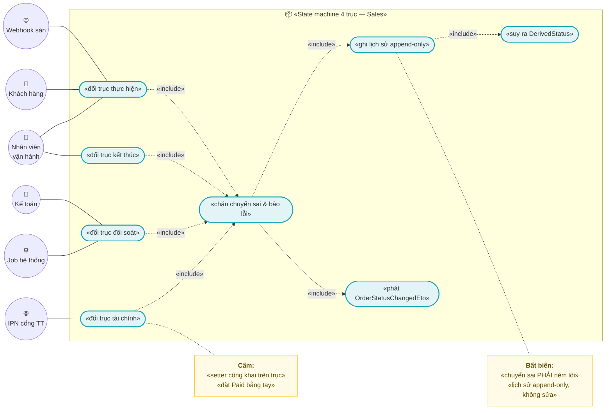
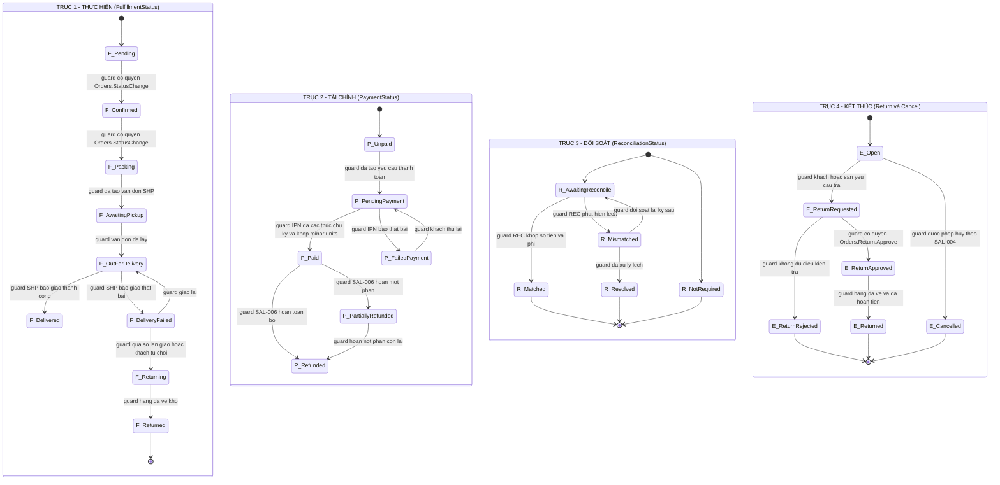
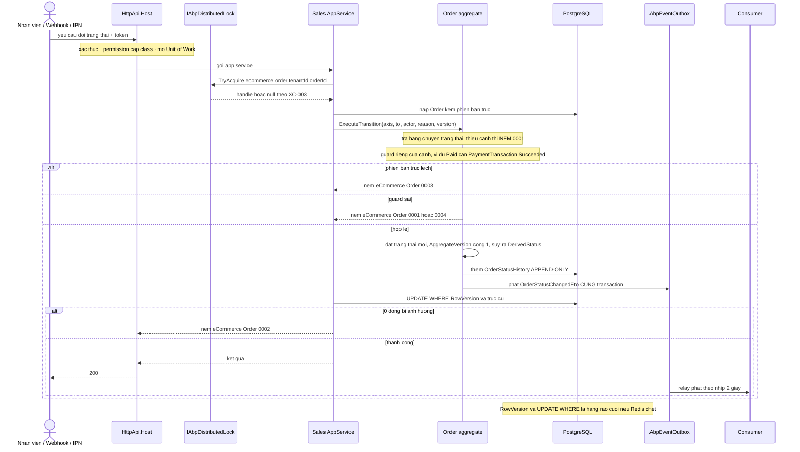
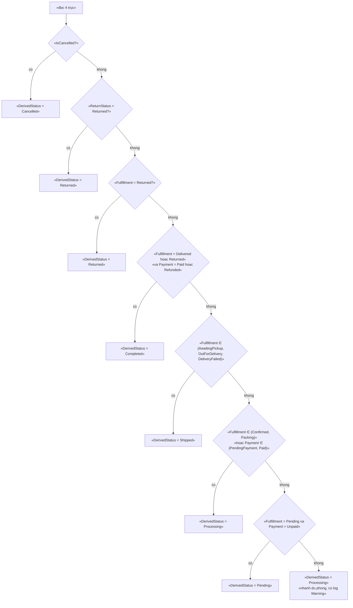
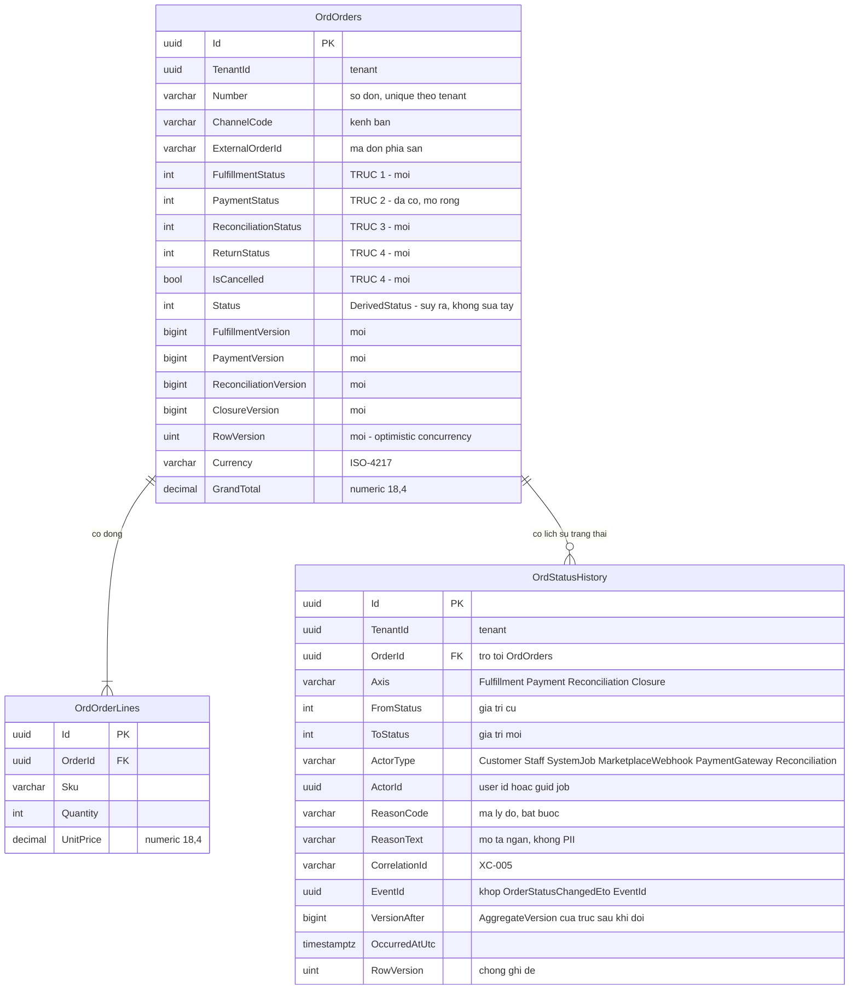

# `SAL-003` — State machine 4 trục và lịch sử trạng thái

| Thuộc tính | Nội dung |
|---|---|
| **Mã** | `SAL-003` |
| **Module** | **Sales** — hiện entity `Order`/`OrderLine` nằm ở app (`src/eCommerce.Domain/Entities/Orders/Order.cs`); kế hoạch tách sang `modules/Sales/eCommerce.Sales.Domain` ở GĐ1 |
| **Giai đoạn** | **GĐ1 — Bán được trên website** (theo `docs/implementation-plan.md` Phụ lục A.3, dòng `SAL-003`) |
| **Ưu tiên** | **Must have** — mọi thao tác đổi trạng thái đơn đều đi qua đây |
| **Trạng thái** | 🟡 `Draft` — chờ review |
| **Người viết / người review** | *(điền)* / **Kiến trúc trưởng + BA vận hành** |
| **Phiên bản / ngày** | `v0.1 — 14/10/2026` |
| **Tài liệu liên quan** | `XC-001` (tiền, cấm `==` — §0.1 D3) · `XC-002` (`OrderStatusChangedEto`, `AggregateVersion`, idempotency 4 biên vào) · `XC-003` (khoá phân tán) · `XC-004` (`[Authorize]` cấp class, permission) · `XC-005` (metric/log) · `SAL-002` (đặt hàng) · `SAL-004` (huỷ đơn & compensation) · `SAL-005` (webhook đơn từ sàn) · `SAL-006` (RMA) · `REC-001`/`REC-002` (đối soát) · `SHP-003` (COD) · `docs/business-modules-proposal.md` §6.4 · `docs/templates/feature-design-template.md` |

---

## 0. Tóm tắt & quyết định thiết kế

**Tóm tắt:** `SAL-003` chốt **vòng đời trạng thái của đơn hàng** thành **4 trục trực giao** — *(1) thực hiện*,
*(2) tài chính*, *(3) đối soát*, *(4) kết thúc (trả hàng / huỷ)* — cộng một trường **`DerivedStatus` suy ra**
(chỉ để hiển thị và tương thích ngược), một **bảng chuyển trạng thái có guard** ném lỗi khi sai, và một
**nhật ký trạng thái append-only** (`OrderStatusHistory`) để trả lời được câu hỏi *"ai đổi, lúc nào, từ đâu sang đâu,
vì sao"*.

**Vì sao không dùng 1 trục như code hiện tại:** trong repo hiện chỉ có **một** enum trạng thái đơn
(`src/eCommerce.Domain.Shared/Enums.cs:50-59`, 7 giá trị) + một `PaymentStatus` (`:61-69`). Với một trục duy nhất,
ca **phổ biến nhất ở Việt Nam** — *"đã giao hàng nhưng CHƯA thu tiền"* (COD) — **không biểu diễn được**: không có
giá trị nào vừa nghĩa "đã giao" vừa nghĩa "chưa thu tiền". nopCommerce phải tách 3 trục trực giao vì đúng lý do này
(`docs/business-modules-proposal.md:214-231`); ta giữ 3 trục của họ và **thêm trục thứ 4 `ReconciliationStatus`**
mà nopCommerce **hoàn toàn không có** (cùng nguồn, dòng 229).

**🚨 Vấn đề nghiêm trọng nhất phát hiện được trong code hiện tại:** state machine **chưa tồn tại** — trạng thái đơn
được đặt bằng một setter **không có guard nào**:

| Hiện trạng | Bằng chứng (đã đọc) | Hệ quả |
|---|---|---|
| `Order.SetStatus(OrderStatus status) => Status = status;` — gán thẳng, **không kiểm tra** chuyển trạng thái hợp lệ | `src/eCommerce.Domain/Entities/Orders/Order.cs:111` | `Completed → Pending`, `Cancelled → Shipped`, … **đều được chấp nhận im lặng** ⇒ vi phạm quy ước #11 (state machine phải ném lỗi) |
| `Order.PaymentStatus` là property **công khai có setter công khai** | `src/eCommerce.Domain/Entities/Orders/Order.cs:33` | Bất kỳ tầng nào cũng ghi đè trạng thái tiền mà **không** qua guard, **không** để lại lịch sử |
| `Order.ExternalOrderId` / `ChannelShopId` / `CustomerId` setter công khai | `Order.cs:21,27,29` | Webhook sàn có thể sửa khoá idempotency của đơn |
| **Không có** entity `OrderStatusHistory`; **không có** DbSet tương ứng | `src/eCommerce.EntityFrameworkCore/eCommerceDbContext.cs:43-45` (chỉ có `Orders`, `OrderLines`); `grep OrderStatusHistory` toàn repo = **0** kết quả trong `src/` | **Không trả lời được** "ai đổi trạng thái lúc nào" — trong khi `docs/implementation-plan.md:180` đã liệt kê `OrderStatusHistory` là entity của module Sales |
| **Không có** `RowVersion`/concurrency token trên `Order` | `eCommerceDbContext.cs:162-192` không cấu hình `.IsRowVersion()`; migration `20261013024226_Fix_NullableTenantId_UniqueIndexes.cs` không tạo cột nào như vậy | Hai người cùng đổi trạng thái ⇒ **last-write-wins im lặng** |
| Trạng thái sai **không** ném lỗi ở tiền thanh toán: `PaymentTransaction.MarkSucceeded` **trả `false`** khi giao dịch đã `Succeeded` | `modules/PaymentHub/eCommerce.PaymentHub.Domain/Entities/PaymentTransaction.cs:96-99` | Đây là ca "guard im lặng" mà `XC-002` §0 bài học #4 và `XC-002` BR-009 **cấm**; test hiện tại còn **khẳng định** hành vi này (`test/eCommerce.Tests/Domain/OrderAndInventoryTests.cs:105-117`) ⇒ xem §15.2 **F2** |

⇒ Tài liệu này biến các phát hiện trên thành **BR có mã + test tự động** (§1, §14) và **kế hoạch sửa** (§11, §15.2).

**Phạm vi:**
- ✅ Định nghĩa **4 trục trạng thái** + giá trị hợp lệ + quy tắc suy ra `DerivedStatus`.
- ✅ **Bảng chuyển trạng thái có guard** cho cả 4 trục; **mọi chuyển sai ⇒ NÉM LỖI có mã**.
- ✅ **Ai được phép chuyển** (khách / nhân viên / webhook sàn / job hệ thống) + permission tương ứng.
- ✅ **Nhật ký trạng thái append-only** (`OrderStatusHistory`): cột, index, quy tắc ghi, quy tắc cấm sửa/xoá.
- ✅ **`AggregateVersion`** đơn điệu theo từng trục + **`RowVersion`** + `UPDATE … WHERE` để chống 2 luồng ghi đè nhau.
- ✅ **`OrderStatusChangedEto`** phát trong cùng Unit of Work (outbox) — khớp `XC-002` §7.1.
- ✅ Khoá phân tán theo đơn + mã lỗi + migration + test case.

**Không nằm trong phạm vi:**
- ❌ **Tạo đơn / tính lại giá / giữ chỗ tồn kho** — thuộc `SAL-002`.
- ❌ **Nghiệp vụ huỷ đơn & bù trừ (compensation)** — thuộc `SAL-004`; ở đây chỉ định nghĩa **trạng thái** huỷ và guard.
- ❌ **Luồng RMA đầy đủ** (tạo phiếu trả, nhập lại kho, hoàn tiền từng phần) — thuộc `SAL-006`; ở đây chỉ định nghĩa **trục kết thúc**.
- ❌ **Đối soát thật** (khớp sao kê, settlement sàn, đối soát COD) — thuộc `REC-001`/`REC-002`/`SHP-003`; ở đây chỉ định nghĩa **các trạng thái đối soát** mà `REC-*` sẽ ghi vào.
- ❌ **Hạ tầng outbox/inbox, DLQ, `IIdempotencyGuard`** — thuộc `XC-002`.
- ❌ **Sơ đồ bảng `Discrepancy`** (chi tiết lệch) — thuộc `REC-001`.
- ❌ **Sửa `PaymentTransaction` của PaymentHub** — chỉ **ghi nhận** phát hiện F2 và chuyển cho module sở hữu (§15.2).

### 0.1 Quyết định thiết kế (ADR ngắn)

| # | Quyết định | Phương án đã cân nhắc | Lý do chọn | Hệ quả |
|---|---|---|---|---|
| **D1** | **4 trục trực giao**, không dùng 1 enum trạng thái đơn | (a) giữ 1 trục như code hiện tại · (b) 3 trục theo nopCommerce · (c) **4 trục** (3 của nopCommerce + `ReconciliationStatus`) | Ca COD *"đã giao nhưng chưa thu tiền"* **không biểu diễn được** với 1 trục. Trục thứ 4 là **bắt buộc** cho VN: tiền từ sàn/COD về **sau** khi giao, và **có thể lệch** (`docs/business-modules-proposal.md:229,275-278`) | Mọi truy vấn/báo cáo phải nói rõ **trục nào**; UI phải hiển thị nhiều trục; thêm 4 cột + 1 bảng lịch sử |
| **D2** | **`DerivedStatus` là giá trị SUY RA**, không phải cột người dùng sửa | (a) cho phép sửa tay · (b) suy ra thuần trong domain · (c) cột lưu sẵn + suy ra lại mỗi lần ghi | Cho sửa tay ⇒ **hai nguồn sự thật** ⇒ lệch với 4 trục (đúng loại lỗi F1 của `XC-003`). Lưu sẵn để **truy vấn danh sách** nhanh, nhưng **chỉ** domain được ghi | `DerivedStatus` **không** có setter công khai; có **test** khẳng định nó luôn khớp 4 trục (**TC-21**) |
| **D3** | Tách **`FulfillmentStatus`** khỏi `OrderStatus` hiện tại (không tái dùng enum cũ) | (a) mở rộng `OrderStatus` thêm giá trị · (b) enum mới `FulfillmentStatus` + giữ `OrderStatus` làm `DerivedStatus` | Enum `OrderStatus` hiện có **7 giá trị trộn 2 nghĩa** (`Cancelled`/`Returned` là trục kết thúc, `Shipped` là trục thực hiện). Mở rộng nó ⇒ mỗi lần thêm giá trị phải tự hỏi "giá trị này thuộc trục nào" | Giữ tên `OrderStatus` làm **derived** (không phá code/tests hiện có); thêm `FulfillmentStatus`, `ReconciliationStatus`, `ReturnStatus`, `IsCancelled` |
| **D4** | Chuyển trạng thái **CHỈ** qua phương thức domain có guard; `SetStatus` **bị xoá** | (a) giữ `SetStatus` cho tiện · (b) `ExecuteTransition(...)` duy nhất + xoá setter | Giữ `SetStatus` ⇒ đường vòng **không guard** tồn tại mãi. Đây **chính là** bất biến #11 của dự án | Mọi chỗ gọi `SetStatus` phải sửa; có **test reflection** chặn setter công khai trên trục (**TC-20**) |
| **D5** | **Guard ở 2 tầng**: domain (đọc bảng chuyển) + **DB** (`RowVersion` + `UPDATE … WHERE`) | (a) chỉ domain · (b) chỉ DB · (c) cả hai | Kiểm tra trong bộ nhớ **không** chống được 2 luồng song song (bài học thật ở Phase 0 và D8 của `XC-002`). DB là hàng rào cuối | Mọi bảng trạng thái có `RowVersion`; `ExecuteUpdateAsync` có điều kiện và **kiểm số dòng bị ảnh hưởng**, `0` dòng ⇒ **NÉM** |
| **D6** | **`AggregateVersion` theo TỪNG TRỤC**, không theo cả đơn | (a) một version cho cả đơn · (b) version riêng mỗi trục · (c) không dùng version (tin vào `RowVersion`) | `XC-002` §7.4 yêu cầu `version > AppliedVersion + 1` ⇒ DLQ `OutOfOrder`. Nếu **một** version cho 4 trục thì hai sự kiện **khác trục** (không hề xung đột) sẽ bị coi là **thiếu bản trung gian** ⇒ DLQ giả | `OrderStatusHistory` phải ghi `Axis`; mỗi trục có bộ đếm riêng; ETO mang cả `Axis` + `AggregateVersion` |
| **D7** | **Lịch sử trạng thái là APPEND-ONLY** trong tầng domain + ràng buộc DB | (a) cho sửa `Reason`/`Note` sau · (b) cấm sửa/xoá | Lịch sử trạng thái là **chứng từ** (dùng khi tranh chấp với khách/sàn). Sửa được ⇒ **mất giá trị chứng cứ**. Cùng nguyên tắc với sổ cái kho (`src/eCommerce.Domain/Entities/Inventory/StockLedger.cs:80-83`) | Bổ sung tại chỗ: `Note` trên lịch sử **cũng** chỉ ghi một lần |
| **D8** | Ghi lịch sử **trong cùng transaction** với đổi trạng thái; phát ETO **cùng UoW** (outbox) | (a) ghi lịch sử sau, qua job · (b) cùng transaction | Ghi sau ⇒ có cửa sổ **trạng thái đã đổi mà chưa có lịch sử** ⇒ vi phạm bất biến "mọi chuyển trạng thái đều có lịch sử" | Không thể "quên" ghi lịch sử: nó nằm trong chính phương thức chuyển trạng thái |
| **D9** | Mã lỗi **`eCommerce:Order:*`** đặt tại `eCommerceConsts.ErrorCodes` (app) | (a) đặt trong module · (b) app | **Hiện tại** entity Order ở `src/` ⇒ app sở hữu; khi tách module Sales (GĐ1) **chuyển mã lỗi về** `SalesErrorCodes` của module — đúng quy ước "module sở hữu hằng số của mình" (`XC-003` D3, `eCommerceConsts.cs:80-84`) | Ghi rõ nợ di chuyển ở §11; **cấm** định nghĩa trùng ở 2 nơi (bài học F1 `XC-003`) |
| **D10** | **`Cancelled` là trạng thái hấp thụ** (absorbing) | (a) cho phép mở lại đơn đã huỷ · (b) hấp thụ | Mở lại đơn đã huỷ ⇒ tồn kho/tiền đã bù trừ (`SAL-004`) mà đơn sống lại ⇒ **sai dữ liệu**. Muốn bán lại ⇒ **tạo đơn mới** | Mọi chuyển dịch từ `Cancelled`/`Returned` ⇒ **NÉM** `eCommerce:Order:0006` |
| **D11** | Trạng thái `PaymentStatus` của `Order` **chỉ** được ghi bởi consumer của `PaymentSucceededEto` (PaymentHub) hoặc IPN **đã xác thực chữ ký** | (a) cho UI/nhân viên đặt "đã thanh toán" tay · (b) chỉ hệ thống | Đặt tay "đã thu tiền" mà **không** có giao dịch ⇒ lệch sổ quỹ, và `REC-001` sẽ báo lệch vĩnh viễn. Quy ước #10 đã có: *"ReturnUrl KHÔNG phải bằng chứng thanh toán"* (`PaymentTransaction.cs:28-31`) | Nhân viên **không** có đường đặt `Paid` tay; ngoại lệ phải qua permission riêng + ghi `Reason` (**chưa mở ở GĐ1**) |
| **D12** | Khoá phân tán theo đơn: **`ecommerce:order:{tenantId}:{orderId}`** (có tiền tố) | (a) `order:{tenantId}:{orderId}` (đang ghi ở `XC-002` §8.2) · (b) `ecommerce:order:…` | `XC-003` §5.4 **đã kiểm chứng bằng `redis-cli MONITOR`** rằng tiền tố thật do `KeyPrefix = "ecommerce:"` sinh ra ⇒ khoá **phải** viết **đủ** tiền tố trong tài liệu để `grep "ecommerce:"` liệt kê được **toàn bộ** khoá (NFR-006 của `XC-003`) | SAL-003 (module sở hữu miền đơn) **đăng ký** hàm sinh khoá; `XC-002` §8.2 cần sửa `order:…` → `ecommerce:order:…` — xem §15.2 **F3** |

> 📌 **Ghi lại phương án BỊ LOẠI:** *"dùng 1 enum + `OrderStatusHistory` để suy ra trạng thái hiện tại"* — bị loại vì
> mỗi lần đọc trạng thái phải quét toàn bộ lịch sử (không dùng được index theo trạng thái), và **không** trả lời được
> câu hỏi vận hành phổ biến nhất: *"đơn nào chưa thu tiền?"*.

---

## 1. Use Case Specification

| Thuộc tính | Nội dung |
|---|---|
| **Use Case ID** | `SAL-003` |
| **Use Case Name** | Chuyển trạng thái đơn hàng trên 4 trục **có guard, có lịch sử, không mất dữ liệu** |
| **Description** | *"Là hệ thống bán hàng đa kênh, tôi muốn mọi thay đổi trạng thái đơn đi qua **một** cửa có kiểm tra, để không bao giờ có đơn 'giao hàng rồi mà quay lại chờ xử lý', và luôn trả lời được **ai đổi, lúc nào, vì sao**."* |
| **Actor(s)** | **Khách hàng** (chỉ huỷ/yêu cầu trả khi đủ điều kiện) · **Nhân viên vận hành** (đóng gói, giao, giao thất bại) · **Kế toán** (đánh dấu đối soát) · **Webhook sàn** (`SAL-005`) · **IPN cổng thanh toán** (PaymentHub) · **Job hệ thống** (quá hạn, đối soát) |
| **Priority** | **Must have** |
| **Trigger** | (a) nhân viên bấm hành động trên UI đơn; (b) webhook sàn báo `shipped`/`delivered`/`cancelled`; (c) IPN cổng thanh toán xác nhận tiền; (d) job đối soát/COD cập nhật trục đối soát; (e) khách yêu cầu huỷ |
| **Pre-Condition(s)** | • **Tenant hiện tại** (`TenantId` từ `ICurrentTenant`) — bắt buộc; `Order` là `IMultiTenant` (`Order.cs:10-12`).<br>• **Kênh bán** (`ChannelCode`) — bắt buộc với đơn từ sàn; **có** trên `Order` (`Order.cs:17-18`).<br>• Đơn **đang tồn tại** và **chưa ở trạng thái hấp thụ** trên trục sắp đổi (`Cancelled`, `Returned`, `ReturnApproved`).<br>• Người gọi có **permission** tương ứng (§9) — `[Authorize]` ở **cấp class** (`XC-004` D3).<br>• Nếu là webhook/IPN: **đã qua** `IIdempotencyGuard` của `XC-002` (BR-004 của `XC-002`).<br>• `ExpectedVersion` (phiên bản phiên bản của trục) đã được đọc ở request trước — nếu client gửi. |
| **Post-Condition(s)** | • Đúng **một** trục đổi giá trị; 3 trục còn lại **không đổi**.<br>• Có **đúng một** bản ghi `OrderStatusHistory` mới, **append-only**, mang `FromStatus`, `ToStatus`, `Axis`, `ActorType`, `ActorId`, `ReasonCode`, `CorrelationId`, `OccurredAtUtc`, `VersionAfter`.<br>• `AggregateVersion` **của trục đó** tăng **đúng 1**.<br>• `DerivedStatus` được tính lại và **khớp** 4 trục.<br>• Phát **đúng một** `OrderStatusChangedEto` **trong cùng Unit of Work** (ghi outbox cùng transaction — `XC-002` BR-001).<br>• Mọi chuyển dịch **sai** ⇒ **không** có thay đổi nào trong DB (rollback) và **có** exception mang mã `eCommerce:Order:*`. |
| **Basic Flow** | 1. App service (`Sales`) mở **Unit of Work**; kiểm tra permission cấp class (`[Authorize]`).<br>2. Giành **khoá phân tán** `eCommerceConsts.LockKeys.Order(TenantId, orderId)` (timeout theo `XC-003` D8).<br>3. Nạp `Order` **kèm lịch sử** nếu cần; đọc `RowVersion` hiện tại.<br>4. Gọi **một** phương thức domain: `order.ExecuteTransition(new OrderTransitionRequest(axis, toStatus, actorType, actorId, reasonCode, correlationId, expectedAxisVersion))`.<br>5. Domain tra **bảng chuyển trạng thái** (§3): không có cạnh hợp lệ ⇒ **NÉM** `eCommerce:Order:0001` (thông điệp có `axis`, `from`, `to`).<br>6. Kiểm tra guard riêng của cạnh (ví dụ `Paid` yêu cầu có `PaymentTransaction` đã `Succeeded`).<br>7. `expectedAxisVersion` lệch ⇒ **NÉM** `eCommerce:Order:0003`.<br>8. Ghi trạng thái mới + `AggregateVersion[axis]++` + `DerivedStatus` mới; **thêm** một `OrderStatusHistory` (**append-only**).<br>9. Phát `OrderStatusChangedEto` (outbox, cùng transaction) — `XC-002` §7.1.<br>10. Lưu bằng `UPDATE … WHERE Id = @id AND RowVersion = @rv AND <Axis> = @from`; **số dòng ảnh hưởng `0`** ⇒ **NÉM** `eCommerce:Order:0002`.<br>11. Commit; nhả khoá; ghi metric `sales_order_transition_total{axis,from,to}`. |
| **Alternative Flow** | **A1: Chuyển do **webhook sàn** (`SAL-005`)** — đi qua `IIdempotencyGuard` **trước**; `actorType = MarketplaceWebhook`; `ReasonCode = <mã sự kiện sàn>`; **không** tin thứ tự ⇒ dùng `AggregateVersion` (D6).<br>**A2: Chuyển do **IPN thanh toán**** — chỉ PaymentHub gọi; `actorType = PaymentGateway`; guard bắt buộc: `PaymentTransaction.Status == Succeeded` **và** `ToMinorUnits()` khớp số tiền đơn (`XC-001` D3 — **cấm** so `==` trên `decimal`).<br>**A3: Chuyển do **job** (quá hạn không giao)** — `actorType = SystemJob`; job **phải** idempotent theo `{JobName}:{tenantId}:{kỳ}` (`XC-002` §7.3).<br>**A4: Chuyển **trùng** (cùng `Axis` + cùng `ToStatus` + cùng `VersionAfter` đã áp dụng)** — coi là **thành công idempotent**, ghi metric `sales_order_transition_duplicate_total`, **không** ghi lịch sử thứ hai, **không** ném lỗi (xem BR-011). |
| **Exception Flow** | **E1:** cạnh **không** có trong bảng chuyển ⇒ `BusinessException` **`eCommerce:Order:0001`** (kèm `axis`/`from`/`to`).<br>**E2:** `UPDATE … WHERE` ảnh hưởng **0 dòng** (RowVersion lệch) ⇒ **`eCommerce:Order:0002`** (không coi là thành công).<br>**E3:** `AggregateVersion` của trục lệch ⇒ **`eCommerce:Order:0003`**.<br>**E4:** thiếu `ActorId`/`ReasonCode` **hoặc** `actorType` không được phép trên cạnh ⇒ **`eCommerce:Order:0004`**.<br>**E5:** `axis` không nằm trong 4 trục (ví dụ `DerivedStatus`) ⇒ **`eCommerce:Order:0005`** — **cấm** ghi đè `DerivedStatus` trực tiếp.<br>**E6:** đơn đang ở trạng thái **hấp thụ** và cố chuyển tiếp ⇒ **`eCommerce:Order:0006`**.<br>**E7:** tiền không khớp (`PaymentSucceededEto` lệch số tiền đơn) ⇒ **`eCommerce:Order:0008`** — **không** đánh dấu `Paid`.<br>**E8:** Redis chết ⇒ khoá **vô hiệu** nhưng `RowVersion` + `UPDATE … WHERE` **vẫn** chặn (D5); hành vi fail-open theo `XC-003` D2/E2. |
| **Business Rules** | • **BR-SAL-003-001**: Mọi thay đổi trạng thái đơn **CHỈ** được thực hiện qua phương thức chuyển trạng thái của domain có guard; **cấm** setter công khai trên bất kỳ trục trạng thái nào; **cấm** tồn tại `Order.SetStatus(...)`.<br>• **BR-SAL-003-002**: **Mọi** chuyển trạng thái không có trong bảng chuyển (§3) **PHẢI NÉM LỖI** `eCommerce:Order:0001` — **cấm** no-op im lặng, **cấm** "bỏ qua nếu đã ở trạng thái đó" **trừ** ca A4 (trùng hợp lệ).<br>• **BR-SAL-003-003**: Đơn hàng có **đúng 4 trục** trạng thái: `FulfillmentStatus`, `PaymentStatus`, `ReconciliationStatus`, `ReturnStatus` (+ `IsCancelled`). **Cấm** thêm trục thứ 5 mà không sửa tài liệu này.<br>• **BR-SAL-003-004**: **Mỗi** lần chuyển trạng thái **PHẢI** sinh **đúng một** bản ghi `OrderStatusHistory` **trong cùng transaction**; `0` bản ghi ⇒ vi phạm; `2` bản ghi cho một chuyển dịch ⇒ vi phạm.<br>• **BR-SAL-003-005**: `OrderStatusHistory` là **APPEND-ONLY**: **cấm** UPDATE/DELETE ở tầng ứng dụng; **cấm** sửa `ReasonCode`/`Note` sau khi ghi.<br>• **BR-SAL-003-006**: Mọi chuyển trạng thái **PHẢI** có `ActorType` + `ActorId` (hoặc `SystemJob`/`MarketplaceWebhook` có định danh nguồn) + `ReasonCode`; thiếu ⇒ **NÉM** `eCommerce:Order:0004`.<br>• **BR-SAL-003-007**: Mọi chuyển trạng thái **PHẢI** đi kèm `CorrelationId` (từ `XC-005`) — để nối trạng thái với log/ETO.<br>• **BR-SAL-003-008**: `DerivedStatus` **CHỈ** do domain suy ra từ 4 trục; **cấm** mọi nguồn khác ghi vào (kể cả SQL tay, trừ migration backfill).<br>• **BR-SAL-003-009**: `AggregateVersion` **theo từng trục**, **tăng đúng 1** mỗi lần chuyển trạng thái của trục đó; **cấm** giảm, **cấm** nhảy cách.<br>• **BR-SAL-003-010**: Mọi chuyển trạng thái **PHẢI** có guard ở **tầng DB**: `UPDATE … WHERE RowVersion = @expected AND <Axis> = @fromStatus`; số dòng `0` ⇒ **NÉM** `eCommerce:Order:0002`.<br>• **BR-SAL-003-011**: Chuyển trạng thái **trùng hợp lệ** (A4: cùng trục, cùng đích, cùng phiên bản đã áp dụng) ⇒ **thành công idempotent**: **không** ghi lịch sử thứ hai, **không** ném lỗi, **có** metric.<br>• **BR-SAL-003-012**: `Cancelled` và `Returned` là trạng thái **hấp thụ** trên trục kết thúc; cố chuyển tiếp ⇒ **NÉM** `eCommerce:Order:0006`. Mở lại đơn ⇒ **tạo đơn mới**.<br>• **BR-SAL-003-013**: `PaymentStatus` của đơn **CHỈ** được ghi bởi PaymentHub/IPN **đã xác thực chữ ký** (`actorType = PaymentGateway`); **cấm** API người dùng đặt `Paid` — **kể cả** `eCommerce.Orders.Manage`.<br>• **BR-SAL-003-014**: `PaymentStatus → Paid` **PHẢI** kiểm tra số tiền khớp theo **minor units** (`XC-001` BR-003: **cấm** so sánh tiền bằng `==` trên `decimal`); lệch ⇒ **NÉM** `eCommerce:Order:0008`.<br>• **BR-SAL-003-015**: `ReconciliationStatus` **CHỈ** được ghi bởi job/module đối soát (`REC-001`/`REC-002`/`SHP-003`); **cấm** UI ghi tay.<br>• **BR-SAL-003-016**: `ReturnStatus → ReturnApproved` **PHẢI** có permission `Orders.Return.Approve` **và** tham chiếu tới phiếu trả của `SAL-006` (guard "có phiếu" — kiểm ở tầng app service).<br>• **BR-SAL-003-017**: Mọi chuyển trạng thái **PHẢI** phát `OrderStatusChangedEto` **trong cùng Unit of Work** (outbox — `XC-002` BR-001) mang `Axis`, `From`, `To`, `AggregateVersion`.<br>• **BR-SAL-003-018**: `AggregateVersion` trong ETO là **của trục** (`Axis`); consumer so theo `(OrderId, Axis)`; **cấm** so version giữa hai trục khác nhau.<br>• **BR-SAL-003-019**: Mọi chuyển trạng thái **PHẢI** nằm trong phạm vi khoá phân tán `ecommerce:order:{tenantId}:{orderId}` (D12) để giảm tranh chấp; **cấm** dựa **duy nhất** vào khoá (phải có D5).<br>• **BR-SAL-003-020**: `OrderStatusHistory` **PHẢI** có `TenantId` + là `IMultiTenant`; truy vấn lịch sử **luôn** lọc theo tenant.<br>• **BR-SAL-003-021**: Tiền trong ETO và trong lịch sử (nếu có) là `decimal` + mã tiền tệ; **cấm** `double`/`float` (`XC-001` BR-008).<br>• **BR-SAL-003-022**: **Cấm** đổi trạng thái đơn của **tenant khác** — kể cả khi biết `orderId`; trả **`404`** (không `403`) theo `XC-004` BR-008. |
| **Non-Functional Requirement** | • **NFR-SAL-003-001**: Kiểm tra guard trong domain (thuần bộ nhớ) p95 **< 1 ms**.<br>• **NFR-SAL-003-002**: Một lần chuyển trạng thái (khoá + đọc + ghi + lịch sử + outbox) p95 **< 100 ms**, p99 **< 300 ms** trên máy dev.<br>• **NFR-SAL-003-003**: **100 %** chuyển trạng thái thành công có **đúng 1** bản ghi lịch sử (kiểm bằng test đếm).<br>• **NFR-SAL-003-004**: Gửi lại **cùng một** yêu cầu chuyển trạng thái **100 lần** ⇒ **đúng 1** bản ghi lịch sử và **0** exception (idempotent — A4).<br>• **NFR-SAL-003-005**: Cách ly tenant: tenant A **không** đọc/ghi được lịch sử của tenant B (integration test 2 tenant).<br>• **NFR-SAL-003-006**: **100 %** chuyển trạng thái có `CorrelationId` trong log + ETO (`XC-005` BR-002/BR-003).<br>• **NFR-SAL-003-007**: **0** lần `UPDATE … WHERE` ảnh hưởng `0` dòng bị **coi là thành công** (kiểm bằng test + review).<br>• **NFR-SAL-003-008**: **0** property trục trạng thái có setter công khai (test reflection).<br>• **NFR-SAL-003-009**: **0** `double`/`float` trong entity/DTO/ETO của Sales (test reflection).<br>• **NFR-SAL-003-010**: Truy vấn lịch sử một đơn (mới nhất trước, 100 dòng) p95 **< 50 ms** với 1 triệu bản ghi lịch sử.<br>• **NFR-SAL-003-011**: **0** chuyển trạng thái vào `Cancelled`/`Returned` mà **sau đó** có chuyển dịch khác (bất biến hấp thụ, kiểm bằng job quét + test).<br>• **NFR-SAL-003-012**: Metric `sales_order_transition_total{axis,from,to}` **và** `sales_order_transition_rejected_total{axis,from,to,code}` tồn tại với nhãn **hữu hạn** (`XC-005` BR-009: **cấm** nhãn `orderId`). |

> ⚠️ **Quy ước #11 của dự án — nhắc lại vì đây là feature dễ vi phạm nhất:**
> *guard trạng thái sai **PHẢI NÉM LỖI** (hoặc ghi log có cấu trúc), **KHÔNG** im lặng.*
> Bằng chứng code hiện tại **vi phạm** quy ước này: `PaymentTransaction.MarkSucceeded` trả `false` và
> `Order.SetStatus` không kiểm tra gì (xem §0 và §15.2 F1/F2).

---

## 2. Sơ đồ Use Case



### Chú giải

| Ký hiệu | Ý nghĩa |
|---|---|
| ⭕ Xanh lá | Actor (người dùng + hệ thống + hệ thống ngoài) |
| 🟦 Bầu dục xanh dương | Use Case |
| 🟨 Khung vàng | Note (bất biến / điều cấm) |
| `───` | Liên kết Actor ↔ Use Case |
| `-.«include».->` | Quan hệ bao hàm — **mọi** chuyển trạng thái đều **buộc** đi qua guard, lịch sử và ETO |

---

## 3. Sơ đồ trạng thái (state machine)

**Bốn trục trực giao — mỗi trục là MỘT state machine độc lập.** Chỉ được đổi **một** trục trong một giao dịch;
mọi chuyển dịch **không có cạnh** trong sơ đồ dưới đây ⇒ **NÉM LỖI** (`eCommerce:Order:0001`).



**Bảng chuyển trạng thái & guard — TRỤC 1 (thực hiện).** Cột *"Nếu guard sai"*: **NÉM LỖI**, không im lặng.

| # | Từ → Sang | Ai được chuyển | Guard (điều kiện cho phép) | Hành động kèm theo | Nếu guard sai |
|---|---|---|---|---|---|
| 1 | `Pending` → `Confirmed` | Nhân viên · Job | Đơn đã có tồn kho giữ chỗ (`INV-002`) và tổng tiền đã chốt | ghi lịch sử · ETO · `AggregateVersion[Fulfillment]++` | **`eCommerce:Order:0001`** |
| 2 | `Confirmed` → `Packing` | Nhân viên | Không có yêu cầu huỷ đang mở (`ReturnStatus = Open`) | như trên | **`0001`** |
| 3 | `Packing` → `AwaitingPickup` | Nhân viên · Job | Có vận đơn từ `SHP-001` (mã vận đơn không rỗng) | như trên | **`0004`** (thiếu tham chiếu vận đơn) |
| 4 | `AwaitingPickup` → `OutForDelivery` | Webhook (`SHP-002`) | Sự kiện vận đơn thuộc **đúng** tenant + đúng mã vận đơn | như trên | **`0001`** |
| 5 | `OutForDelivery` → `Delivered` | Webhook (`SHP-002`) | Sự kiện `delivered` đã xác thực nguồn | như trên | **`0001`** |
| 6 | `OutForDelivery` → `DeliveryFailed` | Webhook (`SHP-002`) | Sự kiện giao thất bại lần thứ `n` | như trên + `ReasonCode = GiaoThatBai` | **`0001`** |
| 7 | `DeliveryFailed` → `OutForDelivery` | Nhân viên · Job | `n < MaxDeliveryAttempts` (cấu hình tenant) | như trên | **`0004`** |
| 8 | `DeliveryFailed` → `Returning` | Nhân viên · Job | `n >= MaxDeliveryAttempts` **hoặc** khách từ chối nhận | như trên | **`0004`** |
| 9 | `Returning` → `Returned` | Job · Nhân viên | Hàng đã nhập lại kho (`INV-001` có bút toán `CustomerReturn`) | như trên | **`0001`** |
| 10 | `Returned` → *bất kỳ* | — | **KHÔNG** có guard nào cho phép | — | **`0006`** (hấp thụ) |

**Bảng chuyển trạng thái & guard — TRỤC 2 (tài chính).**

| # | Từ → Sang | Ai được chuyển | Guard | Hành động kèm theo | Nếu guard sai |
|---|---|---|---|---|---|
| 11 | `Unpaid` → `PendingPayment` | Hệ thống (`PaymentHub`) | Đã tạo `PaymentTransaction` với `IdempotencyKey` **ổn định** (`XC-002` BR-007) | lịch sử · ETO · `AggregateVersion[Payment]++` | **`0001`** |
| 12 | `PendingPayment` → `Paid` | **CHỈ** `PaymentGateway` (IPN đã xác thực chữ ký) | `PaymentTransaction.Status == Succeeded` **VÀ** `Amount.ToMinorUnits()` khớp tổng đơn **VÀ** cùng `Currency` | lịch sử · ETO · tăng version | **`0008`** nếu lệch tiền; **`0004`** nếu actor sai |
| 13 | `PendingPayment` → `FailedPayment` | `PaymentGateway` | IPN báo thất bại/huỷ | lịch sử · ETO | **`0001`** |
| 14 | `FailedPayment` → `PendingPayment` | Khách · Hệ thống | Số lần thử `< MaxPaymentAttempts` | lịch sử · ETO | **`0004`** |
| 15 | `Paid` → `PartiallyRefunded` | `eCommerce.Payments.Refund` | `0 < RefundedAmount < Amount` (so theo **minor units**) | lịch sử · ETO | **`0001`** |
| 16 | `Paid` → `Refunded` | `eCommerce.Payments.Refund` | `RefundedAmount == Amount` theo **minor units** | lịch sử · ETO | **`0001`** |
| 17 | `PartiallyRefunded` → `Refunded` | `eCommerce.Payments.Refund` | hoàn nốt phần còn lại | lịch sử · ETO | **`0001`** |
| 18 | `Refunded` → *bất kỳ* | — | **KHÔNG** cho phép (trừ khi `SAL-006` định nghĩa lại có tài liệu) | — | **`0006`** |

**Bảng chuyển trạng thái & guard — TRỤC 3 (đối soát).**

| # | Từ → Sang | Ai được chuyển | Guard | Ghi chú | Nếu guard sai |
|---|---|---|---|---|---|
| 19 | `NotRequired` → *bất kỳ* | — | **KHÔNG** — `NotRequired` là **hấp thụ** | dùng cho đơn không có tiền cần đối soát (đơn 0 đồng, huỷ trước khi thu) | **`0006`** |
| 20 | `AwaitingReconcile` → `Matched` | Job `REC-001`/`REC-002` | Số tiền + phí khớp sao kê/settlement theo **minor units** | `AggregateVersion[Reconciliation]++` | **`0001`** |
| 21 | `AwaitingReconcile` → `Mismatched` | Job `REC-001`/`REC-002` | Phát hiện lệch ⇒ **bắt buộc** tạo bản ghi `Discrepancy` (thuộc `REC-001`) | có `ReasonCode` = mã loại lệch | **`0004`** (thiếu `ReasonCode`) |
| 22 | `Mismatched` → `Resolved` | Kế toán · Job | Có `Discrepancy` đã đóng | — | **`0001`** |
| 23 | `Mismatched` → `AwaitingReconcile` | Job | Kỳ đối soát mới | — | **`0001`** |
| 24 | `Matched` / `Resolved` → *bất kỳ* | — | **KHÔNG** — **hấp thụ** | muốn đối soát lại ⇒ tạo **kỳ mới** | **`0006`** |

**Bảng chuyển trạng thái & guard — TRỤC 4 (kết thúc).**

| # | Từ → Sang | Ai được chuyển | Guard | Ghi chú | Nếu guard sai |
|---|---|---|---|---|---|
| 25 | `Open` → `ReturnRequested` | Khách · Webhook sàn · Nhân viên | Trong cửa sổ đổi trả (`ReturnWindowDays` theo tenant) **và** `FulfillmentStatus = Delivered` | — | **`0001`** |
| 26 | `ReturnRequested` → `ReturnApproved` | `eCommerce.Orders.Return.Approve` | Có phiếu trả của `SAL-006` tham chiếu đơn này | BR-016 | **`0004`** |
| 27 | `ReturnRequested` → `ReturnRejected` | `eCommerce.Orders.Return.Approve` | Không đủ điều kiện trả | có `ReasonCode` bắt buộc | **`0004`** |
| 28 | `ReturnApproved` → `Returned` | Job · Nhân viên | Hàng đã về kho **và** đã hoàn tiền (`PaymentStatus ∈ {PartiallyRefunded, Refunded}`) | — | **`0001`** |
| 29 | `Open` → `Cancelled` | Khách (đơn chưa giao) · Nhân viên | Theo `SAL-004` (chưa giao được, đã bù trừ giữ chỗ kho) | **hấp thụ** từ đây | **`0001`** |
| 30 | `Cancelled` / `Returned` / `ReturnRejected` → *bất kỳ* | — | **KHÔNG** — **hấp thụ** | **Bắt buộc** tạo đơn mới nếu bán lại (D10) | **`0006`** |

> ⚠️ **Trạng thái hấp thụ (absorbing):** `FulfillmentStatus.Returned`, `PaymentStatus.Refunded`,
> `ReconciliationStatus.{Matched,Resolved,NotRequired}`, `ReturnStatus.{Returned,ReturnRejected}`,
> `IsCancelled = true`. **Mọi** chuyển dịch **rời** khỏi trạng thái hấp thụ ⇒ **NÉM** `eCommerce:Order:0006`.
>
> **Quy tắc bất di bất dịch #11:** guard sai **phải NÉM LỖI có mã**, **không** no-op im lặng.
> Ngoại lệ **duy nhất** được phép "không lỗi" là **A4** (yêu cầu trùng hợp lệ, cùng trục + cùng đích + cùng phiên bản)
> — và khi đó **bắt buộc** có metric `sales_order_transition_duplicate_total`.

---

## 4. Sequence Diagram & luồng dữ liệu

### 4.1 Sequence — chuyển trạng thái có guard, lịch sử append-only, outbox



### 4.2 Quyết định suy ra `DerivedStatus` (thứ tự ưu tiên — dừng ở nhánh đầu tiên đúng)



> 📌 **Ghi rõ chênh lệch (thói quen tốt của tài liệu gốc):** `DerivedStatus` **không** phải nguồn sự thật.
> Khi UI hiển thị "Trạng thái" mà không hiển thị 4 trục, người dùng sẽ thấy **mâu thuẫn** ở ca COD:
> `DerivedStatus = Shipped` cùng lúc `PaymentStatus = Unpaid`. UI **phải** hiển thị trục tài chính **riêng**
> (xem §10) — nếu không sẽ bị báo là lỗi.
>
> 📌 **Nhánh dự phòng `I1` là "không rơi vào trường hợp nào"** — vẫn **phải** trả một giá trị (không ném lỗi, vì
> đây là hàm **thuần đọc**) nhưng **bắt buộc** ghi log `Warning` + metric `sales_order_derived_fallback_total`
> để phát hiện tổ hợp trạng thái chưa được thiết kế. Đây là **"log có cấu trúc thay vì im lặng"** — đúng tinh thần #11.

---

## 5. Mô hình dữ liệu

### 5.1 ERD



### 5.2 Bảng & cột (Data Dictionary)

#### 5.2.1 Bảng `OrdOrders` — **bổ sung cột** (bảng đã tồn tại)

Bảng đã có trong code: `eCommerceDbContext.cs:162-192` (`b.ToTable("OrdOrders")`), migration `20261009070214_Initial.cs:188-220`.
Dưới đây chỉ liệt kê **cột phải thêm**; các cột tiền/hệ thống hiện có **không đổi**.

| Cột | Kiểu | Null? | Nguồn / ý nghĩa | Ghi chú |
|---|---|---|---|---|
| `FulfillmentStatus` | `int` | ✖ | **mới** — trục 1 | mặc định `Pending = 0`; enum `FulfillmentStatus` |
| `PaymentStatus` | `int` | ✖ | **đã có** (`Order.cs:33`) — trục 2 | **giữ nguyên tên**; chỉ mở rộng enum (thêm `FailedPayment`, xem §5.3 mapping) |
| `ReconciliationStatus` | `int` | ✖ | **mới** — trục 3 | mặc định `AwaitingReconcile` cho đơn có tiền; `NotRequired` cho đơn 0 đồng |
| `ReturnStatus` | `int` | ✖ | **mới** — trục 4 | mặc định `Open = 0` |
| `IsCancelled` | `bool` | ✖ | **mới** — trục 4 | mặc định `false`; `true` là **hấp thụ** |
| `Status` | `int` | ✖ | **đã có** (`Order.cs:31`) — nay là **`DerivedStatus`** | ⚠️ **không** có setter công khai; chỉ domain ghi (BR-008) |
| `FulfillmentVersion` | `bigint` | ✖ | **mới** — bộ đếm trục 1 | mặc định `0`; **+1** mỗi lần chuyển trạng thái trục 1 |
| `PaymentVersion` | `bigint` | ✖ | **mới** — bộ đếm trục 2 | như trên |
| `ReconciliationVersion` | `bigint` | ✖ | **mới** — bộ đếm trục 3 | như trên |
| `ClosureVersion` | `bigint` | ✖ | **mới** — bộ đếm trục 4 | như trên |
| `RowVersion` | `xid` *(PostgreSQL)* | ✖ | **mới** — optimistic concurrency | Npgsql map `uint RowVersion` + `.IsRowVersion()` ⇒ cột hệ thống `xid` (⚠️ **chưa kiểm chứng** trên Npgsql 10.0.3 — xem §15.1 Q3) |

**Index & ràng buộc** (bổ sung — index hiện có **giữ nguyên**)

| Loại | Cột | Mục đích |
|---|---|---|
| INDEX | `(TenantId, FulfillmentStatus, CreationTime)` | màn hình vận hành: "đơn cần đóng gói/giao" |
| INDEX | `(TenantId, PaymentStatus, CreationTime)` | màn hình kế toán: "đơn chưa thu tiền" (ca COD) |
| INDEX | `(TenantId, ReconciliationStatus, CreationTime)` | job đối soát quét đơn chờ đối soát |
| INDEX | `(TenantId, ReturnStatus, CreationTime)` | màn hình RMA (`SAL-006`) |
| CHECK | `FulfillmentVersion >= 0 AND PaymentVersion >= 0 AND ReconciliationVersion >= 0 AND ClosureVersion >= 0` | bộ đếm **không** âm |
| UNIQUE *(đã có)* | `(TenantId, Number)` **`NULLS NOT DISTINCT`** | ✅ **đã có trong migration** `20261013024226_Fix_NullableTenantId_UniqueIndexes.cs:52-54` |
| UNIQUE *(đã có)* | `(TenantId, ChannelCode, ExternalOrderId)` **có filter** + `NULLS NOT DISTINCT` | ✅ **đã có** — `eCommerceDbContext.cs:184-186` + migration dòng `56-59`; đây là hàng rào idempotency webhook |

> ⚠️ **Bất biến DB không thể diễn đạt bằng EF Core:** việc *"`Status` (derived) phải khớp 4 trục"* **không** viết được
> bằng CHECK constraint (hàm suy ra nằm trong code). Vì vậy nó được bảo vệ bằng **test** (`TC-21`) + **job quét đối
> chiếu hằng ngày** (`NFR-011`) — ghi rõ ở đây để không ai tưởng DB đang bảo vệ.

#### 5.2.2 Bảng `OrdStatusHistory` — **bảng MỚI** (nhật ký trạng thái, append-only)

| Cột | Kiểu | Null? | Nguồn / ý nghĩa | Ghi chú |
|---|---|---|---|---|
| `Id` | `uuid` | ✖ | khoá chính (`FullAuditedEntity<Guid>`) | |
| `TenantId` | `uuid` | ✔ | tenant sở hữu | **bắt buộc** — entity `IMultiTenant` (`XC-004` BR-009) |
| `OrderId` | `uuid` | ✖ | FK → `OrdOrders.Id` | `DeleteBehavior.Cascade` theo aggregate |
| `Axis` | `varchar(24)` | ✖ | `Fulfillment` · `Payment` · `Reconciliation` · `Closure` | **lưu chuỗi** để đọc log/SQL dễ; enum trong C# |
| `FromStatus` | `int` | ✖ | giá trị trục **trước** | |
| `ToStatus` | `int` | ✖ | giá trị trục **sau** | |
| `ActorType` | `varchar(24)` | ✖ | `Customer` · `Staff` · `SystemJob` · `MarketplaceWebhook` · `PaymentGateway` · `Reconciliation` | BR-006 |
| `ActorId` | `uuid` | ✔ | user id, hoặc id job/lần chạy | nullable **chỉ** với `SystemJob` |
| `ReasonCode` | `varchar(64)` | ✖ | mã lý do (enum chuỗi; ví dụ `GiaoThatBai`, `KhachYeuCauHuy`, `IPNXacNhan`) | BR-006 |
| `ReasonText` | `varchar(512)` | ✔ | mô tả ngắn | ⚠️ **cấm** PII (`XC-005` BR-005); không nhận từ client tự do |
| `CorrelationId` | `varchar(64)` | ✖ | `XC-005` | để nối với log/ETO |
| `EventId` | `uuid` | ✖ | trùng `OrderStatusChangedEto.EventId` | cho phép tra chéo outbox ↔ lịch sử |
| `VersionAfter` | `bigint` | ✖ | `AggregateVersion` **của trục** sau khi đổi | BR-009 |
| `OccurredAtUtc` | `timestamptz` | ✖ | thời điểm **nghiệp vụ** | **không** dùng `CreationTime` của ABP làm nguồn sự thật |
| `RowVersion` | `xid` | ✖ | chống ghi đè | append-only ⇒ thực tế không bao giờ đổi |

**Index & ràng buộc**

| Loại | Cột | Mục đích |
|---|---|---|
| INDEX | `(TenantId, OrderId, OccurredAtUtc)` | truy vấn lịch sử một đơn, mới nhất trước (**NFR-010**) |
| INDEX | `(TenantId, Axis, OccurredAtUtc)` | báo cáo vận hành theo trục |
| INDEX | `(TenantId, ActorType, OccurredAtUtc)` | truy vết "ai làm gì" |
| UNIQUE | `(TenantId, OrderId, Axis, VersionAfter)` **`NULLS NOT DISTINCT`** | 🚨 **hàng rào cuối** chống ghi **hai** lịch sử cho cùng một phiên bản trục — nếu tầng ứng dụng sai (race), DB **chặn**, không tạo lịch sử trùng |
| CHECK | `FromStatus <> ToStatus` | một chuyển dịch **phải** đổi giá trị (không có "tự chuyển sang chính nó") |
| — | **Không** FK tới `AbpUsers` | lịch sử phải **sống được** khi user bị xoá (giữ `ActorId` thô) |

> 📌 **Vì sao `(TenantId, OrderId, Axis, VersionAfter)` là UNIQUE:** đây là **hàng rào DB** cho bất biến
> *"mỗi phiên bản của một trục chỉ có đúng một lịch sử"* — đúng tinh thần `XC-003` D2
> (*"bỏ lock đi, DB có chặn không?"*). Trả lời: **có**.

### 5.3 Ánh xạ enum: hiện tại → 4 trục (bắt buộc để migration không mất dữ liệu)

| Giá trị hiện có (`Enums.cs:50-59`) | Trục | Giá trị mới |
|---|---|---|
| `Pending = 0` | Trục 1 | `FulfillmentStatus.Pending` + `IsCancelled = false` + `ReturnStatus.Open` |
| `Confirmed = 1` | Trục 1 | `FulfillmentStatus.Confirmed` |
| `Processing = 2` | Trục 1 | `FulfillmentStatus.Packing` |
| `Shipped = 3` | Trục 1 | `FulfillmentStatus.OutForDelivery` *(gộp `AwaitingPickup` + `OutForDelivery` khi backfill)* |
| `Completed = 4` | Trục 1 + 2 | `FulfillmentStatus.Delivered` + giữ nguyên `PaymentStatus` hiện có |
| `Cancelled = 5` | Trục 4 | `IsCancelled = true` + `FulfillmentStatus.Pending` (trục 1 **đóng băng**) |
| `Returned = 6` | Trục 1 + 4 | `FulfillmentStatus.Returned` + `ReturnStatus.Returned` |

| Giá trị `PaymentStatus` hiện có (`Enums.cs:61-69`) | Giữ / đổi |
|---|---|
| `Unpaid = 0` | giữ |
| `Pending = 1` | **đổi tên** thành `PendingPayment = 1` (giá trị số **giữ nguyên**) |
| `Paid = 2` | giữ |
| `PartiallyRefunded = 3` | giữ |
| `Refunded = 4` | giữ |
| `Failed = 5` | **đổi tên** thành `FailedPayment = 5` (giá trị số **giữ nguyên**) |

> ⚠️ **Đổi tên thành viên enum nhưng GIỮ giá trị số** ⇒ dữ liệu cũ **không** phải backfill cho trục 2.
> Tuyệt đối **không** đánh số lại enum (bài học nopCommerce: *"enum có lỗ"* — `business-modules-proposal.md:261`).

---

## 6. Hợp đồng API

### 6.1 Application Service

| Mục | Giá trị |
|---|---|
| Interface | `IOrderStatusAppService` (đặt tại `eCommerce.Application.Contracts/Sales/`) — **hiện chưa có file nào** trong `src/eCommerce.Application.Contracts/` ngoài `Channels/` |
| Implementation | `OrderStatusAppService` (đặt tại `eCommerce.Application/Sales/`) — **chưa có** |
| `[Authorize]` | **cấp CLASS** (`XC-004` D3 / BR-001) + permission cụ thể ở từng method |

| Method | Input (DTO) | Output (DTO) | Permission | Ghi chú |
|---|---|---|---|---|
| `ChangeFulfillmentStatusAsync` | `ChangeFulfillmentStatusDto` | `OrderStatusDto` | `eCommerce.Orders.StatusChange` | nhân viên vận hành |
| `ChangeReconciliationStatusAsync` | `ChangeReconciliationStatusDto` | `OrderStatusDto` | `eCommerce.Orders.Reconciliation.Manage` | **chỉ** job/kế toán |
| `RequestReturnAsync` | `RequestReturnDto` | `OrderStatusDto` | `eCommerce.Orders.Return.Request` | khách/nhân viên |
| `ApproveReturnAsync` | `ApproveReturnDto` | `OrderStatusDto` | `eCommerce.Orders.Return.Approve` | có guard "phiếu trả tồn tại" |
| `CancelOrderAsync` | `CancelOrderDto` | `OrderStatusDto` | `eCommerce.Orders.Cancel` | nghiệp vụ bù trừ thuộc `SAL-004` |
| `GetStatusHistoryAsync` | `Guid orderId` + `PagedResultRequestDto` | `PagedResultDto<OrderStatusHistoryDto>` | `eCommerce.Orders.History.View` | mới nhất trước |
| ~~`ChangePaymentStatusAsync`~~ | — | — | — | 🚫 **KHÔNG TỒN TẠI** — BR-013: trục tài chính **chỉ** PaymentHub/IPN ghi |

**DTO chung có `expectedVersion` (bắt buộc khi thao tác từ UI):**

```csharp
public class ChangeFulfillmentStatusDto
{
    public Guid OrderId { get; set; }
    public FulfillmentStatus ToStatus { get; set; }
    public long ExpectedVersion { get; set; }   // AggregateVersion của trục 1 đã đọc ở UI
    public string ReasonCode { get; set; } = default!;
    public string? ReasonText { get; set; }
}
```

### 6.2 REST endpoint

| Mục | Giá trị |
|---|---|
| Method / Route | `POST /api/app/order-status/{orderId}/fulfillment` · `POST .../reconciliation` · `POST .../return/request` · `POST .../return/approve` · `POST .../cancel` · `GET .../{orderId}/history` |
| Authentication | `Bearer` (OpenIddict — `XC-004` D1) |
| Permission | xem bảng §6.1 |
| Content-Type | `application/json` |

**Request mẫu**

```json
{
  "orderId": "3f2504e0-4f89-11d3-9a0c-0305e82c3301",
  "toStatus": 2,
  "expectedVersion": 3,
  "reasonCode": "DaDongGoiXong",
  "reasonText": "Đóng gói lúc 14:20, 2 kiện"
}
```

**Response mẫu**

```json
{
  "orderId": "3f2504e0-4f89-11d3-9a0c-0305e82c3301",
  "fulfillmentStatus": 2,
  "paymentStatus": 1,
  "reconciliationStatus": 1,
  "returnStatus": 0,
  "isCancelled": false,
  "derivedStatus": 2,
  "fulfillmentVersion": 4,
  "paymentVersion": 1,
  "reconciliationVersion": 0,
  "closureVersion": 0,
  "historyEntryId": "9c8f1b7a-1a2b-4c3d-8e9f-0a1b2c3d4e5f"
}
```

**Mã lỗi nghiệp vụ** (đặt tại `eCommerceConsts.ErrorCodes` — hiện **chưa có**, xem §11)

| Mã | HTTP | Khi nào | Thông điệp |
|---|---|---|---|
| `eCommerce:Order:0001` | `409` | Chuyển trạng thái **không có** trong bảng chuyển (BR-002) | `Không thể chuyển trạng thái {axis} từ {from} sang {to}.` |
| `eCommerce:Order:0002` | `409` | `UPDATE … WHERE` ảnh hưởng **0 dòng** (RowVersion lệch — BR-010) | `Đơn hàng vừa bị thay đổi bởi người khác, vui lòng tải lại.` |
| `eCommerce:Order:0003` | `409` | `AggregateVersion` của trục lệch (BR-009) | `Phiên bản trạng thái không khớp, vui lòng tải lại.` |
| `eCommerce:Order:0004` | `400` | Thiếu `ActorId`/`ReasonCode` **hoặc** actor không được phép trên cạnh (BR-006) | `Thao tác này cần lý do và người thực hiện hợp lệ.` |
| `eCommerce:Order:0005` | `400` | Cố ghi vào `DerivedStatus` hoặc trục không tồn tại (BR-003/BR-008) | `Trục trạng thái không hợp lệ: {axis}.` |
| `eCommerce:Order:0006` | `409` | Đơn ở trạng thái **hấp thụ**, không chuyển tiếp (BR-012) | `Đơn hàng đã ở trạng thái kết thúc, không thể thay đổi. Hãy tạo đơn mới.` |
| `eCommerce:Order:0007` | `500` | Không ghi được lịch sử trạng thái (BR-004) | `Không ghi được lịch sử trạng thái.` *(chi tiết chỉ ở log)* |
| `eCommerce:Order:0008` | `409` | Số tiền IPN lệch số tiền đơn theo minor units (BR-014) | `Số tiền thanh toán không khớp đơn hàng.` |

> 📌 Tiền tố `eCommerce:Order:*` theo **tên miền nghiệp vụ** (không theo tên project), đúng tiền lệ
> `eCommerce:Money:*` (`XC-001` §6.2) và `eCommerce:Channel:*` (đã chuẩn hoá ở `XC-004` §15.5 **F5**).
> ⚠️ **Chưa kiểm chứng:** việc `eCommerce:Channel:*` đã được chuẩn hoá **chỉ** đọc trong tài liệu
> (`XC-004` §15.5), **chưa** đọc lại `modules/ChannelHub/.../ChannelHubConsts.cs` trong phiên này ⇒ **chưa xác minh**.

---

## 7. Sự kiện, tích hợp ngoài & idempotency

### 7.1 Sự kiện phát ra (ETO)

| ETO | Khi nào phát | Trường dữ liệu | Ai tiêu thụ | Cần ordering? | Handler idempotent? |
|---|---|---|---|---|---|
| `OrderStatusChangedEto` | **mỗi** lần đổi **một** trục (§3) | `EventId`, `OccurredOn`, `OrderId` (= `AggregateId`), `Axis`, `From`, `To`, `AggregateVersion` (của trục đó), `TenantId`, `ChannelCode`, `CorrelationId`, `ActorType`, `ReasonCode` | `Notifications` (`NOT-001`) · `Reconciliation` (`REC-001`) · `Reporting` (`REP-001`) · `AccountingHub` (`ACC-001`) | ✅ **CÓ** — theo `(AggregateId, Axis)` (`XC-002` §7.4) | ✅ **BẮT BUỘC** — khoá `OrderStatus:{orderId}:{axis}:{versionAfter}` |
| `OrderClosedEto` *(đề xuất)* | khi `IsCancelled = true` hoặc `ReturnStatus = Returned` | `OrderId`, `ClosureKind` (`Cancelled`/`Returned`), `AggregateVersion[Closure]`, tiền đã hoàn | `Inventory` (nhả/hoàn kho — `INV-002`), `Reconciliation` | ✅ | ✅ khoá `OrderClosed:{orderId}:{closureVersion}` |

> 📌 **Kế thừa bắt buộc từ `XC-002`:** ETO **phải** theo khuôn `IntegrationEventBase`
> (`XC-002` §7.1, dòng 743-753) và **phải** phát qua `IDistributedEventBus` với `useOutbox: true` **trong** UoW
> (`XC-002` BR-001). Allowlist phát ngoài outbox (`XC-002` BR-002) **không** bao gồm bất kỳ ETO trạng thái đơn nào —
> vì chúng **chạm trạng thái đơn**.
>
> ⚠️ **Chưa kiểm chứng trong phiên này:** `IntegrationEventBase`, `IIdempotencyGuard`, `InboxRecords`,
> `DeadLetterEvents` **chưa** tồn tại trong code — `grep` trong `src/` **không** tìm thấy
> (xem §15.2 **F4**). Chúng là **điều kiện tiên quyết** của `XC-002` (nền, phải xong **trước** GĐ1).

### 7.2 Sự kiện / webhook nhận vào (đều là **biên vào phải idempotent**)

| Nguồn | Loại | Xác thực | Chống trùng bằng | Nếu xử lý lỗi | Thứ tự đến |
|---|---|---|---|---|---|
| Sàn TMĐT (`SAL-005`) | `webhook` | chữ ký HMAC **nếu sàn có** (`XC-002` §7.2 — GHTK chỉ có `hash` ⇒ cần IP allowlist) | `InboxRecords` unique `(TenantId, EventType, IdempotencyKey)` với `Key = Webhook:{channelCode}:{shopId}:{partnerEventId}` | vào **DLQ** + retry nhịp sau; **KHÔNG** rollback dữ liệu đã ghi | ✅ **có thể sai** ⇒ dùng `AggregateVersion` **theo trục** (D6) |
| Cổng thanh toán | `IPN` / `callback` | **chữ ký** (VNPay/payOS/MoMo); **cấm** tin `ReturnUrl` (`PaymentTransaction.cs:28-31`) | khoá **ổn định** `Pay:{tenantId}:{orderId}:{paymentAttemptNo}` lưu DB (`XC-002` BR-007) | DLQ + đối soát `querydr` định kỳ (`REC-001`) | ✅ có thể sai thứ tự |
| Job đối soát (`REC-001`/`REC-002`) | `schedule` | nội bộ | `InboxRecords` khoá `{JobName}:{tenantId}:{kỳ}` | DLQ + retry; job **phải** chạy lại được | ❌ không cần (job tự xác định kỳ) |
| Consumer nội bộ | `distributed event` | không (đã qua outbox) | `InboxRecords` khoá `{EventType}:{AggregateId}:{axis}:{version}` | DLQ + retry; **không** nuốt lỗi | ✅ |

### 7.3 Gọi API ra ngoài

**Không áp dụng — lý do:** `SAL-003` **không gọi** NCC nào. Việc tạo vận đơn/gửi thông báo thuộc `SHP-*`/`NOT-*`;
việc xác nhận tiền thuộc `PaymentHub`. Ở đây chỉ **tiêu thụ kết quả** của họ (qua guard ở §3 và ETO ở §7.1).

### 7.4 Quy tắc idempotency của feature này

| Đối tượng | Cách sinh khoá | ⚠️ Lưu ý |
|---|---|---|
| Webhook đổi trạng thái đơn | `Webhook:{channelCode}:{shopId}:{partnerEventId}` | Nếu sàn **không** có event id ⇒ dùng `(orderSn, eventType, occurredOn)` + ghi rõ rủi ro vào tài liệu connector (`XC-002` §7.3) |
| IPN thanh toán | `Pay:{tenantId}:{orderId}:{paymentAttemptNo}` — **lưu DB ở lần thử đầu** | **Cấm** `Guid.NewGuid()` mỗi lần gọi (`XC-002` BR-007) |
| Yêu cầu chuyển trạng thái từ UI | không dùng khoá ngoài; dựa vào **`ExpectedVersion`** + **A4** (trùng hợp lệ) | Đây là idempotency **tự nhiên** theo `AggregateVersion` |
| Job đối soát | `{JobName}:{tenantId}:{kỳ}` | Kỳ phải xác định được — **cấm** dùng `DateTime.Now` làm khoá |

---

## 8. Bất biến & xử lý đồng thời

### 8.1 Bất biến

| # | Bất biến | Cơ chế bảo vệ |
|---|---|---|
| 1 | Mọi chuyển trạng thái **có** trong bảng chuyển (§3); chuyển sai ⇒ **NÉM LỖI** | Bảng chuyển trong domain + `eCommerce:Order:0001` (**TC-01…TC-06**) |
| 2 | **Không** tồn tại đường vòng ghi trạng thái **không guard** | Xoá `Order.SetStatus` (`Order.cs:111`); **test reflection** chặn setter công khai (**TC-20**) |
| 3 | Mỗi chuyển trạng thái thành công ⇒ **đúng 1** bản ghi lịch sử | Ghi trong **cùng** phương thức domain + UNIQUE `(TenantId, OrderId, Axis, VersionAfter)` |
| 4 | `OrderStatusHistory` **append-only** | Không có phương thức sửa/xoá trong domain + review + **test** (TC-22); tương tự sổ cái kho (`StockLedger.cs:80-83`) |
| 5 | `AggregateVersion` **của trục** tăng **đúng 1** | Gán trong cùng phương thức; `eCommerce:Order:0003` khi lệch; **test** (TC-08) |
| 6 | Hai luồng cùng đổi **một** trục ⇒ **tối đa một** thành công | `RowVersion` + `UPDATE … WHERE` (BR-010) ⇒ luồng thua nhận **`0002`** (**TC-09**) |
| 7 | `Cancelled` / `Returned` là **hấp thụ** | Guard + `eCommerce:Order:0006` (**TC-07**) + job quét (NFR-011) |
| 8 | `DerivedStatus` **luôn** khớp 4 trục | Suy ra trong domain + **test** (TC-21) + job quét hằng ngày |
| 9 | Trục tài chính **chỉ** PaymentHub/IPN ghi | **Không** có method API nào cho `PaymentStatus` (BR-013) + `actorType` bắt buộc |
| 10 | Trạng thái đơn **cách ly tenant** | `Order`/`OrderStatusHistory` là `IMultiTenant`; lọc theo tenant; tenant khác ⇒ `404` (**TC-17**) |
| 11 | Mọi ETO trạng thái **đi qua outbox** trong cùng transaction | `XC-002` BR-001 + **test** (TC-12) |
| 12 | Không có `double`/`float` trong biểu thức tiền | Test reflection (NFR-009) |
| 13 | Tiền so sánh theo **minor units**, không `==` | `XC-001` BR-003 + guard `Paid` (**TC-11**) |

### 8.2 Xử lý đồng thời

| # | Tình huống | Cơ chế |
|---|---|---|
| 1 | 2 nhân viên cùng bấm "Đóng gói" cho cùng đơn | Khoá `ecommerce:order:{tenantId}:{orderId}` **+** `RowVersion` + `UPDATE … WHERE` ⇒ 1 thắng, luồng kia **`0002`** |
| 2 | Webhook sàn + nhân viên đổi **cùng** trạng thái cùng lúc | Như trên; webhook còn qua `IIdempotencyGuard` (`XC-002`) ⇒ chống trùng tầng nghiệp vụ |
| 3 | IPN đến **trùng** (at-least-once) | `IIdempotencyGuard` + khoá `Pay:…` ổn định; lần thứ hai vào nhánh **A4** (không ghi lịch sử mới) |
| 4 | Hai webhook **khác trục** đến cùng lúc (giao hàng + thanh toán) | **Được phép song song** vì version **theo từng trục** (D6) — đây chính là lý do chọn D6 |
| 5 | Redis chết | Khoá **vô hiệu**; `RowVersion` + `UPDATE … WHERE` vẫn chặn ⇒ dữ liệu **vẫn đúng** (`XC-003` D2) |
| 6 | Job đối soát chạy chồng trên 2 instance | Khoá `ecommerce:messaging:job:{jobName}:{tenantId}` (`XC-003` §5) + `InboxRecords` khoá theo kỳ |
| 7 | Sự kiện đến **sai thứ tự** (webhook cũ về sau) | `AggregateVersion` theo `(OrderId, Axis)`: `version <= AppliedVersion` ⇒ bỏ qua **có log + metric**; `version > AppliedVersion + 1` ⇒ DLQ `OutOfOrder` (`XC-002` §7.4) |

**Khoá phân tán dùng trong feature** *(theo quy ước `XC-003` — **đủ tiền tố**)*

| Tên khoá | Phạm vi | Vì sao cần | Trạng thái |
|---|---|---|---|
| `ecommerce:order:{tenantId}:{orderId}` | theo đơn | chống 2 luồng cùng đổi trạng thái/ghi nhận thanh toán cho cùng đơn | **MỚI** — hàm sinh khoá phải thêm vào `eCommerceConsts.LockKeys` (D9) |
| `ecommerce:order:overdue-scan:{tenantId}` *(đề xuất)* | theo tenant | chỉ 1 instance chạy job quét đơn quá hạn | **MỚI** — đề xuất |
| `ecommerce:messaging:job:{jobName}:{tenantId}` | theo job + tenant | job đối soát/quét không chạy chồng | đã có quy ước (`XC-003` §5) |

> 🚨 **Chú ý tiền tố:** `XC-002` §8.2 (dòng 849-851) ghi khoá là `order:{tenantId}:{orderId}` /
> `payment:{tenantId}:{orderId}` — **thiếu** tiền tố `ecommerce:`. Theo `XC-003` §5.4 (đã kiểm chứng bằng
> `redis-cli MONITOR`) khoá thật **luôn** có tiền tố do `KeyPrefix` sinh. SAL-003 **đăng ký** dạng đủ tiền tố;
> đây là **F3** ở §15.2 cần sửa ở `XC-002`.

**Idempotency key** — xem §7.4 (không lặp lại).

---

## 9. Phân quyền

**Có áp dụng** — feature này **có** endpoint (khác `XC-001`/`XC-003`/`XC-005`).

**Hiện trạng code (đã đọc):**

| Sự thật | Bằng chứng |
|---|---|
| Permission **đã định nghĩa**: `eCommerce.Orders.Default` + `eCommerce.Orders.Manage` | `src/eCommerce.Application.Contracts/Permissions/eCommercePermissionDefinitionProvider.cs:42-44` |
| Hằng số đã có: `eCommerceConsts.Permissions.Orders.Default` / `.Manage` | `src/eCommerce.Domain.Shared/eCommerceConsts.cs:42-46` |
| Permission thanh toán đã có: `eCommerce.Payments.Refund` | `eCommerceConsts.cs:48-52`; định nghĩa ở provider dòng `46-48` |
| Seed **tự động** cấp **mọi** permission đã định nghĩa cho role `admin` | `src/eCommerce.DbMigrator/IdentityDataSeedContributor.cs:92-106` |
| **Chưa có** `IOrderStatusAppService` / `OrderStatusAppService` | `src/eCommerce.Application.Contracts/` chỉ có `Channels/`; `src/eCommerce.Application/` chỉ có `Channels/` |

**Permission cần cho SAL-003:**

| Permission | Nhóm | Method được gán | Vai trò mặc định | Trạng thái |
|---|---|---|---|---|
| `eCommerce.Orders.Default` | `Orders` | `[Authorize]` cấp class | admin | ✅ **đã có** |
| `eCommerce.Orders.Manage` | `Orders` | *(giữ cho nghiệp vụ đơn khác — `SAL-002`/`SAL-004`)* | admin | ✅ **đã có** |
| `eCommerce.Orders.StatusChange` | `Orders` | `ChangeFulfillmentStatusAsync` | nhân viên vận hành | ⬜ **đề xuất — chưa có trong code** (Kế hoạch GĐ1) |
| `eCommerce.Orders.Cancel` | `Orders` | `CancelOrderAsync` | nhân viên + (khách, có điều kiện) | ⬜ **đề xuất** |
| `eCommerce.Orders.Return.Request` | `Orders` | `RequestReturnAsync` | khách + nhân viên | ⬜ **đề xuất** |
| `eCommerce.Orders.Return.Approve` | `Orders` | `ApproveReturnAsync` | quản lý/kế toán | ⬜ **đề xuất** |
| `eCommerce.Orders.Reconciliation.Manage` | `Orders` | `ChangeReconciliationStatusAsync` | kế toán · job | ⬜ **đề xuất** |
| `eCommerce.Orders.History.View` | `Orders` | `GetStatusHistoryAsync` | nhân viên/kế toán | ⬜ **đề xuất** |
| `eCommerce.Payments.Refund` | `Payments` | `PaymentStatus → Refunded` (do `SAL-006` gọi) | kế toán | ✅ **đã có** |

> ⚠️ **Bắt buộc theo `XC-004`:** mọi permission **dùng trong `[Authorize]`** **phải** được định nghĩa trong
> `eCommercePermissionDefinitionProvider` — nếu không ⇒ **`403` cho MỌI người** kể cả admin (`XC-004` D2, E3, `TC-02`).
> ⇒ 6 permission đề xuất **phải** được thêm vào provider **trước** khi viết app service (ghi ở §11).
>
> 🔒 **Không** dùng permission để biểu diễn **vai trò** (`XC-004` D9). Tên permission theo **hành động/đối tượng**.
>
> 🚨 **`[Authorize]` ở CẤP CLASS là bắt buộc** (`XC-004` BR-001) — mẫu đã có trong repo:
> `src/eCommerce.Application/Channels/ChannelAppService.cs:27-28` (`[Authorize]` + `ApplicationService`).

---

## 10. UI Mockup & mapping dữ liệu

**Có UI** (màn hình chi tiết đơn + màn hình vận hành) — nhưng **UI không thuộc phạm vi `SAL-003`**;
phần này chỉ chốt **hợp đồng dữ liệu và quy tắc hiển thị** để `WEB-001`/`WEB-003` làm đúng.

| Vùng UI | Dữ liệu hiển thị | Nguồn (DTO / trường) | Quy tắc |
|---|---|---|---|
| **Header đơn** | `Number`, `ChannelCode`, `ExternalOrderId` | `OrderStatusDto` | Đơn từ sàn phải hiển thị **cả** mã đơn sàn lẫn mã nội bộ (đối soát) |
| **Thanh 4 trạng thái** | 4 trục **riêng biệt** | `fulfillmentStatus`, `paymentStatus`, `reconciliationStatus`, `returnStatus`, `isCancelled` | ⚠️ **Phải** hiển thị **đủ 4 trục**, **không** gộp thành 1 nhãn. Ca COD sẽ hiển thị `Đã giao` + `Chưa thu tiền` cùng lúc — đây là **bình thường**, không phải lỗi (§4.2) |
| **Nhãn tổng hợp** | `derivedStatus` | `derivedStatus` | Chỉ hiển thị kèm ghi chú "trạng thái tổng hợp"; **không** cho sửa |
| **Nút hành động** | theo trục + permission | 4 trục + permission của user | Ẩn nút khi thiếu quyền — **nhưng** server **vẫn** kiểm tra (`XC-004` BR-005) |
| **Timeline lịch sử** | `OccurredAtUtc`, `Axis`, `FromStatus → ToStatus`, `ActorType`, `ReasonCode`, `ReasonText` | `GetStatusHistoryAsync` | Mới nhất trước; **không** hiển thị `ActorId` dạng thô nếu không có quyền xem user; **không** hiển thị với khách |
| **Cột "Đã đối soát"** | `reconciliationStatus` | như trên | Với đơn COD: `Chờ đối soát` sau khi giao — kế toán cần thấy **ngay** |
| Khi nhận `409` mã `0001`/`0002`/`0006` | mã lỗi | response | Hiển thị **thông điệp thân thiện** + nút **tải lại**; **không** hiển thị là lỗi hệ thống (đây là tranh chấp/xung đột bình thường) |
| Khi nhận `400` mã `0004` | mã lỗi | response | Nhắc nhập **lý do** (form bắt buộc) |

> 📌 **Ghi rõ chênh lệch (thói quen tốt của tài liệu gốc):** màn hình **danh sách** đơn lọc theo
> `DerivedStatus` sẽ **không** khớp với số dòng hiển thị nếu người dùng cũng lọc theo một trục cụ thể
> (ví dụ lọc `PaymentStatus = Unpaid` **và** `DerivedStatus = Completed`). UI **phải** ghi rõ bộ lọc đang áp dụng
> và **không** tính lại tổng từ danh sách đã lọc.

---

## 11. Migration & seed

| Mục | Nội dung |
|---|---|
| Migration 1 | **`Add_Order_StatusAxes_And_History`** *(chưa viết — kế hoạch GĐ1)*: thêm 9 cột vào `OrdOrders` (§5.2.1), tạo bảng `OrdStatusHistory` (§5.2.2), tạo 4 index tra cứu + UNIQUE `(TenantId, OrderId, Axis, VersionAfter)` + CHECK |
| Migration 2 (SQL thô) | **Bắt buộc:** `UNIQUE INDEX … NULLS NOT DISTINCT` cho index mới của `OrdStatusHistory` — **EF Core không khai báo được** ⇒ phải SQL thô trong migration, đúng khuôn đã dùng ở `src/eCommerce.EntityFrameworkCore/Migrations/20261013024226_Fix_NullableTenantId_UniqueIndexes.cs:42-85` (⚠️ rủi ro đã ghi ở dòng `23-25`: migration do EF sinh sau này có thể **ghi đè** và làm **mất** `NULLS NOT DISTINCT`) |
| Backfill | **Chỉ cần nếu DB đã có đơn thật.** Ánh xạ **bắt buộc** theo §5.3: `Cancelled → IsCancelled = true`; `Returned → FulfillmentStatus.Returned` + `ReturnStatus.Returned`; `Shipped → OutOfDelivery`; các giá trị khác theo bảng §5.3. `ReconciliationStatus` backfill = `NotRequired` cho đơn 0 đồng, `AwaitingReconcile` cho đơn còn lại. ⚠️ **Mọi bản ghi backfill phải sinh `OrdStatusHistory`** với `ActorType = SystemJob`, `ReasonCode = BackfillMigration` — **nếu không**, bất biến *"mọi trạng thái đều có lịch sử"* bị vi phạm ngay từ đầu |
| Seed | **Không có seed dữ liệu.** Việc cần seed là **permission**: thêm 6 permission ở §9 vào `eCommercePermissionDefinitionProvider` — seeder hiện có (`IdentityDataSeedContributor.cs:92-106`) **tự động** cấp mọi permission đã định nghĩa cho role `admin` ⇒ **không** phải sửa seeder |
| Cấu hình cần thêm (ABP Setting) | `eCommerce.Orders.MaxDeliveryAttempts` (mặc định `3`) · `eCommerce.Orders.ReturnWindowDays` (mặc định `7`) · `eCommerce.Orders.MaxPaymentAttempts` (mặc định `3`) — **có audit** khi đổi |
| Rollback | Có — xoá 9 cột + `DROP TABLE "OrdStatusHistory"`. ⚠️ **Mất lịch sử** (không thể phục hồi) ⇒ chỉ rollback ngay sau migration, trước khi phát sinh lịch sử thật |

---

## 12. Xử lý lỗi & trường hợp biên

| Tình huống | Nguyên nhân | Hành vi hệ thống | Phản hồi tới client |
|---|---|---|---|
| Đơn **không tồn tại** | gõ sai/đã xoá | Trả `404` — **không phải lỗi hệ thống** | `404` |
| Đơn **thuộc tenant khác** | cố truy cập | **`404`** (cố ý — **không** tiết lộ sự tồn tại, `XC-004` BR-008) | `404` |
| **Không có** chuyển dịch hợp lệ | người dùng bấm sai bước (ví dụ "Giao hàng" khi đơn chưa đóng gói) | **NÉM** `BusinessException` `eCommerce:Order:0001` + rollback | `409` + thông điệp có `axis/from/to` |
| **Thiếu lý do / sai actor** | form thiếu `ReasonCode`, hoặc cố đặt `Paid` bằng tay | **NÉM** `eCommerce:Order:0004` | `400` |
| **Xung đột đồng thời** | người khác vừa đổi trạng thái | `UPDATE … WHERE` ảnh hưởng **0 dòng** ⇒ **NÉM** `eCommerce:Order:0002` (**không** coi là thành công) | `409` + "tải lại" |
| **Phiên bản lệch** | UI cầm version cũ | **NÉM** `eCommerce:Order:0003` | `409` |
| **Đơn đã kết thúc** | cố đổi `Cancelled`/`Returned` | **NÉM** `eCommerce:Order:0006` — gợi ý **tạo đơn mới** | `409` |
| **Tiền IPN lệch đơn** | phí/số tiền sai, hoặc webhook giả | **KHÔNG** đánh dấu `Paid`; **NÉM** `eCommerce:Order:0008`; job đối soát `REC-001` xử lý | `409` *(chi tiết chỉ ở log)* |
| **Webhook gửi trùng** | at-least-once | Vào nhánh **A4** ⇒ **thành công idempotent**, **không** ghi lịch sử thứ hai, metric `…_duplicate_total` | `200` |
| **Sự kiện đến sai thứ tự** | webhook cũ về sau | `version <= AppliedVersion` ⇒ **bỏ qua + log + metric** (không phải lỗi); `version > AppliedVersion + 1` ⇒ DLQ `OutOfOrder` + cảnh báo (`XC-002` §7.4) | `200` |
| **Không ghi được lịch sử** | lỗi DB/unique | **NÉM** `eCommerce:Order:0007` + **rollback toàn bộ** (không có trạng thái "đã đổi mà không có lịch sử") | `500` |
| **Redis chết** | sự cố hạ tầng | Fail-open theo `XC-003` D2/E2; khoá vô hiệu nhưng `RowVersion` vẫn chặn | bình thường / `409` |
| **`OrderStatusHistory` bị sửa/xoá** | migration lỗi hoặc thao tác tay | **Bất biến bị vi phạm** — job quét đối chiếu phát hiện (đếm lịch sử vs `AggregateVersion`); **NFR-011** | cảnh báo vận hành |
| **(a) Không có dữ liệu — KHÔNG phải lỗi** | đơn mới chưa có lịch sử | Trả **mảng rỗng** với `totalCount = 0`, **không** ném lỗi | `200` |

**Chiến lược transaction:**
một **Unit of Work** cho **mỗi** lần chuyển trạng thái, bao gồm: đọc đơn → kiểm guard → ghi trạng thái →
**thêm** lịch sử → ghi outbox → `UPDATE … WHERE` → commit.
**Phạm vi khoá phân tán bao NGOÀI UoW** (`await using` ở tầng app service/job) — đúng `XC-003` §12:
khoá được nhả **sau** khi transaction kết thúc.
**Rollback** khi: guard sai, RowVersion lệch, ghi lịch sử thất bại, hoặc bất kỳ exception nào —
trong mọi ca đó **không** được để lại trạng thái đã đổi mà thiếu lịch sử.

---

## 13. Phi chức năng

| Mã | Yêu cầu | Ngưỡng đo được | Cách kiểm chứng |
|---|---|---|---|
| NFR-SAL-003-001 | Độ trễ kiểm guard trong domain | p95 **< 1 ms** | benchmark đơn vị |
| NFR-SAL-003-002 | Độ trễ một lần chuyển trạng thái (end-to-end trong app) | p95 **< 100 ms**, p99 **< 300 ms** (máy dev, PostgreSQL local) | integration test có đo |
| NFR-SAL-003-003 | Lịch sử được ghi | **100 %** chuyển trạng thái thành công có **đúng 1** bản ghi | test đếm sau **1.000** chuyển dịch |
| NFR-SAL-003-004 | Idempotent khi gửi trùng | gửi **100 lần** cùng yêu cầu ⇒ **1** lịch sử, **0** exception | integration test |
| NFR-SAL-003-005 | Cách ly tenant | tenant A **không** đọc/ghi được lịch sử tenant B | integration test 2 tenant (**cần PostgreSQL**) |
| NFR-SAL-003-006 | Truy vết | **100 %** chuyển trạng thái có `CorrelationId` trong log + ETO | kiểm log (JSON) + đọc ETO |
| NFR-SAL-003-007 | Không "thành công giả" | **0** trường hợp `UPDATE` ảnh hưởng `0` dòng mà **không** ném lỗi | test + review |
| NFR-SAL-003-008 | Không setter công khai trên trục | **0** property trục có setter công khai | test reflection (**TC-20**) |
| NFR-SAL-003-009 | Không `double`/`float` | **0** xuất hiện trong entity/DTO/ETO của Sales | test reflection |
| NFR-SAL-003-010 | Truy vấn lịch sử | p95 **< 50 ms** cho 100 dòng, với **1.000.000** bản ghi lịch sử | benchmark với dữ liệu sinh |
| NFR-SAL-003-011 | Bất biến hấp thụ | **0** chuyển dịch rời `Cancelled`/`Returned` | job quét hằng ngày + test (**TC-07**) |
| NFR-SAL-003-012 | Metric | tồn tại `sales_order_transition_total{axis,from,to}` và `sales_order_transition_rejected_total{axis,from,to,code}`; nhãn **hữu hạn** (**cấm** `orderId`) | kiểm bảng đăng ký metric (`XC-005` §5.1) + test cấu hình |

> ⚠️ **`XC-005` §15.2 F1 (đã đọc):** hạ tầng metric **hiện gần như trống** — **0** gói Serilog/OpenTelemetry,
> `CorrelationId` **chưa** wire middleware. ⇒ **12 NFR trên chưa kiểm chứng được** cho tới khi `XC-005` triển khai.

---

## 14. Test cases & Acceptance Criteria

### 14.1 Danh sách test case

| ID | Mục tiêu | Loại | Input chính | Expected | Phủ |
|---|---|---|---|---|---|
| **TC-01** | Mọi cạnh hợp lệ của **trục 1** | Unit | 10 cạnh trong §3 (trục 1) | trạng thái đổi, `Version +1`, có lịch sử | BR-001, BR-009 |
| **TC-02** | Mọi cạnh hợp lệ của **trục 2** | Unit | 8 cạnh §3 (trục 2) | như trên | BR-001, BR-013 |
| **TC-03** | Mọi cạnh hợp lệ của **trục 3** | Unit | các cạnh §3 (trục 3) | như trên | BR-001, BR-015 |
| **TC-04** | Mọi cạnh hợp lệ của **trục 4** | Unit | các cạnh §3 (trục 4) | như trên | BR-001, BR-016 |
| **TC-05** | **Cạnh KHÔNG có trong bảng ⇒ NÉM `0001`** | Unit | `Completed → Pending`, `Paid → Unpaid`, `Matched → Mismatched` | `BusinessException` `eCommerce:Order:0001` | **BR-002** |
| **TC-06** | Mọi **cặp** trạng thái (bảng chuyển vét cạn) | Unit (theory) | 4 trục × mọi cặp giá trị | hợp lệ ⇔ có cạnh; còn lại **ném `0001`** | **BR-002** |
| **TC-07** | Trạng thái **hấp thụ** | Unit | `Cancelled → Confirmed`, `Returned → Delivered`, `Matched → AwaitingReconcile` | **`eCommerce:Order:0006`** | **BR-012**, NFR-011 |
| **TC-08** | `AggregateVersion` **của trục** +1; trục khác không đổi | Unit | đổi trục 1 hai lần, đọc 4 version | `FulfillmentVersion = 2`, các version khác `= 0` | **BR-009**, D6 |
| **TC-09** | Hai luồng cùng đổi **một** trục | **Integration** (PostgreSQL + 2 Task song song) | cùng `OrderId`, cùng `RowVersion` dự kiến | **đúng 1** thành công; luồng kia **`eCommerce:Order:0002`** | **BR-010**, NFR-007 |
| **TC-10** | Mọi chuyển dịch ghi **đúng 1** lịch sử | Unit + Integration | 1.000 chuyển dịch | số lịch sử `== 1.000`, không có bản ghi mồ côi | **BR-004**, NFR-003 |
| **TC-11** | `Paid` khi IPN **lệch tiền** | Unit | đơn `100.000 VND`, IPN `99.999 VND` | **`eCommerce:Order:0008`**, trạng thái **không** đổi | **BR-014**, `XC-001` BR-003 |
| **TC-12** | `OrderStatusChangedEto` phát **cùng transaction** | **Integration** | đổi trạng thái rồi kill tiến trình trước relay | outbox **có** bản ghi; sau khi bật lại ⇒ consumer nhận **đúng 1** | **BR-017**, `XC-002` BR-001 |
| **TC-13** | ETO mang đúng `Axis` + `AggregateVersion` của trục | Unit | đổi trục 3 | ETO có `Axis = Reconciliation`, version = `ReconciliationVersion` | **BR-018** |
| **TC-14** | Consumer **từ chối** bản cũ (`version <= AppliedVersion`) | Unit | phát lại cùng version | **bỏ qua** + log + metric, **không** DLQ | `XC-002` §7.4 |
| **TC-15** | Consumer **cảnh báo** khi thiếu bản trung gian | Unit | `version = Applied+2` | DLQ `FailureKind = OutOfOrder` | `XC-002` §7.4 |
| **TC-16** | **Trùng hợp lệ** (A4) | Unit | gọi 2 lần cùng `(axis, to, versionAfter)` | lần 2 **không** ném lỗi, **không** thêm lịch sử, metric `duplicate` tăng | **BR-011**, NFR-004 |
| **TC-17** | Cách ly tenant trên lịch sử | **Integration** | tenant B đọc lịch sử đơn tenant A | **`404`**, không lộ dữ liệu | **BR-020/022**, NFR-005 |
| **TC-18** | Đổi trạng thái **không** dùng `eCommerce.Orders.StatusChange` | **Integration** | token chỉ có `Orders.Default` | `403` | §9, `XC-004` BR-007 |
| **TC-19** | **Không** có API đặt `Paid` bằng tay | Unit (reflection) | quét mọi app service của Sales | **0** method nhận `PaymentStatus` làm tham số đầu vào | **BR-013** |
| **TC-20** | Không setter công khai trên trục | Unit (**reflection**) | `Order` + mọi entity trạng thái | **0** setter công khai; **không** tồn tại `SetStatus` | **BR-001**, NFR-008 |
| **TC-21** | `DerivedStatus` **luôn** khớp 4 trục | Unit (property-based, sinh tổ hợp) | mọi tổ hợp 4 trục | `DerivedStatus == TinhDerived(...)` **100 %** | **BR-008**, §4.2 |
| **TC-22** | Lịch sử **append-only** | Unit (reflection + API) | tìm mọi method sửa/xoá trên `OrderStatusHistory` | **0** method; `IRepository.DeleteAsync` **không** được gọi trong module Sales | **BR-005** |
| **TC-23** | Thiếu `ReasonCode`/`ActorId` | Unit | `ReasonCode = null` | **`eCommerce:Order:0004`** | **BR-006** |
| **TC-24** | Guard riêng: `ReturnApproved` **không** có phiếu trả | Unit | gọi duyệt khi chưa có phiếu `SAL-006` | **`0004`** | **BR-016** |
| **TC-25** | `UNIQUE (TenantId, OrderId, Axis, VersionAfter)` chặn ghi trùng lịch sử | **Integration** | chèn 2 lịch sử cùng version | DB **từ chối** | **BR-004** (hàng rào DB) |
| **TC-26** | Không có `double`/`float` ở tầng Sales | Unit (reflection) | duyệt assembly Sales | **0** xuất hiện | NFR-009, `XC-001` BR-008 |
| **TC-27** | `DerivedStatus` **không** ghi được từ ngoài | Unit (reflection) | tìm setter/`SetStatus` | **0** | **BR-008** |

### 14.2 Fixture skeleton (xUnit) — **ba test quan trọng nhất**

```csharp
public class OrderStateMachineTests
{
    /// TC-05/TC-06 — cạnh KHÔNG có trong bảng chuyển ⇒ PHẢI ném lỗi (quy ước #11).
    /// Đây là test chặn đúng lỗi hiện tại của `Order.SetStatus` (Order.cs:111).
    [Theory]
    [InlineData(OrderAxis.Fulfillment, FulfillmentStatus.Delivered, FulfillmentStatus.Pending)]
    [InlineData(OrderAxis.Payment,     PaymentStatus.Paid,          PaymentStatus.Unpaid)]
    [InlineData(OrderAxis.Reconciliation, ReconciliationStatus.Matched, ReconciliationStatus.Mismatched)]
    public void TC05_chuyen_trang_thai_khong_co_trong_bang_thi_nem_0001(
        OrderAxis axis, int from, int to)
    {
        var order = TaoDonVoiTrangThai(axis, from);

        var ex = Assert.Throws<BusinessException>(() =>
            order.ExecuteTransition(new OrderTransitionRequest(
                axis, to, ActorType.Staff, Guid.NewGuid(), "LyDoBatKy", "corr-1", expectedAxisVersion: 0)));

        Assert.Equal("eCommerce:Order:0001", ex.Code);
    }

    /// TC-07 — trạng thái hấp thụ: đơn đã huỷ KHÔNG được sống lại (D10).
    [Fact]
    public void TC07_don_da_huy_thi_khong_chuyen_tiep_duoc()
    {
        var order = TaoDonDaHuy();

        var ex = Assert.Throws<BusinessException>(() =>
            order.ExecuteTransition(new OrderTransitionRequest(
                OrderAxis.Fulfillment, FulfillmentStatus.Confirmed,
                ActorType.Staff, Guid.NewGuid(), "ThuMoLai", "corr-2", expectedAxisVersion: 0)));

        Assert.Equal("eCommerce:Order:0006", ex.Code);
    }

    /// TC-20 — không có đường vòng không guard: cấm setter công khai trên mọi trục.
    [Fact]
    public void TC20_khong_co_setter_cong_khai_tren_truc_trang_thai()
    {
        var truc = new[]
        {
            typeof(Order).GetProperty(nameof(Order.FulfillmentStatus)),
            typeof(Order).GetProperty(nameof(Order.PaymentStatus)),
            typeof(Order).GetProperty(nameof(Order.ReconciliationStatus)),
            typeof(Order).GetProperty(nameof(Order.ReturnStatus)),
            typeof(Order).GetProperty(nameof(Order.Status)),   // DerivedStatus
        };

        var coSetterCongKhai = truc
            .Where(p => p is not null && p.GetSetMethod(nonPublic: false) is not null)
            .Select(p => p!.Name)
            .ToList();

        Assert.True(coSetterCongKhai.Count == 0,
            "Trục trạng thái có setter công khai (vi phạm BR-001):\n" + string.Join("\n", coSetterCongKhai));

        // và KHÔNG được tồn tại SetStatus không guard
        Assert.Null(typeof(Order).GetMethod("SetStatus"));
    }
}
```

### 14.3 Acceptance Criteria (Definition of Done)

- [ ] **27 test case** ở §14.1 pass, phủ **hết 22 BR** và **12 NFR**
- [ ] **Mọi nhánh của bảng chuyển (§3) đều có test** — kể cả **nhánh guard sai** (TC-05/06/07)
- [ ] `Order.SetStatus` **đã bị xoá**; `Order.PaymentStatus` **không** còn setter công khai (TC-20)
- [ ] `OrdStatusHistory` tồn tại, có UNIQUE `(TenantId, OrderId, Axis, VersionAfter) NULLS NOT DISTINCT`, và **TC-25** chứng minh DB chặn
- [ ] **TC-09** (2 luồng song song) chạy trên **PostgreSQL thật** và chỉ 1 luồng thành công
- [ ] **TC-12** chứng minh ETO ghi **cùng transaction** (kill tiến trình ⇒ không mất sự kiện)
- [ ] 6 permission mới ở §9 **đã định nghĩa** trong `eCommercePermissionDefinitionProvider` (nếu không ⇒ 403 cho mọi người — `XC-004` E3)
- [ ] `[Authorize]` ở **cấp class** trên mọi app service của Sales (`XC-004` BR-001)
- [ ] **F1** (§15.2) `Order.SetStatus` **đã sửa**; **F3** (tiền tố khoá ở `XC-002`) **đã sửa hoặc ghi nhận**; **F2** (guard im lặng của PaymentHub) đã **chuyển** cho module sở hữu
- [ ] Migration chạy được từ DB trống **và** trên DB đã có dữ liệu (backfill §11 có sinh lịch sử)
- [ ] Tài liệu này cập nhật khớp code

### 14.4 Definition of Ready (trước khi bắt đầu code)

- [ ] Tài liệu đã **review và Approved**
- [ ] **Q1** (§15.1) — chốt danh sách **cạnh** của trục 1 (có cần `AwaitingPickup` tách khỏi `OutForDelivery` không)
- [ ] **Q2** — chốt **`ReturnWindowDays`** và `MaxDeliveryAttempts` mặc định
- [ ] **Q3** — xác nhận **cách map `RowVersion`** trên Npgsql 10.0.3 (cột `xid`) — **chưa kiểm chứng**
- [ ] **Q4** — có mở đường cho **nhân viên đặt `Paid` bằng tay** (có permission riêng + lý do + audit) không
- [ ] **Q5** — trục 3 `NotRequired` có thật cần không (hay gộp vào `Matched`)
- [ ] **Phụ thuộc nền đã xong:** `XC-002` (khoá `IntegrationEventBase`, `IIdempotencyGuard`, outbox/inbox) **và** `XC-005` (CorrelationId middleware + metric) — **cả hai chưa có trong code** (§15.2 F4)

---

## 15. Câu hỏi mở, giả định & lịch sử thay đổi

### 15.1 Câu hỏi mở

| # | Câu hỏi | Cần ai | Trạng thái | Ảnh hưởng |
|---|---|---|---|---|
| **Q1** | Trục 1 có cần **tách** `AwaitingPickup` (chờ lấy hàng) khỏi `OutForDelivery` (đang giao) không? Hay gộp một? | BA vận hành | `Open` | Gộp ⇒ báo cáo không phân biệt được "hàng còn ở kho" và "hàng đang trên xe"; tách ⇒ thêm 1 trạng thái + 1 cạnh |
| **Q2** | `ReturnWindowDays` (mặc định **7**) và `MaxDeliveryAttempts` (**3**) có đúng thực tế VN? | BA + Vận hành | `Open` | Cửa sổ quá ngắn ⇒ từ chối oan; quá dài ⇒ rủi ro |
| **Q3** | Npgsql 10.0.3 map `uint RowVersion` + `.IsRowVersion()` thành cột gì (kỳ vọng `xid`)? Có cần dùng `Npgsql:UseXminAsConcurrencyToken` không? | Dev | `Open` — ⚠️ **chưa kiểm chứng** | Sai cách map ⇒ **mất** hàng rào DB (BR-010) mà **không** có lỗi biên dịch |
| **Q4** | Có cho phép **nhân viên/kế toán** đặt `Paid` **bằng tay** (đơn CK/chuyển khoản ngoài cổng) không? | BA + Kế toán | `Open` — D11 **tạm đóng** = KHÔNG (GĐ1) | Nếu cần ⇒ phải có permission riêng + `ReasonCode` bắt buộc + bắt buộc tham chiếu chứng từ; nếu không ⇒ đơn chuyển khoản tay **không** đánh dấu được |
| **Q5** | `ReconciliationStatus.NotRequired` có thật cần, hay gộp vào `Matched`? | Kế toán | `Open` | Bỏ ⇒ mất khả năng phân biệt "không cần đối soát" với "đã khớp" trong báo cáo |
| **Q6** | Trục 4 có cần tách **`ReturnStatus`** (RMA) khỏi **`IsCancelled`** thành 2 trục (thành 5 trục)? | Kiến trúc trưởng | `Open` — đề xuất **giữ 4 trục** | Tách ⇒ thêm cột + phức tạp UI, nhưng mô hình "trực giao" sạch hơn |
| **Q7** | Ai được **xoá** đơn đã huỷ (nếu có yêu cầu pháp lý về lưu trữ)? | Kiến trúc trưởng + Kế toán | `Open` | Xoá ⇒ mất lịch sử trạng thái (chứng từ); đề xuất **soft-delete** (đã có `FullAuditedAggregateRoot` ⇒ `ISoftDelete`) |

### 15.2 🚨 Sai lệch & vấn đề phát hiện được (đối chiếu code thật)

| # | Vấn đề | Bằng chứng (đã đọc trong phiên này) | Mức độ | Xử lý |
|---|---|---|---|---|
| **F1** | **State machine chưa tồn tại**: `Order.SetStatus(OrderStatus status) => Status = status;` — **không** guard, **không** lịch sử, **không** ETO ⇒ mọi chuyển dịch sai **được chấp nhận im lặng**; `Order.PaymentStatus` có **setter công khai** | `src/eCommerce.Domain/Entities/Orders/Order.cs:111` và `:33` | 🔴 **Cao** — vi phạm trực tiếp quy ước #11 (state machine phải ném lỗi) | ⬜ **Chưa sửa** — thiết kế ở §3/§6; có test chặn tái phát **TC-20**; kế hoạch GĐ1 (§11) |
| **F2** | **Guard im lặng ở PaymentHub**: `PaymentTransaction.MarkSucceeded` **trả `false`** khi giao dịch đã `Succeeded`; `MarkFailed` **trả về** (không ném) khi đã `Succeeded`; test hiện tại **khẳng định** hành vi này | `modules/PaymentHub/eCommerce.PaymentHub.Domain/Entities/PaymentTransaction.cs:96-99`, `:114-118`; `test/eCommerce.Tests/Domain/OrderAndInventoryTests.cs:105-117`, `:120-128` | 🔴 **Cao** (theo `XC-002` §0 bài học #4 + BR-009: *"cấm no-op im lặng"*) | ⬜ **Chưa sửa** — **module PaymentHub sở hữu** entity ⇒ việc sửa thuộc tài liệu/PR của PaymentHub, **không** thuộc SAL-003. Ghi nhận để **không** lặp lại ở SAL-003 (dùng `BusinessException` có mã) |
| **F3** | **Tên khoá phân tán thiếu tiền tố** ở tài liệu `XC-002` §8.2: ghi `order:{tenantId}:{orderId}`, `payment:{tenantId}:{orderId}` — trong khi `XC-003` §5.4 đã kiểm chứng khoá thật **luôn** có `ecommerce:` | `docs/features/XC-002-...md:849-851` so với `docs/features/XC-003-...md:230-261` | 🟠 **Trung bình** (khoá vẫn một nguồn nếu hàm sinh khoá dùng chung; nhưng **grep** `"ecommerce:"` sẽ **thiếu** 2 khoá ⇒ vi phạm NFR-006 của `XC-003`) | ⬜ **Chưa sửa** — SAL-003 **đăng ký** dạng đủ tiền tố `ecommerce:order:{tenantId}:{orderId}` (D12); cần sửa `XC-002` |
| **F4** | **Nền `XC-002` chưa có trong code**: không tìm thấy `IntegrationEventBase`, `IIdempotencyGuard`, `InboxRecords`, `DeadLetterEvents`, outbox/inbox configuration | `glob`/`grep` trong `src/` và `modules/`: **0** kết quả; `src/eCommerce.EntityFrameworkCore/eCommerceDbContext.cs` **không** implement `IHasEventOutbox`/`IHasEventInbox` và **không** gọi `ConfigureEventOutbox()` | 🔴 **Cao** — BR-011/BR-017/BR-018 của SAL-003 **phụ thuộc** vào nền này | ⬜ **Chưa làm** — thuộc `XC-002` (nền, phải xong **trước** GĐ1). SAL-003 **chặn** cho tới khi có |
| **F5** | **Nền `XC-005` chưa có**: `CorrelationId` chỉ tồn tại như **cột** trong bảng ABP, **chưa** wire middleware; **0** gói metric | Đọc trong `docs/features/XC-005-...md:23-33` (tự khai của tài liệu đó); **chưa** tự kiểm lại trong phiên này ⇒ **chưa xác minh độc lập** | 🟠 **Trung bình** | ⬜ Thuộc `XC-005`. BR-007/NFR-006/NFR-012 của SAL-003 **chưa kiểm chứng được** |
| **F6** | **Chưa có tầng Application cho Sales**: chỉ có `Channels/` | `src/eCommerce.Application/` = `Channels/ChannelAppService.cs` + module; `src/eCommerce.Application.Contracts/` = `Channels/` + `Permissions/` | 🟡 **Thấp** (đúng kế hoạch — GĐ1 mới làm) | ⬜ Ghi nhận: SAL-003 là tài liệu **đầu tiên** định nghĩa app service của Sales |
| **F7** | **Kiểm kê trạng thái hiện có** (để không tưởng nhầm là đã có): enum `OrderStatus` 7 giá trị **1 trục**; `PaymentStatus` 6 giá trị; **không** có `FulfillmentStatus`, `ReconciliationStatus`, `ReturnStatus`; **không** có `OrderStatusHistory` | `src/eCommerce.Domain.Shared/Enums.cs:50-69`; `grep OrderStatusHistory` toàn repo = **0** | 🟡 **Thấp** (đúng kế hoạch) | ✅ Đã lập bảng ánh xạ §5.3 để migration không mất dữ liệu |
| **F8** | `docs/implementation-plan.md:180` **đã liệt kê** `OrderStatusHistory` là entity của module Sales, nhưng **chưa** có trong code | `docs/implementation-plan.md:180` vs `eCommerceDbContext.cs:43-45` | 🟡 **Thấp** | ✅ Chính là phần việc của SAL-003 (§11) |

### 15.3 Giả định

| # | Giả định | Nếu SAI thì sao |
|---|---|---|
| 1 | **Không** có đơn thật trong DB khi chạy migration (GĐ1 mới bán) ⇒ backfill chỉ là hình thức | Nếu **có** đơn thật ⇒ **bắt buộc** backfill theo §5.3 **và** sinh lịch sử `ReasonCode = BackfillMigration`, nếu không bất biến BR-004 bị vi phạm từ đầu |
| 2 | `SAL-002` (đặt hàng) sẽ **tạo** đơn ở `FulfillmentStatus.Pending` + `PaymentStatus.Unpaid` + `ReconciliationStatus` theo giá trị 0 đồng hay không | Nếu `SAL-002` chọn giá trị khác ⇒ **phải** sửa bảng chuyển (§3) **trước** khi code (quy trình A.1 bước 6) |
| 3 | `SAL-006` (RMA) sẽ gọi `ExecuteTransition` cho trục 4 thay vì tự ghi trạng thái | Nếu `SAL-006` tự ghi ⇒ **phá** bất biến BR-004/BR-008 ⇒ phải review chéo hai tài liệu |
| 4 | `REC-001`/`REC-002` sẽ ghi trục 3 **qua** phương thức domain (không UPDATE SQL trực tiếp) | Nếu UPDATE SQL trực tiếp ⇒ **mất** lịch sử + **mất** ETO ⇒ vi phạm BR-004/BR-017 |
| 5 | `RowVersion` (`xid`) đủ để chống mất cập nhật cho **mọi** trường hợp trong phạm vi một đơn | Nếu không (ví dụ ghi theo lô) ⇒ cần `ExecuteUpdateAsync` có điều kiện + kiểm số dòng (§12) — đã có |
| 6 | Một đơn **không** bị đổi trạng thái quá **100 lần** trong vòng đời | Nếu vượt (đơn bị đổi đi đổi lại nhiều) ⇒ lịch sử phình to; vẫn đúng về logic, chỉ ảnh hưởng NFR-010 (cần index đúng — đã có) |
| 7 | `XC-002` và `XC-005` sẽ xong **trước** khi SAL-003 code | Nếu **không** ⇒ SAL-003 **không** thể đạt BR-017/BR-018/NFR-006/NFR-012 (xem **F4/F5**) ⇒ **chặn** (blocker phụ thuộc, ghi ở §14.4) |

### 15.4 Lịch sử thay đổi

| Phiên bản | Ngày | Người | Thay đổi |
|---|---|---|---|
| v0.1 | 14/10/2026 | *(điền)* | Bản nháp đầu — chốt **4 trục** + bảng chuyển + lịch sử append-only; phát hiện **F1** (`Order.SetStatus` không guard, `PaymentStatus` setter công khai), **F2** (guard im lặng ở `PaymentTransaction`), **F3** (tiền tố khoá ở `XC-002`), **F4/F5** (nền `XC-002`/`XC-005` chưa có trong code), **F6–F8** (chưa có tầng Application Sales, chưa có entity lịch sử) |
