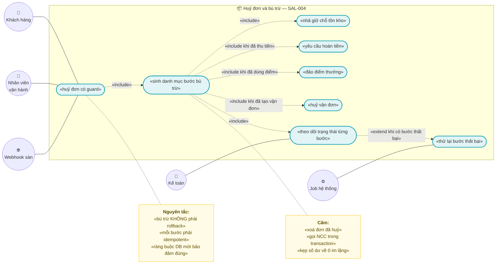
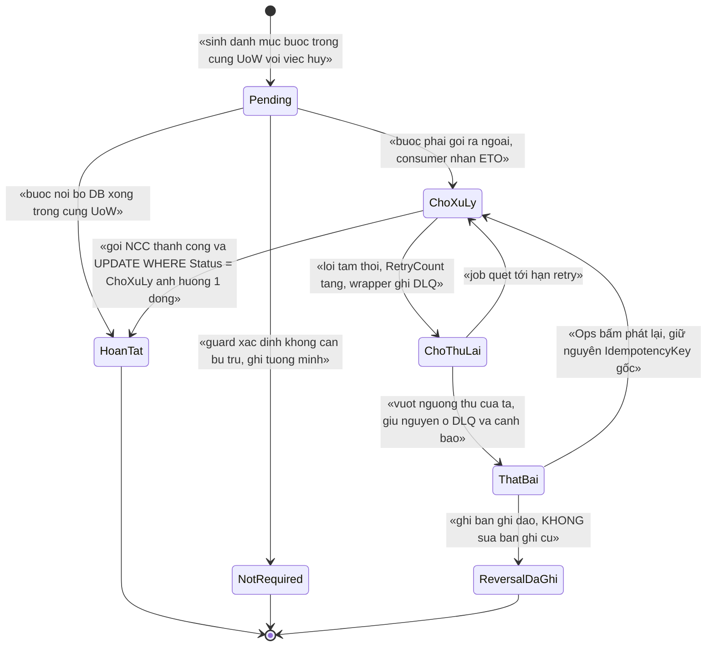
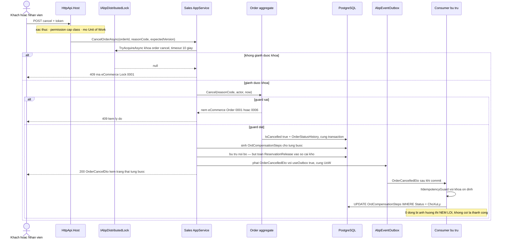

# `SAL-004` — Huỷ đơn và compensation (bù trừ)

| Thuộc tính | Nội dung |
|---|---|
| **Mã** | `SAL-004` |
| **Module** | **Sales** (domain đơn hàng hiện ở `src/eCommerce.Domain`; khi tách module sẽ chuyển sang `modules/Sales/…`) |
| **Giai đoạn** | **GĐ1** — theo `docs/implementation-plan.md:410` |
| **Ưu tiên** | **Must have** |
| **Trạng thái** | 🟡 `Draft` — chờ review |
| **Người viết / người review** | *(điền)* / **Kiến trúc trưởng + Kế toán** |
| **Phiên bản / ngày** | `v0.1 — 13/10/2026` |
| **Tài liệu liên quan** | `XC-001` (Money, cấm `==` trên tiền) · `XC-002` (outbox/inbox, idempotency 4 biên vào, DLQ) · `XC-003` (khoá phân tán) · `XC-004` (`[Authorize]` cấp class, permission, tenant) · `XC-005` (log/metric, nhãn bị cấm) · `SAL-002` (checkout — nơi giữ chỗ được tạo) · `SAL-003` (state machine 4 trục — nơi định nghĩa `IsCancelled`) · `SAL-005` (webhook sàn) · `SAL-006` (RMA/trả hàng) · `INV-002` (giữ chỗ + TTL — bên nhả chỗ) · `LOY-001` (đảo điểm) · `REC-001` (đối soát) |

---

## 0. Tóm tắt & quyết định thiết kế

**Tóm tắt:** `SAL-004` định nghĩa **huỷ đơn** và **bù trừ (compensation)** toàn bộ hệ quả mà hệ thống **đã cam kết** khi tạo đơn:
**nhả giữ chỗ tồn kho** (`INV-002`), **hoàn tiền** (`PaymentHub`), **đảo điểm thưởng** (`LOY-001`), **huỷ vận đơn** (`SHP-*`),
**thông báo** (`NOT-*`) và **đối soát** (`REC-001`).

**Nguyên tắc cốt lõi của tài liệu này — câu dễ hiểu sai nhất:**

> 🔴 **Compensation KHÔNG phải rollback.** Transaction tạo đơn **đã commit** từ lâu; tiền có thể **đã bị trừ thật** ở cổng
> thanh toán; hàng có thể **đã bị đóng gói**. Không có `ROLLBACK` nào cứu được những việc đó.
> Bù trừ là **một chuỗi hành động mới, chạy về phía trước**, mỗi hành động **idempotent**, có **state machine ném lỗi**,
> ghi **sổ cái append-only**, và **không bao giờ "kẹp về 0" im lặng**.

**Vì sao phải có tài liệu này trước khi code — 4 bài học đã kiểm chứng trong repo:**

| # | Sự thật đã đọc trong code | Hệ quả bắt buộc cho `SAL-004` |
|---|---|---|
| 1 | `Order.SetStatus(OrderStatus status) => Status = status;` — gán thẳng, **không guard** (`src/eCommerce.Domain/Entities/Orders/Order.cs:111`). Và `Order.PaymentStatus` có **setter công khai** (`Order.cs:33`) | Huỷ đơn **không** được dùng đường này. Phải xoá `SetStatus` và thêm phương thức `Cancel(...)` có guard ném lỗi (xem **D12**, **BR-001/BR-002**) |
| 2 | Sổ cái kho **đã** append-only và **đã** có sẵn `ReservationRelease = 2`, `CustomerReturn = 4` (`src/eCommerce.Domain.Shared/Enums.cs:35,41`; `Order.cs`… xem `src/eCommerce.Domain/Entities/Inventory/StockLedger.cs:80-83`) | Bù trừ kho **dùng lại** enum có sẵn — **không** thêm loại biến động mới, **không** UPDATE tồn kho trực tiếp (**BR-008/BR-009**) |
| 3 | `PaymentTransaction.RegisterRefund(decimal amount)` cộng dồn rồi so `RefundedAmount >= Amount` (`modules/PaymentHub/eCommerce.PaymentHub.Domain/Entities/PaymentTransaction.cs:124-130`) — **không** guard trạng thái, **không** chặn hoàn vượt, và **so sánh tiền trên `decimal`** thay vì minor units | Hoàn tiền **phải** được viết lại có guard ném lỗi + so theo minor units (`XC-001` BR-003) — xem §15.2 **F5** và **BR-011/BR-012** |
| 4 | Bảng sổ cái kho `InvStockLedger` **không có unique index** nào trên `(ReferenceType, ReferenceId, MovementType)` (`src/eCommerce.EntityFrameworkCore/eCommerceDbContext.cs:144-160`) | **Bỏ lock đi, DB KHÔNG chặn** ⇒ có thể ghi **2 bút toán nhả chỗ cho cùng một đơn**. Đây là khoảng trống **phải** vá bằng ràng buộc DB (§5.4, §15.2 **F1**) |

**Phạm vi:**
- ✅ Vòng đời **yêu cầu huỷ đơn** (`Active → Cancelled`) + guard nghiệp vụ **ai được huỷ, khi nào**.
- ✅ **Danh mục bước bù trừ** (compensation steps) và vòng đời của **từng bước** (state machine ném lỗi).
- ✅ **Idempotency** ở **mọi** biên vào của bù trừ (API, consumer ETO, job quét, webhook sàn) — theo `XC-002` BR-004.
- ✅ Bảng **`OrdCompensationSteps`** + cột bổ sung trên `OrdOrders` + **ràng buộc DB** chống bù trừ hai lần.
- ✅ Hợp đồng **liên module**: Sales gọi `INV-002` / `PaymentHub` / `LOY-001` qua **Contracts** — và **khoảng trống hiện tại** (§6.5).
- ✅ Khoá phân tán, mã lỗi, metric/log, test case.

**Không nằm trong phạm vi:**
- ❌ **Trả hàng / RMA** (hoàn tiền sau khi đã giao, hàng về kho) — thuộc **`SAL-006`**. `SAL-004` chỉ huỷ đơn **trước** mốc đã giao.
- ❌ **Định nghĩa 4 trục trạng thái** — thuộc **`SAL-003`**; tài liệu này **kế thừa** và chỉ thêm trục/nhánh huỷ.
- ❌ **Cơ chế outbox/inbox/DLQ** — thuộc **`XC-002`**; ở đây chỉ **dùng**.
- ❌ **Cơ chế khoá phân tán** — thuộc **`XC-003`**; ở đây chỉ **đăng ký tên khoá** mới.
- ❌ **Huỷ đơn phía sàn** (đồng bộ trạng thái huỷ lên Shopee/Lazada) — thuộc `SAL-005`/`CHN-*`.
- ❌ **Đối soát tiền sau hoàn** — thuộc `REC-001`/`REC-002`.

### 0.1 Quyết định thiết kế (ADR ngắn)

| # | Quyết định | Phương án đã cân nhắc | Lý do chọn | Hệ quả |
|---|---|---|---|---|
| **D1** | Bù trừ là **saga điều phối (orchestration) do Sales sở hữu** | (a) transaction phân tán 2PC · (b) choreography thuần qua event · (c) **orchestration trong Sales** | 2PC **không khả thi**: một nhánh là HTTP ra cổng thanh toán (không có prepare/commit). Choreography thuần ⇒ **không ai biết** bù trừ đã xong hay chưa, và **không trả được lỗi rõ** cho người dùng bấm "Huỷ" | Sales phải giữ **bảng trạng thái từng bước** (`OrdCompensationSteps`); Sales biết tên mọi bước ⇒ đổi thứ tự bước phải sửa tài liệu này |
| **D2** | **Huỷ đơn = bù trừ, KHÔNG xoá dữ liệu** — đơn ở lại, đánh dấu `IsCancelled = true` | (a) xoá cứng đơn · (b) soft-delete (`ISoftDelete`) · (c) **đánh dấu trạng thái hấp thụ** | Đơn là **chứng từ**; xoá ⇒ mất lịch sử trạng thái, mất khả năng đối soát với sàn/ngân hàng. `FullAuditedAggregateRoot` đã có `ISoftDelete` (`Order.cs:10`) nhưng soft-delete **không** diễn đạt được "đã huỷ" cho nghiệp vụ | Tái dùng `Cancelled = 5` (`Enums.cs:57`) làm **derived** + `IsCancelled` theo `SAL-003` §5.3 dòng 502 |
| **D3** | Phần **nội bộ DB** của bù trừ chạy trong **MỘT UoW**; phần **gọi ra ngoài** đi qua **outbox/inbox** | (a) gọi NCC trong transaction · (b) tách nhiều UoW nhỏ · (c) **một UoW + outbox** | Gọi HTTP trong transaction ⇒ transaction **mở lâu**, và nếu commit sau đó thất bại thì **đã hoàn tiền thật** mà DB không biết. Tách nhiều UoW ⇒ có trạng thái nửa vời không ai dọn | **Cấm** gọi NCC trong transaction (**BR-016**); bước gọi NCC là **bước bất đồng bộ** có trạng thái `ChoXuLy` |
| **D4** | **Mỗi bước bù trừ có `IdempotencyKey` ỔN ĐỊNH**, lưu DB ở lần thử đầu | (a) `Guid.NewGuid()` mỗi lần retry · (b) **khoá sinh từ dữ liệu nghiệp vụ, lưu lại** | Khoá mới mỗi lần retry ⇒ **mỗi retry là một lần hoàn tiền mới** ⇒ hoàn tiền 2 lần (`XC-002` D7/BR-007). Đây là lỗi mất tiền thật | Cột `IdempotencyKey` trên `OrdCompensationSteps`; retry **đọc lại** khoá cũ (**BR-006**) |
| **D5** | Distributed lock **chỉ giảm tranh chấp**; hàng rào cuối là **ràng buộc DB** | (a) tin vào lock · (b) **lock + unique index + `UPDATE … WHERE` kiểm số dòng** | Redis chết ⇒ lock **vô hiệu** nhưng app **vẫn chạy** (`XC-003` D2). Nếu bất biến chỉ dựa vào lock thì **sai dữ liệu âm thầm** | Mọi bất biến phải trả lời *"bỏ lock đi, DB có chặn không?"* — hiện **CHƯA chặn** cho bút toán kho (§15.2 **F1**) |
| **D6** | Bù trừ **một chiều (forward-only)**: sai thì **ghi bước bù trừ mới**, cấm sửa/xoá bước cũ | (a) cho sửa bản ghi bù trừ · (b) **append-only + bút toán đảo** | Sửa bản ghi ⇒ mất dấu vết, không đối soát được với ngân hàng/sàn. Đây đúng mô hình đã chốt cho sổ cái kho (`StockLedger.cs:80-83`) và điểm thưởng (`LOY-001` BR-004) | Bảng `OrdCompensationSteps` **append-only** ở tầng ứng dụng; "sửa" = thêm bản ghi `Reversal` |
| **D7** | Giữ chỗ **đã hết hạn / đã nhả** ⇒ bước nhả chỗ coi là **hoàn tất**, **không** ném lỗi | (a) ném lỗi vì "không tìm thấy giữ chỗ hiệu lực" · (b) **coi là đã bù trừ, ghi log + metric** | Job nhả chỗ theo TTL (`INV-002`) có thể **đã nhả trước** khi khách bấm huỷ. Ném lỗi ở đây ⇒ **chặn oan** việc huỷ đơn. Hành vi đúng: **idempotent tự nhiên** | Tuyệt đối **cấm** cách thứ ba: nhả "mù" khi **không** biết trạng thái (`SAL-002` §3.3 dòng 206: *"NÉM lỗi — không nhả mù"*) |
| **D8** | **PaymentHub sở hữu tiền**; Sales **cấm** ghi `PaymentStatus` / bảng `PayTransactions` | (a) Sales tự sửa trạng thái thanh toán · (b) **chỉ PaymentHub ghi** | Kế thừa `SAL-003` BR-013 (*"trục tài chính CHỈ PaymentHub/IPN ghi"*). Hai module cùng ghi một cột ⇒ hai nguồn sự thật cho số tiền | Sales **gọi** PaymentHub qua Contracts hoặc phát ETO; xem **§6.5** về khoảng trống Contracts hiện tại |
| **D9** | `Cancelled` là **trạng thái HẤP THỤ** | (a) cho mở lại đơn đã huỷ · (b) **hấp thụ** | Mở lại đơn đã huỷ ⇒ kho/tiền **đã bù trừ** mà đơn sống lại ⇒ **sai dữ liệu**. Muốn bán lại ⇒ **tạo đơn mới** | Mọi chuyển dịch **rời** `Cancelled` ⇒ **NÉM** `eCommerce:Order:0006` (kế thừa `SAL-003` D10/BR-012) |
| **D10** | Huỷ **một phần** chỉ cho phép **trước** mốc giữ chỗ chốt thành `Sale` | (a) cho huỷ từng dòng ở mọi mốc · (b) **chỉ trước mốc**, sau đó dùng RMA | Huỷ một phần sau khi đã xuất kho/giao ⇒ phải xử lý hàng hoàn, phí vận chuyển, hoàn tiền theo tỷ lệ ⇒ đó **chính là** RMA (`SAL-006`). Trộn hai luồng vào một API ⇒ guard rối và dễ sai tiền | Mốc chuyển `Reservation → Sale` **chưa chốt** (kế thừa `SAL-002` §15.1 **Q3** dòng 967) ⇒ xem §15.1 **Q1** của tài liệu này |
| **D11** | Bỏ **setter công khai** trên `Order.PaymentStatus` | (a) giữ `{ get; set; }` · (b) **`protected set` + phương thức có guard** | Hiện `Order.cs:33` cho phép **bất kỳ ai** đặt `PaymentStatus = Paid` mà không có giao dịch nào ⇒ phá bất biến tiền | Sửa `Order.cs:33`; ghi vào checklist `SAL-003`/`SAL-004`. ⚠️ **Chưa sửa** — xem §15.2 **F2** |
| **D12** | **XOÁ `Order.SetStatus(...)`**; mọi chuyển trạng thái qua phương thức có guard | (a) giữ `SetStatus` cho tiện · (b) **xoá hẳn** | `SetStatus` cho phép `Completed → Pending`, `Cancelled → Shipped` **im lặng** (`Order.cs:111`) — vi phạm **quy ước bất di bất dịch #11** (state machine phải ném lỗi). Giữ nó ⇒ mọi guard ở `SAL-003`/`SAL-004` đều **vô nghĩa** vì có đường vòng | Bắt buộc có **test reflection** chặn tái phát (`TC-22`); xem §15.2 **F2** |

---

## 1. Use Case Specification

| Thuộc tính | Nội dung |
|---|---|
| **Use Case ID** | `SAL-004` |
| **Use Case Name** | Huỷ đơn và **bù trừ** mọi hệ quả đã cam kết, **không mất tiền và không sai tồn kho** |
| **Description** | *"Là chủ shop, tôi muốn huỷ một đơn chưa giao và **chắc chắn** rằng tồn kho đã được nhả, tiền đã được hoàn (hoặc biết rõ là chưa thu nên không cần hoàn), điểm thưởng đã được đảo — và nếu một bước thất bại thì tôi thấy nó ở đâu đó, thay vì im lặng."* |
| **Actor(s)** | **Khách hàng** (tự huỷ khi đơn chưa giao, theo cửa sổ cấu hình) · **Nhân viên vận hành** · **Quản trị tenant** · **Webhook sàn** (`SAL-005` báo sàn huỷ đơn) · **Job hệ thống** (quét bước bù trừ treo, retry DLQ) · **Kế toán** (xem/đối soát hoàn tiền) |
| **Priority** | **Must have** |
| **Trigger** | (a) khách bấm **Huỷ đơn** trên storefront; (b) nhân viên huỷ trên UI admin; (c) webhook sàn báo đơn bị huỷ (`SAL-005`); (d) job **quá hạn thanh toán** tự huỷ; (e) job phát hiện bước bù trừ `ChoThuLai` đã tới hạn retry |
| **Pre-Condition(s)** | • **Tenant hiện tại** (`TenantId` từ `ICurrentTenant`) — `Order` là `IMultiTenant` (`Order.cs:10-12`).<br>• **Kênh bán** (`ChannelCode`) — **có** trên `Order` (`Order.cs:17-18`); với đơn sàn, huỷ phải phản chiếu về sàn (thuộc `SAL-005`).<br>• Đơn **tồn tại** và **chưa ở trạng thái hấp thụ** (`IsCancelled = false`, `ReturnStatus = Open`).<br>• Người gọi có **permission** `eCommerce.Orders.Cancel` (§9) — `[Authorize]` ở **cấp class** (`XC-004` D3).<br>• Nếu là webhook/IPN: **đã qua** `IIdempotencyGuard` của `XC-002` (BR-004). ⚠️ `IIdempotencyGuard` **chưa có trong code** — xem §15.2 **F4**.<br>• Redis 7 sẵn sàng — **không** phải điều kiện bắt buộc (xem **D5**).<br>• `Order.ClosureVersion` (nếu client gửi) đã được đọc ở request trước. |
| **Post-Condition(s)** | • Đơn ở trạng thái **hấp thụ**: `IsCancelled = true`, `FulfillmentStatus` **đóng băng**.<br>• **Đúng một** bản ghi `OrderStatusHistory` cho nhánh huỷ, ghi **trong cùng transaction** (`SAL-003` BR-004/005).<br>• **Đúng một** hàng `OrdCompensationSteps` cho **mỗi** bước trong danh mục (§5.2) — kể cả bước `NotRequired`.<br>• Mọi bước `BatBuoc` đạt trạng thái **cuối** (`HoanTat` / `NotRequired`) — **hoặc** ở `ChoThuLai`/`ThatBai` **có dấu vết** (log + metric + DLQ).<br>• **0** bút toán kho, **0** bút toán điểm, **0** bản ghi hoàn tiền được tạo **hai lần**.<br>• `OrderCancelledEto` **đã ghi outbox trong CÙNG transaction** với việc huỷ (`XC-002` BR-001). |
| **Basic Flow** | 1. Khách/nhân viên gọi `CancelOrderAsync(orderId, reasonCode, reasonText?, expectedVersion?)`.<br>2. App service mở **Unit of Work**, kiểm `[Authorize]` cấp class + permission `eCommerce.Orders.Cancel`.<br>3. Giành khoá phân tán `ecommerce:order:cancel:{tenantId}:{orderId}` (**timeout 10 s**, `ThrowOnTimeout`) — **chỉ giảm tranh chấp** (D5).<br>4. Nạp `Order` **trong phạm vi khoá**; gọi `order.Cancel(reasonCode, actorType, actorId, now)` — **guard** theo bảng §3.<br>5. Guard đạt ⇒ domain đặt `IsCancelled = true`, `CancelledAtUtc`, `CancelReasonCode`, tăng `ClosureVersion`; ghi **một** `OrderStatusHistory`.<br>6. App service **sinh danh mục bước bù trừ** cho đơn này (§5.2) — mỗi bước một hàng `Pending`, kèm `IdempotencyKey` **ổn định** (BR-006).<br>7. Với các bước **nội bộ DB** (`NhaGiuCho`, `HuyVanDonNoiBo`): thực hiện **ngay trong cùng UoW** — ghi bút toán sổ cái kho `ReservationRelease`, đánh dấu bước `HoanTat`.<br>8. Với các bước **gọi ra ngoài** (`HoanTien`, `DaoDiem`, `HuyVanDon`): **KHÔNG** gọi HTTP trong transaction (BR-016) — để `ChoXuLy` và để `OrderCancelledEto` mang thông tin sang consumer.<br>9. Phát `OrderCancelledEto` qua `IDistributedEventBus` với `useOutbox: true` **trong cùng UoW**.<br>10. Commit UoW (đơn + lịch sử + bước bù trừ + outbox **cùng sống hoặc cùng chết**), nhả khoá (`await using`).<br>11. Consumer nhận `OrderCancelledEto`: gọi `IIdempotencyGuard` ⇒ thực hiện bước ⇒ `UPDATE OrdCompensationSteps SET Status = 'HoanTat' WHERE … AND Status = 'ChoXuLy'`, **kiểm số dòng** (0 dòng ⇒ **NÉM**, `XC-002` E7).<br>12. Trả `OrderCancelDto` (trạng thái huỷ + **trạng thái từng bước bù trừ**) để UI hiển thị *"đã huỷ; hoàn tiền đang xử lý"*. |
| **Alternative Flow** | **A1: Chưa thu tiền** (`PaymentStatus = Unpaid`) ⇒ bước `HoanTien` = `NotRequired` — ghi hàng tường minh, **không** bỏ qua im lặng (BR-013).<br>**A2: Giữ chỗ đã hết hạn/đã nhả** ⇒ bước `NhaGiuCho` = `HoanTat` + log `Information` + metric; **không** ném lỗi (**D7**).<br>**A3: Bước gọi NCC thất bại tạm thời** ⇒ `ChoThuLai` + `RetryCount++`; wrapper ghi DLQ **trước khi** ném lại (`XC-002` BR-010) rồi để nhịp sau thử lại.<br>**A4: Yêu cầu huỷ trùng hợp lệ** (cùng `orderId` + cùng `reasonCode` + cùng `expectedVersion`) ⇒ **không** side effect thứ hai; trả kết quả cũ + metric `sales_cancel_duplicate_total` (tương tự A4 của `SAL-003`).<br>**A5: Đơn có nhiều khoá cần giữ** ⇒ gom khoá theo `(WarehouseId, Sku)`, sắp thứ tự, **acquire một lần** mỗi khoá, **cấm** lồng khoá (`XC-003` D6 / `SAL-002` BR-009).<br>**A6: Job quét bước treo** ⇒ giành khoá `ecommerce:order:compensation-sweep:{tenantId}` với `SkipIfBusy`; không giành được ⇒ bỏ nhịp + log + metric (`XC-003` BR-010). |
| **Exception Flow** | **E1:** chuyển trạng thái **không có** trong bảng chuyển (§3) ⇒ **`eCommerce:Order:0001`**.<br>**E2:** đơn đã ở trạng thái **hấp thụ** (đã huỷ / đã trả) ⇒ **`eCommerce:Order:0006`** (gợi ý tạo đơn mới).<br>**E3:** thiếu `ReasonCode` / `ActorId` không hợp lệ ⇒ **`eCommerce:Order:0004`**.<br>**E4:** `ClosureVersion` lệch ⇒ **`eCommerce:Order:0003`**; `UPDATE … WHERE` ảnh hưởng 0 dòng ⇒ **`eCommerce:Order:0002`**.<br>**E5:** không giành được khoá trong timeout ⇒ **`eCommerce:Lock:0001`** → `409` (`XC-003` §6.2) — **không** dùng mã riêng của Sales.<br>**E6:** bước bù trừ chuyển trạng thái sai (ví dụ `HoanTat → ChoXuLy`) ⇒ **`eCommerce:Sales:0101`** — **cấm** no-op im lặng.<br>**E7:** không tìm thấy bước bù trừ (hoặc **thuộc tenant khác**) ⇒ **`eCommerce:Sales:0102`** → `404` (không tiết lộ sự tồn tại — `XC-004` BR-008).<br>**E8:** cùng `IdempotencyKey` nhưng `PayloadHash` **khác** ⇒ **`eCommerce:Sales:0103`** — **cấm** coi là trùng (`XC-002` BR-006).<br>**E9:** đơn **đã giao/đang giao** (không đủ điều kiện huỷ) ⇒ **`eCommerce:Sales:0104`** kèm hướng dẫn dùng **RMA** (`SAL-006`).<br>**E10:** hoàn tiền vượt số đã thu ⇒ **`eCommerce:Sales:0105`** (chi tiết ở §15.2 **F5**).<br>**E11:** huỷ một phần ở mốc không được phép ⇒ **`eCommerce:Sales:0106`** (**D10**).<br>**E12:** không ghi được hàng `OrdCompensationSteps` ⇒ **`eCommerce:Sales:0107`** (`500`, chi tiết chỉ ở log — đồng dạng `eCommerce:Order:0007`).<br>**E13:** handler consumer ném lỗi ⇒ **cấm nuốt**: wrapper ghi DLQ rồi ném lại (`XC-002` BR-010). |
| **Business Rules** | • **BR-SAL-004-001**: Mọi chuyển trạng thái đơn (kể cả huỷ) **CHỈ** qua phương thức domain **có guard**; **CẤM** tồn tại `Order.SetStatus(...)` (hiện có ở `Order.cs:111`) và **CẤM** setter công khai trên trục trạng thái (hiện có ở `Order.cs:33`).<br>• **BR-SAL-004-002**: Mọi chuyển trạng thái **không có** trong bảng chuyển §3 **PHẢI NÉM LỖI** `eCommerce:Order:0001` — **cấm** no-op im lặng.<br>• **BR-SAL-004-003**: `IsCancelled = true` là **hấp thụ**; **mọi** chuyển dịch **rời** khỏi nó **PHẢI NÉM** `eCommerce:Order:0006`; **cấm** mở lại đơn đã huỷ — muốn bán lại ⇒ **tạo đơn mới**.<br>• **BR-SAL-004-004**: Mỗi lần huỷ **PHẢI** sinh **đúng một** bản ghi `OrderStatusHistory` **trong cùng transaction**; `0` bản ghi hoặc `2` bản ghi cho một chuyển dịch ⇒ **vi phạm**.<br>• **BR-SAL-004-005**: `OrderStatusHistory` và `OrdCompensationSteps` là **APPEND-ONLY**; **cấm** UPDATE/DELETE nghiệp vụ ở tầng ứng dụng; sửa sai bằng **bản ghi đảo** (`D6`).<br>• **BR-SAL-004-006**: Mọi lần huỷ **PHẢI** có `ReasonCode` + `ActorType` + `ActorId` (+ `ReasonText` khi `ReasonCode = Khac`); thiếu ⇒ **`eCommerce:Order:0004`**.<br>• **BR-SAL-004-007**: Mỗi bước bù trừ **PHẢI** có `IdempotencyKey` **ổn định** dạng `Cancel:{tenantId}:{orderId}:{stepCode}`; khoá sinh **một lần** ở lần thử đầu và **lưu DB**; **CẤM** `Guid.NewGuid()` cho mỗi lần gọi.<br>• **BR-SAL-004-008**: **MỌI** biên vào của bù trừ — API huỷ, consumer `OrderCancelledEto`, job quét bước treo, webhook sàn (`SAL-005`) — **PHẢI** idempotent: gọi `IIdempotencyGuard` **trước** mọi side effect.<br>• **BR-SAL-004-009**: Mọi thay đổi tồn kho do bù trừ **PHẢI** sinh **một bản ghi** `StockLedgerEntry`; **CẤM** UPDATE/DELETE `InvStockLedger`; **CẤM** sửa `InventoryItem` mà không có bút toán.<br>• **BR-SAL-004-010**: Bù trừ kho dùng **loại biến động có sẵn**: `ReservationRelease` khi hàng **chưa** xuất, `CustomerReturn` khi hàng **đã** xuất và đã về kho (`Enums.cs:35,41`); **cấm** thêm loại mới mà không sửa tài liệu này.<br>• **BR-SAL-004-011**: Nhả giữ chỗ **CHỈ** khi bản ghi giữ chỗ **còn hiệu lực**; nếu đã `Expired`/`Released` ⇒ bước ở `HoanTat` + log + metric; **CẤM** nhả "mù" khi không biết trạng thái.<br>• **BR-SAL-004-012**: **CẤM** Sales ghi trực tiếp `Order.PaymentStatus` hoặc bảng `PayTransactions`; hoàn tiền **CHỈ** do `PaymentHub` thực hiện và **PHẢI** có permission `eCommerce.Payments.Refund` (`eCommerceConsts.cs:48-52`).<br>• **BR-SAL-004-013**: Hoàn tiền **PHẢI** có guard **ném lỗi**: chỉ hoàn khi giao dịch ở `Succeeded`; `0 < RefundedAmount + amount <= Amount` **so theo minor units** (`XC-001` BR-003). ⚠️ Hàm hiện tại `RegisterRefund` (`PaymentTransaction.cs:124-130`) **không** thoả — xem §15.2 **F5**.<br>• **BR-SAL-004-014**: Đơn **chưa thu tiền** ⇒ bước hoàn tiền ở trạng thái `NotRequired` **tường minh**; **CẤM** biểu diễn "không cần hoàn" bằng cách **thiếu** hàng trong bảng bước.<br>• **BR-SAL-004-015**: Đảo điểm thưởng **CHỈ** do `Loyalty` thực hiện (`VoidAsync`); **cấm** Sales ghi bảng điểm. Đảo vượt số dư ⇒ **PHẢI** tạo `LoyaltyPointDebt` + **NÉM** `eCommerce:Loyalty:0007`; **CẤM** "kẹp về 0" im lặng (`LOY-001` BR-009/BR-010).<br>• **BR-SAL-004-016**: **CẤM** gọi NCC (hoàn tiền, huỷ vận đơn) **trong** transaction DB; mọi lời gọi ra ngoài **PHẢI** đi qua outbox/inbox (`XC-002` BR-001/BR-004).<br>• **BR-SAL-004-017**: Mọi số tiền là `decimal`/`Money`; **CẤM** so sánh tiền bằng `==`; so theo `ToMinorUnits()` (`XC-001` BR-003).<br>• **BR-SAL-004-018**: **CẤM** `double`/`float` trong entity/DTO/ETO của Sales (test reflection — `XC-001` NFR-004).<br>• **BR-SAL-004-019**: Khoá phân tán dùng cho huỷ **PHẢI** có `tenantId`, **KHÔNG** chứa tiền tố `ecommerce:` (tiền tố do `AbpDistributedLockOptions.KeyPrefix` cấp — `eCommerceHttpApiHostModule.cs:127`), **PHẢI** có timeout hữu hạn, và **CẤM** là hàng rào duy nhất (`XC-003` BR-002/003/004/007).<br>• **BR-SAL-004-020**: Mọi bước bù trừ **PHẢI** quan sát được: log có cấu trúc có `CorrelationId` + `ReasonCode`; metric có nhãn **hữu hạn** — **CẤM** nhãn `orderId`/`orderNumber` (`XC-005` BR-009; `eCommerceMetrics.cs:83`).<br>• **BR-SAL-004-021**: Mọi `UPDATE … WHERE` trong luồng bù trừ **PHẢI** kiểm **số dòng bị ảnh hưởng**; `0` dòng ⇒ **NÉM LỖI**, **CẤM** coi là thành công (`XC-002` E7, `SAL-003` BR-010).<br>• **BR-SAL-004-022**: Trạng thái bù trừ **đã đạt đích** ở tầng tương ứng (kho đã nhả, tiền đã hoàn đủ) ⇒ lần chạy sau **PHẢI** trả kết quả cũ, **CẤM** tạo side effect thứ hai; đây là **A4** — ngoại lệ **duy nhất** được phép không ném lỗi, và **phải** có metric. |
| **Non-Functional Requirement** | • **NFR-SAL-004-001**: `CancelOrderAsync` (đơn ≤ 5 dòng, 1 kho, **không** chờ NCC) p95 **< 1,5 s**.<br>• **NFR-SAL-004-002**: Gọi cùng `IdempotencyKey` **20 lần** ⇒ **đúng 1** lần huỷ, **1** bút toán kho, **1** yêu cầu hoàn tiền (`XC-002` NFR-005).<br>• **NFR-SAL-004-003**: **0** bút toán `ReservationRelease` thứ hai cho cùng một đơn (đếm bằng truy vấn).<br>• **NFR-SAL-004-004**: **0** lần `UPDATE … WHERE` ảnh hưởng `0` dòng bị coi là thành công.<br>• **NFR-SAL-004-005**: **100 %** thao tác huỷ đơn đã ở trạng thái hấp thụ ⇒ **NÉM** `eCommerce:Order:0006`; **0** no-op im lặng.<br>• **NFR-SAL-004-006**: **0** bản ghi sổ cái kho / bút toán điểm bị UPDATE hoặc DELETE (test quét mã nguồn + test DB).<br>• **NFR-SAL-004-007**: Cách ly tenant: tenant A **không** huỷ/xem bước bù trừ của đơn tenant B (integration test 2 tenant — cần PostgreSQL).<br>• **NFR-SAL-004-008**: **100 %** thao tác huỷ có `CorrelationId` + `ReasonCode` trong log và trong ETO (`XC-005` BR-002/BR-003).<br>• **NFR-SAL-004-009**: Tồn tại metric `sales_order_cancel_total`, `sales_compensation_step_total`, `sales_compensation_step_failed_total`, `sales_cancel_duplicate_total` với nhãn **hữu hạn**.<br>• **NFR-SAL-004-010**: Bước bù trừ thất bại được phát hiện trong **< 60 s** (job quét + DLQ).<br>• **NFR-SAL-004-011**: **0** `double`/`float` trong entity/DTO/ETO của Sales (test reflection).<br>• **NFR-SAL-004-012**: Chạy lại **toàn bộ** chuỗi bù trừ của một đơn **2 lần** ⇒ **0** side effect thứ hai (test tích hợp).<br>• **NFR-SAL-004-013**: Độ trễ hoàn tiền end-to-end (huỷ → `PaymentHub` xác nhận) p95 **< 60 s** khi cổng thanh toán khoẻ; vượt ⇒ cảnh báo. |

---

## 2. Sơ đồ Use Case



---

## 3. Sơ đồ trạng thái (state machine)

> Feature này có **hai** vòng đời cần tách bạch: **yêu cầu huỷ đơn** (ở `Order`) và **từng bước bù trừ** (ở `OrdCompensationSteps`).
> Cả hai **PHẢI NÉM LỖI** khi chuyển sai — **quy ước bất di bất dịch #11**.

### 3.1 Vòng đời **yêu cầu huỷ đơn**

Kế thừa `SAL-003` §3 TRỤC 4 (`Open → Cancelled`, dòng 224 và 278), ở đây bổ sung **điều kiện nghiệp vụ** của `SAL-004`.

| # | Từ | Sang | Ai được chuyển | Guard | Hành động kèm theo | Nếu guard sai |
|---|---|---|---|---|---|---|
| 1 | `ChuaYeuCau` | `DaYeuCau` | Khách · Nhân viên · Webhook sàn | `FulfillmentStatus ∈ {Pending, Confirmed}` **và** `IsCancelled = false` **và** trong cửa sổ huỷ (`CancelWindowMinutes` theo tenant) | ghi `CancelReasonCode` + actor; tăng `ClosureVersion`; 1 bản ghi `OrderStatusHistory` | **`eCommerce:Sales:0104`** (đã giao/đang giao) · **`eCommerce:Order:0001`** (ngoài bảng chuyển) |
| 2 | `DaYeuCau` | `DaHuy` | Hệ thống | Guard đạt **và** mọi bước `BatBuoc` **không** ở `ThatBai` | `IsCancelled = true`; trục 1 **đóng băng**; sinh các hàng `OrdCompensationSteps`; phát `OrderCancelledEto` trong outbox | `eCommerce:Sales:0107` nếu không ghi được bước |
| 3 | `DaHuy` | **bất kỳ** | — | **KHÔNG** có guard nào cho phép — **hấp thụ** | — | **`eCommerce:Order:0006`** |
| 4 | `DaYeuCau` | `DaYeuCau` *(trùng hợp lệ — A4)* | Bất kỳ bên gọi lại | Cùng `orderId` + cùng `ReasonCode` + cùng `ClosureVersion` | **không** side effect; trả kết quả cũ; metric `sales_cancel_duplicate_total` | nếu khác `ReasonCode` ⇒ **`eCommerce:Order:0002`** |

### 3.2 Vòng đời **một bước bù trừ** (dùng cho `OrdCompensationSteps`)



**Bảng chuyển trạng thái & guard của một bước bù trừ (mọi chuyển sai **PHẢI NÉM LỖI**, không im lặng):**

| Từ | Sang | Guard (điều kiện cho phép) | Nếu vi phạm |
|---|---|---|---|
| `[*]` | `Pending` | Bước nằm trong danh mục của đơn và **chưa** tồn tại hàng nào cho `(TenantId, OrderId, StepCode)` | Trùng ⇒ **`eCommerce:Sales:0103`** nếu `PayloadHash` khác; ngược lại coi là A4 |
| `Pending` | `HoanTat` | Bước **nội bộ DB** và ghi xong trong **cùng** UoW với việc huỷ | Ghi lỗi ⇒ rollback toàn bộ UoW |
| `Pending` | `ChoXuLy` | Bước **gọi ra ngoài** (NCC/module khác) **và** `OrderCancelledEto` đã ghi outbox | Thiếu outbox ⇒ dual-write, vi phạm `XC-002` BR-001 ⇒ **chặn ở review + test** |
| `Pending` | `NotRequired` | Guard xác định **không cần** bù trừ (ví dụ chưa thu tiền — BR-014) | Biểu diễn bằng cách **thiếu hàng** ⇒ vi phạm BR-014 |
| `ChoXuLy` | `HoanTat` | Gọi NCC thành công **và** `UPDATE … WHERE Status = 'ChoXuLy'` ảnh hưởng **≥ 1** dòng | `0` dòng ⇒ **NÉM** (`XC-002` E7) — **cấm** coi là thành công |
| `ChoXuLy` | `ChoThuLai` | Lỗi **tạm thời** (timeout, 5xx) | Lỗi **vĩnh viễn** (4xx nghiệp vụ) ⇒ đi thẳng `ThatBai` + cảnh báo |
| `ChoThuLai` | `ChoXuLy` | Job quét thấy `NextRetryAtUtc <= now` và `RetryCount < NguongThuCuaTa` | Vượt ngưỡng ⇒ **`ThatBai`** + giữ ở DLQ (`XC-002` A2) |
| `ThatBai` | `ChoXuLy` | **Ops** bấm phát lại; `IdempotencyKey` **giữ nguyên** | Sinh khoá mới ⇒ **hoàn tiền lần hai** ⇒ vi phạm BR-007 |
| `HoanTat` → `ChoXuLy` | — | **KHÔNG** cho phép (`HoanTat` là hấp thụ) | **`eCommerce:Sales:0101`** |
| `NotRequired` → bất kỳ | — | **KHÔNG** (`NotRequired` là hấp thụ) | **`eCommerce:Sales:0101`** |
| Bất kỳ | `ReversalDaGhi` | Chỉ khi cần sửa sai (**D6**) — ghi **bản ghi đảo mới** | Sửa/xoá bản ghi cũ ⇒ vi phạm BR-005 |

> ⚠️ **Trạng thái nguy hiểm nhất là `ChoThuLai` kéo dài:** đơn đã hiển thị "Đã huỷ" với khách, nhưng **tiền chưa về**.
> Vì vậy `OrderCancelDto` **PHẢI** trả **trạng thái từng bước** cho UI (§10) — cấm hiển thị "Đã huỷ" trần rồi im lặng.

---

## 4. Sequence Diagram & luồng dữ liệu

### 4.1 Huỷ đơn — guard, bù trừ nội bộ, outbox, consumer



### 4.2 Danh mục bước bù trừ & thứ tự thực hiện (mô tả bằng bảng — giữ giới hạn 3 sơ đồ Mermaid)

| # | `StepCode` | Chủ sở hữu | Loại | Guard "có cần bù trừ không?" | Hành động | Nếu không cần |
|---|---|---|---|---|---|---|
| 1 | `NhaGiuCho` | `INV-002` | **Nội bộ DB** | Có bản ghi giữ chỗ **còn hiệu lực** cho `OrderId` | `Reserved -= qty`; 1 bút toán `StockLedgerEntry` (`ReservationRelease`); `UPDATE` bản ghi giữ chỗ | Giữ chỗ đã `Expired`/`Released` ⇒ `HoanTat` + log + metric (**D7**) |
| 2 | `HoanKhoDaXuat` | `INV-002` | **Nội bộ DB** | Giữ chỗ **đã** chốt thành `Sale` (hàng đã xuất) | 1 bút toán `CustomerReturn` (`Enums.cs:41`) sau khi hàng về kho | Chưa xuất ⇒ `NotRequired` |
| 3 | `HuyVanDon` | `SHP-*` | **Gọi ra ngoài** | Đã có mã vận đơn | Gọi API huỷ vận đơn; ghi mã huỷ | Chưa có vận đơn ⇒ `NotRequired` |
| 4 | `HoanTien` | `PaymentHub` | **Gọi ra ngoài** | `PaymentStatus ∈ {Paid, PartiallyRefunded}` **và** có giao dịch `Succeeded` | Tạo yêu cầu hoàn tiền; `PaymentHub` cập nhật `RefundedAmount` + trạng thái (**BR-012/BR-013**) | `Unpaid` ⇒ `NotRequired` (**BR-014**) |
| 5 | `DaoDiem` | `LOY-001` | **Gọi ra ngoài** | Đơn đã tiêu hoặc đã cộng điểm | `VoidAsync` lô tiêu; nếu cần thì bút toán `Reversal`; tạo `LoyaltyPointDebt` khi vượt số dư | Chưa chạm điểm ⇒ `NotRequired` |
| 6 | `DongBoSan` | `SAL-005` | **Gọi ra ngoài** | Đơn có `ChannelCode ≠ "web"` | Đẩy trạng thái huỷ lên sàn | Đơn web ⇒ `NotRequired` |
| 7 | `ThongBao` | `NOT-*` | **Gọi ra ngoài** | Luôn cần | Gửi email/SMS/Zalo OA cho khách (chống gửi trùng — `NOT-002`) | — |
| 8 | `GhiNhanDoiSoat` | `REC-001` | **Nội bộ DB** | Luôn cần (để `REC-001` biết có hoàn tiền) | Ghi bản ghi chờ đối soát khoản hoàn | — |

> 📌 **Thứ tự có ý nghĩa:** bước **nội bộ DB** (1, 2, 8) chạy **trong** UoW ⇒ **nguyên tử**. Bước **gọi ra ngoài** (3–7) chạy **sau** commit qua outbox ⇒ **at-least-once** và **phải** idempotent.
> **Cấm** đảo thứ tự này: gọi `HoanTien` **trước** khi `IsCancelled = true` được commit ⇒ có thể **hoàn tiền cho đơn vẫn còn sống** nếu commit thất bại.

---

## 5. Mô hình dữ liệu

### 5.1 ERD

**Không vẽ ERD ở đây — lý do:** giới hạn **tối đa 3 sơ đồ Mermaid** của tài liệu này (đã dùng ở §2, §3.2, §4.1).
Mô hình dữ liệu được mô tả đầy đủ bằng **Data Dictionary** ở §5.2–§5.5. Quan hệ: `OrdOrders` **1 — n** `OrdCompensationSteps`;
`OrdOrders` **1 — n** `OrdStatusHistory` (thuộc `SAL-003`); `OrdOrders` **1 — n** `InvStockLedger` (theo `ReferenceId`).

### 5.2 Bảng **mới**: `OrdCompensationSteps` (Data Dictionary)

| Cột | Kiểu | Null? | Ý nghĩa | Ghi chú |
|---|---|---|---|---|
| `Id` | `uuid` | ✖ | khoá chính | |
| `TenantId` | `uuid` | ✔ | chiều tenant | `IMultiTenant`; **có thể `NULL`** ở chế độ 1 tenant (`XC-004` F1) |
| `OrderId` | `uuid` | ✖ | đơn bị huỷ | FK → `OrdOrders` |
| `StepCode` | `varchar(32)` | ✖ | mã bước (`NhaGiuCho`, `HoanTien`, …) | **hữu hạn** theo §4.2 — cấm giá trị tự do |
| `StepOrder` | `int` | ✖ | thứ tự thực hiện | dùng để hiển thị tiến trình cho UI |
| `Status` | `int` | ✖ | trạng thái bước | enum `CompensationStepStatus` (§5.3) |
| `IdempotencyKey` | `varchar(200)` | ✖ | **khoá chống trùng ổn định** | `Cancel:{tenantId}:{orderId}:{stepCode}` — **BR-007** |
| `PayloadHash` | `varchar(64)` | ✖ | SHA-256 payload chuẩn hoá | so khi trùng khoá ⇒ khác ⇒ **`eCommerce:Sales:0103`** (`XC-002` BR-005/BR-006) |
| `RetryCount` | `int` | ✖ | số lần đã thử | mặc định `0` |
| `NextRetryAtUtc` | `timestamptz` | ✔ | hạn thử lại | job quét đọc cột này |
| `CompletedAtUtc` | `timestamptz` | ✔ | thời điểm đạt trạng thái cuối | |
| `ExternalReference` | `varchar(128)` | ✔ | mã NCC trả về (mã hoàn tiền, mã huỷ vận đơn) | để đối soát |
| `FailureCode` | `varchar(64)` | ✔ | mã lỗi khi `ThatBai` | |
| `FailureMessage` | `varchar(2000)` | ✔ | thông điệp lỗi (đã che dữ liệu nhạy cảm) | |

**Bảng `OrdCompensationSteps` là APPEND-ONLY ở tầng ứng dụng** (**BR-005**): chỉ được **chèn** hàng mới và
**đổi `Status` theo state machine §3.2**; **cấm** xoá hàng và cấm sửa `StepCode`/`IdempotencyKey`/`PayloadHash`.

### 5.3 Enum mới `CompensationStepStatus` — vị trí đề xuất

**Đề xuất đặt tại `src/eCommerce.Domain.Shared/Enums.cs`** (cạnh `OrderStatus`, `PaymentStatus` — `Enums.cs:50-69`)
vì cả Sales và consumer đều đọc. Giá trị theo §3.2: `Pending = 0`, `ChoXuLy = 1`, `HoanTat = 2`, `ChoThuLai = 3`, `ThatBai = 4`, `NotRequired = 5`, `ReversalDaGhi = 6`.

> ⚠️ **Chưa có trong code** — enum này **chưa tồn tại**; `Enums.cs` hiện chỉ có `ChannelType`, `StockMovementType`,
> `OrderStatus`, `PaymentStatus`, `ChannelListingStatus` (`src/eCommerce.Domain.Shared/Enums.cs:1-79`) — kế hoạch **GĐ1**.
> 📌 **Cấm đánh số lại enum đã phát hành** — bài học `business-modules-proposal.md:261` (*"enum có lỗ"*, dẫn trong `SAL-003` dòng 515).

### 5.4 Cột bổ sung trên `OrdOrders` (ảnh hưởng entity hiện có)

| Cột mới | Kiểu | Null? | Ý nghĩa | Ghi chú |
|---|---|---|---|---|
| `IsCancelled` | `boolean` | ✖ | trục 4 (hấp thụ) | mặc định `false`; theo `SAL-003` §5.3 dòng 502 |
| `CancelledAtUtc` | `timestamptz` | ✔ | thời điểm huỷ | |
| `CancelReasonCode` | `varchar(64)` | ✔ | **mã** lý do (**BR-006**) | bắt buộc khi `IsCancelled = true` |
| `CancelReasonText` | `varchar(2000)` | ✔ | lý do tự do | bắt buộc khi `CancelReasonCode = Khac` |
| `CancelActorType` | `int` | ✔ | Khách / Nhân viên / Webhook sàn / SystemJob | theo `SAL-003` BR-006 |
| `CancelActorId` | `varchar(128)` | ✔ | định danh actor | |
| `ClosureVersion` | `bigint` | ✖ | version của trục kết thúc | tăng **đúng 1** mỗi lần chuyển (kế thừa `SAL-003` BR-009) |
| `RowVersion` | `bytea` | ✖ | optimistic concurrency | ⚠️ **hiện `Order` KHÔNG có** — xem §15.2 **F3** |

> ⚠️ Entity `Order` hiện có **20 property** và **không** có bất kỳ cột nào ở trên (`src/eCommerce.Domain/Entities/Orders/Order.cs:10-56`).
> ⇒ Toàn bộ §5.4 là **kế hoạch GĐ1**, **chưa có trong code**.

### 5.5 Index & ràng buộc (phần **quan trọng nhất** — đây là hàng rào DB, xem **D5**)

| Loại | Bảng | Cột | Mục đích | Trạng thái |
|---|---|---|---|---|
| **UNIQUE** | `OrdCompensationSteps` | `(TenantId, OrderId, StepCode)` **`NULLS NOT DISTINCT`** | 🎯 **chặn sinh hai hàng cho cùng một bước** — hàng rào thật của **A4** khi Redis chết | ⬜ **chưa có** — kế hoạch GĐ1 |
| **UNIQUE (filtered)** | `InvStockLedger` | `(TenantId, ReferenceType, ReferenceId, MovementType)` `WHERE ReferenceType = 'OrderCancel'` **`NULLS NOT DISTINCT`** | 🎯 **chặn ghi 2 bút toán nhả chỗ cho cùng một đơn** | ⬜ **chưa có** — xem §15.2 **F1** |
| INDEX | `OrdCompensationSteps` | `(TenantId, Status, NextRetryAtUtc)` | job quét bước tới hạn retry | ⬜ **chưa có** |
| INDEX | `OrdCompensationSteps` | `(TenantId, OrderId, StepOrder)` | UI hiển thị tiến trình bù trừ | ⬜ **chưa có** |
| CHECK | `OrdCompensationSteps` | `Status IN (0,1,2,3,4,5,6)` | chặn giá trị ngoài enum | ⬜ **chưa có** |
| CHECK *(khuyến nghị)* | `OrdOrders` | `IsCancelled = false OR CancelReasonCode IS NOT NULL` | chặn "đã huỷ nhưng không có lý do" | ⬜ **chưa có** |

> 🚨 **Vì sao `NULLS NOT DISTINCT` là bắt buộc:** PostgreSQL mặc định **`NULLS DISTINCT`** ⇒ hai hàng có `TenantId IS NULL`
> và cùng khoá được coi là **khác nhau** ⇒ **unique index KHÔNG chặn** (lỗi **F1** của `XC-004`, đã sửa cho 11 index bằng SQL thô —
> `src/eCommerce.EntityFrameworkCore/Migrations/20261013024226_Fix_NullableTenantId_UniqueIndexes.cs:39-86`).
> EF Core **không** mô hình hoá được thuộc tính này ⇒ **phải** dùng SQL thô trong migration, y như migration đó đã làm.

### 5.6 Vị trí entity & DbSet (quy ước bất biến)

| Mục | Nội dung |
|---|---|
| Project | Entity mới thuộc **Sales**. Hiện domain Sales nằm trong app (`src/eCommerce.Domain/Entities/Orders/Order.cs`); khi tách module ⇒ chuyển sang `modules/Sales/eCommerce.Sales.Domain` (đồng dạng kế hoạch `INV-002` D12) |
| **DbSet bắt buộc** | `OrdCompensationSteps` **PHẢI** có `DbSet` trên `eCommerceDbContext` — nếu không, `AddDefaultRepositories(includeAllEntities: true)` **KHÔNG** đăng ký `IRepository<T, Guid>` ⇒ runtime báo *"The requested service … has not been registered"* (đã ghi rõ trong `src/eCommerce.EntityFrameworkCore/eCommerceDbContext.cs:48-55`; đăng ký ở `src/eCommerce.EntityFrameworkCore/eCommerceEntityFrameworkCoreModule.cs:42-47`) |
| Cấu hình model | Tách hàm `ConfigureSales(builder)` cùng khuôn `ConfigureCommerce(builder)` hiện có (`eCommerceDbContext.cs:80, 97-210`) |

---

## 6. Hợp đồng API

### 6.1 Application Service

| Mục | Giá trị |
|---|---|
| Interface | `IOrderCancellationAppService` — đề xuất `src/eCommerce.Application.Contracts/Sales/` |
| Implementation | `OrderCancellationAppService` — đề xuất `src/eCommerce.Application/Sales/` |
| `[Authorize]` | **CẤP CLASS** (`XC-004` D3/BR-001) — theo đúng khuôn đã áp dụng ở `src/eCommerce.Application/Channels/ChannelAppService.cs:27` |
| ⚠️ Trạng thái | **Chưa có trong code.** `src/eCommerce.Application/` hiện **chỉ** có `Channels/ChannelAppService.cs`; `src/eCommerce.Application.Contracts/` chỉ có `Channels/` và `Permissions/` ⇒ toàn bộ §6 là **kế hoạch GĐ1** |

| Method | Input (DTO) | Output (DTO) | Permission | Ghi chú |
|---|---|---|---|---|
| `CancelOrderAsync` | `CancelOrderDto` | `OrderCancelDto` | `eCommerce.Orders.Cancel` | ⬜ **permission chưa tồn tại** — xem §9 |
| `GetCancelStatusAsync` | `Guid orderId` | `OrderCancelDto` | `eCommerce.Orders.Cancel` | UI hiển thị tiến trình bù trừ |
| `GetCompensationStepsAsync` | `Guid orderId` + `PagedResultRequestDto` | `PagedResultDto<CompensationStepDto>` | `eCommerce.Orders.Cancel` | mới nhất trước |
| `RetryCompensationStepAsync` | `RetryCompensationStepDto` | `CompensationStepDto` | `eCommerce.Orders.Compensation.Retry` | ⬜ **permission chưa tồn tại** — chỉ Ops/kế toán |
| ~~`ChangePaymentStatusAsync`~~ | — | — | — | 🚫 **KHÔNG TỒN TẠI** — **BR-012**: trục tài chính **chỉ** `PaymentHub` ghi (kế thừa `SAL-003` BR-013) |

### 6.2 REST endpoint

| Mục | Giá trị |
|---|---|
| Method / Route | `POST /api/app/order-cancellation/{orderId}/cancel` · `GET /api/app/order-cancellation/{orderId}/status` · `GET /api/app/order-cancellation/{orderId}/steps` · `POST /api/app/order-cancellation/steps/{stepId}/retry` |
| Authentication | `Bearer` (OpenIddict — `XC-004` D1) |
| Permission | xem §6.1 |
| Content-Type | `application/json` |
| Header | `Idempotency-Key` **bắt buộc** cho `POST …/cancel` (`XC-002` BR-004) |

**Request mẫu**

```json
{
  "orderId": "3f2504e0-4f89-11d3-9a0c-0305e82c3301",
  "reasonCode": "KhachDoiY",
  "reasonText": "Khách đổi ý sau khi đặt",
  "expectedClosureVersion": 3
}
```

**Response mẫu** (đơn **đã huỷ**, hoàn tiền **đang xử lý**)

```json
{
  "orderId": "3f2504e0-4f89-11d3-9a0c-0305e82c3301",
  "isCancelled": true,
  "derivedStatus": 5,
  "closureVersion": 4,
  "cancelledAtUtc": "2026-10-13T09:15:00Z",
  "cancelReasonCode": "KhachDoiY",
  "historyEntryId": "9c8f1b7a-1a2b-4c3d-8e9f-0a1b2c3d4e5f",
  "steps": [
    { "stepCode": "NhaGiuCho", "status": 2, "completedAtUtc": "2026-10-13T09:15:00Z" },
    { "stepCode": "HoanTien", "status": 1, "retryCount": 0, "externalReference": null },
    { "stepCode": "DaoDiem", "status": 5 },
    { "stepCode": "DongBoSan", "status": 5 }
  ]
}
```

> 🎯 `steps[]` là **bắt buộc** trong response: UI **phải** phân biệt được *"đã huỷ và đã hoàn tiền xong"* với
> *"đã huỷ nhưng hoàn tiền đang xử lý"*. Trả về `isCancelled: true` trần là **đủ để gây hiểu nhầm** (xem §3.2 cảnh báo).

### 6.3 Mã lỗi nghiệp vụ

⚠️ **`eCommerceConsts.ErrorCodes` hiện CHỈ có 2 mã**: `eCommerce:Inventory:0001`, `eCommerce:Payment:0001`
(`src/eCommerce.Domain.Shared/eCommerceConsts.cs:79,85`). **Không** có mã `eCommerce:Order:*` và **không** có `eCommerce:Sales:*`.
⇒ Toàn bộ bảng dưới đây là **đề xuất**, kế hoạch **GĐ1**.

| Mã | HTTP | Khi nào | Thông điệp |
|---|---|---|---|
| `eCommerce:Order:0001` | `409` | Chuyển trạng thái không có trong bảng chuyển §3 | `Không thể chuyển trạng thái {axis} từ {from} sang {to}.` |
| `eCommerce:Order:0002` | `409` | `UPDATE … WHERE` ảnh hưởng **0 dòng** | `Đơn hàng vừa bị thay đổi bởi người khác, vui lòng tải lại.` |
| `eCommerce:Order:0003` | `409` | `ClosureVersion` lệch | `Phiên bản trạng thái không khớp, vui lòng tải lại.` |
| `eCommerce:Order:0004` | `400` | Thiếu `ReasonCode` / actor không hợp lệ | `Thao tác này cần lý do và người thực hiện hợp lệ.` |
| `eCommerce:Order:0006` | `409` | Đơn ở trạng thái **hấp thụ** | `Đơn hàng đã ở trạng thái kết thúc, không thể thay đổi. Hãy tạo đơn mới.` |
| `eCommerce:Sales:0101` | `409` | Bước bù trừ chuyển trạng thái **sai** | `Không thể chuyển bước bù trừ từ {from} sang {to}.` |
| `eCommerce:Sales:0102` | `404` | Không tìm thấy bước bù trừ (**hoặc thuộc tenant khác**) | `Không tìm thấy bước bù trừ.` |
| `eCommerce:Sales:0103` | `409` | Trùng `IdempotencyKey` nhưng **khác** `PayloadHash` | `Khoá chống trùng đã dùng với nội dung khác — cần điều tra.` |
| `eCommerce:Sales:0104` | `409` | Đơn **không đủ điều kiện huỷ** (đã giao/đang giao) | `Đơn đã giao hoặc đang giao, không thể huỷ. Vui lòng tạo yêu cầu trả hàng.` |
| `eCommerce:Sales:0105` | `409` | Hoàn tiền **vượt** số đã thu | `Số tiền hoàn vượt số tiền đã thu của giao dịch.` |
| `eCommerce:Sales:0106` | `409` | Huỷ **một phần** ở mốc không được phép | `Không thể huỷ một phần ở trạng thái hiện tại.` |
| `eCommerce:Sales:0107` | `500` | Không ghi được hàng `OrdCompensationSteps` | `Không ghi được bước bù trừ.` *(chi tiết chỉ ở log)* |
| `eCommerce:Lock:0001` | `409` | Không giành được khoá trong timeout | `Tài nguyên đang được xử lý bởi tiến trình khác, vui lòng thử lại.` (`XC-003` §6.2) |
| `eCommerce:Inventory:0001` | `409` | Không đủ tồn khả dụng | (`INV-002` §6.4) — mã **đã có** (`eCommerceConsts.cs:79`) |
| `eCommerce:Inventory:0003` | `409` | Giữ chỗ chuyển trạng thái **sai** | (`INV-002` §6.4) |
| `eCommerce:Loyalty:0007` | `409` | Đảo điểm vượt số dư ⇒ tạo nợ điểm | (`LOY-001` §6.4) |

> 📌 **Vì sao dùng `0101`+ mà không dùng `0010`+:** `SAL-002` **đã đề xuất** `eCommerce:Sales:0001`…`0009`
> (`docs/features/sal-002-checkout-va-dat-hang.md:545-556`). Dùng tiếp `0010` sẽ **đụng dải** của tài liệu đó nếu
> `SAL-002` bổ sung mã. Nhảy sang `01xx` để **hai tài liệu không bao giờ tranh mã**.
> 📌 Tiền tố `eCommerce:Sales:*` theo **tên miền nghiệp vụ**, đúng tiền lệ `eCommerce:Money:*` (`XC-001` §6.2),
> `eCommerce:Order:*` (`SAL-003` §6.2) và `eCommerce:Channel:*` (`modules/ChannelHub/eCommerce.ChannelHub.Domain/ChannelHubConsts.cs:38-41`).

### 6.4 DTO (khai báo đề xuất)

```csharp
public class CancelOrderDto
{
    public Guid OrderId { get; set; }
    public string ReasonCode { get; set; } = default!;   // BAT BUOC - BR-006
    public string? ReasonText { get; set; }
    public long? ExpectedClosureVersion { get; set; }    // optimistic concurrency
    public IReadOnlyList<CancelOrderLineDto>? Lines { get; set; } // null = huy TOAN BO (D10)
}

public class RetryCompensationStepDto
{
    public Guid StepId { get; set; }
    public string Reason { get; set; } = default!;       // BAT BUOC - audit
    // KHONG co truong nao cho phep doi IdempotencyKey (BR-007)
}
```

> 🚫 **Cố ý KHÔNG có** trường `ToStatus`, `PaymentStatus`, `RefundedAmount` trong DTO:
> trạng thái do **domain** quyết (guard ném lỗi), số tiền hoàn do **`PaymentHub`** tính từ giao dịch gốc.
> Cho client gửi số tiền hoàn là **mở đường** cho hoàn sai/hoàn vượt.

### 6.5 Hợp đồng liên module — **khoảng trống hiện tại** (quan trọng)

| Bên gọi | Bên bị gọi | Cơ chế đề xuất | Trạng thái thực tế |
|---|---|---|---|
| Sales (app, `src/`) | `INV-002` (nhả giữ chỗ) | `IInventoryReservationReleaser` ở **Contracts** của module Inventory | ⬜ **Chưa có** — module Inventory **chưa tồn tại** (`modules/` chỉ có `ChannelHub`, `PaymentHub`, `Tax`) |
| Sales (app) | `PaymentHub` (hoàn tiền) | `IRefundAppService` ở **`eCommerce.PaymentHub.Application.Contracts`** | 🔴 **KHÔNG THỂ** — project `eCommerce.PaymentHub.Application.Contracts` **KHÔNG TỒN TẠI** (`Get-ChildItem modules -Filter *.csproj` chỉ trả 3 project PaymentHub: `.Application`, `.Domain`, `.EntityFrameworkCore`) |
| Sales (app) | `LOY-001` (đảo điểm) | ETO hoặc Contracts của Loyalty | ⬜ **Chưa có** — module Loyalty chưa tồn tại |
| Sales (app) | `ChannelHub` (đẩy huỷ lên sàn) | Contracts **đã có** | ✅ `src/eCommerce.Application/eCommerce.Application.csproj` đã tham chiếu `modules/ChannelHub/eCommerce.ChannelHub.Application.Contracts` |

> 🚨 **Hệ quả thiết kế — phải chọn 1 trong 2 cho `PaymentHub`:**
> **(a)** tạo project `eCommerce.PaymentHub.Application.Contracts` chứa `IRefundAppService` + DTO ⇒ Sales gọi **đồng bộ**;
> **(b)** Sales **chỉ** phát `OrderCancelledEto`, `PaymentHub` **tự** tiêu thụ và hoàn tiền ⇒ **không cần** Contracts.
> 📌 Đề xuất **(b)** cho GĐ1: đúng hướng `D3`/`BR-016` (mọi lời gọi ra ngoài qua outbox), và **không** phải thêm project.
> ⚠️ Nếu chọn (a) thì **phải** tạo project Contracts — vì **quy ước bất di bất dịch**: module **cấm** tham chiếu chéo project `src/`,
> nên **không** thể để Sales `using` namespace trong `eCommerce.PaymentHub.Application`.

---

## 7. Sự kiện, tích hợp ngoài & idempotency

### 7.1 Sự kiện phát ra (ETO)

| ETO | Khi nào phát | Trường dữ liệu | Ai tiêu thụ | Cần ordering? | Handler idempotent? |
|---|---|---|---|---|---|
| `OrderCancelledEto` | khi `IsCancelled` chuyển `false → true`, **trong** UoW, `useOutbox: true` | `EventId`, `OccurredOn`, `OrderId` (= `AggregateId`), `AggregateVersion` (= `ClosureVersion`), `TenantId`, `ChannelCode`, `CorrelationId`, `ActorType`, `ReasonCode`, `PaymentStatus` tại thời điểm huỷ, `RefundableAmount` (minor units), `Lines[]` (`Sku`, `Quantity`, `WarehouseId`) | `Inventory` (`INV-002`) · `PaymentHub` · `Loyalty` (`LOY-001`) · `SAL-005` · `NOT-*` · `REC-001` · `REP-001` | ✅ **CÓ** — theo `AggregateId` | ✅ **BẮT BUỘC** — khoá `Cancel:{tenantId}:{orderId}:{stepCode}` |
| `CompensationStepFailedEto` *(đề xuất)* | khi một bước chuyển sang `ThatBai` | `StepId`, `OrderId`, `StepCode`, `FailureCode`, `RetryCount`, `TenantId`, `CorrelationId` | `NOT-*` (cảnh báo vận hành) · `XC-005` (metric/cảnh báo) | ❌ | ✅ |

> 📌 **Kế thừa bắt buộc từ `XC-002`:** ETO **phải** theo khuôn `IntegrationEventBase` (`XC-002` §7.1, D11) và **phải** phát qua
> `IDistributedEventBus` với `useOutbox: true` **trong** UoW (`XC-002` BR-001). Allowlist phát ngoài outbox (`XC-002` BR-002)
> **KHÔNG** bao gồm bất kỳ ETO nào của `SAL-004` — vì chúng **chạm tiền và tồn kho**.
> ⚠️ **Chưa kiểm chứng:** `IntegrationEventBase`, `IIdempotencyGuard`, `InboxRecords`, `DeadLetterEvents` **CHƯA tồn tại trong code** —
> `grep` toàn repo cho 4 tên này trả **0 kết quả** trong `*.cs` (xem §15.2 **F4**). Chúng là **điều kiện tiên quyết** của `XC-002`.

### 7.2 Sự kiện / biên vào **nhận vào** (đều là biên vào **phải idempotent**)

| Nguồn | Loại | Xác thực | Chống trùng bằng | Nếu xử lý lỗi | Thứ tự đến |
|---|---|---|---|---|---|
| UI/nhân viên gọi `POST …/cancel` | HTTP | Bearer + permission `eCommerce.Orders.Cancel` | `Idempotency-Key` (header) + `InboxRecords` unique `(TenantId, EventType, IdempotencyKey)`; **và** A4 theo `ClosureVersion` | trả lỗi rõ cho người dùng; **không** nuốt | ❌ không cần |
| Webhook sàn báo huỷ đơn (`SAL-005`) | `webhook` | chữ ký HMAC **nếu sàn có** (`XC-002` §7.2) | `InboxRecords` khoá `Webhook:{channelCode}:{shopId}:{partnerEventId}` | DLQ + retry nhịp sau; **KHÔNG** rollback dữ liệu đã ghi | ✅ **có thể sai** ⇒ so `AggregateVersion` |
| Consumer `OrderCancelledEto` | `distributed event` | không (đã qua outbox) | `InboxRecords` khoá `Cancel:{tenantId}:{orderId}:{stepCode}` | DLQ + retry (`XC-002` BR-010) | ✅ |
| Job quét bước bù trừ treo | `schedule` | nội bộ | khoá `{JobName}:{tenantId}:{now.Date}` — **cấm** dùng `DateTime.Now` làm khoá (`SAL-003` §7.4) | DLQ + retry; job **phải** chạy lại được | ❌ |
| IPN hoàn tiền từ cổng thanh toán | `IPN` | **chữ ký** (VNPay/payOS/MoMo); **cấm** tin `ReturnUrl` (`PaymentTransaction.cs:28-31`) | khoá **ổn định** `Refund:{tenantId}:{paymentTransactionId}:{refundAttemptNo}` lưu DB | DLQ + đối soát `querydr` định kỳ (`REC-001`) | ✅ có thể sai |

### 7.3 Gọi API **ra ngoài**

| NCC | Thao tác | Ai gọi | Ghi chú |
|---|---|---|---|
| Cổng thanh toán (VNPay/payOS/MoMo) | hoàn tiền | **`PaymentHub`** — **KHÔNG** phải Sales (**BR-012**) | khoá chống trùng **ổn định** (BR-007); VNPay cần `vnp_TxnRef` **không trùng trong ngày** (`PaymentTransaction.cs:43-47`) |
| Đơn vị vận chuyển (`SHP-*`) | huỷ vận đơn | `SHP-*` | có thể **thất bại** nếu đã lấy hàng ⇒ `ThatBai` + cảnh báo (không retry vô hạn) |
| Sàn TMĐT (`SAL-005`) | đẩy trạng thái huỷ | `ChannelHub` | idempotent theo `ExternalOrderId` của đơn |
| Loyalty (`LOY-001`) | đảo điểm | `Loyalty` (nội bộ) | `VoidAsync`; vượt số dư ⇒ `LoyaltyPointDebt` + `eCommerce:Loyalty:0007` (**BR-015**) |

> ⚠️ **Bắt buộc:** mọi adapter gọi NCC **phải** nằm **ngoài** transaction DB (`BR-016`) và **phải** có test chứng minh
> gửi lại **cùng** yêu cầu **100 lần** ⇒ **đúng 1** side effect (`XC-002` NFR-005).

### 7.4 Idempotency key của feature này

| Đối tượng | Cách sinh khoá | ⚠️ Lưu ý |
|---|---|---|
| Yêu cầu huỷ từ UI | `Idempotency-Key` do client sinh **một lần** cho một ý định huỷ | **Cấm** client sinh khoá mới khi retry cùng ý định |
| Bước bù trừ (tổng quát) | `Cancel:{tenantId}:{orderId}:{stepCode}` — sinh **một lần**, lưu ở `OrdCompensationSteps.IdempotencyKey` | **CẤM** `Guid.NewGuid()` mỗi lần gọi (`XC-002` BR-007) |
| Nhả giữ chỗ | `Stock:Release:{tenantId}:{orderId}:{warehouseId}:{sku}` | đồng dạng khoá `Reserve` của `INV-002` §1 Basic Flow bước 1 |
| Hoàn tiền | `Refund:{tenantId}:{paymentTransactionId}:{refundAttemptNo}` — **lưu DB ở lần thử đầu** | `refundAttemptNo` để hỗ trợ hoàn **nhiều phần**; **cấm** sinh mới khi retry |
| Đảo điểm | `Loyalty:{tenantId}:{customerId}:Reverse:{orderId}:{cancellationId}` | `cancellationId` **bắt buộc** — nếu thiếu, hai lần đảo (huỷ + trả hàng) bị coi là trùng ⇒ **mất bút toán đảo** (`LOY-001` §7.4 dòng 444) |
| Job quét bước treo | `{JobName}:{tenantId}:{kỳ}` với `kỳ` = `now` **làm tròn phút** | **Cấm** dùng `DateTime.Now` thô làm khoá |

### 7.5 Ordering — chỗ nào cần

| Luồng | Cần ordering? | Cơ chế |
|---|---|---|
| `OrderCancelledEto` cho **một** đơn | ✅ **CÓ** | `AggregateVersion` = `ClosureVersion` trong payload; consumer **từ chối bản cũ** (`<= AppliedVersion`) ⇒ bỏ qua + log + metric; thiếu bản trung gian ⇒ DLQ `OutOfOrder` (`XC-002` §7.4) |
| Bù trừ kho vs bù trừ điểm cho **cùng** đơn | ❌ **KHÔNG** | Hai bước **độc lập**, mỗi bước có khoá riêng; chạy song song vẫn đúng |
| `NhaGiuCho` vs job nhả chỗ theo TTL (`INV-002`) | ✅ **CÓ** | Khoá `INV-002` + `UPDATE … WHERE Status = 'Held'` kiểm số dòng ⇒ một bên **thắng**, bên thua **NÉM** hoặc coi là đã xong (**D7**) |

---

## 8. Bất biến & xử lý đồng thời

### 8.1 Bất biến

| # | Bất biến | Cơ chế bảo vệ |
|---|---|---|
| 1 | Đơn đã huỷ **KHÔNG BAO GIỜ** sống lại | Guard + `eCommerce:Order:0006` (**TC-07**) + job quét (NFR-005) |
| 2 | **Đúng một** lần bù trừ cho mỗi `(OrderId, StepCode)` | **UNIQUE** `(TenantId, OrderId, StepCode) NULLS NOT DISTINCT` (§5.5) + `IIdempotencyGuard` |
| 3 | **Đúng một** bút toán kho cho mỗi lần nhả chỗ của một đơn | **UNIQUE filtered** trên `InvStockLedger` (§5.5, §15.2 **F1**) — ⚠️ **CHƯA CÓ** |
| 4 | Sổ cái kho & bảng bước bù trừ **append-only** | Không có API sửa/xoá + review + test (`TC-16`, `TC-17`); tiền lệ `StockLedger.cs:80-83` |
| 5 | **Không** chuyển trạng thái sai mà không ném lỗi | Bảng chuyển trong domain + `eCommerce:Order:0001` / `eCommerce:Sales:0101` (**TC-01…TC-06**) |
| 6 | **Không** tồn tại đường vòng ghi trạng thái không guard | Xoá `Order.SetStatus` (`Order.cs:111`) + bỏ setter công khai (`Order.cs:33`); **test reflection** `TC-22` |
| 7 | **Không** hoàn tiền vượt số đã thu | Guard ở `PaymentHub` **so theo minor units** (**BR-013**) |
| 8 | Mọi bù trừ **quan sát được** | Log có cấu trúc + metric (§13) + DLQ (`XC-002` BR-010) |
| 9 | Bù trừ **vẫn đúng khi Redis chết** | Ràng buộc DB (§5.5) + test tích hợp `TC-21` |
| 10 | Tenant A **không** huỷ/xem bước bù trừ của tenant B | Query filter của ABP + `404` khi khác tenant (`XC-004` BR-008) + `TC-20` |

### 8.2 Khoá phân tán dùng trong feature (**tên chính xác — theo quy ước `XC-003`**)

> ⚠️ **Cơ chế tiền tố đã kiểm bằng code:** `AbpDistributedLockOptions.KeyPrefix = "ecommerce:"` (`src/eCommerce.HttpApi.Host/eCommerceHttpApiHostModule.cs:115-127`;
> comment tại dòng 119 ghi rõ ABP ghép `KeyPrefix + tên khoá` **KHÔNG có dấu phân cách**).
> ⇒ Hàm sinh khoá của module **KHÔNG** chứa tiền tố (`XC-003` §5.4 hệ quả 2). **Khoá thật trong Redis** = `ecommerce:` + tên dưới đây.

| Tên khoá do Sales sinh | Khoá thật trong Redis | Tài nguyên | Timeout | Chế độ | Dùng cho |
|---|---|---|---|---|---|
| `SalesLockKeys.OrderCancel(tenantId, orderId)` → `order:cancel:{tenantId}:{orderId}` | `ecommerce:order:cancel:{tenantId}:{orderId}` | một đơn | **10 s** | `ThrowOnTimeout` | chống 2 yêu cầu huỷ cùng đơn chạy chồng |
| `SalesLockKeys.CompensationStep(tenantId, stepId)` → `order:compensation-step:{tenantId}:{stepId}` | `ecommerce:order:compensation-step:{tenantId}:{stepId}` | một bước bù trừ | **30 s** | `ThrowOnTimeout` (API) · `SkipIfBusy` (job) | chống job và API cùng xử lý một bước |
| `SalesLockKeys.CompensationSweep(tenantId)` → `order:compensation-sweep:{tenantId}` | `ecommerce:order:compensation-sweep:{tenantId}` | theo tenant | **300 s** | `SkipIfBusy` | chỉ 1 instance quét bước treo mỗi nhịp |
| `SalesLockKeys.OrderLineReservation(tenantId, warehouseId, sku)` → `order:cancel-stock:{tenantId}:{warehouseId}:{sku}` | `ecommerce:order:cancel-stock:{tenantId}:{warehouseId}:{sku}` | SKU trong kho | **10 s** | `ThrowOnTimeout` | gom khoá khi huỷ nhiều dòng (**A5**) |

> 📌 **Kế thừa `XC-003` D5:** đoạn `<module>` = `order` cho miền Sales/Orders (bảng ánh xạ `XC-003` §5 dòng 224).
> 📌 **Cấm** acquire lồng cùng tên khoá (`XC-003` D6/BR-005) và **cấm** dùng khoá trùng `AbpOutbox_*`/`AbpInbox_*` (`XC-003` BR-006).
> ⚠️ **Chưa có trong code:** `SalesLockKeys` **chưa tồn tại**. Hiện repo chỉ có 3 nơi sinh khoá:
> `eCommerceConsts.LockKeys.InventorySku` (`src/eCommerce.Domain.Shared/eCommerceConsts.cs:103-104`),
> `ChannelHubConsts.LockKeys.*` (`modules/ChannelHub/eCommerce.ChannelHub.Domain/ChannelHubConsts.cs:19-32`),
> `TaxLockKeys.*` (`modules/Tax/eCommerce.Tax.Domain/TaxErrorCodes.cs:38-51`). Xem §15.2 **F6** về lỗi tiền tố đôi đang tồn tại.

### 8.3 Xử lý đồng thời

| # | Tình huống | Cơ chế |
|---|---|---|
| 1 | Khách bấm "Huỷ" **2 lần** (double-click) | `Idempotency-Key` ở biên HTTP + A4 theo `ClosureVersion` ⇒ **1** lần huỷ, lần 2 trả kết quả cũ |
| 2 | Nhân viên và khách huỷ **cùng lúc** | Khoá `order:cancel:{tenantId}:{orderId}` tuần tự hoá + **UNIQUE** `(TenantId, OrderId, StepCode)` là hàng rào cuối |
| 3 | Job nhả chỗ theo TTL **và** yêu cầu huỷ chạy song song | Đọc lại trạng thái giữ chỗ **trong phạm vi khoá** + `UPDATE … WHERE Status = 'Held'` kiểm số dòng ⇒ một bên thắng, bên thua **NÉM** hoặc coi là đã bù trừ (**D7**) |
| 4 | Consumer `OrderCancelledEto` được giao **2 lần** (at-least-once) | `IIdempotencyGuard` + UNIQUE `(TenantId, OrderId, StepCode)` ⇒ **0** side effect thứ hai |
| 5 | Job quét bước treo chạy trên **nhiều instance** | Khoá `order:compensation-sweep:{tenantId}` + `SkipIfBusy` + log + metric (`XC-003` BR-010) |
| 6 | **Redis chết** | Fail-open: app vẫn chạy, khoá vô hiệu; **DB vẫn chặn** nhờ UNIQUE index (§5.5) — đúng `XC-003` D2 |
| 7 | Thao tác bù trừ **dài hơn TTL khoá** | Nguy hiểm: chủ thể thứ hai có thể vào ⇒ **phải** đặt TTL > thời gian tối đa + metric `lock_ttl_exceeded_total` (`XC-003` NFR-007) |

**Idempotency key:** xem §7.4 — **bắt buộc** ở **cả 4** biên vào (`XC-002` BR-004).

---

## 9. Phân quyền

> **Áp dụng.** Khác `XC-003`/`XC-001`, feature này **có** endpoint người dùng ⇒ **bắt buộc** có permission.

| Permission | Nhóm | Dùng cho | Ai nên có | Trạng thái thực tế |
|---|---|---|---|---|
| `eCommerce.Orders.Cancel` | `Orders` | `CancelOrderAsync`, `GetCancelStatusAsync`, `GetCompensationStepsAsync` | nhân viên + (khách, có điều kiện — §15.1 **Q2**) | ⬜ **CHƯA ĐỊNH NGHĨA** — `eCommerceConsts.cs:42-46` chỉ có `Orders.Default` + `Orders.Manage`; provider `eCommercePermissionDefinitionProvider.cs:43-44` cũng chỉ định nghĩa 2 quyền đó |
| `eCommerce.Orders.Compensation.Retry` | `Orders` | `RetryCompensationStepAsync` | Ops / kế toán | ⬜ **CHƯA ĐỊNH NGHĨA** (đề xuất) |
| `eCommerce.Orders.Manage` | `Orders` | các nghiệp vụ đơn khác | admin | ✅ **đã có** (`eCommerceConsts.cs:45`) |
| `eCommerce.Payments.Refund` | `Payments` | `PaymentHub` chuyển `PaymentStatus` sang hoàn tiền | kế toán | ✅ **đã có** (`eCommerceConsts.cs:48-52`; provider `eCommercePermissionDefinitionProvider.cs:47-48`) |
| `eCommerce.Inventory.Adjust` | `Inventory` | nhả giữ chỗ **thủ công** cho ca đặc biệt | quản trị kho | ✅ **đã có** (`eCommerceConsts.cs:27-31`) |

**Quy tắc bắt buộc:**

| # | Quy tắc | Nguồn |
|---|---|---|
| 1 | `[Authorize]` ở **CẤP CLASS** cho `OrderCancellationAppService` | `XC-004` BR-001/D3 — khuôn mẫu thật: `ChannelAppService.cs:27` |
| 2 | **Cấm** magic string permission — dùng `eCommerceConsts.Permissions.*` | `XC-004` BR-003/D4 |
| 3 | Permission dùng trong `[Authorize]` **PHẢI** được định nghĩa trong provider, nếu không ⇒ **`403` cho MỌI người kể cả admin** | `XC-004` D2/E3 — **đã xảy ra thật** ở Phase 0 |
| 4 | Huỷ đơn của **tenant khác** ⇒ trả **`404`**, **không** `403` | `XC-004` BR-008/E5 |
| 5 | **Cấm** kiểm tra quyền **chỉ** ở UI | `XC-004` BR-005/D6 |
| 6 | Gán/gỡ quyền cho vai trò **phải** có audit | `XC-004` BR-011 |

> 🚨 **Điều kiện tiên quyết của GĐ1:** phải thêm `eCommerce.Orders.Cancel` vào **cả hai** nơi
> (`eCommerceConsts.Permissions.Orders` **và** `eCommercePermissionDefinitionProvider`) — nếu thiếu một trong hai thì
> **test `TC-02` của `XC-004` sẽ đỏ** hoặc API trả `403` cho tất cả.

---

## 10. UI Mockup & mapping dữ liệu

**Không có UI riêng của `SAL-004`** — màn hình chi tiết đơn thuộc `WEB-001`; storefront thuộc `WEB-003`.
Ảnh hưởng tới UI như sau:

| Vùng UI | Dữ liệu | Nguồn | Quy tắc hiển thị |
|---|---|---|---|
| Nút "Huỷ đơn" | `isCancelled`, `fulfillmentStatus`, cửa sổ huỷ | `OrderStatusDto` (`SAL-003` §6.2) | **Ẩn** nút khi `fulfillmentStatus ∉ {Pending, Confirmed}` hoặc ngoài cửa sổ; **nhưng** server **vẫn** kiểm tra (`XC-004` BR-005) |
| Hộp thoại huỷ | `reasonCode` (bắt buộc), `reasonText` | danh mục mã lý do | `reasonText` **bắt buộc** khi `reasonCode = Khac` (**BR-006**) |
| **Khối "Bù trừ"** trên chi tiết đơn | `steps[]` từ `OrderCancelDto` | API huỷ | 🎯 **BẮT BUỘC** hiển thị **đủ từng bước** với 3 nhóm trạng thái: *đã xong* / *đang xử lý* / *cần xử lý*. **CẤM** hiển thị "Đã huỷ" trần khi còn bước `ChoXuLy`/`ChoThuLai`/`ThatBai` |
| Bước `HoanTien` chưa xong | `status`, `externalReference` | `steps[]` | Ghi rõ *"Tiền sẽ về trong X ngày làm việc"*; có nút **Thử lại** (chỉ hiện với người có permission `…Compensation.Retry`) |
| Bước `ThatBai` | `failureCode` | `steps[]` | Hiển thị **"Cần xử lý thủ công"** + mã lỗi; **không** hiển thị lỗi hệ thống dạng stack |
| Nhận `409` + `eCommerce:Sales:0104` | — | response | Hiển thị *"Đơn đã giao, không thể huỷ"* + nút **"Tạo yêu cầu trả hàng"** (chuyển sang `SAL-006`) |
| Nhận `409` + `eCommerce:Order:0006` | — | response | Hiển thị *"Đơn đã kết thúc"* + nút **"Tạo đơn mới"** (theo `SAL-003` D10) |
| Nhận `409` + `eCommerce:Lock:0001` | — | response | Hiển thị *"Đang xử lý, vui lòng thử lại"* — đây là tình huống **bình thường**, **không** log như lỗi hệ thống (`XC-003` §10) |

> 📌 **Ghi rõ chênh lệch dễ bị coi là bug:** đơn có thể ở trạng thái **`IsCancelled = true` nhưng tiền CHƯA hoàn**.
> Đây là hành vi **đúng thiết kế** (bù trừ là **bất đồng bộ**), **không** phải lỗi đồng bộ dữ liệu.
> UI **phải** hiển thị hai thông tin này **tách biệt** — gộp thành một nhãn "Đã huỷ" là **sai** và sẽ sinh khiếu nại.

---

## 11. Migration & seed

| Mục | Nội dung | Trạng thái |
|---|---|---|
| Migration tạo bảng | `OrdCompensationSteps` (+ enum lưu dạng `int`) | ⬜ **chưa có** — kế hoạch GĐ1 |
| Migration thêm cột | `OrdOrders`: `IsCancelled`, `CancelledAtUtc`, `CancelReasonCode`, `CancelReasonText`, `CancelActorType`, `CancelActorId`, `ClosureVersion`, `RowVersion` | ⬜ **chưa có** |
| Migration **SQL thô** | Tạo **UNIQUE** `(TenantId, OrderId, StepCode)` **`NULLS NOT DISTINCT`** trên `OrdCompensationSteps`; **UNIQUE filtered** trên `InvStockLedger` | ⬜ **chưa có** — EF Core **không** mô hình hoá `NULLS NOT DISTINCT` ⇒ **phải** SQL thô. 🎯 **Tiền lệ đã chạy thật:** `src/eCommerce.EntityFrameworkCore/Migrations/20261013024226_Fix_NullableTenantId_UniqueIndexes.cs:39-86` (11 index, đã kiểm chứng bằng PostgreSQL 17 thật) |
| Migration hiện có | `Initial` · `Added_Identity` · `Added_Phase0_AuthModules` · `Add_Tax_Module` · `Fix_NullableTenantId_UniqueIndexes` ⇒ **chưa có migration nào** cho Sales | ✅ đã kiểm |
| Backfill | **Chỉ cần nếu DB đã có đơn thật.** Đơn cũ có `Status = Cancelled` ⇒ `IsCancelled = true`, `CancelReasonCode = 'BackfillMigration'`, `ClosureVersion = 1`; **mọi** bản ghi backfill **PHẢI** sinh `OrdStatusHistory` với `ActorType = SystemJob` — nếu không, bất biến *"mọi trạng thái đều có lịch sử"* bị vi phạm **ngay từ đầu** (kế thừa `SAL-003` §11 dòng 772) | ⚠️ **chưa kiểm chứng** — máy dev chưa xác nhận có đơn thật |
| Seed | **Không có** dữ liệu nền. Cấu hình cần seed (hoặc để mặc định trong `appsettings.json` hoặc ABP Setting theo tenant — xem §15.1 **Q3**): `CancelWindowMinutes`, `NguongThuCuaTa` (mặc định **5**, **nhỏ hơn** `InboxProcessorMaxRetryCount = 10` của ABP theo `XC-002` A2), nhịp job quét (đề xuất **1 phút**), `BatchSize` (đề xuất **200**) | ⬜ |
| Rủi ro cấu hình | `NguongThuCuaTa` **phải nhỏ hơn** ngưỡng tự `Discard` của ABP — nếu không, ABP **xoá** bản ghi inbox trước khi ta kịp đưa vào DLQ ⇒ **mất dấu vết** (`XC-002` D4) | 🔴 cần review |
| Rollback | `Down` = xoá bảng `OrdCompensationSteps`; **cột** `OrdOrders` chỉ được **bỏ** khi chấp nhận **mất dấu vết huỷ** (không khuyến nghị). Riêng index `NULLS NOT DISTINCT` ⇒ rollback về `NULLS DISTINCT` **làm mất ràng buộc** — **không** khuyến nghị | — |
| **Package mới** | ✅ **KHÔNG thêm gói NuGet nào.** Feature này chỉ dùng thứ **đã có**: `Volo.Abp.DistributedLocking` (đã tham chiếu ở `src/eCommerce.Application/eCommerce.Application.csproj`), `Volo.Abp.EventBus` (đã có trong `Directory.Packages.props`), và `System.Diagnostics.Metrics` **nằm sẵn trong BCL** .NET — đúng cách `eCommerceMetrics` đang làm (`src/eCommerce.Domain.Shared/Observability/eCommerceMetrics.cs:88-94`: *"KHÔNG thêm gói NuGet nào"*) | ✅ |
| **Phiên bản ABP duy nhất** | 🔒 **Bất biến:** mọi `Volo.Abp.*` trong `Directory.Packages.props` **phải** cùng **một** phiên bản — hiện là **10.7.0** (đã kiểm bằng `Select-String Directory.Packages.props`). Kèm theo: EF Core **10.0.11**, `Npgsql.EntityFrameworkCore.PostgreSQL` **10.0.3**. **CẤM** nâng lệch một gói `Volo.Abp.*` cho riêng feature này | ✅ **đang đúng** |

---

## 12. Xử lý lỗi & trường hợp biên

| Tình huống | Nguyên nhân | Hành vi hệ thống | Phản hồi |
|---|---|---|---|
| Đơn đã giao, khách bấm huỷ | ngoài cửa sổ huỷ | **NÉM** `eCommerce:Sales:0104` + gợi ý RMA | `409` |
| Đơn **đã huỷ**, bấm huỷ lại **cùng** lý do + version | **A4** — trùng hợp lệ | **KHÔNG** ném; trả kết quả cũ + metric `sales_cancel_duplicate_total` | `200` |
| Đơn **đã huỷ**, bấm huỷ với lý do **khác** | xung đột | **NÉM** `eCommerce:Order:0002` | `409` |
| Cố chuyển **rời** `Cancelled` | lập trình/UI sai | **NÉM** `eCommerce:Order:0006` — gợi ý tạo đơn mới | `409` |
| Chuyển trạng thái không có trong bảng chuyển §3 | lập trình sai | **NÉM** `eCommerce:Order:0001` | `409` |
| Bước bù trừ chuyển sai (ví dụ `HoanTat → ChoXuLy`) | lập trình sai / chạy lại sai cách | **NÉM** `eCommerce:Sales:0101` — **cấm** no-op | `409` |
| **Giữ chỗ đã hết hạn** trước khi huỷ | job TTL (`INV-002`) đã nhả | Bước `NhaGiuCho` ⇒ `HoanTat` + log + metric; **KHÔNG** ném lỗi (**D7**) | `200` |
| **Nhả chỗ "mù"** khi không biết trạng thái | lập trình sai | 🚨 **CẤM** (`SAL-002` §3.3 dòng 206) — **NÉM** `eCommerce:Inventory:0003` | `409` |
| **Hoàn tiền khi chưa thu tiền** | `PaymentStatus = Unpaid` | Bước `HoanTien` = `NotRequired` **tường minh** (BR-014); **KHÔNG** bỏ qua im lặng | `200` |
| **Hoàn tiền vượt** số đã thu | nhập sai số tiền | **NÉM** `eCommerce:Sales:0105` (BR-013) — ⚠️ hàm hiện tại **không** chặn (§15.2 **F5**) | `409` |
| **Cùng mục đích huỷ nhưng khác `PayloadHash`** | client gửi lại sai nội dung | **NÉM** `eCommerce:Sales:0103` — **cấm** coi là trùng (`XC-002` BR-006) | `409` |
| **NCC hoàn tiền timeout** | sự cố NCC | Bước ⇒ `ChoThuLai` + `RetryCount++`; wrapper ghi **DLQ trước khi ném lại** (`XC-002` BR-010) | `200` (đơn **đã** huỷ) |
| **NCC trả lỗi nghiệp vụ** (4xx, ví dụ vượt hạn hoàn) | nghiệp vụ | Bước ⇒ `ThatBai` + DLQ + cảnh báo + `CompensationStepFailedEto` | `200` + cờ "cần xử lý thủ công" |
| **`UPDATE … WHERE` ảnh hưởng 0 dòng** | luồng khác đã đổi trạng thái | **NÉM LỖI** — **CẤM** coi là thành công (`XC-002` E7 / BR-021) | `409`/`500` |
| **Redis chết** khi đang huỷ | sự cố hạ tầng | **Fail-open**: khoá vô hiệu, app vẫn chạy; **DB vẫn chặn** nhờ UNIQUE index (§5.5) | bình thường |
| **Redis chết VÀ index chưa có** | 🚨 **thiết kế sai** | **Phát hiện ở review** (**D5**) — không phải xử lý runtime | — |
| **Tenant khác truy cập bước bù trừ** | cố truy cập | **`404`** — **không** tiết lộ sự tồn tại (`XC-004` BR-008) | `404` |
| **Thiếu `ReasonCode`** | UI/lập trình sai | **NÉM** `eCommerce:Order:0004` | `400` |
| **Huỷ một phần ở mốc không cho phép** | UI sai | **NÉM** `eCommerce:Sales:0106` (**D10**) | `409` |
| **Ops phát lại bước `ThatBai` mà bước không ở `ThatBai`** | thao tác sai | **NÉM** `eCommerce:Sales:0101` | `409` |
| Mất kết nối DB giữa chừng | sự cố | UoW **rollback toàn bộ**: không có đơn huỷ nửa vời, không có bước bù trừ treo | `500` |

**Chiến lược transaction:**

| Mục | Nội dung |
|---|---|
| Phạm vi khoá | Khoá phân tán **bao ngoài** UoW (`await using` ở tầng app service/job) ⇒ khoá được nhả **sau** khi transaction kết thúc (`XC-003` §12) |
| UoW | **MỘT** UoW cho `CancelOrderAsync` — bao gồm: `Order` + `OrderStatusHistory` + `OrdCompensationSteps` + bút toán kho **nội bộ** + **outbox** |
| **Cấm** | **Cấm** chia thành nhiều UoW cho một lần huỷ (outbox sẽ **không** cùng transaction ⇒ mất tính nguyên tử); **cấm** `autoSave: true` từng bước (bài học `SAL-002` ADR-10, `ChannelAppService.cs:103` bị `SAL-002` §15.2 **F3** nêu) |
| **Cấm** | **Cấm** gọi NCC trong UoW (**BR-016**) |
| Bù trừ phần gọi ra ngoài | Chạy **sau** commit, qua outbox/inbox, mỗi bước **một UoW riêng** ⇒ bước lỗi **không** rollback đơn đã huỷ |
| DLQ | Ghi ở **UoW riêng** ngay trong wrapper handler **trước khi** ném lại ⇒ bản ghi DLQ **không** bị rollback (`XC-002` D5/BR-010) |

---

## 13. Phi chức năng

| Mã | Yêu cầu | Ngưỡng đo được | Cách kiểm chứng |
|---|---|---|---|
| NFR-SAL-004-001 | Độ trễ `CancelOrderAsync` (không chờ NCC) | p95 **< 1,5 s**, p99 **< 3 s** | integration test đếm thời gian |
| NFR-SAL-004-002 | Idempotency | **20** lần cùng `Idempotency-Key` ⇒ **1** lần huỷ, **1** bút toán kho, **1** yêu cầu hoàn tiền | integration test đếm bản ghi (`TC-14`) |
| NFR-SAL-004-003 | Không nhả chỗ hai lần | **0** bút toán `ReservationRelease` thứ hai cho cùng đơn | truy vấn `InvStockLedger` nhóm theo `ReferenceId` (`TC-15`) |
| NFR-SAL-004-004 | Không "thành công giả" | **0** lần `UPDATE … WHERE` ảnh hưởng `0` dòng bị coi là thành công | review + test (`TC-13`) |
| NFR-SAL-004-005 | Chuyển trạng thái sai phải ném | **100 %** trường hợp `Cancelled → *` ⇒ `eCommerce:Order:0006`; **0** no-op im lặng | property test + test `TC-07` |
| NFR-SAL-004-006 | Sổ cái append-only | **0** bản ghi `InvStockLedger` bị UPDATE/DELETE | quét mã nguồn + test DB (`TC-16`) |
| NFR-SAL-004-007 | Cách ly tenant | tenant A **không** huỷ/xem bước của tenant B | integration test 2 tenant (`TC-20`, cần PostgreSQL) |
| NFR-SAL-004-008 | Truy vết | **100 %** thao tác huỷ có `CorrelationId` + `ReasonCode` trong log **và** ETO | test log/ETO (`TC-18`) |
| NFR-SAL-004-009 | Metric | `sales_order_cancel_total`, `sales_compensation_step_total`, `sales_compensation_step_failed_total`, `sales_cancel_duplicate_total` tồn tại, nhãn **hữu hạn** | test đối chiếu `eCommerceMetricNames` (khuôn `TC-06` của `XC-005`; danh sách hiện tại ở `src/eCommerce.Domain.Shared/Observability/eCommerceMetrics.cs:13-53`) |
| NFR-SAL-004-010 | Phát hiện bước lỗi | **< 60 s** | integration test (đo từ lúc handler ném tới khi có hàng DLQ + metric) |
| NFR-SAL-004-011 | Không `double`/`float` | **0** trong entity/DTO/ETO của Sales | test reflection (`TC-19`) |
| NFR-SAL-004-012 | Replay an toàn | chạy lại **toàn bộ** chuỗi bù trừ **2 lần** ⇒ **0** side effect thứ hai | integration test (`TC-21`) |
| NFR-SAL-004-013 | Độ trễ hoàn tiền end-to-end | p95 **< 60 s** khi cổng thanh toán khoẻ | integration test với cổng sandbox (chưa kiểm chứng — cần NCC) |

---

## 14. Test cases & Acceptance Criteria

### 14.1 Danh sách test case

| ID | Mục tiêu | Loại | Input chính | Expected | Phủ |
|---|---|---|---|---|---|
| **TC-01** | Huỷ đơn hợp lệ | Unit | đơn `Pending`, `IsCancelled = false` | `IsCancelled = true`, `ClosureVersion++`, **1** `OrderStatusHistory` | **BR-004** |
| **TC-02** | Chuyển trạng thái không có trong bảng chuyển | Unit | `Shipped → Cancelled` | **NÉM** `eCommerce:Order:0001` | **BR-002** |
| **TC-03** | Đơn đã giao ⇒ không huỷ được | Unit | `FulfillmentStatus = Delivered` | **NÉM** `eCommerce:Sales:0104` | BR-002, **E9** |
| **TC-04** | Thiếu `ReasonCode` | Unit | `reasonCode = null` | **NÉM** `eCommerce:Order:0004` | **BR-006** |
| **TC-05** | Sinh **đủ** danh mục bước bù trừ | Unit | đơn chưa thu tiền, có giữ chỗ | có hàng cho **mọi** bước; `HoanTien = NotRequired` | **BR-014** |
| **TC-06** | Bước bù trừ chuyển trạng thái sai | Unit | `HoanTat → ChoXuLy` | **NÉM** `eCommerce:Sales:0101` | **BR-002**, E6 |
| **TC-07** | Trạng thái **hấp thụ** | Unit | `IsCancelled → false` | **NÉM** `eCommerce:Order:0006` | **BR-003**, NFR-005 |
| **TC-08** | Giữ chỗ đã hết hạn ⇒ bước `HoanTat`, **không** ném | Unit | reservation `Expired` | `NhaGiuCho = HoanTat` + log + metric | **BR-011**, **D7** |
| **TC-09** | Nhả chỗ ghi **đúng một** bút toán kho | Unit | đơn 2 dòng, 1 kho | 2 bút toán `ReservationRelease`, `Reserved` giảm đúng | **BR-009/BR-010** |
| **TC-10** | Hoàn tiền chỉ khi giao dịch `Succeeded` | Unit | `PaymentTransaction.Status = Initiated` | **NÉM** (guard) — **không** đổi trạng thái | **BR-013** |
| **TC-11** | Hoàn tiền **vượt** số đã thu | Unit | đã thu 100.000, hoàn 150.000 | **NÉM** `eCommerce:Sales:0105` | **BR-013** |
| **TC-12** | So sánh tiền theo **minor units** | Unit | `100000` vs `100000.00` VND | **bằng nhau** — **không** dùng `==` trên `decimal` | **BR-017** |
| **TC-13** | `UPDATE … WHERE` 0 dòng ⇒ **NÉM** | Unit | `Status` đã bị luồng khác đổi | **NÉM**, **không** coi là thành công | **BR-021**, NFR-004 |
| **TC-14** | Idempotent: 20 lần cùng `Idempotency-Key` | **Integration** | cùng key, cùng payload | **1** lần huỷ, **1** bút toán kho, **1** yêu cầu hoàn | **BR-007/BR-008**, NFR-002 |
| **TC-15** | Chạy lại consumer 100 lần | **Integration** | giao `OrderCancelledEto` 100 lần | **1** bút toán nhả chỗ cho mỗi dòng | **BR-008**, NFR-003 |
| **TC-16** | Sổ cái append-only | Unit (quét) + Integration | quét mã nguồn tìm `Update(`/`Remove(` trên `StockLedgerEntries` | **0** kết quả | **BR-009**, NFR-006 |
| **TC-17** | `OrdCompensationSteps` append-only | Unit (quét) | tìm API sửa/xoá bảng bước | **0** | **BR-005** |
| **TC-18** | Truy vết | Unit | huỷ đơn | ETO + log có `CorrelationId` + `ReasonCode` | **BR-020**, NFR-008 |
| **TC-19** | Không `double`/`float` | Unit (reflection) | duyệt assembly Sales | **0** xuất hiện | **BR-018**, NFR-011 |
| **TC-20** | Cách ly tenant | **Integration** | tenant A huỷ đơn của B | `404`, **0** thay đổi dữ liệu | NFR-007 |
| **TC-21** | **Redis chết** ⇒ bất biến vẫn đúng | **Integration** | dừng Redis, 2 luồng cùng huỷ 1 đơn | DB **chặn** bù trừ hai lần (UNIQUE) | **D5**, NFR-012 |
| **TC-22** | Không còn đường vòng ghi trạng thái | Unit (reflection) | tìm `Order.SetStatus`, setter công khai trên `PaymentStatus` | **0** | **BR-001**, D11/D12 |
| **TC-23** | Trùng key nhưng **khác** `PayloadHash` | Unit | cùng `IdempotencyKey`, lý do huỷ khác | **NÉM** `eCommerce:Sales:0103` | **BR-008**, E8 |
| **TC-24** | Metric tồn tại và nhãn hữu hạn | Unit | đối chiếu danh sách metric/nhãn | **0** nhãn ngoài allowlist; **0** nhãn `orderId` | **BR-020**, NFR-009 |

### 14.2 Fixture skeleton (xUnit)

```csharp
public class OrderCancellationTests
{
    /// TC-02 / TC-07 — chuyen trang thai sai PHAI NEM LOI, khong no-op im lang.
    [Fact]
    public void TC02_chuyen_trang_thai_khong_co_trong_bang_thi_nem_0001()
    {
        var order = TaoDon(orderStatus: OrderStatus.Shipped, isCancelled: false);

        var ex = Assert.Throws<BusinessException>(() =>
            order.Cancel("KhachDoiY", ActorType.Customer, "cust-1", DateTime.UtcNow));

        Assert.Equal("eCommerce:Order:0001", ex.Code);
    }

    /// TC-07 — trang thai hap thu: don da huy KHONG duoc song lai (D9).
    [Fact]
    public void TC07_don_da_huy_thi_khong_mo_lai()
    {
        var order = TaoDon(orderStatus: OrderStatus.Pending, isCancelled: true);

        var ex = Assert.Throws<BusinessException>(() =>
            order.Cancel("KhachDoiY", ActorType.Customer, "cust-1", DateTime.UtcNow));

        Assert.Equal("eCommerce:Order:0006", ex.Code);
    }

    /// TC-05 / BR-014 — moi buoc bu tru PHAI co hang, ke ca buoc NotRequired.
    [Fact]
    public void TC05_chua_thu_tien_thi_buoc_hoan_tien_la_NotRequired()
    {
        var steps = SinhDanhMucBuTru(new DonChoXuLy { PaymentStatus = PaymentStatus.Unpaid });

        var hoanTien = steps.Single(x => x.StepCode == "HoanTien");
        Assert.Equal(CompensationStepStatus.NotRequired, hoanTien.Status);
        Assert.NotEmpty(hoanTien.IdempotencyKey);   // khoa VAN phai co - BR-007
    }

    /// TC-14 / NFR-002 — 20 lan cung Idempotency-Key => dung 1 lan huy.
    [Fact]
    public async Task TC14_hai_muoi_lan_cung_khoa_chi_huy_mot_lan()
    {
        var sut = TaoAppServiceVoiDbDemDem();

        for (var i = 0; i < 20; i++)
        {
            await sut.CancelOrderAsync(new CancelOrderDto
            {
                OrderId = DonId,
                ReasonCode = "KhachDoiY",
                ExpectedClosureVersion = 3
            }, idempotencyKey: "cancel-intent-001");
        }

        Assert.Equal(1, SoLanHuyDaGhi());
        Assert.Equal(1, SoButToanNhaCho());
        Assert.Equal(1, SoYeuCauHoanTien());
    }

    /// TC-22 / BR-001 — khong con duong vong ghi trang thai khong guard.
    [Fact]
    public void TC22_khong_con_SetStatus_va_setter_cong_khai()
    {
        var kieu = typeof(eCommerce.Orders.Order);

        Assert.Null(kieu.GetMethod("SetStatus"));
        Assert.False(kieu.GetProperty(nameof(eCommerce.Orders.Order.PaymentStatus))!
            .SetMethod!.IsPublic);
    }
}
```

### 14.3 Acceptance Criteria (Definition of Done)

- [ ] 24 test case ở §14.1 pass, phủ **hết 22 BR** và **13 NFR**
- [ ] **`TC-22` chạy trong CI** — `Order.SetStatus` (`Order.cs:111`) **đã xoá** và setter `PaymentStatus` (`Order.cs:33`) **đã thu hẹp** (D11/D12)
- [ ] **`TC-16` + `TC-17`** chứng minh sổ cái kho và bảng bước bù trừ **append-only**
- [ ] **UNIQUE** `(TenantId, OrderId, StepCode) NULLS NOT DISTINCT` **đã có** + `TC-21` chứng minh **Redis chết vẫn chặn**
      (⚠️ cần PostgreSQL + Redis thật)
- [ ] **UNIQUE filtered** trên `InvStockLedger` **đã có** — vá §15.2 **F1**
- [ ] `eCommerce.Orders.Cancel` **đã định nghĩa ở CẢ HAI** nơi (`eCommerceConsts` + `PermissionDefinitionProvider`) — nếu không, `TC-02` của `XC-004` đỏ
- [ ] `OrderCancelledEto` phát qua outbox **trong** UoW; **0** lời gọi NCC trong transaction (**BR-016**)
- [ ] Metric `sales_order_cancel_total`, `sales_compensation_step_total`, `sales_compensation_step_failed_total`, `sales_cancel_duplicate_total` đã thêm vào `eCommerceMetricNames` (`eCommerceMetrics.cs:13-53`) **với nhãn hữu hạn**
- [ ] Quyết định **§6.5** (tạo `PaymentHub.Application.Contracts` **hay** chỉ dùng ETO) **đã chốt**
- [ ] Tài liệu này **cập nhật khớp code** sau khi code xong

### 14.4 Definition of Ready

- [x] ✅ Đã kiểm: `Order` **có thật**, `StockLedgerEntry` **có thật**, `ReservationRelease`/`CustomerReturn` **có thật**
- [x] ✅ Đã kiểm: `eCommerceConsts.ErrorCodes` **chưa có** mã `eCommerce:Order:*`/`eCommerce:Sales:*` (`eCommerceConsts.cs:77-86`)
- [x] ✅ Đã kiểm: **chưa có** app service Sales nào (`src/eCommerce.Application/` chỉ có `Channels/`)
- [x] ✅ Đã kiểm: `PaymentHub` **không có** project `.Application.Contracts` (§6.5)
- [ ] 🚧 **Phụ thuộc `XC-002`**: `IIdempotencyGuard`, `InboxRecords`, `DeadLetterEvents`, `IntegrationEventBase` **chưa có** — **chặn** GĐ1
- [ ] 🚧 **Phụ thuộc `INV-002`**: entity `StockReservation` **chưa có** ⇒ bước `NhaGiuCho` **không thể** code
- [ ] 🚧 **Phụ thuộc `SAL-003`**: `IsCancelled`, `OrderStatusHistory` **chưa có** trong code
- [ ] Chốt **Q1** (mốc `Reservation → Sale` — quyết định huỷ một phần có khả thi không)
- [ ] Chốt **Q2** (khách có được tự huỷ không, cửa sổ bao lâu, có trừ phí không)
- [ ] Chốt **Q3** (cấu hình để ở `appsettings.json` hay ABP Setting theo tenant)
- [ ] Chốt **Q4** (danh mục `ReasonCode` chuẩn)
- [ ] Chốt **Q5** (§6.5 — Contracts hay ETO cho `PaymentHub`)

---

## 15. Câu hỏi mở, giả định & lịch sử thay đổi

### 15.1 Câu hỏi mở

| # | Câu hỏi | Cần ai | Trạng thái | Ảnh hưởng |
|---|---|---|---|---|
| **Q1** | **Mốc `Reservation → Sale`** (trừ `OnHand`) ở bước nào — khi đặt hàng, khi thanh toán thành công, hay khi xuất kho? | BA + Kế toán | ⬜ **`Open`** — **kế thừa nguyên trạng** từ `SAL-002` §15.1 **Q3** (`docs/features/sal-002-checkout-va-dat-hang.md:967`) | 🔴 Quyết định **toàn bộ** `D10`: nếu `Sale` xảy ra **sớm** thì "huỷ một phần" gần như luôn phải đi qua `HoanKhoDaXuat` (phức tạp hơn nhiều) |
| **Q2** | **Khách có được TỰ huỷ** đơn không? Cửa sổ bao lâu (`CancelWindowMinutes`)? Có **trừ phí** không? | BA | ⬜ **`Open`** — đề xuất: **có**, chỉ khi `FulfillmentStatus ∈ {Pending, Confirmed}`; cửa sổ **30 phút** với đơn web; **không** trừ phí ở GĐ1 | Ảnh hưởng permission `eCommerce.Orders.Cancel` (có cấp cho khách không) + UI + tranh chấp với khách |
| **Q3** | Cấu hình (`CancelWindowMinutes`, `NguongThuCuaTa`, nhịp job) đặt ở **`appsettings.json`** hay **ABP Setting theo tenant**? | Kiến trúc trưởng | ⬜ **`Open`** — đề xuất **Setting theo tenant** (đồng ý với `INV-002` §15.1 **Q6**) | Đặt trong `appsettings.json` ⇒ **không** cấu hình được theo tenant |
| **Q4** | **Danh mục `ReasonCode`** chuẩn gồm những mã nào? | BA | ⬜ **`Open`** — đề xuất tối thiểu: `KhachDoiY`, `HetHang`, `SaiGia`, `KhongLienLacDuoc`, `NghiNgoGianLan`, `QuaHanThanhToan`, `SanHuyDon`, `Khac` | Là **dữ liệu** (enum/seed), không phải magic string rải rác — ảnh hưởng §5.4 + §10 |
| **Q5** | **`PaymentHub`**: tạo project `Application.Contracts` để Sales gọi **đồng bộ**, hay Sales **chỉ** phát ETO để `PaymentHub` tự hoàn tiền? | Kiến trúc trưởng | ⬜ **`Open`** — đề xuất **(b) chỉ ETO** (§6.5) | Nếu chọn (a) ⇒ phải thêm project; nếu (b) ⇒ UI **không** biết ngay kết quả, phải hiển thị *"đang xử lý"* |
| **Q6** | Có cần **huỷ một phần** (một số dòng) ở GĐ1 không, hay **chỉ huỷ toàn bộ**? | BA | ⬜ **`Open`** — đề xuất: **chỉ huỷ toàn bộ** ở GĐ1 (đơn giản, đúng `D10`); huỷ một phần để GĐ2 cùng `SAL-006` | Huỷ một phần ⇒ hoàn tiền theo tỷ lệ ⇒ **phải** có `MoneyAllocator` (`XC-001` BR-006) ⇒ phụ thuộc `XC-001` **chưa có trong code** |
| **Q7** | Đơn **quá hạn thanh toán** nên tự huỷ bằng **job** hay bằng **hết TTL giữ chỗ** (`INV-002`)? | Kiến trúc trưởng | ⬜ **`Open`** — đề xuất: job của `SAL-004` gọi lại **cùng** `CancelOrderAsync` với `ReasonCode = QuaHanThanhToan` (một đường code duy nhất) | Hai cơ chế cùng huỷ một đơn ⇒ nguy cơ **hai nguồn sự thật**; khoá `order:cancel:…` + A4 chặn, nhưng vẫn phải chốt |

### 15.2 🚨 Sai lệch phát hiện được (đọc **code thật**, không suy luận)

| # | Sai lệch | Bằng chứng (đã đọc) | Mức độ | Xử lý |
|---|---|---|---|---|
| **F1** | **Sổ cái kho KHÔNG có ràng buộc DB chống ghi trùng bút toán bù trừ.** `InvStockLedger` chỉ có **2 index KHÔNG unique** ⇒ ghi **2 bút toán nhả chỗ cho cùng một đơn** vẫn **thành công**. ⇒ Trả lời câu hỏi của `XC-003` D2 *"bỏ lock đi, DB có chặn không?"*: **KHÔNG** | `src/eCommerce.EntityFrameworkCore/eCommerceDbContext.cs:144-160` (chỉ `HasIndex(...)` không `.IsUnique()`); đối chiếu `OrdOrders` **có** unique (`:180-186`) | 🔴 **Cao** — **mất tiền/sai tồn kho âm thầm** khi Redis chết hoặc khi có 2 đường code cùng bù trừ | ⬜ **Chưa sửa** — **PHẢI** thêm UNIQUE filtered bằng SQL thô (§5.5), theo tiền lệ `20261013024226_Fix_NullableTenantId_UniqueIndexes.cs:39-86` |
| **F2** | **Hai đường vòng phá state machine**: `Order.SetStatus(...)` gán thẳng **không guard** (`Order.cs:111`), và `Order.PaymentStatus` có **setter công khai** (`Order.cs:33`) ⇒ `PaymentStatus = Paid` **không cần** giao dịch nào; `Cancelled → Shipped` **được chấp nhận im lặng**. Vi phạm **quy ước #11** | `src/eCommerce.Domain/Entities/Orders/Order.cs:33` và `:111`. 📌 `SAL-003` §15.2 đã ghi nhận **một nửa** vấn đề (`SetStatus`) tại dòng 36; **nửa còn lại (setter `PaymentStatus`) tài liệu này phát hiện thêm** | 🔴 **Cao** — mọi guard của `SAL-003`/`SAL-004` trở nên **vô nghĩa** khi có đường vòng | ⬜ **Chưa sửa** — **D11/D12** + test reflection `TC-22` |
| **F3** | **`Order` KHÔNG có `RowVersion`/optimistic concurrency.** EF Core sinh `xmin`? — **không**: `ConfigureCommerce` cho `Orders` **không** cấu hình `IsRowVersion()` (`eCommerceDbContext.cs:162-192`) | `src/eCommerce.EntityFrameworkCore/eCommerceDbContext.cs:162-192`; entity `Order.cs:10-56` không có property version | 🟠 **Trung bình** — hai luồng cùng huỷ/đổi trạng thái chỉ được chặn bởi giá trị trạng thái, **không** chặn được lost-update trên các cột khác | ⬜ **Chưa sửa** — thêm `RowVersion` cho `OrdOrders` (§5.4) hoặc dùng `ExecuteUpdateAsync` có điều kiện cho **mọi** ghi trạng thái (`XC-002` D8) |
| **F4** | **`XC-002` chưa có trong code**: `IIdempotencyGuard`, `InboxRecords`, `DeadLetterEvents`, `IntegrationEventBase`, `IHasEventOutbox` — `grep` toàn repo `*.cs` trả **0 kết quả**; `eCommerceDbContext` **không** implement `IHasEventOutbox`/`IHasEventInbox` | `grep` trên `D:\Projects\Tools\eCommerce` cho 5 tên trên: **0 match** trong `*.cs`; `eCommerceDbContext.cs:33` chỉ kế thừa `AbpDbContext<eCommerceDbContext>` | 🔴 **Cao** — `SAL-004` **phụ thuộc trực tiếp** BR-008/BR-016 vào các thành phần này ⇒ **chặn GĐ1** | ⬜ **Chưa sửa** — thuộc `XC-002` (nền, phải xong **trước** GĐ1) |
| **F5** | **`PaymentTransaction.RegisterRefund` không có guard và so sánh tiền sai cách**: cộng dồn rồi so `RefundedAmount >= Amount` trên **`decimal`** (`:127-129`) ⇒ (1) **hoàn vượt** số đã thu vẫn "thành công"; (2) hoàn được **cả khi** giao dịch chưa `Succeeded`; (3) so tiền trên `decimal` — **trái `XC-001` BR-003** (phải so theo `ToMinorUnits()`) | `modules/PaymentHub/eCommerce.PaymentHub.Domain/Entities/PaymentTransaction.cs:124-130`. 📌 Test hiện tại **chỉ** khẳng định chiều **thuận** (`test/eCommerce.Tests/Domain/OrderAndInventoryTests.cs:131-141`) — **không** có test cho ca sai | 🔴 **Cao** — **hoàn tiền vượt** là mất tiền thật | ⬜ **Chưa sửa** — **BR-013**; `PaymentHub` **phải** thêm guard ném lỗi + so minor units |
| **F6** | **Hai hàm sinh khoá đang có TIỀN TỐ ĐÔI.** `AbpDistributedLockOptions.KeyPrefix = "ecommerce:"` (`eCommerceHttpApiHostModule.cs:127`; comment dòng 119 ghi rõ ABP ghép `KeyPrefix + name` **không** dấu phân cách) nhưng: `TaxLockKeys.Classification` trả **`ecommerce:tax:…`** (`TaxErrorCodes.cs:45-50`) và `eCommerceConsts.LockKeys.InventorySku` trả **`ecommerce:inventory:…`** (`eCommerceConsts.cs:103-104`) ⇒ khoá thật là **`ecommerce:ecommerce:tax:…`** / **`ecommerce:ecommerce:inventory:…`**, **trái** `XC-003` §5.4 hệ quả 2 | `modules/Tax/eCommerce.Tax.Domain/TaxErrorCodes.cs:45-50` · `src/eCommerce.Domain.Shared/eCommerceConsts.cs:103-104` · `src/eCommerce.HttpApi.Host/eCommerceHttpApiHostModule.cs:119,127`. 📌 Đối chiếu: `ChannelHubConsts.LockKeys.*` **KHÔNG** có tiền tố (`ChannelHubConsts.cs:22-31`) ⇒ **đúng** quy ước | 🟠 **Trung bình** (chưa gây hại vì `TaxLockKeys` chưa nơi nào acquire — `grep` chỉ thấy **khai báo**; `InventorySku` cũng chưa nơi nào gọi) | ⚠️ **PHẢI sửa trước khi code `SAL-004`** — nếu copy khuôn `TaxLockKeys`/`InventorySku` sang `SalesLockKeys` thì tái hiện đúng lỗi im lặng **F1/F5 của `XC-003`** |
| **F7** | **`eCommerceConsts.LockKeys.InventorySku` THIẾU `tenantId`** ⇒ trái `XC-003` BR-003 (*"khoá tài nguyên tenant **phải** chứa `tenantId`"*). Khi bật multi-tenant (GĐ4), hai tenant cùng `WarehouseId` + `Sku` sẽ **chặn nhau vô cớ** | `src/eCommerce.Domain.Shared/eCommerceConsts.cs:103-104`. 📌 `INV-002` §15.2 **F3** đã ghi nhận độc lập — tài liệu này **xác nhận lại bằng cách đọc trực tiếp code** trong phiên này | 🟠 **Trung bình** (chưa kích hoạt vì 1 tenant) | ⬜ **Chưa sửa** — `SalesLockKeys.*` ở §8.2 đã bao gồm `tenantId` **ngay từ đầu** để không lặp lại |
| **F8** | **`README`/tài liệu `SAL-003` ghi `eCommerceConsts.ErrorCodes` "hiện chưa có" mã đơn hàng** — **xác nhận đúng**: file chỉ có **2** hằng số `ErrorCodes` | `src/eCommerce.Domain.Shared/eCommerceConsts.cs:77-86` (chỉ `InsufficientStock`, `PaymentSignatureInvalid`); đối chiếu `SAL-003` dòng 592 | 🟡 **Thấp** — ghi nhận để không ai tưởng mã `eCommerce:Order:*` đã tồn tại | ✅ **Đã xác nhận** (thông tin, không cần sửa) |

### 15.3 Giả định

| # | Giả định | Nếu SAI |
|---|---|---|
| 1 | **Bù trừ không cần đúng ngay tức thời** — UI chấp nhận hiển thị *"hoàn tiền đang xử lý"* | Nếu BA yêu cầu "huỷ là tiền về ngay" ⇒ **phải** gọi NCC **trong** request ⇒ vi phạm `D3`/`BR-016` ⇒ phải thiết kế lại (chấp nhận transaction dài + có trạng thái treo) |
| 2 | **`OrderCancelledEto` là nguồn sự thật duy nhất** cho các bên bù trừ; không bên nào tự quét DB đơn để phát hiện huỷ | Nếu có bên tự quét ⇒ **hai** đường bù trừ ⇒ phải có UNIQUE index (**F1**) làm hàng rào, nếu không ⇒ **bù trừ hai lần** |
| 3 | Mọi NCC hoàn tiền **hỗ trợ** hoàn một phần | Nếu NCC chỉ hoàn toàn bộ ⇒ `HoanTien` phải là **all-or-nothing** ⇒ đổi `D10` và **Q6** |
| 4 | Đơn ở GĐ1 **chỉ thuộc 1 kho** (kế thừa `SAL-002` §15.3 giả định 1) | Nếu tách kho ⇒ `OrderLine ↔ StockReservation` thành **1-n** ⇒ phải đổi cấu trúc `OrdCompensationSteps` (một bước `NhaGiuCho` cho **nhiều** kho) |
| 5 | `InboxProcessorMaxRetryCount` của ABP (mặc định **10**, `XC-002` D4) **lớn hơn** `NguongThuCuaTa` (đề xuất **5**) | Nếu ngưỡng của ta **lớn hơn** ⇒ ABP **Discard** bản ghi trước khi ta đưa vào DLQ ⇒ **mất dấu vết** bù trừ lỗi |
| 6 | Redis **không** có HA ở GĐ1 (`XC-003` Q3 đã chốt) | Nếu mất Redis ⇒ khoá vô hiệu; **DB vẫn chặn** — **nhưng chỉ khi** `F1` đã được vá |

### 15.4 Lịch sử thay đổi

| Phiên bản | Ngày | Người | Thay đổi |
|---|---|---|---|
| v0.1 | 13/10/2026 | *(điền)* | Bản nháp đầu — hiện trạng lấy **từ code thật** (`Order.cs`, `Enums.cs`, `StockLedger.cs`, `eCommerceDbContext.cs`, `eCommerceConsts.cs`, `PaymentTransaction.cs`, `eCommerceMetrics.cs`, `eCommerceHttpApiHostModule.cs`, `TaxErrorCodes.cs`, `ChannelHubConsts.cs`) và **từ tài liệu** (`SAL-002`, `SAL-003`, `INV-002`, `LOY-001`, `XC-001`..`XC-005`). Feature **chưa có trong code** ngoài phần domain sẵn có. Phát hiện **F1** (sổ cái kho **không** có ràng buộc chống bù trừ trùng), **F2** (hai đường vòng phá state machine — `SetStatus` + setter `PaymentStatus`), **F3** (không có `RowVersion`), **F5** (`RegisterRefund` không guard + so tiền sai cách), **F6** (tiền tố đôi ở `TaxLockKeys`/`InventorySku`), **F7** (`InventorySku` thiếu `tenantId`). 12 ADR · 22 BR · 13 NFR · 24 test case · **3 sơ đồ Mermaid** |
