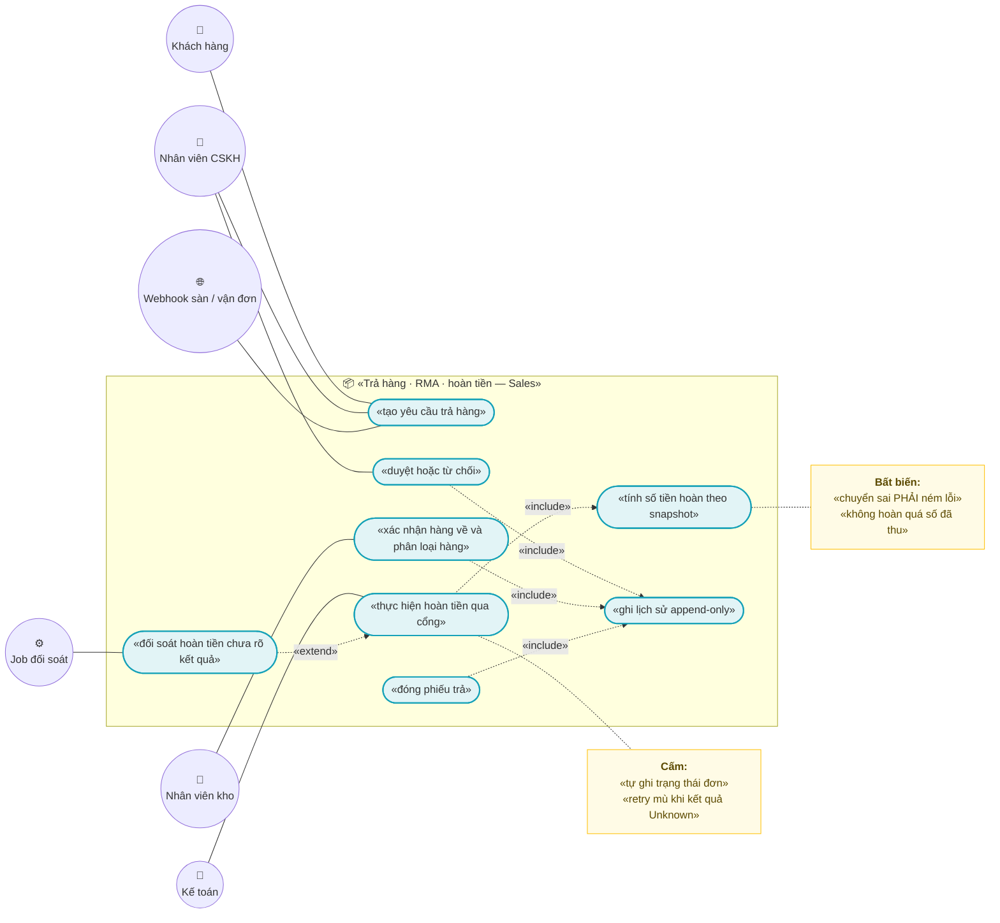
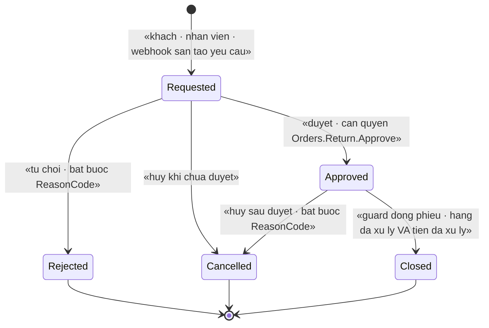
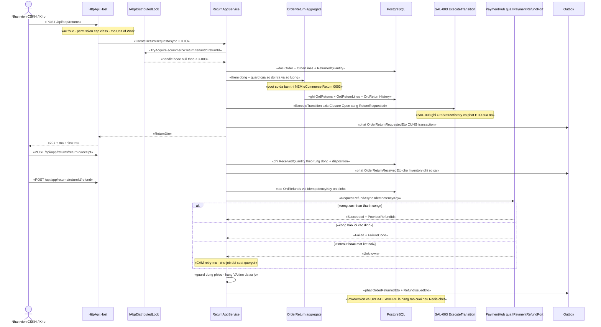

# `SAL-006` — Trả hàng / RMA và hoàn tiền (một phần / toàn bộ)

| Thuộc tính | Nội dung |
|---|---|
| **Mã** | `SAL-006` |
| **Module** | **Sales** — entity `Order`/`OrderLine` hiện nằm ở app (`src/eCommerce.Domain/Entities/Orders/Order.cs`); kế hoạch tách sang `modules/Sales/` ở GĐ1 (`docs/structure-and-techstack.md:68` — dòng `Sales/` đã ghi rõ `RMA`) |
| **Giai đoạn** | **GĐ2 — Vận hành VN** (`docs/implementation-plan.md:113` liệt kê `SAL-006` trong GĐ2; `:430` mô tả *"Trả hàng / **RMA** & hoàn tiền (một phần / toàn bộ)"*) |
| **Ưu tiên** | **Must have** — là mắt xích bắt buộc của TMĐT VN (`docs/business-modules-proposal.md:360`: *"không chấp nhận được với TMĐT. Ta **phải** có compensation hoàn tiền + huỷ/trả một phần"*) |
| **Trạng thái** | 🟡 `Draft` — chờ review |
| **Người viết / người review** | *(điền)* / **Kiến trúc trưởng + BA vận hành + Kế toán** |
| **Phiên bản / ngày** | `v0.1 — 14/10/2026` |
| **Tài liệu liên quan** | `SAL-003` (state machine 4 trục — **trục 4** là `ReturnStatus`; `docs/features/sal-003-state-machine-4-truc.md:218-279`, `:987`) · `XC-001` (Money/làm tròn — **chưa có code**) · `XC-002` (outbox/inbox & idempotency — **chưa có code**) · `XC-003` (khoá phân tán) · `XC-004` (`[Authorize]` cấp class, permission, tenant) · `XC-005` (log/metric — registry metric) · `XC-006` (thuế GTGT — snapshot thuế trên dòng đơn) · `SHP-002` (`ShipmentReturnedEto` → Sales RMA; `docs/features/shp-002-webhook-trang-thai-van-don.md:634`) · `INV-001`/`INV-002` (sổ cái kho append-only) · `PaymentHub` (`IPaymentProvider.RefundAsync`) · `REP-001`/`REP-002` (read-model) · `LOY-001` (`OrderReturnedEto`, khoá đảo điểm có `returnId`; `docs/features/loy-001-diem-thuong.md:406,430,444`) · `ACC-001`/**`EINV-003`** (**chưa có tài liệu**) · `docs/templates/feature-design-template.md` |

---

## 0. Tóm tắt & quyết định thiết kế

**Tóm tắt:** `SAL-006` chốt **vòng đời phiếu trả hàng (RMA)**, **hai trục con của phiếu** (hàng hoá · tiền), **quy tắc tính số tiền hoàn một phần/toàn bộ bảo toàn tổng**, **đường nhập lại kho** (qua sự kiện, không tự ghi kho), và **đường hoàn tiền qua cổng** với nguyên tắc sống còn: *hoàn tiền là giao dịch **không đồng bộ** ⇒ **cấm retry mù** sau timeout* — phải đối soát trước.

**Vì sao phải có tài liệu này (liên kết chéo đã có sẵn, không phải suy đoán):**

| Hệ quả nếu KHÔNG có `SAL-006` | Bằng chứng |
|---|---|
| Trục 4 của `SAL-003` **đứng im**: `ReturnRequested → ReturnApproved` đòi guard *"có phiếu trả của `SAL-006` tham chiếu đơn này"* | `docs/features/sal-003-state-machine-4-truc.md:275` (dòng 26 của bảng guard trục 4) + `:987` (giả định #3: *"`SAL-006` (RMA) sẽ gọi `ExecuteTransition` cho trục 4"*) |
| Loyalty **không đảo được điểm** (khoá đảo điểm có `returnId`, *"nếu thiếu thì 2 lần trả hàng **một phần** sẽ bị coi là trùng ⇒ **mất bút toán đảo**"*) | `docs/features/loy-001-diem-thuong.md:406`, `:430`, `:444` |
| Read-model doanh thu **không ghi âm** được khi hàng bị trả | `docs/features/rep-001-read-model-job-tong-hop.md:714` (`OrderReturnedEto` → `RepSalesDailyFact` **ghi âm**) |
| Vận đơn hoàn về (`SHP-002`) **không có ai tiêu thụ** | `docs/features/shp-002-webhook-trang-thai-van-don.md:634` (`ShipmentReturnedEto` → **Sales (RMA)** · Inventory · ACC-001) |

### Hiện trạng code (đã kiểm bằng `read`/`grep` trong phiên này — **không** viết theo trí nhớ)

| Hạng mục | Hiện trạng | Bằng chứng (đường dẫn thật) |
|---|---|---|
| Module `Sales` | ❌ **chưa tồn tại** — `modules/` chỉ có `ChannelHub`, `PaymentHub`, `Tax` | liệt kê `modules/` (chỉ 3 thư mục) |
| `Order` / `OrderLine` | ✅ **có**, nhưng ở **app** (`eCommerce.Domain`), **một** enum trạng thái, **không** guard | `src/eCommerce.Domain/Entities/Orders/Order.cs:10-112`, `:118-149` |
| Trục 4 (`ReturnStatus`) | ❌ **chưa có** — `Enums.cs` chỉ có `OrderStatus` (7 giá trị) + `PaymentStatus` (6 giá trị) | `src/eCommerce.Domain.Shared/Enums.cs:50-59`, `:61-69` |
| Entity RMA (`OrderReturn`, `OrderReturnLine`, `Refund`) | ❌ **chưa có** — `grep` không thấy; `implementation-plan.md:180`, `:201` **đã liệt kê** là entity của Sales | `src/eCommerce.EntityFrameworkCore/eCommerceDbContext.cs:43-45` (chỉ `Orders`, `OrderLines`) |
| Cột `ReturnedQuantity` trên dòng đơn | ❌ **chưa có** ⇒ **không có hàng rào DB nào** chặn trả vượt số đã bán | `eCommerceDbContext.cs:194-209` |
| Cột tiền đã thu / đã hoàn trên đơn | ❌ **chưa có** (`Order` chỉ có `Subtotal`/`DiscountTotal`/`TaxTotal`/`ShippingTotal`/`GrandTotal`/`ChannelFeeAmount`) | `Order.cs:39-50` |
| `Order.SetStatus(...)` | 🚨 **gán thẳng, không guard, không lịch sử**; `PaymentStatus` có **setter công khai** | `Order.cs:111`, `:33` |
| Loại biến động kho cho hàng trả | ✅ **có** `StockMovementType.CustomerReturn = 4` và `ApplyMovement` cộng `OnHand`; ❌ **chưa có** loại cho hàng hỏng/không nhập lại kho | `src/eCommerce.Domain.Shared/Enums.cs:41`, `src/eCommerce.Domain/Entities/Inventory/StockLedger.cs:45-47`, `Enums.cs:26-48` |
| Sổ cái kho | ✅ append-only, có `ReferenceType`/`ReferenceId`/`ChannelCode` | `StockLedger.cs:80-83`, `:114-135` |
| `PaymentTransaction.RefundedAmount` + `RegisterRefund` | ✅ **có**, nhưng **không** chặn hoàn vượt `Amount`, **không** kiểm `amount > 0` | `modules/PaymentHub/eCommerce.PaymentHub.Domain/Entities/PaymentTransaction.cs:62`, `:124-130` |
| `IPaymentProvider.RefundAsync` | ⚠️ **khai báo có**, **cài đặt thật chưa có** — VNPay ném `NotImplementedException` kèm ghi chú *"hoàn tiền là giao dịch **KHÔNG đồng bộ** — phải gọi `querydr` để xác nhận kết quả"* | `modules/PaymentHub/eCommerce.PaymentHub.Domain/Payments/IPaymentProvider.cs:78`; `modules/PaymentHub/eCommerce.PaymentHub.Application/Providers/VnPayPaymentProvider.cs:158-163`, `:165-170` |
| Project `.Contracts` của PaymentHub | ❌ **chưa có** ⇒ Sales **không có port** để gọi hoàn tiền theo quy ước *"module khác dùng trực tiếp ⇒ tạo `.Contracts`"* | liệt kê `modules/PaymentHub/` (chỉ `Application`, `Domain`, `EntityFrameworkCore`); `docs/structure-and-techstack.md:94` |
| `shared/eCommerce.Kernel` (Money/Currency/làm tròn) | ❌ **chưa tồn tại** — `grep` `Money`/`MoneyAllocator`/`ToMinorUnits` toàn repo = **0** | `XC-001` §0 (thư viện nền **chưa có code**); kết quả `grep` trong phiên này |
| Nền `XC-002` (`IIdempotencyGuard`, `InboxRecords`, `IntegrationEventBase`) | ❌ **chưa có** — `grep` = **0**; DbContext **không** implement `IHasEventOutbox`/`IHasEventInbox`, **không** gọi `ConfigureEventOutbox()` | `eCommerceDbContext.cs:33`, `:71-91` |
| Audit/permission hạ tầng | ✅ **có**: `eCommerce.Orders.Default/.Manage`, `eCommerce.Payments.Refund` đã định nghĩa & đăng ký | `src/eCommerce.Domain.Shared/eCommerceConsts.cs:42-52`; `src/eCommerce.Application.Contracts/Permissions/eCommercePermissionDefinitionProvider.cs:42-48` |
| Khoá phân tán | ✅ **có** hạ tầng thật; `KeyPrefix = "ecommerce:"` (đã sửa bằng `redis-cli MONITOR`) | `src/eCommerce.HttpApi.Host/eCommerceHttpApiHostModule.cs:115-128` |
| Registry metric | ✅ **có** `System.Diagnostics.Metrics`, **đúng 12 tên**; ❌ **chưa có** metric nào cho RMA/hoàn tiền | `src/eCommerce.Domain.Shared/Observability/eCommerceMetrics.cs:13-53`, `:62-85` |
| Tài liệu `SAL-004`, `SAL-005`, `REP-002`, `ACC-001`, `EINV-003` | ❌ **chưa tồn tại** trong `docs/features/` | liệt kê `docs/features/` |

⇒ 🔴 **Kết luận quan trọng:** `SAL-006` là **feature đầu tiên** trong hệ thống **chạm cả 3 tài nguyên có tiền thật** (kho · tiền · thuế) và **phụ thuộc 4 nền chưa có code** (`XC-001`, `XC-002`, `SAL-003` axis, `PaymentHub.Contracts`). Mọi BR về tiền/idempotency ở đây vì vậy **chưa kiểm chứng được** cho tới khi các nền đó xong (xem §14.4 và §15.3).

**Phạm vi:**
- ✅ **Phiếu trả hàng (RMA)**: entity + vòng đời + bảng chuyển trạng thái **có guard, guard sai NÉM LỖI**.
- ✅ **Hai trục con của phiếu**: `GoodsStatus` (hàng) và `RefundStatus` (tiền) — tách rời, vì *"trả hàng nhưng **chưa** thu được tiền"* (COD) là ca phổ biến ở VN.
- ✅ **Tính số tiền hoàn một phần/toàn bộ** trên **snapshot** của dòng đơn (giá · giảm giá · **thuế**), bảo toàn tổng.
- ✅ **Nhập lại kho** theo **disposition** (nhập lại được / hàng hỏng / trả NCC) — qua **sự kiện**, không tự ghi kho.
- ✅ **Hoàn tiền qua cổng** (port của PaymentHub) + **đối soát hoàn tiền chưa rõ kết quả**.
- ✅ **Nhật ký RMA append-only**, khoá phân tán, idempotency ở **mọi** biên vào, mã lỗi, permission, migration, test case.

**Không nằm trong phạm vi:**
- ❌ **State machine 4 trục của đơn** — thuộc `SAL-003`; ở đây chỉ **gọi** `ExecuteTransition(axis = Closure)`.
- ❌ **Huỷ đơn & compensation khi chưa giao** — thuộc `SAL-004` (**chưa có tài liệu**).
- ❌ **Webhook đơn từ sàn** (tạo đơn) — thuộc `SAL-005` (**chưa có tài liệu**); ở đây chỉ **nhận** sự kiện trả hàng của sàn.
- ❌ **Sửa `PaymentTransaction`/`IPaymentProvider`** — module **PaymentHub** sở hữu; ở đây chỉ **gọi qua port** và **ghi nhận phát hiện** (§15.2 F2/F3/F4).
- ❌ **Sửa `StockMovementType`** (thêm loại cho hàng hỏng) — module **Inventory** sở hữu (`XC-003` D3: *"module sở hữu hằng số của mình"`); ở đây ghi **yêu cầu** (§15.2 F6).
- ❌ **Điều chỉnh/thay thế hoá đơn điện tử** — thuộc **`EINV-003`** (được `XC-006` §12 nhắc tới, **chưa có tài liệu**); ở đây chỉ **phát sự kiện** để `EInvoiceHub` xử lý.
- ❌ **Báo cáo doanh thu/lãi gộp sau trả hàng** — thuộc `REP-001`/`REP-002` (**read-model**); `SAL-006` **cấm** query báo cáo trên DB giao dịch (§8.4).
- ❌ **Xuất liệu kế toán** — thuộc `ACC-001` (**chưa có tài liệu**).
- ❌ **Đối soát COD/settlement sàn** — thuộc `REC-002`/`REC-003`/`SHP-003`.

### 0.1 Quyết định thiết kế (ADR ngắn)

| # | Quyết định | Phương án đã cân nhắc | Lý do chọn | Hệ quả |
|---|---|---|---|---|
| **ADR-01** | **Phiếu trả là aggregate riêng (`OrderReturn`)**, không nhồi vào `Order`; trạng thái RMA **gọi** `ExecuteTransition` của trục 4 thay vì tự ghi | (a) thêm cột vào `Order` · (b) entity riêng + gọi trục 4 · (c) tự ghi `Order.ReturnStatus` | (a)/(c) **phá** bất biến `BR-SAL-003-004` (mỗi chuyển trạng thái phải có **đúng 1** `OrderStatusHistory`, ghi trong **cùng** phương thức domain — `sal-003:101`) và **mất lịch sử**; `SAL-003:987` **đã giả định** `SAL-006` gọi `ExecuteTransition` | Thêm 4 bảng; phụ thuộc `SAL-003` phải xong **trước** (blocker đã ghi) |
| **ADR-02** | **Hai trục con `GoodsStatus` + `RefundStatus` tách khỏi `Status` của phiếu** | (a) 1 enum `OrderReturnStatus` gộp hết · (b) 3 trục | (a) **không biểu diễn được** ca *"hàng đã về nhưng tiền chưa hoàn"* và *"hoàn tiền trước khi hàng về"* — **đúng bài học** `SAL-003` D1 (ca COD *"đã giao nhưng chưa thu tiền"* không biểu diễn được bằng 1 trục — `sal-003:67`) | Mọi truy vấn/UI phải nói rõ **trục nào**; đóng phiếu phải kiểm **cả hai** trục (§3) |
| **ADR-03** | **Số tiền hoàn tính trên SNAPSHOT của dòng đơn**, **không** tính lại từ giá/thuế hiện hành | (a) lấy giá hiện tại · (b) snapshot dòng đơn | (a) làm số hoàn **lệch** chứng từ đã phát hành ⇒ phá `XC-006` **BR-002** (*"thay đổi cấu hình **không** làm đổi chứng từ cũ"*, `XC-006:77`) và bất biến hoá đơn `XC-001` **BR-010/011** (`XC-001:64`) | Số hoàn **không đổi** khi giá/thuế suất đổi; cần cột snapshot (đã có `OrderLine.DiscountAmount`/`TaxAmount` ở `Order.cs:135-137`) |
| **ADR-04** | **Hoàn tiền một phần chia theo trọng số dòng bằng `MoneyAllocator`** (phương pháp phần dư lớn nhất), **bảo toàn tổng tuyệt đối** | (a) chia đều rồi làm tròn từng phần · (b) phân bổ phần dư lớn nhất | (a) **mất/thừa 1–2 đồng** ⇒ hoàn tiền không khớp sao kê. `XC-001` **BR-006** **đã ghi đích danh** *"hoàn tiền từng phần"* là ca phải bảo toàn tổng (`XC-001:64`, D7 ở `:45`) | Cần `Money`/`MoneyAllocator` — **chưa có trong code** (§15.2 F5) |
| **ADR-05** | **So sánh tiền bằng `ToMinorUnits()`**, tuyệt đối **không** `==` trên `decimal` | (a) `refundAmount == paidAmount` · (b) minor units | (a) là **đúng lỗi đã được ghi là bài học** của dự án (`XC-001` **BR-003**/D3 — *"Bài học: EShop so `ActualTotalPrice == OriginalPaymentAmount` ⇒ vỡ ngay với VND/payOS"*, `XC-001:41,64`) | Mọi guard tiền của RMA (trần hoàn, xác định `PartiallyRefunded`/`Refunded`) dùng minor units |
| **ADR-06** | **RMA KHÔNG tự ghi kho** — phát sự kiện, **Inventory** tiêu thụ và ghi `StockLedgerEntry` | (a) Sales ghi thẳng `InventoryItem`/`StockLedgerEntry` · (b) qua sự kiện | (a) **vi phạm** quy ước *"module sở hữu entity của mình"* + `XC-003` D3, và khi tách service (GĐ4) sẽ **vỡ**; quy ước `.Contracts` đã chốt ở `docs/structure-and-techstack.md:94` | Cần `OrderReturnReceivedEto` + hàng rào chống trùng ở **phía Inventory**; đóng phiếu phải chờ xác nhận (ADR-02) |
| **ADR-07** | **Hoàn tiền gọi qua port `IPaymentRefundPort`** (thuộc `eCommerce.PaymentHub.Contracts`), **không** để Sales chạm `PaymentTransaction` | (a) Sales đọc/ghi `PayTransactions` · (b) qua port đồng bộ · (c) qua sự kiện | (a) **vi phạm** ranh giới module; (c) **sai** vì hoàn tiền cần **kết quả ngay để quyết định** và `XC-002` ghi rõ *"Nếu có nghiệp vụ cần tức thời ⇒ phải gọi **đồng bộ** trong cùng transaction, **không** dựa vào sự kiện"* (`XC-002:1202`). ⚠️ Project `.Contracts` của PaymentHub **chưa có** ⇒ việc phải làm ở GĐ2 (F4) | Sales **chờ** kết quả gọi cổng ⇒ cần timeout + trạng thái `Unknown` (§3.3) |
| **ADR-08** | 🚨 **`Unknown` (timeout) KHÔNG được retry mù** — phải **đối soát (`querydr`) trước** | (a) retry ngay sau timeout · (b) đánh dấu `Unknown` + job đối soát xác nhận rồi mới quyết | (a) có thể **hoàn tiền 2 lần** cho khách (mất tiền thật, không thu hồi được). `VnPayPaymentProvider.cs:161` **đã cảnh báo** *"hoàn tiền là giao dịch KHÔNG đồng bộ — phải gọi `querydr` để xác nhận kết quả"*; cùng bài học `EINV-002` D9 (*"vì sao KHÔNG được retry mù sau timeout"*) | Cần job đối soát + `InboxRecords` chống trùng; phiếu trả **không đóng** khi hoàn tiền còn `Unknown` |
| **ADR-09** | **Idempotency key ổn định, lưu DB** cho **mọi** biên vào và cho **mỗi lần gọi cổng** | (a) `Guid.NewGuid()` mỗi lần gọi · (b) khoá sinh từ dữ liệu nghiệp vụ, lưu lại | (a) **biến mỗi retry thành một giao dịch mới** — đúng lỗi `XC-002` BR-007 cấm (`XC-002:92`, `:786`) | `OrdReturns.IdempotencyKey`, `OrdRefunds.IdempotencyKey` **NOT NULL** + unique index |
| **ADR-10** | **Tiền tố mã lỗi `eCommerce:Return:*`**, **mã lỗi trục 4 vẫn thuộc `SAL-003`** (`eCommerce:Order:*`) | (a) dùng tiếp `eCommerce:Order:0009+` · (b) tiền tố riêng cho miền RMA | (a) trộn **2 miền** (vòng đời đơn vs vòng đời phiếu trả) vào một dải mã ⇒ khó tra cứu và dễ đụng số. `XC-003` F1 **đã dạy**: hai nguồn cho cùng một khái niệm ⇒ **lỗi im lặng** (`XC-003:534`) | Bảng lỗi §6.2 ghi rõ **mã nào của ai**; **cấm** khai trùng |
| **ADR-11** | **Trả hàng một phần nhiều lần được phép**; hàng rào DB là **cột `ReturnedQuantity` trên dòng đơn + CHECK** | (a) chỉ cho 1 phiếu trả/đơn · (b) nhiều phiếu, chặn ở cấp dòng đơn | Thực tế TMĐT: khách trả 1 trong 3 món, tháng sau trả tiếp món khác. (a) **chặn oan** nghiệp vụ hợp lệ | Thêm 1 cột vào `OrdOrderLines` + CHECK — đây là câu trả lời cho *"bỏ tầng ứng dụng đi, DB có chặn không?"* (`XC-003` D2, `:45`) |
| **ADR-12** | **Khoá phân tán: `ecommerce:return:{tenantId}:{returnId}`**; khi ghi trục 4 thì **acquire `ecommerce:order:{tenantId}:{orderId}`** — thứ tự khoá **cố định return → order** | (a) chỉ khoá đơn · (b) chỉ khoá phiếu trả · (c) cả hai, thứ tự cố định | `XC-003` D6 cấm acquire **lồng cùng tên**, nhưng lồng **khác tên** chỉ nguy hiểm **nếu thứ tự không nhất quán** (deadlock vòng). Ta chốt **một** thứ tự toàn hệ thống: **luôn** `return` **trước** `order`, và **không** có đường code nào acquire `order` rồi tới `return` (SAL-003 không biết RMA) | Phải **review** mọi đường code mới; ghi thành BR (§1) + test `TC-29` |
| **ADR-13** | **Metric RMA tái dùng metric tiền ở dạng MINOR UNITS**, nhãn chỉ `{channel,result}` | (a) counter `decimal` số tiền · (b) counter `long` minor units · (c) histogram | (a) hệ thống metric **không** hỗ trợ `decimal` cho counter; (b) khớp `XC-001` BR-007 (*"tiền truyền dưới dạng **minor units**"*, `XC-001:64`). **Nhãn `currency` bị loại**: `eCommerceMetricTags.Allowed` (`eCommerceMetrics.cs:75-78`) **chưa có** `currency` và `XC-001` BR-009 ghi **đa tiền tệ chưa hoạt động** (`XC-001:64`) | Nếu bật đa tiền tệ ⇒ **phải** sửa registry + tài liệu `XC-005` §5.1 **trước** (§8.5, F8) |

> 📌 **Ghi lại 3 phương án BỊ LOẠI để 6 tháng sau không hỏi lại:**
> 1. *"Chỉ 1 enum trạng thái cho phiếu trả"* — loại vì **không** biểu diễn được ca COD/hàng-về-tiền-chưa-về (ADR-02).
> 2. *"Sales tự ghi `PaymentTransaction` để hoàn tiền nhanh"* — loại vì **phá** ranh giới module và tạo **hai nguồn sự thật** cho số tiền đã hoàn (ADR-07).
> 3. *"Retry hoàn tiền tối đa N lần cho tới khi thành công"* — loại vì **rủi ro hoàn 2 lần**; thay bằng `Unknown` + đối soát (ADR-08).

---

## 1. Use Case Specification

| Thuộc tính | Nội dung |
|---|---|
| **Use Case ID** | `SAL-006` |
| **Use Case Name** | Nhận trả hàng, nhập lại kho và hoàn tiền **đúng số, đúng một lần** |
| **Description** | *"Là hệ thống bán hàng đa kênh, tôi muốn khách trả hàng thì hàng về kho **có sổ sách**, tiền hoàn khách **đúng số và không hoàn hai lần**, còn chứng từ (hoá đơn/điểm thưởng/báo cáo) **điều chỉnh được** — để không mất hàng, không mất tiền và giải trình được với kế toán."* |
| **Actor(s)** | **Khách hàng** (yêu cầu trả) · **Nhân viên CSKH** (tạo/duyệt yêu cầu) · **Nhân viên kho** (xác nhận hàng về + disposition) · **Kế toán** (hoàn tiền, hoàn tiền tay, đối soát) · **Webhook sàn/vận đơn** (`SAL-005`/`SHP-002`) · **Job hệ thống** (đối soát hoàn tiền, hết hạn phiếu) |
| **Priority** | **Must have** |
| **Trigger** | (a) khách gửi yêu cầu đổi/trả trên storefront/CSKH; (b) sàn báo yêu cầu trả (`SAL-005`); (c) `ShipmentReturnedEto` từ `SHP-002` (hàng hoàn về, **đã đối soát**); (d) kế toán bấm hoàn tiền; (e) job đối soát hoàn tiền `Unknown`/hết hạn phiếu |
| **Pre-Condition(s)** | • **Tenant hiện tại** (`TenantId` từ `ICurrentTenant`) — mọi bảng của feature đều `IMultiTenant` (`XC-004` BR-009).<br>• **Kênh bán** (`ChannelCode`) — **bắt buộc lấy từ `Order.ChannelCode`** (`Order.cs:17-18`); RMA **không** nhận `ChannelCode` từ client (chống giả mạo đối soát).<br>• Đơn **tồn tại**, **chưa** ở trạng thái hấp thụ của trục 4, và **đã giao** (`FulfillmentStatus = Delivered`) — trừ nhánh **A4** (hàng hoàn do giao thất bại, `SHP-002`).<br>• Trong **cửa sổ đổi trả** (`eCommerce.Orders.ReturnWindowDays`, đề xuất mặc định `7` theo `SAL-003:774`).<br>• Nếu là webhook/sự kiện: **đã qua** `IIdempotencyGuard` (`XC-002` BR-004) — ⚠️ **nền này chưa có code** (§15.2 F7).<br>• `SAL-003` đã xong (entity `Order.Status`/`ReturnStatus` + `ExecuteTransition`) — ⚠️ **chưa có code** (`SAL-003:972` F1).<br>• Để **hoàn tiền qua cổng**: `PaymentStatus ∈ {Paid, PartiallyRefunded}` **và** có `PaymentTransaction` gốc — ⚠️ **port chưa có** (§15.2 F4). |
| **Post-Condition(s)** | • **Đúng một** phiếu trả mới (hoặc bản ghi trùng được nhận diện là trùng, **không** side effect).<br>• Mọi chuyển trạng thái phiếu ⇒ **đúng một** bản ghi `OrdReturnHistory` (append-only) trong **cùng** transaction.<br>• Chuyển trạng thái **trục 4** của đơn ⇒ **đúng một** `OrdStatusHistory` + `OrderStatusChangedEto` (**qua** `SAL-003`, không tự ghi).<br>• Hàng đã nhận ⇒ **đúng một** `StockLedgerEntry` `CustomerReturn` cho **mỗi** dòng (chống trùng bằng khoá nghiệp vụ ở **phía Inventory**).<br>• Tiền hoàn: `Σ hoàn ≤ số đã thu` (so **minor units**); trạng thái trục tài chính của đơn đi tới `PartiallyRefunded`/`Refunded` **chỉ** khi cổng xác nhận **hoặc** kế toán ghi nhận hoàn tay có chứng từ.<br>• **Không** dòng nào của `OrdReturnHistory` bị sửa/xoá.<br>• Mọi chuyển dịch sai ⇒ **không** thay đổi DB (rollback) + **exception có mã**. |
| **Basic Flow** | 1. `ReturnAppService` mở **Unit of Work**; `[Authorize]` cấp class + permission cụ thể.<br>2. **Idempotency**: gọi `IIdempotencyGuard.AcquireAsync(key = Return:Request:{tenantId}:{orderId}:{idempotencyKey})` **trước mọi side effect**.<br>3. Nạp `Order` **kèm dòng**; kiểm: đơn đã giao, trong cửa sổ đổi trả, `Σ (quantity yêu cầu) ≤ (Quantity − ReturnedQuantity)` **từng dòng**.<br>4. Sinh `ReturnNumber`; tạo `OrderReturn` (`Status = Requested`) + các `OrderReturnLine`; **tăng `OrderLine.ReturnedQuantity`** (hàng rào DB — ADR-11).<br>5. Ghi `OrdReturnHistory` (`SystemJob`→`Requested` là bản ghi **đầu tiên**, `FromStatus = None`).<br>6. Gọi `SAL-003.ExecuteTransition(axis = Closure, ReturnStatus.Open → ReturnRequested, actorType = Customer/Staff/MarketplaceWebhook, reasonCode)`.<br>7. Phát `OrderReturnRequestedEto` (**outbox, cùng UoW**) — `XC-002` BR-001.<br>8. Nếu người duyệt bấm **Duyệt**: `Requested → Approved` (permission `eCommerce.Orders.Return.Approve`) ⇒ `ExecuteTransition(ReturnRequested → ReturnApproved)` + phát `OrderReturnApprovedEto`.<br>9. Khi hàng về: nhân viên kho `ConfirmReceiptAsync` (permission `.Receive`) ⇒ ghi **disposition từng dòng**, `GoodsStatus` đi `Awaiting → Received`/`PartiallyReceived`, phát `OrderReturnReceivedEto` ⇒ **Inventory** ghi sổ cái.<br>10. Khi hoàn tiền: `RefundStatus Pending → Processing`; gọi port hoàn tiền (khoá phân tán + `OrdRefunds` lưu `IdempotencyKey`); cổng trả kết quả ⇒ `Succeeded`/`Failed`/`Unknown`.<br>11. Guard **đóng phiếu**: `GoodsStatus ∈ {Received, Waived}` **và** `RefundStatus ∈ {Succeeded, NotRequired}` ⇒ `Approved → Closed` + `ExecuteTransition(ReturnApproved → Returned)`; phát `OrderReturnedEto` + `RefundIssuedEto`.<br>12. Commit; nhả khoá; ghi metric `sales_return_requested_total{channel,result}` và `sales_refunded_minor_units_total{channel,result}`. |
| **Alternative Flow** | **A1: Sàn báo yêu cầu trả** — đi qua `IIdempotencyGuard` **trước**; `ActorType = MarketplaceWebhook`; `ReasonCode` = mã lý do của sàn; **không** tin thứ tự ⇒ dùng `AggregateVersion`.<br>**A2: `ShipmentReturnedEto` (hàng hoàn do giao thất bại)** — **chỉ** chấp nhận khi `Source ∈ {Reconciliation, Manual}` và có `ConfirmedAtUtc`; nếu thiếu ⇒ **từ chối + log + metric** (**kế thừa** `SHP-002` D1/BR-004, `shp-002:66,695`).<br>**A3: Trả một phần (một số dòng / một phần số lượng)** — tạo phiếu mới; `ReturnedQuantity` tăng theo phần trả; số tiền hoàn phân bổ theo **trọng số giá trị dòng** bằng `MoneyAllocator` (ADR-04).<br>**A4: Hoàn tiền **trước** khi hàng về** — **chỉ** khi người duyệt có quyền `.Approve` **và** đặt `GoodsStatus = Waived` + `ReasonCode` bắt buộc; `RefundStatus` chạy bình thường; **cấm** `Waived` cho đơn từ sàn (sàn yêu cầu hàng hoàn về).<br>**A5: Hoàn tiền tay (chuyển khoản)** — `RefundMethod = Manual`, **bắt buộc** `EvidenceReference` (mã uỷ nhiệm chi/biên nhận) + permission riêng; ghi audit.<br>**A6: Yêu cầu trùng (cùng `IdempotencyKey` + cùng `PayloadHash`)** — **thành công idempotent**: trả lại **chính** phiếu cũ (`200` + `AlreadyExists = true`), **không** ghi thêm; metric `duplicate`. |
| **Exception Flow** | **E1:** chuyển trạng thái phiếu không có trong bảng §3 ⇒ `eCommerce:Return:0001`.<br>**E2:** `UPDATE … WHERE Status = @from` ảnh hưởng **0 dòng** ⇒ `eCommerce:Return:0002` (**không** coi là thành công).<br>**E3:** số lượng trả vượt số đã bán ⇒ `eCommerce:Return:0003` (và DB **cũng** chặn — ADR-11).<br>**E4:** thiếu `ReasonCode`/actor/chứng từ bắt buộc ⇒ `eCommerce:Return:0004`.<br>**E5:** ngoài cửa sổ đổi trả **hoặc** đơn chưa giao ⇒ `eCommerce:Return:0005`.<br>**E6:** phiếu ở trạng thái **hấp thụ** mà cố chuyển tiếp ⇒ `eCommerce:Return:0006`.<br>**E7:** số tiền hoàn vượt số đã thu (so **minor units**) ⇒ `eCommerce:Return:0007`.<br>**E8:** chưa thu được tiền (`PaymentStatus = Unpaid`) mà cố hoàn **qua cổng** ⇒ `eCommerce:Return:0008` (đơn COD chưa đối soát đi nhánh **`RefundStatus = NotRequired`**).<br>**E9:** cổng hoàn tiền lỗi/timeout ⇒ `eCommerce:Return:0009` (chỉ dùng cho **log/metric**), `RefundStatus = Unknown` + **job đối soát**; **cấm** retry mù (ADR-08).<br>**E10:** vượt `MaxRefundAttempts` ⇒ `eCommerce:Return:0010` + DLQ/cảnh báo.<br>**E11:** đóng phiếu khi `GoodsStatus = Awaiting` mà chính sách yêu cầu nhận hàng ⇒ `eCommerce:Return:0011`.<br>**E12:** đóng phiếu khi `RefundStatus ∈ {Processing, Unknown, Failed}` ⇒ `eCommerce:Return:0012`.<br>**E13:** hoàn tiền tay thiếu chứng từ ⇒ `eCommerce:Return:0013`.<br>**E14:** `Disposition` không hợp lệ cho dòng ⇒ `eCommerce:Return:0014`.<br>**E15:** cùng `IdempotencyKey` nhưng **`PayloadHash` khác** ⇒ `BusinessException` **`eCommerce:Messaging:0002`** (**dùng lại** mã của `XC-002` BR-006 — **cấm** định nghĩa mã thứ hai cho cùng khái niệm, bài học `XC-003` F1).<br>**E16:** trục 4 chuyển sai ⇒ mã của **`SAL-003`** (`eCommerce:Order:0001/0002/0004/0006`) — RMA **không** tự dịch lại. |
| **Business Rules** | • **BR-SAL-006-001**: Mọi chuyển trạng thái phiếu trả **CHỈ** qua phương thức domain có guard; **cấm** setter công khai trên `Status`/`GoodsStatus`/`RefundStatus`; guard sai ⇒ **NÉM LỖI có mã** (`eCommerce:Return:*`).<br>• **BR-SAL-006-002**: **Cấm** RMA tự ghi `Order.Status`/`Order.ReturnStatus`/`Order.PaymentStatus`; **bắt buộc** gọi `SAL-003.ExecuteTransition(axis = Closure)` (giữ bất biến `BR-SAL-003-004/008`).<br>• **BR-SAL-006-003**: **Mọi** biên vào (API tạo/duyệt/nhận hàng/hoàn tiền, webhook sàn, `ShipmentReturnedEto`, job) **phải** idempotent qua `IIdempotencyGuard` + unique index ở DB; khoá **ổn định** qua các lần retry; **cấm** `Guid.NewGuid()` mỗi lần gọi.<br>• **BR-SAL-006-004**: `Σ Quantity` trả của một dòng đơn **không** vượt `OrderLine.Quantity`; bất biến này **phải** có hàng rào DB: `CHECK (ReturnedQuantity >= 0 AND ReturnedQuantity <= Quantity)`.<br>• **BR-SAL-006-005**: Số tiền hoàn **tính trên snapshot** của dòng đơn (giá · giảm giá · **thuế đã chốt**); **cấm** tính lại theo giá/thuế suất hiện hành (`XC-006` BR-002).<br>• **BR-SAL-006-006**: Hoàn tiền **một phần** phân bổ bằng `MoneyAllocator`; bất biến `Σ phần == tổng hoàn` (tuyệt đối, `XC-001` BR-006).<br>• **BR-SAL-006-007**: **Cấm** so sánh tiền bằng `==`; mọi guard tiền **phải** dùng `ToMinorUnits()` (`XC-001` BR-003).<br>• **BR-SAL-006-008**: Tiền là `decimal` (+ `Money`); **cấm** `double`/`float` ở entity/DTO/ETO/metric (`XC-001` BR-008).<br>• **BR-SAL-006-009**: Tổng tiền hoàn của một đơn **không** vượt **số tiền đã thu thực tế**; mọi lần hoàn phải để lại **bản ghi `OrdRefunds`** (append-only) làm chứng từ.<br>• **BR-SAL-006-010**: 🚨 **Cấm retry mù** khi kết quả hoàn tiền **không rõ** (`Unknown`); **bắt buộc** đối soát (`querydr`) xác nhận **trước** khi quyết định; chỉ được tạo **lần thử mới** khi lần trước kết luận `Failed` **và** `AttemptNo < MaxRefundAttempts`.<br>• **BR-SAL-006-011**: Hàng **chỉ** được nhập lại kho bán được khi `Disposition = Restock`; hàng hỏng ⇒ **không** tăng `OnHand`; **cấm** nhập kho bán được cho hàng kém chất lượng.<br>• **BR-SAL-006-012**: **Đúng một** `StockLedgerEntry` cho **mỗi** dòng phiếu trả (khoá nghiệp vụ `(TenantId, ReturnId, OrderLineId)` — **hàng rào phía Inventory**); bút toán chỉ được **thêm**, **cấm** sửa/xoá (kế thừa `StockLedger.cs:80-83`).<br>• **BR-SAL-006-013**: `OrdReturnHistory` là **APPEND-ONLY**: **cấm** UPDATE/DELETE ở tầng ứng dụng; sửa sai bằng **bản ghi mới**.<br>• **BR-SAL-006-014**: Mọi chuyển trạng thái **phải** có `ActorType` + `ActorId` (hoặc định danh nguồn với `SystemJob`/`MarketplaceWebhook`) + `ReasonCode` + `CorrelationId`.<br>• **BR-SAL-006-015**: Đóng phiếu **chỉ** khi **cả hai** trục con đã ngã ngũ (`GoodsStatus ∈ {Received, Waived}` **và** `RefundStatus ∈ {Succeeded, NotRequired}`); `Closed`/`Rejected`/`Cancelled` là **hấp thụ**.<br>• **BR-SAL-006-016**: Khoá phân tán **bắt buộc** cho mọi thao tác ghi: phiếu trả `ecommerce:return:{tenantId}:{returnId}`, đơn `ecommerce:order:{tenantId}:{orderId}`; thứ tự acquire **cố định return → order**; **cấm** chờ vô hạn (`XC-003` BR-004).<br>• **BR-SAL-006-017**: Không giành được khoá ⇒ **mặc định NÉM** `eCommerce:Lock:0001`; **chỉ** job định kỳ được bỏ qua **kèm log + metric** (`XC-003` D10, `:53`).<br>• **BR-SAL-006-018**: `[Authorize]` ở **cấp class** + permission cụ thể từng method; permission dùng trong `[Authorize]` **phải** được định nghĩa trong provider **trước** khi viết app service (`XC-004` BR-001/002).<br>• **BR-SAL-006-019**: **Cách ly tenant**: mọi entity `IMultiTenant` + query filter; phiếu của tenant khác ⇒ **`404`** (không tiết lộ sự tồn tại — `XC-004` BR-008).<br>• **BR-SAL-006-020**: **Cấm** `SAL-006` expose bất kỳ endpoint báo cáo nào truy vấn bảng giao dịch; số liệu sau trả hàng **chỉ** đi qua read-model của `REP-001`/`REP-002` (ràng buộc `REP-002` dùng read-model).<br>• **BR-SAL-006-021**: Mọi metric phát ra **phải** nằm trong **bảng đăng ký** (`eCommerceMetricNames`) và nhãn **chỉ** thuộc `eCommerceMetricTags.Allowed`; **cấm** nhãn cardinality cao (`XC-005` BR-008/BR-009).<br>• **BR-SAL-006-022**: Mọi chuyển trạng thái **phải** có guard ở **tầng DB**: `UPDATE … WHERE Id = @id AND RowVersion = @rv AND Status = @from`; số dòng `0` ⇒ **NÉM** `eCommerce:Return:0002`. |
| **Non-Functional Requirement** | • **NFR-SAL-006-001**: `CreateReturnRequestAsync` (khoá + đọc + ghi + lịch sử + outbox) p95 **< 150 ms**, p99 **< 400 ms** trên máy dev.<br>• **NFR-SAL-006-002**: Tính số tiền hoàn cho **1.000 dòng** < **5 ms** p95 (hàm thuần, không chạm DB).<br>• **NFR-SAL-006-003**: Property-based **10.000** bộ ngẫu nhiên: `Σ phần hoàn == tổng hoàn` **100 %** (`XC-001` NFR-002).<br>• **NFR-SAL-006-004**: Gửi lại **cùng** yêu cầu tạo phiếu **100 lần** ⇒ **đúng 1** phiếu, **0** exception (nhánh A6).<br>• **NFR-SAL-006-005**: Webhook/sự kiện gửi trùng **100 lần** ⇒ **đúng 1** `StockLedgerEntry` và **đúng 1** lần hoàn tiền.<br>• **NFR-SAL-006-006**: **0** trường hợp `UPDATE … WHERE` ảnh hưởng `0` dòng mà bị coi là thành công (test + review).<br>• **NFR-SAL-006-007**: **0** lần gọi cổng hoàn tiền **hai lần** cho cùng một khoá idempotency (test + log/metric).<br>• **NFR-SAL-006-008**: **100 %** chuyển trạng thái có `CorrelationId` trong log + ETO (`XC-005` BR-002/BR-003).<br>• **NFR-SAL-006-009**: Truy vấn danh sách phiếu trả theo tenant/trạng thái p95 **< 100 ms** với **1 triệu** phiếu.<br>• **NFR-SAL-006-010**: **0** property trục trạng thái có setter công khai; **0** `double`/`float` trong entity/DTO/ETO (test reflection).<br>• **NFR-SAL-006-011**: Cách ly tenant: tenant A **không** đọc/ghi được phiếu của tenant B (integration test 2 tenant).<br>• **NFR-SAL-006-012**: **0** mã lỗi `eCommerce:Return:*` được khai ở **hai** nơi (test quét mã nguồn — kế thừa `XC-003` NFR-006). |

---

## 2. Sơ đồ Use Case



### Chú giải

| Ký hiệu | Ý nghĩa |
|---|---|
| ⭕ Xanh lá | Actor (người dùng · hệ thống · hệ thống ngoài) |
| 🟦 Bầu dục xanh dương | Use Case |
| 🟨 Khung vàng | Note (bất biến / điều cấm) |
| `───` | Liên kết Actor ↔ Use Case |
| `-.«include».->` | Quan hệ bao hàm — mọi thay đổi **đều** phải ghi lịch sử |
| `-.«extend».->` | Quan hệ mở rộng — đối soát **chỉ** xảy ra khi kết quả không rõ |

---

## 3. Sơ đồ trạng thái (state machine)

Phiếu trả có **một trạng thái vòng đời** + **hai trục con** (ADR-02). Mọi chuyển dịch **không có cạnh** ⇒ **NÉM LỖI** `eCommerce:Return:0001`; mọi chuyển dịch **rời** trạng thái hấp thụ ⇒ **NÉM** `eCommerce:Return:0006`.

### 3.1 Vòng đời phiếu — `OrderReturn.Status`



**Bảng chuyển trạng thái & guard (mọi guard sai **phải ném lỗi**, không im lặng):**

| # | Từ → Sang | Ai được chuyển | Guard (điều kiện cho phép) | Hành động kèm theo | Nếu guard sai |
|---|---|---|---|---|---|
| 1 | *(chưa có)* → `Requested` | Khách · Nhân viên · Webhook sàn | Qua `IIdempotencyGuard`; đơn đã giao; trong `ReturnWindowDays`; `Σ qty ≤ Quantity − ReturnedQuantity`; có ≥ 1 dòng | tạo phiếu + dòng · tăng `ReturnedQuantity` · `OrdReturnHistory` · `ExecuteTransition(Open → ReturnRequested)` · `OrderReturnRequestedEto` | **`0003`** (vượt số lượng) · **`0005`** (ngoài cửa sổ/chưa giao) · **`0004`** (thiếu lý do) |
| 2 | `Requested` → `Approved` | CSKH · Quản lý (`.Approve`) | Có ≥ 1 dòng **chưa** bị từ chối; `RefundStatus` khởi tạo (`NotRequired` hoặc `Pending`) | `OrdReturnHistory` · `ExecuteTransition(ReturnRequested → ReturnApproved)` · `OrderReturnApprovedEto` | **`0001`** |
| 3 | `Requested` → `Rejected` | CSKH · Quản lý (`.Approve`) | **Bắt buộc** `ReasonCode` + `ReasonText` | `OrdReturnHistory` · **hoàn `ReturnedQuantity`** (nhả chỗ đã giữ) · `ExecuteTransition(ReturnRequested → ReturnRejected)` · `OrderReturnRejectedEto` | **`0004`** (thiếu lý do) |
| 4 | `Requested` → `Cancelled` | Khách · Nhân viên | Phiếu **chưa** duyệt | `OrdReturnHistory` · **hoàn `ReturnedQuantity`** · `ExecuteTransition(ReturnRequested → Open)` | **`0001`** |
| 5 | `Approved` → `Cancelled` | Quản lý · Kế toán | **Chưa** phát sinh bút toán kho **và** chưa có lần hoàn tiền `Succeeded` | `OrdReturnHistory` · `ExecuteTransition(ReturnApproved → Open)` (nếu trục 4 cho phép) | **`0001`** / **`0012`** |
| 6 | `Approved` → `Closed` | Nhân viên · **Job** | `GoodsStatus ∈ {Received, Waived}` **VÀ** `RefundStatus ∈ {Succeeded, NotRequired}` | `OrdReturnHistory` · `ExecuteTransition(ReturnApproved → Returned)` · `OrderReturnedEto` + `RefundIssuedEto` | **`0011`** (hàng chưa xử lý) · **`0012`** (tiền chưa ngã ngũ) |
| 7 | `Rejected` · `Cancelled` · `Closed` → *bất kỳ* | — | **KHÔNG** — **hấp thụ** | — | **`0006`** |

> ⚠️ **Trạng thái hấp thụ:** `Rejected`, `Cancelled`, `Closed`. Muốn mua lại/trả lại ⇒ **tạo phiếu mới** (phiếu mới **vẫn** hợp lệ nếu còn số lượng chưa trả — `ReturnedQuantity` đã được nhả khi `Rejected`/`Cancelled`).
>
> 📌 Ghi rõ **ai nhả `ReturnedQuantity`**: chỉ hai cạnh **3** và **4** (từ chối/huỷ khi chưa duyệt). Cạnh **5** (huỷ sau duyệt) nhả **chỉ khi** chưa có bút toán kho — nếu đã có ⇒ **`0001`** + phải làm phiếu nhập lại/điều chỉnh (thuộc `INV-001`).

### 3.2 Trục con 1 — `OrderReturn.GoodsStatus` (hàng)

| # | Từ → Sang | Ai | Guard | Nếu guard sai |
|---|---|---|---|---|
| 1 | `Awaiting` → `PartiallyReceived` | Nhân viên kho (`.Receive`) | `0 < Σ ReceivedQuantity < Σ Quantity` | **`0004`** |
| 2 | `Awaiting`/`PartiallyReceived` → `Received` | Nhân viên kho (`.Receive`) | `Σ ReceivedQuantity == Σ Quantity` (so **số nguyên**, không phải tiền) | **`0004`** |
| 3 | `Awaiting` → `Waived` | Quản lý (`.Approve`) **+** lý do | **Chỉ** đơn **không** từ sàn; `ReasonCode` bắt buộc; đã có `RefundStatus` tương ứng (A4) | **`0001`** + **`0004`** |
| 4 | `Awaiting` → `NotReturned` | **Job** (quá `ReturnDeadlineDays`) | Quá hạn gửi hàng **và** chưa nhận được gì | **`0001`** |
| 5 | `Received` · `Waived` · `NotReturned` → *bất kỳ* | — | **KHÔNG** — **hấp thụ** | **`0006`** |

> 📌 `NotReturned` **không** tự đóng phiếu: nó chuyển `RefundStatus` sang `NotRequired` **và** để con người quyết định đóng/huỷ (không im lặng).

### 3.3 Trục con 2 — `OrderReturn.RefundStatus` (tiền)

| # | Từ → Sang | Ai | Guard | Nếu guard sai |
|---|---|---|---|---|
| 1 | `NotRequired` → *bất kỳ* | — | **KHÔNG** — **hấp thụ** (đơn 0 đồng, COD chưa thu, khách không cần hoàn) | **`0001`** |
| 2 | `Pending` → `Processing` | Kế toán (`.Refund`) · Job | `PaymentStatus ∈ {Paid, PartiallyRefunded}`; `Σ (đã hoàn + lần này) ≤ số đã thu` (minor units); giành được khoá | **`0008`** (chưa thu tiền) · **`0007`** (vượt trần) |
| 3 | `Processing` → `Succeeded` | Cổng trả kết quả **hoặc** kế toán ghi nhận hoàn tay (A5) | Có `ProviderRefundId` **hoặc** `EvidenceReference`; tiền khớp minor units | **`0013`** (thiếu chứng từ) · **`0007`** |
| 4 | `Processing` → `Failed` | Cổng trả lỗi **xác định** (không phải timeout) | Có `FailureCode` | **`0004`** |
| 5 | `Processing` → `Unknown` | Gọi cổng **timeout**/mất kết nối | **Bắt buộc** ghi metric + log `Warning`; tạo việc cho job đối soát | — (không phải lỗi nghiệp vụ) |
| 6 | `Unknown` → `Succeeded`/`Failed` | **Job** đối soát (`querydr`) | Đã có kết quả **từ cổng**; **cấm** suy đoán | **`0009`** |
| 7 | `Failed` → `Processing` | Kế toán · Job | `AttemptNo < MaxRefundAttempts` (mặc định **3**); tạo **lần thử mới** với `AttemptNo + 1` | **`0010`** |
| 8 | `Succeeded` → *bất kỳ* | — | **KHÔNG** — **hấp thụ**; muốn hoàn thêm ⇒ tạo **phiếu trả mới** (nếu còn số lượng) | **`0006`** |

> 🚨 **Vì sao `Unknown` là trạng thái bắt buộc phải có:** hoàn tiền qua cổng VN **không đồng bộ**
> (`VnPayPaymentProvider.cs:161`). Nếu coi timeout là `Failed` và thử lại, hệ thống có thể **hoàn tiền hai lần** —
> mất tiền thật, không thu hồi được. Đây **cũng** là bài học đã được ghi ở `EINV-002` D9
> (*"vì sao **KHÔNG** được retry mù sau timeout"*) và ở `SHP-002` E7.

---

## 4. Sequence Diagram & luồng dữ liệu

### 4.1 Sequence — tạo phiếu trả, xác nhận hàng về, hoàn tiền



### 4.2 DFD — đường đi của một lần trả hàng (mô tả bằng bảng, giữ ngân sách 3 sơ đồ Mermaid)

| Bước | Nguồn → Đích | Dữ liệu | Cơ chế / ràng buộc |
|---|---|---|---|
| 1 | Khách/CSKH/sàn → `Sales` | `orderId`, danh sách `(orderLineId, quantity)`, `ReasonCode`, `IdempotencyKey` | API + `[Authorize]` + `IIdempotencyGuard` |
| 2 | `Sales` → `OrdReturns`/`OrdReturnLines`/`OrdReturnHistory` (**cùng UoW**) | phiếu + dòng + lịch sử | 3 bảng ghi trong **một** transaction |
| 3 | `Sales` → `SAL-003` (trục 4) | `axis = Closure`, `from`, `to`, actor, reason | **Không** tự ghi; `SAL-003` giữ bất biến lịch sử/ETO |
| 4 | `Sales` → `Inventory` (qua `OrderReturnReceivedEto`) | `returnId`, `(orderLineId, sku, warehouseId, qty, disposition)` | Inventory ghi `StockLedgerEntry(CustomerReturn)` + `InventoryItem`; **chống trùng** bằng khoá `(TenantId, ReturnId, OrderLineId)` |
| 5 | `Sales` → `PaymentHub` (port) | số tiền hoàn (minor units), `IdempotencyKey`, `MerchantReference` | PaymentHub ghi `PaymentTransaction.RefundedAmount` + gọi cổng |
| 6 | `Sales` → `REP-001` (qua `OrderReturnedEto`/`RefundIssuedEto`) | `orderId`, `returnId`, tiền hoàn, `AggregateVersion`, `CorrelationId` | Read-model ghi **âm** doanh thu (`rep-001:714`); `REP-002` **chỉ đọc** read-model — **cấm** query `OrdReturns`/`OrdOrders` |
| 7 | `Sales` → `EInvoiceHub` (qua `OrderReturnedEto`) | `orderId`, `returnId`, số tiền/loại điều chỉnh | Điều chỉnh/thay thế hoá đơn thuộc **`EINV-003`** (**chưa có tài liệu**) |
| 8 | `Sales` → `LOY-001` (qua `OrderReturnedEto`) | **`returnId` bắt buộc** trong khoá đảo điểm | `loy-001:444` — thiếu `returnId` ⇒ 2 lần trả **một phần** bị coi là trùng ⇒ **mất bút toán đảo** |
| 9 | `Sales` → `ACC-001` (**chưa có tài liệu**) | số hoàn tiền + thuế đảo | Xuất liệu kế toán **chỉ** từ read-model (`not-002:663` cùng nguyên tắc) |

> 📌 **Ghi rõ chênh lệch (thói quen tốt của tài liệu gốc):** khi trả **một phần**, `OrderRefundedAmount` **không** bằng
> `GrandTotal` của đơn, và `DerivedStatus` của đơn **có thể** vẫn là `Completed` trong khi `ReturnStatus = ReturnRequested`
> (`SAL-003` §4.2 quy tắc suy ra chỉ đổi khi `ReturnStatus = Returned`). UI **phải** hiển thị **cả** trục 4 **và** số tiền đã hoàn,
> **không** suy ra "đã trả hàng" từ `DerivedStatus`.

---

## 5. Mô hình dữ liệu

### 5.1 Bảng & cột (Data Dictionary)

**Bảng `OrdReturns`** — *phiếu trả hàng (aggregate root của RMA)*

| Cột | Kiểu | Null? | Nguồn / ý nghĩa | Ghi chú |
|---|---|---|---|---|
| `Id` | `uuid` | ✖ | `IGuidGenerator` | khoá chính (`FullAuditedAggregateRoot<Guid>`) |
| `TenantId` | `uuid` | ✔ | `ICurrentTenant` | **bắt buộc** — `IMultiTenant` (`XC-004` BR-009) |
| `OrderId` | `uuid` | ✖ | `OrdOrders.Id` | FK **trong cùng module Sales** |
| `ReturnNumber` | `varchar(64)` | ✖ | sinh theo cấu hình (`RT-{yyyyMMdd}-{seq}`) | **UNIQUE** theo tenant |
| `ChannelCode` | `varchar(32)` | ✖ | **copy từ `Order.ChannelCode`** | ⚠️ **không** nhận từ client (chống giả mạo đối soát) |
| `Status` | `int` | ✖ | `Requested · Approved · Rejected · Cancelled · Closed` | **không** setter công khai (BR-001) |
| `GoodsStatus` | `int` | ✖ | `Awaiting · PartiallyReceived · Received · Waived · NotReturned` | mặc định `Awaiting` |
| `RefundStatus` | `int` | ✖ | `NotRequired · Pending · Processing · Succeeded · Failed · Unknown` | mặc định theo `PaymentStatus` của đơn |
| `ReasonCode` | `varchar(64)` | ✖ | mã lý do (chuỗi enum) | BR-014; **không** nhận văn bản tự do |
| `ReasonText` | `varchar(512)` | ✔ | mô tả ngắn | ⚠️ **cấm** PII (`XC-005` BR-005) |
| `WarehouseId` | `uuid` | ✖ | kho nhận hàng hoàn | kiểm tồn/đối soát theo kho |
| `RefundMethod` | `int` | ✖ | `Original · Manual · None` | `Manual` ⇒ cần chứng từ (A5) |
| `RefundedAmount` | `numeric(18,4)` | ✖ | **Σ tiền đã hoàn** của phiếu này | ⚠️ `decimal`, **cấm** `double`; mọi so sánh qua minor units |
| `RefundCurrency` | `varchar(8)` | ✖ | copy từ `Order.Currency` (`Order.cs:36`) | `XC-001` §5.2 |
| `TaxRefundedAmount` | `numeric(18,4)` | ✖ | **Σ thuế đảo** (từ snapshot dòng đơn) | phục vụ điều chỉnh hoá đơn (`EINV-003`) + `ACC-001` |
| `RequestedByActorType` | `varchar(24)` | ✖ | `Customer · Staff · MarketplaceWebhook · SystemJob` | BR-014 |
| `RequestedByActorId` | `uuid` | ✔ | user id (nullable **chỉ** với `SystemJob`/`MarketplaceWebhook`) | không FK tới `AbpUsers` (sống được khi user bị xoá) |
| `IdempotencyKey` | `varchar(256)` | ✖ | khoá **ổn định** của yêu cầu tạo phiếu | **UNIQUE** `(TenantId, IdempotencyKey)` — ADR-09 |
| `PayloadHash` | `char(64)` | ✖ | SHA-256 payload **canonical** | phát hiện **xung đột khoá** ⇒ `eCommerce:Messaging:0002` |
| `Version` | `bigint` | ✖ | bộ đếm của **phiếu** (mỗi chuyển trạng thái **+1**) | dùng cho `AggregateVersion` của ETO |
| `RowVersion` | `xid` *(PostgreSQL)* | ✖ | optimistic concurrency | ⚠️ **chưa kiểm chứng** trên Npgsql 10.0.3 — **kế thừa nguyên cảnh báo** `SAL-003:440` |
| `CorrelationId` | `varchar(64)` | ✖ | `XC-005` | nối log/ETO |
| `CreationTime`/`CreatorId`/… | *(ABP)* | ✔ | `FullAuditedAggregateRoot` | |

**Bảng `OrdReturnLines`** — *dòng trả (bám đúng **một** dòng đơn)*

| Cột | Kiểu | Null? | Nguồn / ý nghĩa | Ghi chú |
|---|---|---|---|---|
| `Id` | `uuid` | ✖ | | `FullAuditedEntity<Guid>` |
| `TenantId` | `uuid` | ✔ | | |
| `ReturnId` | `uuid` | ✖ | FK → `OrdReturns.Id` | cascade theo aggregate |
| `OrderLineId` | `uuid` | ✖ | FK → `OrdOrderLines.Id` | **một dòng đơn chỉ xuất hiện một lần** trong một phiếu |
| `Sku` | `varchar(64)` | ✖ | copy từ `OrderLine.Sku` (snapshot) | khớp `eCommerceDbContext.cs:199` |
| `Quantity` | `int` | ✖ | số lượng yêu cầu trả | `> 0` |
| `ReceivedQuantity` | `int` | ✖ | số lượng đã nhận thực tế | `0 ≤ ≤ Quantity` |
| `Disposition` | `int` | ✖ | `Unset · Restock · Damaged · ReturnToSupplier` | `Unset` chỉ hợp lệ khi `GoodsStatus = Awaiting` |
| `UnitPriceSnapshot` | `numeric(18,4)` | ✖ | **copy** `OrderLine.UnitPrice` tại thời điểm tạo phiếu | ADR-03 |
| `DiscountAmountSnapshot` | `numeric(18,4)` | ✖ | copy `OrderLine.DiscountAmount` | ADR-03 |
| `TaxAmountSnapshot` | `numeric(18,4)` | ✖ | copy `OrderLine.TaxAmount` | ADR-03 + `XC-006` BR-002 |
| `RefundAmount` | `numeric(18,4)` | ✖ | tiền hoàn của **dòng này** | `Σ RefundAmount == OrdReturns.RefundedAmount` (BR-006) |
| `LedgerEntryId` | `uuid` | ✔ | id bút toán kho do Inventory báo lại | `null` = **chưa** ghi sổ (không được đóng phiếu) |

**Bảng `OrdRefunds`** — *từng lần hoàn tiền (append-only, là **chứng từ**)*

| Cột | Kiểu | Null? | Nguồn / ý nghĩa | Ghi chú |
|---|---|---|---|---|
| `Id` | `uuid` | ✖ | | |
| `TenantId` | `uuid` | ✔ | | |
| `ReturnId` | `uuid` | ✖ | FK → `OrdReturns.Id` | |
| `AttemptNo` | `int` | ✖ | lần thử (1..`MaxRefundAttempts`) | **UNIQUE** `(TenantId, ReturnId, AttemptNo)` |
| `Amount` | `numeric(18,4)` | ✖ | số tiền của **lần này** | `> 0` |
| `Currency` | `varchar(8)` | ✖ | | |
| `Status` | `int` | ✖ | `Processing · Succeeded · Failed · Unknown` | **không** setter công khai |
| `ProviderCode` | `varchar(32)` | ✔ | `vnpay`/`momo`/… | lấy từ giao dịch gốc |
| `MerchantReference` | `varchar(64)` | ✖ | mã ta gửi cổng (ổn định) | ví dụ `{ReturnNumber}-R{AttemptNo}` |
| `ProviderRefundId` | `varchar(128)` | ✔ | mã cổng cấp | **UNIQUE có filter** — chống xử lý callback trùng |
| `IdempotencyKey` | `varchar(256)` | ✖ | **ổn định** cho **lần thử này** | ADR-09 |
| `EvidenceReference` | `varchar(128)` | ✔ | chứng từ hoàn tay (A5) | **bắt buộc** khi `RefundMethod = Manual` |
| `FailureCode`/`FailureReason` | `varchar(64)`/`varchar(2048)` | ✔ | lỗi **xác định** từ cổng | ⚠️ **cấm** log payload thô (`XC-005` BR-005) |
| `RawResponseMasked` | `varchar(8000)` | ✔ | phản hồi cổng **đã che** | dùng lại `PaymentTransaction.MaskSensitiveData` (`PaymentTransaction.cs:147-171`) |
| `OccurredAtUtc` | `timestamptz` | ✖ | thời điểm nghiệp vụ | **không** dùng `CreationTime` ABP làm nguồn sự thật |

**Bảng `OrdReturnHistory`** — *nhật ký chuyển trạng thái RMA, **APPEND-ONLY***

| Cột | Kiểu | Null? | Nguồn / ý nghĩa | Ghi chú |
|---|---|---|---|---|
| `Id` | `uuid` | ✖ | | |
| `TenantId` | `uuid` | ✔ | | |
| `ReturnId` | `uuid` | ✖ | FK → `OrdReturns.Id` | |
| `Axis` | `varchar(24)` | ✖ | `Lifecycle · Goods · Refund` | **lưu chuỗi** cho dễ đọc log/SQL |
| `FromStatus` · `ToStatus` | `int` | ✖ | giá trị trục trước/sau | CHECK `FromStatus <> ToStatus` |
| `ActorType` · `ActorId` | `varchar(24)` · `uuid` | ✖ / ✔ | BR-014 | không FK tới `AbpUsers` |
| `ReasonCode` · `ReasonText` | `varchar(64)` · `varchar(512)` | ✖ / ✔ | | `ReasonText` **cấm** PII |
| `CorrelationId` | `varchar(64)` | ✖ | `XC-005` | |
| `EventId` | `uuid` | ✖ | khớp `EventId` của ETO tương ứng | tra chéo outbox ↔ lịch sử |
| `VersionAfter` | `bigint` | ✖ | `OrdReturns.Version` sau khi đổi | |
| `OccurredAtUtc` | `timestamptz` | ✖ | thời điểm nghiệp vụ | |

**Bảng `OrdOrderLines`** — **bổ sung 1 cột** (bảng **đã có**: `eCommerceDbContext.cs:194-209`)

| Cột | Kiểu | Null? | Ý nghĩa | Ghi chú |
|---|---|---|---|---|
| `ReturnedQuantity` | `int` | ✖ | Σ số lượng đã trả/đang giữ chỗ trả của dòng này | mặc định `0`; **đây là hàng rào DB** của BR-004 (ADR-11) |

**Bảng `OrdOrders`** — **không** thêm cột nào thuộc `SAL-006` (các cột trục 1–4 + `RowVersion` do **`SAL-003` §5.2.1** sở hữu: `sal-003:423-456`). ⚠️ Lý do **quan trọng**: cột *số tiền đã thu* **không tồn tại** trên `Order` (`Order.cs:39-50`) ⇒ **trần hoàn tiền KHÔNG thể** diễn đạt bằng CHECK trên bảng đơn (xem §8.2 và F11).

**Index & ràng buộc** *(phần hay bị bỏ sót nhất — liệt kê hết)*

| Bảng | Loại | Cột | Mục đích |
|---|---|---|---|
| `OrdReturns` | **UNIQUE** `NULLS NOT DISTINCT` | `(TenantId, ReturnNumber)` | chống trùng mã phiếu **kể cả khi `TenantId` NULL** (`XC-004` BR-009) |
| `OrdReturns` | **UNIQUE** `NULLS NOT DISTINCT` | `(TenantId, IdempotencyKey)` | ⭐ **hàng rào chống trùng yêu cầu tạo phiếu** (BR-003) |
| `OrdReturns` | INDEX | `(TenantId, OrderId, CreationTime)` | màn hình chi tiết đơn (mọi phiếu trả của đơn) |
| `OrdReturns` | INDEX | `(TenantId, Status, GoodsStatus, RefundStatus)` | màn hình vận hành RMA (`SAL-003:449` đã dự kiến index này theo trục 4) |
| `OrdReturnLines` | **UNIQUE** | `(TenantId, ReturnId, OrderLineId)` | một dòng đơn **một lần** trong một phiếu |
| `OrdReturnLines` | CHECK | `Quantity > 0` · `ReceivedQuantity >= 0` · `ReceivedQuantity <= Quantity` | dữ liệu hợp lệ |
| `OrdReturnLines` | CHECK | `Disposition = 0 OR GoodsStatus <> 0` | **cấm** chọn disposition khi chưa nhận hàng (không diễn đạt được bằng FK — cần trigger/khai báo tường minh) |
| `OrdOrderLines` | **CHECK** | `ReturnedQuantity >= 0 AND ReturnedQuantity <= Quantity` | 🚨 **hàng rào cuối** chống trả vượt số đã bán (ADR-11) |
| `OrdRefunds` | **UNIQUE** | `(TenantId, ReturnId, AttemptNo)` | một lần thử = một bản ghi (đếm & chặn trùng) |
| `OrdRefunds` | **UNIQUE có filter** | `(TenantId, ProviderCode, ProviderRefundId) WHERE ProviderRefundId IS NOT NULL` | callback/`querydr` gửi trùng **không** tạo bản ghi thứ hai |
| `OrdRefunds` | **UNIQUE** `NULLS NOT DISTINCT` | `(TenantId, IdempotencyKey)` | ⭐ gọi cổng **một lần** cho một khoá |
| `OrdRefunds` | CHECK | `Amount > 0` | **cấm** bản ghi hoàn 0 đồng (đó **không** phải hoàn tiền) |
| `OrdRefunds` | CHECK | `(RefundMethod <> Manual) OR EvidenceReference IS NOT NULL` | 🚨 BR: hoàn tay **bắt buộc** có chứng từ — **DB chặn** |
| `OrdReturnHistory` | **UNIQUE** `NULLS NOT DISTINCT` | `(TenantId, ReturnId, Axis, VersionAfter)` | 🚨 chặn ghi **hai** lịch sử cho **cùng** phiên bản trục (kế thừa `sal-003:485`) |
| `OrdReturnHistory` | CHECK | `FromStatus <> ToStatus` | một chuyển dịch **phải** đổi giá trị |
| `OrdReturnHistory` | INDEX | `(TenantId, ReturnId, OccurredAtUtc)` | timeline phiếu (mới nhất trước) |
| — | — | **KHÔNG** FK tới `AbpUsers` | lịch sử **sống được** khi user bị xoá |

> 🚨 **Hai chỗ EF Core KHÔNG diễn đạt được ⇒ phải SQL thô trong migration** (đúng khuôn đã dùng ở
> `src/eCommerce.EntityFrameworkCore/Migrations/20261013024226_Fix_NullableTenantId_UniqueIndexes.cs`):
> 1. `NULLS NOT DISTINCT` cho các UNIQUE **có `TenantId`** — nếu thiếu, index **mất tác dụng** khi `TenantId = NULL` (`XC-004` BR-009).
> 2. **`OrdOrderLines.ReturnedQuantity` + CHECK** — phải thêm cột + constraint bằng SQL thô, **và** backfill `0`.

> 📌 **Bất biến DB không thể diễn đạt:** *"`OrdReturns.RefundedAmount` ≤ số tiền **thực thu**"* **không** viết được bằng CHECK
> trên bảng Sales, vì số tiền thực thu **không nằm** trên `Order` (F11) mà nằm ở `PayTransactions.Amount` (module PaymentHub).
> ⇒ Hàng rào tiền **phải** nằm ở bảng của **PaymentHub** (`CHECK (RefundedAmount >= 0 AND RefundedAmount <= Amount)`) — hiện
> `PaymentHubDbContextModelCreatingExtensions.cs:28` **chỉ** đặt precision, **chưa** có CHECK ⇒ **yêu cầu bổ sung** (F2).

### 5.2 ERD (mô tả bằng bảng — giữ đúng ngân sách 3 sơ đồ Mermaid)

| Quan hệ | Kiểu | Ghi chú |
|---|---|---|
| `OrdOrders` ||--o{ `OrdReturns` | 1 đơn — **n** phiếu trả (trả một phần nhiều lần — ADR-11) |
| `OrdReturns` ||--|{ `OrdReturnLines` | 1 phiếu — ≥ 1 dòng |
| `OrdReturnLines` }o--|| `OrdOrderLines` | mỗi dòng trả bám **đúng** 1 dòng đơn (FK **trong cùng** module Sales) |
| `OrdReturns` ||--o{ `OrdRefunds` | 1 phiếu — **n** lần thử hoàn tiền (≤ `MaxRefundAttempts`) |
| `OrdReturns` ||--o{ `OrdReturnHistory` | 1 phiếu — nhật ký append-only |
| `OrdReturns` — — `InvStockLedger` | **tham chiếu mềm** | `OrdReturnLines.LedgerEntryId`; **không** FK (kho thuộc module Inventory sau GĐ1) |
| `OrdReturns` — — `PayTransactions` | **tham chiếu mềm** | `OrdRefunds.MerchantReference`/`ProviderRefundId`; **không** FK (PaymentHub sở hữu) |

---

## 6. Hợp đồng API

### 6.1 Application Service

| Mục | Giá trị |
|---|---|
| Interface | `IReturnAppService` — đặt tại `src/eCommerce.Application.Contracts/Sales/` (**hiện chưa có thư mục `Sales/`**: `src/eCommerce.Application.Contracts/` chỉ có `Channels/` + `Permissions/`) |
| Implementation | `ReturnAppService` — đặt tại `src/eCommerce.Application/Sales/` (**chưa có**) |
| `[Authorize]` | **cấp CLASS** (`XC-004` BR-001) — mẫu đã có trong repo: `src/eCommerce.Application/Channels/ChannelAppService.cs:27-28` |
| Vị trí tương lai | `modules/Sales/eCommerce.Sales.Application` (GĐ1/GĐ2 — `docs/structure-and-techstack.md:68,93`) |

| Method | Input (DTO) | Output (DTO) | Permission | Ghi chú |
|---|---|---|---|---|
| `CreateReturnRequestAsync` | `CreateReturnRequestDto` | `ReturnDto` | `eCommerce.Orders.Return.Request` | ⬜ permission **chưa có trong code** — đề xuất ở `sal-003:726` |
| `ApproveReturnAsync` | `ApproveReturnDto` | `ReturnDto` | `eCommerce.Orders.Return.Approve` | ⬜ **chưa có** (`sal-003:727`) |
| `RejectReturnAsync` | `RejectReturnDto` | `ReturnDto` | `eCommerce.Orders.Return.Approve` | **bắt buộc** `ReasonCode` |
| `CancelReturnAsync` | `CancelReturnDto` | `ReturnDto` | `eCommerce.Orders.Return.Request` | chỉ khi **chưa** phát sinh bút toán kho |
| `ConfirmReceiptAsync` | `ConfirmReturnReceiptDto` | `ReturnDto` | `eCommerce.Orders.Return.Receive` | ⬜ **mới** (chưa có trong `SAL-003`) |
| `RequestRefundAsync` | `RequestRefundDto` | `RefundDto` | `eCommerce.Payments.Refund` | ✅ permission **đã có**: `eCommerceConsts.cs:51` + provider `:47-48` |
| `RecordManualRefundAsync` | `ManualRefundDto` | `RefundDto` | `eCommerce.Orders.Return.RefundManual` | ⬜ **mới**; **bắt buộc** `EvidenceReference` |
| `GetAsync` / `GetListAsync` | `Guid id` / `GetReturnsInput` | `ReturnDto` / `PagedResultDto<ReturnDto>` | `eCommerce.Orders.Return.View` | ⬜ **mới** |
| `GetHistoryAsync` | `Guid returnId` + `PagedResultRequestDto` | `PagedResultDto<ReturnHistoryDto>` | `eCommerce.Orders.Return.View` | mới nhất trước |
| ~~`ChangeOrderStatusAsync`~~ | — | — | — | 🚫 **KHÔNG TỒN TẠI** — trục 4 do `SAL-003` sở hữu (BR-002) |
| ~~`GetRevenueReportAsync`~~ | — | — | — | 🚫 **KHÔNG TỒN TẠI** — báo cáo thuộc `REP-001`/`REP-002` (BR-020) |

**DTO chính (rút gọn):**

```csharp
public class CreateReturnRequestDto
{
    public Guid OrderId { get; set; }
    public List<CreateReturnLineDto> Lines { get; set; } = new();   // (OrderLineId, Quantity)
    public string ReasonCode { get; set; } = default!;
    public string? ReasonText { get; set; }
    /// Khoá chống trùng do client sinh (ổn định khi retry). Thiếu ⇒ 400 (BR-003).
    public string IdempotencyKey { get; set; } = default!;
    public string? RequestCorrelationId { get; set; }
}

public class RefundDto
{
    public Guid RefundId { get; set; }
    public Guid ReturnId { get; set; }
    public int AttemptNo { get; set; }
    public decimal Amount { get; set; }        // decimal — KHÔNG double
    public string Currency { get; set; } = "VND";
    public RefundStatus Status { get; set; }   // Processing | Succeeded | Failed | Unknown
    public string? ProviderRefundId { get; set; }
    public string? EvidenceReference { get; set; }
}
```

### 6.2 REST endpoint

| Method | Route | Permission | Mô tả |
|---|---|---|---|
| `POST` | `/api/app/returns` | `.Return.Request` | tạo yêu cầu trả (idempotent theo `IdempotencyKey`) |
| `POST` | `/api/app/returns/{id}/approve` | `.Return.Approve` | duyệt |
| `POST` | `/api/app/returns/{id}/reject` | `.Return.Approve` | từ chối (**bắt buộc** lý do) |
| `POST` | `/api/app/returns/{id}/cancel` | `.Return.Request` | huỷ phiếu |
| `POST` | `/api/app/returns/{id}/receipt` | `.Return.Receive` | xác nhận hàng về + disposition từng dòng |
| `POST` | `/api/app/returns/{id}/refund` | `eCommerce.Payments.Refund` | hoàn tiền qua cổng |
| `POST` | `/api/app/returns/{id}/refund/manual` | `.Return.RefundManual` | ghi nhận hoàn tay (**bắt buộc** chứng từ) |
| `GET` | `/api/app/returns/{id}` | `.Return.View` | chi tiết phiếu |
| `GET` | `/api/app/returns` | `.Return.View` | danh sách + lọc theo trạng thái/khoảng ngày |
| `GET` | `/api/app/returns/{id}/history` | `.Return.View` | nhật ký (mới nhất trước) |

**Mã lỗi nghiệp vụ — `eCommerce:Return:*` (do **module Sales** sở hữu — ADR-10)**

| Mã | HTTP | Khi nào | Thông điệp |
|---|---|---|---|
| `eCommerce:Return:0001` | `409` | Chuyển trạng thái **không có** trong bảng §3 | `Không thể chuyển trạng thái {axis} từ {from} sang {to}.` |
| `eCommerce:Return:0002` | `409` | `UPDATE … WHERE` ảnh hưởng **0 dòng** (`RowVersion`/`Status` lệch) | `Phiếu trả vừa bị thay đổi bởi người khác, vui lòng tải lại.` |
| `eCommerce:Return:0003` | `400` | Số lượng trả **vượt** số đã bán của dòng đơn | `Số lượng trả vượt số lượng đã mua của SKU {sku}.` |
| `eCommerce:Return:0004` | `400` | Thiếu `ReasonCode`/actor/`Disposition` bắt buộc | `Thao tác này cần lý do và người thực hiện hợp lệ.` |
| `eCommerce:Return:0005` | `409` | Ngoài cửa sổ đổi trả **hoặc** đơn chưa giao | `Đơn hàng không còn trong thời hạn đổi trả.` |
| `eCommerce:Return:0006` | `409` | Phiếu ở trạng thái **hấp thụ** | `Phiếu trả đã kết thúc, không thể thay đổi. Hãy tạo phiếu mới.` |
| `eCommerce:Return:0007` | `409` | Số tiền hoàn **vượt** số đã thu (so **minor units**) | `Số tiền hoàn vượt số tiền đã thu của đơn.` |
| `eCommerce:Return:0008` | `409` | Chưa thu được tiền (`PaymentStatus = Unpaid`) mà hoàn **qua cổng** | `Đơn chưa thu tiền, không thể hoàn qua cổng thanh toán.` |
| `eCommerce:Return:0009` | `502` | Cổng **lỗi/timeout** ⇒ `Unknown` (mã dùng cho log/metric + job đối soát) | `Chưa xác định được kết quả hoàn tiền, hệ thống sẽ đối soát.` |
| `eCommerce:Return:0010` | `400` | Vượt `MaxRefundAttempts` | `Đã vượt số lần thử hoàn tiền cho phép.` |
| `eCommerce:Return:0011` | `409` | Đóng phiếu khi `GoodsStatus = Awaiting` (chính sách yêu cầu nhận hàng) | `Hàng chưa được xử lý tại kho.` |
| `eCommerce:Return:0012` | `409` | Đóng phiếu khi `RefundStatus ∈ {Processing, Unknown, Failed}` | `Hoàn tiền chưa ngã ngũ, chưa thể đóng phiếu.` |
| `eCommerce:Return:0013` | `400` | Hoàn tiền tay **thiếu** chứng từ | `Hoàn tiền thủ công bắt buộc có chứng từ.` |
| `eCommerce:Return:0014` | `400` | `Disposition` không hợp lệ cho dòng | `Phân loại hàng hoàn không hợp lệ cho dòng {lineId}.` |

**Mã lỗi dùng LẠI (cấm định nghĩa bản thứ hai — bài học `XC-003` F1):**

| Mã | Thuộc | Dùng ở đây khi |
|---|---|---|
| `eCommerce:Order:0001/0002/0004/0006` | **`SAL-003`** (`sal-003:596-601`) | trục 4 chuyển sai / 0 dòng / thiếu actor / trạng thái hấp thụ. RMA **không** bọc lại thành mã riêng |
| `eCommerce:Messaging:0002` | **`XC-002`** (`XC-002:632`) | cùng `IdempotencyKey` nhưng **khác** `PayloadHash` (E15) |
| `eCommerce:Lock:0001` | **`XC-003`** (`XC-003:314`) | không giành được khoá (BR-017) |
| `eCommerce:Money:0001…0005` | **`XC-001`** (`XC-001:243-247`) | lỗi tính tiền/phân bổ khi lộ ra qua app service |
| `eCommerce:Payment:0001` | app (`eCommerceConsts.cs:85`) | chữ ký callback hoàn tiền **không hợp lệ** |

---

## 7. Sự kiện, tích hợp ngoài & idempotency

### 7.1 Sự kiện phát ra (ETO)

| ETO | Khi nào phát | Trường dữ liệu | Ai tiêu thụ | Ordering | Handler idempotent? |
|---|---|---|---|---|---|
| `OrderReturnRequestedEto` | `→ Requested` | `EventId`, `OccurredOn`, `ReturnId`, `OrderId`, `TenantId`, `ChannelCode`, `Lines[]`, `ReasonCode`, `AggregateVersion`, `CorrelationId` | `Notifications` (`NOT-*`), `EInvoiceHub` (thông báo), `SAL-003`-consumer (nếu cần) | ✅ theo `(ReturnId, Axis = Lifecycle)` | ✅ khoá `Return:{returnId}:Requested` |
| `OrderReturnApprovedEto` | `→ Approved` | như trên + `ApprovedBy`, `RefundExpectedAmount` | `Notifications`, `Inventory` (chuẩn bị nhận), `ACC-001` | ✅ | ✅ khoá `Return:{returnId}:Approved` |
| `OrderReturnRejectedEto` | `→ Rejected` | + `ReasonCode` | `Notifications`, `REP-001` | ✅ | ✅ |
| `OrderReturnReceivedEto` | `Goods → Received` **hoặc** `PartiallyReceived` | `ReturnId`, `OrderId`, `WarehouseId`, `Lines[] (Sku, OrderLineId, ReceivedQuantity, Disposition)` | **`Inventory`** (ghi `StockLedgerEntry` + `InventoryItem`) | ✅ theo `(ReturnId, Axis = Goods)` | ✅ **khoá nghiệp vụ `(TenantId, ReturnId, OrderLineId)` ở phía Inventory** (BR-012) |
| `OrderReturnedEto` ⭐ | `→ Closed` (và trục 4 `ReturnApproved → Returned`) | `ReturnId`, `OrderId`, `ClosureKind = Returned`, `RefundedAmount`, `RefundCurrency`, `TaxRefundedAmount`, `Lines[]`, `AggregateVersion`, `CorrelationId` | **`REP-001`** (ghi **âm** — `rep-001:714`), **`LOY-001`** (đảo điểm — `loy-001:406`), `EInvoiceHub` (điều chỉnh hoá đơn — `EINV-003`), `ACC-001`, `REC-002` | ✅ | ✅ **bắt buộc**: `LOY` dùng khoá `Loyalty:{tenantId}:{customerId}:Reverse:{orderId}:{returnId}` (`loy-001:444`) ⇒ **`ReturnId` KHÔNG được thiếu** |
| `RefundIssuedEto` | `RefundStatus → Succeeded` | `RefundId`, `ReturnId`, `OrderId`, `Amount`, `Currency`, `Method`, `ProviderRefundId`, `CorrelationId` | `REP-001`, `ACC-001`, `REC-001`, `Notifications` | ✅ theo `(ReturnId, Axis = Refund)` | ✅ khoá `Refund:{refundId}:Succeeded` |
| `OrderStatusChangedEto` | mỗi lần đổi **trục 4** | *(do **`SAL-003`** phát — RMA **không** phát trực tiếp)* | `REP-001`, `Notifications`, `REC-001` | ✅ | ✅ |

> 📌 **Kế thừa bắt buộc từ `XC-002`:** ETO **phải** mang `AggregateId` + `AggregateVersion` + `CorrelationId` (`XC-002` D6, `:58`;
> BR-003 ở `XC-003` §7) và **phải** phát qua `IDistributedEventBus` với `useOutbox: true` **trong** UoW (`XC-002` BR-001).
> ⚠️ **Chưa kiểm chứng được**: `IntegrationEventBase`/`IIdempotencyGuard`/outbox **chưa có trong code** (F7).
> ⚠️ **Ghi nhận chéo:** `ChannelOrderPulledEto` (`modules/ChannelHub/eCommerce.ChannelHub.Application.Contracts/Events/ChannelEvents.cs:17-30`)
> **thiếu** `CorrelationId`/`AggregateVersion` — cùng loại nợ đã ghi ở `chn-004` F3 (F9); `SAL-006` **không** lặp lại lỗi này.

### 7.2 Sự kiện / webhook nhận vào (đều là **biên vào phải idempotent**)

| Nguồn | Loại | Xác thực | Chống trùng bằng | Nếu xử lý lỗi | Thứ tự đến |
|---|---|---|---|---|---|
| **Sàn TMĐT** (yêu cầu trả của sàn — `SAL-005`, **chưa có tài liệu**) | `webhook` | chữ ký HMAC **nếu sàn có** (`XC-002` §7.2) | `InboxRecords` khoá `Webhook:{channelCode}:{shopId}:{partnerReturnId}` | vào **DLQ** + retry nhịp sau; **KHÔNG** rollback dữ liệu đã ghi | ✅ có thể sai ⇒ `AggregateVersion` |
| **Vận đơn hoàn về** — `ShipmentReturnedEto` (`SHP-002`) | `distributed event` | nội bộ (đã qua outbox) | `InboxRecords` khoá `SHP:{providerCode}:{trackingNumber}:Returned` **+** `(TenantId, EventId)` | DLQ; **không** nuốt lỗi | ✅ |
| **Kết quả hoàn tiền** (callback cổng, nếu cổng có) | `webhook`/`IPN` | **chữ ký** (`IPaymentProvider.VerifyWebhookAsync`, `IPaymentProvider.cs:76`) | `OrdRefunds` UNIQUE `(TenantId, ProviderCode, ProviderRefundId)` | DLQ + **đối soát** `querydr` | ✅ |
| **Job đối soát hoàn tiền** | `schedule` | nội bộ | `InboxRecords` khoá `RefundReconcile:{tenantId}:{windowEndUtc:O}` | DLQ + retry; job **chạy lại được** | ❌ (job tự xác định cửa sổ) |
| **Consumer nội bộ** | `distributed event` | không (đã qua outbox) | `InboxRecords` khoá `{EventType}:{AggregateId}:{Axis}:{Version}` | DLQ + retry | ✅ dùng `AggregateVersion` |

> 🚨 **Ràng buộc cứng kế thừa `SHP-002`:** `ShipmentReturnedEto` **chỉ** được coi là "hàng đã về" khi
> `Source ∈ {Reconciliation, Manual}` **và** có `ConfirmedAtUtc` (`shp-002:634`, D1 ở `:66`, CHECK ở `:400`).
> Webhook đơn thuần **không đủ** — GHTK **không có HMAC** (`rep-001:733-735`). Nếu thiếu `ConfirmedAtUtc` ⇒
> **từ chối có ghi vết** (không im lặng, không tự đoán).

### 7.3 Gọi API ra ngoài

| NCC | Endpoint (base URL) | Auth | Timeout | Retry | Nếu thất bại |
|---|---|---|---|---|---|
| Cổng thanh toán (VNPay/MoMo/payOS…) — **qua** `IPaymentHubRefundPort`, **không** gọi trực tiếp từ Sales | ⚠️ **chưa có trong code**: `VnPayPaymentProvider.RefundAsync` ném `NotImplementedException` (`:158-163`) — endpoint thật phải lấy từ tài liệu NCC khi làm GĐ2 | chữ ký theo từng cổng (đã có thuật toán cho VNPay ở `VnPayPaymentProvider.cs:126-128`) | **10 s** (đề xuất, cấu hình) | ❌ **CẤM** retry tự động khi timeout (ADR-08) — chỉ **đối soát** | `RefundStatus = Unknown` + `eCommerce:Return:0009` (log/metric) + job đối soát |
| Tra cứu trạng thái hoàn tiền (`querydr`) | như trên | như trên | 10 s | ✅ **2 lần** có backoff (đây là **đọc**, không phải ghi tiền) | giữ `Unknown` + cảnh báo vận hành |

> 📌 **`SAL-006` KHÔNG gọi NCC nào trực tiếp.** Mọi tương tác cổng nằm sau port của PaymentHub (ADR-07) — vì vậy bảng trên
> **cố ý ngắn**: các cổng cụ thể thuộc tài liệu của `PaymentHub`. ⚠️ **Chưa kiểm chứng:** đặc tả endpoint/`vnp_Command=refund`
> của VNPay **chỉ có** ghi chú TODO trong code (`:160-161`), **chưa** có tài liệu NCC trong repo ⇒ phải xác minh **trước** khi code.

**Idempotency key (bảng hợp nhất — nguồn sự thật duy nhất)**

| Đối tượng | Cách sinh khoá | ⚠️ Lưu ý |
|---|---|---|
| Tạo phiếu trả (API) | `Return:Request:{tenantId}:{orderId}:{idempotencyKey}` (`idempotencyKey` do **client** cấp, **bắt buộc**) | **Cấm** `Guid.NewGuid()` mỗi lần gọi. Client retry **phải** dùng **cùng** khoá |
| Webhook yêu cầu trả của sàn | `Webhook:{channelCode}:{shopId}:{partnerReturnId}` | Nếu sàn **không** có id ⇒ dùng `(returnSn, eventType, occurredOn)` + ghi rõ rủi ro (kế thừa `XC-002` §7.3) |
| `ShipmentReturnedEto` | `SHP:{providerCode}:{trackingNumber}:Returned` | Kèm `(TenantId, EventId)` để chống relay phát lại |
| Nhận hàng về (API) | `Return:Receipt:{tenantId}:{returnId}:{receiptRevision}` | `receiptRevision` client cấp (nhập một phần nhiều lần ⇒ **khác** khoá) |
| **Gọi cổng hoàn tiền** | `Refund:{tenantId}:{returnId}:{attemptNo}` — sinh **một lần** ở lần thử đầu, **lưu** vào `OrdRefunds.IdempotencyKey` | ⭐ **Khoá phải ổn định qua retry** (`XC-002` BR-007, `:786`). Lần thử mới ⇒ `attemptNo + 1` ⇒ **khoá mới** (có **chủ ý**, vì là giao dịch **khác**) |
| Job đối soát | `RefundReconcile:{tenantId}:{windowEndUtc:O}` | **Cấm** dùng `DateTime.Now` làm khoá (`XC-002` §7.3) |
| Job hết hạn phiếu trả | `ReturnExpire:{tenantId}:{ngày}` | Kỳ **xác định được** |

---

## 8. Bất biến & xử lý đồng thời

### 8.1 Bất biến

| # | Bất biến | Cơ chế bảo vệ |
|---|---|---|
| 1 | Mọi chuyển trạng thái phiếu **có** trong bảng §3; chuyển sai ⇒ **NÉM LỖI** | Bảng chuyển trong domain + `eCommerce:Return:0001` (**TC-06**) |
| 2 | Trục 4 của đơn **chỉ** được ghi qua `SAL-003.ExecuteTransition` | BR-002 + **test** chặn setter công khai (**TC-27**) |
| 3 | `Σ Quantity` trả **≤** `OrderLine.Quantity` | `OrdOrderLines.ReturnedQuantity` + **CHECK** (ADR-11) + guard domain ⇒ **TC-04/TC-05** |
| 4 | Số tiền hoàn **≤** số đã thu; `Σ hoàn` khớp `OrdReturns.RefundedAmount` | Guard **minor units** + `OrdRefunds` append-only + **CHECK ở PaymentHub** (yêu cầu bổ sung — F2) |
| 5 | Hoàn tiền **một phần** bảo toàn tổng | `MoneyAllocator` (ADR-04) + property-based test **TC-15** |
| 6 | Mỗi chuyển trạng thái ⇒ **đúng 1** `OrdReturnHistory` | Ghi trong **cùng** phương thức domain + UNIQUE `(TenantId, ReturnId, Axis, VersionAfter)` |
| 7 | `OrdReturnHistory` **append-only** | Không có phương thức sửa/xoá + review + **test** (**TC-26**) |
| 8 | Hàng trả ⇒ **đúng 1** bút toán kho cho mỗi dòng | Khoá nghiệp vụ `(TenantId, ReturnId, OrderLineId)` ở **phía Inventory** + **test** (**TC-20**) |
| 9 | Số tiền hoàn **không** tính lại theo cấu hình hiện hành | Snapshot trên `OrdReturnLines` (ADR-03) + **test** (**TC-23**) |
| 10 | Hoàn tiền **không** xảy ra **hai lần** cho một lần thử | `OrdRefunds` UNIQUE `(TenantId, IdempotencyKey)` + UNIQUE `(TenantId, ReturnId, AttemptNo)` |
| 11 | `Succeeded`/`NotRequired`/`Rejected`/`Cancelled`/`Closed` là **hấp thụ** | Guard + `eCommerce:Return:0006` (**TC-06**) |
| 12 | `Closed` **chỉ** khi **cả hai** trục con ngã ngũ | Guard cạnh 6 (§3.1) + `0011`/`0012` (**TC-21/TC-22**) |
| 13 | Trạng thái phiếu **cách ly tenant** | `IMultiTenant` + query filter; tenant khác ⇒ `404` (**TC-28**) |
| 14 | Mọi thao tác ghi nằm trong **một** Unit of Work (dữ liệu + lịch sử + outbox) | `XC-002` BR-001 + review + **test** (**TC-25**) |
| 15 | Không có `double`/`float` trong biểu thức tiền | Test reflection (**TC-30**) |
| 16 | Tiền so bằng **minor units**, không `==` | Test + review (**TC-13/TC-16**) |

### 8.2 🚨 Trả lời câu hỏi của `XC-003` D2: *"bỏ khoá đi, DB có chặn không?"*

| Bất biến | Nếu **bỏ Redis lock** | Nếu **bỏ cả tầng ứng dụng** | Kết luận |
|---|---|---|---|
| Trả vượt số đã bán | ❌ không chặn | ✅ **DB chặn**: `CHECK (ReturnedQuantity <= Quantity)` | ✅ **Đạt** |
| Hai lịch sử cho cùng một phiên bản | ❌ | ✅ UNIQUE `(TenantId, ReturnId, Axis, VersionAfter)` | ✅ **Đạt** |
| Tạo 2 phiếu từ 1 yêu cầu | ❌ | ✅ UNIQUE `(TenantId, IdempotencyKey)` | ✅ **Đạt** |
| Gọi cổng hoàn tiền 2 lần cho 1 lần thử | ❌ | ✅ UNIQUE `(TenantId, IdempotencyKey)` trên `OrdRefunds` | ✅ **Đạt** |
| **Hoàn tiền vượt số đã thu** | ❌ | ⚠️ **KHÔNG** — số đã thu **không** nằm trên bảng Sales (F11); CHECK phải nằm ở `PayTransactions` (**hiện chưa có** — F2) | 🚨 **Chưa đạt — phải bổ sung ở PaymentHub** |
| Nhập kho 2 lần cho 1 dòng | ❌ | ⚠️ **KHÔNG** trên bảng Sales — hàng rào **phải** ở phía Inventory | 🚨 **Phụ thuộc module Inventory (ghi ở §14.4)** |

> 📌 Đây là **kết quả trung thực**, không phải "đạt hết": 2 bất biến **chưa** có hàng rào DB **trong phạm vi Sales**.
> Chúng **phải** được bổ sung ở module sở hữu (`PaymentHub`, `Inventory`) — nếu không, vi phạm `XC-003` **BR-007** (mọi bất biến
> được bảo vệ bằng khoá **phải** đồng thời có ràng buộc DB).

### 8.3 Xử lý đồng thời — các tình huống thật

| # | Tình huống | Cơ chế |
|---|---|---|
| 1 | 2 nhân viên cùng duyệt 1 phiếu | Khoá `ecommerce:return:{tenantId}:{returnId}` + `RowVersion` + `UPDATE … WHERE Status = @from` ⇒ 1 thắng, luồng kia **`0002`** |
| 2 | Khách bấm "Gửi yêu cầu trả" 2 lần (double-click) | `IdempotencyKey` + UNIQUE `(TenantId, IdempotencyKey)` ⇒ lần 2 nhánh **A6** (`200` + `AlreadyExists`) |
| 3 | Trả một phần **và** trả tiếp trong lúc phiếu trước còn mở | **Được phép** (ADR-11); ràng buộc **duy nhất** là `Σ qty ≤ Quantity` (CHECK ở DB) |
| 4 | Webhook sàn **và** nhân viên cùng tạo phiếu cho cùng đơn | Cả hai đi qua `IIdempotencyGuard` (khoá **khác nhau** vì nguồn khác nhau) ⇒ có thể tạo **2 phiếu**; **DB** chặn nếu tổng vượt số đã bán ⇒ luồng thua nhận `0003` (đúng, không im lặng) |
| 5 | 2 lần gọi cổng hoàn tiền song song cho cùng lần thử | Khoá `ecommerce:return:...` + UNIQUE `(TenantId, IdempotencyKey)` ⇒ 1 thắng. ⚠️ **Nếu Redis chết**: UNIQUE **vẫn** chặn ⇒ **không** hoàn 2 lần |
| 6 | Timeout gọi cổng **rồi** có người bấm "hoàn tiền lại" | **BỊ CHẶN**: `RefundStatus = Unknown` **không** có cạnh nào tới `Processing` (chỉ `Failed` mới đi tiếp — §3.3 cạnh 7) |
| 7 | Job đối soát chạy chồng trên 2 instance | Khoá `ecommerce:messaging:job:{jobName}:{tenantId}` (`XC-003` §5) + `InboxRecords` khoá theo cửa sổ; job định kỳ dùng **`SkipIfBusy` + log + metric** (BR-017) |
| 8 | Sự kiện `OrderReturnReceivedEto` đến **sai thứ tự** (gửi lại bản cũ) | `AggregateVersion` theo `(ReturnId, Goods)`: `version <= AppliedVersion` ⇒ **bỏ qua có log + metric**; `version > AppliedVersion + 1` ⇒ DLQ `OutOfOrder` (`XC-002` §7.4) |
| 9 | Redis chết | Khoá **vô hiệu**; `RowVersion` + UNIQUE + CHECK vẫn chặn ⇒ dữ liệu **vẫn đúng** (§8.2) |
| 10 | Phiếu `Closed` rồi có webhook trả hàng đến muộn | `Closed` **hấp thụ** ⇒ `eCommerce:Return:0006`; webhook **được ACK** + ghi vết, kế toán mở phiếu mới nếu cần |

**Khoá phân tán dùng trong feature** *(theo quy ước `XC-003` — **đủ tiền tố**, sinh từ hàm trong consts của module sở hữu)*

| Tên khoá | Phạm vi | Vì sao cần | Trạng thái trong code |
|---|---|---|---|
| `ecommerce:return:{tenantId}:{returnId}` | theo phiếu trả | chống 2 luồng cùng duyệt/nhận hàng/hoàn tiền một phiếu | ⬜ **MỚI** — hàm sinh khoá phải thêm vào consts của Sales (`SalesConsts.LockKeys.Return(...)`); hiện app có `eCommerceConsts.LockKeys` (`eCommerceConsts.cs:89-109`) |
| `ecommerce:order:{tenantId}:{orderId}` | theo đơn | chống 2 luồng cùng đổi **trục 4** | ⬜ **do `SAL-003` đăng ký** (`sal-003:691`) — RMA **dùng lại**, **cấm** tạo khoá thứ hai (bài học F1 `XC-003`) |
| `ecommerce:messaging:job:{jobName}:{tenantId}` | theo job + tenant | job đối soát hoàn tiền/hết hạn phiếu không chạy chồng | ✅ đã có quy ước (`XC-003` §5, `:212`) |

> ⚠️ **Thứ tự acquire cố định `return` → `order`** (ADR-12). **Cấm** đường code nào acquire `order` trước rồi `return`.
> Lý do: `XC-003` D6 chỉ cấm **lồng cùng tên khoá**; lồng **khác tên** vẫn có thể **deadlock vòng** nếu thứ tự không nhất quán.
> Test `TC-29` kiểm bằng cách quét mã nguồn/thứ tự gọi.

### 8.4 ⚠️ `REP-002` **KHÔNG** được query DB giao dịch (ràng buộc bắt buộc)

| Quy tắc | Nội dung | Bằng chứng / liên kết |
|---|---|---|
| R1 | Mọi số liệu doanh thu/lãi gộp sau trả hàng **chỉ** đọc từ **read-model** (`RepSalesDailyFact`), **cấm** query `OrdOrders`/`OrdOrderLines`/`OrdReturns`/`OrdRefunds` | `rep-001:430-461` (bảng fact) · `rep-003` BR-REP-003-001 (cùng nguyên tắc: *"**cấm** app service của Reporting truy vấn bảng giao dịch"*) |
| R2 | `SAL-006` **phải** phát `OrderReturnedEto`/`RefundIssuedEto` để read-model ghi **âm** | `rep-001:714` — `OrderReturnedEto` từ `SAL-006` → `RepSalesDailyFact` (**ghi âm**) |
| R3 | `SAL-006` **cấm** expose endpoint báo cáo; nếu `REP-002` cần chi tiết chứng từ ⇒ gọi **API của Sales** (`GetAsync`) theo `rep-001:425-426` (*"muốn xem chi tiết chứng từ thì gọi API của module nguồn"*) | `rep-001:425-426` |
| R4 | Số liệu phải dùng **số đã chốt** trên dòng (không làm tròn lại) ⇒ trường `TaxRefundedAmount`/`RefundedAmount` mang **số đã tính**, không mang công thức | `XC-001` BR-005 (`XC-001:64`) · `rep-003` BR-REP-003-007 |

### 8.5 Metric & log (liên kết `XC-005`)

| Metric | Loại | Nhãn (hữu hạn) | Ý nghĩa | Trạng thái |
|---|---|---|---|---|
| `sales_return_requested_total` | Counter | `channel`, `result` (`created`/`duplicate`/`rejected`) | số yêu cầu trả theo kênh & kết quả | ⬜ **phải bổ sung** vào `eCommerceMetricNames` (`eCommerceMetrics.cs:13-53`) |
| `sales_return_closed_total` | Counter | `channel`, `result` (`closed`/`blocked_goods`/`blocked_refund`) | phiếu đóng / bị chặn đóng | ⬜ **phải bổ sung** |
| `sales_refunded_minor_units_total` | Counter | `channel`, `result` (`succeeded`/`failed`/`unknown`) | **tổng tiền hoàn tính bằng MINOR UNITS** | ⬜ **phải bổ sung** (ADR-13) |
| `sales_refund_unknown_total` | Counter | `channel` | 🚨 số lần kết quả hoàn tiền **không rõ** — kỳ vọng **0** | ⬜ **phải bổ sung** |
| `lock_timeout_total` · `lock_skipped_total` | Counter | `module` (`sales`) | tranh chấp khoá | ✅ **đã có** (`eCommerceMetrics.cs:22-23`) — chỉ cần truyền tag `module = "sales"` |
| *(log)* `ReturnId`, `OrderId`, `Axis`, `FromStatus`, `ToStatus`, `IdempotencyKey`, `LockKey`, `ErrorCode` | trường log | — | theo bảng trường log của `XC-005` §5.2 (`:201-216`) | ✅ tên trường **đã có** trong hợp đồng; chi tiết theo `ReturnId` đi vào **log**, **không** vào nhãn metric (`XC-005` BR-009) |

> 🚨 **Quy tắc cardinality:** **cấm** dùng `returnId`/`orderId`/`sku`/`correlationId` làm **nhãn metric**
> (`eCommerceMetrics.cs:81-85` liệt kê đúng danh sách cấm). Cần truy vết theo các giá trị đó ⇒ **dùng log**.
> 📌 **Việc phải làm TRƯỚC khi phát metric:** sửa `eCommerceMetricNames` **và** cập nhật `XC-005` §5.1 —
> vì `TC-06` của `XC-005` **fail** nếu tên metric phát ra **không** nằm trong registry (F8).

**Idempotency key** — xem §7.3 (không lặp lại).

---

## 9. Phân quyền

**Hiện trạng code (đã đọc trong phiên này):**

| Sự thật | Bằng chứng |
|---|---|
| Hằng số permission **đã có**: `eCommerce.Orders.Default`, `.Manage`, `eCommerce.Payments.Refund` | `src/eCommerce.Domain.Shared/eCommerceConsts.cs:42-46`, `:48-52` |
| Provider **đã định nghĩa**: `Orders.Default` + `Orders.Manage` + `Payments.Refund` | `src/eCommerce.Application.Contracts/Permissions/eCommercePermissionDefinitionProvider.cs:42-44`, `:47-48` |
| Seed **tự động** cấp **mọi** permission đã định nghĩa cho role `admin` ⇒ thêm permission **không** phải sửa seeder | `src/eCommerce.DbMigrator/IdentityDataSeedContributor.cs:92-106` (theo `sal-003:715,773`) |
| **Chưa có** app service nào của Sales | `src/eCommerce.Application/` chỉ có `Channels/`; `src/eCommerce.Application.Contracts/` chỉ có `Channels/` + `Permissions/` |

| Permission | Nhóm | Method được gán | Vai trò mặc định | Trạng thái |
|---|---|---|---|---|
| `eCommerce.Orders.Default` | `Orders` | `[Authorize]` cấp class | admin | ✅ **đã có** |
| `eCommerce.Orders.Return.Request` | `Orders` | `CreateReturnRequestAsync` · `CancelReturnAsync` | khách (đăng nhập) + nhân viên CSKH | ⬜ **đề xuất** (`sal-003:726`) — **chưa có trong code** |
| `eCommerce.Orders.Return.Approve` | `Orders` | `ApproveReturnAsync` · `RejectReturnAsync` | quản lý vận hành | ⬜ **đề xuất** (`sal-003:727`) — **chưa có** |
| `eCommerce.Orders.Return.Receive` | `Orders` | `ConfirmReceiptAsync` | nhân viên kho | ⬜ **mới** — **chưa có** |
| `eCommerce.Orders.Return.View` | `Orders` | `GetAsync` · `GetListAsync` · `GetHistoryAsync` | nhân viên CSKH · kế toán | ⬜ **mới** — **chưa có** |
| `eCommerce.Orders.Return.RefundManual` | `Orders` | `RecordManualRefundAsync` | **kế toán trưởng** (không phải nhân viên) | ⬜ **mới** — **chưa có**; lý do siết: hoàn tiền tay **không** qua cổng ⇒ rủi ro gian lận |
| `eCommerce.Payments.Refund` | `Payments` | `RequestRefundAsync` | kế toán | ✅ **đã có** (`eCommerceConsts.cs:51`) |
| `eCommerce.Orders.StatusChange` | `Orders` | *(thuộc `SAL-003`)* | nhân viên vận hành | ⬜ đề xuất ở `sal-003:724` — **không** thuộc `SAL-006` |

> ⚠️ **Bắt buộc theo `XC-004`:** permission dùng trong `[Authorize]` **phải** được định nghĩa trong provider **trước** khi viết
> app service — nếu không ⇒ **`403` cho MỌI người**, kể cả admin (`XC-004` D2/E3; chính file provider ghi rõ ở `:8-11`).
> ⇒ 4 permission ⬜ phải được thêm vào `eCommercePermissionDefinitionProvider` + `eCommerceConsts.Permissions.Orders` **trước** (ghi ở §11).
>
> 🔒 **Cấm** dùng permission để biểu diễn **vai trò** (`XC-004` D9): tên permission theo **hành động/đối tượng**.
> 🚨 `[Authorize]` ở **CẤP CLASS** là bắt buộc (`XC-004` BR-001) — mẫu có sẵn: `ChannelAppService.cs:27-28`.

---

## 10. UI Mockup & mapping dữ liệu

**Có UI** (màn hình RMA cho CSKH/kho/kế toán) — nhưng UI **không thuộc phạm vi** `SAL-006`; mục này chốt **hợp đồng dữ liệu & quy tắc hiển thị** để `WEB-001`/`WEB-003` làm đúng.

| Vùng UI | Dữ liệu hiển thị | Nguồn (DTO / trường) | Quy tắc |
|---|---|---|---|
| **Thanh trạng thái phiếu trả** | `status`, `goodsStatus`, `refundStatus` — **3 nhãn riêng** | `ReturnDto` | ⚠️ **Phải** hiển thị **cả 3**, **không** gộp thành 1 nhãn (ADR-02). Ca "hàng đã về, tiền chưa hoàn" là **bình thường**, không phải lỗi |
| **Danh sách dòng trả** | `sku`, `quantity`, `receivedQuantity`, `disposition`, `refundAmount`, `taxAmountSnapshot` | `ReturnLineDto[]` | Tiền format theo locale (`vi-VN`, VND 0 chữ số — `XC-001` §10) |
| **Tổng tiền hoàn** | `refundedAmount`, `refundCurrency`, `refundMethod` | `ReturnDto` | 🚨 Hiển thị **tổng = tổng các dòng** (kế thừa `XC-001` BR-005) — **không** tính lại từ tổng đơn; ghi rõ "đã hoàn **một phần**" khi `< số đã thu` |
| **Nút hành động** | theo 3 trục + permission | `status`/`goodsStatus`/`refundStatus` + quyền user | Ẩn nút khi thiếu quyền — **nhưng** server **vẫn** kiểm tra (`XC-004` BR-005) |
| **Nhập hàng về** | danh sách dòng + ô `receivedQuantity` + chọn `disposition` | `ConfirmReturnReceiptDto` | Mặc định `receivedQuantity = quantity`; **bắt buộc** chọn disposition cho dòng có số lượng nhận `> 0` |
| **Hoàn tiền** | số tiền đề xuất (đã tính) + nút "Hoàn qua cổng" | `RefundDto` | Nút **ẩn/disabled** khi `refundStatus ∉ {Pending, Failed}`; hiện cảnh báo **"giao dịch không đồng bộ"** |
| **Hoàn tiền tay** | ô `evidenceReference` **bắt buộc** + upload chứng từ | `ManualRefundDto` | Chỉ hiện với người có `.RefundManual`; ghi rõ "thao tác này được ghi audit" |
| **Timeline nhật ký** | `occurredAtUtc`, `axis`, `fromStatus → toStatus`, `actorType`, `reasonCode`, `reasonText` | `GetHistoryAsync` | Mới nhất trước; **không** hiển thị `actorId` thô khi người xem không có quyền xem user; **không** hiển thị với khách |
| Khi nhận `409` mã `0001/0002/0006/0007/0011/0012` | mã lỗi | response | Hiển thị **thông điệp thân thiện** + nút **tải lại**; **không** hiện "lỗi hệ thống" — đây là **xung đột/vi phạm nghiệp vụ bình thường** |
| Khi nhận `502` mã `0009` | mã lỗi | response | Hiện **"chưa xác định được kết quả hoàn tiền — hệ thống sẽ đối soát"**; **cấm** hiện "hoàn tiền thất bại" (sai bản chất — ADR-08) |

> 📌 **Ghi rõ chênh lệch (thói quen tốt của tài liệu gốc):**
> 1. **Đếm ≠ số dòng:** danh sách phiếu lọc theo `RefundStatus = Unknown` sẽ **không** khớp tổng "tiền chờ hoàn" nếu người dùng cũng lọc theo kênh — UI **phải** ghi rõ bộ lọc đang áp dụng và **không** tính tổng từ danh sách đã lọc.
> 2. **Trạng thái ≠ tiền:** `derivedStatus` của đơn **không** phản ánh việc trả một phần (xem §4.2 ghi chú) ⇒ UI **phải** hiển thị riêng "đã hoàn bao nhiêu".
> 3. **Trạng thái rỗng:** đơn **chưa** có phiếu trả ⇒ hiện **hướng dẫn** ("đơn này chưa có yêu cầu trả nào"), **không** hiện bảng trống vô nghĩa — và **không** coi là lỗi.

---

## 11. Migration & seed

| Mục | Nội dung |
|---|---|
| Migration 1 | **`Add_Return_Rma_Module`** *(chưa viết — kế hoạch **GĐ2**)*: tạo `OrdReturns`, `OrdReturnLines`, `OrdRefunds`, `OrdReturnHistory` + index/CHECK ở §5.1 |
| Migration 2 | **`Add_OrderLine_ReturnedQuantity`** *(chưa viết)*: thêm cột `ReturnedQuantity int NOT NULL DEFAULT 0` vào `OrdOrderLines` + **CHECK** `ReturnedQuantity >= 0 AND ReturnedQuantity <= Quantity` (ADR-11) |
| Migration 3 (SQL thô) | **Bắt buộc:** `UNIQUE INDEX … NULLS NOT DISTINCT` cho mọi UNIQUE **có `TenantId`** — **EF Core không khai báo được** ⇒ SQL thô trong migration, đúng khuôn `20261013024226_Fix_NullableTenantId_UniqueIndexes.cs` (⚠️ rủi ro đã ghi ở `sal-003:771`: migration do EF sinh sau này **ghi đè** và làm **mất** `NULLS NOT DISTINCT`) |
| Migration 4 (**module khác**) | **`PaymentHub`**: thêm **CHECK** `RefundedAmount >= 0 AND RefundedAmount <= Amount` trên `PayTransactions` (**yêu cầu bổ sung** — F2/§8.2) + project `.Contracts` với `IPaymentHubRefundPort` (F4) |
| Migration 5 (**module khác**) | **`Inventory`** (GĐ1): thêm `StockMovementType` cho hàng hỏng/không nhập lại kho (**yêu cầu** — F6) + UNIQUE chống trùng bút toán hoàn theo `(TenantId, ReturnId, OrderLineId)` |
| **Bảng tạo mới** | `OrdReturns` · `OrdReturnLines` · `OrdRefunds` · `OrdReturnHistory` |
| **Bảng có thêm cột** | `OrdOrderLines` (+`ReturnedQuantity`) |
| **DbSet bắt buộc** | 4 entity mới **phải** được khai báo `DbSet<>` trên **DbContext hợp nhất** — nếu không, `IRepository<T, Guid>` **không** được đăng ký (`AddDefaultRepositories(includeAllEntities: true)` chỉ tạo repository cho entity **có `DbSet`**): ghi chú dài ở `eCommerceDbContext.cs:48-52`; ví dụ module Tax phải khai báo ở `:60-64` |
| **Seed** | **Không** có dữ liệu nghiệp vụ. Việc cần làm là **permission**: thêm 4 permission ở §9 vào `eCommerceConsts.Permissions.Orders` + `eCommercePermissionDefinitionProvider` — seeder hiện có (`IdentityDataSeedContributor.cs:92-106`) **tự** cấp cho role `admin` ⇒ **không** sửa seeder |
| **Cấu hình cần thêm (ABP Setting)** | `eCommerce.Orders.ReturnWindowDays` (**đã đề xuất** ở `sal-003:774`, mặc định `7`) · `eCommerce.Orders.ReturnDeadlineDays` (mặc định `14`) · `eCommerce.Returns.RequireGoodsReceipt` (mặc định `true`) · `eCommerce.Returns.MaxRefundAttempts` (mặc định `3`) — **có audit** khi đổi |
| **Ảnh hưởng dữ liệu cũ** | `ReturnedQuantity` backfill = `0` (an toàn: chưa có RMA). ⚠️ Nếu DB đã có dữ liệu và có đơn `OrderStatus.Returned = 6` cũ ⇒ phải backfill phiếu trả tương ứng **và** sinh `OrdReturnHistory` với `ReasonCode = BackfillMigration`; nếu không, bất biến *"mọi lần trả đều có phiếu"* bị vi phạm **ngay từ đầu** |
| **Rollback** | `Down()` xoá cột + 4 bảng. ⚠️ Mất **chứng từ** (phiếu trả + lịch sử + số tiền đã hoàn) ⇒ chỉ rollback **ngay sau** migration, khi chưa phát sinh nghiệp vụ thật |
| **Không cần** | ❌ Không thêm gói NuGet nào — chỉ dùng `System.Diagnostics.Metrics` (BCL) như `XC-005` Q1 đã chốt (`XC-005:447`); **giữ một phiên bản ABP duy nhất** `10.7.0` trong `Directory.Packages.props:21-76` |

---

## 12. Xử lý lỗi & trường hợp biên

> Giữ đúng tinh thần tài liệu gốc: phân biệt **(a) không có dữ liệu — KHÔNG phải lỗi** với **(b) lỗi thật**.

| Tình huống | Nguyên nhân | Hành vi hệ thống | Phản hồi tới client |
|---|---|---|---|
| Đơn **chưa có** phiếu trả nào | đơn bình thường | Trả **mảng rỗng** + `totalCount = 0`, **không** ném lỗi | `200` — **không phải lỗi** |
| Phiếu trả **không tồn tại** | gõ sai/đã xoá | Trả `404` | `404` |
| Phiếu **thuộc tenant khác** | cố truy cập | **`404`** (cố ý — **không** tiết lộ sự tồn tại, `XC-004` BR-008) | `404` |
| **Ngoài cửa sổ đổi trả** | khách gửi muộn | **NÉM** `0005` + rollback | `409` + nêu số ngày cho phép |
| **Đơn chưa giao** (`FulfillmentStatus ≠ Delivered`) | gửi sai trạng thái | **NÉM** `0005` (**trừ** nhánh A2 — hàng hoàn do giao thất bại) | `409` |
| **Trả vượt số đã bán** | nhập sai/dữ liệu sàn sai | **NÉM** `0003`; DB **cũng** chặn (CHECK) | `400` |
| **Chuyển trạng thái không hợp lệ** | bấm sai bước | **NÉM** `0001` (+ `ExecuteTransition` của `SAL-003` ném `eCommerce:Order:*` nếu trục 4 sai) | `409` |
| **Xung đột đồng thời** | người khác vừa đổi phiếu | `UPDATE … WHERE` **0 dòng** ⇒ **NÉM** `0002` (**không** coi là thành công) | `409` + "tải lại" |
| **Thiếu lý do / actor / chứng từ** | form thiếu | **NÉM** `0004`/`0013` | `400` |
| **Hoàn tiền vượt số đã thu** | tính sai/lặp | **NÉM** `0007` (so **minor units**) | `409` |
| **Đơn chưa thu tiền (COD) mà hoàn qua cổng** | hiểu sai luồng | **NÉM** `0008`; hướng dẫn dùng `RefundStatus = NotRequired` + điều chỉnh công nợ COD (`REC-003`) | `409` |
| **Cổng hoàn tiền timeout** | mạng/cổng chậm | `RefundStatus = Unknown` + `0009` (**chỉ** log/metric) + **job đối soát**; **cấm** retry mù | `502` + thông điệp "sẽ đối soát" |
| **Cổng báo lỗi xác định** | sai tham số/số dư | `Failed` + `FailureCode`; cho phép lần thử mới nếu `< MaxRefundAttempts` | `409`/`400` |
| **Vượt số lần thử** | cổng hỏng kéo dài | `0010` + DLQ/cảnh báo cho vận hành | `400` |
| **Đóng phiếu khi hàng chưa về** | bấm sớm | **NÉM** `0011` (**trừ** khi `GoodsStatus = Waived` hợp lệ) | `409` |
| **Đóng phiếu khi hoàn tiền chưa ngã ngũ** | bấm sớm | **NÉM** `0012` | `409` |
| **Hàng hỏng nhưng chọn `Restock`** | nhập liệu sai | **NÉM** `0014` + yêu cầu chọn lại; **cấm** im lặng nhập kho bán được (BR-011) | `400` |
| **Webhook/sự kiện gửi trùng** | at-least-once | Nhánh **A6**: **thành công idempotent**, **không** side effect thứ hai, metric `duplicate` | `200` |
| **Sự kiện đến sai thứ tự** | webhook cũ về sau | `version <= AppliedVersion` ⇒ **bỏ qua + log + metric** (không phải lỗi); `version > AppliedVersion + 1` ⇒ DLQ `OutOfOrder` | `200` |
| **`ShipmentReturnedEto` thiếu `ConfirmedAtUtc`** | webhook chưa đối soát | **Từ chối** + log `Warning` + metric; **không** nhập kho/hoàn tiền (kế thừa `SHP-002` BR-004) | *(nội bộ)* |
| **Không ghi được lịch sử** | lỗi DB/unique | **NÉM** + **rollback toàn bộ** (không có trạng thái "đã đổi mà không có lịch sử") | `500` + chi tiết **chỉ ở log** |
| **Redis chết** | sự cố hạ tầng | Fail-open theo `XC-003` D2/E2; khoá vô hiệu nhưng `RowVersion` + UNIQUE + CHECK vẫn chặn | bình thường / `409` |

**Chiến lược transaction (Unit of Work):**
Một **UoW** cho **mỗi** thao tác ghi, bao gồm: *(a)* ghi/cập nhật `OrdReturns` + `OrdReturnLines` (+ `ReturnedQuantity` trên dòng đơn),
*(b)* **thêm** `OrdReturnHistory`, *(c)* ghi `OrdRefunds` khi hoàn tiền, *(d)* phát ETO qua **outbox** ⇒ **tất cả cùng một transaction**
(`XC-002` BR-001). **Phạm vi khoá phân tán bao NGOÀI UoW** (`await using` ở tầng app service — `XC-003` §12, `:412`), để khoá được nhả **sau** khi transaction kết thúc.
⚠️ **Gọi cổng thanh toán nằm TRONG** bước `Processing → Succeeded/Failed` nhưng **kết quả** được ghi vào **cùng** UoW; nếu cổng chậm ⇒ timeout **ngắn** (10 s) và trạng thái `Unknown` (không treo UoW lâu hơn).

---

## 13. Phi chức năng

| Mã | Yêu cầu | Ngưỡng đo được | Cách kiểm chứng |
|---|---|---|---|
| NFR-SAL-006-001 | Độ trễ tạo phiếu trả | p95 **< 150 ms**, p99 **< 400 ms** (máy dev) | integration test + log `DurationMs` |
| NFR-SAL-006-002 | Tính tiền hoàn (hàm thuần) | 1.000 dòng **< 5 ms** p95 | micro-benchmark |
| NFR-SAL-006-003 | Bảo toàn tổng khi phân bổ | **10.000** bộ ngẫu nhiên ⇒ `Σ == total` **100 %** | property-based test (**TC-15**) |
| NFR-SAL-006-004 | Idempotent khi gửi trùng | **100** lần cùng `IdempotencyKey` ⇒ **1** phiếu, **0** exception | integration test (**TC-09**) |
| NFR-SAL-006-005 | Chống trùng bút toán kho & hoàn tiền | **100** lần gửi lại sự kiện ⇒ **1** bút toán, **1** lần hoàn | integration test (**TC-20**) |
| NFR-SAL-006-006 | Không "thành công giả" | **0** lần `UPDATE … WHERE` 0 dòng bị coi là thành công | test + review (**TC-08**) |
| NFR-SAL-006-007 | Không hoàn tiền hai lần | **0** lần gọi cổng 2 lần cho cùng khoá | test + metric `sales_refunded_minor_units_total` (**TC-17**) |
| NFR-SAL-006-008 | Log/ETO có `CorrelationId` | **100 %** chuyển trạng thái | integration (**TC-25**) |
| NFR-SAL-006-009 | Truy vấn danh sách phiếu | p95 **< 100 ms** với **1 triệu** phiếu | test tải + index §5.1 |
| NFR-SAL-006-010 | Không setter công khai / không `double`-`float` | **0** xuất hiện | test reflection (**TC-27**, **TC-30**) |
| NFR-SAL-006-011 | Cách ly tenant | A **không** đọc/ghi được phiếu của B | integration (**TC-28**) |
| NFR-SAL-006-012 | Không trùng mã lỗi ở 2 nơi | **0** `eCommerce:Return:*` khai ngoài consts của Sales | test quét mã nguồn |

---

## 14. Test cases & Acceptance Criteria

### 14.1 Danh sách test case

| ID | Mục tiêu | Loại | Input chính | Expected | Phủ |
|---|---|---|---|---|---|
| **TC-01** | Happy path đầy đủ | **Integration** | tạo → duyệt → nhận hàng (`Restock`) → hoàn tiền → đóng | phiếu `Closed`; 1 bút toán kho; 1 lần hoàn; trục 4 `Returned` | BR-001/002/015 |
| **TC-02** | Ngoài cửa sổ đổi trả | Unit | đơn giao cách đây `ReturnWindowDays + 1` | `BusinessException` `eCommerce:Return:0005` | BR-001 |
| **TC-03** | Đơn chưa giao | Unit | `FulfillmentStatus = OutForDelivery` | `0005` | BR-001 |
| **TC-04** | Trả vượt số đã bán (guard domain) | Unit | dòng đơn `Quantity = 2`, yêu cầu trả `3` | `0003` | **BR-004** |
| **TC-05** | Trả vượt số đã bán (hàng rào **DB**) | **Integration** | chèn thẳng SQL `ReturnedQuantity = Quantity + 1` | DB **chặn** (CHECK) | ⭐ **BR-004**, ADR-11 |
| **TC-06** | Mọi cạnh **sai** của 3 bảng §3 | Unit (lý thuyết hoá) | `Closed → Requested`, `Rejected → Approved`, `Succeeded → Processing`, `NotRequired → Pending` | `0001` / `0006` (hấp thụ) | **BR-001/015** |
| **TC-07** | Thiếu `ReasonCode`/actor | Unit | `RejectReturn` không lý do | `0004` | BR-014 |
| **TC-08** | `UPDATE … WHERE` 0 dòng | **Integration** | 2 luồng cùng duyệt 1 phiếu | 1 thắng; luồng kia **`0002`** (không coi là thành công) | **BR-022**, NFR-006 |
| **TC-09** | Tạo phiếu gửi trùng | **Integration** | 2 request cùng `IdempotencyKey`, cùng payload | **1** phiếu; lần 2 `AlreadyExists = true`; 0 exception | **BR-003**, NFR-004 |
| **TC-10** | Cùng khoá + **khác** payload | Unit | sửa 1 ký tự trong payload | `eCommerce:Messaging:0002` | **BR-003** (E15) |
| **TC-11** | Webhook sàn gửi trùng | **Integration** | cùng `partnerReturnId` 2 lần | **1** phiếu | BR-003 |
| **TC-12** | `ShipmentReturnedEto` thiếu `ConfirmedAtUtc` | Unit | `Source = Webhook`, `ConfirmedAtUtc = null` | **từ chối** + log `Warning` + metric; **không** nhập kho | kế thừa `SHP-002` BR-004 |
| **TC-13** | Hoàn vượt số đã thu | Unit | đã thu `100.000`, hoàn `150.000` | `0007` (**so minor units**) | **BR-007/009** |
| **TC-14** | Hoàn qua cổng khi chưa thu tiền | Unit | `PaymentStatus = Unpaid` | `0008` | **BR-009** |
| **TC-15** | Phân bổ hoàn một phần bảo toàn tổng | Unit (property) | 10.000 bộ ngẫu nhiên (trọng số = giá trị dòng) | `Σ phần == tổng` **100 %** | **BR-006**, NFR-003 |
| **TC-16** | `PartiallyRefunded` vs `Refunded` | Unit | hoàn 60 % rồi 40 % | trạng thái trục tài chính đổi **đúng**; so bằng minor units | **BR-007** |
| **TC-17** | 🚨 Timeout cổng ⇒ **không** retry mù | **Integration** | cổng giả timeout; sau đó người bấm "hoàn lại" | `RefundStatus = Unknown`; **không** có cạnh `Unknown → Processing`; job đối soát mới xác nhận | ⭐ **BR-010**, NFR-007 |
| **TC-18** | `Succeeded` là **hấp thụ** | Unit | gọi hoàn lần nữa khi đã `Succeeded` | `0006` | BR-015 |
| **TC-19** | Vượt `MaxRefundAttempts` | Unit | `Failed` 3 lần, thử lần 4 | `0010` | **BR-010** |
| **TC-20** | Nhập kho **đúng một** bút toán | **Integration** | phát `OrderReturnReceivedEto` 100 lần | **1** `StockLedgerEntry(CustomerReturn)` cho mỗi dòng | ⭐ **BR-012**, NFR-005 |
| **TC-21** | Đóng phiếu khi hàng chưa xử lý | Unit | `GoodsStatus = Awaiting`, `RequireGoodsReceipt = true` | `0011` | **BR-015** |
| **TC-22** | Đóng phiếu khi tiền chưa ngã ngũ | Unit | `RefundStatus = Unknown` | `0012` | **BR-015** |
| **TC-23** | Thuế hoàn theo **snapshot**, không tính lại | Unit | đặt hàng ở mức 8 %, sau đó đổi phân loại sang 10 %, rồi trả hàng | thuế hoàn tính theo **8 %** (snapshot) | ⭐ **BR-005**, `XC-006` BR-002 |
| **TC-24** | `Σ thuế hoàn theo dòng == tổng thuế hoàn` | Unit | nhiều dòng khác mức thuế | khớp | `XC-001` BR-010 |
| **TC-25** | ETO phát **cùng** UoW + đủ trường | **Integration** | rollback sau khi phát | **0** ETO trong outbox; ETO có `EventId`/`AggregateVersion`/`CorrelationId`/`ReturnId` | **BR-014**, NFR-008 |
| **TC-26** | `OrdReturnHistory` **append-only** | **Integration** | cố `UPDATE`/`DELETE` bản ghi lịch sử | **không** có đường ở tầng ứng dụng; test SQL trực tiếp phải thấy lịch sử **không** bị đổi qua app service | **BR-013** |
| **TC-27** | Không setter công khai trên trục | Unit (reflection) | quét `OrderReturn` | **0** property `Status`/`GoodsStatus`/`RefundStatus` có setter công khai | **BR-001**, NFR-010 |
| **TC-28** | Cách ly tenant | **Integration** | tenant B đọc phiếu của tenant A | **`404`** (không `403`) | **BR-019**, NFR-011 |
| **TC-29** | Thứ tự khoá **cố định** `return → order` | Unit (quét mã nguồn) | danh sách lời gọi acquire | **0** chỗ acquire `order` trước `return` | **ADR-12**, BR-016 |
| **TC-30** | Không `double`/`float` trong Sales | Unit (reflection) | entity/DTO/ETO | **0** xuất hiện | **BR-008**, NFR-010 |
| **TC-31** | Metric nằm trong registry + nhãn hữu hạn | Unit | so tên metric phát ra với `eCommerceMetricNames.All` | **0** tên ngoài registry; **0** nhãn cấm | **BR-021**, `XC-005` TC-06/TC-07 |
| **TC-32** | `[Authorize]` cấp class + permission đã định nghĩa | **Integration** | gọi API không token / thiếu quyền | `401` / `403`; **0** app service thiếu `[Authorize]` | **BR-018** |
| **TC-33** | Hoàn tiền tay thiếu chứng từ | Unit + **Integration** | `RecordManualRefundAsync` không `EvidenceReference` | `0013` + **DB CHECK** chặn | **BR-009** (A5) |
| **TC-34** | Hàng hỏng ⇒ **không** tăng `OnHand` | Unit | `Disposition = Damaged` | `OnHand` **không** đổi; có bút toán riêng theo loại mới (F6) | ⭐ **BR-011** |
| **TC-35** | Không giành được khoá ⇒ **NÉM** | Unit | lock busy, gọi từ API | `eCommerce:Lock:0001` (không im lặng) | **BR-017** |
| **TC-36** | Job định kỳ bỏ qua có log + metric | Unit | lock busy, gọi từ job | **không** ném; có log **và** metric `lock_skipped_total{module="sales"}` | **BR-017** |

### 14.2 Fixture skeleton (xUnit)

```csharp
public class ReturnRmaTests
{
    /// TC-05 — hang rao DB: tra vuot so da ban thi CHECK chan (khong chi guard domain).
    [Fact]
    public async Task TC05_tra_vuot_so_da_ban_thi_DB_chan()
    {
        await Assert.ThrowsAsync<DbUpdateException>(() => ChenThangReturnedQuantityVuotSoLuong());
    }

    /// TC-17 — ADR-08: timeout KHONG duoc retry mu (neu khong se hoan tien 2 lan).
    [Fact]
    public async Task TC17_timeout_cong_thi_Unknown_va_KHONG_co_canh_retry()
    {
        var phieu = await TaoPhieuDaDuyet();
        CongGia.LapTrinhTimeout();

        var refund = await _sut.RequestRefundAsync(new RequestRefundDto { ReturnId = phieu.Id, /* ... */ });

        Assert.Equal(RefundStatus.Unknown, refund.Status);
        // Khong duoc co duong chuyen Unknown -> Processing
        await Assert.ThrowsAsync<BusinessException>(() =>
            _sut.RequestRefundAsync(new RequestRefundDto { ReturnId = phieu.Id }));
    }

    /// TC-23 — thue hoan tinh tren SNAPSHOT, khong tinh lai theo cau hinh hien hanh.
    [Fact]
    public async Task TC23_thue_hoan_theo_snapshot_khong_tinh_lai()
    {
        var phieu = await DatHangVoiThue8PhanTram_RoiDoiPhanLoaiSang10();

        Assert.Equal(8.0000m, phieu.Lines.Single().TaxRateSnapshot);
    }

    /// TC-29 — thu tu khoa CO DINH: return -> order (tranh deadlock vong).
    [Fact]
    public void TC29_khong_co_cho_acquire_order_truoc_return()
    {
        var viPham = QuetThuTuAcquireKhoa();
        Assert.True(viPham.Count == 0, "Thu tu khoa sai:\n" + string.Join("\n", viPham));
    }
}
```

### 14.3 Acceptance Criteria (Definition of Done)

- [ ] **36 test case** ở §14.1 pass, phủ **hết 22 BR** và **12 NFR**
- [ ] **Mọi nhánh của 3 state machine (§3)** đều có test — **kể cả nhánh guard sai và trạng thái hấp thụ**
- [ ] **Hàng rào DB thực sự chặn**: `CHECK (ReturnedQuantity <= Quantity)` (TC-05) và UNIQUE `(TenantId, IdempotencyKey)` (TC-09) — kiểm bằng **chèn SQL trực tiếp**
- [ ] **Timeout cổng ⇒ `Unknown`, KHÔNG retry mù** (TC-17) — kèm job đối soát chạy được
- [ ] **`Σ thuế hoàn theo dòng == tổng thuế hoàn`** và thuế tính trên **snapshot** (TC-23/TC-24)
- [ ] **Hoàn tiền không xảy ra hai lần** (TC-17 + metric `sales_refund_unknown_total` = 0 ở môi trường bình thường)
- [ ] **4 permission mới** đã thêm vào `eCommerceConsts` + provider **trước** khi viết app service (§9, §11)
- [ ] **`[Authorize]` cấp class** trên `ReturnAppService` + test 401/403
- [ ] **4 `DbSet` mới** khai báo trên `eCommerceDbContext` (nếu thiếu ⇒ `IRepository` không được đăng ký — `eCommerceDbContext.cs:48-52`)
- [ ] **`NULLS NOT DISTINCT`** bằng SQL thô cho mọi UNIQUE có `TenantId`
- [ ] **Metric mới** đã thêm vào `eCommerceMetricNames` **và** `XC-005` §5.1 đã cập nhật (F8)
- [ ] ⚠️ **Việc còn nợ ở module KHÁC được ghi rõ**: CHECK trần hoàn tiền ở `PayTransactions` (F2) · port `.Contracts` của PaymentHub (F4) · movement type cho hàng hỏng ở Inventory (F6)
- [ ] Migration chạy được từ DB trống **và** trên DB đã có dữ liệu; seed idempotent
- [ ] Tài liệu này cập nhật khớp code

### 14.4 Definition of Ready (trước khi bắt đầu code)

- [ ] Tài liệu đã **Approved** (Kiến trúc trưởng + BA vận hành + Kế toán)
- [ ] **`XC-001` (`Money`) có code** — ⬜ **chặn** (F5)
- [ ] **`XC-002` (`IIdempotencyGuard`, `InboxRecords`, outbox) có code** — ⬜ **chặn** (F7)
- [ ] **`SAL-003` xong** (trục 4 + `ExecuteTransition` + `OrdStatusHistory`) — ⬜ **chặn** (`sal-003:972` F1; `sal-003:987` giả định #3)
- [ ] **PaymentHub có `.Contracts` + `RefundAsync` cài đặt thật + CHECK trần hoàn** — ⬜ **chặn** (F2/F3/F4)
- [ ] **Inventory có movement type cho hàng hỏng + UNIQUE chống trùng bút toán hoàn** — ⬜ **chặn một phần** (F6; TC-34)
- [ ] **`SHP-002` phát `ShipmentReturnedEto` có `ConfirmedAtUtc`** — ⬜ chưa có code
- [ ] Mọi **câu hỏi mở (§15.1)** đã trả lời (đặc biệt **Q1** cửa sổ đổi trả, **Q3** phí vận chuyển, **Q5** hoá đơn điều chỉnh)
- [ ] Đã xác minh **đặc tả API hoàn tiền của cổng** (chưa có tài liệu NCC trong repo — §7.3)

---

## 15. Câu hỏi mở, giả định & lịch sử thay đổi

### 15.1 Câu hỏi mở

| # | Câu hỏi | Cần ai trả lời | Trạng thái | Ảnh hưởng nếu chưa trả lời |
|---|---|---|---|---|
| **Q1** | Cửa sổ đổi trả: **7 ngày** (đề xuất của `SAL-003:961`) có đúng thực tế? Có **khác theo kênh** (sàn thường 7–15 ngày) không? | BA + Vận hành | `Open` — đề xuất: **cấu hình theo tenant, mặc định 7**, có ngoại lệ theo kênh | Quá ngắn ⇒ từ chối oan; quá dài ⇒ rủi ro |
| **Q2** | Có cho phép **hoàn tiền TRƯỚC khi hàng về** (khách quen/uy tín) không? | BA + Kế toán trưởng | `Open` — đề xuất: **CÓ nhưng phải có quyền `.Approve`** (A4) + `GoodsStatus = Waived` + lý do | Nếu không cho phép ⇒ khách phải chờ hàng về mới có tiền (chậm, mất trải nghiệm) |
| **Q3** | **Phí vận chuyển** có được hoàn khi trả hàng? (toàn bộ / một phần / không) | BA + Kế toán trưởng | `Open` — đề xuất: **không hoàn** với "đổi ý", **hoàn toàn bộ** với "lỗi người bán/hàng lỗi" (theo `ReasonCode`) | Ảnh hưởng trực tiếp `RefundAmount` và `ShippingRevenue` trong `RepSalesDailyFact` (`rep-001:444`) |
| **Q4** | Hàng hỏng/không bán được: **ai chịu chi phí**, và **có cần** movement type mới ở Inventory? | BA + Kế toán + Kiến trúc trưởng | `Open` — đề xuất: **CÓ** thêm `StockMovementType.Damaged/Scrap` (F6) | Nếu không có ⇒ **không** biểu diễn được "hàng về kho nhưng không nhập bán" bằng sổ cái hiện tại |
| **Q5** | Trả hàng **sau khi đã phát hành hoá đơn**: **điều chỉnh** hay **thay thế** hoá đơn, và ai làm? | Kế toán trưởng + (EInvoiceHub) | `Open` — **thuộc `EINV-003`** (**chưa có tài liệu**); `SAL-006` **chỉ phát** `OrderReturnedEto` + `TaxRefundedAmount` | Nếu không chốt ⇒ hoá đơn đã phát hành **lệch** doanh thu sau trả hàng ⇒ rủi ro thuế |
| **Q6** | Đơn **COD chưa đối soát** mà khách trả hàng: hoàn tiền thế nào? | Kế toán trưởng + `REC-003` | `Open` — đề xuất: `RefundStatus = NotRequired` + **điều chỉnh công nợ COD** (không hoàn qua cổng) | Nếu chốt sai ⇒ hoàn tiền cho khoản **chưa** thu ⇒ mất tiền |
| **Q7** | `Refund` là entity của **Sales** hay của **PaymentHub**? | Kiến trúc trưởng | `Open` — đề xuất: **Sales** sở hữu `OrdRefunds` (**chứng từ nghiệp vụ trả hàng**); **PaymentHub** sở hữu `PaymentTransaction` (**giao dịch tiền với cổng**) | Nếu để lẫn ⇒ **hai nguồn sự thật** cho "đã hoàn bao nhiêu" (đúng lỗi F1 `XC-003`) |
| **Q8** | Sau `Unknown`, chờ bao lâu thì job đối soát chạy, và chạy bao nhiêu lần? | Vận hành + Kiến trúc trưởng | `Open` — đề xuất: đối soát trong **15 phút**, tối đa **24 giờ**, sau đó **cảnh báo người** | Quá chậm ⇒ khách chờ lâu; quá nhanh ⇒ gọi cổng nhiều |
| **Q9** | `ReturnNumber` theo khuôn nào (`RT-{yyyyMMdd}-{seq}`)? Có cần theo **kênh** không? | BA vận hành | `Open` — đề xuất `RT-{yyyyMMdd}-{seq}` **theo tenant**, không theo kênh | Ảnh hưởng tra cứu/đối soát thủ công |
| **Q10** | `ACC-001` (**GĐ3**, chưa có tài liệu) lấy dữ liệu hoàn tiền **từ read-model** hay **từ API Sales**? | Kiến trúc trưởng + Kế toán trưởng | `Open` — đề xuất: **từ read-model** (`IReportFactReader`, `rep-001:613`), giống `REP-002` | Nếu cho `ACC-001` query bảng giao dịch ⇒ **phá** ràng buộc read-model (§8.4) |

### 15.2 🚨 Sai lệch & vấn đề phát hiện được (đối chiếu code thật trong phiên này)

| # | Vấn đề | Bằng chứng (đã đọc/`grep`) | Mức độ | Xử lý |
|---|---|---|---|---|
| **F1** | **Không có state machine**: `Order.SetStatus(OrderStatus status) => Status = status;` **không** guard; `PaymentStatus` có **setter công khai**; `OrderLine.DiscountAmount`/`TaxAmount` cũng có **setter công khai** | `Order.cs:111`, `:33`, `:135`, `:137` | 🔴 **Cao** — `SAL-006` **phụ thuộc** `ExecuteTransition` (**chưa tồn tại**) | ⬜ **Chưa sửa** — thuộc `SAL-003` (đã ghi F1 ở `sal-003:972`); `SAL-006` **chặn** cho tới khi xong |
| **F2** | **`RegisterRefund` không có guard nào**: cộng dồn **không** kiểm `amount > 0`, **không** chặn vượt `Amount`; trạng thái tính bằng `RefundedAmount >= Amount` trên `decimal`; bảng **chỉ** cấu hình precision, **không** CHECK | `modules/PaymentHub/eCommerce.PaymentHub.Domain/Entities/PaymentTransaction.cs:124-130`; `modules/PaymentHub/eCommerce.PaymentHub.EntityFrameworkCore/PaymentHubDbContextModelCreatingExtensions.cs:28` | 🔴 **Cao** — hoàn **vượt** số đã thu **âm thầm**; test hiện tại **chỉ** khẳng định cộng dồn (`test/eCommerce.Tests/Domain/OrderAndInventoryTests.cs:136-140`) | ⬜ **Chưa sửa** — **module PaymentHub sở hữu**; `SAL-006` **yêu cầu**: thêm guard + CHECK `RefundedAmount <= Amount` (§8.2, §11 migration 4) |
| **F3** | **Không có đường hoàn tiền thật**: `IPaymentProvider.RefundAsync` **đã khai báo** nhưng VNPay **ném** `NotImplementedException`; comment trong code **đã** cảnh báo hoàn tiền **không đồng bộ** ⇒ phải `querydr`; `QueryStatusAsync` cũng `NotImplementedException` | `modules/PaymentHub/eCommerce.PaymentHub.Domain/Payments/IPaymentProvider.cs:78`; `modules/PaymentHub/eCommerce.PaymentHub.Application/Providers/VnPayPaymentProvider.cs:158-163`, `:165-170` | 🔴 **Cao** — `SAL-006` **không thể** hoàn tiền cho tới khi PaymentHub cài đặt | ⬜ **Chưa làm** — thuộc PaymentHub (GĐ2); ADR-08 dựa **chính** vào ghi chú này |
| **F4** | **PaymentHub không có project `.Contracts`** ⇒ Sales **không có port** để gọi hoàn tiền theo quy ước *"module khác cần dùng trực tiếp ⇒ tạo `.Contracts`"* | liệt kê `modules/PaymentHub/` (chỉ `Application`, `Domain`, `EntityFrameworkCore`); `docs/structure-and-techstack.md:94` | 🟠 **Trung bình** — ảnh hưởng **ranh giới module** (ADR-07) | ⬜ **Chưa làm** — yêu cầu: tạo `eCommerce.PaymentHub.Contracts` + `IPaymentHubRefundPort` (kế hoạch **GĐ2**) |
| **F5** | **`shared/eCommerce.Kernel` chưa tồn tại** ⇒ **không có** `Money`/`Currency`/`MoneyAllocator`/`IRoundingPolicy`; `grep` `Money`/`MoneyAllocator`/`ToMinorUnits` toàn repo = **0** | `XC-001` §0/§6.1 (thư viện **chưa có code**); kết quả `grep` trong phiên này | 🔴 **Cao** — mọi BR tiền của `SAL-006` (BR-005/006/007/008) **chưa kiểm chứng được** | ⬜ **Chưa làm** — thuộc `XC-001` (nền, phải xong **trước** GĐ1). `SAL-006` **ghi rõ** là điều kiện tiên quyết (§14.4) |
| **F6** | **`StockMovementType` không có giá trị cho hàng hỏng/không nhập lại kho** (7 giá trị, `CustomerReturn = 4` tăng `OnHand` **vô điều kiện**) | `src/eCommerce.Domain.Shared/Enums.cs:26-48`; `src/eCommerce.Domain/Entities/Inventory/StockLedger.cs:45-47` | 🟠 **Trung bình** — nếu **không** bổ sung ⇒ *"hàng hỏng vẫn nhập kho bán được"* ⇒ **sai tồn** (vi phạm BR-011) | ⬜ **Chưa làm** — **module Inventory sở hữu** (`XC-003` D3); `SAL-006` ghi **yêu cầu** (§11 migration 5, TC-34) |
| **F7** | **Nền `XC-002` chưa có trong code**: `grep` `IIdempotencyGuard`/`InboxRecords`/`IntegrationEventBase`/`DeadLetterEvents` = **0**; DbContext **không** implement `IHasEventOutbox`/`IHasEventInbox` và **không** gọi `ConfigureEventOutbox()` | `src/eCommerce.EntityFrameworkCore/eCommerceDbContext.cs:33`, `:71-91` | 🔴 **Cao** — BR-003 (idempotency **mọi biên vào**) **phụ thuộc** nền này | ⬜ **Chưa làm** — thuộc `XC-002` (nền, **trước** GĐ1); `SAL-006` **chặn** |
| **F8** | **Registry metric chưa có metric RMA/hoàn tiền**: `eCommerceMetricNames` có **đúng 12** tên; danh sách **nhãn cho phép** **không có** `currency`; `XC-005` §5.1 cũng **chưa** liệt kê metric hoàn tiền | `src/eCommerce.Domain.Shared/Observability/eCommerceMetrics.cs:13-53`, `:75-78`; `XC-005:183-196` | 🟠 **Trung bình** — phát metric ngoài registry ⇒ test `TC-06` của `XC-005` **fail** | ⬜ **Chưa làm** — `SAL-006` yêu cầu: bổ sung `eCommerceMetricNames` + cập nhật `XC-005` §5.1 (§8.5, ADR-13) |
| **F9** | **`ChannelOrderPulledEto` thiếu `CorrelationId` và `AggregateVersion`** — cùng loại nợ đã ghi ở `chn-004` F3 | `modules/ChannelHub/eCommerce.ChannelHub.Application.Contracts/Events/ChannelEvents.cs:17-30` | 🟡 **Thấp** với `SAL-006` (RMA không tạo đơn) nhưng **cùng đường ống sự kiện** | ⬜ **Ghi nhận** — `SAL-006` **không** lặp lại: mọi ETO của RMA **có** cả hai trường (§7.1) |
| **F10** | **`OrdOrderLines` không có cột `ReturnedQuantity`** ⇒ hiện **không có hàng rào DB nào** chặn trả vượt số đã bán | `eCommerceDbContext.cs:194-209` | 🔴 **Cao** (nếu phát hành không có cột này thì bất biến BR-004 **chỉ** dựa vào lock/app ⇒ vi phạm `XC-003` BR-007) | ⬜ **Chưa có** — chính là phần việc của `SAL-006` (§11 migration 2, TC-05) |
| **F11** | **`OrdOrders` không có cột số tiền **đã thu**/**đã hoàn**** (`Order.cs:39-50` chỉ có tổng đơn) ⇒ **trần hoàn tiền không thể** diễn đạt bằng CHECK trên bảng Sales; hàng rào tiền **phải** nằm ở `PayTransactions` | `Order.cs:39-50`; `PaymentTransaction.cs:53,62` | 🟠 **Trung bình** — ảnh hưởng câu trả lời *"DB có chặn không?"* (§8.2) | ⬜ **Ghi nhận + yêu cầu** ở PaymentHub (F2); `SAL-006` **không** tự thêm cột tiền đã thu (tránh **hai nguồn sự thật** với `PayTransactions`) |
| **F12** | **`SAL-003`, `SAL-004`, `SAL-005`, `REP-002`, `ACC-001`, `EINV-003` chưa có tài liệu** trong `docs/features/` (chỉ có `sal-002`, `sal-003`) | liệt kê `docs/features/` | 🟠 **Trung bình** — các điểm nối trong §4.2/§7 **là giả định** theo `implementation-plan.md`, **chưa** có hợp đồng chi tiết | ⬜ **Ghi nhận** — review chéo khi các tài liệu đó ra đời (đặc biệt `EINV-003` cho Q5) |
| **F13** | **`SAL-003` §15.3 giả định #3** (`SAL-006` gọi `ExecuteTransition`) — tài liệu này **xác nhận** giả định đó **đúng**, và bổ sung **thứ tự khoá** để tránh deadlock | `sal-003:987` so với ADR-12 ở đây | ✅ **Khớp** — không có xung đột tài liệu | ✅ Đã ghi thành BR-016 + TC-29 |

### 15.3 Giả định

| # | Giả định | Nếu giả định SAI thì sao |
|---|---|---|
| 1 | `XC-001` (`Money`/`MoneyAllocator`) **có code** trước GĐ2 | Không có ⇒ BR-005/006/007/008 **không** kiểm chứng được; phải hoãn `SAL-006` hoặc viết tạm logic tiền (tạo **nợ kỹ thuật** nghiêm trọng — **không** khuyến nghị) |
| 2 | `XC-002` (`IIdempotencyGuard` + `InboxRecords` + outbox) **có code** trước GĐ2 | Không có ⇒ **mọi** biên vào của RMA **không** chống trùng được ở tầng nghiệp vụ ⇒ **rủi ro hoàn tiền 2 lần** ⇒ **blocker tuyệt đối** |
| 3 | `SAL-003` xong (trục 4 + `OrdStatusHistory` + `ExecuteTransition`) | Không có ⇒ `SAL-006` phải tự ghi trạng thái ⇒ **phá** bất biến `BR-SAL-003-004/008` (đúng cảnh báo `sal-003:987`) |
| 4 | `SHP-002` phát `ShipmentReturnedEto` **có** `ConfirmedAtUtc` và `Source ∈ {Reconciliation, Manual}` | Không có ⇒ `SAL-006` phải **tự** đối soát vận đơn (ngoài phạm vi) hoặc **chấp nhận** webhook chưa xác nhận (rủi ro **mất hàng, mất tiền** — `shp-002:35`) |
| 5 | `PaymentHub` bổ sung `.Contracts` + `RefundAsync` thật + CHECK trần hoàn | Không có ⇒ hoàn tiền **không** thực hiện được (F3/F4) và bất biến tiền **không** có hàng rào DB (F2) |
| 6 | Chỉ **một** tiền tệ hoạt động (`VND`) — `XC-001` BR-009 | Nếu bật đa tiền tệ ⇒ phải thêm nhãn `currency` vào registry metric + sửa `XC-005` §5.1 (ADR-13) và kiểm lại mọi phép so minor units |
| 7 | Thuế **đã snapshot** trên dòng đơn (`XC-006` D3) trước GĐ2 | ⚠️ `XC-006` §14.5 ghi **application service chưa có** và dòng đơn hiện **chỉ** có `TaxAmount` (`Order.cs:137`), **chưa** có `TaxRate`/`TaxClassificationId` ⇒ nếu chưa bổ sung, `TaxRateSnapshot` ở `OrdReturnLines` **chỉ** copy được `TaxAmount` (đủ cho hoàn tiền, **thiếu** cho điều chỉnh hoá đơn chi tiết) |
| 8 | Số lượng bán của một dòng **không** bị sửa sau khi đặt (`OrderLine.Quantity` **protected set**, `Order.cs:131`) | Nếu có nghiệp vụ sửa số lượng ⇒ CHECK `ReturnedQuantity <= Quantity` có thể **chặn oan** |
| 9 | Job đối soát hoàn tiền chạy **định kỳ**, chấp nhận trễ **15 phút** | Nếu cần tức thời ⇒ phải có worker nhịp ngắn + khoá riêng; và **không** được gọi cổng lại mù (ADR-08) |

### 15.4 Lịch sử thay đổi

| Phiên bản | Ngày | Người | Thay đổi |
|---|---|---|---|
| v0.1 | 14/10/2026 | *(điền)* | Bản nháp đầu — chốt **phiếu trả RMA + 2 trục con** + bảng chuyển trạng thái **ném lỗi**; chốt **3 ADR tiền/kho/tiền-hoàn** (snapshot · `MoneyAllocator` · **cấm retry mù** khi `Unknown`); lập **bảng ép DB** §8.2 trả lời câu hỏi *"bỏ lock/ bỏ app đi, DB có chặn không?"* (2 bất biến **chưa đạt** — thuộc PaymentHub/Inventory); ghi nhận **F1–F13** từ code thật (`Order.SetStatus`, `RegisterRefund`, `RefundAsync` chưa cài đặt, thiếu `.Contracts`, thiếu `Money`, thiếu movement type hàng hỏng, thiếu nền `XC-002`, registry metric chưa có metric hoàn tiền, thiếu cột `ReturnedQuantity`) |
| v0.2 | 16/10/2026 | *(agent, session GĐ1)* | **LÁT CẮT 1 — BẤT BIẾN HOÀN TIỀN Ở TẦNG DOMAIN (`§16`)**: vá **`F1`** của chính tài liệu này — `RegisterRefund` **không kiểm gì** ⇒ nay **NÉM** ở 3 ca (hoàn vượt số đã thu · chưa thu được tiền · số tiền `≤ 0`), mỗi ca **một mã lỗi riêng** (`PaymentErrorCodes` `0002`/`0003`/`0004`); phát hiện **2 bug thật** ở trạng thái CUỐI (`MarkSucceeded`/`MarkFailed` **"hồi sinh"** giao dịch đã hoàn tiền); **+12 unit test**. ⏳ **CÒN**: `RefundAsync` của VNPay **vẫn `NotImplementedException`** (F2) · chưa có app service/API hoàn tiền · chưa có phiếu RMA · chưa nối `SAL-004` ↔ hoàn tiền |

---

## 16. ✅ **LÁT CẮT 1 — BẤT BIẾN HOÀN TIỀN Ở TẦNG DOMAIN** (16/10/2026)

> ⚠️ **PHẠM VI NÓI RÕ:** lát cắt này **chỉ** làm **tầng domain của `PaymentHub`** — nơi `SAL-006` §15.2 **F1**
> đã chỉ ra: *"`RegisterRefund` không kiểm gì"*. **Chưa** làm: phiếu RMA, app service/API hoàn tiền,
> và `RefundAsync` của VnPay (vẫn `NotImplementedException` — **F2**). Nợ ghi ở **§16.5**.

### 16.1 Vấn đề: **mã hoàn tiền KHÔNG có gì chặn** (đã đọc mã, không suy đoán)

Phiên bản `RegisterRefund` trước lát cắt này **nguyên văn** là:

```csharp
public void RegisterRefund(decimal amount)
{
    RefundedAmount += amount;
    Status = RefundedAmount >= Amount ? Refunded : PartiallyRefunded;
}
```

⇒ **Không** kiểm trạng thái, **không** kiểm số tiền, **không** kiểm tổng đã hoàn. Ba hệ quả **đọc được từ mã**:

| # | Hệ quả | Vì sao nghiêm trọng |
|---|---|---|
| **1** | Hoàn **vượt** số đã thu **LỌT** | Sổ ghi *"đã hoàn nhiều hơn đã thu"* mà **không lỗi nào**; status nhảy `Refunded` ⇒ **kế toán tin là xong** |
| **2** | Hoàn cho giao dịch **CHƯA THU ĐƯỢC** (`Initiated`/`Failed`) **LỌT** | **Chi tiền chưa từng nhận** — mất tiền thật |
| **3** | `amount ≤ 0` **LỌT** | Số âm **GIẢM** `RefundedAmount` ⇒ **che mất** một lần hoàn đã xảy ra |

📌 **Vì sao DB KHÔNG cứu được (đối chiếu §8.2 của tài liệu này):** bất biến *"hoàn ≤ thu"* là bất biến
**liên cột theo THỜI GIAN** (tổng của nhiều lần), **không** phải một hàng ⇒ **không** viết được `CHECK`.
⇒ **Tầng domain là chốt DUY NHẤT** cho tới khi có bảng dòng hoàn tiền + ràng buộc tổng.

### 16.2 Đã làm gì

| # | Thành phần | Nội dung |
|---|---|---|
| **1** | `RegisterRefund` **kiểm TRƯỚC khi gán** | 🔒 **Tính → kiểm → mới gán** (bài học `InventoryItem.ApplyMovement`, 15/10/2026): gán trước rồi kiểm ⇒ entity **ở lại trạng thái SAI trong bộ nhớ**, EF vẫn theo dõi ⇒ một `SaveChanges` **vì việc khác** ghi số sai xuống DB. *"Ném lỗi mà để lại rác là gieo bug."* |
| **2** | Ba mã lỗi **RIÊNG** (`PaymentErrorCodes`) | `0002` hoàn vượt số đã thu · `0003` chưa thu được tiền · `0004` số tiền `≤ 0`. 📌 **Vì sao không gộp một mã:** mỗi ca cần **một hành động khác nhau** của CSKH (kiểm **số tiền** vs kiểm **trạng thái** vs sửa **tham số**) — gộp là **chỉ dẫn sai**, đúng bài học `INV-003` `0042` |
| **3** | 📍 `PaymentErrorCodes` đặt **TRONG MODULE** (`modules/PaymentHub/.../Payments/`) | ⚠️ `PaymentHub.Domain` **không** tham chiếu `eCommerce.Domain.Shared` (module tự chứa — quy ước #2). Khai thêm bản ở `eCommerceConsts` sẽ thành **HAI nguồn sự thật** cho cùng mã (đúng họ lỗi `XC-003` **F2** đã xảy ra với mã miền KÊNH) |
| **4** | `ConHoanDuoc` (`Amount − RefundedAmount`, kẹp `≥ 0`) | Client cần biết **còn bao nhiêu** trước khi gửi, thay vì gửi rồi nhận lỗi |
| **5** | 🚨 **Vá 2 bug THẬT về trạng thái CUỐI** | `MarkSucceeded` **chỉ** chặn `Succeeded` ⇒ webhook gửi lại (IPN **at-least-once**) sau khi hoàn tiền **"hồi sinh"** giao dịch về `Succeeded` ⇒ **sổ sách tự mâu thuẫn** (*"Succeeded, đã thu tiền — mà đã hoàn 100 %"*). `MarkFailed` **cùng lỗi** (ghi `Failed` lên giao dịch đã hoàn ⇒ **xoá dấu vết dòng tiền**). Nay **cả hai** coi `Succeeded`/`PartiallyRefunded`/`Refunded` là **trạng thái CUỐI** |

### 16.3 🚨 Bài học: **hai hàm trạng thái phải NHẤT QUÁN về "trạng thái nào là CUỐI"**

`MarkSucceeded` và `MarkFailed` **cùng** phải trả lời một câu: *"trạng thái nào là cuối?"*.
Phiên bản trước: **cả hai** đều chỉ chặn `Succeeded` — **cả hai đều quên** `PartiallyRefunded`/`Refunded`
vì hai giá trị đó **được thêm sau** (khi làm hoàn tiền) mà **không** rà lại hai hàm này.
📌 Đây là dạng lỗi *"thêm giá trị enum mới ⇒ phải rà MỌI chỗ chuyển trạng thái"* — **không** có lỗi biên dịch nào chỉ ra.

🔒 **Và cả hai bug đều do TEST bắt, không do đọc mã:** test
`Webhook_gui_lai_sau_khi_da_Refunded__KHONG_doi_trang_thai_ve_Succeeded` **ĐỎ** ngay lần chạy đầu.
⇒ Bài học Phụ lục C lặp lại: **cơ chế (test) bắt được thứ mà đọc mã bỏ sót**.

### 16.4 ✅ Kiểm chứng

| Nhóm | Số ca | Nội dung |
|---|---|---|
| Hoàn vượt / cộng dồn | 3 | vượt ⇒ NÉM + **entity nguyên vẹn** · cộng dồn vượt ⇒ NÉM ở lần vượt, các lần trước giữ nguyên · hoàn đúng bằng ⇒ `Refunded` |
| Trạng thái chưa thu | 3 | `Initiated` · `Pending` · `Failed` ⇒ **đều NÉM** `0003` |
| Số tiền không hợp lệ | 3 | `0` · `-1` · `-500000` ⇒ **đều NÉM** `0004` |
| Ba mã phải **khác nhau** + không mượn `0001` | 1 | chống "một mã cho mọi ca" |
| Trạng thái cuối (bug vừa vá) | 1 | webhook gửi lại sau `Refunded` ⇒ **không** hồi sinh |
| Hoàn một phần | 1 | `PartiallyRefunded` + `ConHoanDuoc` giảm đúng |
| **Tổng** | **+12** | `846 unit` (toàn bộ xanh) · build **0 lỗi / 0 cảnh báo** |

📌 **Chưa có kiểm chứng HTTP** cho lát cắt này — **vì chưa có API/endpoint hoàn tiền** (mới có tầng domain).
Ghi rõ để **không** ai đọc *"846 test xanh"* thành *"hoàn tiền đã chạy được"*.

### 16.5 ⏳ NỢ (KHÔNG phải tính năng đã có)

| # | Nợ | Ghi chú |
|---|---|---|
| **1** | 🚨 **`RefundAsync` của VNPay vẫn `NotImplementedException`** (**F2** của tài liệu này) | Chưa gọi được cổng ⇒ **chưa hoàn tiền thật được**. 📌 Đây vẫn là **cổng kiểm soát GĐ1 còn trống** (*"không mất tiền"*) |
| **2** | **Chưa có app service/API hoàn tiền** | Chưa có đường nào gọi `RegisterRefund` từ bên ngoài (grep: **0** chỗ gọi) ⇒ bất biến mới **chưa được dùng ở đường thật** |
| **3** | **Chưa có phiếu RMA** (`ReturnRequest` + 2 trục con, `§0` của tài liệu này) | Toàn bộ luồng trả hàng theo RMA **chưa có code** |
| **4** | **Chưa nối `SAL-004` ↔ hoàn tiền** | `SAL-004` đã làm **trả hàng kho** (`CustomerReturn`); **hoàn TIỀN** cho khách vẫn tách rời |
| **5** | **Chưa có metric/bảng dòng hoàn tiền** | `RefundedAmount` là **tổng trên entity** ⇒ không truy vấn được *"hoàn lúc nào, vì sao, ai duyệt"*. Cần bảng dòng + ràng buộc tổng **ở DB** (§8.2) |
| **6** | **Chưa dùng `Money`** (`eCommerce.Kernel`) cho số tiền hoàn | Hiện `decimal` trần; `RegisterRefund` **chỉ** dùng `>`/`<=` nên an toàn trước `XC-001` BR-003, nhưng chưa theo `XC-001` |

### 16.6 Lịch sử thay đổi (bổ sung)

| Phiên bản | Ngày | Người | Thay đổi |
|---|---|---|---|
| v0.2 | 16/10/2026 | *(agent, session GĐ1)* | **§16 — LÁT CẮT 1: BẤT BIẾN HOÀN TIỀN Ở TẦNG DOMAIN**: `RegisterRefund` nay **kiểm trước khi gán** (3 ca ⇒ 3 mã riêng `0002`/`0003`/`0004` trong `PaymentErrorCodes` **của module**) · `ConHoanDuoc` · 🚨 **vá 2 bug trạng thái CUỐI** (`MarkSucceeded`/`MarkFailed` hồi sinh giao dịch đã hoàn tiền) · **+12 unit test** (846 tổng). Ghi **§16.3** (hai hàm trạng thái phải nhất quán) · **§16.5** (nợ: `RefundAsync` **vẫn chưa cài**, chưa có API, chưa có RMA) |

---

## 17. ✅ **LÁT CẮT 2 — `RefundAsync` VNPAY + API HOÀN TIỀN** (16/10/2026)

> ⚠️ **PHẠM VI NÓI RÕ:** lát cắt này **cài thật** `RefundAsync`/`QueryStatusAsync` của VNPay và dựng
> **app service + 4 endpoint** cho vận hành — tức đóng **F2** (§15.2) và **nợ #1/#2** của §16.5.
> 🚫 **CHƯA** có phiếu RMA (`ReturnRequest`, §0), **chưa** nối `SAL-004` ↔ hoàn tiền, **chưa** có bảng
> dòng hoàn tiền + metric, và **chưa** kiểm chứng được **tiền thật ra** (không có credential sandbox).
> Nợ ghi ở **§17.7**.

### 17.1 Vì sao phải sửa **KIỂU TRẢ VỀ** trước khi cài (bài học thiết kế)

`IPaymentProvider.RefundAsync` cũ trả `Task<bool>` — và đó là **sai kiểu**, không phải *"chưa đẹp"*:

| Vấn đề của `bool` | Hậu quả **cụ thể** |
|---|---|
| Không phân biệt **"cổng đã nhận"** với **"tiền đã ra"** | Hoàn tiền VN là **BẤT ĐỒNG BỘ**: cổng nhận (mã `00`) rồi xử lý sau, **có thể thất bại** ⇒ `true` bị đọc là *"đã hoàn xong"* ⇒ **không ai** theo dõi bước xác nhận |
| Không có chỗ ghi **mã phản hồi** | Khi sai thì **không điều tra được** (cổng chỉ nói *"Invalid Checksum"*, không nói sai ở đâu) |
| Không phân biệt **lỗi hạ tầng** với **cổng từ chối** | Timeout nghĩa là **KHÔNG BIẾT** cổng có nhận hay không ⇒ `false` bị đọc là *"chắc chắn chưa hoàn"* ⇒ **thử lại** ⇒ **hoàn HAI LẦN** |

⇒ Thay bằng **`RefundResult`** với **ba** trạng thái **tách biệt**:
`DaNhanYeuCau` (cổng đã nhận) · `DaHoanThat` (tiền **đã ra**, đã ghi sổ) · `ChoXacNhan` (**phải** đối soát tiếp).
📌 Cùng họ lỗi *"báo thành công trong khi chưa làm xong"* đã gây **mất đơn vĩnh viễn** ở `ChannelShopSyncer`.

### 17.2 Đã làm gì

| # | Thành phần | Nội dung |
|---|---|---|
| **1** | **`VnPayRequestBuilder`** (**MỚI**, lõi thuần) | `ThamSoHoanTien` (`vnp_Command=refund`, `vnp_TransactionType` `02`/`03`) · `ThamSoTruyVan` (`querydr`) · `DungChuoiKy` · `Ky` (HMAC-SHA512 hex thường) · `TinhSoTien` (**×100**, `AwayFromZero`) · `KiemChuKy` · `DocPhanHoi` · `DocJsonPhang` |
| **2** | **`VnPayPaymentProvider.RefundAsync`** | **CÀI THẬT**: ký + POST JSON + đọc phản hồi. ⚠️ **Luôn** `DaHoanThat = false` + `ChoXacNhan = true` khi cổng nhận (`00` — xem §17.3) |
| **3** | **`QueryStatusAsync`** | **CÀI THẬT** (`querydr`) + **ánh xạ mã có chủ ý** (§17.4) |
| **4** | **`IPaymentProvider.RefundAsync`** thêm `providerTransactionId` | `vnp_TransactionNo` (từ **IPN đã xác thực**) ⇒ tra giao dịch gốc **tất định**, không để cổng tự đoán |
| **5** | **`eCommerce.PaymentHub.Application.Contracts`** (**PROJECT MỚI**) | `PaymentTransactionDto` · `HoanTienInput` · `HoanTienKetQuaDto` · `IPaymentAppService`. 📌 Trước đó module **không có** project Contracts ⇒ không có hợp đồng nào cho tầng ngoài |
| **6** | **`PaymentAppService`** (**MỚI**) | 4 endpoint + **4 bất biến** cưỡng chế (§17.5) |
| **7** | **`PaymentErrorCodes.KhongTimThayGiaoDich`** (`0005`) | Mã riêng cho *"không có giao dịch"* — chỉ dẫn khác hẳn *"sửa số tiền"* |
| **8** | **`PaymentTransaction.DungDuocDeHoan`** | Gộp **một chỗ** điều kiện *"đã thu được tiền"* (được kiểm ở **2** nơi) |
| **9** | **DI**: `IPaymentProvider` + `AddHttpClient<VnPayPaymentProvider>` (ở **Host**) | §17.6 |
| **10** | **4 endpoint** (đo bằng swagger thật) | `GET theo-ma` · `GET danh-sach` · `POST hoan-tien/{id}` · `POST truy-van-trang-thai/{id}` |

### 17.3 🚨 **`00` = "CỔNG ĐÃ NHẬN", KHÔNG PHẢI "TIỀN ĐÃ RA"** — bất biến trung tâm

`DocPhanHoi` **cố ý** đặt:

```csharp
kq.DaNhanYeuCau = true;    // cổng nhận yêu cầu
kq.DaHoanThat   = false;   // ⇐ LUÔN false khi chỉ có mã `00`
kq.ChoXacNhan   = true;    // ⇒ PHẢI đối soát `querydr`
```

📌 Nếu đổi `DaHoanThat = true` ở đây thì `PaymentAppService` sẽ gọi `RegisterRefund` ⇒ **ghi sổ "đã hoàn"**
trong khi tiền **chưa** ra ⇒ **sổ sách nói dối**, khách khiếu nại, và **không ai** theo dõi bước xác nhận.
🔒 Test `DocPhanHoi__ma_00__DA_NHAN_yeu_cau_NHUNG_CHUA_xac_nhan_tien_ra` khoá bất biến này.

### 17.4 Ánh xạ mã `querydr` — chỗ **KHÔNG ĐƯỢC ĐOÁN**

| Mã | Trạng thái nội bộ | Vì sao |
|---|---|---|
| `00` | `Succeeded` | đã thu tiền |
| `24` | `Cancelled` | khách **cố ý** huỷ — **khác** `Failed` (không phải lỗi) |
| `01`/`02`/`04`/`07` | `Failed` | giao dịch không thành công |
| **khác** | **`Pending`** | 🚨 **KHÔNG ĐOÁN**: mã lạ ⇒ *"vẫn chưa biết"* ⇒ để job gọi lại. Ánh xạ bừa sang `Failed` sẽ **chôn** một giao dịch **đã thu tiền** ⇒ **mất tiền im lặng** |

⚠️ Và lỗi hạ tầng/cấu hình ⇒ **`Pending`** (không phải `Failed`): *"chưa biết"* **khác** *"không thành công"*.

### 17.5 Bốn bất biến cưỡng chế trong `PaymentAppService`

| # | Bất biến | Vì sao |
|---|---|---|
| **1** | **Chỉ ghi sổ khi `DaHoanThat`** | §17.3 |
| **2** | **Lỗi hạ tầng ⇒ `ChoXacNhan = true`** (buộc đối soát) | 🚨 **Phát hiện ĐO ĐƯỢC** — xem §17.6 |
| **3** | **Khoá phân tán `payments:refund:{id}`** | ⚠️ Entity **không** đủ: `RegisterRefund` chặn ở tầng **ghi sổ**, nhưng hai request cùng qua kiểm tra rồi **cả hai gọi cổng** ⇒ hoàn **gấp đôi** — và bất biến chỉ *phát hiện* **SAU KHI** tiền đã ra |
| **4** | **Lý do + `NguoiThucHien` BẮT BUỘC** | Hoàn tiền không lý do thì 6 tháng sau **không ai** giải thích được vì sao tiền ra (và đó cũng là `vnp_OrderInfo` cổng yêu cầu) |

➕ **`TruyVanTrangThaiAsync` CHỈ TIẾN, KHÔNG LÙI**: nếu cổng nói *"chưa biết"* (`Pending`) mà ta **đã** có tiền thì **KHÔNG** hạ trạng thái — hạ sẽ mở đường cho việc **thu lại** hoặc **huỷ đơn oan**.
📌 Cùng họ lỗi đã vá ở nhánh trạng thái CUỐI của `MarkSucceeded` (§16.3).

### 17.6 🚨 **Phép đo bắt được LỖ HỔNG THẬT trong hợp đồng** (giá trị lớn nhất của lát cắt)

Probe gọi cổng **THẬT** (không có credential sandbox) ⇒ VNPay trả nội dung **không phải JSON**
⇒ `DocPhanHoi` ném `FormatException` ⇒ `loiHaTang = "FormatException"`.

**Kết quả ĐO ĐƯỢC ở lần chạy đầu: `choXacNhan = false`** ❌ — tức tầng gọi **được phép hiểu**
*"chắc chắn chưa hoàn"* ⇒ có thể **thử lại** ⇒ **hoàn HAI LẦN**.

🔑 **Vì sao đây là lỗ hổng THẬT, không phải chi tiết nhỏ:** *"**KHÔNG đọc được phản hồi**"* **KHÁC HẲN**
*"**cổng TỪ CHỐI**"*:

| Ca | Cổng đã xử lý? | `ChoXacNhan` **đúng** |
|---|---|---|
| Cổng từ chối (đọc được phản hồi, mã ≠ `00`) | **Có, đã xử lý và không hoàn** | `false` ✅ |
| **Không đọc được phản hồi** (HTML 502, JSON méo, timeout) | **KHÔNG BIẾT** | **`true`** ⬅ **đã sửa** |

⇒ Sửa: đặt `ChoXacNhan = true` **ngay trong nhánh không-đọc-được**, và `PaymentAppService` **phân nhánh** theo
`LoiHaTang` (nó **không** chỉ để ghi log — nó là **cờ phân biệt**), thêm neo log riêng **`[PAY-KHONG-XAC-DINH]`**.

📌 **Bài học:** nếu chỉ đọc mã thì cả hai ca **trông giống nhau** (đều `DaNhanYeuCau = false`).
**Chỉ phép đo với một phản hồi THẬT (dù lỗi) mới lộ ra** rằng hai ca cần **hai kết luận khác nhau**.

### 17.7 ✅ Kiểm chứng

**Unit test `VnPayRefundTests` — 27 ca:**

| Nhóm | Nội dung |
|---|---|
| Tham số `refund` | đủ trường bắt buộc · `02` (toàn phần) vs `03` (một phần) · **KHÔNG thêm `vnp_TransactionNo` rỗng** (rỗng làm **lệch chữ ký**) |
| `TinhSoTien` | ×100 + `AwayFromZero` (5 ca) · **không dùng `double`** (số tiền lớn 10^15) |
| **Chữ ký** | khớp **HMAC-SHA512 tính ĐỘC LẬP bằng .NET** · khoá sắp xếp `Ordinal` + URL-encode · **bỏ** `vnp_SecureHash{Type}` khi ký · **bỏ tham số RỖNG** cho khớp quy tắc VNPay · thiếu chữ ký ⇒ `false` (không ném) · sai khoá ⇒ `false` |
| **`DocPhanHoi`** | 🚨 **mã `00` ⇒ `DaHoanThat = FALSE` + `ChoXacNhan = TRUE`** · **chữ ký sai ⇒ KHÔNG tin dù nội dung nói thành công** (chống giả mạo) · thiếu `HashSecret` ⇒ **fail-closed** · mã khác `00` ⇒ từ chối + lý do · thân rỗng ⇒ không ném · **không phải JSON ⇒ `FormatException` được BẮT** |
| `DocJsonPhang` | giữ **nguyên văn** giá trị · `null` ⇒ **rỗng** (không phải chuỗi `"null"`) · JSON hỏng ⇒ `FormatException` |
| `querydr` | đúng `vnp_Command` + đủ trường |
| **`RefundResult` mặc định** | 🔒 **tất cả `false`** (**fail-closed**): không chắc thì **không** ghi sổ |

**Probe HTTP thật (`tools\_tam-pay\sal-006-kiem.ps1`) — 12/12 ca ĐẠT:**

| # | Ca | Kỳ vọng | **Đo được** |
|---|---|---|---|
| C1 | `GET /api/app/payment/theo-ma` | `200` + đúng giao dịch + `conHoanDuoc=199000` | **`200`** ✅ |
| C2 | `GET /api/app/payment/danh-sach` | `200` + thấy 3 giao dịch thử | **`200`** ✅ |
| **D1** | Hoàn **vượt** số đã thu (`250000` / đã thu `199000`) | **`403`** · `Payment:0002` · **KHÔNG gọi cổng** | **`403` · `eCommerce:Payment:0002`** ✅ |
| D2 | Số tiền `= 0` | `403` · `Payment:0004` | **`403` · `0004`** ✅ |
| D3 | Giao dịch **CHƯA THU** (`Initiated`) | `403` · `Payment:0003` | **`403` · `0003`** ✅ |
| D4 | **Thiếu lý do** | `403` (audit bắt buộc) | **`403`** ✅ |
| **E1** | 🚨 Gọi cổng **THẬT** (không credential) | **`RefundedAmount` VẪN `= 0`** | **`0.0000`** trong DB ✅ — **KHÔNG ghi sổ nhầm** |
| E2 | Không có trường `success` trần | có `choXacNhan` + `daHoanThat` | ✅ |
| **E3** | 🚨 Cổng chưa xác nhận ⇒ `daHoanThat=false` + **`choXacNhan=true`** | đúng | **`false` / `true`** ✅ (sau khi vá §17.6) |
| E4 | Lỗi hạ tầng **được ghi rõ** | `loiHaTang` có giá trị | **`FormatException`** ✅ |
| F1 | `POST truy-van-trang-thai` | `200` + **không hạ** trạng thái giao dịch đã thu tiền | **`200`** ✅ |
| F2 | Tra mã **không tồn tại** | **`204`** (ABP: `null` ⇒ No Content), **không ném** | **`204`** ✅ |

**Neo log (đo được):** `PAY-KHONG-XAC-DINH` = **1** — và đó là neo **đúng** cho ca này;
`PAY-DA-HOAN`/`PAY-CHO-XAC-NHAN`/`PAY-TU-CHOI-HOAN` = **0** (vì cổng chưa từng xác nhận và chưa từng từ chối
— ta **không đọc được** phản hồi). 📌 Ba neo **phải khác nhau**: gộp lại thì không phân biệt được
*"đã hoàn"* với *"chưa biết"* — đúng thứ §17.6 vừa vá.

### 17.8 ⏳ NỢ (KHÔNG phải tính năng đã có)

| # | Nợ | Ghi chú |
|---|---|---|
| **1** | 🚨 **CHƯA kiểm chứng được TIỀN THẬT RA** | Không có credential sandbox VNPay ⇒ `RefundAsync` mới được kiểm ở **lõi thuần** (chữ ký, tham số, đọc phản hồi) + **nhánh lỗi hạ tầng**. ⚠️ Đọc *"12/12 ca ĐẠT"* **KHÔNG** có nghĩa *"đã hoàn được tiền"* |
| **2** | **Chưa có phiếu RMA** (`ReturnRequest` + 2 trục con, §0) | Luồng trả hàng theo RMA **chưa có code** |
| **3** | **Chưa nối đường GHI giao dịch:** không có app service tạo `PaymentTransaction` | ⇒ giao dịch chỉ vào DB qua **webhook**/ghi thẳng ⇒ **chưa có luồng đặt hàng → thanh toán → hoàn** khép kín |
| **4** | **Chưa có webhook controller** (`POST /api/webhooks/vnpay`) | ⇒ `MarkSucceeded` **chưa** được gọi ở đường thật; `querydr` là **lưới an toàn duy nhất** hiện có |
| **5** | **Chưa nối `SAL-004` ↔ hoàn tiền** | Trả hàng kho (`CustomerReturn`) và hoàn tiền vẫn **tách rời** |
| **6** | **Chưa có bảng dòng hoàn tiền + metric** | `RefundedAmount` là **tổng trên entity** ⇒ không truy vấn *"hoàn lúc nào, vì sao, ai duyệt"*. Cần bảng dòng + ràng buộc tổng **ở DB** (§8.2) |
| **7** | **Chưa có job đối soát `querydr`** | Hàm **đã cài** và **đã kiểm**, nhưng **chưa** có worker chạy định kỳ ⇒ các yêu cầu `ChoXacNhan` **chưa ai xác nhận tự động** |
| **8** | **`Reason`/`CreateBy` đang** là `"eCommerce"` | Chưa truyền người dùng thật xuống cổng (audit phía VNPay) |

### 17.9 Lịch sử thay đổi (bổ sung)

| Phiên bản | Ngày | Người | Thay đổi |
|---|---|---|---|
| v0.3 | 16/10/2026 | *(agent, session GĐ1)* | **§17 — LÁT CẮT 2: `RefundAsync` VNPAY + API HOÀN TIỀN (đóng F2)**: `VnPayRequestBuilder` (lõi thuần: ký HMAC-SHA512, tham số `refund`/`querydr`, đọc phản hồi) · `RefundAsync` + `QueryStatusAsync` **CÀI THẬT** (hết `NotImplementedException`) · **`RefundResult`** thay `bool` (**3** trạng thái tách biệt) · `providerTransactionId` (`vnp_TransactionNo`) · **project `Application.Contracts` MỚI** + `PaymentAppService` + **4 endpoint** (swagger thật) · mã `Payment:0005` · **+27 unit test** (955 tổng) · **12/12 ca HTTP thật**. 🚨 **Phép đo bắt được LỖ HỔNG THẬT** (§17.6): phản hồi **không đọc được** bị trả `ChoXacNhan=false` ⇒ client có thể **retry mù** ⇒ **hoàn HAI LẦN**; đã vá + tách neo log `[PAY-KHONG-XAC-DINH]`. Ghi **§17.8** (nợ: **chưa kiểm chứng tiền thật ra**, chưa có RMA, chưa có webhook controller, chưa có job đối soát) |

---

## 20. ✅ **LÁT CẮT 3 — ĐƯỜNG GỌI ĐỐI SOÁT THANH TOÁN HÀNG LOẠT (`querydr`)** (17/10/2026) — *mục 7 của gói bàn giao*

### 20.1 🔑 **Vì sao cần hàm LÔ, không đủ hàm MỘT — và vì sao đây là lỗ hổng thật**

Đã có `PostTruyVanTrangThaiAsync(id)` (§trước): nó gọi cổng `querydr` cho **một** giao dịch, và 🔒 bảo đảm
bất biến **CHỈ TIẾN, KHÔNG LÙI** (không hạ trạng thái khi cổng nói *"chưa biết"*).

🚨 **Nhưng hàm một có một lỗ hổng về VẬN HÀNH:** nó buộc người vận hành **biết trước** giao dịch nào cần kiểm —
📌 mà đó **chính là** thứ họ **KHÔNG** biết (nếu biết thì đã không cần đối soát).
⚠️ Hệ quả: **IPN mất** ⇒ giao dịch kẹt ở `Pending` ⇒ **không ai** phát hiện ⇒ 🔒 **tiền đã vào nhưng hệ thống
không biết**, và **không có lỗi nào**.

### 20.2 ✅ **Hai bất biến của hàm lô**

| # | Bất biến | Vì sao |
|---|---|---|
**1** | **CHỈ xét giao dịch CHƯA ở trạng thái CUỐI** (`Initiated`/`Pending`/`Failed`) | ⚠️ Gọi cổng cho giao dịch `Succeeded`/`Refunded` là **lãng phí quota** — mà quota là tài nguyên **có giới hạn** của cổng |
**2** | 🔑 **GỌI LẠI CHÍNH HÀM MỘT — KHÔNG tự cập nhật DB** | 📌 Hàm một đã bảo đảm **CHỈ TIẾN, KHÔNG LÙI**. ⚠️ Nếu hàm lô tự viết lại việc cập nhật thì bất biến đó có **HAI** chỗ phải đúng — và chỗ thứ hai sẽ **lệch** khi ai đó sửa chỗ thứ nhất |

➕ **Có trần `toiDa`** (`Clamp(1, 100)`): mỗi giao dịch là **một lời gọi HTTP ra ngoài** ⇒ quét vô hạn sẽ **treo**
request và **tiêu quota**. 🔒 Trần là hằng số **hữu hạn cứng**, không nhận số client gửi thẳng.

### 20.3 🚨 **Quyết định thiết kế quan trọng nhất: TÁCH BA CON SỐ, KHÔNG GỘP**

`KetQuaDoiSoatThanhToanDto` trả **`SoDaXet`** · **`SoDoiTrangThai`** · **`SoKhongXacDinh`** · **`SoThuDuoc`** ·
**`MaDaDoi`** — 🔑 **không** gộp thành *"đã đối soát N giao dịch"*.

📌 **VÌ SAO:** nếu chỉ trả một con số thì **ba tình huống rất khác nhau** trông **giống hệt nhau**:
| Tình huống | Ý nghĩa thật |
|---|---|
**đã kiểm, không có gì đổi** | ✅ tốt |
🚨 **cổng CHƯA cấu hình** ⇒ không kiểm được gì | ⚠️ **KHÔNG PHẢI** "tốt" |
**tiền đã vào** mà hệ thống chưa biết | 🔑 **vừa phát hiện và sửa** ⇒ cần người xem log |

🔒 Gộp ba ca đó lại là biến *"KHÔNG KIỂM ĐƯỢC"* thành *"đã kiểm, không sao"* — **đúng loại nói dối mà cả dự án
đang chống**.

### 20.4 🚨 **Một phát hiện về NHÀ CUNG CẤP (không phải lỗi, nhưng phải ghi)**

`VnPayPaymentProvider.QueryStatusAsync` trả **`Pending`** khi `HttpClient` **rỗng** (cổng **chưa cấu hình**) —
nó **KHÔNG ném** (cố ý, để tránh `NullReferenceException` bị nuốt thành *"hoàn tiền thất bại"* chung chung).

🔒 **Hệ quả:** ở tầng HTTP, *"cổng chưa cấu hình"* và *"cổng nói chưa biết"* **giống hệt nhau**.
📌 Đó **không phải** bug — bất biến **CHỈ TIẾN** vẫn được giữ. 🔑 **Nhưng** nó có nghĩa: **không thể** phân biệt
hai ca đó chỉ bằng mã trạng thái ⇒ 📌 vì vậy hàm lô **đếm** `SoKhongXacDinh` và **log `Warning`** khi con số đó
**bằng** `SoDaXet` — neo `[PAY-DOISOAT-KHONG-XAC-DINH]`.

### 20.5 ✅ **KIỂM CHỨNG — 7/7 CA TRÊN DB + HTTP + LOG THẬT**

| Ca | Đo được |
|---|---|
**A1** tiền đề | Gieo **1 giao dịch `Pending`** + **1 giao dịch `Succeeded`** (kiểm bằng `select`) |
**C1** | `POST /api/app/payment/doi-soat-loat` ⇒ **`200`** |
**C2** | 🔒 **`soDaXet = 1`** — giao dịch `Succeeded` **KHÔNG** bị xét (bất biến ①) |
**C3** | 🚨 **`soKhongXacDinh = 1`** — cổng chưa cấu hình ⇒ **KHÔNG** trả *"0 thay đổi = mọi thứ ổn"* |
**C4** | **`soDoiTrangThai = 0`** — **không** bịa ra thay đổi |
**D1** | 🚨 **log CÓ neo `[PAY-DOISOAT-KHONG-XAC-DINH]`** (`Warning`) — **không im lặng** |
**E1** | **DB vẫn `Status = 1`** — trạng thái **không** bị hạ/đổi khi cổng nói *"chưa biết"* (🔑 bất biến **CHỈ TIẾN, KHÔNG LÙI** giữ được **qua cả hàm lô**) |

➕ **Route thật đo được** (`tools\route-check.ps1`): `/api/app/payment/doi-soat-loat` **POST** `toiDa(query)` —
📌 nằm cạnh 4 route cũ, không đè.

### 20.6 🐞 **Ba lỗi của tôi trong lượt này — và một trong đó suýt làm tôi kết luận sai về sản phẩm**

| # | Lỗi | Bài học |
|---|---|---|
🚨 **1** | **Sai CHỮ HOA mật khẩu** (`1q2w3e*` thay vì **`1q2w3E*`**) ⇒ token `401` ⇒ **5/7 ca đỏ** | 🔑 **`401` là lỗi ĐĂNG NHẬP, không phải lỗi sản phẩm.** 📌 Nếu tôi không kiểm *"token có lấy được không"* trước thì đã **kết luận sai** rằng hàm lô hỏng. ✅ **Luật mới: kiểm TOKEN trước khi tin mọi ca đỏ sau nó** |
🚨 **2** | **Sửa mã theo CHỈ SỐ DÒNG** ⇒ **phá cấu trúc tệp** (`CS1519: Invalid token 'if'`) — phải `git checkout` khôi phục | 🔒 **Chỉ số dòng đổi khi tôi thêm/xoá dòng ở trên.** 📌 Dùng `edit` với ngữ cảnh, **không** dùng chỉ số |
**3** | **Suy kiểu từ DTO**: viết `canDoiSoat` là **mảng chuỗi** nhưng `x.Status` (entity) là **ENUM** ⇒ `CS1503`; rồi so `sau == truoc` với hai kiểu khác nhau ⇒ `CS0019` | 🔑 **DTO và ENTITY có thể đặt CÙNG tên trường với KIỂU KHÁC NHAU** (`PaymentTransactionDto.Status` là **chuỗi** — `ChuyenDto` làm `.ToString()` — còn `PaymentTransaction.Status` là **enum**). 📌 **Đọc kiểu TỪ ENTITY, không suy từ DTO** |

### 20.7 ⏳ NỢ

| # | Nợ | Ghi chú |
|---|---|---|
**1** | 🚨 **Chưa có JOB ĐỊNH KỲ gọi đối soát lô** | 📌 Hàm lô đã có **đường gọi**, nhưng **chưa ai gọi nó theo lịch** ⇒ đối soát vẫn **phải bấm tay**. 🔑 Cần `AsyncPeriodicBackgroundWorkerBase` (khuôn đã có: `MarketplaceReconciliationWorker` của `SAL-005`) |
**2** | 🚨 **Chưa có UI đối soát lô** | `/DoiSoatThanhToan` hiện chỉ có nút **truy vấn từng giao dịch** |
**3** | 🚨 **`SoKhongXacDinh` KHÔNG phân biệt được "chưa cấu hình" với "cổng chậm"** | ⚠️ Xem §20.4 — 📌 muốn phân biệt thì nhà cung cấp phải trả **lý do**, không chỉ `Pending` |
**4** | **Chưa kiểm luồng THU ĐƯỢC TIỀN thật** (`SoThuDuoc > 0`) | 🔒 Cần **credential sandbox** VNPay ⇒ **nợ chặn** (giống `HoanTienAsync`) |
**5** | **Chưa có metric** cho `SoDoiTrangThai`/`SoKhongXacDinh` | 📌 Hiện chỉ **log**; `eCommerceMetrics` đã có sẵn khuôn |

### 20.8 Lịch sử thay đổi (bổ sung)

| Phiên bản | Ngày | Người | Thay đổi |
|---|---|---|---|
| v1.1 | 17/10/2026 | *(agent, session GĐ1)* | **§20 — LÁT CẮT 3: ĐƯỜNG GỌI ĐỐI SOÁT THANH TOÁN HÀNG LOẠT (`querydr`)**: thêm **`IPaymentAppService.PostDoiSoatLoatAsync(toiDa)`** + **`KetQuaDoiSoatThanhToanDto`** (🔑 **tách BA con số `SoDaXet`/`SoDoiTrangThai`/`SoKhongXacDinh` — gộp lại là biến *"KHÔNG KIỂM ĐƯỢC"* thành *"đã kiểm, không sao"*). 🔑 **VÌ SAO CẦN HÀM LÔ:** hàm một buộc người vận hành **biết trước** giao dịch nào cần kiểm — mà đó **chính là** thứ họ **không** biết; ⚠️ **IPN mất** ⇒ giao dịch kẹt `Pending` ⇒ **không ai phát hiện** ⇒ **tiền đã vào mà hệ thống không biết**, **không lỗi nào**. 🔒 **HAI BẤT BIẾN:** ① **chỉ xét giao dịch CHƯA ở trạng thái cuối** (gọi cổng cho `Succeeded`/`Refunded` là **lãng phí quota**); ② **GỌI LẠI CHÍNH HÀM MỘT, không tự cập nhật DB** (nếu không thì bất biến **CHỈ TIẾN, KHÔNG LÙI** có **hai** chỗ phải đúng và chỗ thứ hai sẽ **lệch**). 🚨 **PHÁT HIỆN VỀ NHÀ CUNG CẤP:** `QueryStatusAsync` trả `Pending` khi `HttpClient` **rỗng** và **không ném** (cố ý) ⇒ ở tầng HTTP *"cổng chưa cấu hình"* và *"cổng nói chưa biết"* **giống hệt nhau** ⇒ 📌 hàm lô **đếm** `SoKhongXacDinh` và **log `Warning`** `[PAY-DOISOAT-KHONG-XAC-DINH]` khi nó **bằng** `SoDaXet`. ✅ **7/7 ca DB + HTTP + LOG thật**: `A1` tiền đề · `C1` `200` · `C2` **`soDaXet=1`** (bỏ qua `Succeeded`) · `C3` **`soKhongXacDinh=1`** · `C4` `soDoiTrangThai=0` · `D1` **log có neo** · `E1` **DB không đổi** (bất biến CHỈ TIẾN giữ **qua cả hàm lô**). ➕ route thật: `/api/app/payment/doi-soat-loat` **POST**. 🐞 **Ba lỗi của tôi:** (1) 🚨 **sai CHỮ HOA mật khẩu** (`1q2w3e*` vs **`1q2w3E*`**) ⇒ token `401` ⇒ **5/7 ca đỏ** — 🔑 **`401` là lỗi ĐĂNG NHẬP, không phải lỗi sản phẩm**; nếu không kiểm token trước thì đã **kết luận sai** rằng hàm lô hỏng (**luật mới: kiểm TOKEN trước khi tin mọi ca đỏ sau nó**); (2) 🚨 **sửa mã theo CHỈ SỐ DÒNG** ⇒ **phá cấu trúc tệp** (`CS1519`) — 🔒 chỉ số dòng **đổi** khi thêm/xoá dòng ở trên ⇒ dùng `edit` với **ngữ cảnh**; (3) **suy kiểu từ DTO** — `canDoiSoat` là mảng **chuỗi** nhưng `x.Status` (entity) là **ENUM** ⇒ `CS1503`, rồi `sau == truoc` hai kiểu khác nhau ⇒ `CS0019` — 🔑 **DTO và ENTITY có thể đặt CÙNG tên trường với KIỂU KHÁC NHAU** (`ChuyenDto` làm `.ToString()`), **đọc kiểu TỪ ENTITY**. Ghi **§20.7** (nợ: 🚨 **chưa có JOB ĐỊNH KỲ** gọi đối soát lô ⇒ vẫn phải bấm tay · chưa có UI đối soát lô · 🚨 `SoKhongXacDinh` **không phân biệt** *"chưa cấu hình"* với *"cổng chậm"* · chưa kiểm luồng **THU ĐƯỢC TIỀN** thật (🔒 **cần credential sandbox** — **nợ chặn**) · chưa có **metric**) |
