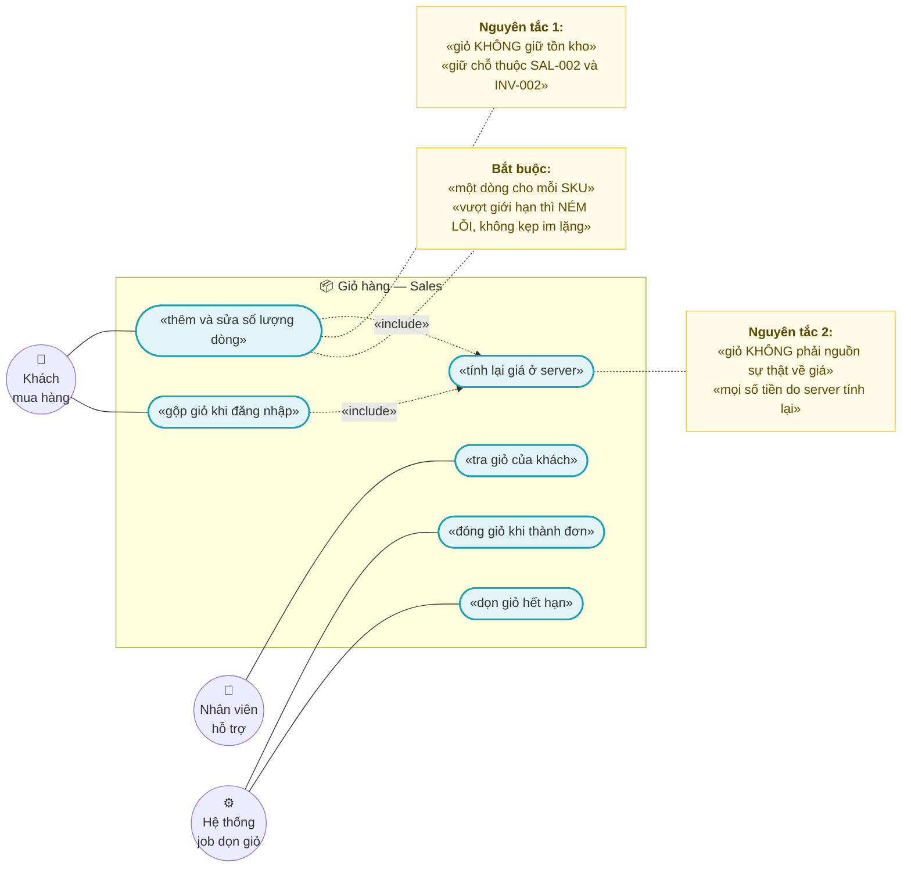
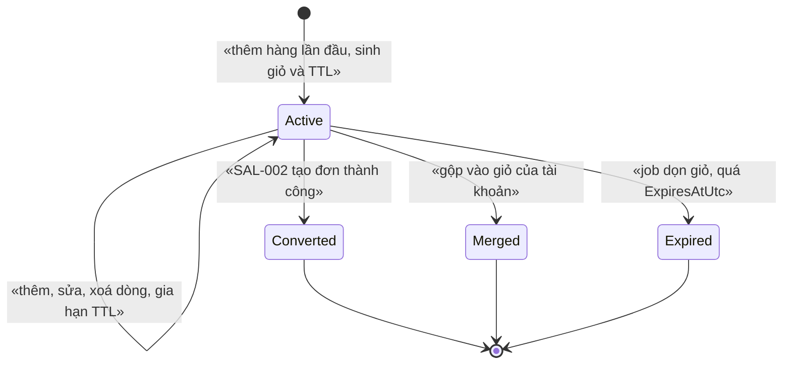
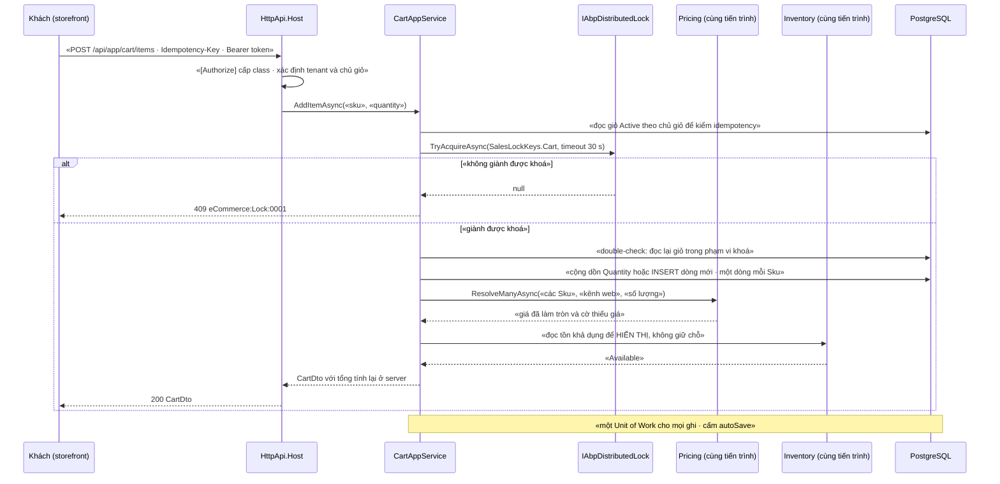

# `SAL-001` — Giỏ hàng

| Thuộc tính | Nội dung |
|---|---|
| **Mã** | `SAL-001` |
| **Module** | **Sales** — hiện **chưa có** project `eCommerce.Sales.*`; entity `Order`/`OrderLine` tạm nằm ở `src/eCommerce.Domain/Entities/Orders/Order.cs` (xem §14.5) |
| **Giai đoạn** | **GĐ1** (`docs/implementation-plan.md:407`, `docs/implementation-plan.md:112`) |
| **Ưu tiên** | **Must have** |
| **Trạng thái** | 🟡 `Draft` — chờ review · ✅ **ĐÃ CÓ CODE** — tạo đơn từ checkout: `src/eCommerce.Application/Checkout/CheckoutAppService.cs` + migration `20261015121002_Sal001_Order_CheckoutKey` (khoá checkout trên đơn) |
| **Người viết / người review** | *(điền)* / **Kiến trúc trưởng + BA + Security** (giỏ của khách vãng lai là bề mặt tấn công — §15.2 **F6**) |
| **Phiên bản / ngày** | `v0.2 — 17/10/2026` (sửa dòng *"chưa có dòng code"* đã sai + đường dẫn theo cấu trúc `docs/features/<module>/`; trước: `v0.1 — 13/10/2026`) |
| **Tài liệu liên quan** | `XC-001` (Money/làm tròn) · `XC-002` (outbox/inbox + idempotency) · `XC-003` (khoá phân tán) · `XC-004` (auth/permission/tenant) · `XC-005` (observability) · `SAL-002` (checkout & đặt hàng — **bên tiêu thụ giỏ**) · `SAL-003` (state machine 4 trục của đơn) · `INV-002` (giữ chỗ + TTL — **Q3** hỏi có giữ chỗ ở bước giỏ không) · `INV-003` (tồn khả dụng theo kênh) · `PRC-001`/`PRC-002` (pipeline tính giá) · `CAT-001` (SKU) · `WEB-003` (UI giỏ hàng & checkout) |

---

## 0. Tóm tắt & quyết định thiết kế

**Tóm tắt:** `SAL-001` là **bộ đệm ý định mua** của khách: nơi khách gom SKU + số lượng **trước** khi có bất kỳ
cam kết nào về tiền và tồn kho. Giỏ hàng vì vậy **cố tình yếu** về ràng buộc (không giữ tồn kho, không chốt giá)
và **cố tình mạnh** về tính đúng của dữ liệu (không mất dòng khi 2 tab cùng sửa, không nhân đôi khi client retry,
không để dòng trỏ vào SKU đã ngừng bán mà không có dấu vết).

Ba bất biến định hình toàn bộ thiết kế:

1. **Giỏ KHÔNG phải nguồn sự thật về giá.** Mọi số tiền hiển thị trên giỏ **phải** do server tính lại từ
   `PRC-001`/`PRC-002` tại thời điểm đọc (`PRC-001` *"ResolveManyAsync … lô cho giỏ hàng; ≤ 200 dòng/lần"* —
   `docs/features/pricing/prc-001-bang-gia-va-gia-theo-kenh.md:438`). Đây là cùng nguyên tắc `SAL-002` **ADR-01**
   (`docs/features/sales/sal-002-checkout-va-dat-hang.md:57`) và `docs/business-modules-proposal.md:80`
   (*"tính lại giá tại checkout (không bao giờ dùng giá đã lưu trong cart)"*).
2. **Giỏ KHÔNG giữ chỗ tồn kho.** Giữ chỗ gắn với **một lần đặt hàng**, không gắn với giỏ —
   `INV-002` đã tuyên bố việc này **ngoài phạm vi** (`docs/features/inventory/inv-002-giu-cho-reservation-ttl.md:55`) và
   còn **để mở** ở **Q3** với khuyến nghị *"chỉ khi đặt hàng"* (`...inv-002-giu-cho-reservation-ttl.md:874`).
   Lý do nghiệp vụ: giữ chỗ ở bước giỏ ⇒ kẻ xấu giữ sạch tồn kho của đối thủ.
3. **Hàng rào cuối của giỏ KHÔNG phải distributed lock.** Lock chỉ **giảm tranh chấp**; tính đúng được bảo đảm bằng
   **unique index** + `ConcurrencyStamp` (`XC-003` **D2/BR-007** — câu hỏi kiểm tra: *"bỏ lock đi, DB có chặn không?"*).

**Vì sao phải viết tài liệu này trước khi code (bài học đã kiểm chứng trong repo):**

| # | Bài học | Nguồn trong repo | Hệ quả cho `SAL-001` |
|---|---|---|---|
| 1 | Guard trạng thái **no-op im lặng** làm sự kiện rơi **không để lại dấu vết** | `XC-002` §0 bài học #4; `XC-003` **D10** | Vòng đời giỏ **phải NÉM LỖI** khi chuyển sai (§3) |
| 2 | Lock **không** phải hàng rào; Redis chết ⇒ lock vô hiệu nhưng app **vẫn chạy** | `XC-003` **D2**; `src/eCommerce.HttpApi.Host/eCommerceHttpApiHostModule.cs:141` (`AbortOnConnectFail = false`) | Mọi bất biến của giỏ phải có ràng buộc DB đi kèm (§8.1) |
| 3 | **Hai nguồn sự thật cho cùng một hằng số ⇒ lỗi im lặng** | `XC-003` §15.2 **F1** (`src/eCommerce.Domain.Shared/eCommerceConsts.cs:91-96` — khoá kênh từng định nghĩa 2 nơi, 2 chuỗi khác nhau) | Mã lỗi, tên khoá, tên metric của giỏ **chỉ** được khai ở **một** nơi (§6.2, §8.2, §13) |
| 4 | **Thiếu `DbSet` ⇒ `IRepository<T>` không được đăng ký** (lỗi runtime đã gặp) | `src/eCommerce.EntityFrameworkCore/eCommerceDbContext.cs:48-52` | `OrdCarts`/`OrdCartItems` **bắt buộc** có `DbSet` (§5.5, §11) |
| 5 | Dùng `[Authorize]` với permission **chưa định nghĩa** ⇒ **`403` cho MỌI người, kể cả admin**, không có lỗi biên dịch | `XC-004` **D2/E3**, `src/eCommerce.Application.Contracts/Permissions/eCommercePermissionDefinitionProvider.cs:8-11` | Permission của giỏ **chưa tồn tại** (§15.2 **F4**) ⇒ là **điều kiện tiên quyết** ở §14.4, không phải việc làm sau |
| 6 | Thói quen **`autoSave: true`** có sẵn trong repo ⇒ dễ sao chép vào luồng nhiều bước và **phá vỡ tính nguyên tử** | `src/eCommerce.Application/Channels/ChannelAppService.cs:103,119,132,183`; `modules/ChannelHub/eCommerce.ChannelHub.Application/Sync/ChannelShopSyncer.cs:97,110` | **Cấm** `autoSave: true` trong luồng ghi giỏ (**BR-SAL-001-009**) |

**Phạm vi:**

- ✅ Vòng đời giỏ (`Cart`) + dòng giỏ (`CartItem`): thêm / sửa số lượng / xoá / xoá sạch; **một dòng cho mỗi `Sku`**.
- ✅ **Tính lại giá ở server** khi đọc giỏ (gọi `PRC-*` trong cùng tiến trình) + **ảnh chụp giá** để phát hiện *"giá đã thay đổi"*.
- ✅ **Hiển thị tồn khả dụng** (`InventoryItem.Available`, `src/eCommerce.Domain/Entities/Inventory/StockLedger.cs:25`) — **chỉ đọc**, không giữ chỗ.
- ✅ **Giỏ theo chủ sở hữu**: khách đã đăng nhập (`CustomerId`) và khách vãng lai (`CartToken`) — ⚠️ xem **Q1/F6**.
- ✅ **Gộp giỏ khi đăng nhập** (giỏ vãng lai → giỏ tài khoản), idempotent, cộng dồn số lượng.
- ✅ **TTL giỏ** + **job dọn giỏ hết hạn** (`SkipIfBusy` + log + metric).
- ✅ **Idempotency ở mọi biên vào** (HTTP storefront, job dọn giỏ, yêu cầu gộp giỏ).
- ✅ Hợp đồng API, mã lỗi, phân quyền, migration, test case.

**Không nằm trong phạm vi:**

- ❌ **Tính lại giá & đặt hàng, giữ chỗ tồn kho** — thuộc `SAL-002` (`docs/features/sales/sal-002-checkout-va-dat-hang.md:36-41`). `SAL-001` **chỉ** hiển thị giá **tạm tính** và **bàn giao** dòng giỏ cho `SAL-002`.
- ❌ **Chính sách giá / giá theo kênh / giá bậc thang / làm tròn / phân bổ tiền** — thuộc `PRC-001`/`PRC-002`/`XC-001`. `SAL-001` **gọi** pipeline và **không** tự tính giá.
- ❌ **Giữ chỗ (reservation), TTL giữ chỗ, job nhả kho** — thuộc `INV-002`; tranh chấp *"có giữ chỗ ở bước giỏ không"* là **Q3** của `INV-002` (đang **mở**).
- ❌ **Phân bổ tồn theo kênh** — thuộc `INV-003`.
- ❌ **Khuyến mãi / voucher** — thuộc `PRO-001`/`PRO-002` (GĐ2). `SAL-001` **không** áp mã giảm giá ở GĐ1.
- ❌ **State machine 4 trục của ĐƠN HÀNG & lịch sử trạng thái** — thuộc `SAL-003`.
- ❌ **UI giỏ hàng & checkout** — thuộc `WEB-003` (`docs/features/web/web-002-storefront-duyet-chi-tiet-san-pham.md:49,564`); tài liệu này chỉ chốt **hợp đồng dữ liệu** (§10).
- ❌ **Sổ địa chỉ giao hàng** — thuộc `CUS-001`.

### 0.1 Quyết định thiết kế (ADR ngắn)

> 📌 Quy ước mã: `ADR-nn` cho quyết định, `BR-SAL-001-nnn` cho business rule, `NFR-SAL-001-nnn` cho phi chức năng,
> `TC-nn` cho test case — **giống `SAL-002`** (`docs/features/sales/sal-002-checkout-va-dat-hang.md:57,92,93`) để hai tài
> liệu cùng module đọc được như một cặp.

| # | Quyết định | Phương án đã cân nhắc | Lý do chọn | Hệ quả |
|---|---|---|---|---|
| **ADR-01** | **Server TÍNH LẠI giá mỗi lần ĐỌC giỏ**; client chỉ gửi `Sku` + `Quantity` | (a) lưu giá vào dòng giỏ rồi dùng làm giá bán · (b) tính lại khi đọc | (a) là **lỗ hổng kinh điển**: giá trong giỏ cũ sau khi shop đổi giá ⇒ khách thấy giá cũ, kế toán thấy giá khác. Trùng nguyên tắc `SAL-002` **ADR-01** | Mọi DTO ghi của giỏ **không có** trường tiền; nếu client gửi tiền ⇒ **bỏ qua + log `Warning`** |
| **ADR-02** | Vẫn lưu **`UnitPriceSnapshot`** trên dòng giỏ, nhưng **chỉ để so sánh** (phát hiện *"giá đã thay đổi"*), **không** để bán | (a) không lưu gì · (b) lưu ảnh chụp | Không lưu ⇒ không thể nói cho khách *"giá đã tăng từ X lên Y"*; UX xấu và khách mất niềm tin | Cột `UnitPriceSnapshot` + `PriceSnapshotAtUtc`; **cấm** join sang bảng giá để hiển thị giá bán khi đã có kết quả resolve |
| **ADR-03** | **Một dòng cho mỗi `Sku`** trong giỏ; thêm SKU đã có ⇒ **cộng dồn** số lượng | (a) mỗi lần bấm "Thêm" tạo một dòng mới · (b) gộp theo SKU | (a) ⇒ giỏ có 10 dòng cùng SKU, không kiểm soát được `MaxLineQuantity`, và `SAL-002` phải tự gộp lại (hai nơi cùng logic) | Unique index `(TenantId, CartId, Sku)` là hàng rào; luồng thêm **phải** đọc-lại-trong-lock rồi cộng dồn (§4.1) |
| **ADR-04** | **Giỏ có TTL** (`ExpiresAtUtc`) + job dọn; mỗi thao tác **gia hạn** TTL | (a) giỏ sống vĩnh viễn · (b) TTL cố định không gia hạn | (a) ⇒ bảng `OrdCarts` phình vô hạn, dữ liệu rác, báo cáo sai; (b) ⇒ giỏ của khách đang mua bị dọn giữa chừng | TTL mặc định **30 ngày** kể từ **hoạt động cuối**; job `SkipIfBusy` + log + metric (**BR-SAL-001-006/020**) |
| **ADR-05** | **KHÔNG giữ chỗ tồn kho ở bước giỏ** | (a) giữ chỗ khi thêm vào giỏ · (b) chỉ giữ ở `SAL-002` | Giữ ở giỏ ⇒ **bề mặt lạm dụng**: kẻ xấu thêm 999 đơn vị của đối thủ rồi bỏ giỏ ⇒ khoá sạch tồn kho. `INV-002` **Q3** khuyến nghị **chỉ khi đặt hàng** | Giỏ chỉ **hiển thị** `Available`; việc *"còn hàng hay không"* chỉ được **chốt** ở `SAL-002` (nơi có `eCommerce:Inventory:0001`) |
| **ADR-06** | **Giới hạn tường minh**: `MaxLines` (mặc định **100**) và `MaxLineQuantity` (mặc định **999**); vượt ⇒ **NÉM** | (a) không giới hạn · (b) giới hạn + **kẹp im lặng** (clamp) · (c) giới hạn + **ném lỗi** | (b) ⇒ khách bấm "+" mà số không đổi, tưởng app lỗi; tệ hơn: khách tưởng đã đặt 5000. Ném lỗi có mã ⇒ UI hiển thị đúng lý do | `eCommerce:Sales:0010` (vượt số dòng) và `eCommerce:Sales:0011` (vượt số lượng) — §6.2 |
| **ADR-07** | **Idempotency-Key ở header** + UNIQUE `(TenantId, IdempotencyKey)`, **cấm** `Guid.NewGuid()` mỗi lần thử | (a) tin client · (b) khoá sinh mới mỗi request · (c) khoá **ổn định** lưu DB | `XC-002` **D7/BR-007**: khoá mới mỗi retry ⇒ mỗi retry là một thao tác mới ⇒ **cộng số lượng 2 lần**. Retry mạng là chuyện bình thường | Bảng `OrdCarts` có `IdempotencyKey` + `PayloadHash`; cùng khoá + payload khác ⇒ **NÉM** `eCommerce:Sales:0007` (`XC-002` BR-006) |
| **ADR-08** | **State machine của GIỎ tách khỏi state machine ĐƠN HÀNG** | (a) dùng chung `OrderStatus` · (b) enum riêng `CartStatus` | `OrderStatus` hiện có **7 giá trị** (`src/eCommerce.Domain.Shared/Enums.cs:50-59`) và `Order.SetStatus()` **gán trực tiếp, không guard** (`src/eCommerce.Domain/Entities/Orders/Order.cs:111`) ⇒ dùng nó cho giỏ là trộn hai khái niệm và làm vô hiệu `SAL-003` | `OrdCarts.Status` có enum riêng (§3); `SAL-001` **không** gọi `Order.SetStatus` |
| **ADR-09** | **Toàn bộ ghi trong MỘT Unit of Work**; **cấm** `autoSave: true` | (a) `autoSave: true` từng bước · (b) một UoW | Tiền lệ `autoSave: true` **đã có trong repo** ở 4 chỗ (`ChannelAppService.cs:103,119,132,183`) ⇒ rất dễ sao chép. Nếu tách bước: giỏ có dòng nhưng không có ảnh chụp giá ⇒ dữ liệu nửa vời | UoW mặc định của ABP app service; test `TC-19` quét mã nguồn **cấm** `autoSave: true` trong `**/Carts/**` |
| **ADR-10** | Khoá phân tán **theo giỏ** (`Cart`) để giảm tranh chấp; hàng rào cuối là **DB** | (a) chỉ lock · (b) chỉ DB · (c) lock + unique index + `ConcurrencyStamp` | Đúng `XC-003` **D2/BR-007**. Tiền lệ gọi lock thật: `modules/ChannelHub/eCommerce.ChannelHub.Application/Sync/ChannelTokenManager.cs:69` (`await using` + timeout + `handle is null` ⇒ bỏ lượt có log) | Lock **bao ngoài** UoW; timeout hữu hạn **30 s**; không giành được ⇒ **NÉM** `eCommerce:Lock:0001` (**BR-SAL-001-012**) |
| **ADR-11** | **Cấm acquire lồng**; khi gộp 2 giỏ ⇒ **sắp khoá theo `cartId`** và acquire **một lần** mỗi khoá | (a) acquire lại cho tiện · (b) sắp thứ tự | `IAbpDistributedLock` **không reentrant** (`XC-003` **D6**): acquire lồng trên cùng khoá ⇒ **chờ chính mình** rồi hết timeout. Ca thật của giỏ: gộp giỏ cần khoá **2** giỏ; hai request gộp chéo nhau ⇒ **deadlock** nếu không sắp thứ tự | Khoá được gom thành danh sách, `OrderBy(cartId)`, acquire tuần tự, nhả theo thứ tự ngược |
| **ADR-12** | **Giỏ `Active` là DUY NHẤT theo (tenant, kênh, chủ giỏ)** — cưỡng chế bằng **filtered unique index** | (a) cho phép nhiều giỏ `Active` · (b) một giỏ `Active` | (a) ⇒ *"giỏ của tôi"* trả kết quả khác nhau giữa 2 request; UI 2 tab thấy 2 giỏ; gộp giỏ mất tính xác định | Hai filtered unique index: theo `CustomerId` và theo `CartToken` (§5.2). Đăng nhập trên thiết bị mới ⇒ **gộp**, không tạo giỏ thứ hai |
| **ADR-13** | **Gộp giỏ là thao tác TƯỜNG MINH qua API**, **không** nghe sự kiện đăng nhập | (a) consumer nghe ETO đăng nhập · (b) `POST /api/app/cart/merge` do UI gọi sau khi đăng nhập | (a) phụ thuộc một ETO của Identity mà **chưa kiểm chứng** có trong ABP 10.7, và gộp giỏ là **ý định của người dùng** (khách có thể muốn bỏ giỏ cũ) chứ không phải hệ quả tự động | UI (`WEB-003`) gọi merge sau đăng nhập; gọi lại **không** nhân đôi (**BR-SAL-001-017**); **Q6** hỏi có cần ETO sau này |
| **ADR-14** | Giỏ **chỉ** áp cho kênh **`"web"`** ở GĐ1 | (a) đa kênh · (b) chỉ web | Đơn từ **sàn** không đi qua giỏ: sàn đẩy nguyên đơn qua webhook ⇒ thuộc `SAL-005` (`SAL-002` Pre-condition, `docs/features/sales/sal-002-checkout-va-dat-hang.md:87`) | Cột `ChannelCode varchar(32)` bắt buộc, giá trị `"web"`; **cấm** hard-code rỗng |

---

## 1. Use Case Specification

| Thuộc tính | Nội dung |
|---|---|
| **Use Case ID** | `SAL-001` |
| **Use Case Name** | Quản lý giỏ hàng của khách: thêm / sửa / xoá dòng, tính lại giá ở server, gộp giỏ, dọn giỏ hết hạn |
| **Description** | *"Là khách mua hàng, tôi muốn gom hàng vào giỏ và thấy **giá đúng tại thời điểm này** cùng **tồn kho còn hay hết**, để tôi quyết định trước khi đặt — và tôi muốn giỏ của tôi **không bị mất dòng** khi mở nhiều tab, cũng không bị **nhân đôi số lượng** khi mạng chập chờn."* |
| **Actor(s)** | **Khách đã đăng nhập** (chủ giỏ) · **Khách vãng lai** (⚠️ xem **Q1** — có được phép hay không) · **Hệ thống** (`ICartAppService`, job dọn giỏ) · **Nhân viên hỗ trợ** (tra giỏ của khách — permission `Carts.Manage`) · **`SAL-002`** (bên tiêu thụ: đọc giỏ để checkout) |
| **Priority** | **Must have** |
| **Trigger** | (a) khách bấm **Thêm vào giỏ** / đổi số lượng / xoá dòng trên storefront; (b) khách **đăng nhập** ⇒ UI gọi gộp giỏ; (c) `SAL-002` đọc giỏ để đặt hàng; (d) job định kỳ dọn giỏ hết hạn |
| **Pre-Condition(s)** | • **Tenant hiện tại** (`TenantId` từ `ICurrentTenant`) — mọi bảng của feature `IMultiTenant`; ⚠️ `TenantId` **có thể là `NULL`** ở chế độ 1 tenant (`XC-004` §5.2 **F1**).<br>• **Kênh bán** (`ChannelCode`) = `"web"`; cột khớp `Order.ChannelCode` (`IsRequired().HasMaxLength(32)` — `src/eCommerce.EntityFrameworkCore/eCommerceDbContext.cs:168`).<br>• **SKU tồn tại và đang bán**: `CatProductVariants.Sku` unique theo tenant (`eCommerceDbContext.cs:129`); `ProductVariant.IsActive` (`src/eCommerce.Domain/Entities/Catalog/Product.cs:78`).<br>• **Pipeline tính giá sẵn sàng** (`PRC-001`/`PRC-002`) — ⚠️ **chưa có trong code**, kế hoạch GĐ1.<br>• **`XC-001` (`Money`) đã có** — ⚠️ **chưa có trong code**: `shared/eCommerce.Kernel` **không tồn tại** (§15.2 **F5**).<br>• **Permission của giỏ đã định nghĩa** trong `eCommercePermissionDefinitionProvider` — ⚠️ **CHƯA** (§15.2 **F4**); thiếu ⇒ **`403` cho mọi người** (`XC-004` **D2/E3**).<br>• **Entity đã có `DbSet`** trên DbContext hợp nhất — ⚠️ **CHƯA** (xem `eCommerceDbContext.cs:48-52`).<br>• Redis 7 sẵn sàng (**không** phải điều kiện bắt buộc để đúng — **ADR-10**). |
| **Post-Condition(s)** | • Giỏ **`Active`** tồn tại **đúng một** cho `(TenantId, ChannelCode, chủ giỏ)` (**BR-SAL-001-002**).<br>• Mọi dòng giỏ có `Quantity > 0` và ≤ `MaxLineQuantity`; số dòng ≤ `MaxLines` (**BR-SAL-001-004/005**).<br>• Mọi số tiền trả về **đã được server tính lại** và **đã làm tròn** theo `Currency.Decimals` (`XC-001` BR-001); **0** lần so tiền bằng `==` (`XC-001` BR-003).<br>• **Không** bản ghi tồn kho nào bị thay đổi bởi thao tác giỏ (append-only ledger không có bản ghi mới — `src/eCommerce.Domain/Entities/Inventory/StockLedger.cs:81`).<br>• Mọi lần **không làm được việc** đều **có dấu vết**: exception có mã, hoặc log + metric (không nuốt im lặng). |
| **Basic Flow** | 1. Khách bấm **Thêm vào giỏ**: UI gọi `POST /api/app/cart/items` kèm `Authorization: Bearer`, `Idempotency-Key`, body `{ sku, quantity }` — **không** có trường tiền (`ADR-01`).<br>2. `[Authorize]` cấp class xác thực **danh tính** (`XC-004` **D3**); app service xác định **chủ giỏ** (CustomerId hoặc CartToken).<br>3. Kiểm **idempotency**: `(TenantId, IdempotencyKey)` đã có **và** `PayloadHash` khớp ⇒ trả **kết quả giỏ hiện tại** (200), **0** side effect (**BR-SAL-001-008**).<br>4. Giành khoá `SalesLockKeys.Cart(...)` với timeout **30 s** (**ADR-10**). Không giành được ⇒ **NÉM** `eCommerce:Lock:0001` ⇒ `409`.<br>5. Trong phạm vi khoá: đọc giỏ `Active` (**double-check**); chưa có ⇒ tạo mới với `ExpiresAtUtc = now + TTL`.<br>6. Validate SKU: tồn tại, `ProductVariant.IsActive = true`, số lượng hợp lệ ⇒ sai ⇒ **NÉM** `eCommerce:Sales:0001`/`0011`.<br>7. Cộng dồn số lượng vào dòng của `Sku` (hoặc tạo dòng mới); kiểm `MaxLines`; cập nhật `UnitPriceSnapshot` + gia hạn `ExpiresAtUtc`.<br>8. Gọi `PRC-*` **trong cùng tiến trình** để resolve giá cho **toàn bộ** dòng (lô ≤ **200** dòng — `PRC-001:438`); gọi `INV-*` để đọc **tồn khả dụng**.<br>9. Trả `CartDto` với mọi số tiền đã tính lại ở server; commit UoW; nhả khoá (`await using`). |
| **Alternative Flow** | **A1: Khách vãng lai** — nhận diện bằng `CartToken` (chuỗi ngẫu nhiên, không đoán được) do server phát; ⚠️ **phụ thuộc Q1** (`[AllowAnonymous]` phải nằm trong allowlist — `XC-004` **Q1** đã đóng với allowlist **chỉ 4 mục**, xem **F6**).<br>**A2: Gộp giỏ sau đăng nhập** — UI gọi `POST /api/app/cart/merge` với `CartToken`; hệ thống sắp khoá **2** giỏ theo `cartId` (**ADR-11**), cộng dồn dòng trùng SKU, đặt giỏ nguồn `Merged`; gọi lại **không** nhân đôi (**BR-SAL-001-017**).<br>**A3: Giá đã đổi so với ảnh chụp** — giỏ **vẫn** hoạt động; `CartDto` trả cờ `PriceChanged = true` + giá cũ/mới cho **từng dòng** ⇒ UI hiển thị *"giá đã thay đổi"*; **không** chặn giỏ (chặn là việc của `SAL-002` **BR-004**).<br>**A4: Không resolve được giá cho một SKU** — dòng vẫn nằm trong giỏ với `HasPriceIssue = true` và **không** có giá hiển thị; checkout sẽ **NÉM** `eCommerce:Pricing:0004` (**BR-SAL-001-015**) — **cấm** bịa giá.<br>**A5: Job dọn giỏ** — chạy độc lập, `SkipIfBusy`, chuyển mọi giỏ `Active` quá `ExpiresAtUtc` sang `Expired`, metric `cart_expired_total`.<br>**A6: `SAL-002` tiêu thụ giỏ** — đọc dòng giỏ **trong cùng tiến trình**, chuyển giỏ sang `Converted`; `SAL-001` **không** tham gia giữ chỗ. |
| **Exception Flow** | **E1:** `Quantity <= 0` hoặc SKU không tồn tại/ngừng bán ⇒ **NÉM** `eCommerce:Sales:0001` (`400`) — mã **đã có trong thiết kế `SAL-002`** (`docs/features/sales/sal-002-checkout-va-dat-hang.md:548`).<br>**E2:** vượt `MaxLineQuantity` ⇒ **NÉM** `eCommerce:Sales:0011` (`400`).<br>**E3:** vượt `MaxLines` ⇒ **NÉM** `eCommerce:Sales:0010` (`400`).<br>**E4:** chuyển trạng thái giỏ sai (ví dụ `Converted → Active`, `Expired → Active`) ⇒ **NÉM** `eCommerce:Sales:0012` (`409`) — **cấm** no-op im lặng.<br>**E5:** `CartToken` sai/không thuộc tenant hiện tại ⇒ **NÉM** `eCommerce:Sales:0013` (`400`).<br>**E6:** gộp giỏ làm vượt `MaxLines`/`MaxLineQuantity` ⇒ **NÉM** `eCommerce:Sales:0014` (`409`) — **cấm** cắt bớt dòng của khách.<br>**E7:** giỏ không tồn tại **hoặc** thuộc khách/tenant khác ⇒ **`404`** `eCommerce:Sales:0015` — **không** `403` (`XC-004` BR-008: không tiết lộ sự tồn tại).<br>**E8:** cùng `Idempotency-Key` nhưng `PayloadHash` **khác** ⇒ **NÉM** `eCommerce:Sales:0007` — **cấm** trả kết quả cũ (`XC-002` BR-006).<br>**E9:** không giành được khoá trong **30 s** ⇒ **NÉM** `eCommerce:Lock:0001` ⇒ `409` (`XC-003` §6.2).<br>**E10:** Redis **không kết nối được** ⇒ **fail-open**: chạy tiếp + log `Error` + metric; unique index + `ConcurrencyStamp` **vẫn** chặn lost update (**ADR-10**).<br>**E11:** `UPDATE` trạng thái ảnh hưởng **0 dòng** (luồng khác đã đổi) ⇒ **NÉM LỖI**, **cấm** coi là thành công (`XC-002` **E7**). |
| **Business Rules** | • **BR-SAL-001-001**: Giỏ **không** là nguồn sự thật về giá; mọi số tiền trả cho client **phải** được tính lại ở server từ `PRC-*`; **cấm** dùng `UnitPriceSnapshot` làm giá bán.<br>• **BR-SAL-001-002**: Mỗi `(TenantId, ChannelCode, chủ giỏ)` có **tối đa một** giỏ `Active`; cưỡng chế bằng **filtered unique index** (ADR-12).<br>• **BR-SAL-001-003**: Mỗi `Sku` có **tối đa một** dòng trong một giỏ; thêm SKU đã có ⇒ **cộng dồn** số lượng; cưỡng chế bằng unique index `(TenantId, CartId, Sku)`.<br>• **BR-SAL-001-004**: `Quantity` **phải** `> 0` và `<= MaxLineQuantity` (mặc định **999**); vi phạm ⇒ **NÉM** `eCommerce:Sales:0011`; **cấm kẹp im lặng**.<br>• **BR-SAL-001-005**: Số dòng **phải** `<= MaxLines` (mặc định **100**); vượt ⇒ **NÉM** `eCommerce:Sales:0010`; **cấm** cắt bớt im lặng.<br>• **BR-SAL-001-006**: Giỏ **phải** có `ExpiresAtUtc` (`NOT NULL`); **cấm** giỏ vô thời hạn; mỗi thao tác ghi **gia hạn** TTL.<br>• **BR-SAL-001-007**: Mọi chuyển trạng thái sai **phải NÉM** `eCommerce:Sales:0012`; `Converted`/`Merged`/`Expired` là **trạng thái hấp thụ**.<br>• **BR-SAL-001-008**: Mọi biên vào ghi **phải** idempotent: `Idempotency-Key` ổn định + UNIQUE `(TenantId, IdempotencyKey)`; cùng khoá + payload khác ⇒ **NÉM** `eCommerce:Sales:0007` (`XC-002` BR-006).<br>• **BR-SAL-001-009**: Mọi thao tác ghi **phải** nằm trong **một** Unit of Work; **cấm** `autoSave: true` (tiền lệ `ChannelAppService.cs:103`).<br>• **BR-SAL-001-010**: Thao tác ghi lên **một** giỏ **phải** đi qua khoá `SalesLockKeys.Cart(...)` **và** ràng buộc DB; **cấm** chỉ dựa vào lock (`XC-003` BR-007).<br>• **BR-SAL-001-011**: **Cấm acquire lồng** cùng tên khoá; gộp giỏ ⇒ sắp khoá theo `cartId`, acquire **một lần** mỗi khoá (`XC-003` **D6**).<br>• **BR-SAL-001-012**: Mọi lần acquire **phải** có timeout hữu hạn; hết timeout ⇒ **NÉM** `eCommerce:Lock:0001`; **cấm** bỏ qua im lặng (`XC-003` **D10**).<br>• **BR-SAL-001-013**: Giỏ **không được** giữ chỗ tồn kho; chỉ **đọc** `InventoryItem.Available` để hiển thị; giữ chỗ thuộc `SAL-002`/`INV-002` (ADR-05).<br>• **BR-SAL-001-014**: SKU không tồn tại hoặc `ProductVariant.IsActive = false` ⇒ **NÉM** `eCommerce:Sales:0001`; **cấm** thêm vào giỏ; dòng đã có mà SKU ngừng bán ⇒ hiển thị `Unavailable = true` (**không** tự xoá dòng của khách — cần dấu vết).<br>• **BR-SAL-001-015**: Không resolve được giá ⇒ dòng có `HasPriceIssue = true`; **cấm** tự bịa giá hoặc rơi về giá niêm yết ngoài pipeline; checkout **NÉM** `eCommerce:Pricing:0004`.<br>• **BR-SAL-001-016**: Tiền **phải** là `decimal`/`Money` đã làm tròn; **cấm** so tiền bằng `==` (`XC-001` BR-003); **tổng giỏ = tổng các dòng đã làm tròn**, **không** làm tròn lại tổng (`XC-001` BR-005).<br>• **BR-SAL-001-017**: Gộp giỏ **phải** idempotent, cộng dồn theo `Sku`, **không** vượt `MaxLines`/`MaxLineQuantity`; vượt ⇒ **NÉM** `eCommerce:Sales:0014`; giỏ nguồn chuyển `Merged` (**trạng thái hấp thụ**).<br>• **BR-SAL-001-018**: Giỏ của khách khác/tenant khác ⇒ **`404`**, **không** `403` (`XC-004` BR-008); **cấm** tiết lộ sự tồn tại.<br>• **BR-SAL-001-019**: **Mọi** app service của feature **phải** có `[Authorize]` ở **cấp class** (`XC-004` BR-001); kiểm tra **quyền sở hữu giỏ** ở **server**, **cấm** chỉ ẩn nút trên UI (`XC-004` BR-005).<br>• **BR-SAL-001-020**: Job dọn giỏ **phải** dùng `SkipIfBusy` **kèm** log + metric; **cấm** ném lỗi cho job định kỳ (`XC-003` **D10**).<br>• **BR-SAL-001-021**: Mã lỗi/tên khoá/tên metric của giỏ **chỉ** được khai ở **một** nơi (hằng số dùng chung); **cấm** literal rải rác — bài học `XC-003` §15.2 **F1**.<br>• **BR-SAL-001-022**: Giỏ **chỉ** áp cho kênh `"web"` ở GĐ1; **cấm** tạo giỏ cho kênh sàn (đơn sàn đi qua `SAL-005` — ADR-14). |
| **Non-Functional Requirement** | • **NFR-SAL-001-001**: `AddItemAsync` / `UpdateItemQuantityAsync` / `RemoveItemAsync` (giỏ ≤ 100 dòng) p95 **< 150 ms**.<br>• **NFR-SAL-001-002**: `GetCartAsync` (≤ 100 dòng, pricing resolve theo lô ≤ 200 — `PRC-001:438`) p95 **< 300 ms**.<br>• **NFR-SAL-001-003**: **20** request ghi đồng thời lên **cùng một** giỏ ⇒ **0** lost update (số lượng cuối = tổng delta hợp lệ) — đo bằng integration test.<br>• **NFR-SAL-001-004**: **20** lần retry cùng `Idempotency-Key` ⇒ **đúng 1** lần cộng số lượng, **0** dòng trùng.<br>• **NFR-SAL-001-005**: Job dọn **10.000** giỏ hết hạn trong **< 60 s**.<br>• **NFR-SAL-001-006**: Sau **1 nhịp** job, **0** giỏ `Active` còn quá `ExpiresAtUtc` quá **1 nhịp**.<br>• **NFR-SAL-001-007**: Cách ly chủ sở hữu + tenant: khách A **không** đọc/sửa được giỏ khách B ⇒ **`404`** (integration test; cần PostgreSQL).<br>• **NFR-SAL-001-008**: **0** `double`/`float` trong DTO/entity tiền (test reflection — `XC-001` NFR-004).<br>• **NFR-SAL-001-009**: Mọi cột tiền `numeric(18,4)`, cột tiền tệ `char(3)` (`XC-001` §5.2).<br>• **NFR-SAL-001-010**: **100 %** thao tác giỏ có `CorrelationId`; mọi metric của giỏ **phải** nằm trong bảng đăng ký (`eCommerceMetricNames` + `XC-005` §5.1) — ⚠️ hiện **chưa có** tên metric nào của giỏ (§15.2 **F3**).<br>• **NFR-SAL-001-011**: **0** trường hợp treo vô hạn (mọi acquire có timeout) — `XC-003` NFR-002.<br>• **NFR-SAL-001-012**: **0** bản ghi `InvStockLedger` được sinh bởi thao tác giỏ (test đếm bản ghi trước/sau). |

---

## 2. Sơ đồ Use Case



---

## 3. Vòng đời một giỏ hàng (state machine) — **BẮT BUỘC ném lỗi khi chuyển sai**



**Bảng chuyển trạng thái & guard (mọi chuyển sai **phải ném lỗi**, không im lặng):**

| # | Từ → Sang | Guard (điều kiện cho phép) | Hành động kèm theo | Nếu guard sai thì? |
|---|---|---|---|---|
| 1 | `[*]` → `Active` | Chủ giỏ xác định được (CustomerId **hoặc** CartToken hợp lệ) **và** chưa có giỏ `Active` nào cho `(TenantId, ChannelCode, chủ giỏ)` **và** SKU hợp lệ (`Quantity > 0`, SKU đang bán) | Sinh `ExpiresAtUtc = now + TTL`; ghi 1 dòng giỏ | `eCommerce:Sales:0001` (`400`) — **không** tạo giỏ; chèn trùng giỏ `Active` ⇒ unique index chặn (ADR-12) |
| 2 | `Active` → `Active` | Giỏ đang `Active` **và** số dòng ≤ `MaxLines` **và** `Quantity` ≤ `MaxLineQuantity` | Cộng dồn/xoá dòng; cập nhật `UnitPriceSnapshot`; **gia hạn** `ExpiresAtUtc`; `ConcurrencyStamp++` | `eCommerce:Sales:0010` (vượt số dòng) hoặc `0011` (vượt số lượng) — **NÉM**, **cấm** kẹp |
| 3 | `Active` → `Converted` | **Chỉ** `SAL-002` gọi, sau khi `Order` + `OrderLine` đã ghi **trong cùng UoW** | `ConvertedAtUtc`; **cấm** mọi thao tác sửa sau đó | Nếu gọi từ đường khác (không phải `SAL-002`) ⇒ **NÉM** `eCommerce:Sales:0012` |
| 4 | `Active` → `Merged` | Giỏ **nguồn** của khách vãng lai; giỏ **đích** đã tồn tại và đang `Active`; đã sắp khoá 2 giỏ (ADR-11) | `MergedIntoCartId`; cộng dồn dòng; ghi vết để hỗ trợ khách | Gộp vượt `MaxLines`/`MaxLineQuantity` ⇒ **NÉM** `eCommerce:Sales:0014`; giỏ nguồn **giữ nguyên** `Active` (rollback) |
| 5 | `Active` → `Expired` | Job giữ khoá `SalesLockKeys.CartSweep(...)` **và** `ExpiresAtUtc < now` | Ghi `ExpiredAtUtc`; metric `cart_expired_total` | **`UPDATE … WHERE Status = Active`** ảnh hưởng **0** dòng ⇒ **NÉM LỖI** (`XC-002` E7) — **cấm** coi là thành công |
| 6 | `Converted` → bất kỳ | **KHÔNG** có guard nào cho phép | — | **Trạng thái HẤP THỤ**: mọi chuyển dịch ⇒ **NÉM** `eCommerce:Sales:0012`. Khách muốn mua lại ⇒ tạo giỏ **mới** (`[*] → Active`) |
| 7 | `Merged` → bất kỳ | **KHÔNG** có guard nào cho phép — **cấm** "hồi sinh" giỏ đã gộp (nếu không sẽ **nhân đôi** dòng hàng) | — | **NÉM** `eCommerce:Sales:0012` |
| 8 | `Expired` → bất kỳ | **KHÔNG** có guard nào cho phép — **cấm** "hồi sinh" giỏ đã hết hạn | — | **NÉM** `eCommerce:Sales:0012` |
| 9 | bất kỳ → `Expired` **khi** đang `Converted` | — | — | **NÉM** `eCommerce:Sales:0012` — chống job dọn giỏ **đóng nhầm** giỏ đã thành đơn |

> ⚠️ **Ai được phép chuyển:** `[*] → Active` và `Active → Active` do **app service** (có xác thực + kiểm sở hữu);
> `Active → Converted` **chỉ** `SAL-002` (cùng tiến trình, cùng UoW); `Active → Merged` do **API merge**;
> `Active → Expired` do **job dọn giỏ**.
> **Trạng thái hấp thụ:** `Converted`, `Merged`, `Expired` — cả ba đều **không** có đường quay lại.
>
> 📌 **Ghi rõ để tránh lệch số liệu (thói quen tốt của `SAL-002` §5.2):** *"giỏ bỏ dở"* (abandoned cart)
> **KHÔNG** phải một trạng thái. Nó là **truy vấn** trên giỏ `Active` có `LastActivityAtUtc < now − ngưỡng`
> (ngưỡng cấu hình, đề xuất **24 giờ**). Nếu báo cáo đếm *"giỏ bỏ dở"* bằng số giỏ `Expired` thì **hai con số khác nhau**
> — phải ghi rõ định nghĩa dùng ở mỗi báo cáo (`REP-*`).

---

## 4. Sequence Diagram & luồng dữ liệu

### 4.1 Thêm hàng vào giỏ — lock + cộng dồn + tính lại giá



### 4.2 Các luồng còn lại — mô tả bằng bảng (giữ giới hạn 3 sơ đồ)

| # | Luồng | Các bước chính | Khoá dùng | Idempotency |
|---|---|---|---|---|
| 1 | **Đọc giỏ** (`GetCartAsync`) | Xác định chủ giỏ ⇒ đọc giỏ `Active` + dòng ⇒ gọi `PRC-*` lô ≤ 200 ⇒ gọi `INV-*` đọc `Available` ⇒ trả `CartDto` | **Không** dùng khoá (chỉ đọc) | Không cần (đọc thuần) |
| 2 | **Gộp giỏ khi đăng nhập** | Xác thực ⇒ đọc giỏ đích `Active` (theo `CustomerId`) ⇒ đọc giỏ nguồn theo `CartToken` ⇒ **sắp khoá 2 giỏ theo `cartId`** ⇒ acquire lần lượt ⇒ cộng dồn dòng trùng SKU ⇒ kiểm giới hạn ⇒ đặt giỏ nguồn `Merged` ⇒ commit ⇒ nhả khoá theo thứ tự ngược | `SalesLockKeys.Cart(nguồn)` + `SalesLockKeys.Cart(đích)` (sorted) | `Idempotency-Key` + UNIQUE `(TenantId, IdempotencyKey)`; giỏ nguồn `Merged` là **hấp thụ** ⇒ gọi lại là **no-op thành công** |
| 3 | **Job dọn giỏ hết hạn** | Giành khoá sweep (`SkipIfBusy`) ⇒ truy vấn giỏ `Active` có `ExpiresAtUtc < now` (batch) ⇒ `UPDATE … WHERE Status = Active` ⇒ đếm số dòng ảnh hưởng ⇒ metric ⇒ nhả khoá | `SalesLockKeys.CartSweep(tenantId)` | Trạng thái **hấp thụ** + `SkipIfBusy` ⇒ chạy lại **không** đóng hai lần; **cấm** `Guid.NewGuid()` làm khoá mỗi nhịp |
| 4 | **`SAL-002` tiêu thụ giỏ** | `SAL-002` đọc dòng giỏ **trong cùng UoW của checkout** ⇒ giữ chỗ ⇒ tạo đơn ⇒ gọi `SAL-001` đặt giỏ `Converted` | Khoá của `SAL-002` (`ecommerce:inventory:{warehouseId}:{sku}`) — **không** acquire lại khoá giỏ trong cùng luồng (**ADR-11**) | `SAL-002` **ADR-08** |

### 4.3 DFD — đường đi của một dòng giỏ (mô tả bằng bảng, không vẽ thêm sơ đồ)

| Bước | Nguồn | Đích | Dữ liệu | Ghi chú |
|---|---|---|---|---|
| 1 | Storefront (`WEB-003`) | `CartAppService` | `{ sku, quantity }` + `Idempotency-Key` | **Không** có trường tiền (ADR-01) |
| 2 | `CartAppService` | PostgreSQL (`OrdCarts`, `OrdCartItems`) | dòng giỏ + `UnitPriceSnapshot` | Cùng một UoW |
| 3 | `CartAppService` | `PRC-*` (cùng tiến trình) | `Sku[]`, `ChannelCode`, `Quantity`, thời điểm | Lô ≤ **200** dòng (`PRC-001:438`) |
| 4 | `CartAppService` | `INV-*` (cùng tiến trình) | `Sku[]` ⇒ `Available` | **Chỉ đọc** — `InvStockLedger` **không** có bản ghi mới |
| 5 | `CartAppService` | Storefront | `CartDto` (giá **tính lại** + cờ `PriceChanged`, `Unavailable`, `HasPriceIssue`) | Tổng = **tổng các dòng đã làm tròn** |
| 6 | `SAL-002` | `OrdCarts` | `Active → Converted` | **Chỉ** `SAL-002` được chuyển |

---

## 5. Mô hình dữ liệu

### 5.1 ERD

> 📌 **Trình bày bằng bảng quan hệ thay vì sơ đồ Mermaid `erDiagram`** — tài liệu này đã dùng **3** sơ đồ ở §2, §3, §4.1
> (giới hạn 3 sơ đồ; cùng cách xử lý ở `SAL-002` §4.2 — `docs/features/sales/sal-002-checkout-va-dat-hang.md:263`).

| Quan hệ | Bội số | Cưỡng chế |
|---|---|---|
| `OrdCarts` → `OrdCartItems` | 1 → 0..n | FK `CartId`, `OnDelete(Cascade)` theo aggregate (tiền lệ `OrdOrders` → `OrdOrderLines` ở `eCommerceDbContext.cs:188-191`) |
| `OrdCartItems` → `CatProductVariants` | n → 1 (**luận lý**, không FK) | Giữ bằng `Sku` + `ProductVariantId` nullable; **cấm** FK cứng để không chặn xoá/đổi SKU ở Catalog |
| `OrdCarts` → `OrdCarts` | 1 → 0..1 | `MergedIntoCartId` (nullable) — vết gộp giỏ |
| `OrdCarts` → `OrdOrders` (bảng **đã có**) | 1 → 0..1 | **Luận lý**: `SAL-002` ghi `OrderId` khi đặt hàng; `SAL-001` **không** sở hữu `Orders` |

### 5.2 Bảng `OrdCarts` — **MỚI** (chưa có trong code — kế hoạch GĐ1)

| Cột | Kiểu | Null? | Ý nghĩa | Ghi chú |
|---|---|---|---|---|
| `Id` | `uuid` | ✖ | khoá chính | `FullAuditedAggregateRoot<Guid>` |
| `TenantId` | `uuid` | ✔ | tenant sở hữu | **bắt buộc** vì `IMultiTenant` — ⚠️ **có thể `NULL`** ở chế độ 1 tenant (`XC-004` §5.2 **F1**) |
| `ChannelCode` | `varchar(32)` | ✖ | kênh bán | `"web"` ở GĐ1 — khớp `OrdOrders.ChannelCode` (`eCommerceDbContext.cs:168`) |
| `CustomerId` | `uuid` | ✔ | chủ giỏ đã đăng nhập | `null` cho khách vãng lai (tiền lệ `Order.CustomerId` nullable — `src/eCommerce.Domain/Entities/Orders/Order.cs:29`) |
| `CartToken` | `varchar(64)` | ✔ | định danh giỏ vãng lai (ngẫu nhiên, **không** đoán được) | `null` khi đã có `CustomerId`; ⚠️ phụ thuộc **Q1** |
| `Status` | `int` | ✖ | `Active` · `Converted` · `Merged` · `Expired` | enum riêng `CartStatus` — **ADR-08** (§3) |
| `Currency` | `char(3)` | ✖ | ISO-4217 | `char(3)` theo `XC-001` §5.2 — ⚠️ **khác** `OrdOrders.Currency varchar(8)` (`eCommerceDbContext.cs:170`), xem §15.2 **F7** |
| `IdempotencyKey` | `varchar(128)` | ✖ | khoá chống trùng do client gửi | **BR-SAL-001-008** — khoá của **thao tác tạo/cập nhật giỏ** |
| `PayloadHash` | `varchar(64)` | ✖ | SHA-256 payload **chuẩn hoá** | Phân biệt *"trùng thật"* với *"xung đột khoá"* — `XC-002` BR-005/BR-006 |
| `ExpiresAtUtc` | `timestamptz` | ✖ | hạn sống của giỏ | **BR-SAL-001-006**; cột `NOT NULL` là cách **cưỡng chế** ở tầng DB |
| `LastActivityAtUtc` | `timestamptz` | ✖ | hoạt động cuối | Dùng cho định nghĩa *"giỏ bỏ dở"* (§3) + báo cáo `REP-*` |
| `ConvertedAtUtc` | `timestamptz` | ✔ | thời điểm thành đơn | Chỉ có khi `Status = Converted` |
| `MergedIntoCartId` | `uuid` | ✔ | giỏ đích khi gộp | Chỉ có khi `Status = Merged`; giữ vết để hỗ trợ khách |
| `ConcurrencyStamp` | `varchar(40)` | ✖ | optimistic concurrency của ABP | ✅ **đã có sẵn** trên bảng của ABP — kiểm bằng `read`: `src/eCommerce.EntityFrameworkCore/Migrations/20261009070214_Initial.cs:27` (`character varying(40)`, `nullable: false`) — đây là **hàng rào chống lost update** khi 2 tab cùng sửa |

**Index & ràng buộc**

| Loại | Cột | Mục đích |
|---|---|---|
| **UNIQUE filtered** | `(TenantId, ChannelCode, CustomerId) WHERE Status = 0 AND CustomerId IS NOT NULL` | 🎯 **ADR-12**: một giỏ `Active` cho mỗi khách — chặn 2 tab/2 thiết bị tạo 2 giỏ |
| **UNIQUE filtered** | `(TenantId, ChannelCode, CartToken) WHERE Status = 0 AND CartToken IS NOT NULL` | 🎯 **ADR-12**: một giỏ `Active` cho mỗi khách vãng lai |
| **UNIQUE** | `(TenantId, IdempotencyKey)` | **Hàng rào idempotency** — **BR-SAL-001-008** |
| INDEX | `(TenantId, Status, ExpiresAtUtc)` | Job dọn giỏ quét theo hạn |
| INDEX | `(TenantId, CustomerId, Status)` | Tra giỏ của khách |
| INDEX | `(TenantId, LastActivityAtUtc)` | Báo cáo giỏ bỏ dở (`REP-*`) |
| CHECK | `CustomerId IS NOT NULL OR CartToken IS NOT NULL` | Chặn giỏ **vô chủ** (không thể tra được, không thể phân quyền) |
| CHECK | `ExpiresAtUtc > CreationTime` | Chặn TTL ≤ 0 |
| CHECK | `NOT (Status = 1 AND ConvertedAtUtc IS NULL)` | `Converted` **phải** có thời điểm |
| CHECK | `NOT (Status = 2 AND MergedIntoCartId IS NULL)` | `Merged` **phải** có giỏ đích |
| ⚠️ **BẮT BUỘC** | — | Mọi unique index **có `TenantId`** phải dùng **`NULLS NOT DISTINCT`** khi `TenantId` là `NULL` — `XC-004` **BR-009**; tiền lệ `Migrations/20261013024226_Fix_NullableTenantId_UniqueIndexes.cs` |

### 5.3 Bảng `OrdCartItems` — **MỚI**

| Cột | Kiểu | Null? | Ý nghĩa | Ghi chú |
|---|---|---|---|---|
| `Id` | `uuid` | ✖ | khoá chính | `FullAuditedEntity<Guid>` |
| `TenantId` | `uuid` | ✔ | tenant | như trên |
| `CartId` | `uuid` | ✖ | FK → `OrdCarts` | cascade theo aggregate |
| `Sku` | `varchar(64)` | ✖ | SKU | khớp `OrdOrderLines.Sku` (`eCommerceDbContext.cs:199`) |
| `ProductVariantId` | `uuid` | ✔ | biến thể | để tra giá ở `PRC-*`; nullable vì SKU có thể gắn sau |
| `Quantity` | `int` | ✖ | số lượng | `> 0` và `<= MaxLineQuantity` |
| `UnitPriceSnapshot` | `numeric(18,4)` | ✔ | giá **đã báo cho khách** lần đọc gần nhất | **CHỈ** để so sánh (*"giá đã thay đổi"*) — **cấm** dùng làm giá bán (**ADR-01/BR-SAL-001-001**) |
| `PriceSnapshotAtUtc` | `timestamptz` | ✔ | thời điểm chụp giá | Dùng để hiển thị *"giá cập nhật lúc …"* |
| `AddedAtUtc` | `timestamptz` | ✖ | thời điểm thêm | |

**Index & ràng buộc**

| Loại | Cột | Mục đích |
|---|---|---|
| **UNIQUE** | `(TenantId, CartId, Sku)` | 🎯 **ADR-03/BR-SAL-001-003**: một dòng cho mỗi SKU — chặn "2 tab cùng thêm ⇒ 2 dòng cùng SKU" |
| CHECK | `Quantity > 0 AND Quantity <= 999` | Bất biến ở tầng DB (**BR-SAL-001-004**); hằng số `999` **phải** khớp cấu hình `MaxLineQuantity` — ⚠️ nếu đổi cấu hình phải có migration (xem §15.4 **G5**) |
| INDEX | `(TenantId, Sku)` | Thống kê *"SKU được cho vào giỏ nhiều nhất"* (`REP-*`) |
| ⚠️ **BẮT BUỘC** | — | `NULLS NOT DISTINCT` trên unique index có `TenantId` (`XC-004` **BR-009**) |

### 5.4 Bảng **đã tồn tại** cần đối chiếu (không sửa thuộc `SAL-001`)

| Bảng | Trạng thái | Bằng chứng | Ghi chú cho `SAL-001` |
|---|---|---|---|
| `CatProducts` / `CatProductVariants` | ✅ đã có | `src/eCommerce.Domain/Entities/Catalog/Product.cs:56-88`; mapping + unique `(TenantId, Sku)` ở `eCommerceDbContext.cs:117-130` | `ProductVariant.IsActive` (`Product.cs:78`) là cờ *"đang bán"* — dùng cho **BR-SAL-001-014** |
| `InvItems` | ✅ đã có | `src/eCommerce.Domain/Entities/Inventory/StockLedger.cs:10-78`; unique `(TenantId, WarehouseId, Sku)` ở `eCommerceDbContext.cs:141` | **Chỉ đọc** `Available` (`StockLedger.cs:25`) để hiển thị |
| `InvStockLedger` | ✅ đã có | `StockLedger.cs:84-135`; comment append-only ở `StockLedger.cs:81` | Thao tác giỏ **không** sinh bản ghi nào (**NFR-SAL-001-012**) |
| `OrdOrders` / `OrdOrderLines` | ✅ đã có | `src/eCommerce.Domain/Entities/Orders/Order.cs:10-149` | `SAL-002` ghi; `SAL-001` **không** chạm |

### 5.5 Yêu cầu với `eCommerceDbContext` (bắt buộc — lỗi Phase 0)

| Mục | Nội dung |
|---|---|
| **Phải thêm `DbSet`** | `DbSet<Cart> Carts` và `DbSet<CartItem> CartItems` trong `src/eCommerce.EntityFrameworkCore/eCommerceDbContext.cs` (khối DbSet hiện ở dòng 35-64) |
| **Vì sao bắt buộc** | `AddDefaultRepositories(includeAllEntities: true)` **chỉ** tạo `IRepository<T>` cho entity **có `DbSet`**; thiếu ⇒ runtime ném *"The requested service 'IRepository<Cart, Guid>' has not been registered."* — ghi rõ ngay trong code ở `eCommerceDbContext.cs:48-52` |
| Mapping | `ConfigureCommerce(builder)` hiện có ở `eCommerceDbContext.cs:97-210` — thêm khối `Entity<Cart>` / `Entity<CartItem>` tại đây (tiền lệ `Entity<Orders.Order>` ở dòng 162-209) |
| Vị trí entity | Đề xuất `src/eCommerce.Domain/Entities/Carts/` (theo tiền lệ `Entities/Orders/`, `Entities/Catalog/`, `Entities/Inventory/`) cho tới khi tách `modules/Sales/` — `docs/structure-and-techstack.md:68` |
| Khi tách module | Chuyển sang `modules/Sales/eCommerce.Sales.Domain` + `SalesDbContextModelCreatingExtensions.cs` gọi từ `OnModelCreating` (khuôn `ConfigureTax()` ở `eCommerceDbContext.cs:78`) |

---

## 6. Hợp đồng API

### 6.1 Application Service (đề xuất — **chưa có trong code**)

| Mục | Nội dung |
|---|---|
| Interface | `ICartAppService` — ⚠️ **chưa có**; đề xuất đặt ở `src/eCommerce.Application.Contracts/Carts/` (tiền lệ **đang có**: `src/eCommerce.Application.Contracts/Channels/IChannelAppService.cs`, `ChannelDtos.cs`) cho tới khi tách `modules/Sales/` |
| Implementation | `CartAppService` ở `src/eCommerce.Application/` (tiền lệ `src/eCommerce.Application/Channels/ChannelAppService.cs`) |
| **Bắt buộc** | `[Authorize]` ở **CẤP CLASS** (`XC-004` **D3/BR-001**) — kể cả khi mọi method chỉ cần đăng nhập |

| Method | Input (DTO) | Output | Permission / điều kiện | Ghi chú |
|---|---|---|---|---|
| `GetCartAsync()` | — | `CartDto` | `[Authorize]` (đăng nhập) **hoặc** `CartToken` hợp lệ (A1/Q1) | Tính lại giá ở server; trả cờ `PriceChanged`/`Unavailable`/`HasPriceIssue` |
| `AddItemAsync(AddCartItemDto)` | `{ sku, quantity }` | `CartDto` | Chủ giỏ | ⚠️ **KHÔNG** có trường tiền trong input (**ADR-01**) |
| `UpdateItemQuantityAsync(UpdateCartItemDto)` | `{ cartItemId, quantity }` | `CartDto` | Chủ giỏ | `quantity = 0` ⇒ **NÉM** `eCommerce:Sales:0001`; **cấm** coi là "xoá" |
| `RemoveItemAsync(Guid cartItemId)` | — | `CartDto` | Chủ giỏ | Xoá dòng; giỏ rỗng vẫn **giữ** `Active` tới hết TTL |
| `ClearCartAsync()` | — | `CartDto` | Chủ giỏ | Xoá hết dòng; **vẫn** cập nhật `LastActivityAtUtc` |
| `MergeAsync(MergeCartDto)` | `{ cartToken }` | `CartDto` | Đăng nhập (giỏ đích) | **ADR-13**; idempotent (**BR-SAL-001-017**) |
| `GetCartAdminAsync(Guid cartId)` | — | `CartAdminDto` | `eCommerce.Carts.Manage` — ⚠️ **chưa định nghĩa** (§15.2 **F4**) | Hỗ trợ khách qua điện thoại; **chỉ đọc** |

> 🔒 **Quy tắc DTO:** mọi DTO **ghi** của giỏ **không có** trường tiền (tên, giá, tổng).
> Nếu client gửi kèm ⇒ **bỏ qua + log `Warning`** (cùng nguyên tắc `SAL-002` **ADR-01**).
> DTO **đọc** có tiền nhưng **tất cả** đều do server tính lại + đã làm tròn theo `Currency.Decimals` (`XC-001` BR-001).

### 6.2 Mã lỗi nghiệp vụ

> 🚨 **Quan trọng — tránh hai nguồn sự thật (bài học `XC-003` §15.2 F1):** mã **`eCommerce:Sales:0001`…`0009`** đã được
> `SAL-002` đề xuất (`docs/features/sales/sal-002-checkout-va-dat-hang.md:548-556`). `SAL-001` **KHÔNG** định nghĩa lại các mã đó —
> chỉ **dùng lại**, và các mã **mới** của giỏ bắt đầu từ **`0010`** để không đụng dải.

| Mã | HTTP | Khi nào | Thông điệp | Trạng thái |
|---|---|---|---|---|
| `eCommerce:Sales:0001` | `400` | Dòng hàng không hợp lệ: `Quantity <= 0`, SKU không tồn tại/ngừng bán | `Dòng hàng không hợp lệ: {chi tiết}.` | ♻️ **Dùng lại** của `SAL-002` (`...sal-002...md:548`) — **không** định nghĩa lại |
| `eCommerce:Sales:0007` | `409` | Cùng `Idempotency-Key` nhưng `PayloadHash` **khác** | `Yêu cầu không nhất quán với yêu cầu trước đó.` | ♻️ **Dùng lại** của `SAL-002` (`...sal-002...md:554`) |
| `eCommerce:Sales:0008` | `409` | **Giỏ rỗng** (khi checkout) | `Giỏ hàng trống.` | ♻️ **Dùng lại** của `SAL-002` (`...sal-002...md:555`) — `SAL-001` **không** dùng cho thao tác xoá sạch |
| **`eCommerce:Sales:0010`** | `400` | Vượt số dòng tối đa (`MaxLines`, mặc định 100) | `Giỏ hàng đã đạt tối đa {MaxLines} dòng. Vui lòng bỏ bớt trước khi thêm.` | ⚠️ **đề xuất — chưa có trong code** |
| **`eCommerce:Sales:0011`** | `400` | Vượt số lượng tối đa mỗi dòng (`MaxLineQuantity`, mặc định 999) | `Mỗi mặt hàng chỉ được mua tối đa {MaxLineQuantity} trong một đơn.` | ⚠️ **đề xuất — chưa có trong code** |
| **`eCommerce:Sales:0012`** | `409` | Chuyển trạng thái giỏ **không hợp lệ** (chuyển dịch từ trạng thái hấp thụ) | `Giỏ hàng đã kết thúc, không thể thay đổi. Vui lòng tạo giỏ mới.` | ⚠️ **đề xuất — chưa có trong code** |
| **`eCommerce:Sales:0013`** | `400` | `CartToken` không hợp lệ hoặc không thuộc tenant hiện tại | `Phiên giỏ hàng không hợp lệ.` | ⚠️ **đề xuất — chưa có trong code** |
| **`eCommerce:Sales:0014`** | `409` | Gộp giỏ làm vượt `MaxLines`/`MaxLineQuantity` | `Không thể gộp giỏ: vượt giới hạn {giới hạn}. Vui lòng bỏ bớt hàng.` | ⚠️ **đề xuất — chưa có trong code** |
| **`eCommerce:Sales:0015`** | `404` | Không tìm thấy giỏ, **hoặc** giỏ thuộc khách/tenant khác | `Không tìm thấy giỏ hàng.` | ⚠️ **đề xuất** — **cố ý `404`**, không `403` (`XC-004` BR-008) |
| `eCommerce:Lock:0001` | `409` | Quá timeout **30 s** mà không giành được khoá giỏ | `Tài nguyên đang được xử lý bởi tiến trình khác, vui lòng thử lại.` | ✅ **đã định nghĩa** ở `XC-003` §6.2 |
| `eCommerce:Pricing:0004` | `409` | Không có giá cho SKU (policy `Throw`) — **ném ở checkout** | `Chưa có giá cho SKU '{Sku}' trên kênh '{ChannelCode}' tại ngày {At}.` | ✅ **đã định nghĩa** — `docs/features/pricing/prc-001-bang-gia-va-gia-theo-kenh.md:531` |
| `eCommerce:Pricing:0005` | `409` | `Currency` của giá khác tiền tệ kênh/tenant | `Không thể dùng giá {A} cho giao dịch bằng {B} — hệ thống chưa hỗ trợ quy đổi tiền tệ.` | ✅ **đã định nghĩa** — `prc-001-bang-gia-va-gia-theo-kenh.md:532` |

| Nơi khai báo | Ghi chú |
|---|---|
| ⚠️ **Hiện trạng** | `src/eCommerce.Domain.Shared/eCommerceConsts.cs:77-86` (`eCommerceConsts.ErrorCodes`) **chỉ** có **2** mã: `eCommerce:Inventory:0001` (dòng 79) và `eCommerce:Payment:0001` (dòng 85) — **0** mã `eCommerce:Sales:*` (§15.2 **F2**) |
| Đề xuất GĐ1 | Thêm **6** mã mới vào `eCommerceConsts.ErrorCodes` (vì entity còn ở `src/`) |
| Khi tách module | Chuyển **toàn bộ** dải `eCommerce:Sales:*` sang `SalesErrorCodes` của module — đúng ghi chú ở `...sal-002...md:562` |

### 6.3 REST endpoint (ABP auto API controller)

| Method | Route (đề xuất) | Permission | Ghi chú |
|---|---|---|---|
| `GET` | `/api/app/cart` | `[Authorize]` (đăng nhập) | Trả giỏ của chính người gọi |
| `POST` | `/api/app/cart/items` | `[Authorize]` | Bắt buộc header `Idempotency-Key` |
| `PUT` | `/api/app/cart/items/{cartItemId}/quantity` | `[Authorize]` | Sửa số lượng |
| `DELETE` | `/api/app/cart/items/{cartItemId}` | `[Authorize]` | Xoá dòng |
| `DELETE` | `/api/app/cart/items` | `[Authorize]` | Xoá sạch dòng |
| `POST` | `/api/app/cart/merge` | `[Authorize]` | Gộp giỏ vãng lai sau đăng nhập |
| `GET` | `/api/app/cart/admin/{cartId}` | `eCommerce.Carts.Manage` | Hỗ trợ khách — ⚠️ permission **chưa định nghĩa** |

> 📌 Khuôn route theo tiền lệ **đã chạy thật**: `GET /api/app/channel/shops`, `POST /api/app/channel/connect`
> (`XC-004` §15.5 — kiểm chứng `200`/`403` bằng chạy thật).

---

## 7. Sự kiện, tích hợp ngoài & idempotency

### 7.1 Sự kiện phát ra (ETO)

| ETO | Khi nào phát | Trạng thái | Ghi chú |
|---|---|---|---|
| *(không có ở GĐ1)* | — | ✅ **Cố ý** | `docs/implementation-plan.md:180` liệt kê sự kiện của module **Sales** đúng **4**: `OrderPlacedEto`, `OrderPaidEto`, `OrderCancelledEto`, `OrderReturnedEto` — **không** có ETO nào của giỏ |
| `CartAbandonedEto` *(đề xuất — **KHÔNG** thuộc GĐ1)* | Khi job phát hiện giỏ `Active` quá ngưỡng | ⚠️ **đề xuất, chưa có trong kế hoạch** (`docs/implementation-plan.md:180`) | Nếu làm (GĐ3, cho `NOT-*` nhắc khách): **phải** có `AggregateId` + `AggregateVersion` + `CorrelationId` (`XC-002` **D6/D11/BR-014**) và **phải** đi qua outbox (`XC-002` BR-001) |

**Vì sao giỏ KHÔNG phát ETO ở GĐ1:** mọi thao tác giỏ đều **nội bộ** module Sales (kể cả việc `SAL-002` đọc giỏ —
cùng tiến trình, cùng UoW), và giỏ thay đổi **rất thường xuyên** ⇒ phát sự kiện mỗi lần sửa dòng là **lãng phí outbox**
mà **không** consumer nào cần. Việc *"giỏ đã thành đơn"* **đã** được biểu diễn bằng `OrderPlacedEto` của `SAL-002`
(`docs/features/sales/sal-002-checkout-va-dat-hang.md:586`).

**Ordering:** **Không áp dụng ở GĐ1** — không có ETO nào được phát. Nếu về sau thêm `CartAbandonedEto` ⇒ **bắt buộc**
`AggregateVersion` để consumer từ chối bản cũ (`XC-002` §7.4).

### 7.2 Sự kiện / webhook nhận vào

**Không áp dụng — lý do:** giỏ hàng là luồng **do khách khởi phát từ storefront**; **không** có hệ thống ngoài nào
gửi dữ liệu vào giỏ. Webhook đơn từ sàn thuộc `SAL-005`; IPN cổng thanh toán thuộc `PaymentHub` + `REC-001`;
cả hai **không** đi qua giỏ.

> ⚠️ **Kế thừa bắt buộc:** nếu về sau có bất kỳ biên vào nào chạm giỏ (ví dụ job đồng bộ giỏ từ app di động),
> nó **phải** đi qua `IIdempotencyGuard` (`XC-002` BR-004) — ⚠️ **`IIdempotencyGuard` CHƯA có trong code** (§15.4 **G3**).

### 7.3 Gọi API ra ngoài

**Không áp dụng — lý do:** `SAL-001` **không** gọi NCC nào. Việc resolve giá (`PRC-*`) và đọc tồn (`INV-*`) là
**gọi trong cùng tiến trình** (modular monolith), **không** phải HTTP ra ngoài
⇒ **không** có trường hợp *"đã ghi dữ liệu nhưng gọi NCC thất bại"* ⇒ **không** cần saga/compensation ở `SAL-001`.

> 🔒 **Lưu ý phân quyền nội bộ:** `PRC-001` khai permission `eCommerce.Pricing.Price.Resolve` và ghi rõ
> *"`SAL-002` chạy cùng tiến trình ⇒ dùng quyền nội bộ, **không** cấp cho storefront"*
> (`docs/features/pricing/prc-001-bang-gia-va-gia-theo-kenh.md:642`). `SAL-001` **tuân theo** đúng như vậy.

### 7.4 Idempotency — 3 tầng của `SAL-001`

| Tầng | Cơ chế | Chống được gì | Không chống được gì |
|---|---|---|---|
| **HTTP (biên vào)** | Header `Idempotency-Key` + UNIQUE `(TenantId, IdempotencyKey)` trên `OrdCarts` | Client bấm 2 lần, mạng timeout rồi retry, 2 tab cùng gửi | Hai request với **2 khoá khác nhau** cho cùng một ý định |
| **Dòng giỏ** | UNIQUE `(TenantId, CartId, Sku)` + **cộng dồn trong lock** | Hai luồng cùng thêm một SKU ⇒ 2 dòng trùng | Hai **giỏ khác nhau** cùng SKU (đúng nghiệp vụ — mỗi giỏ độc lập) |
| **Trạng thái giỏ** | State machine **hấp thụ** + `UPDATE … WHERE Status = Active` + đếm số dòng ảnh hưởng | Gộp giỏ/đóng giỏ chạy **2 lần** | Sửa nội dung giỏ bằng 2 request khác khoá (đây là **ý định khác nhau**, không phải trùng) |
| **Job dọn giỏ** | Trạng thái hấp thụ + `SkipIfBusy` + khoá `SalesLockKeys.CartSweep(...)` | Chạy lại **không** đóng 2 lần; nhiều instance không chồng nhau | **Cấm** `Guid.NewGuid()` làm khoá cho mỗi nhịp (`XC-002` **BR-007**) |

**Idempotency key đề xuất (ổn định, sinh từ dữ liệu nghiệp vụ):**

| Thao tác | Khoá | Ghi chú |
|---|---|---|
| Thêm dòng | `Cart:Add:{tenantId}:{cartId}:{sku}` + số lượng trong payload | Cùng khoá + `Quantity` khác ⇒ `PayloadHash` khác ⇒ **NÉM** `eCommerce:Sales:0007` (không coi là trùng) |
| Gộp giỏ | `Cart:Merge:{tenantId}:{sourceCartId}:{targetCartId}` | `sourceCartId` suy ra từ `CartToken` |
| Job dọn giỏ | `Cart:Sweep:{tenantId}:{yyyy-MM-dd-HH-mm}` | ⚠️ **chưa kiểm chứng** — nếu job chạy dày hơn 1 phút thì khoá này **trùng** giữa 2 nhịp; xem **Q7**. An toàn hơn: dựa vào trạng thái hấp thụ (đã có) |

---

## 8. Bất biến & xử lý đồng thời

### 8.1 Bất biến

| # | Bất biến | Cơ chế bảo vệ | *"Bỏ lock đi, DB có chặn không?"* |
|---|---|---|---|
| 1 | Mỗi `(TenantId, ChannelCode, chủ giỏ)` có **tối đa một** giỏ `Active` | **Filtered UNIQUE index** ×2 (ADR-12) | ✅ **CÓ** |
| 2 | Mỗi `Sku` có **tối đa một** dòng trong một giỏ | UNIQUE `(TenantId, CartId, Sku)` | ✅ **CÓ** |
| 3 | `Quantity` luôn `> 0` và `<= MaxLineQuantity` | CHECK `Quantity > 0 AND Quantity <= 999` + guard domain | ✅ **CÓ** |
| 4 | Số dòng `<= MaxLines` | Guard tầng ứng dụng — ⚠️ **chưa** có ràng buộc DB (đếm dòng không biểu diễn được bằng CHECK/unique) ⇒ **khoảng trống** (§15.4 **G2**) | ❌ **CHƯA** — đã ghi nhận |
| 5 | Mọi giỏ có `ExpiresAtUtc` | Cột `NOT NULL` + CHECK `ExpiresAtUtc > CreationTime` | ✅ **CÓ** |
| 6 | Không thao tác ghi nào thay đổi tồn kho | **NFR-SAL-001-012** (đếm `InvStockLedger` trước/sau) + review | ✅ **CÓ** (thiết kế: không có đường ghi) |
| 7 | Mọi ghi nằm trong **một** UoW; **0** `autoSave: true` | **BR-SAL-001-009** + test quét mã nguồn `TC-19` | ✅ **CÓ** (test) |
| 8 | `Converted`/`Merged`/`Expired` là **trạng thái hấp thụ** | Guard ném `eCommerce:Sales:0012` + `UPDATE … WHERE Status = …` | ⚠️ **MỘT PHẦN** — guard tầng ứng dụng **đã** có; ràng buộc DB cho *"không quay lại"* **chưa** (xem **Q8**) |
| 9 | Tiền luôn `decimal` đã làm tròn; **0** so sánh `==` | `Money` + `ToMinorUnits()` (`XC-001` BR-001/BR-003) | Test reflection (**NFR-SAL-001-008**) |
| 10 | Không rò khoá phân tán | `await using` (tiền lệ `ChannelTokenManager.cs:69`) — **cấm** acquire không có phạm vi | Review + test `TC-16` |

### 8.2 Xử lý đồng thời

| # | Tình huống | Cơ chế | Vì sao đủ |
|---|---|---|---|
| 1 | **2 tab** cùng thêm cùng SKU | Khoá `SalesLockKeys.Cart(...)` tuần tự hoá + **UNIQUE `(TenantId, CartId, Sku)`** | Request 2 **bị DB chặn** nếu vẫn tạo dòng trùng ⇒ tầng ứng dụng dịch thành **cộng dồn** (đọc-lại-trong-lock) |
| 2 | 2 tab sửa số lượng của **2 dòng khác nhau** trong cùng giỏ | Khoá theo **giỏ** (không theo dòng) ⇒ tuần tự hoá + `ConcurrencyStamp` | Không có lost update vì cả hai đều đi qua cùng một khoá |
| 3 | **Gộp 2 giỏ chéo nhau** (A→B và B→A đồng thời) | **Sắp khoá theo `cartId`** rồi acquire lần lượt (**ADR-11**) | Sắp thứ tự ⇒ **không** deadlock; `XC-003` **D6** (lock không reentrant) được tôn trọng |
| 4 | Job dọn giỏ chạy **đúng lúc** khách đang thêm hàng | Khoá `CartSweep` (tenant) **khác** khoá `Cart` (từng giỏ) ⇒ có thể chạy song song ⇒ **double-check** dưới khoá giỏ + `UPDATE … WHERE Status = Active` | Nếu job đã đóng giỏ ⇒ thao tác thêm hàng **NÉM** `eCommerce:Sales:0012`; UI tạo giỏ mới (không im lặng) |
| 5 | Job dọn chạy trên **nhiều instance** | Khoá `ecommerce:order:cart-sweep:{tenantId}` + `SkipIfBusy` | Chỉ **một** instance đóng giỏ mỗi nhịp; instance khác bỏ lượt **có log + metric** (`XC-003` **D10**) |
| 6 | **Redis chết** | **Fail-open**: chạy tiếp + log `Error` + metric `lock_timeout_total`; **DB là hàng rào cuối** | Đúng `XC-003` **D2**; kiểm bằng `TC-04` |

**Khoá phân tán dùng trong feature** (theo `XC-003` **D3/D4** — **cấm** viết literal khoá trong code nghiệp vụ):

| Hàm sinh khoá (nguồn sự thật) | Tên khoá **do hàm trả về** (⚠️ **KHÔNG** kèm tiền tố) | Khoá **thật** trong Redis | Phạm vi | Modes | TTL | Vì sao cần |
|---|---|---|---|---|---|---|
| `SalesLockKeys.Cart(tenantId, cartId)` — ⚠️ **chưa có** | `order:cart:{tenantId}:{cartId}` | `ecommerce:order:cart:{tenantId}:{cartId}` | một giỏ | `ThrowOnTimeout` | **30 s** | Chống 2 tab/2 request cùng sửa một giỏ (lost update) |
| `SalesLockKeys.CartSweep(tenantId)` — ⚠️ **chưa có** | `order:cart-sweep:{tenantId}` | `ecommerce:order:cart-sweep:{tenantId}` | theo tenant | `SkipIfBusy` (job) | **300 s** | Chỉ 1 instance dọn giỏ mỗi nhịp |

> 🚨 **F1 — HAI quy ước tiền tố khoá đang cùng tồn tại trong repo (đã kiểm bằng `read`), và `SAL-001` phải chọn bên ĐÚNG:**
> `AbpDistributedLockOptions.KeyPrefix = "ecommerce:"` (`src/eCommerce.HttpApi.Host/eCommerceHttpApiHostModule.cs:127`) và ABP
> ghép **`KeyPrefix + tên khoá` KHÔNG có dấu phân cách** (`XC-003` §5.4; ghi chú ngay trong code ở dòng 119-121).
> ⇒ **Tên khoá do hàm sinh KHÔNG được chứa `ecommerce:`**, nếu không khoá thật thành **`ecommerce:ecommerce:…`** (tiền tố đôi).
>
> | Bên | Trả về | Đúng? | Bằng chứng |
> |---|---|---|---|
> | `ChannelHubConsts.LockKeys.*` | `channel:…` (không tiền tố) | ✅ **ĐÚNG** | `modules/ChannelHub/eCommerce.ChannelHub.Domain/ChannelHubConsts.cs:22-31` |
> | `eCommerceConsts.LockKeys.InventorySku` | `ecommerce:inventory:…` (**có** tiền tố) | ❌ **SAI** ⇒ `ecommerce:ecommerce:inventory:…` | `src/eCommerce.Domain.Shared/eCommerceConsts.cs:103-104` |
> | `TaxLockKeys.*` | `ecommerce:tax:…` (**có** tiền tố) | ❌ **SAI** ⇒ `ecommerce:ecommerce:tax:…` | `modules/Tax/eCommerce.Tax.Domain/TaxErrorCodes.cs:45-50` |
>
> ⚠️ **Chưa kiểm chứng:** máy viết tài liệu **không có Redis** ⇒ **chưa** chạy `redis-cli MONITOR` để chụp khoá thật.
> `SAL-002` đã ghi nhận phần `TaxLockKeys` (`...sal-002...md:979` — **F1**); tài liệu này **bổ sung** phần `InventorySku`.
> **Việc bắt buộc khi có môi trường:** chốt **một** quy ước (`XC-003` **D3**), sửa bên sai, rồi cập nhật bảng đăng ký `XC-003` §5.

> 📌 **Chọn đoạn `<module>` = `order`** (không phải `cart`/`sales`) vì bảng ánh xạ module → đoạn khoá của `XC-003` §5
> ghi *"Sales / Orders → `order`"* (`docs/features/cross-cutting/XC-003-khoa-phan-tan-quy-uoc.md:224`). ⚠️ **Câu hỏi mở Q9**: có nên
> tách thêm đoạn `cart` cho miền giỏ không.

---

## 9. Phân quyền

### 9.1 Bảng permission

| Permission | Nhóm | Method được gán | Vai trò mặc định | Trạng thái |
|---|---|---|---|---|
| `eCommerce.Carts.Default` = `"eCommerce.Carts"` | `Carts` | *(nhóm cha)* | — | ⚠️ **CHƯA ĐỊNH NGHĨA** — phải thêm vào `eCommerceConsts.Permissions` + provider |
| `eCommerce.Carts.Manage` | `Carts` | `GetCartAdminAsync` | **Nhân viên/chủ shop** (hỗ trợ khách) | ⚠️ **CHƯA ĐỊNH NGHĨA** |
| *(không dùng policy riêng)* | — | `GetCartAsync`, `AddItemAsync`, `UpdateItemQuantityAsync`, `RemoveItemAsync`, `ClearCartAsync`, `MergeAsync` | **Chủ giỏ** (khách) | `[Authorize]` **trần** ở cấp class = chỉ cần **đăng nhập**; quyền **sở hữu giỏ** kiểm trong method |

**Bằng chứng hiện trạng (đã kiểm bằng `read`):**

| Bằng chứng | Nội dung |
|---|---|
| `src/eCommerce.Domain.Shared/eCommerceConsts.cs:15-74` | Khối `Permissions` có **7** nhóm con: `Products`, `Inventory`, `Channels`, `Orders`, `Payments`, `TaxClassification`, `TaxRateSchedule` — **KHÔNG** có `Carts` |
| `src/eCommerce.Application.Contracts/Permissions/eCommercePermissionDefinitionProvider.cs:42-44` | Chỉ đăng ký `Orders.Default` + `Orders.Manage` |
| `XC-004` §5.3 + §14.4 | **21 định nghĩa = 21 hằng số** — nếu thêm hằng số mới mà **quên** định nghĩa ⇒ `TC-02` của `XC-004` **đỏ** (đúng mong muốn) |

> 🚨 **CẢNH BÁO BẮT BUỘC (`XC-004` **D2/E3**, `BR-XC-004-002`)**: dùng `[Authorize(eCommerceConsts.Permissions.Carts.Manage)]`
> **TRƯỚC KHI** thêm định nghĩa ⇒ **`403` cho MỌI người, kể cả admin**, và **không có lỗi biên dịch**.
> Đây **đúng** lỗi Phase 0. Việc thêm định nghĩa permission là **điều kiện tiên quyết** ở §14.4, **không** phải việc làm sau.

### 9.2 Quy tắc sở hữu & mã trạng thái

| Tình huống | Phản hồi | Lý do |
|---|---|---|
| Không có token | **`401`** | `XC-004` BR-007 |
| Có token, gọi giỏ **của mình** | **`200`** | — |
| Có token, gọi giỏ **của khách khác** | **`404`** (`eCommerce:Sales:0015`) | **Cố ý** — **không** tiết lộ sự tồn tại (`XC-004` BR-008) |
| Có token, gọi giỏ **của tenant khác** | **`404`** | Như trên |
| Có token **thiếu** `eCommerce.Carts.Manage`, gọi `GetCartAdminAsync` | **`403`** | `XC-004` BR-007 |
| Gửi `CartToken` **không hợp lệ** | **`400`** (`eCommerce:Sales:0013`) | Token sai là **lỗi đầu vào**, không phải lỗi quyền |

### 9.3 Tenant & cách ly

| Mục | Nội dung |
|---|---|
| `TenantId` trên bảng mới | ✖ **bắt buộc** (`IMultiTenant`) — `OrdCarts`, `OrdCartItems` |
| ⚠️ `TenantId` có thể là `NULL` | 🔴 `XC-004` §5.2 **F1** — hệ thống đang chạy **1 tenant**; `AbpTenantManagement` **chưa** cài ⇒ **mọi unique index mới PHẢI dùng `NULLS NOT DISTINCT`**, nếu không `IdempotencyKey` và *"một giỏ `Active`"* **mất tác dụng** |
| `ChannelCode` | `"web"`; **không** tham gia quyết định phân quyền (`XC-004` Pre-condition) |
| Truy vấn | Query filter của ABP lọc theo tenant (đã hoạt động từ Phase 0 — `XC-004` §9.2) |

---

## 10. UI Mockup & mapping dữ liệu

**Không có UI riêng** — storefront giỏ hàng thuộc **`WEB-003`** (`docs/implementation-plan.md:416`), UI admin thuộc **`WEB-001`**.
Tài liệu này chỉ chốt **hợp đồng dữ liệu** và **quy tắc hiển thị**.

| Vùng UI | Dữ liệu hiển thị | Nguồn (DTO / trường) | Quy tắc bắt buộc |
|---|---|---|---|
| Huy hiệu giỏ trên header | số dòng / tổng số lượng | `CartDto.lineCount`, `CartDto.totalQuantity` | **Số dòng** ≠ **tổng số lượng** — phải ghi rõ đang hiển thị cái nào (tránh *"đếm ≠ số dòng"* — `docs/design-doc-guidelines.md` §5 quy tắc 9) |
| Bảng dòng hàng | SKU, tên, số lượng, đơn giá, thành tiền | `CartDto.lines[]` | `UnitPrice` **luôn** là giá server vừa tính lại; ⚠️ **cấm** hiển thị `UnitPriceSnapshot` như giá bán |
| Cảnh báo giá | *"Giá đã thay đổi"* + giá cũ/mới | `line.priceChanged`, `line.unitPriceSnapshot` so với `line.unitPrice` | So bằng **`ToMinorUnits()`**, **cấm** so `decimal` bằng `==` (`XC-001` BR-003) |
| Tồn kho | **tồn khả dụng** (`OnHand − Reserved`) | `InventoryItem.Available` (`src/eCommerce.Domain/Entities/Inventory/StockLedger.cs:25`) hoặc `INV-003` | Hiển thị **khả dụng**, **KHÔNG** hiển thị `OnHand` — cùng quy tắc đã chốt ở `...inv-002...md:649` |
| Dòng không còn bán | *"Sản phẩm đã ngừng bán"* + nút xoá | `line.unavailable` (từ `ProductVariant.IsActive`, `Product.cs:78`) | **KHÔNG** tự xoá dòng (cần dấu vết — **BR-SAL-001-014**); **KHÔNG** cho phép đặt hàng với dòng này |
| Dòng thiếu giá | *"Chưa có giá — liên hệ"* | `line.hasPriceIssue` | **KHÔNG** hiển thị `0 ₫`; **KHÔNG** bịa giá (**BR-SAL-001-015**) |
| Tổng giỏ | tổng tiền tạm tính | `CartDto.estimatedTotal` | Phải hiển thị **tổng = tổng các dòng đã làm tròn** (`XC-001` BR-005); chênh 1–2 đồng so với *"làm tròn tổng"* là **đúng**, không phải bug |
| Giỏ rỗng | trạng thái rỗng + gợi ý | `CartDto.lineCount == 0` | **KHÔNG** phải lỗi ⇒ UI hiển thị **trạng thái rỗng**; mã `eCommerce:Sales:0008` **chỉ** dùng ở bước checkout (`...sal-002...md:737`) |
| Khi nhận `409` `eCommerce:Lock:0001` | — | response | Hiển thị *"Đang xử lý, vui lòng thử lại"* + nút thử lại — **KHÔNG** hiển thị lỗi hệ thống (`XC-003` §10) |
| Khi nhận `400` `0010/0011` | — | response | Hiển thị **đúng thông điệp** + giới hạn cụ thể; **KHÔNG** kẹp im lặng ở client |
| Gộp giỏ sau đăng nhập | thông báo *"Đã gộp N sản phẩm từ giỏ trước"* | `CartDto.mergedLineCount` | Gọi lại **không** nhân đôi (**BR-SAL-001-017**) |
| Giỏ vãng lai | nhắc đăng nhập để lưu giỏ | `CartDto.isGuest` | ⚠️ Phụ thuộc **Q1/F6** |

---

## 11. Migration & seed

| Mục | Nội dung |
|---|---|
| Migration **bắt buộc** #1 | `Added_Sales_Cart` — tạo `OrdCarts` + `OrdCartItems` + index/CHECK; **SQL thô** cho `NULLS NOT DISTINCT` trên **3** unique index có `TenantId` (`(TenantId, IdempotencyKey)`, 2 filtered index của ADR-12). Tiền lệ: `src/eCommerce.EntityFrameworkCore/Migrations/20261013024226_Fix_NullableTenantId_UniqueIndexes.cs` (đã tạo lại **11** index với `NULLS NOT DISTINCT` — `XC-004` §15.5) |
| Bảng tạo mới | `OrdCarts` · `OrdCartItems` (**2** bảng mới) |
| Bảng **phải** thêm `DbSet` trên DbContext hợp nhất | ✅ **BẮT BUỘC**: `DbSet<Cart>` + `DbSet<CartItem>` — nếu không, `IRepository<T, Guid>` **KHÔNG được đăng ký** và runtime ném *"The requested service 'IRepository<…, Guid>' has not been registered."* (lỗi thật đã gặp, ghi rõ ở `src/eCommerce.EntityFrameworkCore/eCommerceDbContext.cs:48-52`) |
| Seed | **Không có** dữ liệu nền cho `SAL-001`. Cấu hình cần seed **hoặc** đặt mặc định trong `appsettings.json`: TTL giỏ (**30 ngày**), `MaxLines` (**100**), `MaxLineQuantity` (**999**), ngưỡng *"giỏ bỏ dở"* (**24 giờ**), timeout khoá (**30 s**) — đặt dưới tiền tố setting `eCommerce.Sales.Cart.*` (tiền lệ `eCommerce.Money.RoundingPolicy` ở `XC-001` §9) |
| Ảnh hưởng dữ liệu cũ | **Không backfill** — feature mới; `OrdOrders`/`OrdOrderLines` **không** đổi |
| Rollback | Drop 2 bảng mới. ⚠️ Mất **toàn bộ** giỏ đang `Active` ⇒ chỉ rollback khi chưa có khách thật dùng |
| ⚠️ Ràng buộc `tenantId NULL` | **Bắt buộc** kiểm chứng bằng SQL thật: chèn 2 giỏ cùng `IdempotencyKey` với `TenantId = NULL` ⇒ **phải** bị chặn (`XC-004` **TC-08** là mẫu); và chèn 2 giỏ `Active` cùng chủ giỏ với `TenantId = NULL` ⇒ **phải** bị chặn |
| ⚠️ Chưa kiểm chứng | Repo **chưa từng** dùng `.HasFilter(...)` **kèm** `NULLS NOT DISTINCT` (ghi nhận ở `...sal-002...md:729`) ⇒ **phải** chạy `dotnet ef migrations script` + đọc DDL thật trước khi coi **ADR-12** hoàn tất |
| ⚠️ Nợ kèm theo | `InvStockLedger` **chưa** được cưỡng chế append-only ở tầng DB (chỉ là comment — `src/eCommerce.Domain/Entities/Inventory/StockLedger.cs:81`); dù `SAL-001` **không** ghi bảng này, **NFR-SAL-001-012** chỉ kiểm được bằng đếm bản ghi, **không** kiểm được bằng ràng buộc DB |

> ⚠️ **Ghi rõ điều kiện tiên quyết of `SAL-001`:** migration này **chỉ** viết được **sau** khi
> `shared/eCommerce.Kernel` (`Money`) **và** pipeline `PRC-*` tồn tại — nếu không, entity giỏ sẽ **không** biểu diễn
> được tiền đúng quy ước (`XC-001` BR-001/BR-003). Hiện **cả hai đều chưa có** (§15.2 **F5**, §15.4 **G1**).

---

## 12. Xử lý lỗi & trường hợp biên

| Tình huống | Nguyên nhân | Hành vi hệ thống | Phản hồi |
|---|---|---|---|
| `Quantity <= 0` | client gửi sai | **NÉM** `eCommerce:Sales:0001` | `400` |
| `Quantity > MaxLineQuantity` | client gửi sai / cộng dồn vượt | **NÉM** `eCommerce:Sales:0011` — **KHÔNG** kẹp im lặng | `400` |
| Số dòng > `MaxLines` | khách thêm nhiều | **NÉM** `eCommerce:Sales:0010` — **KHÔNG** cắt bớt | `400` |
| SKU không tồn tại | dữ liệu sai / SKU bị xoá | **NÉM** `eCommerce:Sales:0001` | `400` |
| SKU **ngừng bán** (`IsActive = false`) | Catalog đổi trạng thái | **NÉM** `eCommerce:Sales:0001` khi **thêm**; dòng **đã có** ⇒ `Unavailable = true` khi đọc, **không** tự xoá | `400` / bình thường |
| Không resolve được giá | thiếu cấu hình giá (`PRC-*`) | Giỏ **vẫn** hoạt động, `HasPriceIssue = true`; checkout **NÉM** `eCommerce:Pricing:0004` | bình thường trên giỏ · `409` ở checkout |
| Giá **đã đổi** so với ảnh chụp | shop đổi giá | Trả cờ `PriceChanged` + giá cũ/mới; **KHÔNG** chặn giỏ | bình thường |
| Tiền tệ của giá khác kênh | cấu hình sai | **NÉM** `eCommerce:Pricing:0005` — **cấm** tự quy đổi (`XC-001` BR-002) | `409` |
| Giỏ rỗng khi **đọc** | khách chưa thêm gì | Trả `CartDto` với `lineCount = 0` — **KHÔNG** phải lỗi | `200` |
| Giỏ rỗng khi **checkout** | — | Thuộc `SAL-002` ⇒ `eCommerce:Sales:0008` | `409` (`...sal-002...md:737`) |
| Giỏ đã `Converted`/`Merged`/`Expired`, khách còn tab cũ | trạng thái hấp thụ | **NÉM** `eCommerce:Sales:0012`; UI tạo giỏ mới | `409` |
| `CartToken` sai/không thuộc tenant | truy cập chéo | **NÉM** `eCommerce:Sales:0013` | `400` |
| Giỏ của khách khác / tenant khác | cố truy cập | **`404`** `eCommerce:Sales:0015` — **cố ý**, không lộ sự tồn tại | `404` |
| Gộp giỏ vượt giới hạn | giỏ nguồn + đích quá lớn | **NÉM** `eCommerce:Sales:0014`; **rollback** — giỏ nguồn giữ nguyên `Active` | `409` |
| Gộp giỏ gọi **2 lần** | client retry | Lần 2: giỏ nguồn đã `Merged` ⇒ **no-op thành công** (trả giỏ đích) | `200` |
| Trùng `Idempotency-Key`, payload **khớp** | client retry | Trả **kết quả hiện tại**; **0** side effect | `200` |
| Trùng `Idempotency-Key`, payload **khác** | lỗi lập trình phía client | **NÉM** `eCommerce:Sales:0007` — **cấm** trả kết quả cũ | `409` |
| Không giành được khoá trong **30 s** | instance khác đang sửa cùng giỏ | **NÉM** `eCommerce:Lock:0001` — **cấm** bỏ qua im lặng | `409` |
| Redis không kết nối được | sự cố hạ tầng | **Fail-open**: chạy tiếp + log `Error` + metric; unique index + `ConcurrencyStamp` **vẫn** chặn lost update | bình thường |
| `UPDATE … WHERE Status = Active` ảnh hưởng **0 dòng** | luồng khác đã đổi trạng thái | **NÉM LỖI** — **cấm** coi là thành công (`XC-002` E7) | `409` `eCommerce:Sales:0012` |
| Job dọn giỏ gặp giỏ đã `Converted` | job chạy muộn | Bỏ qua **có log** (không phải lỗi) + metric; **cấm** đóng giỏ đã thành đơn | bình thường |
| `default(Money)` / tiền tệ rỗng lọt vào tính toán | quên khởi tạo | `XC-001` §12 yêu cầu test reflection/analyzer **cấm** `default(Money)` | `500` + log |

**Chiến lược transaction:**

| Mục | Quyết định |
|---|---|
| Phạm vi UoW | **Một** UoW cho mỗi thao tác ghi (thêm/sửa/xoá/gộp/đóng) — **cấm** `autoSave: true` (**BR-SAL-001-009**) |
| Vị trí khoá | `await using` **bao ngoài** UoW ⇒ khoá được nhả **sau** khi transaction kết thúc (đúng `XC-003` §12) |
| UoW riêng khi cần | Nếu phải ghi log lỗi/audit **không** bị rollback ⇒ `IUnitOfWorkManager.Begin(requiresNew: true)` |
| Rollback | Bất kỳ exception nào ⇒ **rollback toàn bộ**: không có giỏ nửa vời, không có dòng mồ côi |
| Ghi ngoài transaction | ✅ **Có, có chủ ý**: metric là **best-effort** (`XC-005` §12) — **cấm** để metric quyết định nghiệp vụ |

---

## 13. Phi chức năng

| Mã | Yêu cầu | Ngưỡng đo được | Cách kiểm chứng |
|---|---|---|---|
| NFR-SAL-001-001 | Độ trễ thao tác ghi giỏ | p95 **< 150 ms** (giỏ ≤ 100 dòng) | benchmark integration test |
| NFR-SAL-001-002 | Độ trễ đọc giỏ (có resolve giá) | p95 **< 300 ms** (≤ 100 dòng, lô resolve ≤ 200 — `PRC-001:438`) | benchmark integration test |
| NFR-SAL-001-003 | Chống lost update | **20** request đồng thời ⇒ **0** mất delta | integration test (PostgreSQL thật + 2 luồng) |
| NFR-SAL-001-004 | Idempotent replay | **20** retry cùng khoá ⇒ **1** lần cộng số lượng | integration test |
| NFR-SAL-001-005 | Hiệu năng job dọn giỏ | **10.000** giỏ < **60 s** | integration test |
| NFR-SAL-001-006 | Không còn giỏ quá hạn | sau **1 nhịp**, **0** giỏ `Active` quá hạn > **1 nhịp** | integration test |
| NFR-SAL-001-007 | Cách ly chủ sở hữu + tenant | khách A **không** đọc/sửa giỏ khách B ⇒ **`404`** | integration test (2 tài khoản; cần PostgreSQL) |
| NFR-SAL-001-008 | Không dùng `double`/`float` cho tiền | **0** xuất hiện trong entity/DTO của giỏ | test reflection (`XC-001` NFR-004) |
| NFR-SAL-001-009 | Kiểu cột tiền | tiền `numeric(18,4)`; tiền tệ `char(3)` | review DDL sinh ra từ migration |
| NFR-SAL-001-010 | Observability | **100 %** thao tác có `CorrelationId`; **100 %** metric của giỏ nằm trong bảng đăng ký | test quét tên metric (mẫu `TC-06` của `XC-005` — `docs/features/cross-cutting/XC-005-observability-log-metric.md:368`) |
| NFR-SAL-001-011 | Không treo vô hạn | **0** trường hợp (mọi acquire có timeout) | review API + `TC-15` |
| NFR-SAL-001-012 | Giỏ **không** chạm sổ cái kho | **0** bản ghi `InvStockLedger` mới do thao tác giỏ | integration test đếm bản ghi trước/sau |
| NFR-SAL-001-013 | Không rò khoá phân tán | **1.000** vòng ghi giỏ ⇒ **0** khoá còn trong Redis | integration test (cần Redis) |

**Metric đề xuất cho giỏ** (⚠️ **CHƯA có trong bảng đăng ký** — `shared/eCommerce.Kernel/Observability/eCommerceMetrics.cs:38-52`
hiện liệt kê **12** tên, **0** tên nào của giỏ/sales; §15.2 **F3**):

| Tên metric | Loại | Nhãn (hữu hạn) | Ý nghĩa / ngưỡng |
|---|---|---|---|
| `cart_expired_total` | Counter | `channel`, `result` | Số giỏ bị job đóng; bất thường ⇒ nghi TTL sai |
| `cart_merge_total` | Counter | `channel`, `result` | Số lần gộp giỏ (`success` / `limit_exceeded`) |
| `cart_limit_rejected_total` | Counter | `channel`, `reason` | Số lần từ chối vì **vượt giới hạn** (`max_lines` / `max_line_quantity`) — tăng vọt ⇒ nghi lạm dụng |
| `cart_guest_created_total` | Counter | `channel` | Số giỏ vãng lai tạo mới (đo bề mặt lạm dụng của **Q1**) |

> 🚨 **Quy tắc bắt buộc (`XC-005` BR-008/BR-009)**: mọi metric **phải** nằm trong bảng đăng ký **và** có tên theo quy ước
> `<miền>_<đối tượng>_<đơn vị>` (`XC-005` **D4` — `docs/features/cross-cutting/XC-005-observability-log-metric.md:54`).
> ⇒ Việc thêm **4** tên trên vào `eCommerceMetricNames` **và** vào `XC-005` §5.1 là **điều kiện** để `TC-18` xanh.
> **Cấm** nhãn cardinality cao: **không** gắn `cartId`/`customerId`/`sku`/`correlationId` làm nhãn
> (`eCommerceMetrics.cs:81-84` liệt kê đúng danh sách bị cấm).

---

## 14. Test cases & Acceptance Criteria

### 14.1 Danh sách test case

| ID | Mục tiêu | Loại | Input chính | Expected | Phủ |
|---|---|---|---|---|---|
| **TC-01** | Thêm SKU mới tạo giỏ + 1 dòng | Unit | giỏ trống + `{sku, qty=2}` | 1 giỏ `Active`, 1 dòng, `Quantity = 2` | BR-003 |
| **TC-02** | Thêm **cùng SKU** ⇒ **cộng dồn** | Unit | thêm `SKU-A` 2 rồi 3 | **1** dòng, `Quantity = 5` | **BR-003**, ADR-03 |
| **TC-03** | Chỉ có **một** giỏ `Active` cho mỗi chủ giỏ | **Integration** | 2 request song song tạo giỏ cùng `CustomerId`, `TenantId = NULL` | **DB chặn** (unique) ⇒ chỉ 1 giỏ | **BR-002**, ADR-12, `XC-004` BR-009 |
| **TC-04** | Redis **chết** ⇒ giỏ vẫn đúng | **Integration** | dừng Redis, 2 luồng cùng ghi một giỏ | không sập; **0** lost update nhờ `ConcurrencyStamp` | **BR-010**, NFR-003, `XC-003` D2 |
| **TC-05** | Chuyển trạng thái **sai** ⇒ **NÉM** | Unit | `Converted → Active`; `Merged → Active`; `Expired → Active` | `BusinessException` `eCommerce:Sales:0012` | **BR-007** |
| **TC-06** | `Converted` là **hấp thụ** | Unit | thêm dòng vào giỏ `Converted` | **NÉM** `eCommerce:Sales:0012`; **0** dòng mới | **BR-007** |
| **TC-07** | Vượt `MaxLineQuantity` | Unit | `qty = 1000` (mặc định 999) | **NÉM** `eCommerce:Sales:0011`; số lượng **không** đổi | **BR-004** |
| **TC-08** | Vượt `MaxLines` | Unit | giỏ 100 dòng, thêm SKU thứ 101 | **NÉM** `eCommerce:Sales:0010`; **0** dòng mới | **BR-005** |
| **TC-09** | `Quantity <= 0` | Unit | `qty = 0`, `qty = -1` | **NÉM** `eCommerce:Sales:0001` | BR-004 |
| **TC-10** | SKU ngừng bán | Unit | `ProductVariant.IsActive = false` | Thêm ⇒ **NÉM** `0001`; dòng cũ ⇒ `Unavailable = true`, **không** bị xoá | **BR-014** |
| **TC-11** | Không resolve được giá | Unit | `PRC-*` ném `eCommerce:Pricing:0004` | Giỏ **vẫn** hoạt động, `HasPriceIssue = true`, **0** giá bịa | **BR-015** |
| **TC-12** | Giá đổi ⇒ có cờ so sánh | Unit | snapshot 100.000, resolve 120.000 | `PriceChanged = true`; so bằng `ToMinorUnits()` | **BR-001**, BR-016 |
| **TC-13** | Tổng = **tổng các dòng đã làm tròn** | Unit | 3 dòng VND lẻ | `Σ` dòng == tổng giỏ; **khác** `Round(tổng chưa làm tròn)` nếu có | **BR-016**, `XC-001` BR-005 |
| **TC-14** | Idempotency: 20 retry cùng khoá + payload khớp | Unit | lặp 20 lần | **1** lần cộng số lượng, **0** dòng trùng | **BR-008**, NFR-004 |
| **TC-15** | Trùng khoá + payload **khác** | Unit | cùng key, `qty` khác | **NÉM** `eCommerce:Sales:0007` | **BR-008** |
| **TC-16** | Khoá **luôn** được nhả | Unit | handler ném exception trong phạm vi khoá | lần acquire kế tiếp **thành công** | BR-012, NFR-011 |
| **TC-17** | Gộp giỏ **idempotent** | Unit | gộp 2 lần cùng `CartToken` | Lần 2 **no-op**; **0** nhân đôi số lượng | **BR-017** |
| **TC-18** | Gộp giỏ vượt giới hạn | Unit | giỏ đích 99 dòng + nguồn 5 dòng khác SKU | **NÉM** `eCommerce:Sales:0014`; giỏ nguồn **giữ** `Active` | **BR-017** |
| **TC-19** | **Cấm** `autoSave: true` | Unit (quét mã nguồn) | quét `**/Carts/**` | **0** match | **BR-009** |
| **TC-20** | Mọi app service có `[Authorize]` cấp class | Unit (reflection) | quét `*CartAppService` | **100 %** có `[Authorize]` | **BR-019**, `XC-004` TC-01 |
| **TC-21** | Giỏ khách khác ⇒ **`404`** | **Integration** | token khách B gọi `cartId` của khách A | `404`, **không** `403` | **BR-018**, `XC-004` BR-008 |
| **TC-22** | Giỏ **không** sinh bản ghi sổ cái | **Integration** | đếm `InvStockLedger` trước/sau 10 thao tác giỏ | **0** bản ghi mới | **BR-013**, NFR-012 |
| **TC-23** | Job dọn giỏ: đóng đúng, `SkipIfBusy` | **Integration** | 2 instance cùng nhịp | 1 instance chạy; instance kia **bỏ qua có log + metric** | **BR-020**, `XC-003` D10 |
| **TC-24** | Không có metric nào ngoài bảng đăng ký | Unit (quét) | so tên metric literal vs `eCommerceMetricNames` | **0** metric ngoài registry | NFR-010, `XC-005` BR-008 |
| **TC-25** | Không có `double`/`float` cho tiền | Unit (reflection) | duyệt entity/DTO của giỏ | **0** xuất hiện | **BR-016**, NFR-008 |
| **TC-26** | Gộp 2 giỏ **chéo nhau** không deadlock | **Integration** | A→B và B→A đồng thời (khoá sắp thứ tự) | Cả hai kết thúc; **không** timeout vô cớ | ADR-11, `XC-003` D6 |

### 14.2 Fixture skeleton (xUnit)

```csharp
public class CartTests
{
    /// TC-02 — thêm cùng SKU phải CỘNG DỒN, không tạo dòng thứ hai (ADR-03).
    [Fact]
    public void TC02_them_cung_sku_thi_cong_don()
    {
        var cart = new Cart(Guid.NewGuid(), "web", customerId: Guid.NewGuid());

        cart.AddOrAccumulate(Guid.NewGuid(), "SKU-A", quantity: 2);
        cart.AddOrAccumulate(Guid.NewGuid(), "SKU-A", quantity: 3);

        Assert.Single(cart.Items);
        Assert.Equal(5, cart.Items.Single().Quantity);
    }

    /// TC-05 — chuyển trạng thái SAI phải NÉM LỖI (quy ước #11 của dự án).
    [Fact]
    public void TC05_chuyen_trang_thai_sai_thi_nem_0012()
    {
        var cart = new Cart(Guid.NewGuid(), "web", customerId: Guid.NewGuid());
        cart.MarkConverted(DateTime.UtcNow);

        var ex = Assert.Throws<BusinessException>(() => cart.AddOrAccumulate(Guid.NewGuid(), "SKU-A", 1));

        Assert.Equal("eCommerce:Sales:0012", ex.Code);
    }

    /// TC-07 — vượt giới hạn phải NÉM, KHÔNG được kẹp im lặng (ADR-06).
    [Fact]
    public void TC07_vuot_so_luong_toi_da_thi_nem_0011()
    {
        var cart = new Cart(Guid.NewGuid(), "web", customerId: Guid.NewGuid());

        var ex = Assert.Throws<BusinessException>(
            () => cart.AddOrAccumulate(Guid.NewGuid(), "SKU-A", quantity: 1000));

        Assert.Equal("eCommerce:Sales:0011", ex.Code);
        Assert.Empty(cart.Items); // KHONG duoc tao dong nao
    }

    /// TC-13 — tong gio = TONG CAC DONG da lam tron (XC-001 BR-005).
    [Fact]
    public void TC13_tong_gio_bang_tong_cac_dong_da_lam_tron()
    {
        var cart = new Cart(Guid.NewGuid(), "web", customerId: Guid.NewGuid());
        cart.AddOrAccumulate(Guid.NewGuid(), "SKU-A", 3);
        cart.AddOrAccumulate(Guid.NewGuid(), "SKU-B", 1);

        var dong = new[]
        {
            Money.Of(19999.99m, Currency.Vnd) * 3,
            Money.Of(0.01m, Currency.Vnd) * 1
        };

        var tong = cart.SumLines(dong);

        // So bang minor units — CAM so tien bang == (XC-001 BR-003)
        Assert.Equal(dong.Sum(x => x.ToMinorUnits()), tong.ToMinorUnits());
    }

    /// TC-20 — moi app service phai co [Authorize] o CAP CLASS (XC-004 TC-01).
    [Fact]
    public void TC20_moi_app_service_cua_gio_phai_co_Authorize_cap_class()
    {
        var thieu = typeof(eCommerceApplicationModule).Assembly.GetTypes()
            .Where(t => t.Name.EndsWith("CartAppService") && !t.IsAbstract)
            .Where(t => !t.GetCustomAttributes(typeof(AuthorizeAttribute), inherit: true).Any())
            .Select(t => t.FullName)
            .ToList();

        Assert.True(thieu.Count == 0, "Thieu [Authorize] cap class:\n" + string.Join("\n", thieu));
    }
}
```

### 14.3 Acceptance Criteria (Definition of Done)

- [ ] **26 test case** pass, phủ **hết 22 BR** và **13 NFR**
- [ ] `OrdCarts` + `OrdCartItems` có **`DbSet`** trên `eCommerceDbContext` và **migration đã chạy** trên PostgreSQL thật
- [ ] **Chứng minh `NULLS NOT DISTINCT` có hiệu lực**: chèn 2 giỏ `Active` cùng chủ giỏ với `TenantId = NULL` ⇒ **DB từ chối** (`TC-03`)
- [ ] **Test Redis chết** chứng minh **không** lost update (`TC-04`)
- [ ] **0** `autoSave: true` trong luồng giỏ (`TC-19`)
- [ ] **0** bản ghi `InvStockLedger` do thao tác giỏ (`TC-22`) — chứng minh **BR-013** ở tầng dữ liệu, không chỉ ở tài liệu
- [ ] Permission `eCommerce.Carts.Default` + `eCommerce.Carts.Manage` **đã định nghĩa** trong `eCommerceConsts.Permissions` **và** `eCommercePermissionDefinitionProvider`; `TC-02` của `XC-004` **xanh**
- [ ] **4** metric của giỏ **đã thêm** vào `eCommerceMetricNames` **và** `XC-005` §5.1; `TC-24` xanh
- [ ] **6** mã `eCommerce:Sales:0010…0015` đã khai ở **một** nơi; **0** literal mã lỗi rải rác (**BR-021**)
- [ ] Tài liệu này cập nhật khớp code (quy tắc vàng `docs/design-doc-guidelines.md:102`)
- [ ] **F1** (tiền tố khoá) đã **thống nhất một quy ước** và bảng đăng ký `XC-003` §5 đã cập nhật
- [ ] **Q1** (giỏ khách vãng lai) đã **đóng** — vì đây là **quyết định bảo mật**, không phải chi tiết kỹ thuật

### 14.4 Definition of Ready

- [ ] 📄 Tài liệu này được review & **Approved** (Kiến trúc trưởng + BA + Security)
- [ ] `shared/eCommerce.Kernel` (`Money`/`Currency`) **đã tồn tại** — ⚠️ hiện **KHÔNG** tồn tại (§15.2 **F5**)
- [ ] Pipeline tính giá `PRC-001`/`PRC-002` **đã có** `ResolveManyAsync` với lô ≤ 200 (`PRC-001:438`) — ⚠️ **chưa có trong code**
- [ ] Module Inventory (`INV-001`…`003`) **đã có** để đọc `Available` — ⚠️ hiện chỉ có `InventoryItem.Available` trong app (`StockLedger.cs:25`)
- [ ] Permission của giỏ **đã định nghĩa TRƯỚC** khi viết `[Authorize]` (`XC-004` **D2/E3**)
- [ ] **Q1** (giỏ khách vãng lai) đã **đóng**; nếu cho phép ⇒ allowlist `[AllowAnonymous]` **đã cập nhật tường minh** + rate limit
- [ ] **Q3** (giữ chỗ ở bước giỏ) đã **đóng** — phối hợp với `INV-002` **Q3** (đang **mở**: `...inv-002...md:874`)
- [ ] Chốt **dải mã lỗi** `eCommerce:Sales:*` dùng chung với `SAL-002` (**Q5**)
- [ ] Chốt **quy ước tiền tố khoá** (`XC-003` **D3**) trước khi viết bất kỳ hàm sinh khoá nào (**F1**)
- [ ] Chốt TTL giỏ, `MaxLines`, `MaxLineQuantity`, ngưỡng *"giỏ bỏ dở"*

### 14.5 Trạng thái triển khai — **kiểm bằng `read`/`grep` ngày 13/10/2026**

| Hạng mục | Trạng thái | Bằng chứng |
|---|---|---|
| Entity `Cart` / `CartItem` | ❌ **chưa có** | `grep "(?i)cart"` trên `**/*.cs`: **0** kết quả |
| `CartAppService` / `ICartAppService` | ❌ **chưa có** | `grep "CartAppService"` trên `**/*.cs`: **0** kết quả |
| Project `eCommerce.Sales.*` | ❌ **chưa có** | `eCommerce.slnx` có **đúng** `ChannelHub`, `PaymentHub`, `Tax` |
| Permission của giỏ | ❌ **chưa định nghĩa** | `src/eCommerce.Domain.Shared/eCommerceConsts.cs:15-74` (7 nhóm, **không** có `Carts`); `eCommercePermissionDefinitionProvider.cs:42-44` |
| Mã lỗi `eCommerce:Sales:*` | ❌ **chưa có** | `eCommerceConsts.cs:77-86` **chỉ** có `eCommerce:Inventory:0001` + `eCommerce:Payment:0001` |
| Khoá `SalesLockKeys.*` | ❌ **chưa có** | `eCommerceConsts.cs:88-109` chỉ có `InventorySku` |
| Metric của giỏ | ❌ **chưa có** | `shared/eCommerce.Kernel/Observability/eCommerceMetrics.cs:38-52` — **12** tên, **0** tên của giỏ/sales |
| Bảng `OrdCarts` / `OrdCartItems` | ❌ **chưa có** | `Migrations/` hiện có 5 migration (mới nhất `20261013024226_Fix_NullableTenantId_UniqueIndexes.cs`) |
| Test cho giỏ | ❌ **chưa có** | `test/eCommerce.Tests/**` **không** có file cart |
| Entity `Order` / `OrderLine` (bên nhận giỏ) | 🟡 **có một phần** | `src/eCommerce.Domain/Entities/Orders/Order.cs:10-149` |
| `ProductVariant.IsActive` + `Price` | ✅ **có** | `src/eCommerce.Domain/Entities/Catalog/Product.cs:71,78` |
| Tồn khả dụng `Available` | ✅ **có** | `src/eCommerce.Domain/Entities/Inventory/StockLedger.cs:25` |
| **Mẫu** `IAbpDistributedLock` dùng đúng (await using + timeout + xử lý `null`) | ✅ **có** | `modules/ChannelHub/eCommerce.ChannelHub.Application/Sync/ChannelTokenManager.cs:69-83` |
| **Mẫu** migration `NULLS NOT DISTINCT` | ✅ **có** | `Migrations/20261013024226_Fix_NullableTenantId_UniqueIndexes.cs` (**11** index) |
| **Mẫu** test bất biến domain | ✅ **có** | `test/eCommerce.Tests/Domain/OrderAndInventoryTests.cs:10-142` |
| `Money` / `Currency` (`XC-001`) | ❌ **chưa có** | `Test-Path shared` = **False**; `eCommerce.slnx` **không** có project Kernel; `grep "class Money"`: **0** |
| `IIdempotencyGuard` / `InboxRecords` / `DeadLetterEvents` (`XC-002`) | ❌ **chưa có** | `grep "IIdempotencyGuard\|InboxRecords\|DeadLetterEvents"` trên `**/*.cs`: **0** kết quả |
| Outbox/inbox ABP **đã bật** | ❌ **chưa** | `grep "IHasEventOutbox\|ConfigureEventOutbox"` trên `**/*.cs`: **0** kết quả |
| Phát metric `lock_*` / `messaging_*` | 🟡 **đã có nơi phát** | `eCommerceMetrics.cs:137-165` (12 metric — nhưng **chưa** có metric nào của giỏ) |

> ⚠️ **Kết luận trung thực:** `SAL-001` là **feature hoàn toàn chưa có trong code — kế hoạch GĐ1**.
> Toàn bộ §3–§13 là **thiết kế**, **không** phải mô tả code hiện có. Những chỗ **tái dùng được** đã ghi rõ đường dẫn ở §14.5
> (đặc biệt: `ProductVariant.IsActive`, `InventoryItem.Available`, mẫu `IAbpDistributedLock`, mẫu migration `NULLS NOT DISTINCT`).

---

## 15. Câu hỏi mở, giả định & lịch sử thay đổi

### 15.1 Câu hỏi mở

| # | Câu hỏi | Cần ai | Trạng thái | Ảnh hưởng |
|---|---|---|---|---|
| **Q1** | **Giỏ cho khách vãng lai (chưa đăng nhập) có được phép không?** Nếu có ⇒ endpoint giỏ phải nằm trong **allowlist `[AllowAnonymous]`** | **Kiến trúc trưởng + Security** | ⬜ `Open` — 🚨 **chặn DoR** | 🔴 **Mâu thuẫn đã kiểm chứng**: `XC-004` **Q1** đã **`Closed`** với allowlist **CHỈ** gồm `/connect/*`, `/api/abp/application-configuration`, `/health-status`, Swagger (**chỉ Development**) — `docs/features/cross-cutting/XC-004-xac-thuc-phan-quyen-tenant.md:505`. Giỏ vãng lai **không** nằm trong danh sách đó ⇒ nếu bật mà không sửa allowlist tường minh thì **vi phạm** `XC-004` **BR-004**. Xem **F6** |
| **Q2** | **TTL giỏ bao lâu?** (đề xuất **30 ngày** kể từ hoạt động cuối) | BA + Vận hành | ⬜ `Open` | TTL dài ⇒ bảng phình + dữ liệu rác; TTL ngắn ⇒ khách mất giỏ đang cân nhắc |
| **Q3** | **Có giữ chỗ tồn kho ở bước giỏ không?** | BA + Kiến trúc trưởng | ⬜ `Open` — **kế thừa `INV-002` Q3** (`docs/features/inventory/inv-002-giu-cho-reservation-ttl.md:874`) | Đề xuất của `INV-002` **và** của tài liệu này: **KHÔNG** giữ ở giỏ (`ADR-05`). Nếu chọn **CÓ** ⇒ cần TTL rất ngắn (≤ 10 phút) + rate limit, và **thay đổi** §3/§4/§13 |
| **Q4** | Một khách đăng nhập trên **nhiều thiết bị**: **một** giỏ hay **nhiều** giỏ? | BA | ⬜ `Open` | Đề xuất: **một** giỏ `Active` (**ADR-12**) ⇒ thiết bị mới **gộp** vào giỏ hiện có. Nếu nhiều giỏ ⇒ ADR-12 đổi, và *"giỏ của tôi"* phải chỉ rõ thiết bị |
| **Q5** | **Ai sở hữu dải mã lỗi `eCommerce:Sales:*`?** `SAL-001` đề xuất `0010…0015`, `SAL-002` đã dùng `0001…0009` — ai chốt để **không đụng** nhau? | Kiến trúc trưởng | ⬜ `Open` | 🚨 **Rủi ro thật**: hai tài liệu cùng module cùng đề xuất mã ⇒ nếu không có registry, lặp lại đúng lỗi `XC-003` §15.2 **F1** (**hai nguồn sự thật cho cùng một mã**) |
| **Q6** | Có cần phát **`CartAbandonedEto`** để nhắc khách (GĐ3, `NOT-*`) không? | BA + Kiến trúc trưởng | ⬜ `Open` | Nếu có ⇒ phải có `AggregateVersion` + outbox (`XC-002` D6/D11/BR-014) và **thêm** vào kế hoạch sự kiện của module Sales (`docs/implementation-plan.md:180` hiện **không** có) |
| **Q7** | **Idempotency key của job dọn giỏ** nên là gì? (đề xuất dựa vào trạng thái hấp thụ thay vì khoá theo phút) | Kiến trúc trưởng | ⬜ `Open` | Khoá theo phút **có thể trùng** giữa 2 nhịp nếu job chạy dày ⇒ **giả idempotency**. An toàn nhất: **không** cần khoá thời gian, chỉ cần trạng thái hấp thụ |
| **Q8** | Trạng thái **hấp thụ** của giỏ có cần **ràng buộc DB** (cột `Status` + `RowVersion` + `UPDATE … WHERE Status = …`) hay guard tầng ứng dụng là đủ? | Kiến trúc trưởng | ⬜ `Open` | `XC-002` **D8** nói guard phải ở **tầng DB** cho bảng trạng thái; nếu áp dụng ⇒ tăng độ phức tạp nhưng đúng quy ước (cùng câu hỏi **Q6** của `SAL-002`) |
| **Q9** | Đoạn `<module>` trong khoá lock của Sales là `order` (theo `XC-003` §5) hay tách riêng `cart`/`sales`? | Kiến trúc trưởng | ⬜ `Open` | Ảnh hưởng bảng đăng ký khoá `XC-003` §5 và việc gỡ khoá treo bằng tay khi vận hành |
| **Q10** | Có cần **giới hạn riêng theo SKU** (một số SKU khan hiếm chỉ cho 1–2 món/giỏ) không? | BA | ⬜ `Open` | Nếu có ⇒ `MaxLineQuantity` phải là **hàm cấu hình theo SKU**, và CHECK constraint ở §5.3 **không** biểu diễn được (xem §15.4 **G5**) |

### 15.2 🚨 Sai lệch & rủi ro phát hiện được khi viết tài liệu

| # | Vấn đề | Bằng chứng (đã kiểm bằng `read`/`grep`) | Mức độ | Xử lý |
|---|---|---|---|---|
| **F1** | **HAI quy ước tiền tố khoá cùng tồn tại**: `ChannelHubConsts` trả khoá **không** tiền tố (**đúng**), còn `eCommerceConsts.LockKeys.InventorySku` **và** `TaxLockKeys` **tự** mang `ecommerce:` ⇒ với `KeyPrefix = "ecommerce:"` khoá thật thành **`ecommerce:ecommerce:…`** (**tiền tố đôi**) ⇒ trái `XC-003` §5.4 hệ quả #2 | `modules/ChannelHub/eCommerce.ChannelHub.Domain/ChannelHubConsts.cs:22-31` vs `src/eCommerce.Domain.Shared/eCommerceConsts.cs:103-104` và `modules/Tax/eCommerce.Tax.Domain/TaxErrorCodes.cs:45-50`; `src/eCommerce.HttpApi.Host/eCommerceHttpApiHostModule.cs:119-127` | 🔴 **Cao** (lỗi im lặng — lock vẫn "chạy" nhưng **không ai giữ đúng khoá**) | ⚠️ **CHƯA KIỂM CHỨNG BẰNG `MONITOR`** (máy viết tài liệu không có Redis). `SAL-002` **F1** (`...sal-002...md:979`) đã ghi phần `TaxLockKeys`; tài liệu này **bổ sung** phần `InventorySku`. **Việc đầu tiên khi có môi trường**: chạy `redis-cli MONITOR`, đọc khoá thật, **thống nhất một quy ước** rồi sửa bên sai |
| **F2** | **0 mã `eCommerce:Sales:*` trong code**, trong khi **hai** tài liệu cùng module đã đề xuất **15** mã (`0001…0009` của `SAL-002`, `0010…0015` của `SAL-001`) | `src/eCommerce.Domain.Shared/eCommerceConsts.cs:77-86` (chỉ 2 mã, không có Sales); `...sal-002...md:548-556` | 🟠 **Trung bình** (chưa có code để sai, nhưng **nguy cơ đụng dải số**) | ⬜ Cần **Q5** chốt; đề xuất: một bảng đăng ký mã lỗi theo miền (giống bảng đăng ký metric `XC-005` §5.1) |
| **F3** | **Metric của giỏ chưa có trong bảng đăng ký**: `eCommerceMetricNames.All` có **12** tên, **0** tên của giỏ/sales | `shared/eCommerce.Kernel/Observability/eCommerceMetrics.cs:38-52`; `docs/features/cross-cutting/XC-005-observability-log-metric.md:181` (§5.1) | 🟠 **Trung bình** | ⬜ Thêm **4** tên (§13) vào **cả hai** nơi; `XC-005` **BR-008/TC-06** sẽ chặn nếu thiếu |
| **F4** | **Permission của giỏ chưa định nghĩa** ⇒ dùng `[Authorize(eCommerce.Carts.Manage)]` sẽ **`403` cho MỌI người kể cả admin**, **không** có lỗi biên dịch | `src/eCommerce.Domain.Shared/eCommerceConsts.cs:15-74`; `src/eCommerce.Application.Contracts/Permissions/eCommercePermissionDefinitionProvider.cs:42-44`; `XC-004` **D2/E3** | 🔴 **Cao** (đúng lỗi Phase 0 đã xảy ra thật) | ✅ **Đã biến thành điều kiện tiên quyết** ở §14.4 + `TC-20`; việc thêm định nghĩa **phải** xong **trước** khi viết app service |
| **F5** | **`shared/eCommerce.Kernel` KHÔNG tồn tại** ⇒ `Money`/`Currency` (`XC-001`) **chưa có**, dù `SAL-001` **phụ thuộc bắt buộc** để biểu diễn tiền đúng quy ước | `Test-Path shared` = **False**; `eCommerce.slnx` không có project Kernel; `grep "class Money"` trên `**/*.cs`: **0** | 🔴 **Cao** (**chặn** thực thi) | ⬜ Là **việc #1** của hạ tầng GĐ1 (`docs/implementation-plan.md:164`) — trước mọi entity có tiền |
| **F6** | **Giỏ khách vãng lai mâu thuẫn với allowlist `[AllowAnonymous]` hiện hành**: `XC-004` **Q1** đã **đóng** với allowlist **chỉ 4 mục**, **không** có endpoint giỏ | `docs/features/cross-cutting/XC-004-xac-thuc-phan-quyen-tenant.md:505`; `XC-004` **BR-004** (`...XC-004...md:74`) | 🔴 **Cao** (**chặn DoR** + là **quyết định bảo mật**) | ⬜ **Q1** phải đóng: hoặc (a) GĐ1 **yêu cầu đăng nhập** để có giỏ (đơn giản + an toàn nhất), hoặc (b) mở allowlist tường minh + `rate limit` + token một lần để tra giỏ (phức tạp hơn nhiều) |
| **F7** | `OrdOrders.Currency` là `varchar(8)` trong khi `XC-001` §5.2 quy định cột tiền tệ **`char(3)`** | `src/eCommerce.EntityFrameworkCore/eCommerceDbContext.cs:170` (`HasMaxLength(8)`) vs `XC-001` §5.2 | 🟡 **Thấp** | ⬜ **Kế thừa** `SAL-002` **F2** (`...sal-002...md:980`) — **không** thuộc phạm vi `SAL-001`; bảng giỏ mới **phải** dùng `char(3)` |
| **F8** | `ProductVariant` **chỉ** có cờ `IsActive` (bool), **không** có trạng thái ngừng bán **theo thời gian** ⇒ *"ngừng bán từ ngày X"* không biểu diễn được | `src/eCommerce.Domain/Entities/Catalog/Product.cs:78` | 🟡 **Thấp** (ảnh hưởng hiển thị + `CAT-*`) | ⬜ Ghi nhận cho `CAT-001`; `SAL-001` dùng `IsActive` như hiện có (**BR-SAL-001-014**) |

### 15.3 Giả định

| # | Giả định | Nếu SAI |
|---|---|---|
| 1 | Hệ thống chạy **1 tenant**, `TenantId` **có thể là `NULL`** | Nếu luôn có tenant ⇒ nhánh `NULLS NOT DISTINCT` **vẫn** phải giữ (an toàn cho GĐ4 — `XC-004` **Q6** đã chốt **chung DB, lọc theo `TenantId`**) |
| 2 | **VND là tiền tệ duy nhất** ở GĐ1 (`Currency.Vnd`, 0 chữ số thập phân) | Đa tiền tệ ⇒ `Money`/`Currency` (`XC-001`) đã sẵn sàng, nhưng cột `Currency varchar(8)` hiện có (**F7**) **không** khớp `char(3)` ⇒ cần migration |
| 3 | Số dòng giỏ ≤ **100** và mỗi dòng ≤ **999** | Nếu vượt ⇒ `ResolveManyAsync` (lô ≤ 200 — `PRC-001:438`) và NFR-SAL-001-002 **không** đạt; phải phân trang/lọc theo SKU |
| 4 | Giỏ **chỉ** dùng cho kênh `"web"`; đơn từ sàn **không** đi qua giỏ | Nếu sàn cần giỏ ⇒ mô hình phải đổi (giỏ theo `ChannelShopId`) và `ADR-14` phải viết lại |
| 5 | Không có **khuyến mãi/voucher** ở GĐ1 (GĐ2 — `PRO-001/002`) | Nếu có mã giảm giá ở giỏ ⇒ cần bảng riêng + `MoneyAllocator` (`XC-001` BR-006) và **phân bổ theo dòng** — thay đổi §5 |
| 6 | Thời gian thao tác trong phạm vi khoá **< TTL 30 s** | Nếu vượt ⇒ hai chủ thể cùng chạy; `ConcurrencyStamp` **vẫn** chặn lost update nhưng cần metric cảnh báo (`XC-003` NFR-007) |
| 7 | Redis **không** bắt buộc để đúng đắn (chỉ để giảm tranh chấp) | Nếu ai đó làm cho tính đúng **phụ thuộc** Redis ⇒ **vi phạm** `XC-003` **D2** — phải sửa thiết kế |
| 8 | Có **`IIdempotencyGuard`** (`XC-002`) để dùng cho biên vào | ⚠️ **chưa có trong code** (§15.4 **G3**) ⇒ idempotency ở GĐ1 **chỉ** dựa vào unique index `(TenantId, IdempotencyKey)` + `PayloadHash` |

### 15.4 Khoảng trống đã ghi nhận (chưa sửa)

| # | Khoảng trống | Ảnh hưởng | Kế hoạch |
|---|---|---|---|
| **G1** | `shared/eCommerce.Kernel` (`Money`) **chưa tồn tại**; pipeline `PRC-*` **chưa có** | 🚫 **Chặn** mọi entity/DTO tiền của giỏ ⇒ `TC-12`, `TC-13`, `TC-25` **chưa viết được** | Việc #1 hạ tầng GĐ1 (`docs/implementation-plan.md:164`) |
| **G2** | `MaxLines` **chưa** có ràng buộc DB (đếm dòng không biểu diễn được bằng CHECK/unique) | Nếu guard tầng ứng dụng sai ⇒ giỏ **có thể** vượt 100 dòng mà không ai biết | Cân nhắc: giữ guard tầng ứng dụng + metric `cart_limit_rejected_total`; **hoặc** thêm trigger đếm (đắt) — cần quyết định ở **Q10**/review |
| **G3** | `IIdempotencyGuard` / `InboxRecords` / `DeadLetterEvents` (`XC-002`) **chưa có** | Idempotency của giỏ **chỉ** có 1 tầng (unique index), **không** có bảng inbox nghiệp vụ để tra *"đã nhận gì"* | Thuộc `XC-002` (`docs/features/cross-cutting/XC-002-outbox-inbox-chong-trung-su-kien.md`) — làm trước khi có biên vào phức tạp |
| **G4** | `OrdCarts` **chưa** có ràng buộc DB cho **trạng thái hấp thụ** | Một `UPDATE` sai có thể "hồi sinh" giỏ đã `Converted` ⇒ **trùng dòng hàng** | **Q8**; nếu chọn guard DB ⇒ `UPDATE … WHERE Status = 0` + đếm dòng (mẫu `XC-002` **D8**) |
| **G5** | `MaxLineQuantity` **vừa** là cấu hình (setting) **vừa** là CHECK constraint `<= 999` | Đổi setting lên 5000 mà **không** migration ⇒ DB **chặn** dữ liệu hợp lệ (lỗi 500 khó hiểu) | Phải ghi rõ: **đổi ngưỡng = có migration**; hoặc bỏ CHECK và chỉ giữ guard ứng dụng (kém an toàn hơn) — quyết định ở review |
| **G6** | **Chưa có** test module EF Core (`eCommerceTestBase<T>`) trong `test/` | Mọi test **integration** của feature này (`TC-03/04/21/22/23/26`) **chưa viết được** | Kế thừa `SAL-002` **G5** (`...sal-002...md:1006`) — cần `test/eCommerce.IntegrationTests` + Testcontainers PostgreSQL |
| **G7** | **Chưa có** `ILockManager` như `XC-003` §6.1 đề xuất | Mỗi nơi gọi trực tiếp `IAbpDistributedLock` ⇒ dễ **quên timeout** hoặc quên `await using` | `SAL-001` dùng trực tiếp `IAbpDistributedLock` **theo tiền lệ** `ChannelTokenManager.cs:69` cho tới khi `ILockManager` tồn tại (kế thừa `SAL-002` **G6**) |
| **G8** | `InvStockLedger` **chưa** được cưỡng chế append-only ở tầng DB (chỉ là comment) | **NFR-SAL-001-012** chỉ kiểm được bằng đếm bản ghi, **không** kiểm được bằng ràng buộc DB | Kế thừa `SAL-002` **G1/F5**; đề xuất trigger DB |

### 15.5 Lịch sử thay đổi

| Phiên bản | Ngày | Người | Thay đổi |
|---|---|---|---|
| v0.1 | 13/10/2026 | *(điền)* | Bản nháp đầu. **14 ADR**, **22 BR**, **13 NFR**, **26 TC**. Mọi khẳng định về code đều kèm đường dẫn file đã kiểm bằng `read`/`grep`; ghi rõ **`SAL-001` chưa có trong code — kế hoạch GĐ1** (§14.5; `grep "(?i)cart"` trên `**/*.cs` = **0**). Phát hiện **F1** (tiền tố đôi của khoá — **bổ sung** phần `InventorySku` cho `SAL-002` F1; ⚠️ **chưa kiểm chứng bằng `MONITOR`**), **F2** (0 mã `eCommerce:Sales:*`, nguy cơ đụng dải số giữa `SAL-001`/`SAL-002`), **F3** (metric giỏ chưa có trong bảng đăng ký), **F4** (permission giỏ chưa định nghĩa ⇒ `403` cho mọi người), **F5** (`shared/eCommerce.Kernel` không tồn tại), **F6** (giỏ vãng lai mâu thuẫn allowlist `[Anonymous]` — **chặn DoR**), **F7/F8**; ghi nhận **8 khoảng trống G1–G8** và **10 câu hỏi mở Q1–Q10** |
