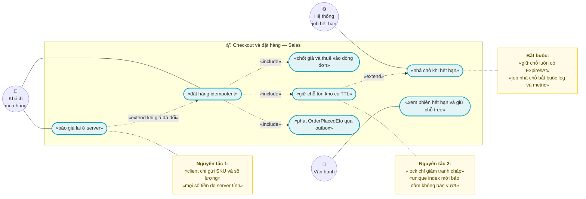
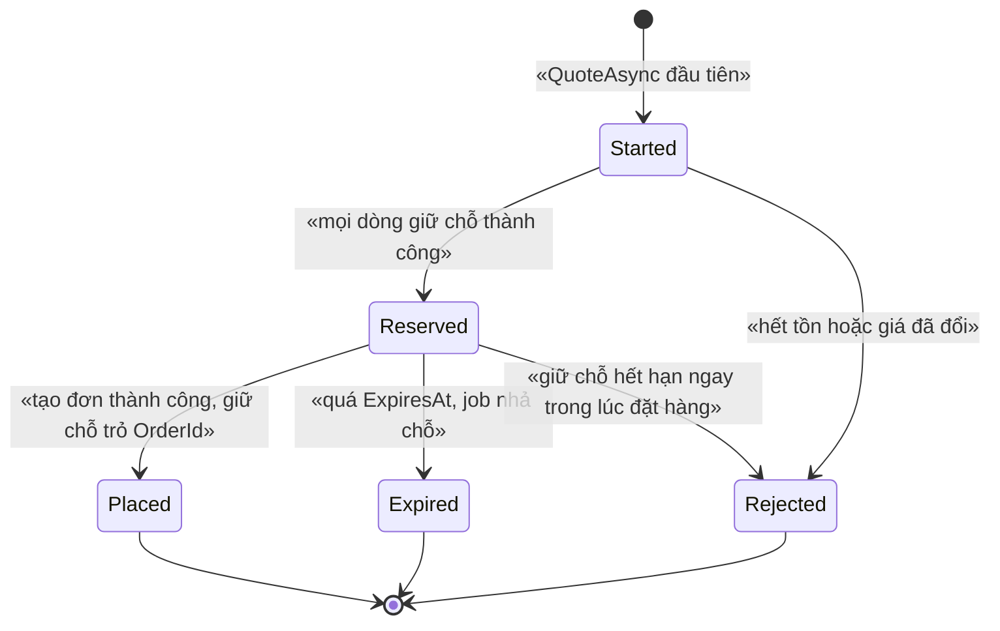
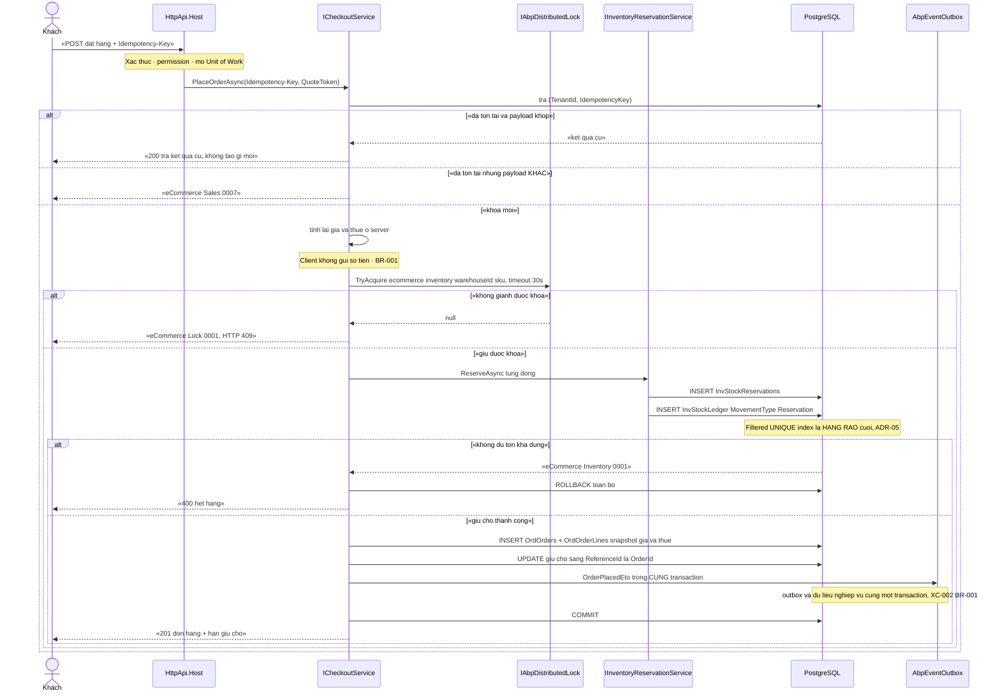
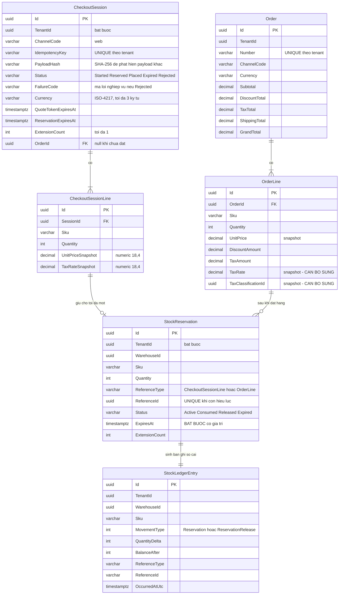

# `SAL-002` — Checkout và đặt hàng (tính lại giá + giữ kho)

| Thuộc tính | Nội dung |
|---|---|
| **Mã** | `SAL-002` |
| **Module** | **Sales** — hiện entity đơn nằm ở `src/eCommerce.Domain/Entities/Orders/Order.cs`; **chưa có** project `eCommerce.Sales.*` (xem §14.5) |
| **Giai đoạn** | **GĐ1** (`docs/implementation-plan.md:408`) |
| **Ưu tiên** | **Must have** |
| **Trạng thái** | 🟡 `Draft` — chờ review · ✅ **ĐÃ CÓ CODE** — `src/eCommerce.Application/Checkout/CheckoutAppService.cs` (`tinh-va-giu-cho`: giữ chỗ fail-closed + idempotent, tiền lấy từ sổ giải trình `PRC-002`) |
| **Người viết / người review** | *(điền)* / **Kiến trúc trưởng + BA + Kế toán** (có tiền + thuế) |
| **Phiên bản / ngày** | `v0.2 — 17/10/2026` (sửa dòng *"chưa có dòng code"* đã sai + đường dẫn theo cấu trúc `docs/features/<module>/`; trước: `v0.1 — 13/10/2026`) |
| **Tài liệu liên quan** | `XC-001` (Money/làm tròn) · `XC-002` (outbox/inbox + idempotency) · `XC-003` (khoá phân tán) · `XC-004` (auth/permission/tenant) · `XC-006` (thuế GTGT) · `SAL-001` (giỏ hàng) · `SAL-003` (state machine 4 trục) · `SAL-004` (compensation) · `SAL-005` (webhook sàn) · **`INV-002` (giữ chỗ + TTL)** · **`INV-003` (phân bổ tồn theo kênh)** · `PRC-002` (pipeline tính giá) · `WEB-003` (UI checkout) |

---

## 0. Tóm tắt & quyết định thiết kế

**Tóm tắt:** `SAL-002` là **biên cam kết** của hệ thống: nơi giỏ hàng biến thành **đơn hàng có ràng buộc tiền và tồn kho**.
Ba bất biến định hình toàn bộ thiết kế:

1. **Giá phải được TÍNH LẠI ở server** từ dữ liệu hiện tại (`PRC-001/002` + `XC-006`), và **mọi số tiền client gửi lên đều bị bỏ qua**.
   Client chỉ gửi *cái gì* (SKU + số lượng), **không** gửi *bao nhiêu tiền*.
2. **Giữ kho phải xảy ra TRƯỚC khi đơn tồn tại**, và số tồn giữ chỗ **phải tự hết hạn** — nếu không, giỏ hàng bỏ dở sẽ khoá sạch tồn kho.
3. **Không được bán vượt tồn kể cả khi Redis chết** — vì vậy hàng rào cuối **không** phải distributed lock mà là **ràng buộc DB**
   (đúng `XC-003` **D2/BR-007**: *"bỏ lock đi, DB có chặn không?"*).

**Vì sao phải viết tài liệu này trước khi code (3 lỗi im lặng đã biết trong dự án):**

| # | Bài học | Nguồn trong repo | Hệ quả cho `SAL-002` |
|---|---|---|---|
| 1 | Lock **không** phải hàng rào; Redis chết ⇒ lock vô hiệu nhưng app **vẫn chạy** | `XC-003` §0.1 **D2**, `eCommerceHttpApiHostModule.cs:141` (`AbortOnConnectFail = false`) | Mọi bất biến giữ kho phải có **unique index / CHECK constraint** đi kèm |
| 2 | Guard trạng thái **no-op im lặng** làm sự kiện rơi **không để lại dấu vết** (bài học `SetPaidStatus()` của eShop) | `XC-002` §0 bài học #4, `XC-003` **D10** | Mọi chuyển trạng thái của phiên checkout **phải NÉM LỖI** khi sai (§3) |
| 3 | Idempotency ở **tầng HTTP thôi là không đủ**; retry/redelivery ⇒ xử lý 2 lần | `XC-002` §0 bài học #3 | Đặt hàng idempotent **ở DB** (unique index), giữ chỗ idempotent **ở DB** (filtered unique index) |

**Phạm vi:**
- ✅ **Báo giá lại (re-quote)** và **tính lại giá** ở server cho toàn bộ dòng hàng: đơn giá, giảm giá, thuế, phí vận chuyển, tổng.
- ✅ **Phiên checkout** (`CheckoutSession`) có vòng đời và **TTL**, tách biệt khỏi vòng đời đơn hàng.
- ✅ **Giữ chỗ tồn kho** (reservation) append-only + **nhả chỗ** + **job hết hạn** + **gia hạn ngắn có kiểm soát**.
- ✅ **Đặt hàng** (tạo `Order` + `OrderLine` + số đơn) và **phát `OrderPlacedEto`** qua outbox.
- ✅ **Idempotency ở mọi biên vào** (HTTP checkout, job hết hạn, consumer sự kiện).
- ✅ Hợp đồng API, mã lỗi, phân quyền, migration, test case.

**Không nằm trong phạm vi:**
- ❌ **State machine 4 trục của đơn hàng + lịch sử trạng thái** — thuộc `SAL-003`.
- ❌ **Chính sách giá / giá theo kênh / giá bậc thang** — thuộc `PRC-001`/`PRC-002`. `SAL-002` chỉ **gọi** pipeline và **chốt (snapshot)** kết quả.
- ❌ **Thuật toán làm tròn & phân bổ tiền** — thuộc `XC-001`. `SAL-002` chỉ dùng `Money` + `MoneyAllocator`.
- ❌ **Cơ chế lưu chỗ / TTL / nhả kho (thi hành)** — thuộc `INV-002`. `SAL-002` là **bên gọi**; tranh chấp "ai sở hữu job hết hạn" ghi ở §15.1 **Q1**.
- ❌ **Phân bổ tồn theo kênh** — thuộc `INV-003` (§15.1 **Q5**).
- ❌ **Thanh toán / IPN** — thuộc `PaymentHub` + `REC-001`.
- ❌ **Huỷ đơn & bù trừ** — thuộc `SAL-004`.
- ❌ **UI checkout** — thuộc `WEB-003`; tài liệu này chỉ ghi **hợp đồng dữ liệu** cho UI (§10).

### 0.1 Quyết định thiết kế (ADR ngắn)

| # | Quyết định | Phương án đã cân nhắc | Lý do chọn | Hệ quả |
|---|---|---|---|---|
| **ADR-01** | **Server TÍNH LẠI toàn bộ giá**; client chỉ gửi `Sku` + `Quantity` | (a) client gửi `UnitPrice` (như một số mẫu phổ biến) · (b) server tính lại | Client là **vùng không tin cậy**: sửa giá trong request là lỗ hổng kinh điển của checkout. Dữ liệu giá **đã có sẵn ở server** (`CatProductVariants.Price`, `eCommerceDbContext.cs:126`) | Mọi DTO checkout **không có** trường tiền nào ở input; nếu client gửi tiền ⇒ **bỏ qua + log `Warning`** |
| **ADR-02** | **Chốt (snapshot) giá + thuế vào dòng đơn** tại thời điểm đặt hàng | (a) đọc lại giá mỗi lần xem đơn · (b) snapshot | Đổi giá/chính sách sau **không được** làm đổi đơn đã phát sinh (kế toán + hoá đơn cần số bất biến). Cùng nguyên tắc `XC-006` **D3/BR-002** | `OrderLine` phải thêm `TaxRate`, `TaxClassificationId`, `UnitPrice` đã chốt; **cấm** join sang bảng giá khi hiển thị đơn cũ |
| **ADR-03** | **Giữ chỗ là bản ghi trong sổ cái APPEND-ONLY**, không UPDATE tồn trực tiếp | (a) `Reserved++` rồi `Reserved--` khi hết hạn · (b) mỗi lần giữ/nhả là **một bản ghi mới** | Sổ cái append-only là quy ước bất biến (`INV-001`, `StockLedger.cs:81`). UPDATE tại chỗ ⇒ **mất khả năng truy vết** vì sao tồn đổi, và không đối soát được với sàn | Bảng `InvStockReservations` **append-only**; trạng thái `Active/Released/Consumed/Expired` là **cột trên bản ghi**, việc nhả chỗ vẫn sinh **một bản ghi ledger mới** `ReservationRelease` |
| **ADR-04** | Dùng **khoá phân tán theo (SKU, kho)** để **giảm tranh chấp**, không để bảo đảm đúng | (a) chỉ lock · (b) chỉ DB · (c) **lock + ràng buộc DB** | Đúng **D2 của `XC-003`**: Redis chết ⇒ lock vô hiệu nhưng app vẫn chạy. Khoá đã có sẵn: `eCommerceConsts.LockKeys.InventorySku(warehouseId, sku)` (`eCommerceConsts.cs:103`) | Lock **bao ngoài** Unit of Work; thời gian chờ **hữu hạn** (30 s, theo `XC-003` §5); không giành được ⇒ **ném lỗi**, không im lặng |
| **ADR-05** 🎯 | **Hàng rào chống bán vượt = filtered UNIQUE index** trên bản ghi giữ chỗ đang hiệu lực | (a) chỉ `if (Available >= qty)` trong bộ nhớ · (b) `RowVersion` · (c) **unique index trên `(TenantId, WarehouseId, Sku, ReferenceId, MovementType)`** | Kiểm tra trong bộ nhớ **không** chống được 2 luồng song song (đã gặp thật ở Phase 0, xem `XC-002` **D8**). Đây là câu trả lời cho *"bỏ lock đi, DB có chặn không?"* — **CÓ** | Mọi đường giữ chỗ **bắt buộc** đi qua bảng này; chèn trùng ⇒ DB ném lỗi ⇒ tầng ứng dụng dịch thành `eCommerce:Sales:0002` |
| **ADR-06** | **TTL giữ chỗ** + **job hết hạn** dùng `SkipIfBusy` | (a) giữ vô hạn tới khi trả tiền · (b) TTL ngắn | Giữ vô hạn ⇒ giỏ bỏ dở **khoá sạch tồn kho** (sự cố vận hành thật của mọi sàn). TTL ngắn (mặc định **15 phút**, cấu hình) + job nhả | `INV-002` là chủ sở hữu job (xem **Q1**); job chạy nhiều instance ⇒ khoá `ecommerce:inventory:reservation-sweep:{tenantId}` + `SkipIfBusy` + log + metric |
| **ADR-07** | **Một `ReferenceId` chỉ có TỐI ĐA một giữ chỗ đang hiệu lực** | (a) nhiều bản ghi cùng reference · (b) một bản ghi | Retry/refresh trang của khách **không** được giữ chỗ 2 lần cho cùng một phiên/dòng. Đây chính là cơ chế làm cho *"bấm Đặt hàng 2 lần"* trở nên **idempotent ở tầng DB** | `ReferenceId` = `CheckoutSessionLineId`; **cấm** sinh reference mới cho cùng một dòng khi đã có giữ chỗ hiệu lực |
| **ADR-08** | **Idempotency-Key ở header** + lưu DB, **cấm** `Guid.NewGuid()` mỗi lần thử | (a) không chống trùng, tin vào client · (b) khoá sinh mới mỗi request · (c) khoá **ổn định** lưu DB | Đúng `XC-002` **D7/BR-007**: khoá mới mỗi retry ⇒ mỗi retry là một đơn mới. Client retry mạng là chuyện bình thường | Unique `(TenantId, IdempotencyKey)` trên phiên checkout; cùng khoá + **payload khác** ⇒ **NÉM LỖI** (không coi là trùng — `XC-002` BR-006) |
| **ADR-09** | **State machine của PHIÊN CHECKOUT tách khỏi state machine ĐƠN HÀNG** | (a) dùng chung `OrderStatus` · (b) entity riêng `CheckoutSession` | `OrderStatus` hiện có **7 giá trị** (`Enums.cs:50`) và `Order.SetStatus()` **không có guard** (`Order.cs:111`) ⇒ dùng nó cho vòng đời checkout sẽ **trộn hai khái niệm** và vô hiệu hoá `SAL-003` (4 trục) | `OrdCheckoutSessions` có state machine riêng (§3); `SAL-002` **không** gọi `Order.SetStatus` |
| **ADR-10** | **Toàn bộ ghi trong MỘT Unit of Work** | (a) `autoSave: true` từng bước · (b) một UoW | *"Hoặc phiên + giữ chỗ + dòng đơn cùng có, hoặc cùng không"* — nếu tách, sẽ có phiên `Reserved` mà **không** có giữ chỗ (đúng loại lỗi đã gây oversell ở hệ thống khác) | **Cấm** `autoSave: true` trong luồng checkout (khác thói quen hiện tại ở `ChannelAppService.cs:103` — xem §15.2 **F3**) |
| **ADR-11** | **Double-check + guard-buffer** trước khi dùng giữ chỗ | (a) tin vào trạng thái đọc lúc đầu · (b) đọc lại + kiểm tra `ExpiresAt` | Giữ chỗ có thể **hết hạn đúng lúc** đang dùng (job nhả chạy song song). `XC-003` §3 gọi đây là trạng thái nguy hiểm nhất; `XC-003` §8.2 ghi rõ phải double-check dưới lock | Trong lock, đọc lại giữ chỗ và kiểm `ExpiresAt >= now + guardBuffer` (mặc định **10 s**); không thoả ⇒ `eCommerce:Sales:0004` |
| **ADR-12** | **KHÔNG acquire lồng** cùng một tên khoá | (a) acquire lại cho tiện · (b) **bắt buộc sắp khoá theo thứ tự** | `IAbpDistributedLock` **không reentrant** (`XC-003` **D6**): acquire lồng trên cùng khoá ⇒ chờ chính mình rồi hết timeout. Nhiều dòng đơn có thể cùng SKU | Khoá được **gom theo (kho, SKU)** và **sắp theo thứ tự chữ cái**; mỗi khoá acquire **một lần** cho cả request |
| **ADR-13** | **Khoá có TTL (timeout hữu hạn)**, mặc định **30 s**; không giành được ⇒ **NÉM** | (a) chờ vô hạn · (b) `SkipIfBusy` cho HTTP | Chờ vô hạn ⇒ treo request khi có sự cố; im lặng bỏ qua ⇒ **mất đơn** mà không ai biết (`XC-003` **D10**) | `eCommerce:Lock:0001` → **`409`**; UI hiển thị "đang xử lý, vui lòng thử lại" (§10) |
| **ADR-14** | **Gia hạn giữ chỗ**: chỉ **một lần**, tối đa **+5 phút**, có kiểm soát | (a) không cho gia hạn · (b) gia hạn vô hạn | Khách đang ở bước thanh toán mà hết hạn là trải nghiệm xấu; nhưng gia hạn vô hạn ⇒ **khoá tồn kho** trở lại | Cột `ExtensionCount`; `ExtensionCount >= 1` ⇒ `eCommerce:Sales:0009` (xem **Q4**) |

> 📌 Ghi lại **phương án bị loại** để 6 tháng sau không hỏi lại. Đặc biệt **ADR-05**: đây là quyết định
> *"nếu bỏ lock đi, DB có chặn không?"* — trả lời **có**, nên thiết kế này **không** phụ thuộc Redis.

---

## 1. Use Case Specification

| Thuộc tính | Nội dung |
|---|---|
| **Use Case ID** | `SAL-002` |
| **Use Case Name** | Đặt hàng từ giỏ: **tính lại giá ở server** + **giữ chỗ tồn kho** + tạo đơn |
| **Description** | *"Là khách mua hàng, tôi muốn bấm **Đặt hàng** và nhận được một đơn hàng với **số tiền đúng tại thời điểm đặt** và **tồn kho đã được giữ cho tôi**, để tôi không bị báo hết hàng sau khi đã trả tiền — và để bấm hai lần cũng không tạo hai đơn."* |
| **Actor(s)** | **Khách** (có hoặc không có tài khoản) · **Hệ thống** (`ICheckoutService`, `IInventoryReservationService`, job hết hạn) · **Vận hành** (xem phiên hết hạn / giữ chỗ treo) |
| **Priority** | **Must have** |
| **Trigger** | (a) khách bấm **Đặt hàng** trên storefront; (b) job định kỳ quét giữ chỗ hết hạn; (c) khách/UI gọi **báo giá lại** khi giá đã đổi |
| **Pre-Condition(s)** | • **Tenant hiện tại** (`TenantId` từ `ICurrentTenant`) — mọi bảng của feature đều `IMultiTenant`.<br>• **Kênh bán** (`ChannelCode`): `"web"` cho luồng này (giá trị hợp lệ theo `Order.ChannelCode`, `eCommerceDbContext.cs:168` khai `IsRequired().HasMaxLength(32)`). Đơn từ sàn **không** đi qua `SAL-002` mà qua `SAL-005`.<br>• **Giỏ hàng** đã có (thuộc `SAL-001`) và **không rỗng**.<br>• **Pipeline tính giá** đã sẵn sàng (`PRC-001/002`) — ⚠️ **chưa có trong code**, kế hoạch GĐ1.<br>• **`XC-001` (`Money`) đã có** — ⚠️ **chưa có trong code** (`shared/eCommerce.Kernel` **chưa tồn tại**, xem §14.5).<br>• **Dịch vụ giữ chỗ** đã sẵn sàng (`INV-002`) — ⚠️ **chưa có trong code**, kế hoạch GĐ1.<br>• Permission đã định nghĩa trong `eCommercePermissionDefinitionProvider` (thiếu ⇒ **403 cho mọi người** — `XC-004` **D2**).<br>• Redis 7 sẵn sàng (**không** phải điều kiện bắt buộc — xem **ADR-05**). |
| **Post-Condition(s)** | • **Đơn đã tồn tại** với `Number` duy nhất theo tenant, `Status = Pending`, mọi dòng có `UnitPrice` **đã chốt**.<br>• **Tồn kho đã bị giữ** đúng số lượng, có `ExpiresAt`, và giữ chỗ đã trỏ về **`OrderId`** (không còn trỏ về dòng phiên).<br>• `OrderPlacedEto` **đã ghi outbox trong CÙNG transaction** với đơn (`XC-002` BR-001).<br>• Phiên checkout ở trạng thái **hấp thụ** `Placed`.<br>• Mọi số tiền trong đơn là **`decimal` đã làm tròn theo `Currency.Decimals`** (`XC-001` BR-001); **0** lần so sánh tiền bằng `==` (`XC-001` BR-003). |
| **Basic Flow** | 1. Khách bấm Áp dụng mã/thay đổi giỏ ⇒ UI gọi **`QuoteAsync`**: hệ thống **tính lại** giá từng dòng từ `PRC-*`, áp thuế từ `XC-006`, áp phí vận chuyển, **trả về tổng + `QuoteToken` + thời hạn hiệu lực**.<br>2. Khách bấm **Đặt hàng** ⇒ UI gọi `PlaceOrderAsync` kèm **`Idempotency-Key`** (header) và `QuoteToken`.<br>3. `ICheckoutService` kiểm tra idempotency: `(TenantId, IdempotencyKey)` **đã tồn tại** ⇒ trả **kết quả cũ** (200) và **kết thúc**.<br>4. Tính lại giá **lần hai** ngay trước khi ghi (không tin `QuoteToken` như nguồn tiền); lệch quá ngưỡng ⇒ dừng và yêu cầu khách xác nhận lại (**BR-004**).<br>5. **Gom khoá** theo `(WarehouseId, Sku)`, sắp thứ tự, acquire **một lần** mỗi khoá (**ADR-12**), timeout **30 s**.<br>6. Với từng dòng: **giữ chỗ** (`Reservation`) — kiểm tra khả dụng, ghi **một bản ghi giữ chỗ** + **một bản ghi sổ cái** (`StockMovementType.Reservation`) trong **cùng UoW**.<br>7. Tạo `Order` + `OrderLine` (chốt giá/thuế), **chuyển giữ chỗ sang trỏ `OrderId`** (**BR-011**), đặt phiên sang `Placed`.<br>8. Ghi `OrderPlacedEto` qua **outbox** (cùng transaction), commit UoW, nhả khoá.<br>9. Trả về `OrderDto` (số đơn, tổng tiền, hạn giữ chỗ). |
| **Alternative Flow** | **A1: `QuoteToken` hết hiệu lực / giá đã đổi** ⇒ hệ thống **không** đặt hàng; trả `eCommerce:Sales:0006` kèm **bảng so sánh giá cũ/mới** để UI hiển thị "giá đã thay đổi, xác nhận lại".<br>**A2: Khách xác nhận lại** ⇒ UI gọi `QuoteAsync` mới (bỏ `QuoteToken` cũ) rồi `PlaceOrderAsync` với token mới.<br>**A3: Client retry cùng `Idempotency-Key`** ⇒ **trả kết quả cũ**, **0** giữ chỗ mới, **0** đơn mới (BR-007).<br>**A4: Đặt hàng cho khách vãng lai** ⇒ hoạt động nếu **Q2** (§15.1) chốt cho phép; `CustomerId = null` (`Order.cs:29` cho phép).<br>**A5: Job hết hạn** — chạy độc lập, **`SkipIfBusy`**, nhả mọi giữ chỗ `Active` đã quá `ExpiresAt`, ghi bản ghi ledger `ReservationRelease`, metric `sales_reservation_expired_total`.<br>**A6: Nhiều kho cùng có hàng** ⇒ chọn kho theo thứ tự ưu tiên (**BR-012**); nếu **không** kho nào đủ nhưng **tổng** đủ ⇒ **từ chối** ở GĐ1 (không tự tách đơn) — xem §15.1 **Q5**. |
| **Exception Flow** | **E1:** không đủ tồn khả dụng cho một dòng ⇒ `BusinessException` **`eCommerce:Inventory:0001`** (mã **đã có sẵn**: `eCommerceConsts.cs:79`), **rollback toàn bộ** UoW (không có đơn, không có giữ chỗ).<br>**E2:** chèn giữ chỗ vi phạm **unique index** (2 request song song cùng reference) ⇒ dịch thành **`eCommerce:Sales:0002`** — đây **chính là** hàng rào ADR-05 phát huy tác dụng; **không** coi là lỗi hệ thống.<br>**E3:** không giành được khoá trong **30 s** ⇒ **`eCommerce:Lock:0001`** → **`409`** (`XC-003` §6.2).<br>**E4:** `Order.Number` bị trùng (unique `(TenantId, Number)`, `eCommerceDbContext.cs:180`) ⇒ sinh lại số, thử tối đa **3 lần**, hết lượt ⇒ **`eCommerce:Sales:0005`**.<br>**E5:** SKU chưa phân loại thuế ⇒ **KHÔNG chặn bán** (`XC-006` **D5** đã chốt: chặn ở bước **hoá đơn**, không chặn ở bước bán) ⇒ áp mức chuẩn + cờ `NeedsClassification` + log `Warning`.<br>**E6:** `Quantity <= 0` ⇒ từ chối bằng guard domain hiện có (`Order.AddLine` ném `ArgumentOutOfRangeException`, `Order.cs:72-75`) ⇒ dịch thành **`eCommerce:Sales:0001`** (`400`).<br>**E7:** giữ chỗ hết hạn **ngay trong lúc** đặt hàng ⇒ double-check dưới lock (**ADR-11**) ⇒ **`eCommerce:Sales:0004`**, UI quay lại bước giữ chỗ.<br>**E8:** `IdempotencyKey` trùng nhưng **payload khác** ⇒ **`eCommerce:Sales:0007`** — **cấm** trả kết quả cũ (`XC-002` BR-006).<br>**E9:** Redis **không kết nối được** ⇒ **fail-open**: chạy tiếp, log `Error`, metric; **ADR-05 vẫn chặn** nếu có tranh chấp thật. |
| **Business Rules** | • **BR-SAL-002-001**: Server **tính lại** mọi số tiền; **cấm** dùng bất kỳ trường tiền nào do client gửi làm nguồn sự thật.<br>• **BR-SAL-002-002**: Đơn giá, `DiscountAmount`, `TaxRate`, `TaxAmount`, `TaxClassificationId` **phải được chốt (snapshot)** vào `OrderLine` tại thời điểm đặt hàng; đổi cấu hình sau **không** làm đổi đơn cũ.<br>• **BR-SAL-002-003**: Thuế suất **phải** lấy theo khung hiệu lực tại thời điểm đặt hàng (không hard-code) — đúng `XC-006` BR-001/BR-012.<br>• **BR-SAL-002-004**: Nếu tổng tính lại **lệch** quá ngưỡng so với báo giá khách đã thấy ⇒ **DỪNG**, trả báo giá mới (**không** tự đổi giá im lặng).<br>• **BR-SAL-002-005**: Mọi thay đổi tồn kho (kể cả giữ chỗ) **phải** sinh **một bản ghi sổ cái**; **cấm** UPDATE/DELETE `InvStockLedger`.<br>• **BR-SAL-002-006**: Giữ chỗ **phải có `ExpiresAt`**; **cấm** giữ chỗ vô thời hạn.<br>• **BR-SAL-002-007**: Giữ chỗ **idempotent** ở **tầng DB**: tối đa **một** giữ chỗ hiệu lực cho mỗi `(TenantId, WarehouseId, Sku, ReferenceId, MovementType)`.<br>• **BR-SAL-002-008**: Mọi đường **giữ chỗ phải đi qua distributed lock** `ecommerce:inventory:{warehouseId}:{sku}` **và** ràng buộc DB; **cấm** chỉ dựa vào lock (`XC-003` BR-007).<br>• **BR-SAL-002-009**: **Cấm acquire lồng** cùng tên khoá; nhiều dòng cùng SKU ⇒ gom khoá, sắp thứ tự, acquire **một lần**.<br>• **BR-SAL-002-010**: Mọi lần acquire khoá **phải có timeout hữu hạn**; hết timeout ⇒ **NÉM** `eCommerce:Lock:0001`; **cấm** bỏ qua im lặng.<br>• **BR-SAL-002-011**: Khi tạo đơn thành công, giữ chỗ **phải** được chuyển sang trỏ **`OrderId`**; **cấm** để giữ chỗ trỏ về dòng phiên đã chết.<br>• **BR-SAL-002-012**: Khi nhiều kho cùng có hàng, chọn kho theo **thứ tự ưu tiên tường minh** và **ghi log** kho đã chọn; **cấm** tách một dòng thành nhiều kho ở GĐ1.<br>• **BR-SAL-002-013**: **`IdempotencyKey` ổn định** cho một lần đặt hàng: sinh **một lần**, lưu DB; mọi retry **đọc lại**; **cấm** `Guid.NewGuid()` mỗi lần gọi.<br>• **BR-SAL-002-014**: Cùng `IdempotencyKey` **+ payload khác** ⇒ **NÉM** `eCommerce:Sales:0007`; **cấm** coi là trùng.<br>• **BR-SAL-002-015**: Mọi chuyển trạng thái phiên checkout sai **phải NÉM LỖI có mã**; **cấm** no-op im lặng (`XC-002` BR-009).<br>• **BR-SAL-002-016**: Mọi ghi trong luồng checkout **phải** nằm trong **một** Unit of Work; **cấm** `autoSave: true` giữa luồng.<br>• **BR-SAL-002-017**: `OrderPlacedEto` **phải** được phát qua `IDistributedEventBus` với outbox, **cùng transaction** với đơn (`XC-002` BR-001).<br>• **BR-SAL-002-018**: **Cấm** so sánh tiền bằng `==`; so bằng `Money.ToMinorUnits()` (`XC-001` BR-003).<br>• **BR-SAL-002-019**: **Cấm** `double`/`float` trong mọi DTO/entity tiền của feature (`XC-001` BR-008).<br>• **BR-SAL-002-020**: Job nhả giữ chỗ hết hạn **phải** dùng `SkipIfBusy` **kèm log + metric**; **cấm** `SkipIfBusy` cho luồng HTTP (`XC-003` BR-010). |
| **Non-Functional Requirement** | • **NFR-SAL-002-001**: `QuoteAsync` (≤ 20 dòng, cache hit) p95 **< 300 ms**.<br>• **NFR-SAL-002-002**: `PlaceOrderAsync` (≤ 5 dòng, 1 kho) p95 **< 1,5 s**.<br>• **NFR-SAL-002-003**: **2 luồng đồng thời cùng SKU** ⇒ **0** trường hợp bán vượt tồn (kể cả khi **dừng Redis**) — test tích hợp.<br>• **NFR-SAL-002-004**: **20 lần retry** cùng `Idempotency-Key` ⇒ **đúng 1** đơn, **đúng 1** giữ chỗ.<br>• **NFR-SAL-002-005**: Job hết hạn xử lý **10.000** phiên trong **< 60 s**.<br>• **NFR-SAL-002-006**: Hết tồn ở một dòng ⇒ **0** bản ghi giữ chỗ, **0** đơn được ghi (rollback toàn bộ).<br>• **NFR-SAL-002-007**: **100 %** thao tác checkout có `CorrelationId`; tồn tại metric `sales_checkout_total`, `sales_reservation_expired_total`, `sales_oversell_blocked_total`, `sales_idempotent_replay_total`.<br>• **NFR-SAL-002-008**: Cách ly tenant: tenant A **không** đọc/giữ chỗ được dữ liệu tenant B.<br>• **NFR-SAL-002-009**: **0** `double`/`float` trong DTO/entity tiền (test reflection — `XC-001` NFR-004).<br>• **NFR-SAL-002-010**: Mọi cột tiền là `numeric(18,4)`, cột tiền tệ ≤ `char(3)` (`XC-001` §5.2).<br>• **NFR-SAL-002-011**: Idempotent replay trả kết quả trong **< 100 ms** (không tính lại giá).<br>• **NFR-SAL-002-012**: **0** trường hợp treo vô hạn (mọi acquire có timeout) — `XC-003` NFR-002. |

---

## 2. Sơ đồ Use Case



### Chú giải

| Ký hiệu | Ý nghĩa |
|---|---|
| ⭕ Xanh lá | Actor (khách, hệ thống, vận hành) |
| 🟦 Bầu dục xanh dương | Use Case |
| 🟨 Khung vàng | Note (nguyên tắc bắt buộc) |
| `───` | Liên kết Actor ↔ Use Case |
| `-.«include».->` | Quan hệ bao hàm (bắt buộc xảy ra) |
| `-.«extend».->` | Quan hệ mở rộng (chỉ xảy ra trong điều kiện ghi trong nhãn) |

---

## 3. Sơ đồ trạng thái (state machine) — **BẮT BUỘC ném lỗi khi chuyển sai**

> Feature có **hai vòng đời**. `SAL-002` sở hữu vòng đời **phiên checkout**; vòng đời **giữ chỗ** do `INV-002` sở hữu
> nhưng được `SAL-002` điều khiển ở hai bước `Reserve`/`Consume`. Cả hai **phải ném lỗi**, không no-op.

### 3.1 Vòng đời **phiên checkout** (`CheckoutSession`)



### 3.2 Bảng chuyển trạng thái & guard

| # | Từ → Sang | Guard (điều kiện cho phép) | Hành động kèm theo | Nếu guard sai thì? |
|---|---|---|---|---|
| 1 | `[*]` → `Started` | Giỏ **không rỗng** và mọi dòng có `Quantity > 0` | Tính lại giá; trả `QuoteToken` + `ExpiresAt` của báo giá | `eCommerce:Sales:0001` (`400`) — **không** tạo phiên |
| 2 | `Started` → `Reserved` | **Tất cả** dòng giữ chỗ thành công **và** tổng tính lại khớp báo giá trong ngưỡng (**BR-004**) | Ghi bản ghi giữ chỗ + bản ghi ledger `Reservation` (**cùng UoW**); đặt `ExpiresAt` cho phiên | Chuyển `Rejected` (nhánh 3) |
| 3 | `Started` → `Rejected` | Không đủ tồn khả dụng, **hoặc** lệch giá quá ngưỡng, **hoặc** không giành được khoá | **Rollback** toàn bộ UoW; ghi mã lý do (`FailureCode`) | — (trạng thái hấp thụ) |
| 4 | `Reserved` → `Placed` | Giữ chỗ **còn hiệu lực** sau double-check (`ExpiresAt >= now + guardBuffer` — **ADR-11**) **và** tạo được `Order` + `OrderLine` | Chuyển giữ chỗ sang trỏ `OrderId`; phát `OrderPlacedEto` trong outbox; commit | **`eCommerce:Sales:0004`** ⇒ `Rejected`; **cấm** tạo đơn |
| 5 | `Reserved` → `Expired` | `now > ExpiresAt` **và** job đã giành được khoá `…:reservation-sweep:{tenantId}` | Ghi ledger `ReservationRelease`; đặt giữ chỗ `Expired`; metric + log `Information` | Không giành được khoá ⇒ **`SkipIfBusy`** + log + metric (`XC-003` BR-010) |
| 6 | `Reserved` → `Rejected` | Giữ chỗ hết hạn **giữa** bước 6 và bước 7 của Basic Flow | Rollback; **`eCommerce:Sales:0004`** | — |
| 7 | `Placed` → bất kỳ | **KHÔNG** có guard nào cho phép | — | **Trạng thái HẤP THỤ**: mọi chuyển dịch khỏi `Placed` ⇒ **NÉM `eCommerce:Sales:0003`** |
| 8 | `Expired` / `Rejected` → bất kỳ | **KHÔNG** có guard nào cho phép — **cấm** "hồi sinh" phiên đã hết hạn | Khách **phải** tạo phiên mới (`QuoteAsync` lại) | **NÉM `eCommerce:Sales:0003`** |
| 9 | bất kỳ → `Expired` **trong khi** đang `Placed` | — | — | **NÉM `eCommerce:Sales:0003`** — chống job nhả chỗ của một đơn **đã đặt** |

**Ai được phép chuyển:**

| Chuyển dịch | Chủ thể |
|---|---|
| `[*]`→`Started`, `Started`→`Reserved`, `Reserved`→`Placed`, `Reserved`→`Rejected` | **`ICheckoutService`** (request HTTP có permission — §9) |
| `Reserved`→`Expired` | **job hết hạn** (**`INV-002`**, hoặc `SAL-002` nếu **Q1** chốt ngược lại) |
| `Placed`→bất kỳ | **không ai** — hấp thụ |

> ⚠️ **Quy tắc bất di bất dịch:** guard sai **phải NÉM LỖI có mã**, không được *"bỏ qua im lặng"*.
> Lý do rất cụ thể: bài học `SetPaidStatus()` của eShop — guard no-op làm sự kiện **rơi mà không để lại dấu vết**
> (`XC-002` §0 bài học #4). Trong `SAL-002`, một guard no-op ở nhánh 4 nghĩa là **đơn không được tạo mà khách vẫn thấy thành công**.

### 3.3 Vòng đời **bản ghi giữ chỗ** (do `INV-002` sở hữu — ghi ở đây vì `SAL-002` là bên điều khiển)

| Từ → Sang | Ai chuyển | Guard | Nếu guard sai thì? |
|---|---|---|---|
| `[*]` → `Active` | `SAL-002` (Basic Flow bước 6) | Có khoá `ecommerce:inventory:{warehouseId}:{sku}`; `Available >= Quantity`; chưa có giữ chỗ hiệu lực cho `ReferenceId` | `eCommerce:Inventory:0001`; chèn trùng ⇒ `eCommerce:Sales:0002` (**ADR-05**) |
| `Active` → `Consumed` | **`INV-001`/`INV-002`**, sau `OrderPlacedEto` (không phải `SAL-002`) | Đơn tồn tại và chưa xuất kho | ⚠️ Ngoài phạm vi `SAL-002` — xem §15.1 **Q3** |
| `Active` → `Released` | `SAL-004` (huỷ đơn) hoặc job hết hạn | Có lý do nhả (`Cancelled`/`Expired`) | **NÉM lỗi** — không nhả "mù" |
| `Active` → `Expired` | job hết hạn | `now > ExpiresAt` | `SkipIfBusy` + log + metric |
| `Consumed` / `Released` / `Expired` → bất kỳ | — | **KHÔNG** có guard | **Hấp thụ** — mọi chuyển dịch ⇒ **NÉM lỗi** |

---

## 4. Sequence Diagram & luồng dữ liệu

### 4.1 Sequence — đặt hàng: tính lại giá, giữ chỗ, phát sự kiện



### 4.2 Luồng job nhả giữ chỗ hết hạn (mô tả — dùng bảng thay sơ đồ để giữ giới hạn 3 sơ đồ)

| Bước | Việc | Cơ chế / mã |
|---|---|---|
| 1 | Giành khoá quét | `ecommerce:inventory:reservation-sweep:{tenantId}`; không giành được ⇒ **`SkipIfBusy`** + log + metric (BR-020) |
| 2 | Lấy lô giữ chỗ hết hạn | `Status = Active AND ExpiresAt <= now`, `Take(N)` — có index `(TenantId, Status, ExpiresAt)` |
| 3 | Với mỗi bản ghi: ghi ledger `ReservationRelease` + đặt `Status = Expired` | Append-only (BR-005); **cùng UoW** |
| 4 | Phát metric | `sales_reservation_expired_total{tenantId}` (NFR-007) |
| 5 | Không đủ tồn cho dòng khác | Không xảy ra — nhả chỗ chỉ **tăng** khả dụng |

**Idempotency của job:** nhờ **BR-007** (một giữ chỗ hiệu lực cho mỗi reference) **và** trạng thái hấp thụ của bản ghi
giữ chỗ (§3.3) — chạy job hai lần **không** nhả hai lần. Đây là ví dụ "job định kỳ" trong 4 biên vào của `XC-002` §7.3.

---

## 5. Mô hình dữ liệu

### 5.1 ERD



### 5.2 Bảng & cột (Data Dictionary)

> **Đọc kỹ:** trong **6 bảng** dưới đây, **2 bảng đã tồn tại** trong code (`OrdOrders`, `OrdOrderLines`) và **2 bảng đã tồn tại**
> (`InvItems`, `InvStockLedger`) nhưng **phải bổ sung** index/ràng buộc; **2 bảng là MỚI** (`OrdCheckoutSessions`, `InvStockReservations`).
> Cột nào **chưa** đối chiếu được với migration thật được đánh dấu ⚠️ **chưa kiểm chứng**.

#### 5.2.1 Bảng `OrdCheckoutSessions` — **MỚI** (chưa có trong code — kế hoạch GĐ1)

| Cột | Kiểu | Null? | Ý nghĩa | Ghi chú |
|---|---|---|---|---|
| `Id` | `uuid` | ✖ | khoá chính | `FullAuditedAggregateRoot<Guid>` |
| `TenantId` | `uuid` | ✔ | tenant sở hữu | **bắt buộc** vì entity `IMultiTenant` — nhưng ⚠️ có thể là **`NULL`** ở chế độ 1 tenant (`XC-004` §5.2 **F1**) |
| `ChannelCode` | `varchar(32)` | ✖ | kênh phát sinh | `"web"` ở GĐ1 |
| `IdempotencyKey` | `varchar(128)` | ✖ | khoá chống trùng do client gửi | **BR-013** |
| `PayloadHash` | `varchar(64)` | ✖ | SHA-256 của payload **chuẩn hoá** | dùng để phân biệt "trùng thật" với "xung đột khoá" — `XC-002` BR-005/BR-006 |
| `Status` | `int` | ✖ | `Started` · `Reserved` · `Placed` · `Expired` · `Rejected` | enum riêng của `SAL-002` — **ADR-09** |
| `FailureCode` | `varchar(64)` | ✔ | mã lỗi nghiệp vụ khi `Rejected` | để vận hành tra cứu |
| `Currency` | `varchar(3)` | ✖ | ISO-4217 | ⚠️ **khác** cột hiện tại `OrdOrders.Currency varchar(8)` (`eCommerceDbContext.cs:170`) — xem §15.2 **F2** |
| `QuoteTokenExpiresAt` | `timestamptz` | ✔ | hạn hiệu lực của báo giá | **BR-004** đọc cột này |
| `ReservationExpiresAt` | `timestamptz` | ✔ | hạn giữ chỗ | **BR-006** |
| `ExtensionCount` | `int` | ✖ | số lần gia hạn (mặc định `0`) | **ADR-14**, tối đa `1` |
| `OrderId` | `uuid` | ✔ | đơn đã tạo | `null` cho tới `Placed` |
| `ConcurrencyStamp` | `varchar(40)` | ✖ | optimistic concurrency của ABP | ✅ **đã có sẵn** trên mọi bảng ABP (ví dụ `20261009070214_Initial.cs:27`) |

**Index & ràng buộc**

| Loại | Cột | Mục đích |
|---|---|---|
| **UNIQUE** | `(TenantId, IdempotencyKey)` | **hàng rào idempotency** của đặt hàng — **BR-013/BR-014** |
| INDEX | `(TenantId, Status, ReservationExpiresAt)` | job quét giữ chỗ hết hạn theo phiên |
| INDEX | `(TenantId, OrderId)` | tra phiên theo đơn |
| CHECK | `ExtensionCount >= 0 AND ExtensionCount <= 1` | chặn gia hạn vô hạn ở tầng DB — **ADR-14** |
| ⚠️ **BẮT BUỘC** | — | Mọi unique index **có `TenantId`** phải dùng **`NULLS NOT DISTINCT`** khi `TenantId` là `NULL` — `XC-004` **BR-009**; repo đã có migration mẫu `20261013024226_Fix_NullableTenantId_UniqueIndexes.cs` |

#### 5.2.2 Bảng `OrdCheckoutSessionLines` — **MỚI**

| Cột | Kiểu | Null? | Ý nghĩa | Ghi chú |
|---|---|---|---|---|
| `Id` | `uuid` | ✖ | khoá chính | là **`ReferenceId`** của giữ chỗ |
| `SessionId` | `uuid` | ✖ | FK → `OrdCheckoutSessions` | cascade delete theo aggregate |
| `Sku` | `varchar(64)` | ✖ | SKU | khớp `OrdOrderLines.Sku` (`eCommerceDbContext.cs:199`) |
| `ProductVariantId` | `uuid` | ✔ | biến thể | dùng để tra giá ở `PRC-*` |
| `Quantity` | `int` | ✖ | số lượng | guard `> 0` — **E6** |
| `UnitPriceSnapshot` | `numeric(18,4)` | ✔ | giá đã báo cho khách | ⚠️ **chưa kiểm chứng** giá trị này có bị dùng làm nguồn tiền không — thiết kế nói **KHÔNG** (chỉ để so sánh lệch giá) |

**Index & ràng buộc**

| Loại | Cột | Mục đích |
|---|---|---|
| UNIQUE | `(SessionId, Sku)` | một SKU một dòng trong phiên — chống gộp dòng trùng |
| CHECK | `Quantity > 0` | bất biến ở tầng DB (`Order.AddLine` đã chặn ở tầng domain, `Order.cs:72`) |

#### 5.2.3 Bảng `InvStockReservations` — **MỚI** (sở hữu `INV-002`; `SAL-002` là bên ghi)

| Cột | Kiểu | Null? | Ý nghĩa | Ghi chú |
|---|---|---|---|---|
| `Id` | `uuid` | ✖ | khoá chính | |
| `TenantId` | `uuid` | ✔ | tenant | như trên |
| `WarehouseId` | `uuid` | ✖ | kho | |
| `Sku` | `varchar(64)` | ✖ | SKU | |
| `Quantity` | `int` | ✖ | số giữ chỗ | `> 0` |
| `ReferenceType` | `varchar(32)` | ✖ | `CheckoutSessionLine` / `OrderLine` | **BR-011** đổi giá trị này khi đặt hàng thành công |
| `ReferenceId` | `uuid` | ✖ | id dòng phiên **hoặc** dòng đơn | một giữ chỗ hiệu lực cho mỗi reference — **BR-007** |
| `MovementType` | `int` | ✖ | kiểu biến động sinh ra giữ chỗ | tham gia unique index để tách `Reservation` với `ReservationRelease` |
| `Status` | `int` | ✖ | `Active` · `Consumed` · `Released` · `Expired` | §3.3 |
| `ExpiresAt` | `timestamptz` | ✖ | **BẮT BUỘC có giá trị** | **BR-006** — cột `NOT NULL` là cách **cưỡng chế** quy tắc này ở tầng DB |
| `ExtensionCount` | `int` | ✖ | số lần gia hạn | **ADR-14** |
| `ReleasedAt` | `timestamptz` | ✔ | thời điểm nhả | |

**Index & ràng buộc — đây là phần quan trọng nhất của tài liệu (ADR-05)**

| Loại | Cột | Mục đích |
|---|---|---|
| **UNIQUE (filtered)** | `(TenantId, WarehouseId, Sku, ReferenceId, MovementType) WHERE Status = Active` | 🎯 **HÀNG RÀO CHỐNG BÁN VƯỢT**: hai request song song cùng reference ⇒ request thứ hai **bị DB chặn** dù Redis chết. EF Core **không** diễn đạt được filter theo `Status` kèm `NULLS NOT DISTINCT` ⇒ phải **SQL thô trong migration** (cùng kỹ thuật đã dùng cho `EXCLUDE` của `Tax` và `NULLS NOT DISTINCT` của `XC-004`) |
| INDEX | `(TenantId, Status, ExpiresAt)` | job quét hết hạn |
| INDEX | `(TenantId, WarehouseId, Sku, Status)` | đọc tổng đang giữ chỗ theo SKU |
| CHECK | `Quantity > 0` | dữ liệu rác |
| CHECK | `ExtensionCount >= 0 AND ExtensionCount <= 1` | **ADR-14** |

> ⚠️ **Cần xác minh khi triển khai:** EF Core 10 có hỗ trợ **partial unique index** qua `.HasFilter(...)` (repo **đã dùng** ở `eCommerceDbContext.cs:184-186`),
> nhưng **chưa** có tiền lệ dùng `.HasFilter` **kèm** `NULLS NOT DISTINCT` trong repo ⇒ **phải kiểm chứng bằng SQL thật** trước khi coi ADR-05 đã xong.

#### 5.2.4 Bảng `InvStockLedger` — **ĐÃ TỒN TẠI**, cần bổ sung

| Cột | Trạng thái | Ghi chú |
|---|---|---|
| `Id`, `TenantId`, `WarehouseId`, `Sku`, `MovementType`, `QuantityDelta`, `BalanceAfter`, `ReferenceType`, `ReferenceId`, `ChannelCode`, `OccurredAtUtc`, `Note` | ✅ **đã có** | `src/eCommerce.Domain/Entities/Inventory/StockLedger.cs:84-135`; mapping ở `eCommerceDbContext.cs:144-160` |
| APPEND-ONLY | ✅ **đã tuyên bố trong code** | `StockLedger.cs:81`: *"APPEND-ONLY. Không bao giờ UPDATE/DELETE bản ghi ở bảng này."* |
| ⚠️ **Chưa có cơ chế cưỡng chế** | ⚠️ **khoảng trống** | Không có trigger/rule DB chặn UPDATE/DELETE ⇒ **đề xuất** trigger hoặc thu hồi quyền UPDATE/DELETE ở tầng DB (§11, §15.4 **G1**) |

**Index & ràng buộc**

| Loại | Cột | Trạng thái |
|---|---|---|
| INDEX | `(TenantId, WarehouseId, Sku, OccurredAtUtc)` | ✅ đã có (`eCommerceDbContext.cs:156`) |
| INDEX | `(TenantId, ChannelCode, OccurredAtUtc)` | ✅ đã có (`eCommerceDbContext.cs:159`) |
| **UNIQUE (filtered)** *(đề xuất)* | `(TenantId, WarehouseId, Sku, ReferenceId, MovementType)` cho `MovementType = Reservation` | 🎯 **lưới an toàn thứ ba** — vì bảng ledger là **nguồn sự thật**, chặn trùng ở đây cũng bảo vệ được cả ca "hai đường code khác nhau cùng giữ chỗ" |

#### 5.2.5 Bảng `InvItems` — **ĐÃ TỒN TẠI**, cần bổ sung CHECK

| Mục | Trạng thái | Ghi chú |
|---|---|---|
| `OnHand`, `Reserved`, `Available = OnHand - Reserved` | ✅ đã có | `StockLedger.cs:19-25` |
| UNIQUE `(TenantId, WarehouseId, Sku)` | ✅ đã có | `eCommerceDbContext.cs:141` — *"hàng rào cuối cùng chống ghi trùng"* |
| Guard âm tồn ở tầng domain | ✅ đã có | `StockLedger.cs:70-74` ném `InvalidOperationException` khi `OnHand < 0 || Reserved < 0` |
| **CHECK `OnHand >= 0 AND Reserved >= 0`** | ⚠️ **CHƯA CÓ** — **đề xuất bổ sung** | Đây **chính là** câu trả lời *"bỏ lock đi, DB có chặn không?"* ở tầng ảnh chụp (ADR-05 mới chỉ chặn ở tầng bản ghi giữ chỗ) |
| `RowVersion` (optimistic concurrency) | ⚠️ **chưa có** | `InventoryItem` kế thừa `FullAuditedAggregateRoot<Guid>` (`StockLedger.cs:10`) — **không** có `RowVersion`; ⚠️ **chưa kiểm chứng** ABP có tự thêm `ConcurrencyStamp` cho aggregate root này không (xem §15.4 **G2**) |

#### 5.2.6 Bảng `OrdOrders` / `OrdOrderLines` — **ĐÃ TỒN TẠI**, cần bổ sung

| Cột | Trạng thái | Ghi chú |
|---|---|---|
| `Number`, `ChannelCode`, `ExternalOrderId`, `Currency`, `CustomerId`, `Status`, `PaymentStatus` | ✅ | `Order.cs:15-33` |
| `Subtotal`, `DiscountTotal`, `TaxTotal`, `ShippingTotal`, `GrandTotal`, `ChannelFeeAmount` | ✅ | `Order.cs:39-50`; `numeric(18,4)` ở `eCommerceDbContext.cs:173-178` |
| UNIQUE `(TenantId, Number)` | ✅ | `eCommerceDbContext.cs:180` |
| UNIQUE filtered `(TenantId, ChannelCode, ExternalOrderId) WHERE ExternalOrderId IS NOT NULL` | ✅ | `eCommerceDbContext.cs:184-186` — idempotency webhook sàn (`SAL-005`) |
| **`OrderLine.TaxRate`** | ⚠️ **THIẾU** | **BR-002/BR-003** yêu cầu chốt thuế suất; `OrderLine` hiện chỉ có `TaxAmount` (`Order.cs:137`) ⇒ **cần migration thêm cột** |
| **`OrderLine.TaxClassificationId`** | ⚠️ **THIẾU** | cần cho `EINV-001` + Mẫu 01 (`XC-006` BR-006) |
| **`OrderLine.NeedsClassification`** | ⚠️ **THIẾU** | phục vụ `XC-006` **E5/D5** (bán được nhưng cảnh báo) |
| UNIQUE `(OrderId, ExternalLineId)` filtered | ✅ đã có | `eCommerceDbContext.cs:206-208` — dùng cho webhook sàn, **không** dùng cho luồng checkout web |

> 📌 **Ghi rõ chênh lệch đếm (thói quen tốt của tài liệu gốc):** `Order.Recalculate()` tính
> `Subtotal = Σ LineTotal` rồi `GrandTotal = Subtotal − DiscountTotal + TaxTotal + ShippingTotal` (`Order.cs:92-96`).
> Vì `OrderLine.LineTotal` đã gồm `− DiscountAmount + TaxAmount` **theo từng dòng** (`Order.cs:139`), tổng đơn **khớp**
> tổng các dòng đã làm tròn — đúng `XC-001` BR-005. **Nhưng**: `Order.Recalculate()` **không** kiểm chứng
> `DiscountTotal <= Subtotal`, nên `GrandTotal` **có thể âm** nếu mã giảm giá bị tính sai. Đây là **khoảng trống G3** (§15.4).

---

## 6. Hợp đồng API

### 6.1 Application Service (đề xuất — **chưa có trong code**)

| Mục | Giá trị |
|---|---|
| Interface | `ICheckoutAppService` — ⚠️ **chưa có**; đề xuất đặt ở `eCommerce.Sales.Application.Contracts` (kế hoạch GĐ1) hoặc tạm ở `src/eCommerce.Application.Contracts/Orders/` nếu chưa tách module |
| Implementation | `CheckoutAppService` — ⚠️ **chưa có** |
| `[Authorize]` | **`[Authorize]` ở CẤP CLASS** (quy ước bất biến + `XC-004` BR-001; tiền lệ: `ChannelAppService.cs:27`) + permission cụ thể ở từng method |
| Domain service | `ICheckoutService` (điều phối tính giá + giữ chỗ + tạo đơn) — ⚠️ **chưa có** |
| Dịch vụ ngoài phạm vi gọi vào | `IPricingCalculator` (`PRC-002`), `ITaxRateResolver` (`XC-006`), `IInventoryReservationService` (`INV-002`) — ⚠️ **cả ba chưa có trong code** |

| Method | Input (DTO) | Output (DTO) | Ghi chú |
|---|---|---|---|
| `QuoteAsync` | `QuoteCheckoutDto` — **chỉ** `IReadOnlyList<QuoteLineDto>` (`Sku`, `Quantity`), `ShippingAddressId?`, `CouponCode?` | `CheckoutQuoteDto` — từng dòng (`Sku`, `Quantity`, `UnitPrice`, `DiscountAmount`, `TaxRate`, `TaxAmount`, `LineTotal`), `Subtotal`, `DiscountTotal`, `TaxTotal`, `ShippingTotal`, `GrandTotal`, `Currency`, `QuoteToken`, `ExpiresAt` | **Không** nhận bất kỳ trường tiền nào từ client (BR-001) |
| `PlaceOrderAsync` | `Idempotency-Key` (**header**), `PlaceOrderDto` (`QuoteToken`, `PaymentMethod`, `Note?`, `ShippingAddressId?`) | `OrderDto` (`OrderId`, `Number`, `GrandTotal`, `Currency`, `ReservationExpiresAt`) | Idempotent theo header (BR-013/014) |
| `GetSessionAsync` | `sessionId` | `CheckoutSessionDto` | dùng cho UI hiển thị trạng thái/đồng hồ đếm ngược |
| `ExtendReservationAsync` | `sessionId` | `CheckoutSessionDto` | gia hạn **một lần** (ADR-14) — cần **Q4** chốt |
| `CancelSessionAsync` | `sessionId` | `void` | nhả chỗ ngay khi khách bỏ ngang |

**Ví dụ request `PlaceOrderAsync` (chỉ có thứ client ĐƯỢC gửi):**

```json
{
  "quoteToken": "eyJhbGciOi...",
  "paymentMethod": "COD",
  "shippingAddressId": "6f1e...",
  "note": "Giao giờ hành chính"
}
```

**Ví dụ response `CheckoutQuoteDto`:**

```json
{
  "currency": "VND",
  "subtotal": 5999998,
  "discountTotal": 1000000,
  "taxTotal": 399999,
  "shippingTotal": 30000,
  "grandTotal": 5439997,
  "quoteToken": "eyJhbGciOi...",
  "expiresAt": "2026-10-13T10:15:00Z",
  "lines": [
    { "sku": "SKU-A", "quantity": 3, "unitPrice": 1999999, "discountAmount": 500000,
      "taxRate": 8.0, "taxAmount": 199999, "lineTotal": 1699997 }
  ]
}
```

> ⚠️ **Con số trong ví dụ là MINH HOẠ, chưa kiểm chứng** với pipeline `PRC-002` (chưa tồn tại). Quy tắc `XC-001`
> **BR-005** (thuế làm tròn theo **từng dòng**, tổng = tổng các dòng) nghĩa là `taxTotal` **có thể khác**
> `Round(subtotal × rate)` 1–2 đồng — UI **phải** hiển thị tổng = tổng các dòng (§10).

### 6.2 Mã lỗi nghiệp vụ

| Mã | HTTP | Khi nào | Thông điệp | Trạng thái |
|---|---|---|---|---|
| `eCommerce:Inventory:0001` | `400` | Không đủ tồn khả dụng | `Sản phẩm '{sku}' không đủ hàng (còn {available}, cần {requested}).` | ✅ **mã đã tồn tại** (`eCommerceConsts.cs:79`) |
| `eCommerce:Sales:0001` | `400` | Dòng hàng không hợp lệ (số lượng ≤ 0, SKU không tồn tại/ngừng bán) | `Dòng hàng không hợp lệ: {chi tiết}.` | ⚠️ **đề xuất** — chưa có trong code |
| `eCommerce:Sales:0002` | `409` | Vi phạm unique index giữ chỗ (2 request song song) | `Sản phẩm đang được xử lý cho đơn khác, vui lòng thử lại.` | ⚠️ **đề xuất** |
| `eCommerce:Sales:0003` | `409` | Chuyển trạng thái phiên không hợp lệ (chuyển dịch từ trạng thái hấp thụ) | `Phiên thanh toán đã kết thúc, không thể thay đổi.` | ⚠️ **đề xuất** |
| `eCommerce:Sales:0004` | `409` | Giữ chỗ đã hết hạn tại thời điểm đặt hàng | `Thời gian giữ hàng đã hết, vui lòng đặt lại.` | ⚠️ **đề xuất** |
| `eCommerce:Sales:0005` | `500` | Không sinh được số đơn duy nhất sau 3 lần thử | `Không thể tạo số đơn, vui lòng thử lại.` | ⚠️ **đề xuất** |
| `eCommerce:Sales:0006` | `409` | Giá đã thay đổi quá ngưỡng so với báo giá | `Giá sản phẩm đã thay đổi, vui lòng xác nhận lại.` | ⚠️ **đề xuất** |
| `eCommerce:Sales:0007` | `409` | Cùng `Idempotency-Key` nhưng payload khác | `Yêu cầu không nhất quán với yêu cầu trước đó.` | ⚠️ **đề xuất** (`XC-002` BR-006 tương ứng `eCommerce:Messaging:0002`) |
| `eCommerce:Sales:0008` | `409` | Giỏ hàng rỗng | `Giỏ hàng trống.` | ⚠️ **đề xuất** |
| `eCommerce:Sales:0009` | `409` | Vượt số lần gia hạn giữ chỗ | `Đã gia hạn giữ hàng tối đa, vui lòng đặt lại.` | ⚠️ **đề xuất** |
| `eCommerce:Lock:0001` | `409` | Quá timeout 30 s mà không giành được khoá | `Tài nguyên đang được xử lý bởi tiến trình khác, vui lòng thử lại.` | ✅ **đã định nghĩa ở `XC-003` §6.2** (chưa có hằng số trong code) |

> 📌 **Quy ước đặt mã:** `eCommerce:<Module>:<4 số>` — theo tiền lệ `eCommerce:Inventory:0001`, `eCommerce:Channel:0001`
> (`ChannelHubConsts.cs:38`) và `eCommerce:Tax:0001` (`TaxErrorCodes.cs:13`).
> ⚠️ **Tách biệt theo module sở hữu** (quy ước bất biến #3: module không tham chiếu `src/`).
> Khi tách `eCommerce.Sales.*` thành module, **9 mã `eCommerce:Sales:*` phải chuyển vào `SalesErrorCodes`** của module
> — **giống hệt** cách `TaxErrorCodes` đang làm. Trong khi chưa tách, chúng nằm ở `eCommerceConsts.ErrorCodes`
> **nhưng không được trùng** với mã đã có.

### 6.3 REST endpoint

| Method / Route | Permission | Ghi chú |
|---|---|---|
| `POST /api/app/checkout/quote` | *(Q2 — xem §9)* | Báo giá; **an toàn khi gọi lại nhiều lần** (chỉ đọc + tính) |
| `POST /api/app/checkout/place-order` | `eCommerce.Orders.Place` *(đề xuất)* | Bắt buộc header `Idempotency-Key`; thiếu header ⇒ `400` |
| `GET /api/app/checkout/session/{id}` | `eCommerce.Orders.Place` | UI hiển thị đồng hồ đếm ngược |
| `POST /api/app/checkout/session/{id}/extend` | `eCommerce.Orders.Place` | Tối đa 1 lần (ADR-14) |
| `POST /api/app/checkout/session/{id}/cancel` | `eCommerce.Orders.Place` | Nhả chỗ ngay |

Authentication: `Bearer` (OpenIddict) — theo `XC-004` **D1**. Content-Type: `application/json`.

---

## 7. Sự kiện, tích hợp ngoài & idempotency

### 7.1 Sự kiện phát ra (ETO)

| ETO | Khi nào phát | Trường dữ liệu | Ai tiêu thụ | Handler có idempotent? |
|---|---|---|---|---|
| **`OrderPlacedEto`** | Sau khi đơn được tạo & commit (Basic Flow bước 8) | `EventId`, `OccurredOn`, `AggregateId` (**`OrderId`**), `AggregateVersion`, `TenantId`, `ChannelCode`, `CorrelationId`, `OrderId`, `OrderNumber`, `Lines[]` (`Sku`, `Quantity`, `WarehouseId`), `Currency`, `GrandTotal`, `ReservationExpiresAt` | **Inventory** (chuyển giữ chỗ → xuất kho), **Notifications**, **AccountingHub** | ✅ **có** — `IIdempotencyGuard` với `Key = Order:{orderId}:Placed` (đúng ví dụ ở `XC-002` §7.1) |
| `CheckoutSessionReservationExpiredEto` *(đề xuất — chỉ khi `INV-002` là chủ sở hữu job)* | Khi job nhả chỗ | `SessionId`, `OrderId?` = `null`, `TenantId`, `ReleasedLines[]` | Notifications (nhắc khách), Reporting | ✅ `Key = CheckoutSession:{sessionId}:Expired` |

> ⚠️ **`OrderPlacedEto` hiện CHƯA có trong code.** Tiền lệ về khuôn ETO: `ChannelEvents.cs`
> (`modules/ChannelHub/eCommerce.ChannelHub.Application.Contracts/Events/ChannelEvents.cs`) — nhưng file này
> **chưa** có `AggregateVersion`, tức **chưa** đúng `XC-002` **D6/BR-014**. `SAL-002` **phải** có `AggregateVersion`
> vì consumer cần từ chối bản cũ (đặc biệt khi đơn bị huỷ sau khi đặt).

### 7.2 Sự kiện / webhook nhận vào

**Không áp dụng — lý do:** `SAL-002` là luồng **do khách khởi phát từ storefront**, **không** nhận webhook.
Webhook đơn từ sàn thuộc **`SAL-005`**; IPN cổng thanh toán thuộc **`PaymentHub`** + `REC-001`.
Cả hai **bắt buộc** đi qua `IIdempotencyGuard` của `XC-002` (BR-004 của tài liệu đó).

### 7.3 Gọi API ra ngoài

**Không áp dụng — lý do:** checkout **không** gọi NCC đồng bộ. Hệ quả quan trọng: **không có** trường hợp
"đã trừ kho nhưng gọi NCC thất bại" trong luồng này ⇒ **không cần saga/compensation** ở `SAL-002`
(compensation thuộc `SAL-004`). Bưu cục/vận chuyển (`SHP-*`) và cổng thanh toán được gọi ở bước **sau**
khi đơn đã tồn tại.

### 7.4 Idempotency — 3 tầng của `SAL-002`

| Tầng | Cơ chế | Chống được gì | Không chống được gì |
|---|---|---|---|
| **HTTP** | Header `Idempotency-Key` + UNIQUE `(TenantId, IdempotencyKey)` | Client bấm 2 lần, mạng timeout rồi retry | Hai request với **2 khoá khác nhau** cho cùng một ý định |
| **Giữ chỗ** | UNIQUE filtered trên `(TenantId, WarehouseId, Sku, ReferenceId, MovementType)` — **ADR-05/BR-007** | Hai luồng cùng reference (kể cả Redis chết) | Hai **phiên** khác nhau cùng giữ chỗ vượt tồn (chặn bằng `Available` + CHECK `Reserved >= 0`) |
| **Đơn hàng** | UNIQUE `(TenantId, Number)` (`eCommerceDbContext.cs:180`) | Trùng số đơn | Trùng **nội dung** đơn với số khác — tầng HTTP lo việc này |

**Idempotency key của job hết hạn:** trạng thái **hấp thụ** của bản ghi giữ chỗ (§3.3) + `SkipIfBusy` ⇒ chạy lại
**không** nhả hai lần. **Cấm** dùng `Guid.NewGuid()` làm khoá cho mỗi lần chạy job (`XC-002` **BR-007**).

---

## 8. Bất biến & xử lý đồng thời

### 8.1 Bất biến

| # | Bất biến | Cơ chế bảo vệ | *"Bỏ lock đi, DB có chặn không?"* |
|---|---|---|---|
| 1 | **Không** bán vượt tồn khả dụng | (a) khoá `ecommerce:inventory:{warehouseId}:{sku}` — **giảm tranh chấp**; (b) **UNIQUE filtered** trên giữ chỗ hiệu lực; (c) **CHECK** `OnHand >= 0 AND Reserved >= 0` *(đề xuất)* | ✅ **CÓ** (b, c) |
| 2 | **Không** có 2 giữ chỗ hiệu lực cho cùng một reference | UNIQUE filtered — **BR-007** | ✅ **CÓ** |
| 3 | **Không** có 2 đơn cho cùng một `Idempotency-Key` | UNIQUE `(TenantId, IdempotencyKey)` | ✅ **CÓ** |
| 4 | **Không** có 2 đơn cùng `Number` | UNIQUE `(TenantId, Number)` — ✅ đã có | ✅ **CÓ** |
| 5 | Mọi giữ chỗ **có** `ExpiresAt` | Cột `NOT NULL` + guard domain | ✅ **CÓ** |
| 6 | Sổ cái kho **append-only** | Quy ước + review; ⚠️ **chưa có** cơ chế DB cưỡng chế (§15.4 **G1**) | ❌ **CHƯA** — khoảng trống đã ghi nhận |
| 7 | Tiền luôn `decimal` đã làm tròn; **0** so sánh `==` | `Money` + `ToMinorUnits()` (`XC-001` BR-001/003) | Test reflection (NFR-009) |
| 8 | `Placed` là **trạng thái hấp thụ** của phiên | Guard ném `eCommerce:Sales:0003` | Guard tầng ứng dụng — ⚠️ **chưa** có ràng buộc DB |
| 9 | Mọi ghi trong **một** UoW | `IUnitOfWorkManager`; **cấm** `autoSave` — BR-016 | Test (TC-21) |
| 10 | `OrderPlacedEto` ghi **cùng transaction** với đơn | Outbox của ABP (`XC-002` BR-001) | Test khởi động outbox (`XC-002` TC-05) |

> 📌 **Bất biến #6 và #8 là hai khoảng trống thật** — ghi rõ thay vì tuyên bố "đã bảo vệ". Việc bổ sung trigger DB
> cho #6 nằm ở §11; #8 cần chấp nhận rủi ro hoặc thêm cột `Status` + `RowVersion` (§15.1 **Q6**).

### 8.2 Xử lý đồng thời

| # | Tình huống | Cơ chế | Vì sao đủ |
|---|---|---|---|
| 1 | 2 request cùng giữ chỗ **cùng reference** | `TryAcquire` khoá rồi **UNIQUE filtered** | Request 2 **bị DB chặn** ⇒ `eCommerce:Sales:0002` (E2) |
| 2 | 2 request giữ chỗ **2 reference khác nhau**, cùng SKU | Khoá `(warehouseId, sku)` **tuần tự hoá**; `Available` giảm dần; CHECK `Reserved >= 0` chặn | Không giành được khoá ⇒ `409` (không im lặng) |
| 3 | Job nhả chỗ chạy **đúng lúc** khách đặt hàng | Double-check + `guardBuffer` 10 s (**ADR-11**) | Nếu giữ chỗ đã hết hạn ⇒ `eCommerce:Sales:0004`, UI quay lại bước giữ chỗ |
| 4 | Nhiều dòng đơn **cùng một SKU** | Gom khoá theo `(warehouseId, sku)`; acquire **một lần** (**ADR-12**) | Tránh acquire lồng ⇒ tránh chờ chính mình tới timeout (`XC-003` **D6**) |
| 5 | Job quét chạy trên **nhiều instance** | Khoá `ecommerce:inventory:reservation-sweep:{tenantId}` + `SkipIfBusy` | Chỉ một instance nhả chỗ mỗi nhịp |
| 6 | **Redis chết** | **Fail-open**: chạy tiếp + log `Error` + metric; **DB là hàng rào cuối** | Đúng `XC-003` **D2**; kiểm bằng TC-04 |

**Khoá phân tán dùng trong feature** (theo `XC-003` **D3/D4** — **cấm** viết literal khoá trong code nghiệp vụ):

| Tên khoá (chuỗi thật trong Redis) | Hàm sinh khoá (nguồn sự thật) | Phạm vi | Vì sao cần | TTL |
|---|---|---|---|---|
| `ecommerce:inventory:{warehouseId}:{sku}` | `eCommerceConsts.LockKeys.InventorySku(warehouseId, sku)` — ✅ **đã có** (`eCommerceConsts.cs:103`) | theo SKU trong kho | Chống 2 luồng cùng trừ/giữ một SKU | **30 s** |
| `ecommerce:inventory:reservation-sweep:{tenantId}` | ⚠️ **chưa có** — đề xuất `InventoryLockKeys.ReservationSweep(tenantId)` trong `INV-002` | theo tenant | Chống job quét chạy chồng trên nhiều instance | **300 s** |

> ⚠️ **Chưa kiểm chứng:** `eCommerceConsts.DbTablePrefix = "App"` nhưng `ChannelHubConsts.DbTablePrefix = "Chn"`
> (`ChannelHubConsts.cs:14`) ⇒ cơ chế `AbpDistributedLockOptions` là **duy nhất** ghép tiền tố `ecommerce:` (`eCommerceHttpApiHostModule.cs:127`),
> nên việc hằng số khoá trong code **không** mang tiền tố (như `ChannelHubConsts.cs:23`) là **đúng thiết kế**.
> **Nhưng** `TaxLockKeys` (`TaxErrorCodes.cs:46`) **lại** tự mang `ecommerce:` ⇒ ⚠️ **hai quy ước đang cùng tồn tại**.
> Xem §15.2 **F1** — đây là **sai lệch thật** cần thống nhất.

---

## 9. Phân quyền

### 9.1 Bảng permission

| Permission | Nhóm | Method được gán | Vai trò mặc định | Trạng thái |
|---|---|---|---|---|
| `eCommerce.Orders.Place` | `Orders` | `PlaceOrderAsync`, `GetSessionAsync`, `ExtendReservationAsync`, `CancelSessionAsync` | **Nhân viên/chủ shop**; ⚠️ khách vãng lai xem **Q2** | ⚠️ **CHƯA ĐỊNH NGHĨA** — phải thêm vào `eCommerceConsts.Permissions.Orders` + `eCommercePermissionDefinitionProvider` |
| `eCommerce.Orders.Manage` | `Orders` | *(chỉ đọc đơn — thuộc `SAL-003`)* | Quản trị | ✅ **đã có** (`eCommerceConsts.cs:45`) |
| `eCommerce.Inventory.Adjust` | `Inventory` | *(không gán cho checkout)* | Quản trị kho | ✅ **đã có** (`eCommerceConsts.cs:30`) |

> 🚨 **CẢNH BÁO BẮT BUỘC (`XC-004` D2/B**R-XC-004-002)**: dùng `[Authorize(eCommerceConsts.Permissions.Orders.Place)]`
> **trước khi** thêm định nghĩa ⇒ **`403` cho MỌI người, kể cả admin**, và **không có lỗi biên dịch**.
> Đây **đúng** lỗi Phase 0 (C7 trong `docs/runtime-verification-report.md:27`). Việc thêm định nghĩa permission
> là **điều kiện tiên quyết** trong Definition of Ready (§14.4), không phải việc làm sau.

### 9.2 Tenant & cách ly

| Mục | Nội dung |
|---|---|
| `TenantId` trên mọi bảng mới | ✖ **bắt buộc** (`IMultiTenant`) — `OrdCheckoutSessions`, `OrdCheckoutSessionLines`, `InvStockReservations` |
| ⚠️ `TenantId` có thể là `NULL` | 🔴 `XC-004` §5.2 **F1** + `docs/runtime-verification-report.md:23` (C4): hệ thống đang chạy **1 tenant** và `TenantId` **có thể là `NULL`** ⇒ **mọi unique index mới PHẢI dùng `NULLS NOT DISTINCT`**, nếu không `IdempotencyKey` sẽ **không chặn được trùng** khi `TenantId` là `NULL` |
| Truy vấn | Query filter của ABP lọc theo tenant — ✅ đã hoạt động từ Phase 0 |
| `ChannelCode` | `"web"` cho luồng này; **không** tham gia quyết định phân quyền (`XC-004` Pre-condition) |

---

## 10. UI Mockup & mapping dữ liệu

**Không có UI riêng** — storefront checkout thuộc **`WEB-003`**; UI admin (xem phiên/giữ chỗ treo) thuộc **`WEB-001`**.
Tài liệu này chỉ chốt **hợp đồng dữ liệu** và **quy tắc hiển thị** bằng bảng dưới đây.

| Vùng UI | Dữ liệu hiển thị | Nguồn (DTO / trường) | Quy tắc bắt buộc |
|---|---|---|---|
| Bảng dòng hàng ở checkout | đơn giá, giảm giá, thuế suất, thành tiền | `CheckoutQuoteDto.lines[]` | ⚠️ **Phải** hiển thị **tổng = tổng các dòng** (`XC-001` BR-005), **không** tính lại từ tổng gốc. Chênh 1–2 đồng là **đúng**, không phải bug |
| Khối tổng kết | `subtotal`, `discountTotal`, `taxTotal`, `shippingTotal`, `grandTotal` | `CheckoutQuoteDto` | Hiển thị `currency` (VND, 0 chữ số thập phân); dùng `CultureInfo("vi-VN")` |
| Đồng hồ đếm ngược giữ hàng | `reservationExpiresAt` | `CheckoutSessionDto` | Đếm ngược **theo giờ server**; hết giờ ⇒ **tự** chuyển sang trạng thái "hết thời gian giữ hàng" + nút **Đặt lại** |
| Khi giá đổi (`0006`) | bảng so sánh giá cũ/mới | `eCommerce:Sales:0006` + data đính kèm | Hiển thị "**Giá đã thay đổi**" + nút **Xác nhận lại**; **không** hiển thị lỗi hệ thống |
| Khi hết hàng (`Inventory:0001`) | chỉ rõ SKU + còn bao nhiêu | `BusinessException.WithData` | **Không** rollback UI: giữ các dòng khác, chỉ báo dòng thiếu |
| Khi khoá bận (`Lock:0001`) | — | `409` | Hiển thị "**Đang xử lý, vui lòng thử lại**" + nút thử lại; **không** log như lỗi hệ thống (đây là tình huống **bình thường** — `XC-003` §10) |
| Khi `409` do idempotency (`0007`) | — | `409` | Hiển thị "**Yêu cầu không nhất quán**" — đây là **lỗi lập trình phía client**, cần báo kỹ thuật, **không** bảo khách thử lại |
| Màn hình vận hành (`WEB-001`) | phiên hết hạn, giữ chỗ treo | `metrics` + truy vấn `InvStockReservations` | **Chỉ đọc**; có nút **Nhả chỗ** cho ca đặc biệt (cần permission `eCommerce.Inventory.Adjust`) |

> 📌 **Ghi rõ chênh lệch (thói quen tốt của tài liệu gốc):** **số phiên `Expired`** (đếm từ `CheckoutSessions`)
> **có thể khác** **số bản ghi giữ chỗ `Expired`** (đếm từ `InvStockReservations`) khi một phiên giữ chỗ **nhiều dòng**.
> UI vận hành **phải** ghi rõ đang đếm theo **phiên** hay theo **bản ghi giữ chỗ** — đây là loại lệch rất dễ bị coi là bug.

---

## 11. Migration & seed

| Mục | Nội dung |
|---|---|
| Migration **bắt buộc** #1 | `Added_Sales_CheckoutSessions` — tạo `OrdCheckoutSessions` + `OrdCheckoutSessionLines` + index/CHECK; **SQL thô** cho `NULLS NOT DISTINCT` trên `(TenantId, IdempotencyKey)` (tiền lệ: `20261013024226_Fix_NullableTenantId_UniqueIndexes.cs`) |
| Migration **bắt buộc** #2 | `Added_Inventory_Reservations` — tạo `InvStockReservations` + **filtered UNIQUE index** (ADR-05) + CHECK `Quantity > 0`, `ExtensionCount BETWEEN 0 AND 1` |
| Migration **bắt buộc** #3 | `Added_OrderLine_TaxSnapshot` — thêm `TaxRate numeric(18,4) NULL`, `TaxClassificationId uuid NULL`, `NeedsClassification boolean NOT NULL DEFAULT false` vào `OrdOrderLines` |
| Migration **khuyến nghị** #4 | `Added_Inventory_NonNegative_Check` — **CHECK** `OnHand >= 0 AND Reserved >= 0` trên `InvItems` (bất biến #1c) — **đây là hàng rào cuối** chống bán vượt |
| Migration **khuyến nghị** #5 | **Trigger/rule chặn UPDATE/DELETE trên `InvStockLedger`** để **cưỡng chế** quy ước append-only ở tầng DB (hiện chỉ là quy ước trong comment `StockLedger.cs:81`) |
| Bảng tạo mới | `OrdCheckoutSessions` · `OrdCheckoutSessionLines` · `InvStockReservations` (**3 bảng mới**) |
| Bảng **phải** thêm `DbSet` trên DbContext hợp nhất | ✅ **BẮT BUỘC**: `eCommerceDbContext` phải khai `DbSet<CheckoutSession>`, `DbSet<CheckoutSessionLine>`, `DbSet<StockReservation>` — nếu không, `IRepository<T, Guid>` **KHÔNG được đăng ký** và runtime ném *"The requested service 'IRepository<…, Guid>' has not been registered"*. Đây là **lỗi thật đã gặp** và đã ghi rõ ở `eCommerceDbContext.cs:48-52` |
| Seed | **Không có** dữ liệu nền cho `SAL-002`. Cấu hình cần seed (hoặc đặt mặc định trong `appsettings.json`): TTL giữ chỗ (**15 phút**), số lần gia hạn (**1**), `guardBuffer` (**10 s**), ngưỡng lệch giá (`0` đồng với VND — xem **Q7**) |
| Ảnh hưởng dữ liệu cũ | **Không backfill** cho phiên/giữ chỗ (feature mới). `OrdOrderLines` cũ có `TaxRate = NULL` ⇒ **chấp nhận** (đơn cũ không có snapshot thuế; báo cáo thuế dùng `EINV-*`, không dùng `SAL-002`) |
| Rollback | Drop 3 bảng mới + drop 3 cột mới (mất snapshot thuế của đơn **mới** ⇒ chỉ rollback khi chưa có đơn thật). **Cấm** rollback migration #4/#5 khi đã có dữ liệu vi phạm |
| ⚠️ Ràng buộc `tenantId NULL` | **Bắt buộc** kiểm chứng bằng SQL thật: chèn 2 phiên cùng `IdempotencyKey` với `TenantId = NULL` ⇒ **phải** bị chặn (`XC-004` **TC-08** là mẫu) |
| ⚠️ Chưa kiểm chứng | Repo **chưa từng** dùng `.HasFilter(...)` **kèm** `NULLS NOT DISTINCT` ⇒ **phải** chạy `dotnet ef migrations script` + `psql` kiểm DDL thật trước khi coi ADR-05 hoàn tất |

---

## 12. Xử lý lỗi & trường hợp biên

| Tình huống | Nguyên nhân | Hành vi hệ thống | Phản hồi |
|---|---|---|---|
| **Giỏ rỗng** | khách chưa thêm hàng | Từ chối; **không** tạo phiên | `400` `eCommerce:Sales:0008` — **không** phải lỗi hệ thống |
| Số lượng ≤ 0 | client gửi sai | Guard domain `Order.AddLine` ném `ArgumentOutOfRangeException` (`Order.cs:72-75`) ⇒ **dịch** thành mã nghiệp vụ | `400` `eCommerce:Sales:0001` |
| **Không đủ tồn** ở một dòng | hết hàng / tranh chấp | **NÉM** + **rollback toàn bộ** UoW (0 đơn, 0 giữ chỗ) | `400` `eCommerce:Inventory:0001` (mã **đã có**) |
| **Chèn giữ chỗ vi phạm unique** | 2 request song song cùng reference | **NÉM** `eCommerce:Sales:0002` — **đây là thiết kế**, không phải lỗi hệ thống | `409` |
| **Giá đã đổi quá ngưỡng** | pipeline `PRC-*` trả giá khác báo giá | **DỪNG**, trả báo giá mới + bảng so sánh | `409` `eCommerce:Sales:0006` |
| **`QuoteToken` hết hiệu lực** | khách để trang quá lâu | **DỪNG**; yêu cầu báo giá lại | `409` `eCommerce:Sales:0006` |
| **Giữ chỗ hết hạn lúc đặt hàng** | job nhả chỗ chạy song song | Double-check trong lock ⇒ **DỪNG**; **không** tạo đơn | `409` `eCommerce:Sales:0004` |
| Không giành được khoá trong 30 s | instance khác đang xử lý cùng SKU | **NÉM** (không im lặng) | `409` `eCommerce:Lock:0001` |
| Redis không kết nối được | sự cố hạ tầng | **Fail-open**: chạy tiếp + log `Error` + metric; **UNIQUE index vẫn chặn** tranh chấp thật | bình thường hoặc `409` `Sales:0002` |
| **Trùng `Idempotency-Key`, payload khớp** | client retry | Trả **kết quả cũ**; **0** side effect | `200` |
| **Trùng `Idempotency-Key`, payload khác** | lỗi lập trình phía client | **NÉM**; **cấm** trả kết quả cũ | `409` `eCommerce:Sales:0007` |
| Trùng `Order.Number` | sinh số trùng | Sinh lại, tối đa 3 lần; hết lượt ⇒ ném | `500` `eCommerce:Sales:0005` |
| Chuyển trạng thái phiên sai | lập trình/UI sai | **NÉM**; **cấm** no-op | `409` `eCommerce:Sales:0003` |
| **Vượt tồn khi Redis chết** | 🚨 thiết kế sai nếu xảy ra | **UNIQUE index + CHECK** chặn; metric `sales_oversell_blocked_total` tăng | `409` `Sales:0002` |
| SKU chưa phân loại thuế | `XC-006` **D5** | **KHÔNG** chặn bán; áp mức chuẩn + `NeedsClassification = true` + log `Warning` | bình thường (chặn ở bước **hoá đơn**) |
| `Quantity` vượt tồn **của một kho** nhưng tổng nhiều kho đủ | chưa có phân bổ theo kênh (`INV-003`) | **Từ chối** ở GĐ1 (không tự tách đơn) — **Q5** | `400` `Inventory:0001` |
| `default(Money)` / tiền tệ rỗng lọt vào tính toán | quên khởi tạo | `XC-001` §12 yêu cầu analyzer/test reflection cấm `default(Money)` | `500` + log |

**Chiến lược transaction:**

| Mục | Quyết định |
|---|---|
| Phạm vi UoW | **Một** UoW cho toàn bộ `PlaceOrderAsync` — bao gồm ghi giữ chỗ, sổ cái, đơn, dòng đơn, outbox |
| Vị trí khoá | `await using` **bao ngoài** UoW ⇒ khoá được nhả **sau** khi transaction kết thúc (đúng `XC-003` §12) |
| **Cấm** | `autoSave: true` giữa luồng (BR-016) — khác thói quen hiện tại ở `ChannelAppService.cs:103` (§15.2 **F3**) |
| UoW riêng khi cần | Nếu phải ghi log lỗi/audit **không** bị rollback ⇒ `IUnitOfWorkManager.Begin(requiresNew: true)` |
| Rollback | Bất kỳ exception nào trong UoW ⇒ **rollback toàn bộ**: không có giữ chỗ treo, không có đơn nửa vời |
| Sau commit | Chỉ **đọc** + trả DTO; **cấm** gọi NCC sau commit trong luồng này |

---

## 13. Phi chức năng

| Mã | Yêu cầu | Ngưỡng đo được | Cách kiểm chứng |
|---|---|---|---|
| NFR-SAL-002-001 | Độ trễ báo giá | `QuoteAsync` ≤ 20 dòng, cache hit: p95 **< 300 ms** | benchmark trong integration test |
| NFR-SAL-002-002 | Độ trễ đặt hàng | `PlaceOrderAsync` ≤ 5 dòng, 1 kho: p95 **< 1,5 s** | benchmark |
| NFR-SAL-002-003 | **Chống bán vượt** | 2 luồng song song cùng SKU ⇒ **0** oversell; và **0** oversell **khi dừng Redis** | integration test 2 luồng (cần PostgreSQL + Redis) |
| NFR-SAL-002-004 | Idempotency | **20** retry cùng key ⇒ **đúng 1** đơn, **đúng 1** giữ chỗ | integration test |
| NFR-SAL-002-005 | Job hết hạn | 10.000 phiên **< 60 s** | integration test |
| NFR-SAL-002-006 | Nguyên tử | Hết tồn 1 dòng ⇒ **0** bản ghi giữ chỗ + **0** đơn | integration test đếm bản ghi |
| NFR-SAL-002-007 | Observability | **100 %** có `CorrelationId`; tồn tại 4 metric ở §1 | kiểm log + metric |
| NFR-SAL-002-008 | Cách ly tenant | tenant A **không** thấy/không giữ chỗ được dữ liệu B | integration test 2 tenant (cần PostgreSQL) |
| NFR-SAL-002-009 | Không `double`/`float` | **0** xuất hiện trong DTO/entity tiền | test reflection (`XC-001` NFR-004 là mẫu) |
| NFR-SAL-002-010 | Kiểu cột tiền | mọi cột tiền `numeric(18,4)`; cột tiền tệ ≤ `char(3)` | đọc DDL migration thật |
| NFR-SAL-002-011 | Idempotent replay | **< 100 ms** (không tính lại giá) | benchmark |
| NFR-SAL-002-012 | Không treo vô hạn | **0** trường hợp; mọi acquire có timeout | review API + test |
| NFR-SAL-002-013 | Khoá lock đúng quy ước | `grep "ecommerce:"` liệt kê đủ; khoá thật khớp khi `MONITOR` | test quét mã nguồn + `redis-cli MONITOR` (đúng cách đã tìm ra C11) |

---

## 14. Test cases & Acceptance Criteria

### 14.1 Danh sách test case

| ID | Mục tiêu | Loại | Input chính | Expected | Phủ |
|---|---|---|---|---|---|
| TC-01 | Happy path: đặt 1 đơn 2 dòng | Unit | giá mock, đủ tồn | 1 `Order`, `Status=Pending`, 2 `OrderLine`, tổng đúng | BR-001/002 |
| TC-02 | **Client gửi giá sai** ⇒ bị bỏ qua | Unit | payload có `unitPrice = 1` | `OrderLine.UnitPrice` = **giá server tính**, **không** phải 1 | **BR-001** |
| TC-03 | Chốt thuế vào dòng đơn | Unit | thuế suất 8% | `OrderLine.TaxRate = 8`, `TaxAmount` đúng | **BR-002/003** |
| TC-04 | **Hai luồng song song cùng SKU, tồn = 1** | **Integration** (PostgreSQL) | 2 request cùng SKU | **đúng 1** thành công; luồng kia `Inventory:0001`; **0** oversell | **BR-007/008**, NFR-003 |
| TC-05 | **Dừng Redis rồi 2 luồng song song** | **Integration** | Redis stopped, 2 request | **vẫn** không oversell (UNIQUE index chặn) ⇒ `Sales:0002` | **BR-008**, NFR-003 |
| TC-06 | **Hết tồn ⇒ rollback toàn bộ** | **Integration** | dòng 1 đủ, dòng 2 thiếu | **0** giữ chỗ, **0** `Order` | **BR-016**, NFR-006 |
| TC-07 | **Idempotent: 20 lần cùng key** | **Integration** | cùng `Idempotency-Key` | **1** đơn, **1** giữ chỗ; lần 2..20 trả kết quả cũ | **BR-013**, NFR-004 |
| TC-08 | Cùng key **payload khác** | Unit | key trùng, payload khác | `BusinessException` `eCommerce:Sales:0007` | **BR-014** |
| TC-09 | **Giữ chỗ luôn có `ExpiresAt`** | Unit | tạo giữ chỗ | `ExpiresAt` khác `null`, trong khoảng `(now, now+TTL]` | **BR-006** |
| TC-10 | Job nhả chỗ hết hạn | Unit + Integration | 1 giữ chỗ quá hạn | `Status = Expired` + **1 bản ghi ledger `ReservationRelease`** | **BR-005/020** |
| TC-11 | Chạy job **2 lần** không nhả 2 lần | Integration | chạy job 2 nhịp | vẫn **1** bản ghi ledger nhả | BR-007 |
| TC-12 | Chuyển trạng thái **sai** ⇒ **ném** | Unit | `Placed` → `Reserved`; `Expired` → `Placed` | `BusinessException` `eCommerce:Sales:0003` | **BR-015** |
| TC-13 | **ConcurrencyStamp / guard DB** — không mất cập nhật | Integration | 2 luồng cập nhật cùng aggregate | 1 thắng, luồng kia lỗi rõ ràng (không ghi đè im lặng) | BR-013 |
| TC-14 | Hết hạn **lúc đang đặt hàng** | Unit (clock giả) | `ExpiresAt = now − 1 s` | `eCommerce:Sales:0004`; **0** đơn | **BR-007** (ADR-11) |
| TC-15 | Lệch giá quá ngưỡng | Unit | quote cũ 100k, giá mới 120k | `eCommerce:Sales:0006` + có bảng so sánh | **BR-004** |
| TC-16 | Khoá được **nhả** khi handler ném lỗi | Unit | handler ném sau khi acquire | khoá đã nhả (acquire lại được) | BR-010 |
| TC-17 | Khoá **hữu hạn**: quá timeout ⇒ **ném** `Lock:0001` | Integration | giữ khoá bằng tay | `BusinessException` `eCommerce:Lock:0001` | **BR-010** |
| TC-18 | **Không acquire lồng**: 2 dòng cùng SKU | Unit/Integration | 2 dòng cùng SKU, 1 kho | chỉ **1 lần** acquire; **0** timeout do tự chờ mình | **BR-009** |
| TC-19 | Bản ghi **append-only**: không có đường UPDATE/DELETE ledger | Unit (reflection/quét) | quét `IRepository<StockLedgerEntry>` | không overload `Update/Delete` được gọi | **BR-005** |
| TC-20 | Giữ chỗ chuyển sang **`OrderId`** sau khi đặt | Integration | đặt hàng thành công | `ReferenceType = OrderLine`, `ReferenceId = OrderLine.Id` | **BR-011** |
| TC-21 | **Một UoW**: không `autoSave` trong luồng | Unit (quét mã nguồn) | grep `autoSave` trong `Sales/Checkout*` | **0** match | **BR-016** |
| TC-22 | `[Authorize]` **cấp class** trên mọi app service mới | Unit (reflection) | quét `*AppService` | **100 %** có `[Authorize]` ở class | `XC-004` BR-001 |
| TC-23 | Permission `Orders.Place` **đã định nghĩa** | Unit | so hằng số vs provider | **0** mồ côi (⇒ không có `403` toàn cục) | `XC-004` BR-002 |
| TC-24 | **Unique index chặn trùng khi `TenantId = NULL`** | Integration | 2 phiên cùng key, `TenantId = NULL` | DB **từ chối** | `XC-004` BR-009 |
| TC-25 | **`OrderPlacedEto` ghi cùng transaction** | Integration | kill tiến trình sau commit | sự kiện **không** mất | **BR-017** |
| TC-26 | Cách ly tenant | Integration | tenant B đọc phiên của A | không thấy | NFR-008 |
| TC-27 | Không `double`/`float` trong DTO tiền | Unit (reflection) | duyệt assembly | **0** xuất hiện | **BR-019**, NFR-009 |
| TC-28 | Cột tiền là `numeric(18,4)` | Integration (đọc DDL) | `information_schema.columns` | khớp 100 % | NFR-010 |
| TC-29 | Metric `sales_oversell_blocked_total` tăng khi DB chặn | Integration | 2 luồng tranh chấp | metric tăng ≥ 1 | NFR-007 |

### 14.2 Fixture skeleton (xUnit)

> ⚠️ **Chưa kiểm chứng:** repo hiện có **20 test** (`ChannelHub/ShopeeSigningTests.cs`, `Domain/OrderAndInventoryTests.cs`,
> `Observability/MetricsTests.cs`, `PaymentHub/VnPayWebhookTests.cs`, `WebhookMaskingTests.cs`, `Tax/TaxRateResolverTests.cs`)
> nhưng **chưa có** `eCommerceTestBase<T>` / test module EF Core nào (không tìm thấy `*TestBase*.cs` trong `test/`).
> ⇒ Các test dưới đây viết theo khuôn `XC-006` (unit test thuần, không cần DB); **test integration cần PostgreSQL
> phải được viết mới** khi có môi trường — ghi ở §14.5.

```csharp
public class CheckoutTests
{
    // TC-02 — client gui gia sai thi BI BO QUA (BR-001)
    [Fact]
    public async Task TC02_gia_do_client_gui_bi_bo_qua()
    {
        var sut = TaoCheckoutVoiGiaServer(unitPrice: 199_999m);

        // payload CO unitPrice = 1 dong, nhung DTO khong co truong nay o input
        var quote = await sut.QuoteAsync(new QuoteCheckoutDto
        {
            Lines = new[] { new QuoteLineDto { Sku = "SKU-A", Quantity = 1 } }
        });

        Assert.Equal(199_999m, quote.Lines.Single().UnitPrice);     // KHONG phai 1
        Assert.Equal(199_999m, quote.GrandTotal);                    // VND: 0 chu so thap phan
    }

    // TC-12 — chuyen trang thai SAI thi PHAI NEM (BR-015)
    [Theory]
    [InlineData(CheckoutSessionStatus.Placed, CheckoutSessionStatus.Reserved)]
    [InlineData(CheckoutSessionStatus.Expired, CheckoutSessionStatus.Placed)]
    [InlineData(CheckoutSessionStatus.Rejected, CheckoutSessionStatus.Placed)]
    public void TC12_chuyen_trang_thai_sai_thi_nem(
        CheckoutSessionStatus tu, CheckoutSessionStatus sang)
    {
        var session = TaoPhien(tu);

        var ex = Assert.Throws<BusinessException>(() => session.TransitionTo(sang));

        Assert.Equal("eCommerce:Sales:0003", ex.Code);
    }

    // TC-09 — giu cho LUON co ExpiresAt (BR-006)
    [Fact]
    public void TC09_giu_cho_luon_co_han()
    {
        var clock = new FakeClock(new DateTime(2026, 10, 13, 10, 0, 0, DateTimeKind.Utc));
        var r = StockReservation.Create(Guid.NewGuid(), Sku, qty: 2, ttl: TimeSpan.FromMinutes(15), clock);

        Assert.True(r.ExpiresAt > clock.Now);
        Assert.True(r.ExpiresAt <= clock.Now.AddMinutes(15));
        Assert.Equal(0, r.ExtensionCount);
    }

    // TC-14 — het han NGAY TRONG LUC dat hang (ADR-11)
    [Fact]
    public async Task TC14_giu_cho_het_han_thi_khong_tao_don()
    {
        var sut = TaoCheckoutVoiGiuChoHetHan(hetHanCachDay: TimeSpan.FromSeconds(1));

        var ex = await Assert.ThrowsAsync<BusinessException>(() => sut.PlaceOrderAsync(Key, Token));

        Assert.Equal("eCommerce:Sales:0004", ex.Code);
        Assert.Empty(DemDonDaTao());
    }
}
```

### 14.3 Acceptance Criteria (Definition of Done)

- [ ] **29 test case** ở §14.1 pass, phủ **hết 20 BR** và **13 NFR**
- [ ] **TC-04 + TC-05 chạy trên PostgreSQL + Redis thật** — đây là **điều kiện quan trọng nhất**: chứng minh **không bán vượt kể cả khi Redis chết** (ADR-05)
- [ ] **Filtered UNIQUE index** (ADR-05) tồn tại trong DDL **thật**, và **TC-24** chứng minh chặn được trùng khi `TenantId = NULL`
- [ ] **CHECK `OnHand >= 0 AND Reserved >= 0`** đã bổ sung; **TC** chứng minh DB từ chối giá trị âm
- [ ] `[Authorize]` **cấp class** + permission `Orders.Place` **đã định nghĩa** (TC-22, TC-23) — `XC-004` DoD
- [ ] **0** `autoSave: true` trong luồng checkout (TC-21, BR-016)
- [ ] **0** `double`/`float` trong DTO/entity tiền (TC-27)
- [ ] Mọi unique index mới có `TenantId` dùng **`NULLS NOT DISTINCT`** (TC-24)
- [ ] `OrderPlacedEto` có đủ `AggregateId` + `AggregateVersion` + `CorrelationId` (`XC-002` BR-014)
- [ ] Migration chạy được từ DB trống **và** trên DB đã có dữ liệu
- [ ] Không có literal khoá phân tán trong code nghiệp vụ (dùng consts — `XC-003` BR-001)
- [ ] **Tài liệu này cập nhật khớp code** sau khi triển khai (§14.5 điền bảng trạng thái)

### 14.4 Definition of Ready

- [x] ✅ Đã kiểm: **`SAL-002` chưa có dòng code nào** (grep `Checkout`/`Reserve` toàn repo ⇒ chỉ thấy `Reserved` của `InventoryItem` và `HoldsInventory` của `Channel`)
- [x] ✅ Đã kiểm: hàng rào DB **sẵn có** để tái dùng — `OrdOrders` UNIQUE `(TenantId, Number)` + UNIQUE filtered `(TenantId, ChannelCode, ExternalOrderId)`
- [x] ✅ Đã kiểm: khoá `eCommerceConsts.LockKeys.InventorySku` **đã tồn tại** đúng quy ước `XC-003`
- [ ] 🚧 **Phụ thuộc `XC-001` (`Money`)** — `shared/eCommerce.Kernel` **chưa tồn tại** ⇒ phải xong trước
- [ ] 🚧 **Phụ thuộc `XC-002` (outbox/inbox)** — ⚠️ `IIdempotencyGuard`, `InboxRecords`, `DeadLetterEvents` **chưa có trong code**; `AbpDistributedEventBusOptions.Outboxes/Inboxes` **chưa** cấu hình (grep: 0 kết quả)
- [ ] 🚧 **Phụ thuộc `INV-002` (giữ chỗ + TTL)** — `InvStockReservations` **chưa có**; **Q1** (ai sở hữu job) phải chốt
- [ ] 🚧 **Phụ thuộc `PRC-002` (pipeline tính giá)** — **chưa có**
- [ ] 🚧 **Phụ thuộc `XC-006`** — `TaxRateResolver` đã có ở `modules/Tax` ✅ nhưng **chưa có app service**
- [ ] Chốt **Q2** (khách vãng lai có được đặt hàng không ⇒ có `[AllowAnonymous]` không)
- [ ] Chốt **Q3** (giữ chỗ chuyển `Sale` ở bước nào)
- [ ] Chốt **Q4** (có cho gia hạn giữ chỗ không, mấy lần)
- [ ] Chốt **Q5** (chọn kho nào khi nhiều kho cùng có hàng; có tách đơn không)
- [ ] Chốt **Q7** (ngưỡng lệch giá được coi là "chấp nhận được")
- [ ] Chốt **Q8** (bảng đếm số đơn: sequence per-tenant hay bảng counter)
- [ ] Thêm `DbSet` cho 3 bảng mới trên `eCommerceDbContext` (**bắt buộc**, nếu không `IRepository<T>` không được đăng ký)

---

### 14.5 Trạng thái triển khai — **kiểm bằng `read`/`grep` ngày 13/10/2026**

| Hạng mục | Trạng thái | Bằng chứng |
|---|:--:|---|
| Entity `Order` / `OrderLine` | 🟡 **có một phần** | `src/eCommerce.Domain/Entities/Orders/Order.cs` |
| Tính tổng đơn ở domain | ✅ **có** | `Order.cs:92-96` (`Recalculate`), `Order.cs:139` (`LineTotal`) |
| Guard chuyển trạng thái đơn | ❌ **KHÔNG có** | `Order.cs:111` — `public void SetStatus(OrderStatus status) => Status = status;` (gán trực tiếp, không guard) ⇒ ⚠️ **rủi ro** nếu `SAL-002` dùng; thiết kế **không** dùng (**ADR-09**) |
| `CheckoutSession` / `CheckoutService` / `CheckoutAppService` | ❌ **chưa có** | grep `Checkout` toàn repo: **0** kết quả trong `src/**` và `modules/**` |
| Giữ chỗ (`StockReservation`) | ❌ **chưa có** | grep `StockReservation` / `Reserve` toàn repo: chỉ có `InventoryItem.Reserved` + `CanReserve` (`StockLedger.cs:22-77`) |
| Job nhả chỗ | ❌ **chưa có** | **0** background worker về kho |
| Cột `InvItems.Reserved` + `ApplyMovement` | ✅ **có** | `StockLedger.cs:40-75`; test `OrderAndInventoryTests.cs:55-100` |
| Sổ cái append-only (tuyên bố) | ✅ **có** | `StockLedger.cs:81` — nhưng ⚠️ **chưa** cưỡng chế ở DB |
| `Money` / `MoneyAllocator` (`XC-001`) | ❌ **chưa có** | `shared/eCommerce.Kernel` **không tồn tại**; `eCommerce.slnx` **không** có project Kernel; grep `class Money` toàn repo: **0** |
| `IIdempotencyGuard` / `InboxRecords` / `DeadLetterEvents` (`XC-002`) | ❌ **chưa có** | grep toàn repo: **0** kết quả |
| Module `Messaging` | ❌ **chưa có** | `eCommerce.slnx` không có project `Messaging` |
| Module Inventory / Sales (project riêng) | ❌ **chưa có** | `eCommerce.slnx` có đúng `ChannelHub`, `PaymentHub`, `Tax` |
| `IAbpDistributedLock` **đã dùng thật** | ✅ **có** | `modules/ChannelHub/eCommerce.ChannelHub.Application/Sync/ChannelTokenManager.cs:29,69` |
| Khoá `eCommerceConsts.LockKeys.InventorySku` | ✅ **có** | `eCommerceConsts.cs:103-104` |
| Tiền tố lock thật `ecommerce:` | ✅ **đã sửa** | `eCommerceHttpApiHostModule.cs:127`; bằng chứng `redis-cli MONITOR` ghi ở `XC-003` §5.4 và `docs/runtime-verification-report.md:31` (C11) |
| Outbox/inbox ABP **đã bật** | ❌ **chưa** | grep `IHasEventOutbox` / `ConfigureEventOutbox` / `Outboxes`: **0** kết quả |
| Permission `eCommerce.Orders.Place` | ❌ **chưa định nghĩa** | `eCommerceConsts.cs:42-46` chỉ có `Orders.Default` + `Orders.Manage`; `eCommercePermissionDefinitionProvider.cs:43-44` chỉ đăng ký 2 quyền đó |
| Migration cho checkout / giữ chỗ | ❌ **chưa có** | migrations hiện tại: `Initial`, `Added_Identity`, `Added_Phase0_AuthModules`, `Add_Tax_Module`, `Fix_NullableTenantId_UniqueIndexes` |
| Test cho feature này | ❌ **chưa có** | `test/eCommerce.Tests/**` không có file checkout |
| **Mẫu index chống trùng `TenantId NULL`** | ✅ **có** | `Migrations/20261013024226_Fix_NullableTenantId_UniqueIndexes.cs` — tái dùng cho `IdempotencyKey` |

> ⚠️ **Kết luận trung thực:** `SAL-002` là **feature hoàn toàn chưa có trong code — kế hoạch GĐ1**.
> Tất cả nội dung ở §3–§13 là **thiết kế**, không phải mô tả code hiện có. Những chỗ **tái dùng được** code
> hiện có đã được ghi rõ đường dẫn ở §14.5 (đặc biệt: `Order`/`OrderLine`, `InventoryItem`, `StockLedgerEntry`,
> `eCommerceConsts.LockKeys.InventorySku`, mẫu migration `NULLS NOT DISTINCT`).

---

## 15. Câu hỏi mở, giả định & lịch sử thay đổi

### 15.1 Câu hỏi mở

| # | Câu hỏi | Cần ai | Trạng thái | Ảnh hưởng |
|---|---|---|---|---|
| **Q1** | **Ai sở hữu job nhả giữ chỗ hết hạn** — `INV-002` hay `SAL-002`? Plan giao `INV-002` (`docs/implementation-plan.md:405`), nhưng `SAL-002` là bên đặt `ExpiresAt` | **Kiến trúc trưởng** | ⬜ `Open` | Nếu `INV-002` sở hữu ⇒ `SAL-002` chỉ là bên gọi (**khuyến nghị**); nếu `SAL-002` sở hữu ⇒ hai tài liệu cùng mô tả một job ⇒ **nguy cơ hai nguồn sự thật** |
| **Q2** | **Khách vãng lai (chưa đăng nhập) có được đặt hàng không?** Nếu có ⇒ `/checkout/*` phải nằm trong **allowlist `[AllowAnonymous]`** | **Kiến trúc trưởng + Security** | ⬜ `Open` — 🚨 **chặn DoR** | Đây là **mâu thuẫn** với quy ước "`[Authorize]` ở cấp class": `[AllowAnonymous]` **chỉ** được dùng cho endpoint trong **allowlist** có lý do (`XC-004` BR-004). Nếu cho phép ⇒ cần: rate limiting, không lộ dữ liệu đơn của người khác (tra đơn bằng `sessionId`/token một lần), và **thêm mục vào allowlist tường minh** |
| **Q3** | **Giữ chỗ chuyển thành `Sale` (trừ `OnHand`) ở bước nào** — ngay khi đặt hàng, hay khi thanh toán thành công / khi xuất kho? | **BA + Kế toán** | ⬜ `Open` | Ảnh hưởng trực tiếp `INV-001`/`INV-002` và `SAL-004` (huỷ đơn). Đặt sớm ⇒ giữ tồn lâu, hoàn kho nhiều; đặt muộn ⇒ nguy cơ bán vượt nếu đơn bị treo |
| **Q4** | Có cho **gia hạn giữ chỗ** không? Mấy lần, bao lâu? (đề xuất: **1 lần, +5 phút**) | **BA** | ⬜ `Open` | Gia hạn nhiều ⇒ khoá tồn kho (mục đích của TTL bị vô hiệu) |
| **Q5** | Khi **nhiều kho** cùng có hàng: chọn kho nào? Có **tách một dòng thành nhiều kho** không? | **BA + Vận hành** | ⬜ `Open` — liên quan `INV-003` | GĐ1 đề xuất **không tách** (đơn giản + dễ đối soát); tách ⇒ cần mô hình dữ liệu khác ở `OrderLine` |
| **Q6** | Phiên checkout có cần **ràng buộc DB** cho state machine (cột `Status` + `RowVersion` + guard `UPDATE … WHERE Status = …`) không, hay guard tầng ứng dụng là đủ? | **Kiến trúc trưởng** | ⬜ `Open` | `XC-002` **D8** nói guard phải ở **tầng DB** cho bảng trạng thái. Nếu áp dụng ⇒ cần `ExecuteUpdateAsync` có điều kiện + đếm dòng ảnh hưởng ⇒ **tăng độ phức tạp** nhưng đúng quy ước |
| **Q7** | **Ngưỡng lệch giá** được coi là "chấp nhận được" là bao nhiêu? (`0` đồng, hay `±1` đồng do làm tròn?) | **Kế toán + Kiến trúc trưởng** | ⬜ `Open` | Ngưỡng `0` ⇒ khách bị chặn vì lệch **1 đồng** do làm tròn (`XC-001` §10 cảnh báo đúng ca này). Đề xuất: so bằng **`ToMinorUnits()`** và cho phép lệch `0` minor unit, **không** so `decimal` (`XC-001` BR-003) |
| **Q8** | **Sinh số đơn** thế nào — PostgreSQL sequence **per tenant**, hay bảng `OrderNumberCounter` + lock? | **Kiến trúc trưởng** | ⬜ `Open` | Sequence per-tenant **không** biểu diễn được bằng EF migration thuần (cần SQL thô + động theo tenant); bảng counter cần lock/`UPDATE … RETURNING`. Cả hai phải chịu được **`TenantId = NULL`** |
| **Q9** | Có cần **hạn giữ chỗ khác nhau theo SKU/kênh** không (ví dụ hàng khan hiếm giữ ngắn hơn)? | **BA** | ⬜ `Open` | Nếu có ⇒ TTL phải là **hàm cấu hình**, không phải hằng số |

### 15.2 🚨 Sai lệch phát hiện được khi viết tài liệu

| # | Sai lệch | Bằng chứng (đã kiểm bằng `read`/`grep`) | Mức độ | Xử lý |
|---|---|---|---|---|
| **F1** | **HAI quy ước tiền tố khoá đang cùng tồn tại**: `ChannelHubConsts.LockKeys.*` trả `channel:…` (**không** tiền tố — đúng, vì `KeyPrefix` lo), nhưng `TaxLockKeys.*` trả `ecommerce:tax:…` (**có** tiền tố) ⇒ nếu `KeyPrefix = "ecommerce:"` thì khoá thật của Tax là `ecommerce:ecommerce:tax:…` (**tiền tố ĐÔI**), vi phạm `XC-003` §5.4 hệ quả #2 | `ChannelHubConsts.cs:23,27,31` vs `TaxErrorCodes.cs:46,50`; `eCommerceHttpApiHostModule.cs:127` | 🔴 **Cao** (lỗi im lặng — lock vẫn "chạy" nhưng **không ai giữ đúng khoá**, đúng loại lỗi đã tìm ra ở C11) | ⚠️ **CHƯA KIỂM CHỨNG BẰNG `MONITOR`** (máy viết tài liệu không có Redis) ⇒ **việc đầu tiên khi có môi trường**: chạy `redis-cli MONITOR` khi import phân loại thuế, đọc khoá thật, rồi **thống nhất một quy ước** (`XC-003` **D3**) và sửa bên sai |
| **F2** | `OrdOrders.Currency` là `varchar(8)` trong khi `XC-001` §5.2 quy định cột tiền tệ **`char(3)`** | `eCommerceDbContext.cs:170` (`HasMaxLength(8)`) vs `XC-001` §5.2 | 🟡 Thấp | ⬜ Ghi nhận cho `XC-001` (đã có mục "thu `Currency` từ `varchar(8)` → `char(3)`" ở §11 của tài liệu đó) — **không** thuộc phạm vi `SAL-002` |
| **F3** | Thói quen **`autoSave: true`** trong app service hiện có ⇒ dễ bị sao chép vào luồng checkout và **phá vỡ tính nguyên tử** (BR-016) | `src/eCommerce.Application/Channels/ChannelAppService.cs:103,119,132,183` | 🟠 Trung bình | ✅ **Đã biến thành BR-016 + TC-21** (test quét mã nguồn). `SAL-002` **cấm** `autoSave` |
| **F4** | `Order.SetStatus(OrderStatus)` **gán trực tiếp, không guard** ⇒ mọi trạng thái chuyển sang mọi trạng thái **không lỗi** | `Order.cs:111` | 🔴 **Cao** nếu dùng cho checkout | ✅ **Đã tránh** bằng **ADR-09** (state machine riêng cho phiên). ⚠️ Vẫn là **khoảng trống thật** cho `SAL-003` — ghi nhận sang tài liệu đó |
| **F5** | Sổ cái kho **tuyên bố append-only trong comment** nhưng **không** có cơ chế DB cưỡng chế | `StockLedger.cs:81` (comment) — không có trigger/rule trong migrations | 🟠 Trung bình | ⬜ **Chưa sửa**: đề xuất trigger DB (§11 migration #5) |
| **F6** | `InventoryItem` **không** có `RowVersion`, và **chưa kiểm chứng** ABP có thêm `ConcurrencyStamp` cho `FullAuditedAggregateRoot` này không | `StockLedger.cs:10` kế thừa `FullAuditedAggregateRoot<Guid>`; DB có cột `ConcurrencyStamp` cho nhiều bảng (`20261009070214_Initial.cs:27`) nhưng **chưa** xác nhận cho `InvItems` | 🟡 Thấp | ⚠️ **chưa kiểm chứng** — cần đọc DDL thật của `InvItems` |
| **F7** | `ChannelEvents.cs` **chưa** có `AggregateVersion` ⇒ **chưa** đúng `XC-002` **D6/BR-014** | `modules/ChannelHub/eCommerce.ChannelHub.Application.Contracts/Events/ChannelEvents.cs` | 🟠 Trung bình (module khác) | ⬜ Ghi nhận cho `CHN-*`; `SAL-002` **bắt buộc** có `AggregateVersion` trong `OrderPlacedEto` |

### 15.3 Giả định

| # | Giả định | Nếu SAI |
|---|---|---|
| 1 | Mỗi dòng đơn **chỉ** giữ chỗ ở **một** kho (không tách kho) | Nếu phải tách ⇒ mô hình `OrderLine` ↔ `StockReservation` thành **1-n**, và `ReservationExpiresAt` phải là **sớm nhất** trong các phần ⇒ đổi cấu trúc §5 |
| 2 | Thời gian thao tác trong phạm vi khoá **< TTL 30 s** | Nếu vượt ⇒ hai chủ thể cùng chạy; DB vẫn chặn (ADR-05) nhưng cần metric cảnh báo (`XC-003` NFR-007) |
| 3 | Redis **không** bắt buộc để đúng đắn (chỉ để giảm tranh chấp) | Nếu ai đó làm cho tính đúng **phụ thuộc** Redis ⇒ **vi phạm** `XC-003` **D2** — phải sửa thiết kế |
| 4 | VND là tiền tệ duy nhất ở GĐ1 (`Currency.Vnd`, 0 chữ số thập phân) | Đa tiền tệ ⇒ `Money`/`Currency` (`XC-001`) đã sẵn sàng, nhưng cột `Currency varchar(8)` hiện tại (F2) **không** khớp `char(3)` ⇒ cần migration |
| 5 | CSP (khách) **không** gửi số tiền là **chấp nhận được** về mặt UX (mọi tính toán ở server) | Nếu cần hiển thị tức thời ở client ⇒ client có thể **tính nhẩm để hiển thị**, nhưng **bắt buộc** hiển thị lại số của server trước khi xác nhận |
| 6 | `TenantId` hiện là `NULL` cho mọi dòng | Nếu luôn có tenant ⇒ nhánh `NULLS NOT DISTINCT` **vẫn** phải giữ (an toàn cho GĐ4) — `XC-004` **Q6** đã chốt chung DB + lọc theo `TenantId` |

### 15.4 Khoảng trống đã ghi nhận (chưa sửa)

| # | Khoảng trống | Ảnh hưởng | Kế hoạch |
|---|---|---|---|
| **G1** | Sổ cái kho **chưa** được cưỡng chế append-only ở tầng DB (F5) | Một UPDATE/DELETE nhầm ⇒ **mất khả năng đối soát** và không ai biết | Trigger DB (§11 #5); ưu tiên **trước** khi có dữ liệu thật |
| **G2** | `InventoryItem` **chưa** có CHECK `OnHand >= 0 AND Reserved >= 0`; `RowVersion` **chưa kiểm chứng** (F6) | Đây là **hàng rào cuối** chống bán vượt ⇒ thiếu nó thì NFR-003 **không** được bảo đảm khi Redis chết | CHECK constraint (§11 #4) — **bắt buộc** cho DoD |
| **G3** | `Order.Recalculate()` **không** kiểm `DiscountTotal <= Subtotal` ⇒ `GrandTotal` có thể **âm** | Đơn có tổng âm lọt qua ⇒ sai tiền, và **hoá đơn sai** là lỗi không sửa được (`XC-001` §0) | Thêm guard **NÉM LỖI** vào `Order.Recalculate()` (`Order.cs:92`); test bổ sung |
| **G4** | `Order.SetStatus()` **không guard** (F4) | Chuyển trạng thái sai **im lặng** — đúng loại lỗi eShop | Thuộc `SAL-003`; `SAL-002` **không** dùng (ADR-09) |
| **G5** | **Chưa có** test module EF Core (`eCommerceTestBase<T>`) trong `test/` | Mọi test tích hợp của feature này (TC-04/05/06/07/24/25/26/28) **chưa viết được** | Tạo test module khi có PostgreSQL (đúng ghi chú ở `XC-006` §14.5) |
| **G6** | `IAbpDistributedLock` **chưa** được bọc sau `ILockManager` như `XC-003` §6.1 đề xuất | Mỗi nơi gọi trực tiếp ⇒ dễ **quên timeout** hoặc quên `await using` | `SAL-002` dùng trực tiếp `IAbpDistributedLock` **theo tiền lệ** `ChannelTokenManager.cs:69` cho tới khi `ILockManager` tồn tại |

### 15.5 Lịch sử thay đổi

| Phiên bản | Ngày | Người | Thay đổi |
|---|---|---|---|
| v0.1 | 13/10/2026 | *(điền)* | Bản nháp đầu. **14 ADR**, **20 BR**, **13 NFR**, **29 TC**. Mọi khẳng định về code đều kèm đường dẫn file đã kiểm bằng `read`/`grep`; ghi rõ **`SAL-002` chưa có trong code — kế hoạch GĐ1** (§14.5). Phát hiện **F1** (hai quy ước tiền tố khoá: `channel:` vs `ecommerce:tax:`) — ⚠️ **chưa kiểm chứng bằng `MONITOR`**; ghi nhận **F3/F4/F5/F7** và **6 khoảng trống G1–G6** |
