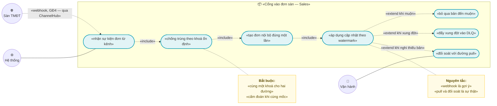
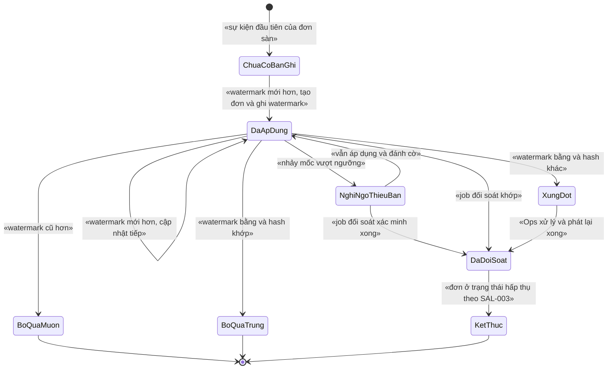
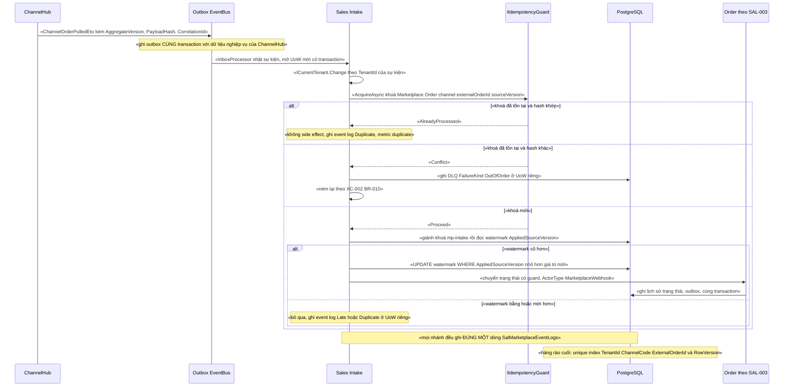

# `SAL-005` — Webhook đơn từ sàn (idempotent, chịu được sai thứ tự)

| Thuộc tính | Nội dung |
|---|---|
| **Mã** | `SAL-005` |
| **Module** | **Sales** — ⚠️ **chưa có trong code**: `modules/` chỉ có `ChannelHub`, `PaymentHub`, `Tax`; entity đơn hàng hiện ở `src/eCommerce.Domain/Entities/Orders/Order.cs` (app sở hữu) ⇒ theo `SAL-003` D9, GĐ1 viết app service ở `src/eCommerce.Application/Sales/` **trước**, tách module `Sales` sau |
| **Giai đoạn** | **GĐ1 — Bán được trên website** (`docs/implementation-plan.md:411`) |
| **Ưu tiên** | **Must have** |
| **Trạng thái** | 🟡 `Draft` — chờ review |
| **Người viết / người review** | *(điền)* / **Kiến trúc trưởng + BA** (feature có state machine + tích hợp sàn — `design-doc-guidelines.md` §6) |
| **Phiên bản / ngày** | `v0.1 — 14/10/2026` |
| **Tài liệu liên quan** | `XC-001` (Money, cấm `==`) · `XC-002` (outbox/inbox, `IIdempotencyGuard`, DLQ, ordering) · `XC-003` (khoá phân tán) · `XC-004` (auth/permission/tenant + allowlist) · `XC-005` (log/metric) · `SAL-002` (đặt hàng trên web) · `SAL-003` (**state machine 4 trục** — SAL-005 **gọi**, không sở hữu) · `CHN-002` (connector Shopee: webhook inbound + chữ ký) · `CHN-004` (allotment) · `REP-003` (báo cáo kênh) · `docs/implementation-plan.md` · `docs/design-doc-guidelines.md` · `docs/templates/feature-design-template.md` |

---

## 0. Tóm tắt & quyết định thiết kế

**Tóm tắt:** `SAL-005` chốt **cổng vào duy nhất của đơn sàn vào Sales**: mọi đơn đến từ kênh TMĐT — dù qua
**đường webhook** hay **đường pull theo con trỏ** — đều phải tạo **đúng một** `Order` nội bộ, và mọi bản cập nhật
phải được áp dụng theo **watermark** (`update_time` của sàn) chứ **không** theo thứ tự đến. Tài liệu định nghĩa
**khoá chống trùng ổn định dùng chung cho cả hai đường**, **bảng watermark theo đơn sàn**, **nhật ký sự kiện
append-only**, và **luật xử lý 4 nhánh** khi một sự kiện đến: áp dụng · trùng · muộn · xung đột cùng mốc.

**Vì sao tài liệu này phải viết trước khi code:** sàn TMĐT giao webhook theo kiểu **at-least-once** và
**không đảm bảo thứ tự** — điều này đã được ghi nhận ngay trong code thật hiện có
(`ShopeeConnector.cs:22`: *"webhook là at-least-once → xử lý đơn phải idempotent theo `order_sn` / `package_number`"*;
`IChannelConnector.cs:93`: *"Cả hai: webhook là at-least-once → mọi xử lý phải IDEMPOTENT"*).
Ba loại lỗi im lặng dưới đây **không có lỗi biên dịch** và **không** lộ ra ở môi trường dev:

| # | Lỗi im lặng có thể xảy ra | Hậu quả |
|---|---|---|
| 1 | Webhook gửi lại ⇒ tạo **2 đơn** cho cùng một đơn sàn | Sai doanh thu, giao 2 lần |
| 2 | Sự kiện **cũ** đến **sau** sự kiện mới ⇒ **ghi đè** trạng thái mới bằng trạng thái cũ | Đơn đã giao bị đưa về "chờ lấy hàng" |
| 3 | Webhook **mất** (sàn không đảm bảo giao) mà hệ thống chỉ tin webhook | Đơn rơi **hoàn toàn** khỏi hệ thống, không ai biết |

**Phạm vi:**

- ✅ **Biên vào** đơn sàn vào Sales: consumer `ChannelOrderPulledEto` (**đã có thật** — phát tại
  `ChannelShopSyncer.cs:69-89`) và cùng ETO đó với cờ `IsFromWebhook = true` (đường webhook, GĐ4).
- ✅ **Chống trùng 2 tầng**: `IIdempotencyGuard` của `XC-002` (tầng nghiệp vụ, theo **sự kiện**) + unique index
  `(TenantId, ChannelCode, ExternalOrderId)` **đã có** trên `OrdOrders` (`eCommerceDbContext.cs:184-186`) làm
  **hàng rào cuối** (theo **đơn**).
- ✅ **Chịu sai thứ tự**: watermark `AppliedSourceVersion` (= epoch giây của `update_time` sàn) + `AppliedPayloadHash`
  trên bảng mới `SalMarketplaceOrderIntakes`; luật 4 nhánh ở §3/§4.
- ✅ **Nhật ký sự kiện append-only** `SalMarketplaceEventLogs` — mọi sự kiện nhận được (kể cả bị bỏ qua) **phải**
  để lại dấu vết (kế thừa `XC-002` D5: *"lỗi luôn để lại dấu vết"* và `XC-002` BR-016: sổ cái append-only).
- ✅ **Ánh xạ dữ liệu sàn → `Order`/`OrderLine`** kèm luật tiền (`decimal` + `Currency`, so bằng minor units).
- ✅ **Job đối soát chủ động** cho các đơn bị đánh cờ `GapSuspected` (lưới an toàn khi webhook mất).
- ✅ **Hợp đồng sự kiện**: bổ sung các trường còn thiếu vào `ChannelOrderPulledEto` (§7.1) — **chưa có trong code - kế hoạch GĐ1**.

**Không nằm trong phạm vi:**

- ❌ **HTTP endpoint nhận webhook + xác thực chữ ký của sàn** — thuộc `CHN-002` §6.3 (module ChannelHub sở hữu
  `IChannelConnector`; `CHN-002` BR-001 **cấm** Sales gọi HTTP tới sàn). ⚠️ `CHN-002` xếp phần này vào **GĐ4** ⇒
  xem **F1** ở §15.2.
- ❌ **Bảng chuyển trạng thái 4 trục** — thuộc `SAL-003`. `SAL-005` **gọi** phương thức chuyển trạng thái **có guard**
  của aggregate `Order` với `ActorType = MarketplaceWebhook`; **không** định nghĩa lại bảng chuyển.
- ❌ **Tạo/sửa đơn nội bộ trên website** — thuộc `SAL-002`.
- ❌ **Huỷ đơn & bù trừ (hoàn kho, hoàn tiền)** — thuộc `SAL-004`.
- ❌ **Đẩy tồn/giá lên sàn và phân bổ tồn theo kênh** — thuộc `CHN-002`/`CHN-004`/`INV-003`.
- ❌ **Settlement/phí sàn và đối soát tiền với sàn** — thuộc `REC-002`.
- ❌ **Trả hàng (RMA)** — thuộc `SAL-006`.
- ❌ **Cam kết exactly-once** — khẳng định rõ: **không đạt được** (`XC-002` §0). Thứ đạt được là **hiệu ứng đúng
  một lần** nhờ idempotency + watermark + unique index.

### 0.1 Quyết định thiết kế (ADR ngắn)

| # | Quyết định | Phương án đã cân nhắc | Lý do chọn | Hệ quả |
|---|---|---|---|---|
| **D1** | **Sales sở hữu "cổng vào" đơn sàn**; ChannelHub **chỉ** phát sự kiện | (a) ChannelHub tự tạo `Order` · (b) Sales tiêu thụ sự kiện | (a) **vi phạm** quy ước #3 (*"module → app là cấm"*) — `ChannelHub` là module, `Order` hiện ở app; và bản thân code hiện có đã chốt hướng (b): `ChannelShopSyncer.cs:13-18` *"ChannelHub KHÔNG tự tạo đơn hàng… app subscribe và tạo Order"* | Sales phải tham chiếu `eCommerce.ChannelHub.Application.Contracts` (hợp lệ: **app → module**). Hợp đồng ETO trở thành **API công khai** giữa hai bên |
| **D2** | **Pull theo con trỏ là nguồn sự thật; webhook chỉ giảm độ trễ** | (a) webhook-only · (b) pull-only · (c) pull + webhook | Webhook **có thể mất** và **có thể sai thứ tự** (`IChannelConnector.cs:93`); pull-only thì đơn mới trễ tới một nhịp (mặc định **300 s**, `ChannelHubOptions.cs:10`) | Đơn có **2 đường vào** ⇒ **bắt buộc** hai đường dùng **cùng** khoá chống trùng (D4). Bỏ webhook đi thì hệ thống **vẫn** chạy đúng, chỉ chậm hơn — đây là tiêu chí kiểm thử |
| **D3** | **`SAL-005` KHÔNG nhận HTTP trực tiếp từ sàn ở GĐ1** | (a) Sales tự mở endpoint webhook · (b) ChannelHub nhận rồi phát ETO | (a) buộc Sales phải biết chữ ký/định dạng riêng của từng sàn ⇒ **nhân đôi** logic connector, và vô hiệu hoá abstraction `IChannelConnector` | GĐ1 chỉ có **đường pull** (có thật trong code). Khi `CHN-002` làm webhook (GĐ4), Sales **không phải sửa** vì hợp đồng ETO đã đủ trường (§7.1) |
| **D4** | **Một khoá chống trùng duy nhất cho cả hai đường**: `Marketplace:Order:{channelCode}:{externalOrderId}:{sourceVersion}` | (a) mỗi đường một khoá · (b) khoá theo `EventId` của sàn · (c) khoá theo `(đơn, mốc cập nhật)` | (a) ⇒ đúng lỗi **dual-path** (`CHN-002` §6.5: *"nếu đặt khác nhau thì cùng một đơn đến 2 đường ⇒ 2 đơn"*); (b) sàn **không** đảm bảo có `event_id` cho mọi loại thông báo | Chống trùng ở mức **sự kiện**; chống tạo 2 đơn ở mức **đơn** dùng unique index **đã có** (`eCommerceDbContext.cs:184-186`) |
| **D5** | **Watermark theo `update_time` của sàn**, không dùng `AggregateVersion` tăng đều | (a) bộ đếm tăng 1 mỗi sự kiện · (b) **mốc thời gian của sàn** | (a) **không** thực hiện được: sàn chỉ cho `update_time`; ta **không** kiểm soát bộ đếm của sàn, và bộ đếm nội bộ **không** trả lời được "bản này có mới hơn bản kia không" | `SourceVersion = epoch giây (UTC)` của `update_time`; ETO mang trường này dưới tên `AggregateVersion` để thoả `XC-002` BR-020, nhưng **ngữ nghĩa là watermark** ⇒ cần ngoại lệ cho luật "gap" của `XC-002` §7.4 (xem **F5** §15.2) |
| **D6** | **Cùng mốc (`v` bằng nhau) mà nội dung khác ⇒ KHÔNG đoán, đẩy DLQ** | (a) bản đến trước thắng · (b) bản đến sau thắng · (c) so `PayloadHash` để chọn · (d) **đẩy DLQ + cảnh báo** | (a)/(b) **không tất định** giữa các instance ⇒ hai instance có thể cho ra hai trạng thái **khác nhau**; (c) hash **không** mang ngữ nghĩa "mới hơn" ⇒ có thể chọn sai bản (ví dụ cùng giây có `cancelled` và `shipped`) | Đây là **quyết định "không đoán"**, đúng nguyên tắc #11 (*"state machine phải NÉM lỗi, không im lặng"*). ⚠️ Đổi lại: cần Ops xử lý ⇒ xem **Q1**. Rủi ro thật: `update_time` của Shopee có **độ phân giải 1 giây** |
| **D7** | **Hai bảng mới của Sales**: `SalMarketplaceOrderIntakes` (watermark) + `SalMarketplaceEventLogs` (append-only) | (a) chỉ dùng `InboxRecords` của `XC-002` · (b) thêm cột vào `OrdOrders` · (c) **2 bảng riêng** | (a) `InboxRecords` chống trùng theo **sự kiện**, **không** giữ watermark theo **đơn** ⇒ không trả lời được "bản này mới hơn không"; (b) làm `OrdOrders` phình và trộn trách nhiệm giữa `SAL-003` và `SAL-005` | 2 bảng ⇒ 2 unique index; `SAL-005` **không** sửa cấu trúc bảng mà `SAL-003` đang sở hữu (chỉ **thêm 2 cột** ở §5.2.1, có phối hợp migration ở §11) |
| **D8** | **`Number` của đơn sàn sinh TẤT ĐỊNH** từ `(channelCode, externalOrderId)` | (a) dãy số tuần tự · (b) `Guid` · (c) chuỗi tất định | (a) dãy tuần tự ⇒ hai luồng sinh hai số khác nhau cho **cùng** một đơn sàn ⇒ phải chống trùng bằng index khác; (c) tất định ⇒ unique index `(TenantId, Number)` **đã có** (`eCommerceDbContext.cs:180`) trở thành **hàng rào thứ hai** miễn phí | Số đơn hiển thị cho khách là `SHOPEE-<order_sn>` (không phải dãy số nội bộ); `Number` giới hạn **64 ký tự** (`eCommerceDbContext.cs:167`) ⇒ vượt ⇒ **NÉM** lỗi |
| **D9** | **Giảm giá chỉ ghi MỘT lần** | (a) ghi cả `OrderLine.DiscountAmount` **và** `Order.DiscountTotal` · (b) chỉ một trong hai | ⚠️ **(a) trừ giảm giá HAI LẦN**: `Order.Recalculate()` tính `Subtotal = Σ LineTotal` mà `LineTotal` **đã trừ** `DiscountAmount` (`Order.cs:139`), rồi lại trừ tiếp `DiscountTotal` (`Order.cs:95`) | `GrandTotal` bị **thấp giả** ⇒ sai tiền, sai đối soát. Ghi rõ luật ở BR-011 + test bất biến tổng (§14 `TC-16`) |
| **D10** | **Khoá phân tán theo đơn sàn** `ecommerce:order:mp-intake:{tenantId}:{channelCode}:{externalOrderId}` | (a) không khoá, chỉ dựa `RowVersion` · (b) **khoá + `RowVersion` + `UPDATE … WHERE`** | `XC-003` D2: *"bỏ lock đi, DB có chặn không?"* — ở đây **có** (`RowVersion` + `UPDATE` có điều kiện là hàng rào thật). Nhưng `XC-003` D9 nói khoá là để **giảm tranh chấp**, và ở đây tranh chấp **vắt qua 2 tiến trình thật** (webhook ở instance A, worker pull ở instance B) | Có **cả hai**. Nhớ `XC-003` D6: khoá **không reentrant** ⇒ **cấm** acquire lồng; timeout bắt buộc (10 s) |
| **D11** | **`CorrelationId` bắt buộc xuyên suốt** ingestion | (a) chỉ log ở đầu | `XC-002` BR-007 + `XC-005`: không có `CorrelationId` thì **không** nối được webhook ↔ ETO ↔ lịch sử trạng thái khi điều tra | ETO, event log, lịch sử `OrdStatusHistory` (`SAL-003` §5.2.2) mang **cùng** `CorrelationId` |
| **D12** | **Job đối soát chủ động là bắt buộc, không phải tuỳ chọn** | (a) tin webhook · (b) tin pull · (c) **pull + job đối soát đơn bị đánh cờ** | Sàn **không** đảm bảo giao webhook (`CHN-002` D1); pull theo con trỏ vẫn có thể lỡ nếu con trỏ nhảy | Nhịp job **hằng ngày** (đối soát theo ngày), khoá `ecommerce:messaging:job:{jobName}:{tenantId}`, idempotent theo `{JobName}:{tenantId}:{kỳ}` (`XC-002` §7.3) |

> 📌 **Hiện trạng code đã kiểm chứng trong phiên này** (làm cơ sở cho mọi khẳng định ở trên):

| Sự thật | Bằng chứng (đã đọc/grep) |
|---|---|
| `ChannelOrderPulledEto` **đã có thật** và **đã được phát** khi pull đơn | `modules/ChannelHub/eCommerce.ChannelHub.Application.Contracts/Events/ChannelEvents.cs:16-30`; phát tại `modules/ChannelHub/eCommerce.ChannelHub.Application/Sync/ChannelShopSyncer.cs:69-89` |
| **Chưa có** handler nào tiêu thụ `ChannelOrderPulledEto` (grep `ChannelOrderPulledEto` toàn repo: chỉ có 3 chỗ — khai báo, comment, nơi phát) | grep `*.cs` toàn repo |
| Unique index chống trùng đơn sàn **đã có** và **đã** dùng `NULLS NOT DISTINCT` | `src/eCommerce.EntityFrameworkCore/eCommerceDbContext.cs:180-186`; `test/eCommerce.IntegrationTests/PostgreSqlSchemaTests.cs:159-160` |
| **Nền `XC-002` chưa có trong code**: grep `IIdempotencyGuard\|InboxRecord\|DeadLetterEvent\|IntegrationEventBase\|IHasEventOutbox\|AbpEventOutbox\|eCommerce.Messaging\|AggregateVersion` trên toàn `*.cs` = **0 kết quả** | grep `*.cs` toàn repo |
| `Order.SetStatus(...)` gán trực tiếp, **không guard** | `src/eCommerce.Domain/Entities/Orders/Order.cs:111` |
| `Order` **không** có cột nào lưu `update_time`/thời điểm đặt hàng của sàn | `src/eCommerce.Domain/Entities/Orders/Order.cs` (đọc toàn bộ 150 dòng) |
| **Chưa có** `shared/eCommerce.Kernel` (nền `Money` của `XC-001`) | `Test-Path shared` = `False`; thư mục gốc chỉ có `docs`, `modules`, `src`, `test`, `tools` |
| Distributed lock **đang** được dùng thật với `IAbpDistributedLock` + `BusinessException` có mã | `modules/ChannelHub/eCommerce.ChannelHub.Application/Sync/ChannelTokenManager.cs:29,67-72,102-104` |

---

## 1. Use Case Specification

| Thuộc tính | Nội dung |
|---|---|
| **Use Case ID** | `SAL-005` |
| **Use Case Name** | Nhận đơn từ sàn vào Sales **đúng một lần** và **chịu được sai thứ tự** |
| **Description** | *"Là hệ thống bán đa kênh, tôi muốn mọi đơn của sàn — đến qua webhook hay qua nhịp pull — đều tạo **đúng một** đơn nội bộ, và mọi bản cập nhật được áp dụng theo **mốc thời gian của sàn** để một thông báo cũ đến muộn **không bao giờ** ghi đè trạng thái mới hơn."* |
| **Actor(s)** | **Sàn TMĐT** (nguồn dữ liệu, gửi webhook/trả kết quả pull) · **ChannelHub** (`ChannelShopSyncer`, phát `ChannelOrderPulledEto`) · **Hệ thống** (`IIdempotencyGuard`, `InboxProcessor`, job đối soát) · **NCC chữ ký webhook** (gián tiếp — thuộc `CHN-002`) · **Vận hành (Ops)** (xem/xử lý xung đột, phát lại DLQ) · **Kiến trúc/DBA** (theo dõi metric lệch) |
| **Priority** | **Must have** |
| **Trigger** | (a) `ChannelShopSyncer.SyncAsync` phát `ChannelOrderPulledEto` khi kéo được đơn; (b) webhook đơn của sàn được ChannelHub xác thực và phát **cùng** ETO với `IsFromWebhook = true` (GĐ4); (c) job đối soát hằng ngày quét đơn bị đánh cờ `GapSuspected`; (d) Ops bấm phát lại một bản ghi DLQ (`XC-002` §6.1) |
| **Pre-Condition(s)** | • **Tenant hiện tại** (`TenantId`) — **bắt buộc**; ETO **phải** mang `TenantId` (lấy từ `ChannelShop.TenantId`, xem `ChannelShopSyncer.cs:71`) — thiếu ⇒ **NÉM** lỗi tham số, **cấm** suy diễn.<br>• **Kênh bán** (`ChannelCode`) — **bắt buộc** và **không** rỗng (miền đơn sàn **luôn** có kênh).<br>• **`ChannelShop` tồn tại** và **`IsActive`** — nếu không ⇒ **NÉM** `eCommerce:Sales:0004` (không âm thầm bỏ qua).<br>• **Nền `XC-002` đã sẵn sàng**: `IIdempotencyGuard`, `InboxRecords`, `DeadLetterEvents`, outbox/inbox **đã bật tường minh** (`XC-002` D2/§6.3) — ⚠️ **chưa có trong code - kế hoạch nền trước GĐ1** (xem §14.4).<br>• **`SAL-003` đã có** phương thức chuyển trạng thái **có guard** trên aggregate `Order` — ⚠️ **chưa có trong code - kế hoạch GĐ1**; `SAL-005` **chặn** cho tới khi có.<br>• **Redis 7** sẵn sàng (dùng cho khoá `mp-intake`); **không** phải điều kiện bắt buộc để **đúng** dữ liệu — hàng rào cuối là `RowVersion` + `UPDATE … WHERE` + unique index (`XC-003` D2).<br>• **ETO có đủ trường watermark** (`AggregateVersion`, `SourceUpdatedAtUtc`, `PayloadHash`, `CorrelationId`) — ⚠️ **các trường này chưa có trong ETO hiện tại** (xem **F2/F3** §15.2). |
| **Post-Condition(s)** | • Với mỗi `(TenantId, ChannelCode, ExternalOrderId)` có **đúng một** `Order` và **đúng một** bản ghi `SalMarketplaceOrderIntakes`.<br>• `AppliedSourceVersion` **chỉ tăng**, **không bao giờ** giảm (bất biến watermark).<br>• Mọi sự kiện nhận được **có đúng một** dòng `SalMarketplaceEventLogs` với `Outcome` xác định (`Applied`/`Duplicate`/`Late`/`Conflict`/`GapSuspected`/`Failed`).<br>• Sự kiện bị áp dụng **có** `OrdStatusHistory` (`SAL-003` BR-004) và `OrderStatusChangedEto` phát **cùng transaction** (`XC-002` BR-001).<br>• Sự kiện không áp dụng được vì **xung đột** ⇒ **có** bản ghi DLQ **trước khi** kết thúc xử lý (`XC-002` BR-010).<br>• Không phát sinh `double`/`float`; mọi so sánh tiền dùng minor units. |
| **Basic Flow** | 1. ChannelHub phát `ChannelOrderPulledEto` (đã bổ sung trường §7.1) **trong** UoW.<br>2. `InboxProcessor` (`XC-002`) nhặt sự kiện, mở UoW **mới có transaction**, chạy handler của Sales.<br>3. Handler gọi `IIdempotencyGuard.AcquireAsync` với khoá **D4** ⇒ `Proceed` ⇒ ghi/khẳng định `InboxRecords`.<br>4. Handler giành khoá `ecommerce:order:mp-intake:{tenantId}:{channelCode}:{externalOrderId}` (timeout **10 s**).<br>5. Handler đọc `SalMarketplaceOrderIntakes` theo `(TenantId, ChannelCode, ExternalOrderId)`.<br>6. **Chưa có bản ghi** ⇒ tạo `Order` (số đơn tất định — D8) + `OrderLine` (chống trùng theo `ExternalLineId`) + ghi intake record (`AppliedSourceVersion = v_in`).<br>7. **Đã có bản ghi** ⇒ so watermark theo **bảng 4 nhánh** §3.3; nếu `v_in` lớn hơn ⇒ áp dụng cập nhật.<br>8. Áp dụng cập nhật: cập nhật tiền/địa chỉ/ghi chú, rồi gọi phương thức chuyển trạng thái **có guard** của `Order` (`SAL-003`) với `ActorType = MarketplaceWebhook` + `ReasonCode` = trạng thái thô của sàn.<br>9. Ghi **một** dòng `SalMarketplaceEventLogs` (`Outcome = Applied`, kèm `CorrelationId`).<br>10. `UPDATE` watermark có điều kiện (`WHERE AppliedSourceVersion < @v_in`) ⇒ **0 dòng** ⇒ **NÉM** `eCommerce:Sales:0003`.<br>11. UoW kết thúc: trạng thái đơn + lịch sử + event log + outbox **cùng transaction**. |
| **Alternative Flow** | **A1 — Sự kiện đến MUỘN (`v_in < AppliedSourceVersion`)**: **bỏ qua** (không side effect), ghi event log `Outcome = Late`, log `Information`, tăng metric `sales_mp_intake_late_total` — **KHÔNG** DLQ, **KHÔNG** ném lỗi (đây là ca **bình thường**: webhook đến sau nhịp pull).<br>**A2 — Sự kiện TRÙNG (`v_in` bằng `AppliedSourceVersion`, hash khớp)**: **bỏ qua**, event log `Outcome = Duplicate`, log `Information`, metric `..._duplicate_total`.<br>**A3 — XUNG ĐỘT CÙNG MỐC (`v_in` bằng, hash khác)**: **KHÔNG** ghi đè; event log `Outcome = Conflict`; ghi **DLQ** `FailureKind = OutOfOrder`; metric `..._conflict_total`; **cảnh báo** — chờ Ops (`XC-002` A3 phát lại DLQ).<br>**A4 — NGHI NGỜ THIẾU BẢN TRUNG GIAN (`v_in - watermark > ngưỡng`, mặc định **3600 s**)**: **vẫn áp dụng** (bản mới hơn là đúng) **nhưng** đặt `GapSuspected = true` + metric `..._gap_suspected_total` + **đưa vào phạm vi job đối soát** (§7.2). **Không** DLQ — vì bỏ qua sẽ để trạng thái đơn **sai** cho tới nhịp đối soát.<br>**A5 — Đơn đã ở trạng thái hấp thụ** (`SAL-003`: `IsCancelled = true` / `ReturnStatus = Returned`): sự kiện **mới hơn** vẫn được **ghi nhận vào event log** (`Outcome = Late` vì không còn chuyển dịch hợp lệ) + metric; **cấm** mở lại đơn (`SAL-003` BR-012) ⇒ luồng này **phải** đi qua guard của `SAL-003` và **NÉM** `eCommerce:Order:0006` — **không** nuốt.<br>**A6 — Phát lại từ DLQ**: giữ **nguyên** `IdempotencyKey` gốc (`XC-002` BR-012); watermark vẫn là hàng rào ⇒ nếu đã có bản mới hơn thì lần phát lại rơi vào **A1**. |
| **Exception Flow** | **E1:** ETO thiếu `AggregateVersion`/`PayloadHash`/`TenantId` ⇒ **NÉM** `eCommerce:Sales:0001` (dữ liệu hợp đồng sai — **không** retry vô hạn) + DLQ `PoisonMessage`.<br>**E2:** payload không deserialize được về ETO ⇒ DLQ `FailureKind = PoisonMessage` (`XC-002` E4).<br>**E3:** cùng `IdempotencyKey` + **khác** `PayloadHash` ⇒ **NÉM** `eCommerce:Messaging:0002` (`XC-002` BR-006) — **cấm** coi là trùng.<br>**E4:** `UPDATE` watermark ảnh hưởng **0 dòng** (đã bị luồng khác tiến) ⇒ **NÉM** `eCommerce:Sales:0003`, **cấm** coi là thành công — luồng thua **không** ghi gì thêm.<br>**E5:** không giành được khoá `mp-intake` trong timeout ⇒ **NÉM** `eCommerce:Sales:0006` (`XC-003` D10: mặc định `ThrowOnTimeout`); **cấm** bỏ qua im lặng.<br>**E6:** chuyển trạng thái không có trong bảng chuyển của `SAL-003` ⇒ `SAL-003` **NÉM** `eCommerce:Order:0001` ⇒ handler ghi DLQ `FailureKind = HandlerError` + `FailureCode` rồi **ném lại** (`XC-002` BR-010).<br>**E7:** `ChannelShop` không tồn tại / `IsActive = false` ⇒ **NÉM** `eCommerce:Sales:0004` + DLQ (thường là lỗi cấu hình, **không** retry vô hạn).<br>**E8:** `Number` tất định vượt **64 ký tự** (giới hạn cột, `eCommerceDbContext.cs:167`) ⇒ **NÉM** `eCommerce:Sales:0002` + DLQ + **cảnh báo** (cần đổi quy tắc số đơn).<br>**E9:** vi phạm unique `(TenantId, ChannelCode, ExternalOrderId)` khi chèn ⇒ **bắt** `DbUpdateException` ⇒ coi là **trùng hợp lệ** (luồng khác đã tạo) ⇒ ghi event log `Duplicate` + **đọc lại** bản ghi ⇒ tiếp tục luật watermark — **KHÔNG** trả `500`.<br>**E10:** Redis chết ⇒ khoá **vô hiệu** ⇒ `RowVersion` + `UPDATE … WHERE` **vẫn** chặn ⇒ dữ liệu **vẫn đúng**; ghi metric (theo `XC-003` E2, fail-open). |
| **Business Rules** | • **BR-SAL-005-001**: **Mọi** biên vào (consumer ETO, đường webhook, job đối soát) **phải** gọi `IIdempotencyGuard` **trước** mọi side effect (`XC-002` BR-004).<br>• **BR-SAL-005-002**: Khoá chống trùng **phải** là `Marketplace:Order:{channelCode}:{externalOrderId}:{sourceVersion}`; đường pull và đường webhook **phải** dùng **cùng** khoá — **cấm** hai khoá khác nhau (lỗi dual-path của `CHN-002` §6.5).<br>• **BR-SAL-005-003**: Tạo đơn **phải** dựa vào unique index DB `(TenantId, ChannelCode, ExternalOrderId)` làm hàng rào cuối; vi phạm unique ⇒ coi là **trùng hợp lệ**, **cấm** trả lỗi hệ thống.<br>• **BR-SAL-005-004**: Mọi ETO đơn sàn **phải** mang `AggregateVersion` (epoch giây của `update_time` sàn), `SourceUpdatedAtUtc`, `PayloadHash` (SHA-256 canonical JSON), `CorrelationId`; thiếu ⇒ **NÉM** `eCommerce:Sales:0001`.<br>• **BR-SAL-005-005**: `v_in < AppliedSourceVersion` ⇒ **bỏ qua** có log `Information` + metric; **cấm** DLQ và **cấm** ném lỗi (ca bình thường).<br>• **BR-SAL-005-006**: `v_in` bằng `AppliedSourceVersion` **và** `PayloadHash` khớp ⇒ **trùng** ⇒ **0** side effect + metric `..._duplicate_total`.<br>• **BR-SAL-005-007**: `v_in` bằng **và** `PayloadHash` khác ⇒ **NÉM**/DLQ `OutOfOrder` + **cảnh báo**; **cấm** ghi đè; **cấm** chọn bản theo thứ tự đến (D6).<br>• **BR-SAL-005-008**: `v_in > AppliedSourceVersion` ⇒ **áp dụng**; cập nhật watermark **phải** bằng `UPDATE … WHERE AppliedSourceVersion < @v_in` **và** kiểm tra số dòng; `0` dòng ⇒ **NÉM** `eCommerce:Sales:0003`.<br>• **BR-SAL-005-009**: `v_in - AppliedSourceVersion > GapThresholdSeconds` (mặc định **3600**) ⇒ đặt `GapSuspected = true` + metric + **đưa vào** phạm vi job đối soát; **vẫn** áp dụng.<br>• **BR-SAL-005-010**: **Cấm** gọi `Order.SetStatus(...)` (không guard — `Order.cs:111`); chuyển trạng thái **chỉ** qua phương thức có guard của `SAL-003` với `ActorType = MarketplaceWebhook` và `ReasonCode` **không** rỗng.<br>• **BR-SAL-005-011**: Giảm giá của sàn **chỉ** được ghi **một lần**: **hoặc** phân bổ về `OrderLine.DiscountAmount`, **hoặc** để ở `Order.DiscountTotal`; ghi **cả hai** ⇒ **NÉM** `eCommerce:Sales:0005` (D9 — chống trừ hai lần).<br>• **BR-SAL-005-012**: Mọi so sánh/đối chiếu tiền **phải** qua minor units (`ToMinorUnits()`); **cấm** `==` trên `decimal` (`XC-001` BR-003) và **cấm** `double`/`float`.<br>• **BR-SAL-005-013**: `SalMarketplaceEventLogs` là **APPEND-ONLY**; **cấm** UPDATE/DELETE ở tầng ứng dụng; mọi sự kiện nhận được ⇒ **đúng một** dòng.<br>• **BR-SAL-005-014**: ETO đơn sàn **phải** phát qua `IDistributedEventBus` với `useOutbox: true` **trong** UoW; **cấm** phát ngoài outbox (`XC-002` BR-001/BR-002).<br>• **BR-SAL-005-015**: Mọi app service của Sales **phải** có `[Authorize]` ở **cấp class** và permission **phải** được định nghĩa trong `eCommercePermissionDefinitionProvider` (`XC-004` BR-001/BR-002).<br>• **BR-SAL-005-016**: Mọi entity của feature **phải** là `IMultiTenant`; handler **phải** `ICurrentTenant.Change(tenantId của sự kiện)` trước khi chạm DB; tài nguyên tenant khác ⇒ `404` (`XC-004` BR-008/BR-009).<br>• **BR-SAL-005-017**: **Cấm** Sales gọi HTTP tới sàn; mọi tương tác sàn qua `IChannelConnector` của ChannelHub (`CHN-002` BR-001).<br>• **BR-SAL-005-018**: Job đối soát **phải** idempotent theo `{JobName}:{tenantId}:{kỳ}`; **cấm** dùng `DateTime.Now` làm thành phần khoá (`XC-002` §7.3).<br>• **BR-SAL-005-019**: **Cấm** coi *"đã có bản ghi `AbpEventInbox`"* là đã chống trùng (`XC-002` D3 — `MessageId` không unique và đổi mỗi lần phát lại).<br>• **BR-SAL-005-020**: Mọi lần **không giành được khoá** `mp-intake` **phải** có dấu vết: ném lỗi có mã (`eCommerce:Sales:0006`) **hoặc** (job định kỳ) log + metric `lock_skipped_total` (`XC-003` BR-010). |
| **Non-Functional Requirement** | • **NFR-SAL-005-001**: Áp dụng **1** sự kiện (đã có intake record, không tranh chấp) p95 **< 50 ms**, p99 **< 150 ms** (máy dev).<br>• **NFR-SAL-005-002**: Gửi lại **cùng** webhook **100 lần** ⇒ **đúng 1** đơn, **0** exception (`XC-002` NFR-005).<br>• **NFR-SAL-005-003**: **2** luồng song song (webhook + pull, cùng đơn) ⇒ **đúng 1** đơn; **0** lỗi hệ thống trả về.<br>• **NFR-SAL-005-004**: **1.000** ca đến **sai thứ tự** ⇒ **0** lần ghi đè trạng thái mới hơn (bất biến watermark).<br>• **NFR-SAL-005-005**: **0** sự kiện nhận được mà **không** có dòng `SalMarketplaceEventLogs`.<br>• **NFR-SAL-005-006**: Độ trễ áp dụng (enqueue → trạng thái đơn đổi) p95 **< 5 s** (khớp `XC-002` NFR-013 + relay outbox **2 s**).<br>• **NFR-SAL-005-007**: Cách ly tenant: tenant A **không** đọc được intake/event log/DLQ của tenant B (integration test 2 tenant).<br>• **NFR-SAL-005-008**: **0** `double`/`float` trong entity/DTO/ETO của Sales (test reflection).<br>• **NFR-SAL-005-009**: **6** metric mới của feature **có** trong `eCommerceMetricNames.All` **và** có nơi phát; tên theo snake_case + hậu tố `_total` (ràng buộc bởi `test/eCommerce.Tests/Observability/MetricsTests.cs:112-127`).<br>• **NFR-SAL-005-010**: **100 %** sự kiện có `CorrelationId` trong log + ETO + lịch sử trạng thái.<br>• **NFR-SAL-005-011**: **0** deadlock/treo vô hạn: mọi lần acquire khoá **có** timeout hữu hạn.<br>• **NFR-SAL-005-012**: Job đối soát phát hiện lệch do webhook mất trong **< 24 h** kể từ khi đơn lệch. |

---

## 2. Sơ đồ Use Case



### Chú giải

| Ký hiệu | Ý nghĩa |
|---|---|
| ⭕ Xanh lá | Actor (người dùng + hệ thống ngoài) |
| 🟦 Bầu dục xanh dương | Use Case |
| 🟨 Khung vàng | Note (nguyên tắc bắt buộc) |
| `───` | Liên kết Actor ↔ Use Case |
| `-.«include».->` | Quan hệ bao hàm |
| `-.«extend …».->` | Quan hệ mở rộng (chỉ xảy ra ở nhánh tương ứng) |

---

## 3. Sơ đồ trạng thái (state machine)

### 3.1 Vòng đời **một đơn sàn trong Sales** (bản ghi `SalMarketplaceOrderIntakes`)



| # | Từ → Sang | Guard (điều kiện cho phép) | Hành động kèm theo | Nếu guard sai thì? |
|---|---|---|---|---|
| 1 | `[*]` → `ChuaCoBanGhi` | Có sự kiện đầu tiên cho `(TenantId, ChannelCode, ExternalOrderId)` | Không ghi gì (chỉ là điểm bắt đầu logic) | — |
| 2 | `ChuaCoBanGhi` → `DaApDung` | `IIdempotencyGuard` trả `Proceed` **và** giành được khoá `mp-intake` | `INSERT Order` + `OrderLine` + `INSERT intake (AppliedSourceVersion = v_in)` + event log `Applied` + chuyển trạng thái `SAL-003` + outbox | Vi phạm unique ⇒ **trùng hợp lệ** (E9) ⇒ đọc lại + sang nhánh watermark |
| 3 | `DaApDung` → `DaApDung` | `v_in > AppliedSourceVersion` **và** `UPDATE … WHERE` ảnh hưởng **1** dòng | Cập nhật tiền/dòng đơn, chuyển trạng thái `SAL-003`, event log `Applied`, outbox | `0` dòng ⇒ **NÉM** `eCommerce:Sales:0003` |
| 4 | `DaApDung` → `BoQuaMuon` | `v_in < AppliedSourceVersion` | Event log `Late` + metric `..._late_total` | **Không** ném, **không** DLQ, **không** side effect (BR-005) |
| 5 | `DaApDung` → `BoQuaTrung` | `v_in` bằng **và** `PayloadHash` khớp `AppliedPayloadHash` | Event log `Duplicate` + metric `..._duplicate_total` | Nếu hash **khác** ⇒ sang `XungDot` (BR-007) |
| 6 | `DaApDung` → `XungDot` | `v_in` bằng **và** `PayloadHash` khác | Event log `Conflict` + **DLQ** `OutOfOrder` + metric `..._conflict_total` + **cảnh báo** | Thiếu DLQ ⇒ vi phạm BR-010 của `XC-002` (lỗi không có dấu vết) |
| 7 | `DaApDung` → `NghiNgoThieuBan` | `v_in - AppliedSourceVersion > GapThresholdSeconds` | Event log `GapSuspected` + metric + `GapSuspected = true`; **vẫn** áp dụng cập nhật | Nếu **không** áp dụng ⇒ trạng thái đơn **sai** cho tới nhịp đối soát (tệ hơn) |
| 8 | `NghiNgoThieuBan` → `DaDoiSoat` / `DaDoiSoat` | Job đối soát chạy xong cho kỳ chứa đơn | Ghi `LastReconciledAtUtc`; xoá cờ `GapSuspected` nếu khớp | Lệch ⇒ **giữ** cờ + DLQ `HandlerError` + cảnh báo (không tự "sửa" bằng tay) |
| 9 | `XungDot` → `DaDoiSoat` | Ops phát lại DLQ (`XC-002` A3) **và** watermark cuối cùng **lớn hơn** mốc xung đột | Event log `Applied` (bản phát lại) | Không tiến được watermark ⇒ **ở lại** `XungDot` + cảnh báo |
| 10 | `DaDoiSoat` → `KetThuc` | `SAL-003` báo đơn ở trạng thái **hấp thụ** (`IsCancelled = true` hoặc `ReturnStatus = Returned`) | Sự kiện mới hơn ⇒ event log `Late` + metric; **cấm** chuyển dịch (`SAL-003` BR-012) | Cố chuyển ⇒ `SAL-003` **NÉM** `eCommerce:Order:0006` ⇒ handler ghi DLQ + **ném lại** |
| 11 | `KetThuc` → `[*]` | — | — | Trạng thái **hấp thụ** |

> ⚠️ **Quy tắc bất di bất dịch #11** (`docs/implementation-plan.md:54`): guard sai **phải NÉM LỖI** hoặc để lại
> dấu vết có cấu trúc — **không** im lặng. Trong tài liệu này, **chỉ hai** nhánh được phép "không làm gì" là
> `BoQuaMuon` và `BoQuaTrung`, và **cả hai** đều **bắt buộc** có event log + metric (BR-005/BR-006).
>
> 📌 **Ai được phép chuyển:** `ChuaCoBanGhi → DaApDung` và `DaApDung → DaApDung` do **handler tiêu thụ sự kiện**
> (không phải người dùng); `XungDot → DaDoiSoat` do **Ops có permission** `eCommerce.Sales.MarketplaceIntake.Reprocess`;
> `NghiNgoThieuBan → DaDoiSoat` do **job đối soát**.
>
> 📌 **Trạng thái hấp thụ:** `KetThuc`, `BoQuaMuon`, `BoQuaTrung`. `XungDot` **không** hấp thụ vì còn đường phát lại.

### 3.2 Vòng đời **một sự kiện nhận được** (mỗi dòng `SalMarketplaceEventLogs`)

Vòng đời này **không** cần sơ đồ riêng: nó là **6+1 giá trị** của cột `Outcome` (`Applied`, `Duplicate`, `Late`,
`Conflict`, `GapSuspected`) + `Failed` khi có exception. Bất biến: **một sự kiện ⇒ đúng một dòng, ghi một lần,
không sửa** (BR-013).

### 3.3 Bảng **4 nhánh quyết định** (luật áp dụng — nguồn sự thật duy nhất)

| Nhánh | Điều kiện (so **watermark**) | Áp dụng cập nhật? | Ghi event log | DLQ | Metric | Ném lỗi? |
|---|---|---|---|---|---|---|
| **A. Áp dụng** | `v_in > AppliedSourceVersion` | ✅ **CÓ** | `Applied` | ❌ | `..._applied_total` | ❌ |
| **B. Muộn** | `v_in < AppliedSourceVersion` | ❌ | `Late` | ❌ | `..._late_total` | ❌ |
| **C. Trùng** | `v_in` bằng **và** hash **khớp** | ❌ | `Duplicate` | ❌ | `..._duplicate_total` | ❌ |
| **D. Xung đột** | `v_in` bằng **và** hash **khác** | ❌ (**cấm** đoán) | `Conflict` | ✅ `OutOfOrder` | `..._conflict_total` | ✅ (ghi DLQ rồi ném lại theo `XC-002`) |

> 📌 **Vì sao `v_in` bằng nhau phải tách thành 2 nhánh (C và D):** `PayloadHash` khớp nghĩa là **cùng một sự kiện
> được giao lại** (at-least-once — hoàn toàn bình thường). Hash khác nghĩa là sàn đã **đổi nội dung** trong **cùng
> một giây** (`update_time` phân giải 1 giây) ⇒ hai bản **khác nhau** cùng mốc. Không có cơ sở **tất định** nào để
> chọn bản nào là "mới hơn" ⇒ chọn bừa sẽ cho **hai instance hai kết quả khác nhau** (phân kỳ dữ liệu). Đây là lý do
> **D6**: đẩy DLQ và **không** ghi đè.

---

## 4. Sequence Diagram & luồng dữ liệu

### 4.1 Sequence — nhận một sự kiện đơn sàn, quyết định theo watermark



### 4.2 DFD — hai đường vào, một hàng rào

**Không vẽ sơ đồ riêng** — lý do: yêu cầu "tối đa 3 sơ đồ Mermaid" cho tài liệu này, và 3 sơ đồ đã dùng ở §2, §3.1,
§4.1. Luồng dữ liệu được mô tả bằng bảng định tuyến dưới đây (đủ để kiểm chứng, không mất thông tin).

| # | Đường vào | Có thật trong code? | Ai xác thực | Khoá chống trùng | Nếu xử lý lỗi |
|---|---|---|---|---|---|
| 1 | **Pull theo con trỏ** → `ChannelOrderPulledEto` | ✅ **CÓ** — `ChannelShopSyncer.cs:69-89` (⚠️ `ShopeeConnector` còn `EnableLiveCalls = false` nên hiện trả lệnh rỗng: `ShopeeConnector.cs:80-87`) | Nội bộ (đi qua outbox) | **D4** | DLQ + retry nhịp sau (`XC-002`) |
| 2 | **Webhook sàn** → ChannelHub → **cùng** ETO với `IsFromWebhook = true` | ❌ **chưa có trong code - kế hoạch GĐ4** (`CHN-002` §6.3) | **Chữ ký của sàn** (thuộc `CHN-002` BR-010) — không phải permission | **D4** (**trùng** với đường 1) | DLQ + retry; chữ ký sai ⇒ từ chối ở `CHN-002` |
| 3 | **Job đối soát chủ động** (quét đơn `GapSuspected` / theo ngày) | ❌ **chưa có trong code - kế hoạch GĐ1** | Nội bộ | `{JobName}:{tenantId}:{kỳ}` | DLQ + retry; job **phải** chạy lại được |
| 4 | **Ops phát lại DLQ** | ❌ phụ thuộc `XC-002` (§6.1) **chưa có trong code** | Permission `eCommerce.Messaging.DeadLetter.Replay` | Giữ **nguyên** khoá gốc (`XC-002` BR-012) | Ở lại DLQ + cảnh báo |

**Chiến lược transaction (tóm tắt — chi tiết §12):**

1. **Phía ChannelHub:** một UoW cho dữ liệu nghiệp vụ **và** bản ghi outbox (`XC-002` BR-001) — **không** thuộc
   phạm vi `SAL-005` nhưng `SAL-005` **phụ thuộc** vào nó.
2. **Phía Sales (handler):** một UoW `isTransactional: true, requiresNew: true` cho **trạng thái đơn + lịch sử +
   event log `Applied` + outbox**; **UoW riêng** (`requiresNew`) cho **DLQ** và cho **event log của nhánh bỏ qua**
   (`Late`/`Duplicate`/`Conflict`) để dấu vết **không** bị rollback theo (`XC-002` D5).
3. **Job đối soát:** mỗi đơn một UoW; **không** gộp cả kỳ vào một transaction.

---

## 5. Mô hình dữ liệu

### 5.1 ERD

**Không vẽ sơ đồ ERD** — lý do: giới hạn **3 sơ đồ Mermaid** cho tài liệu này (§2, §3.1, §4.1 đã dùng hết); và
quan hệ ở đây đơn giản, mô tả đủ bằng bảng:

| Quan hệ | Bản số | Ghi chú |
|---|---|---|
| `OrdOrders` ↔ `SalMarketplaceOrderIntakes` | 1 — 0..1 | `Order` **không** FK cứng tới intake; intake trỏ `OrderId` (soft reference) — để `SAL-005` **không** trói khoá ngoại vào bảng của `SAL-003` |
| `SalMarketplaceOrderIntakes` ↔ `SalMarketplaceEventLogs` | 1 — n | qua `(TenantId, ChannelCode, ExternalOrderId)`; **không** FK cứng (log **phải** sống được kể cả khi intake bị xoá/không tồn tại — ví dụ sự kiện `Failed` đầu tiên) |
| `SalMarketplaceEventLogs` ↔ `DeadLetterEvents` (`XC-002`) | 1 — 0..1 | qua `(TenantId, ChannelCode, ExternalOrderId, SourceVersion)`; DLQ là bảng của `XC-002`, **không** sở hữu ở đây |
| `ChannelShop` (module ChannelHub) ↔ intake | 1 — n | qua cột `ChannelShopId` (Guid, soft reference — **cấm** FK cứng qua ranh giới module) |

### 5.2 Bảng & cột (Data Dictionary)

#### 5.2.1 Bảng `OrdOrders` — **bổ sung 2 cột** (bảng đã tồn tại)

Bảng đã có trong code: `src/eCommerce.EntityFrameworkCore/eCommerceDbContext.cs:162-192` (`b.ToTable("OrdOrders")`);
migration đầu tiên `src/eCommerce.EntityFrameworkCore/Migrations/20261009070214_Initial.cs`. Dưới đây **chỉ** liệt kê
cột mà `SAL-005` cần thêm — **cột của `SAL-003` không nằm ở đây** (tránh hai tài liệu cùng sửa một bảng mà không phối hợp).

| Cột | Kiểu | Null? | Nguồn / ý nghĩa | Ghi chú |
|---|---|---|---|---|
| `PlacedAtUtc` | `timestamptz` | ✔ | **mới** — thời điểm **khách đặt hàng trên sàn** (`PlacedAtUtc` trong ETO, `ChannelEvents.cs:24`) | ⚠️ **chưa có trong code**: `Order.cs` (đọc toàn bộ) **không** có cột nào lưu mốc này ⇒ hiện đang **mất** thông tin. Nullable cho đơn web (đơn web dùng `CreationTime`) |
| `MarketplaceUpdatedAtUtc` | `timestamptz` | ✔ | **mới** — mốc `update_time` gần nhất **đã áp dụng** | ⚠️ **denormalize có chủ ý** để báo cáo/đối soát (`REP-003`) không phải join; ⚠️ **nguồn sự thật** vẫn là `SalMarketplaceOrderIntakes.AppliedSourceVersion` ⇒ mọi kiểm tra quyết định (nhánh A/B/C/D) **phải** đọc từ intake, **không** từ cột này |

**Index & ràng buộc** — index hiện có **giữ nguyên**; `SAL-005` **thêm**:

| Loại | Cột | Mục đích |
|---|---|---|
| UNIQUE *(đã có)* | `(TenantId, Number)` **`NULLS NOT DISTINCT`** | ✅ **đã có** — `eCommerceDbContext.cs:180` + `test/eCommerce.IntegrationTests/PostgreSqlSchemaTests.cs:160`. Vì `Number` sinh **tất định** (D8) ⇒ index này là **hàng rào thứ hai** chống tạo 2 đơn từ cùng một đơn sàn |
| UNIQUE *(đã có)* | `(TenantId, ChannelCode, ExternalOrderId)` **có filter** + `NULLS NOT DISTINCT` | ✅ **đã có** — `eCommerceDbContext.cs:184-186` + `PostgreSqlSchemaTests.cs:159`; **hàng rào chính** của BR-003 |
| INDEX *(mới)* | `(TenantId, ChannelCode, MarketplaceUpdatedAtUtc)` | job đối soát quét theo kênh + mốc |

#### 5.2.2 Bảng `SalMarketplaceOrderIntakes` — **bảng MỚI** (watermark theo đơn sàn)

Mục đích: giữ **một** dòng cho mỗi đơn sàn, chứa **watermark** để trả lời câu hỏi *"bản này có mới hơn bản đã áp dụng không?"*.

| Cột | Kiểu | Null? | Nguồn / ý nghĩa | Ghi chú |
|---|---|---|---|---|
| `Id` | `uuid` | ✖ | khoá chính (`FullAuditedAggregateRoot<Guid>`) | |
| `TenantId` | `uuid` | ✔ | tenant sở hữu | **bắt buộc** theo ngữ nghĩa (`IMultiTenant`; `XC-004` BR-009/F1) |
| `ChannelCode` | `varchar(32)` | ✖ | kênh bán (`shopee`, `lazada`, …) | khớp `Order.ChannelCode` (`eCommerceDbContext.cs:168`) |
| `ChannelShopId` | `uuid` | ✔ | shop trên kênh | **soft reference** sang `ChnChannelShops` — **cấm** FK cứng (ranh giới module) |
| `ExternalOrderId` | `varchar(64)` | ✖ | mã đơn của sàn (`order_sn`) | khớp độ dài với `Order.ExternalOrderId` (`eCommerceDbContext.cs:169`) |
| `OrderId` | `uuid` | ✔ | `OrdOrders.Id` đã tạo cho đơn này | soft reference |
| `AppliedSourceVersion` | `bigint` | ✖ | **watermark**: `SourceVersion` **đã áp dụng** (epoch giây của `update_time` sàn) | ⭐ **cột quan trọng nhất**; **chỉ tăng** |
| `AppliedSourceUpdatedAtUtc` | `timestamptz` | ✖ | mốc thời gian tương ứng `AppliedSourceVersion` | phải khớp `AppliedSourceVersion` (bất biến 4 ở §8.1 — kiểm bằng test) |
| `AppliedPayloadHash` | `char(64)` | ✖ | SHA-256 canonical JSON của payload **đã áp dụng** | dùng cho nhánh C/D (§3.3) |
| `AppliedEventId` | `uuid` | ✖ | `EventId` của ETO đã áp dụng | tra chéo outbox ↔ intake |
| `GapSuspected` | `bool` | ✖ | mặc định `false`; `true` khi nhảy mốc vượt ngưỡng | đưa đơn vào phạm vi job đối soát |
| `LastReceivedAtUtc` | `timestamptz` | ✖ | thời điểm **nhận** sự kiện gần nhất (kể cả bị bỏ qua) | |
| `LastFailureCode` | `varchar(64)` | ✔ | mã lỗi gần nhất (nếu có) | để tra cứu vận hành |
| `LastReconciledAtUtc` | `timestamptz` | ✔ | lần cuối job đối soát xác minh đơn này | |
| `CorrelationId` | `varchar(64)` | ✔ | `XC-005` | |
| `RowVersion` | `xid` *(PostgreSQL)* | ✖ | optimistic concurrency | Npgsql map `uint RowVersion` + `.IsRowVersion()` ⇒ cột hệ thống `xid` — ⚠️ **chưa kiểm chứng** trên Npgsql **10.0.3** (`Directory.Packages.props`); `SAL-003` §15.1 Q3 đã nêu cùng câu hỏi |
| `ExtraProperties` | `jsonb` | ✔ | dữ liệu mở rộng | theo quy ước ABP |

**Index & ràng buộc**

| Loại | Cột | Mục đích |
|---|---|---|
| **UNIQUE** | `(TenantId, ChannelCode, ExternalOrderId)` **`NULLS NOT DISTINCT`** | ⭐ **hàng rào watermark**: **đúng một** dòng cho một đơn sàn ⇒ `UPDATE … WHERE` luôn nhắm đúng một dòng |
| INDEX | `(TenantId, GapSuspected, LastReceivedAtUtc)` | job đối soát: *"đơn nào đang bị đánh cờ"* |
| INDEX | `(TenantId, ChannelCode, AppliedSourceVersion)` | điều tra "đơn chậm tiến watermark" |
| CHECK | `AppliedSourceVersion > 0` | epoch giây luôn dương ⇒ bắt lỗi map sai (ví dụ map `PlacedAtUtc` vào watermark) |
| CHECK | `AppliedPayloadHash ~ '^[0-9a-f]{64}$'` | bắt buộc là SHA-256 hex **chữ thường** (khớp quy ước `XC-002` §5.2.3) |

#### 5.2.3 Bảng `SalMarketplaceEventLogs` — **bảng MỚI** (nhật ký sự kiện **append-only**)

Mục đích: trả lời được câu hỏi vận hành *"sàn có gửi sự kiện này không, gửi lúc nào, và hệ thống đã làm gì?"* —
kể cả khi sự kiện **bị bỏ qua**. Không có bảng này thì nhánh B/C (§3.3) **không để lại dấu vết** ⇒ đúng loại lỗi
im lặng mà `XC-002` D4/D5 cảnh báo.

| Cột | Kiểu | Null? | Nguồn / ý nghĩa | Ghi chú |
|---|---|---|---|---|
| `Id` | `uuid` | ✖ | khoá chính | |
| `TenantId` | `uuid` | ✔ | tenant sở hữu | |
| `ChannelCode` | `varchar(32)` | ✖ | kênh bán | |
| `ChannelShopId` | `uuid` | ✔ | shop | |
| `ExternalOrderId` | `varchar(64)` | ✖ | mã đơn của sàn | |
| `SourceVersion` | `bigint` | ✖ | epoch giây của `update_time` **của sự kiện này** | nằm trong khoá unique |
| `PayloadHash` | `char(64)` | ✖ | SHA-256 canonical JSON **của sự kiện này** | nằm trong khoá unique |
| `Outcome` | `int` | ✖ | `Applied=0` · `Duplicate=1` · `Late=2` · `Conflict=3` · `GapSuspected=4` · `Failed=5` · `ThieuWatermark=6` | **6+1** giá trị — khớp §3.2. 📌 `ThieuWatermark` thêm ở `S6` (§20.4 ②): `Late` là **kết luận** dựa trên dữ liệu, còn *"thiếu watermark"* là **không có** dữ liệu để kết luận |
| `EventKind` | `varchar(24)` | ✔ | `Created` · `Updated` · `Cancelled` (nếu sàn cung cấp) | nullable vì không phải sàn nào cũng phân loại |
| `MarketplaceStatusRaw` | `varchar(64)` | ✔ | **trạng thái thô** của sàn (`order_status`) | giữ nguyên văn để điều tra/đối soát; **cấm** diễn giải ở tầng này (ánh xạ thuộc `SAL-003`) |
| `IsFromWebhook` | `bool` | ✖ | `true` = đường webhook, `false` = đường pull | cho phép đo **hiệu quả** webhook và phát hiện dual-path |
| `SourceUpdatedAtUtc` | `timestamptz` | ✖ | mốc thời gian tương ứng `SourceVersion` | |
| `ReceivedAtUtc` | `timestamptz` | ✖ | thời điểm hệ thống nhận | **không** dùng làm nguồn sự thật về thứ tự |
| `FailureCode` | `varchar(64)` | ✔ | mã lỗi nghiệp vụ (`eCommerce:...`) khi `Outcome = Failed` | |
| `FailureMessage` | `varchar(2000)` | ✔ | thông điệp **đã cắt ngắn, đã che PII** | `XC-002` BR-021 |
| `EventId` | `uuid` | ✖ | `EventId` của ETO | tra chéo outbox |
| `CorrelationId` | `varchar(64)` | ✔ | `XC-005` | |
| `SourceInboxEventId` | `uuid` | ✔ | `AbpEventInbox.Id` nếu biên vào là sự kiện | **không** FK (ABP xoá cứng bản ghi inbox cũ — `XC-002` D4) |

**Index & ràng buộc**

| Loại | Cột | Mục đích |
|---|---|---|
| **UNIQUE** | `(TenantId, ChannelCode, ExternalOrderId, SourceVersion, PayloadHash, **`Outcome`**)` **`NULLS NOT DISTINCT`** | ⭐ **hàng rào chống ghi 2 dòng cho CÙNG một kết cục của CÙNG một sự kiện** — kể cả khi tầng ứng dụng sai (2 luồng song song). Đây là câu trả lời cho `XC-003` D2: *"bỏ lock đi, DB có chặn không?"* ⇒ **CÓ**. 🚨 **`Outcome` PHẢI nằm trong khoá** — thiếu nó thì dòng `Duplicate` (cùng phiên bản + cùng hash) trùng **toàn bộ** khoá với dòng `Applied` ⇒ **không bao giờ** ghi được ⇒ `Duplicate` thành **giá trị chết** (phát hiện ở `S6`, §20.4 ①) |
| INDEX | `(TenantId, ChannelCode, ExternalOrderId, ReceivedAtUtc)` | dựng lại "lịch sử nhận" của một đơn sàn |
| INDEX | `(TenantId, Outcome, ReceivedAtUtc)` | dashboard vận hành: tỉ lệ `Late`/`Conflict` |
| INDEX | `(TenantId, IsFromWebhook, ReceivedAtUtc)` | đo hiệu quả đường webhook (webhook bật ở GĐ4) |
| CHECK | `SourceVersion > 0` | như trên |
| CHECK | `PayloadHash ~ '^[0-9a-f]{64}$'` | như trên |
| Ghi chú | — | **Không** FK tới `OrdOrders`/`SalMarketplaceOrderIntakes` (log phải sống độc lập) |

> 🔒 **APPEND-ONLY (BR-013):** bảng này **không** có phương thức sửa/xoá trong domain; `IRepository.DeleteAsync`
> **không** được gọi từ module Sales (kiểm bằng test `TC-20`, cách làm đã có tiền lệ ở `StockLedger` —
> `src/eCommerce.Domain/Entities/Inventory/StockLedger.cs`, và `SAL-003` §8.1 bất biến 4 cho `OrdStatusHistory`).
> ⚠️ **Cần chốt với DBA:** append-only ở tầng ứng dụng **không** chặn `UPDATE` bằng SQL tay; nếu muốn chặn ở DB thì
> cần `REVOKE UPDATE, DELETE` trên bảng này (thuộc §11 — xem Q5).

#### 5.2.4 Quy ước tiền & làm tròn (kế thừa `XC-001`)

| Mục | Quy ước áp dụng cho `SAL-005` | Trạng thái |
|---|---|---|
| Kiểu cột tiền | `numeric(18,4)` — **không bao giờ** `double`/`real` | ✅ đã có: `eCommerceDbContext.cs:173-178, 201-203` |
| So sánh tiền | **Bắt buộc** qua `Money.ToMinorUnits()` (`long`); **cấm** `==` trên `decimal` (`XC-001` D3/BR-003) | ⚠️ `Money` **chưa có trong code** (`shared/eCommerce.Kernel` không tồn tại) ⇒ hiện **chỉ** kiểm được bằng review + test `TC-18` |
| Làm tròn | `MidpointRounding.AwayFromZero` theo `Currency.Decimals` | ⚠️ chưa có `Money` trong code |
| `Currency` | `Order.Currency` là `varchar(8)` (`eCommerceDbContext.cs:170`), ETO mang `Currency` (`ChannelEvents.cs:25`) | ✅ có (⚠️ `XC-001` §5.2 khuyến nghị `char(3)` — nợ kỹ thuật của app, **không** thuộc `SAL-005`) |
| Phân bổ giảm giá | **Một lần** (D9/BR-011); nếu phân bổ về dòng ⇒ dùng largest-remainder của `XC-001` để `Σ parts == total` | ⚠️ `MoneyAllocator` **chưa có trong code** |

---

## 6. Hợp đồng API

### 6.1 Application Service (phần **vận hành** — không phải API nghiệp vụ của sàn)

| Mục | Giá trị |
|---|---|
| Interface | `IMarketplaceIntakeAppService` — đặt tại `src/eCommerce.Application.Contracts/Sales/` ⚠️ **chưa có trong code - kế hoạch GĐ1** (thư mục `Sales/` **chưa tồn tại**; hiện chỉ có `Channels/`) |
| Implementation | `MarketplaceIntakeAppService` — đặt tại `src/eCommerce.Application/Sales/` ⚠️ **chưa có trong code - kế hoạch GĐ1** |
| `[Authorize]` | **cấp CLASS** (`XC-004` BR-001); mẫu đã có trong repo: `src/eCommerce.Application/Channels/ChannelAppService.cs:27-28` |

| Method | Input (DTO) | Output (DTO) | Permission | Ghi chú |
|---|---|---|---|---|
| `GetIntakesAsync` | `GetIntakeInput` (`Status`/`ChannelCode`/`GapSuspected`/khoảng ngày + phân trang) | `PagedResultDto<MarketplaceIntakeDto>` | `eCommerce.Sales.MarketplaceIntake.View` | ⬜ **đề xuất — chưa có trong code** |
| `GetIntakeAsync` | `GetIntakeInput` (kênh + mã đơn sàn) | `MarketplaceIntakeDto` | `eCommerce.Sales.MarketplaceIntake.View` | ✅ **ĐÃ CÓ CODE 18/10/2026 (§21)** — trả **cả** watermark + cờ `GapSuspected` ⇒ Ops biết ngay vì sao đơn không cập nhật. 📌 `404` nếu đơn **chưa từng** được nhận (khác *"có và đang chờ"*) |
| `GetEventLogAsync` | `channelCode` + `externalOrderId` + phân trang | `PagedResultDto<MarketplaceEventLogDto>` | `eCommerce.Sales.MarketplaceIntake.View` | mới nhất trước; **không** trả `FailureMessage` thô nếu chưa che PII |
| `MarkReconciledAsync` | `MarkReconciledInput` (kênh + mã đơn sàn + **lý do**) | `MarketplaceIntakeDto` | `eCommerce.Sales.MarketplaceIntake.Reprocess` | ✅ **ĐÃ CÓ CODE 18/10/2026 (§21)** — **chỉ** Ops; **bắt buộc** lý do (audit) ⇒ thiếu ⇒ **`403` + `0005`** và cờ **KHÔNG** đổi. **Không** cho sửa watermark |
| ~~`SetWatermarkAsync`~~ | — | — | — | 🚫 **KHÔNG TỒN TẠI** — BR-008: watermark **chỉ** tiến qua luật 4 nhánh; sửa tay = mở đường cho ghi đè trạng thái mới hơn |

### 6.2 REST endpoint

| Method / Route | Permission | Mô tả | Trạng thái |
|---|---|---|---|
| `GET /api/app/sales/marketplace-intakes` | `eCommerce.Sales.MarketplaceIntake.View` | danh sách đơn sàn + watermark + cờ | ⬜ **chưa có trong code - kế hoạch GĐ1** |
| ✅ **THẬT:** `GET /api/app/marketplace-intake/intake?ChannelCode={kênh}&ExternalOrderId={mã}` | `eCommerce.Sales.MarketplaceIntake.View` | chi tiết một đơn sàn (watermark + cờ) | ✅ **đã có** — 📌 route **thật** đọc từ `swagger.json`; route viết trong tài liệu bản trước (`/api/app/sales/marketplace-intakes/…`) **KHÔNG TỒN TẠI** (lần thứ **5** của bẫy `S2-1`) |
| `GET /api/app/sales/marketplace-intakes/{channelCode}/{externalOrderId}/events` | `eCommerce.Sales.MarketplaceIntake.View` | nhật ký sự kiện (append-only) | ⬜ kế hoạch GĐ1 |
| ✅ **THẬT:** `POST /api/app/marketplace-intake/mark-reconciled` (body `MarkReconciledInput`) | `eCommerce.Sales.MarketplaceIntake.Reprocess` | Ops xác nhận đã đối soát ⇒ **hạ cờ** `GapSuspected` | ✅ **đã có** — 📌 `403` khi thiếu lý do (**ABP biến `BusinessException` thành `403`**, không phải `400` — `S2-3`), `404` khi đơn không có |
| ~~`POST /api/webhooks/...`~~ | — | — | 🚫 **KHÔNG THUỘC `SAL-005`** — endpoint webhook do `CHN-002` §6.3 sở hữu (`POST /api/webhooks/shopee/order`), và **phải** là `[AllowAnonymous]` **có** trong allowlist `XC-004` Q1 (xem **F6** §15.2) |

| Mục | Giá trị |
|---|---|
| Authentication | `Bearer` (OpenIddict — `XC-004` D1) |
| Content-Type | `application/json` |
| Phân trang | chuẩn ABP (`SkipCount`/`MaxResultCount`) |

**Response mẫu — chi tiết một đơn sàn**

```json
{
  "tenantId": null,
  "channelCode": "shopee",
  "channelShopId": "0f4c1f9e-6f1e-4a3c-9a1f-2b6a4c7d8e90",
  "externalOrderId": "231012ABCDEFGH",
  "orderId": "3f2504e0-4f89-11d3-9a0c-0305e82c3301",
  "orderNumber": "SHOPEE-231012ABCDEFGH",
  "appliedSourceVersion": 1760313600,
  "appliedSourceUpdatedAtUtc": "2026-10-14T02:00:00Z",
  "appliedPayloadHash": "9f2c1b7a4e5d6c8b0a1f2e3d4c5b6a79887766554433221100ffeeddccbbaa99",
  "gapSuspected": false,
  "lastReceivedAtUtc": "2026-10-14T02:00:03Z",
  "lastReconciledAtUtc": null,
  "correlationId": "0f4c1f9e6f1e4a3c9a1f2b6a4c7d8e90"
}
```

**Mã lỗi nghiệp vụ** — ⚠️ **tất cả đều CHƯA có trong code**: `src/eCommerce.Domain.Shared/eCommerceConsts.cs:77-86`
hiện chỉ có `InsufficientStock` và `PaymentSignatureInvalid`.

| Mã | HTTP | Khi nào | Thông điệp | Trạng thái |
|---|---|---|---|---|
| `eCommerce:Sales:0001` | `400` | ETO thiếu trường bắt buộc (`TenantId`/`ChannelCode`/`AggregateVersion`/`PayloadHash`) | `Sự kiện đơn sàn thiếu dữ liệu bắt buộc.` | ⬜ **chưa có trong code - kế hoạch GĐ1** |
| `eCommerce:Sales:0002` | `400` | `Number` sinh ra vượt **64 ký tự** | `Mã đơn sàn quá dài để tạo số đơn nội bộ.` | ⬜ kế hoạch GĐ1 |
| `eCommerce:Sales:0003` | `409` | `UPDATE` watermark ảnh hưởng **0 dòng** (luồng khác đã tiến watermark) | `Đơn sàn vừa được cập nhật bởi tiến trình khác.` | ⬜ kế hoạch GĐ1 |
| `eCommerce:Sales:0004` | `409` | `ChannelShop` không tồn tại / không hoạt động | `Shop của kênh không tồn tại hoặc đã ngắt kết nối.` | ⬜ kế hoạch GĐ1 |
| `eCommerce:Sales:0005` | `400` | Giảm giá ghi **cả hai** nơi (line + order) — BR-011 | `Giảm giá của sàn bị ghi trùng ở hai cấp.` | ⬜ kế hoạch GĐ1 |
| `eCommerce:Sales:0006` | `409` | Không giành được khoá `mp-intake` trong timeout | `Đơn sàn đang được xử lý bởi tiến trình khác, vui lòng thử lại.` | ⬜ kế hoạch GĐ1 |
| `eCommerce:Marketplace:0005` | `403` | 🆕 `S6`: **hạ cờ `GapSuspected` mà thiếu lý do** | `Hạ cờ đối soát BẮT BUỘC có lý do (audit).` | ✅ **đã có** (§21) — 📌 ABP trả **`403`** cho `BusinessException` (`S2-3`) |
| `eCommerce:Messaging:0002` | `409` | Cùng khoá + **khác** `PayloadHash` | *(đã định nghĩa ở `XC-002` §6.2)* | ⚠️ phụ thuộc nền `XC-002` (chưa có trong code) |
| `eCommerce:Order:0001` / `:0006` | `409` | Chuyển trạng thái sai / đơn ở trạng thái hấp thụ | *(đã định nghĩa ở `SAL-003` §6.2)* | ⚠️ phụ thuộc `SAL-003` (chưa có trong code) |

> 🚨 **Rủi ro tiền tố mã lỗi (bài học `XC-003` F2/F5):** `SAL-003` dùng `eCommerce:Order:*`, tài liệu này dùng
> `eCommerce:Sales:*` cho **cùng một miền nghiệp vụ**. Hai tiền tố **khác nhau** trong cùng một module ⇒ về sau rất dễ
> sinh **hai định nghĩa cho cùng một khái niệm**. Đề xuất: khi tách module `Sales` (GĐ1), **gom về một** file
> `SalesErrorCodes` **của module** và giữ tiền tố `eCommerce:Sales:*`, chuyển `eCommerce:Order:*` sang đó **trong cùng PR**
> (xem **Q2**). **Cấm** khai báo cùng một mã ở hai nơi.

### 6.3 Hợp đồng **nội bộ** với `SAL-003` (không phải HTTP)

| Mục | Giá trị |
|---|---|
| Cách gọi | Handler của `SAL-005` gọi **phương thức chuyển trạng thái có guard** trên aggregate `Order` (`SAL-003` §3) — **không** qua app service HTTP |
| Vì sao không qua app service | App service của `SAL-003` yêu cầu **permission + user** (`SAL-003` §9) ⇒ **không** dùng được cho consumer sự kiện (`actorType = MarketplaceWebhook`); gọi domain method giữ **cùng UoW** ⇒ trạng thái + lịch sử + outbox **cùng transaction** (`SAL-003` BR-004 + `XC-002` BR-001) |
| Tham số bắt buộc | `ToStatus` (ánh xạ từ `MarketplaceStatusRaw` — **ánh xạ thuộc `SAL-003`**), `ActorType = MarketplaceWebhook`, `ActorId = null` (nguồn là sàn), `ReasonCode = MarketplaceStatusRaw`, `CorrelationId`, `EventId` |
| ⚠️ Chưa có trong code | Hàm này **chưa tồn tại**; `Order.SetStatus(...)` hiện tại **không guard** (`Order.cs:111`) và **cấm** được gọi (BR-010) |

---

## 7. Sự kiện, tích hợp ngoài & idempotency

### 7.1 Sự kiện phát ra (ETO)

`SAL-005` **không phát** ETO nghiệp vụ mới. Việc đổi trạng thái đơn phát `OrderStatusChangedEto` **do `SAL-003` sở hữu**
(`SAL-003` §7.1) — `SAL-005` **chỉ** kích hoạt nó qua aggregate, **trong cùng UoW**.

| ETO | Ai sở hữu | Khi nào phát | Ghi chú cho `SAL-005` |
|---|---|---|---|
| `OrderStatusChangedEto` | **`SAL-003`** | mỗi lần một trục đổi | `SAL-005` **bắt buộc** truyền `EventId` + `CorrelationId` xuống aggregate để ETO và event log của intake **cùng** `CorrelationId` |
| `OrderPlacedEto` | `SAL-002`/`SAL-003` | khi đơn được tạo | ⚠️ **chưa có trong code** — nếu `SAL-005` tạo đơn từ sàn thì **phải** phát cùng ETO để `INV-002`/`REP-001`/`NOT-*` hoạt động; **cần chốt** với `SAL-003` (xem **Q3**) |

### 7.2 Sự kiện / webhook **nhận vào**

| Nguồn | Loại | Xác thực | Chống trùng bằng | Nếu xử lý lỗi | Thứ tự đến |
|---|---|---|---|---|---|
| Sàn TMĐT qua **ChannelHub** (webhook) | `webhook` → ETO | **chữ ký của sàn** ở tầng `CHN-002` (`CHN-002` BR-010); `SAL-005` **không** xác thực chữ ký | `IIdempotencyGuard` + khoá **D4** | DLQ `HandlerError` + retry nhịp sau; **KHÔNG** rollback dữ liệu đã ghi | ✅ **CÓ THỂ SAI** ⇒ watermark (§3.3) |
| Sàn TMĐT qua **pull worker** | `distributed event` | nội bộ (đã qua outbox của ChannelHub) | **cùng** khoá **D4** | DLQ + retry nhịp sau | ✅ có thể sai (webhook/pull xen nhau) |
| **Job đối soát** | `schedule` | nội bộ | `{JobName}:{tenantId}:{kỳ}` (kỳ = `yyyy-MM-dd` theo UTC) | DLQ + retry; job **phải** chạy lại được | ❌ không cần (job tự xác định kỳ) |

**Trường bắt buộc của ETO sau khi `SAL-005` bổ sung** (⚠️ **chưa có trong code** — ETO hiện tại chỉ có 11 trường,
`ChannelEvents.cs:16-30`):

| Trường | Kiểu | Vì sao `SAL-005` cần | Trạng thái |
|---|---|---|---|
| `EventId` | `Guid` | khoá chống trùng tầng transport + tra chéo outbox (`XC-002` D11) | ⬜ **chưa có trong code - kế hoạch GĐ1** |
| `OccurredOn` | `DateTime` | `XC-002` D11 | ⬜ kế hoạch GĐ1 |
| `AggregateId` | `string` | `"{channelCode}:{externalOrderId}"` — định danh aggregate đơn sàn | ⬜ kế hoạch GĐ1 |
| `AggregateVersion` | `long` | ⭐ **watermark** (epoch giây của `update_time` sàn) — cơ sở cho nhánh A/B/C/D | ⬜ kế hoạch GĐ1 |
| `SourceUpdatedAtUtc` | `DateTime` | mốc thời gian người đọc hiểu được (song song `AggregateVersion`) | ⬜ kế hoạch GĐ1 |
| `PayloadHash` | `string` (64) | phân biệt nhánh **C** (trùng) và **D** (xung đột) | ⬜ kế hoạch GĐ1 |
| `CorrelationId` | `string` | `XC-005` | ⬜ kế hoạch GĐ1 |
| `IsFromWebhook` | `bool` | phân biệt 2 đường vào để đo hiệu quả + phát hiện dual-path | ⬜ kế hoạch GĐ1 |
| `MarketplaceStatusRaw` | `string` | giữ trạng thái thô để điều tra; ánh xạ thuộc `SAL-003` | ⬜ kế hoạch GĐ1 |
| `EventKind` | `string` | `Created`/`Updated`/`Cancelled` (nếu sàn cung cấp) | ⬜ kế hoạch GĐ1 |
| `ChannelShopId` | `Guid` | tra `ChannelShop`, kiểm `IsActive` (E7) | ✅ **đã có** (`ChannelEvents.cs:20`) |
| `Currency`, `ShippingFee`, `ChannelDiscount`, `Lines[]` | `string`/`decimal` | dữ liệu nghiệp vụ — **giữ nguyên** | ✅ đã có (`ChannelEvents.cs:25-29`) |
| `PlacedAtUtc` | `DateTime?` | lưu vào `OrdOrders.PlacedAtUtc` (§5.2.1) | ✅ đã có (`ChannelEvents.cs:24`) |

> ⚠️ **Bắt buộc `PayloadHash` phải tính trên canonical JSON** (thứ tự khoá xác định, bỏ khoảng trắng, UTC) —
> theo `XC-002` §6.4 (`IPayloadCanonicalizer`). Nếu không, cùng một payload có thể cho **hash khác nhau** ở 2 instance
> ⇒ nhánh **C** bị nhận nhầm thành nhánh **D** ⇒ **DLQ giả**.
>
> ⚠️ **Chưa kiểm chứng:** hành vi thực tế của `update_time` Shopee (có thực sự đơn điệu theo `order_sn` không, có
> nhảy lùi khi sàn sửa dữ liệu không) — **chưa kiểm chứng**; cần đo trên sandbox. Nếu sàn cho `update_time` **nhảy lùi**
> thì thiết kế watermark **vẫn đúng** (bản cũ bị coi là muộn ⇒ bỏ qua), nhưng có thể **mất** một cập nhật hợp lệ ⇒
> lưới an toàn là job đối soát (D12).

### 7.3 Job đối soát chủ động (`SAL-005` sở hữu)

| Mục | Giá trị |
|---|---|
| Tên job | `MarketplaceIntakeReconciliationWorker` ⬜ **chưa có trong code - kế hoạch GĐ1** |
| Nhịp | **hằng ngày** (đề xuất `02:00 UTC`) + chạy tay được; mẫu worker định kỳ đã có trong repo: `modules/ChannelHub/eCommerce.ChannelHub.Application/Sync/ChannelSyncSupervisorWorker.cs` (`AsyncPeriodicBackgroundWorkerBase`) |
| Khoá | `ecommerce:messaging:job:mp-intake-reconcile:{tenantId}` + idempotent `{JobName}:{tenantId}:{kỳ}` |
| Phạm vi quét | (a) đơn có `GapSuspected = true`; (b) đơn có `LastReceivedAtUtc < now - 24 h` **và** `SAL-003` cho rằng đơn **chưa** kết thúc (bất đối xứng = nghi mất sự kiện) |
| Hành vi | Đọc lại đơn từ sàn **qua `CHN-002`** ⇒ tạo **sự kiện đối soát** đi **đúng** đường ống của §4.1 (**không** ghi thẳng DB) ⇒ watermark tự chặn nếu đã mới hơn |
| Nếu lệch | Giữ cờ + ghi DLQ `HandlerError` + metric + **cảnh báo**; **cấm** tự sửa dữ liệu bằng script |
| Ghi nhận | `LastReconciledAtUtc` |

### 7.4 Gọi API ra ngoài

**Không áp dụng — lý do:** `SAL-005` **cấm** gọi HTTP tới sàn (BR-017). Mọi tương tác sàn đi qua
`IChannelConnector` của ChannelHub (`CHN-002` BR-001); endpoint/`Auth`/`Timeout`/`Retry` của Shopee thuộc `CHN-002` §6.
`SAL-005` chỉ **tiêu thụ** sự kiện do ChannelHub phát ra.

### 7.5 Ordering — quy tắc của feature này

| Nhóm | Cần ordering? | Cách xử lý |
|---|---|---|
| Đơn sàn (`OrdOrders` theo `(channelCode, externalOrderId)`) | ✅ **CÓ** | **Watermark** `AppliedSourceVersion` + luật 4 nhánh (§3.3). ⚠️ **Ngoại lệ có chủ ý** so với `XC-002` §7.4: luật *"`version > applied + 1` ⇒ DLQ vì thiếu bản trung gian"* **KHÔNG** áp dụng ở đây vì `SourceVersion` là **mốc thời gian của sàn** (giây), **không** phải bộ đếm dày. Nhảy mốc ⇒ **vẫn áp dụng** + đánh cờ `GapSuspected` + đối soát (nhánh A4). Lý do: bỏ qua một bản **mới hơn** sẽ để trạng thái đơn **sai** ngay lúc đó, trong khi nhảy mốc **không** chứng minh được là có sự kiện bị mất |
| Trạng thái thô của sàn (`order_status`) | ✅ **CÓ** (gián tiếp) | `SAL-005` **không** tự ánh xạ; nó chuyển `MarketplaceStatusRaw` xuống guard của `SAL-003` — nếu `SAL-003` từ chối (không có trong bảng chuyển) ⇒ **NÉM** `eCommerce:Order:0001` (E6), **không** bỏ qua im lặng |
| Job đối soát | ❌ **KHÔNG** | Idempotent theo kỳ; mỗi đơn một UoW |

> 🚫 **Cấm** "sửa" vấn đề ordering bằng cách **giảm nhịp** supervisor/worker hoặc bằng cách **khoá cứng 1 consumer**:
> thứ tự **phải** được mã hoá trong **dữ liệu** (watermark), không dựa vào thời gian đến (`XC-002` §7.4).

---

## 8. Bất biến & xử lý đồng thời

### 8.1 Bất biến

| # | Bất biến | Cơ chế bảo vệ |
|---|---|---|
| 1 | Mỗi `(TenantId, ChannelCode, ExternalOrderId)` có **đúng một** `Order` | UNIQUE `(TenantId, ChannelCode, ExternalOrderId)` ✅ **đã có** + UNIQUE `(TenantId, Number)` với `Number` tất định (D8) + bắt `DbUpdateException` (E9) |
| 2 | **Đúng một** `SalMarketplaceOrderIntakes` cho mỗi đơn sàn | UNIQUE `(TenantId, ChannelCode, ExternalOrderId)` **`NULLS NOT DISTINCT`** trên bảng mới |
| 3 | `AppliedSourceVersion` **chỉ tăng**, **không** giảm | `UPDATE … WHERE AppliedSourceVersion < @v_in` + kiểm số dòng (0 dòng ⇒ **NÉM** `eCommerce:Sales:0003`) + `RowVersion` |
| 4 | `AppliedSourceUpdatedAtUtc` **khớp** `AppliedSourceVersion` | Gán trong **cùng** phương thức domain + test `TC-17` (bất biến **không** diễn đạt được bằng CHECK constraint — ghi rõ để không ai tưởng DB đang bảo vệ) |
| 5 | Mỗi sự kiện nhận được ⇒ **đúng một** dòng `SalMarketplaceEventLogs` | UNIQUE `(TenantId, ChannelCode, ExternalOrderId, SourceVersion, PayloadHash, Outcome)` + ghi trong **mọi** nhánh (kể cả bỏ qua và `Failed`) + test `TC-14` + bước ⑫ `C34` (5 lần nhận ⇒ đúng 5 dòng, 0 cặp trùng) |
| 6 | `SalMarketplaceEventLogs` là **APPEND-ONLY** | Không có phương thức sửa/xoá trong domain + **test reflection** `TC-20` + review |
| 7 | Một sự kiện **không** gây side effect 2 lần | `IIdempotencyGuard` (`XC-002`) + khoá **D4** + event log |
| 8 | Cùng khoá + khác nội dung ⇒ **không** im lặng | `BusinessException` `eCommerce:Messaging:0002` (`XC-002` BR-006) |
| 9 | Sự kiện **cùng mốc, khác nội dung** ⇒ **không** ghi đè | Nhánh D (§3.3) + DLQ `OutOfOrder` + **cảnh báo** |
| 10 | Sự kiện **đến muộn** ⇒ **không** ghi đè trạng thái mới hơn | Nhánh B + watermark + `RowVersion` ⇒ test `TC-11` (1.000 ca) |
| 11 | Mọi lần **không giành được khoá** đều có dấu vết | Ném `eCommerce:Sales:0006` (`XC-003` BR-010) + metric `lock_timeout_total` **đã có nơi phát** (`eCommerceMetrics.cs:141-142`) |
| 12 | Redis chết ⇒ dữ liệu **vẫn** đúng | `RowVersion` + `UPDATE … WHERE` + unique index là hàng rào thật (`XC-003` D2); khoá chỉ giảm tranh chấp |
| 13 | **Không** ghi trạng thái qua đường vòng | Không gọi `Order.SetStatus(...)` (BR-010) + test reflection `TC-21` |
| 14 | Giảm giá **không** bị trừ hai lần | BR-011 + kiểm bất biến tổng trước khi commit + test `TC-16` |
| 15 | Tiền so sánh theo **minor units**, **không** `==` | Guard đối chiếu số tiền (`XC-001` BR-003) + test `TC-18` |
| 16 | **Không** `double`/`float` | Test reflection `TC-19` duyệt entity/DTO/ETO của Sales |
| 17 | Cách ly tenant | Mọi bảng `IMultiTenant` + `ICurrentTenant.Change(tenantId của sự kiện)` trong handler + test `TC-15` |
| 18 | Sự kiện đơn sàn **đi qua outbox** trong cùng transaction | `XC-002` BR-001 + test `TC-13` |

### 8.2 Xử lý đồng thời

| # | Tình huống | Cơ chế |
|---|---|---|
| 1 | **Webhook (instance A)** + **worker pull (instance B)** cùng xử lý **cùng đơn** | Khoá `ecommerce:order:mp-intake:{tenantId}:{channelCode}:{externalOrderId}` **+** `UPDATE … WHERE AppliedSourceVersion < @v_in` **+** `RowVersion`. Luồng thua: nếu `v_in` ≤ watermark ⇒ nhánh B/C (bỏ qua, **không** phải lỗi); nếu `v_in` > watermark nhưng `UPDATE` 0 dòng ⇒ **NÉM** `eCommerce:Sales:0003` |
| 2 | Sàn gửi **cùng** webhook **N lần** | `IIdempotencyGuard` (khoá D4) ⇒ `AlreadyProcessed` ⇒ 0 side effect + event log `Duplicate` |
| 3 | Đơn đến **đồng thời 2 đường** với **cùng** mốc | Nhánh C (trùng) hoặc D (xung đột) — **không** tạo đơn thứ hai; UNIQUE index là chốt cuối |
| 4 | 2 sự kiện **khác mốc** đến cùng lúc, mốc lớn đến trước | Sự kiện mốc nhỏ đi nhánh B (muộn) ⇒ **không** hạ trạng thái. **Đây là mục đích chính của watermark** |
| 5 | Job đối soát chạy **chồng** trên 2 instance | Khoá `ecommerce:messaging:job:mp-intake-reconcile:{tenantId}` + idempotent theo kỳ (`XC-002` §8.2 #6) |
| 6 | 2 Ops cùng `mark-reconciled` một đơn | `RowVersion` + `UPDATE … WHERE` ⇒ 1 thắng; luồng kia **NÉM** `eCommerce:Sales:0003`-tương-đương (`SAL-003` BR-008 dùng cùng khuôn: `0` dòng ⇒ ném) |
| 7 | Redis chết | Khoá vô hiệu ⇒ tranh chấp có thể xảy ra **nhưng** `RowVersion` + `UPDATE … WHERE` **vẫn** chặn ghi đè ⇒ dữ liệu đúng; metric + log `Error` (`XC-003` E2, fail-open) |

**Khoá phân tán dùng trong feature** *(theo quy ước `XC-003` §5.4 — **đủ tiền tố** trong tài liệu để `grep "ecommerce:"` liệt kê được, `XC-003` NFR-006)*

| Tên khoá (mẫu đầy đủ) | Hàm sinh khoá (đề xuất) | Phạm vi | Vì sao cần | Trạng thái |
|---|---|---|---|---|
| `ecommerce:order:mp-intake:{tenantId}:{channelCode}:{externalOrderId}` | `SalesLockKeys.MarketplaceOrderIntake(...)` | theo **đơn sàn** | chỉ 1 chủ thể áp dụng một mốc cập nhật tại một thời điểm (khoá là **tối ưu**; DB là hàng rào) | ⬜ **chưa có trong code** — module Sales chưa tồn tại; **phải** đăng ký vào **bảng đăng ký khoá** của `XC-003` §5 khi code |
| `ecommerce:order:{tenantId}:{orderId}` | `SalesLockKeys.Order(...)` | theo **đơn** | `SAL-003` §8.2 đã đăng ký khoá này; `SAL-005` **dùng lại**, **không** tạo khoá thứ hai cho cùng tài nguyên | ⬜ đề xuất của `SAL-003`; **chưa có trong code** |
| `ecommerce:messaging:job:mp-intake-reconcile:{tenantId}` | `MessagingLockKeys.Job(...)` | theo **job + tenant** | job đối soát không chạy chồng | ⬜ **chưa có trong code** (`XC-002`/`XC-003`) |

> ⚠️ **Ghi chú tiền tố:** khoá do **hàm sinh khoá của module** trả về **không** chứa `ecommerce:` — tiền tố do
> `AbpDistributedLockOptions.KeyPrefix = "ecommerce:"` sinh ra (`XC-003` §5.4, đã kiểm chứng bằng `redis-cli MONITOR`).
> Bảng trên ghi **khoá thật** để `grep` được, đúng cách đã làm ở `XC-003` §5.4 và `SAL-003` D12.
>
> ⚠️ **Không** được đặt tên trùng `AbpOutbox_{DatabaseName}` / `AbpInbox_{DatabaseName}` (`XC-003` BR-006).

**Idempotency key** — bảng quy tắc (⚠️ nền `IIdempotencyGuard` **chưa có trong code** — thuộc `XC-002`)

| Đối tượng | Cách sinh khoá | ⚠️ Lưu ý |
|---|---|---|
| Sự kiện đơn sàn (webhook **và** pull) | `Marketplace:Order:{channelCode}:{externalOrderId}:{sourceVersion}` | **Cùng** khoá cho **cả hai** đường (D4/BR-002) — **cấm** thêm `isFromWebhook` vào khoá (sẽ phá tính chống trùng chéo đường) |
| Khoá thô khi cần tra cứu theo **đơn** | `Marketplace:Order:{channelCode}:{externalOrderId}` | **Không** dùng làm khoá chống trùng sự kiện (nhiều sự kiện hợp lệ cho cùng đơn ⇒ sẽ vướng `XC-002` BR-006) |
| Job đối soát | `MarketplaceIntakeReconcile:{tenantId}:{yyyy-MM-dd}` | Kỳ **phải** xác định được; **cấm** `DateTime.Now` làm khoá (`XC-002` §7.3) |
| Phát lại DLQ | **Giữ nguyên** khoá gốc | `XC-002` BR-012 |

---

## 9. Phân quyền

**Có áp dụng** — feature này có app service vận hành (§6.1/§6.2). **Không** áp dụng cho đường tiêu thụ sự kiện
(consumer nội bộ đã qua outbox, không có user) và **không** áp dụng cho webhook HTTP (bảo vệ bằng **chữ ký**, thuộc `CHN-002`).

**Hiện trạng code (đã đọc trong phiên này):**

| Sự thật | Bằng chứng |
|---|---|
| Permission **đã định nghĩa**: `eCommerce.Orders.Default`, `eCommerce.Orders.Manage`, `eCommerce.Channels.*`, `eCommerce.Payments.Refund`, `eCommerce.Tax.*` | `src/eCommerce.Application.Contracts/Permissions/eCommercePermissionDefinitionProvider.cs:25-59` |
| Hằng số permission nằm ở `eCommerceConsts.Permissions` | `src/eCommerce.Domain.Shared/eCommerceConsts.cs:15-74` |
| **Chưa có** permission nào cho Sales/marketplace intake | `eCommercePermissionDefinitionProvider.cs` (đọc toàn bộ 61 dòng) — **không** có nhóm `Sales` |
| **Chưa có** app service nào của Sales | `src/eCommerce.Application/` chỉ có `Channels/ChannelAppService.cs`; `src/eCommerce.Application.Contracts/` chỉ có `Channels/` + `Permissions/` |
| `[Authorize]` **cấp class** — mẫu đã có trong repo | `src/eCommerce.Application/Channels/ChannelAppService.cs:27-28` |
| **0** chỗ dùng `[AllowAnonymous]` trong repo | grep `AllowAnonymous` trên `*.cs` = **0 kết quả** |

**Permission cần cho `SAL-005`:**

| Permission | Nhóm | Method được gán | Vai trò mặc định | Trạng thái |
|---|---|---|---|---|
| `eCommerce.Orders.Default` | `Orders` | `[Authorize]` cấp class | admin | ✅ **đã có** (`eCommercePermissionDefinitionProvider.cs:43`) |
| `eCommerce.Sales.MarketplaceIntake.View` | `Sales` | `GetIntakeAsync` | admin · nhân viên vận hành | ✅ **ĐÃ ĐỊNH NGHĨA 18/10/2026 (§21)** — hằng số `eCommerceConsts.Permissions.MarketplaceIntake.View` (**hai nơi**) |
| `eCommerce.Sales.MarketplaceIntake.Reprocess` | `Sales` | `MarkReconciledAsync` | **chỉ** quản trị/kế toán | ✅ **ĐÃ ĐỊNH NGHĨA 18/10/2026 (§21)** — thao tác này **đóng cờ đối soát** ⇒ ảnh hưởng tính đúng của báo cáo, **không** gán cho vai trò chỉ-xem |
| `eCommerce.Messaging.DeadLetter.View` / `.Replay` | `Messaging` | xem/phát lại DLQ xung đột (A3) | admin tenant | ⬜ **đề xuất của `XC-002` §9** — `SAL-005` **dùng lại**, **không** định nghĩa permission riêng cho phát lại |

> ⚠️ **Bắt buộc theo `XC-004`:** mọi permission dùng trong `[Authorize]` **phải** được định nghĩa trong
> `eCommercePermissionDefinitionProvider` — thiếu ⇒ **`403` cho MỌI người** kể cả admin (`XC-004` D2/E3, `TC-02`).
> ⇒ 2 permission đề xuất **phải** được thêm vào provider **trước** khi viết app service (ghi ở §11).
>
> 🔒 **Không** dùng permission để biểu diễn vai trò (`XC-004` D9).

**Allowlist `[AllowAnonymous]` (ràng buộc chéo tài liệu):** endpoint webhook `POST /api/webhooks/shopee/order`
(`CHN-002` §6.3) **phải** là `[AllowAnonymous]` (sàn **không** có token của ta) ⇒ **phải** được thêm vào allowlist
của `XC-004` Q1 (hiện allowlist chỉ có `/connect/*`, `/api/abp/application-configuration`, `/health-status`, Swagger dev)
— xem **F6** §15.2. `SAL-005` **không** sở hữu endpoint này nhưng **phụ thuộc** vào nó nếu muốn chạy đường webhook.

---

## 10. UI Mockup & mapping dữ liệu

**Có UI** (màn hình vận hành đơn sàn + ngăn kéo chi tiết) — nhưng **UI không thuộc phạm vi `SAL-005`**; phần này chỉ
chốt **hợp đồng dữ liệu và quy tắc hiển thị** để `WEB-001` làm đúng. ⬜ **chưa có trong code - kế hoạch GĐ1 (WEB-001)**.

| Vùng UI | Dữ liệu hiển thị | Nguồn (DTO / trường) | Quy tắc |
|---|---|---|---|
| **Danh sách đơn sàn** | `channelCode`, `externalOrderId`, `orderNumber`, `AppliedSourceUpdatedAtUtc`, `GapSuspected`, `LastReceivedAtUtc` | `MarketplaceIntakeDto` | Sắp theo `LastReceivedAtUtc` giảm dần; **đơn bị đánh cờ** phải **nổi bật** (đây là việc cần người xử lý, không phải lỗi hệ thống) |
| **Bộ lọc** | `channelCode`, `gapSuspected`, khoảng ngày | query | ⚠️ **Bắt buộc** hiển thị **bộ lọc đang áp dụng** ngay cạnh con số tổng (xem ghi chú chênh lệch bên dưới) |
| **Ngăn kéo chi tiết** | watermark `AppliedSourceVersion` + `AppliedSourceUpdatedAtUtc` + `AppliedPayloadHash` (rút gọn 8 ký tự đầu) | `MarketplaceIntakeDto` | Phải nói **rõ** đây là mốc **của sàn**, không phải mốc hệ thống nhận |
| **Timeline sự kiện** | `SourceVersion`, `SourceUpdatedAtUtc`, `Outcome`, `IsFromWebhook`, `ReceivedAtUtc` | `GetEventLogAsync` | Mới nhất trước; `Late`/`Duplicate` **không** tô đỏ (bình thường); `Conflict`/`Failed` tô đỏ + liên kết sang DLQ |
| **Cột "Nguồn"** | `IsFromWebhook` | `MarketplaceEventLogDto` | Hiển thị `Webhook` / `Pull` — người vận hành cần biết **đường nào** đã mang dữ liệu tới |
| **Nút hành động** | `Mark reconciled` | `MarkReconciledAsync` | Chỉ hiện khi có permission; **bắt buộc** nhập lý do + hộp thoại xác nhận. **Không** có nút sửa watermark |
| Khi nhận `409` mã `0003`/`0006` | mã lỗi | response | Hiển thị **"đang được xử lý, vui lòng thử lại"** + nút tải lại; **không** hiển thị là lỗi hệ thống (đây là **tranh chấp bình thường** — cùng tinh thần `XC-003` §10) |

> 📌 **Ghi rõ chênh lệch (thói quen tốt của tài liệu gốc):**
> 1. **Số đếm trên thẻ ≠ số dòng hiển thị** khi người dùng đang lọc (ví dụ lọc `gapSuspected = true`). UI **phải** ghi
>    *"đang lọc: N/M"* và **không** tính lại tổng từ danh sách đã lọc.
> 2. **`AppliedSourceVersion` là epoch giây** — UI **không** được hiển thị số thô cho người dùng cuối; hiển thị
>    `AppliedSourceUpdatedAtUtc` (đã quy đổi) và chỉ cho kỹ thuật xem số thô trong ngăn kéo chi tiết.
> 3. **`LastReceivedAtUtc` ≠ `AppliedSourceUpdatedAtUtc`**: một đơn có thể **nhận** sự kiện gần đây nhưng **không áp dụng**
>    (nhánh B/C). Nếu UI chỉ hiển thị `LastReceivedAtUtc`, người vận hành sẽ tưởng đơn **đã** cập nhật ⇒ **phải** hiển thị **cả hai**.
> 4. **Trạng thái rỗng** khi chưa có đơn sàn nào ⇒ hiển thị *"Chưa nhận đơn nào từ sàn"* — **không phải** lỗi.

---

## 11. Migration & seed

| Mục | Nội dung |
|---|---|
| Migration **1** | ✅ **ĐÃ LÀM**: `Add_Sal005_MarketplaceOrderIntake` (`20261015082700`, `S1`-time) tạo `SalMarketplaceOrderIntakes`; **`20261018082801_Sal005_MarketplaceEventLogs`** (`S6`, §20) tạo `SalMarketplaceEventLogs` + 3 index + 2 `CHECK`. ⚠️ **Còn nợ**: **2 cột** của `OrdOrders` (§5.2.1 — `PlacedAtUtc`, `MarketplaceUpdatedAtUtc`) + index `(TenantId, ChannelCode, MarketplaceUpdatedAtUtc)` **chưa** thêm (thuộc `SAL-003`) |
| Migration **2** (SQL thô — **bắt buộc**) | ✅ **ĐÃ LÀM**: mỗi unique index mới đều có **SQL thô** `… NULLS NOT DISTINCT` (bảng intake: `20261015082700`; bảng nhật ký sự kiện: `20261018082801`). **EF Core không khai báo được** ⇒ đúng khuôn `20261013024226_Fix_NullableTenantId_UniqueIndexes.cs`. 🔑 Lưới an toàn: `PostgreSqlSchemaTests` khẳng định **đích danh** tên index (**53** index — `S6`) |
| ⚠️ **Rủi ro đã ghi nhận** | Migration do EF sinh **sau này** có thể **ghi đè** và làm **mất** `NULLS NOT DISTINCT` (rủi ro đã ghi ở `20261013024226_...cs`). ⇒ **Bắt buộc** thêm 3 index mới vào danh sách đích danh trong `test/eCommerce.IntegrationTests/PostgreSqlSchemaTests.cs` (danh sách hiện có **11** index ở dòng `152-165`) ⇒ thành **14** |
| **DbSet bắt buộc** | Thêm `DbSet<SalMarketplaceOrderIntake>` + `DbSet<SalMarketplaceEventLog>`. ⚠️ **Thiếu `DbSet` ⇒ `IRepository<T>` KHÔNG được đăng ký** — lỗi đã gặp thật ở Phase 0, ghi rõ ngay trong `src/eCommerce.EntityFrameworkCore/eCommerceDbContext.cs:48-52` |
| **Phối hợp với `SAL-003`** | `SAL-003` §11 cũng sửa `OrdOrders` (**9 cột**) ⇒ **bắt buộc** chốt thứ tự: **một** migration gộp, **hoặc** `SAL-003` trước rồi `SAL-005` sau. **Cấm** hai migration cùng `ALTER TABLE "OrdOrders"` chạy song song trên môi trường có dữ liệu |
| Seed | **Không seed dữ liệu nghiệp vụ.** Chỉ seed **permission** (`eCommerce.Sales.MarketplaceIntake.View/.Reprocess`) qua `eCommercePermissionDefinitionProvider` — seeder hiện có **tự động** cấp mọi permission đã định nghĩa cho role `admin` |
| Ảnh hưởng dữ liệu cũ | **Không backfill.** Chưa có đơn sàn nào trong DB ở giai đoạn này (`OrdOrders` hiện chỉ có schema, không có seeder dữ liệu đơn). ⚠️ **Khi đã có dữ liệu thật:** đơn sàn **cũ** sẽ **không có** dòng intake ⇒ watermark **trống** ⇒ lần cập nhật đầu tiên sẽ được **áp dụng** (đúng, vì chưa có mốc nào). Ghi rõ để không ai tưởng là bug |
| Rollback | `Down()`: xoá 2 bảng + 2 cột + index. ⚠️ **Mất nhật ký sự kiện** (append-only, không phục hồi) ⇒ chỉ rollback ngay sau migration, trước khi phát sinh sự kiện thật |
| Cấu hình cần thêm (ABP Setting) | `eCommerce.Sales.MarketplaceIntake.GapThresholdSeconds` (mặc định **3600**) · `eCommerce.Sales.MarketplaceIntake.OrderNumberMaxLength` (mặc định **64**, khớp cột) — ⚠️ **chưa có trong code**; đổi ⇒ **phải** có audit (`XC-001` BR-004 cùng tinh thần) |
| Cấu hình khác | `AbpDistributedLockOptions.KeyPrefix = "ecommerce:"` **phải** giữ nguyên (`XC-003` §5.4 F5 — sửa ngày 13/10/2026) |

---

## 12. Xử lý lỗi & trường hợp biên

> Giữ đúng tinh thần tài liệu gốc: phân biệt **(a) không có dữ liệu / ca bình thường — KHÔNG phải lỗi** với **(b) lỗi thật**.

| Tình huống | Nguyên nhân | Hành vi hệ thống | Phản hồi tới client |
|---|---|---|---|
| Sự kiện **đến muộn** (nhánh B) | webhook đến sau nhịp pull (at-least-once) — **bình thường** | Bỏ qua + event log `Late` + metric + log `Information` | — *(không có client)* |
| Sự kiện **trùng** (nhánh C) | sàn gửi lại | Bỏ qua + event log `Duplicate` + metric | — |
| **Không có đơn sàn nào** | hệ thống mới | Trả danh sách rỗng | `200` + mảng rỗng (**không phải** lỗi) |
| **Không có dòng event log** cho một đơn đã có intake | 🚨 **bất khả thi theo thiết kế** ⇒ là **lỗi thật** | Test `TC-14` phải bắt ở CI; nếu thấy ở production ⇒ điều tra khẩn (bất biến 5 §8.1 bị phá) | — |
| **Cùng khoá + khác `PayloadHash`** (tầng `IIdempotencyGuard`) | lỗi sinh khoá / dữ liệu bị sửa | **NÉM** `eCommerce:Messaging:0002`; **không** ghi đè; **không** vào DLQ (`XC-002` §12) | `409` nếu lộ ra qua API |
| **Xung đột cùng mốc** (nhánh D) | sàn đổi nội dung trong **cùng một giây** | **Không** ghi đè; DLQ `OutOfOrder`; **cảnh báo**; chờ Ops (A3) | — |
| **`UPDATE` watermark 0 dòng** | luồng khác đã tiến watermark | **NÉM** `eCommerce:Sales:0003` — **cấm** coi là thành công (`XC-002` BR-008 cùng tinh thần) | `409` (nếu là API) |
| **Vi phạm unique `(TenantId, ChannelCode, ExternalOrderId)`** | 2 luồng cùng tạo đơn | Bắt `DbUpdateException` ⇒ **trùng hợp lệ** ⇒ đọc lại + đi tiếp luật watermark; **KHÔNG** `500` | — |
| **Vi phạm unique event log** | 2 luồng cùng ghi **cùng** sự kiện | Coi là **trùng hợp lệ** ⇒ `Duplicate` | — |
| ETO **thiếu trường bắt buộc** | hợp đồng sai / producer cũ | **NÉM** `eCommerce:Sales:0001`; DLQ `PoisonMessage`; **không** retry vô hạn | — |
| Payload **không deserialize** được | ETO đổi cấu trúc | DLQ `PoisonMessage` (`XC-002` E4) | — |
| `ChannelShop` **không tồn tại**/không hoạt động | shop bị ngắt kết nối giữa chừng | **NÉM** `eCommerce:Sales:0004`; DLQ; **cảnh báo** (thường là lỗi cấu hình) | — |
| Đơn đã ở trạng thái **hấp thụ** (`SAL-003`) | thông báo đến muộn | Guard của `SAL-003` **NÉM** `eCommerce:Order:0006` ⇒ DLQ + **ném lại**; đơn **không** mở lại | `409` nếu là API |
| **Không giành được khoá** `mp-intake` | tiến trình khác đang xử lý cùng đơn | **NÉM** `eCommerce:Sales:0006` + metric `lock_timeout_total` | `409` |
| **Redis chết** | hạ tầng | Khoá **vô hiệu** ⇒ fail-open; `RowVersion` + `UPDATE … WHERE` **vẫn** chặn ⇒ **dữ liệu vẫn đúng**; log `Error` + metric | bình thường |
| Handler ném `BusinessException` do vi phạm bất biến | nghiệp vụ chặn (ví dụ chuyển trạng thái sai) | Ghi DLQ `HandlerError` + `FailureCode`; **KHÔNG** rollback dữ liệu đã ghi ở transaction khác; retry nhịp sau | — |
| Lỗi runtime DB (deadlock, timeout) | hạ tầng | Rollback UoW; sự kiện **còn** trong outbox/inbox ⇒ thử lại nhịp sau; log có `CorrelationId` | `500` cho API đồng bộ |
| **Sai/chưa xác thực** | auth | Chặn | `401` |
| **Thiếu permission** | auth | Chặn | `403` |
| Tài nguyên **tenant khác** | cố truy cập | **404** (không tiết lộ sự tồn tại — `XC-004` BR-008) | `404` |

**Chiến lược transaction:**

1. **Handler tiêu thụ sự kiện (nhánh A):** **một** UoW `isTransactional: true, requiresNew: true` (`XC-002` §12 #2) cho
   **trạng thái đơn + `OrdStatusHistory` + event log `Applied` + outbox**. Nếu handler tự mở UoW riêng ⇒ **mất** tính
   nguyên tử với `MarkAsProcessedAsync` (`XC-002` §15.3 giả định 6) ⇒ **cấm**.
2. **Ghi DLQ (nhánh D, E):** **UoW riêng** (`requiresNew`) để dấu vết lỗi **không** bị rollback theo (`XC-002` D5).
3. **Event log của nhánh bỏ qua (B/C):** **UoW riêng** — vì transaction chính có thể rollback vì lý do khác, và
   **đúng một dòng** cho sự kiện **phải** tồn tại (bất biến 5 §8.1).
4. **Job đối soát:** mỗi đơn **một** UoW; **không** gộp cả kỳ vào một transaction (tránh transaction dài + khoá bảng).
5. **Phạm vi khoá `mp-intake`:** bao **ngoài** UoW của nhánh A (khoá nhả **sau** khi transaction kết thúc), theo
   `XC-003` §12.

---

## 13. Phi chức năng

| Mã | Yêu cầu | Ngưỡng đo được | Cách kiểm chứng |
|---|---|---|---|
| NFR-SAL-005-001 | Độ trễ áp dụng 1 sự kiện | p95 **< 50 ms**, p99 **< 150 ms** (máy dev) | integration test có đo (PostgreSQL thật) |
| NFR-SAL-005-002 | Chống trùng ở biên vào | gửi lại **100 lần** ⇒ **đúng 1** đơn, **0** exception | integration test `TC-09` |
| NFR-SAL-005-003 | Đồng thời 2 đường | **đúng 1** đơn; **0** lỗi hệ thống | integration test `TC-10` (2 `Task` song song, PostgreSQL **thật**) |
| NFR-SAL-005-004 | Chịu sai thứ tự | **1.000** ca đảo thứ tự ⇒ **0** lần ghi đè trạng thái mới hơn | unit + integration `TC-11` |
| NFR-SAL-005-005 | Không mất dấu vết | **0** sự kiện nhận được mà không có dòng event log | test đếm `TC-14` |
| NFR-SAL-005-006 | Độ trễ end-to-end | p95 **< 5 s** (enqueue → trạng thái đơn đổi) | integration test `TC-13` (khớp relay outbox 2 s) |
| NFR-SAL-005-007 | Cách ly tenant | tenant A **không** đọc được intake/event log của tenant B | integration test 2 tenant `TC-15` |
| NFR-SAL-005-008 | Không `double`/`float` | **0** xuất hiện trong entity/DTO/ETO của Sales | test reflection `TC-19` |
| NFR-SAL-005-009 | Metric | **6** metric mới có trong `eCommerceMetricNames.All` **và** có nơi phát; tên snake_case + hậu tố hợp lệ | test registry (`TC-22`) — ⚠️ **phải** đồng thời sửa `test/eCommerce.Tests/Observability/MetricsTests.cs:64` (đang khẳng định **12**) |
| NFR-SAL-005-010 | Truy vết | **100 %** sự kiện có `CorrelationId` trong log + ETO + lịch sử trạng thái | kiểm log (JSON) + đọc ETO `TC-23` |
| NFR-SAL-005-011 | Không treo | **0** deadlock/treo vô hạn; mọi acquire **có** timeout | review API + test `TC-24` |
| NFR-SAL-005-012 | Phát hiện lệch | lệch do webhook mất được phát hiện trong **< 24 h** | integration test job đối soát `TC-12` |

**Bảng đăng ký metric của feature** (⚠️ **tất cả CHƯA có trong code** — phải thêm vào
`shared/eCommerce.Kernel/Observability/eCommerceMetrics.cs` **và** vào `eCommerceMetricNames.All`):

| Tên metric | Loại | Nhãn (chỉ dùng nhãn **đã cho phép**) | Ý nghĩa |
|---|---|---|---|
| `sales_mp_intake_applied_total` | Counter | `channel` | số sự kiện **đã áp dụng** |
| `sales_mp_intake_duplicate_total` | Counter | `channel` | số sự kiện **trùng** bị bỏ qua |
| `sales_mp_intake_late_total` | Counter | `channel` | số sự kiện **đến muộn** bị bỏ qua |
| `sales_mp_intake_conflict_total` | Counter | `channel` | số **xung đột cùng mốc** (kỳ vọng **0**; > 0 ⇒ cảnh báo) |
| `sales_mp_intake_gap_suspected_total` | Counter | `channel` | số lần **nhảy mốc vượt ngưỡng** (nghi thiếu bản trung gian) |
| `sales_mp_intake_failed_total` | Counter | `channel`, `reason` | số sự kiện xử lý **thất bại** |

> 🔒 **Ràng buộc cứng:** nhãn **phải** nằm trong `eCommerceMetricTags.Allowed` (`eCommerceMetrics.cs:75-78`); **cấm**
> nhãn cardinality cao — `orderId`/`sku`/`lockKey` nằm trong `Forbidden` (`eCommerceMetrics.cs:81-84`) và có test
> `TC-07` chặn (`test/eCommerce.Tests/Observability/MetricsTests.cs:68-77`). Tên metric **phải** snake_case +
> hậu tố `_total`/`_seconds`/`_size`/`_pending`/`_skus` (`MetricsTests.cs:112-127`) — 6 tên trên **đều** kết thúc `_total` ✅.

---

## 14. Test cases & Acceptance Criteria

### 14.1 Danh sách test case

| ID | Mục tiêu | Loại | Input chính | Expected | Phủ BR/NFR |
|---|---|---|---|---|---|
| **TC-01** | Happy path: tạo đơn sàn lần đầu | Unit | 1 ETO `v = 1000` | `1` đơn + `1` intake (`AppliedSourceVersion = 1000`) + `1` event log `Applied` | BR-003/BR-004 |
| **TC-02** | Cập nhật khi mốc **mới hơn** | Unit | intake `v = 1000`; ETO `v = 1005` | watermark thành `1005`; trạng thái đổi; `1` event log `Applied` | BR-008 |
| **TC-03** | **Muộn** (nhánh B) | Unit | intake `v = 1005`; ETO `v = 1000` | watermark **không đổi**; trạng thái **không đổi**; event log `Late`; **không** ném; **không** DLQ | **BR-005**, NFR-004 |
| **TC-04** | **Trùng** (nhánh C) | Unit | cùng `v`, cùng `PayloadHash`, lần 2 | event log `Duplicate`; **0** side effect; **0** exception | **BR-006** |
| **TC-05** | **Xung đột cùng mốc** (nhánh D) | Unit | cùng `v`, `PayloadHash` khác 1 ký tự | **NÉM** (`XC-002` A3) + **1** dòng DLQ `OutOfOrder`; watermark **không đổi** | **BR-007**, D6 |
| **TC-06** | **Nhảy mốc vượt ngưỡng** | Unit | `v_in - v = 7200` > **3600** | **áp dụng** + `GapSuspected = true` + metric; **không** DLQ | **BR-009**, NFR-012 |
| **TC-07** | `UPDATE` watermark **0 dòng** ⇒ **NÉM** | Unit | 2 luồng cùng tiến watermark | luồng 2 nhận `eCommerce:Sales:0003` (**không** trả `true` âm thầm) | **BR-008**, §8.1 #3 |
| **TC-08** | **`UPDATE` watermark chỉ tiến**, không lùi | Unit (property) | 500 cặp `(v_cũ, v_mới)` ngẫu nhiên (seed cố định) | `AppliedSourceVersion` **đơn điệu không giảm** 100 % | NFR-004 |
| **TC-09** | Webhook gửi lại **100 lần** | **Integration** | cùng payload ×100 (10 luồng song song) | **1** đơn; `99` event log `Duplicate`; **0** exception | **BR-001/BR-002**, NFR-002 |
| **TC-10** | **2 đường cùng lúc** (webhook + pull) | **Integration** (PostgreSQL **thật**) | 2 `Task` song song, cùng `(channelCode, externalOrderId)` | **đúng 1** đơn; `0` lỗi `500`; **1** trong 2 nhánh ghi `Applied` | **BR-003**, NFR-003 |
| **TC-11** | **Sai thứ tự** 1.000 ca | **Integration** | phát 1.000 cặp sự kiện **đảo thứ tự** (`v` tăng dần nhưng giao ngẫu nhiên) | **0** lần ghi đè trạng thái mới hơn; trạng thái cuối = bản `v` lớn nhất | **NFR-004**, BR-005 |
| **TC-12** | Job đối soát phát hiện webhook mất | **Integration** | tạo đơn trực tiếp trong DB **không** qua intake; chạy job | đơn vào danh sách `GapSuspected` hoặc bị đánh dấu lệch + DLQ + cảnh báo | **BR-018**, NFR-012 |
| **TC-13** | Trạng thái + lịch sử + outbox **cùng transaction** | **Integration** | 1 ETO nhánh A | `1` `OrdStatusHistory` + `1` dòng outbox + `1` event log; rollback ⇒ **0** dòng tất cả | **BR-014**, NFR-006 |
| **TC-14** | **Không** sự kiện nào thiếu dấu vết | **Integration** | phát 5 loại outcome | **đúng 5** dòng event log; **0** sự kiện không có dòng | **BR-013**, NFR-005 |
| **TC-15** | Cách ly tenant | **Integration** | tenant A có intake, tenant B đọc | B **không** thấy gì; handler chạy **đúng** tenant của sự kiện | **BR-016**, NFR-007 |
| **TC-16** | Giảm giá **không** bị trừ hai lần | Unit | ETO có `LineDiscount = 1000` **và** `OrderDiscount = 500` | ném **hoặc** chỉ ghi một cấp; `GrandTotal == Subtotal - Discount + Tax + Shipping` **và** khớp sàn theo minor units | **BR-011**, D9 |
| **TC-17** | `SourceUpdatedAtUtc` khớp `SourceVersion` | Unit | 100 bộ ngẫu nhiên | epoch của `AppliedSourceUpdatedAtUtc` **bằng** `AppliedSourceVersion` 100 % | §8.1 #4 |
| **TC-18** | So tiền bằng **minor units** | Unit | 2 `decimal` biểu diễn **cùng** số tiền (`1000` vs `1000.00`) | coi là **bằng nhau**; **0** lần dùng `==` trên `decimal` (quét mã nguồn) | **BR-012**, NFR-008 |
| **TC-19** | Không `double`/`float` | Unit (reflection) | duyệt mọi entity/DTO/ETO của Sales | **0** xuất hiện | **NFR-008** |
| **TC-20** | `SalMarketplaceEventLogs` **append-only** | Unit (reflection + quét) | tìm method sửa/xoá; quét lời gọi `DeleteAsync`/`UpdateAsync` trên log | **0** method; **0** lời gọi trong module Sales | **BR-013** |
| **TC-21** | **Không** gọi `Order.SetStatus(...)` từ Sales | Unit (quét mã nguồn) | grep trong `src/eCommerce.Application/Sales/` + handler | **0** match; chỉ gọi hàm chuyển trạng thái có guard | **BR-010** |
| **TC-22** | Metric đã đăng ký + có nơi phát | Unit | `MeterListener` + `eCommerceMetricNames.All` | 6 tên mới **có** trong registry **và** được phát; **0** metric phát mà chưa đăng ký | **NFR-009** |
| **TC-23** | `CorrelationId` xuyên suốt | **Integration** | 1 ETO nhánh A | `CorrelationId` **giống nhau** ở: log, event log, `OrdStatusHistory`, `OrderStatusChangedEto` | **BR-004**, NFR-010 |
| **TC-24** | Mọi acquire khoá **có timeout** | Unit (reflection + quét) | quét lời gọi acquire `mp-intake` | **0** lời gọi thiếu timeout; `0` chờ vô hạn | **BR-020**, NFR-011 |
| **TC-25** | Chữ ký webhook **không** thuộc Sales | Unit (quét) | tìm `HMAC`/`VerifyWebhookAsync` trong module Sales | **0** match (việc này ở `CHN-002`) | **BR-017** |
| **TC-26** | Số đơn tất định | Unit | cùng `(channelCode, externalOrderId)` gọi 2 lần | **cùng** `Number`; vượt **64** ký tự ⇒ **NÉM** `eCommerce:Sales:0002` | **BR-003**, D8 |
| **TC-27** | Endpoint vận hành được bảo vệ | **Integration** | gọi `/api/app/sales/marketplace-intakes` không token / thiếu permission / đủ quyền | `401` / `403` / `200` | **BR-015** |

> 📌 **Bắt buộc dùng PostgreSQL thật (Testcontainers) cho mọi test `Integration`**: SQLite **không** phản ánh đúng
> `NULLS NOT DISTINCT`, `xmin`/`RowVersion` và transaction ⇒ test sẽ **pass giả**. Hạ tầng đã có:
> `test/eCommerce.IntegrationTests/eCommerce.IntegrationTests.csproj` (ghim `Testcontainers.PostgreSql` **4.16.0**),
> `test/eCommerce.IntegrationTests/PostgreSqlSchemaFixture.cs`, và `Assets/schema.sql` (**sinh từ migration thật**).

### 14.2 Fixture skeleton (xUnit + ABP)

```csharp
public class MarketplaceIntakeTests : eCommerceTestBase<eCommerceEntityFrameworkCoreTestModule>
{
    private readonly IMarketplaceIntakeHandler _handler;          // handler nội bộ của SAL-005
    private readonly IRepository<SalMarketplaceOrderIntake, Guid> _intakes;
    private readonly IRepository<SalMarketplaceEventLog, Guid> _events;
    private readonly IRepository<Order, Guid> _orders;

    public MarketplaceIntakeTests()
    {
        _handler = GetRequiredService<IMarketplaceIntakeHandler>();
        _intakes = GetRequiredService<IRepository<SalMarketplaceOrderIntake, Guid>>();
        _events = GetRequiredService<IRepository<SalMarketplaceEventLog, Guid>>();
        _orders = GetRequiredService<IRepository<Order, Guid>>();
    }

    // TC-03 · BR-005 — su kien den MUON thi BO QUA, khong nem, khong DLQ
    [Fact]
    public async Task TC03_su_kien_den_muon_thi_bo_qua()
    {
        await _handler.HandleAsync(TaoEto(version: 1005, hash: "aa"));
        await _handler.HandleAsync(TaoEto(version: 1000, hash: "bb"));

        var intake = await _intakes.GetAsync(x => x.ExternalOrderId == "SN-1");
        intake!.AppliedSourceVersion.ShouldBe(1005);                       // watermark KHONG doi
        (await _events.GetListAsync(x => x.Outcome == MarketplaceIntakeOutcome.Late)).Count.ShouldBe(1);
    }

    // TC-05 · BR-007 + D6 — cung moc, hash KHAC ⇒ KHONG ghi de, phai co DLQ
    [Fact]
    public async Task TC05_cung_moc_khac_hash_thi_khong_ghi_de()
    {
        await _handler.HandleAsync(TaoEto(version: 1000, hash: "aa"));
        var truoc = (await _intakes.GetAsync(x => x.ExternalOrderId == "SN-1"))!.AppliedPayloadHash;

        await Should.ThrowAsync<BusinessException>(() => _handler.HandleAsync(TaoEto(version: 1000, hash: "bb")));

        (await _intakes.GetAsync(x => x.ExternalOrderId == "SN-1"))!.AppliedPayloadHash.ShouldBe(truoc);
        (await GetDlqAsync()).Count.ShouldBe(1);                            // FailureKind = OutOfOrder
    }

    // TC-10 · NFR-003 — 2 duong cung luc: DUNG 1 don (can PostgreSQL that)
    [Fact]
    public async Task TC10_hai_duong_cung_luc_chi_tao_mot_don()
    {
        var ketQua = await Task.WhenAll(
            _handler.HandleAsync(TaoEto(version: 1000, hash: "aa", fromWebhook: true)),
            _handler.HandleAsync(TaoEto(version: 1000, hash: "aa", fromWebhook: false)));

        (await _orders.GetCountAsync(x => x.ExternalOrderId == "SN-1")).ShouldBe(1);
        ketQua.Count(x => x.Outcome == MarketplaceIntakeOutcome.Applied).ShouldBe(1);
    }

    // TC-16 · BR-011 — giam gia KHONG duoc tru hai lan
    [Fact]
    public void TC16_giam_gia_khong_bi_tru_hai_lan()
    {
        var order = new Order(Guid.NewGuid(), "SHOPEE-SN-1", "shopee");
        order.AddLine(Guid.NewGuid(), "SKU-A", 2, 100_000m, externalLineId: "L1");
        order.SetDiscount(50_000m);          // giam gia cap DON
        order.SetTotals(taxTotal: 0m, shippingTotal: 20_000m);

        // LineTotal da tru DiscountAmount cua dong; DiscountTotal tru o cap don ⇒ phai kiem tra khong trung
        order.GrandTotal.ShouldBe(170_000m); // 200.000 - 50.000 + 0 + 20.000
    }
}
```

### 14.3 Acceptance Criteria (Definition of Done)

- [ ] **27 test case** ở §14.1 pass, phủ **hết 20 BR** và **12 NFR**
- [ ] **Mọi nhánh của bảng 4 nhánh (§3.3) có test** — kể cả nhánh **D** (xung đột) và **A4** (nhảy mốc)
- [ ] **TC-09 + TC-10 chứng minh "hai đường, một đơn"** — đây là test **quan trọng nhất** của tài liệu
- [ ] **TC-11 chứng minh bất biến watermark** (1.000 ca đảo thứ tự, **0** lần ghi đè trạng thái mới hơn)
- [ ] **TC-14 chứng minh "không mất dấu vết"** — kể cả nhánh **bỏ qua** vẫn có event log
- [ ] 3 unique index mới **đã thêm** vào danh sách đích danh của `test/eCommerce.IntegrationTests/PostgreSqlSchemaTests.cs` và **có** `NULLS NOT DISTINCT` (⇒ tổng **14** index)
- [ ] **0** lời gọi `Order.SetStatus(...)` từ Sales (TC-21); **0** `double`/`float` (TC-19)
- [ ] **0** XML/HTTP Shopee trong Sales (TC-25) — mọi tương tác sàn qua ChannelHub
- [ ] 2 permission mới **đã định nghĩa** trong `eCommercePermissionDefinitionProvider` + test `401/403` (TC-27)
- [ ] 6 metric mới **đã** vào `eCommerceMetricNames.All` **và** có nơi phát; `MetricsTests` **đã cập nhật** hằng số `12` ⇒ **18**
- [ ] Cách ly tenant đúng (TC-15)
- [ ] Migration chạy được **từ DB trống** **và** trên **DB đã có dữ liệu**; rollback đã thử
- [ ] **Tài liệu này đã cập nhật khớp code thực tế** (nếu code phải lệch ⇒ **sửa tài liệu trước**, `design-doc-guidelines.md` §4)
- [ ] **F2/F3/F4** ở §15.2 đã được xử lý ở tài liệu/module sở hữu trước khi code `SAL-005`

### 14.4 Definition of Ready (trước khi bắt đầu code)

- [ ] Tài liệu đã được **review và Approved** (Kiến trúc trưởng + BA)
- [ ] **Nền `XC-002` đã xong**: `IIdempotencyGuard`, `InboxRecords`, `DeadLetterEvents`, outbox/inbox bật **tường minh** — ⚠️ hiện **0** kết quả grep trong code (**F4**)
- [ ] **`SAL-003` đã có** hàm chuyển trạng thái **có guard** trên `Order` + `OrdStatusHistory` — ⚠️ **chưa có trong code**
- [ ] **ETO `ChannelOrderPulledEto` đã bổ sung** đủ **9 trường** ở §7.2 + `ChannelOrderModel` có `UpdatedAtUtc` và trạng thái thô (**F2/F3**)
- [ ] **Q1** (luật tie-break cho xung đột cùng mốc) **đã chốt** — nếu chốt "có tie-break" thì **phải** sửa §3.3 + thêm TC
- [ ] **Q2** (gom tiền tố mã lỗi `eCommerce:Sales:*` vs `eCommerce:Order:*`) **đã chốt**
- [ ] **Q3** (ETO khi `SAL-005` tạo đơn từ sàn) **đã chốt** với `SAL-003`/`INV-002`
- [ ] **Q5** (append-only ở tầng DB bằng `REVOKE`?) **đã chốt** với DBA
- [ ] Đã chốt **ngưỡng**: `GapThresholdSeconds = 3600` · timeout khoá **10 s** · nhịp job đối soát **hằng ngày**
- [ ] `Money` (`XC-001`) **đã có** để so tiền theo minor units — ⚠️ `shared/eCommerce.Kernel` **chưa tồn tại**; nếu chưa có ⇒ BR-012 **chỉ** kiểm được bằng review (ghi rõ đánh đổi)
- [ ] **F1** (webhook inbound của ChannelHub nằm ở GĐ4 trong khi `SAL-005` ở GĐ1) **đã có quyết định**: hoặc `SAL-005` GĐ1 **chỉ** chạy đường pull, hoặc kéo webhook của `CHN-002` lên GĐ1

---

## 15. Câu hỏi mở, giả định & lịch sử thay đổi

### 15.1 Câu hỏi mở

| # | Câu hỏi | Cần ai trả lời | Trạng thái | Ảnh hưởng nếu chưa trả lời |
|---|---|---|---|---|
| **Q1** | **Cùng mốc `update_time` mà nội dung khác** (nhánh D): giữ nguyên "**không đoán, đẩy DLQ**" (D6) hay cần **luật tie-break tất định** (ví dụ trạng thái **kết thúc** thắng: `cancelled` > `shipped`)? | **Kiến trúc trưởng + BA** | ⬜ `Open` — **đề xuất giữ D6** | Nếu `update_time` Shopee phân giải **1 giây** và một đơn thật sự đổi trạng thái 2 lần trong cùng giây ⇒ **DLQ giả** thường xuyên ⇒ Ops quá tải. Ngược lại, tie-break theo "trạng thái kết thúc thắng" có thể **che** một cập nhật hợp lệ. **Cần đo thực tế trên sandbox trước khi chốt** |
| **Q2** | Gom mã lỗi về **một** tiền tố (`eCommerce:Sales:*`) và chuyển `eCommerce:Order:*` của `SAL-003` sang đó, hay giữ **hai** tiền tố? | Kiến trúc trưởng | ⬜ `Open` — **đề xuất gom về `eCommerce:Sales:*`** | Hai tiền tố cho cùng một miền ⇒ tái hiện đúng lỗi F2/F5 của `XC-003` (hai định nghĩa cho một khái niệm) |
| **Q3** | Khi `SAL-005` tạo đơn **từ sàn**, có phát `OrderPlacedEto` (để `INV-002` giữ kho, `NOT-*` thông báo, `REP-001` cập nhật read-model) không? | Kiến trúc trưởng + BA | ⬜ `Open` — **đề xuất CÓ**, phát **cùng** transaction với việc tạo đơn | Nếu **không** ⇒ đơn sàn **không** giữ kho, **không** vào read-model ⇒ báo cáo và tồn kho **sai** toàn bộ kênh sàn. ⚠️ Đơn sàn **đã** được bán trên sàn ⇒ giữ kho nội bộ là **bắt buộc** để tránh bán vượt (liên quan `CHN-004` allotment) |
| **Q4** | Có cần **API phát lại sự kiện theo `IdempotencyKey`** (thay vì theo `Id` bản ghi DLQ) cho `SAL-005`? | Vận hành | ⬜ `Open` — **đề xuất CÓ** (khớp `XC-002` Q7 đã `Closed` = CÓ) | Không có ⇒ Ops phải tra DLQ bằng tay khi hàng trăm đơn cùng kênh bị xung đột |
| **Q5** | Chặn `UPDATE`/`DELETE` trên `SalMarketplaceEventLogs` ở **tầng DB** (`REVOKE`) hay chỉ ở **tầng ứng dụng** (như `StockLedger` hiện nay)? | DBA + Kiến trúc trưởng | ⬜ `Open` — **đề xuất có `REVOKE`**: sổ cái append-only **nên** được DB bảo vệ (`XC-003` D2: *"bỏ lock đi, DB có chặn không?"*) | Chỉ ở tầng ứng dụng ⇒ một script SQL tay có thể sửa/xoá dấu vết sự kiện, và **không** có lỗi nào |
| **Q6** | `update_time` của Shopee có **thực sự đơn điệu** theo `order_sn` (có nhảy lùi khi sàn sửa dữ liệu không)? | Dev (đo trên sandbox) + tài liệu Shopee | ⬜ `Open` — **chưa kiểm chứng** | Nếu nhảy lùi ⇒ watermark **vẫn** đúng (bản cũ bị coi là muộn) nhưng có thể **bỏ qua** một cập nhật hợp lệ ⇒ tăng tải cho job đối soát. Nếu **không** đơn điệu và sàn **không** cho `update_time` ⇒ thiết kế phải đổi sang nguồn mốc khác |
| **Q7** | Cờ `GapSuspected` nên **tự xoá** sau khi job đối soát khớp, hay **giữ** để audit? | Vận hành + Kiến trúc trưởng | ⬜ `Open` — **đề xuất tự xoá** + ghi `LastReconciledAtUtc` | Giữ mãi ⇒ danh sách vận hành **phình** và người dùng quen với việc bỏ qua cờ (mất tác dụng cảnh báo) |
| **Q8** | `Number` tất định dạng `SHOPEE-<order_sn>` có chấp nhận được cho **trải nghiệm** khách/nhân viên (không phải dãy số tăng dần)? | BA + Chủ sản phẩm | ⬜ `Open` — **đề xuất CHẤP NHẬN** | Nếu cần dãy số **hiển thị** riêng ⇒ thêm cột `DisplayNumber` (dãy tuần tự) **tách** khỏi `Number` (khoá idempotency) — **không** dùng chung cột |

### 15.2 🚨 Sai lệch & vấn đề phát hiện được (đối chiếu code thật)

| # | Vấn đề | Bằng chứng | Mức độ | Xử lý |
|---|---|---|---|---|
| **F1** | **`SAL-005` ở GĐ1 nhưng đường webhook nằm ở GĐ4**: webhook inbound của ChannelHub được `CHN-002` §6.3 ghi rõ *"chưa có trong code — kế hoạch GĐ4"*, trong khi `SAL-005` nằm ở **GĐ1** (`docs/implementation-plan.md:411`) và `CHN-001…004` nằm ở **GĐ4** (`docs/implementation-plan.md:115, 447-450`) | `docs/features/channel/chn-002-connector-shopee.md` §6.3 + `docs/implementation-plan.md:115,411` | 🟠 **Trung bình** (không sai dữ liệu, nhưng **không** đạt được mục tiêu "idempotent, chịu sai thứ tự" ở GĐ1 nếu không có đường webhook để kiểm thử) | ⬜ **Chưa giải quyết** — **phải** chốt: (a) `SAL-005` GĐ1 **chỉ** làm đường pull (đường webhook đã thiết kế sẵn, bật ở GĐ4 **không** phải sửa), hoặc (b) kéo webhook inbound của `CHN-002` lên GĐ1. **Đề xuất (b)** vì `TC-10` (hai đường, một đơn) **không** kiểm được nếu chỉ có một đường |
| **F2** | **ETO `ChannelOrderPulledEto` thiếu 9 trường bắt buộc** của `XC-002` D11 **và** thiếu chính trường mà `SAL-005` cần để chống sai thứ tự: hiện chỉ có `TenantId`, `ChannelShopId`, `ChannelCode`, `ExternalShopId`, `ExternalOrderId`, `PlacedAtUtc`, `Currency`, `ShippingFee`, `ChannelDiscount`, `BuyerNote`, `Lines` — **không** có `EventId`/`OccurredOn`/`AggregateId`/`AggregateVersion`/`CorrelationId`/`PayloadHash`/`SourceUpdatedAtUtc`/`MarketplaceStatusRaw`/`IsFromWebhook` | `modules/ChannelHub/eCommerce.ChannelHub.Application.Contracts/Events/ChannelEvents.cs:16-30` (đọc toàn bộ file); grep `AggregateVersion` trên `*.cs` toàn repo = **0** | 🔴 **Cao** — **không** từ chối được sự kiện đến muộn (đúng hệ quả đã ghi ở `CHN-002` F5 và `CHN-004` F3) | ⬜ **Chưa sửa** — thuộc `CHN-002` (**module sở hữu** ETO); `SAL-005` **chặn** cho tới khi bổ sung. ⚠️ Ghi chú: đây là lần **thứ ba** cùng một phát hiện được nêu (`CHN-002` F5, `CHN-004` F3) mà **chưa** có ai sửa ⇒ cần đưa vào việc bắt buộc của GĐ1 |
| **F3** | **`ChannelOrderModel` không có mốc `update_time` và không có trạng thái thô**: chỉ có `ExternalOrderId`, `PlacedAtUtc`, `BuyerNote`, `Currency`, `ShippingFee`, `ChannelDiscount`, `Lines`. ⇒ Connector **không** lấy được watermark; `SAL-005` **không** có gì để so thứ tự | `modules/ChannelHub/eCommerce.ChannelHub.Application.Contracts/Connectors/IChannelConnector.cs:29-39` (đọc toàn bộ file) | 🔴 **Cao** — thiếu nó thì **D5/D6** (watermark) **không** thực hiện được | ⬜ **Chưa sửa** — thuộc `CHN-002` §5.2; **phải** thêm `UpdatedAtUtc` + trạng thái thô **trước** khi code `SAL-005` |
| **F4** | **Nền `XC-002` chưa có trong code**: grep `IIdempotencyGuard\|InboxRecord\|DeadLetterEvent\|IntegrationEventBase\|IHasEventOutbox\|AbpEventOutbox\|eCommerce.Messaging\|AggregateVersion` trên toàn `*.cs` = **0 kết quả**; `eCommerceDbContext` **không** implement `IHasEventOutbox`/`IHasEventInbox` và **không** gọi `ConfigureEventOutbox()`/`ConfigureEventInbox()` | grep `*.cs` toàn repo; `src/eCommerce.EntityFrameworkCore/eCommerceDbContext.cs:33-91` (đọc toàn bộ) | 🔴 **Cao** — **7** BR của `SAL-005` (001, 004, 006, 014, 019, 020) **phụ thuộc** nền này | ⬜ **Chưa làm** — thuộc `XC-002` (**nền, phải xong trước GĐ1**). `SAL-005` **chặn** cho tới khi có |
| **F5** | **Luật "gap" của `XC-002` §7.4 không áp dụng được cho watermark epoch-giây**: `XC-002` quy định `version > AppliedVersion + 1` ⇒ DLQ `OutOfOrder` (thiếu bản trung gian). Với `SourceVersion` là **mốc thời gian của sàn** (giây), "gap" **không** chứng minh được có sự kiện bị mất (một đơn có thể không đổi trạng thái trong nhiều giờ) | `docs/features/cross-cutting/XC-002-outbox-inbox-chong-trung-su-kien.md:804` (bảng ordering) so với thiết kế §3.3/§7.5 của tài liệu này | 🟠 **Trung bình** — nếu áp nguyên luật ⇒ **DLQ giả** hàng loạt cho mọi đơn "im lặng" hơn 2 giây | ⬜ **Chưa sửa** — đề xuất bổ sung **ngoại lệ** vào `XC-002` §7.4: *"với ETO mà `AggregateVersion` là **watermark mốc thời gian của nguồn ngoài**, gap **không** tự động ⇒ DLQ; thay bằng **áp dụng + đánh cờ + đối soát**"* |
| **F6** | **Endpoint webhook chưa nằm trong allowlist `[AllowAnonymous]`**: `XC-004` Q1 chốt allowlist **chỉ** gồm `/connect/*`, `/api/abp/application-configuration`, `/health-status`, Swagger (dev); nhưng webhook sàn **buộc** phải `[AllowAnonymous]` (sàn không có token của ta) — `CHN-002` §6.3 ghi rõ | `docs/features/cross-cutting/XC-004-xac-thuc-phan-quyen-tenant.md:505` (Q1) + `docs/features/channel/chn-002-connector-shopee.md` §6.3; grep `AllowAnonymous` trên `*.cs` toàn repo = **0** (khớp `XC-004` §14.4) | 🟠 **Trung bình** — khi bật webhook (GĐ4) **phải** sửa allowlist, nếu không thì hoặc webhook bị chặn `401`, hoặc bị thêm "cho đủ" và trở thành **bề mặt tấn công** | ⬜ **Chưa sửa** — **phải** thêm `/api/webhooks/*` vào allowlist `XC-004` **cùng lúc** với việc làm webhook, kèm **lý do** và **IP allowlist** (bài học `SHP-002` F2: GHTK **không** có HMAC) |
| **F7** | **Nguy cơ trừ giảm giá HAI LẦN** khi map đơn sàn: `Order.Recalculate()` tính `Subtotal = Σ LineTotal` và `LineTotal` **đã trừ** `DiscountAmount` của dòng, rồi lại trừ tiếp `DiscountTotal` ở cấp đơn ⇒ nếu map **cả** `Lines[].DiscountAmount` **và** `ChannelDiscount` vào `DiscountTotal` thì giảm giá bị trừ **2 lần** | `src/eCommerce.Domain/Entities/Orders/Order.cs:92-96` (`Recalculate`) và `:139` (`LineTotal => (UnitPrice * Quantity) - DiscountAmount + TaxAmount`) | 🟠 **Trung bình–Cao** (sai **tiền**, ảnh hưởng hoá đơn/đối soát; **không** lỗi biên dịch) | ✅ **Đã xử lý trong tài liệu**: D9 + **BR-011** + `TC-16`. ⚠️ **Chưa sửa trong code** — việc sửa/bổ sung guard thuộc `SAL-003`/domain đơn (cần chốt ai sở hữu `Recalculate`) |
| **F8** | **`Order` không lưu mốc thời điểm đặt hàng trên sàn**: `ChannelOrderPulledEto.PlacedAtUtc` **có** (`ChannelEvents.cs:24`) nhưng `Order` **không** có property nào nhận nó ⇒ thông tin **bị mất** khi tạo đơn | `src/eCommerce.Domain/Entities/Orders/Order.cs` (đọc toàn bộ 150 dòng — không có `PlacedAtUtc`) | 🟡 **Thấp–Trung bình** — báo cáo theo kênh (`REP-003`) và đối soát với sàn **thiếu** mốc nghiệp vụ; chỉ còn `CreationTime` (thời điểm **ta** tạo bản ghi) | ✅ **Đã xử lý trong tài liệu**: §5.2.1 thêm `PlacedAtUtc`. ⬜ Chưa có migration |
| **F9** | **`XC-002` Q10 ghi "ghim `Testcontainers.PostgreSql` trong `Directory.Packages.props`"** nhưng thực tế ghim ở **csproj của project test** (project đó đặt `ManagePackageVersionsCentrally=false`), và `Directory.Packages.props` **không** có `Testcontainers` | `test/eCommerce.IntegrationTests/eCommerce.IntegrationTests.csproj` (PackageReference `Testcontainers.PostgreSql` **4.16.0**); grep `Testcontainers` trong `Directory.Packages.props` = **0** | 🟡 **Thấp** (tài liệu sai vị trí, **không** ảnh hưởng chạy test) | ⬜ **Chưa sửa** — thuộc `XC-002`; cần sửa câu chữ để lần sau không ai đi tìm ở file sai. 📌 **Cách ghim hiện tại là ĐÚNG** (project test tự quản version) — chỉ **mô tả** trong tài liệu là sai chỗ |
| **F10** | **Thứ tự migration `OrdOrders` chưa chốt giữa `SAL-003` và `SAL-005`**: cả hai đều `ALTER TABLE "OrdOrders"` (`SAL-003` thêm **9** cột, `SAL-005` thêm **2** cột) | `docs/features/sales/sal-003-state-machine-4-truc.md:770` (Migration 1) + §5.2.1 của tài liệu này | 🟡 **Thấp** (chỉ là phối hợp, nhưng **hai** migration cùng bảng trên môi trường có dữ liệu là rủi ro thật) | ⬜ **Chưa chốt** — **phải** gộp **một** migration **hoặc** chốt thứ tự `SAL-003` → `SAL-005` (§11) |

### 15.3 Giả định

| # | Giả định | Nếu giả định SAI thì sao |
|---|---|---|
| 1 | **Mỗi đơn sàn có đúng một `update_time` đơn điệu** (không nhảy lùi) | `SAL-005` **vẫn** đúng (bản cũ bị coi là muộn), nhưng có thể **bỏ qua** cập nhật hợp lệ ⇒ tăng tải job đối soát. Nếu sàn **không** cho `update_time` ⇒ **phải** đổi nguồn watermark (Q6) |
| 2 | **`PayloadHash` tính trên canonical JSON ổn định** giữa các instance | Nếu không ⇒ nhánh **C** bị nhận nhầm thành **D** ⇒ **DLQ giả** hàng loạt. Phòng ngừa: dùng `IPayloadCanonicalizer` của `XC-002` §6.4 + test vector cố định |
| 3 | **Sàn gửi cùng nội dung cho cùng sự kiện** (retry không đổi payload) | Nếu sàn **đổi** payload khi retry (ví dụ thêm trường `retry_count`) ⇒ cùng `(v, key)` mà hash khác ⇒ **DLQ giả**. Phòng ngừa: canonical hoá **loại bỏ** trường không nghiệp vụ (danh sách loại trừ phải ghi trong tài liệu connector `CHN-002`) |
| 4 | **`XC-002` và `SAL-003` xong trước `SAL-005`** | Nếu **không** ⇒ `SAL-005` **không** đạt BR-001/004/006/014/019/020 và **không** gọi được hàm chuyển trạng thái **có guard** ⇒ **chặn** (F2/F4, §14.4) |
| 5 | **Redis dùng chung một instance** cho lock + cache (kế thừa `XC-003` §15.3) | Nếu tách DB ⇒ tiền tố `ecommerce:` vẫn đủ phân biệt; **không** phải đổi thiết kế |
| 6 | **Không có đơn sàn nào trong DB ở giai đoạn này** ⇒ không cần backfill intake | Nếu **đã có** dữ liệu ⇒ đơn cũ **không** có watermark ⇒ lần cập nhật đầu **được** áp dụng (đúng), nhưng nếu sàn đã ở trạng thái **cuối** mà nội bộ chưa biết ⇒ cần job đối soát chạy **một lần** toàn bộ trước khi bật đường webhook |
| 7 | **`xmin` (PostgreSQL) là cơ chế `RowVersion` hoạt động trên Npgsql `10.0.3`** | Nếu **không** ⇒ mất optimistic concurrency ⇒ **vẫn** còn `UPDATE … WHERE AppliedSourceVersion < @v` làm hàng rào, nhưng `xmin` là lớp thứ hai bị mất. ⚠️ **chưa kiểm chứng** (`SAL-003` §15.1 Q3 nêu cùng câu hỏi) |
| 8 | **Sàn TMĐT gửi `order_status` trong payload webhook** (đủ để ánh xạ trạng thái) | Nếu webhook chỉ báo "có thay đổi" mà **không** kèm trạng thái ⇒ phải **gọi lại sàn** để lấy chi tiết ⇒ luồng trở thành *"webhook là tín hiệu, pull là dữ liệu"* ⇒ `SAL-005` **vẫn** đúng (đường pull đã là nguồn sự thật — D2), chỉ chậm hơn |

### 15.4 Lịch sử thay đổi

| Phiên bản | Ngày | Người | Thay đổi |
|---|---|---|---|
| v0.1 | 14/10/2026 | *(điền)* | Bản nháp đầu — theo đúng cấu trúc 16 mục của `XC-003`. **Chốt nguyên tắc nền**: *"webhook là gợi ý, pull + đối soát là sự thật"* (D2) và *"một khoá cho hai đường"* (D4). Chốt **watermark theo `update_time` của sàn** (D5) + **luật 4 nhánh** (§3.3) + **"không đoán khi cùng mốc"** (D6). Lập **Data Dictionary 2 bảng mới** (`SalMarketplaceOrderIntakes`, `SalMarketplaceEventLogs`) — **chưa có trong code - kế hoạch GĐ1** — và **2 cột** bổ sung cho `OrdOrders`. **12 ADR · 20 BR · 12 NFR · 27 test case · 3 sơ đồ Mermaid.** Phát hiện **F1** (webhook GĐ4 vs `SAL-005` GĐ1), **F2/F3** (ETO + `ChannelOrderModel` thiếu watermark — lần thứ ba cùng phát hiện được nêu), **F4** (nền `XC-002` chưa có), **F5** (luật gap của `XC-002` không áp dụng được cho watermark), **F6** (allowlist `[AllowAnonymous]`), **F7** (nguy cơ trừ giảm giá **hai lần** — đã xử lý bằng BR-011/TC-16), **F8** (`Order` không lưu `PlacedAtUtc`), **F9** (vị trí ghim Testcontainers), **F10** (thứ tự migration `OrdOrders` với `SAL-003`) |

---

## 16. TRẠNG THÁI TRIỂN KHAI (15/10/2026) — **NƠI NHẬN ĐƠN ĐÃ CHẠY THẬT** (lỗi #22 đóng hoàn toàn)

> Đây là **việc A** đã được người chốt ở `docs/handover-gd1.md` §4: lượt trước **chặn** mất đơn bằng
> fail-closed, lượt này **xây nơi nhận thật** ⇒ cổng fail-closed **tự mở**, không cần bật cờ nào.

### 16.1 Đã làm

| # | Thành phần | Tệp | Nội dung |
|---|---|---|---|
| 1 | `MarketplaceOrderIntake` (entity) | `src/eCommerce.Domain/Entities/Orders/MarketplaceOrderIntake.cs` | Nhật ký nhận **MỘT đơn sàn**: khoá nghiệp vụ `(TenantId, ChannelCode, ExternalOrderId)`, `PayloadHash`, `OrderId`, **`MarketplacePlacedAtUtc`**, `CorrelationId`, `SkipReason` (nhận D7; `SalMarketplaceEventLogs` **chưa làm** — xem 16.4) |
| 2 | `MarketplaceOrderFactory` (**lõi thuần**) | `src/eCommerce.Application/Marketplace/` | Dựng `Order` + dòng từ ETO. Số đơn **tất định** (D8). **D9**: giảm giá dòng → `OrderLine.DiscountAmount`, giảm giá đơn → `Order.DiscountTotal` (**mỗi khoản một nơi**) |
| 3 | `MarketplaceOrderIntakeHandler` | `src/eCommerce.Application/Marketplace/` | `IDistributedEventHandler<ChannelOrderPulledEto>`. **Khoá idempotency mức ĐƠN** `"{channelCode}:order"/"{externalOrderId}"` (D4) ⇒ pull hôm nay và webhook GĐ4 dùng **chung** khoá |
| 4 | `MarketplaceErrorCodes` | `eCommerce:Marketplace:0001…0004` | |
| 5 | Migration + index | `20261015082700_Add_Sal005_MarketplaceOrderIntake` | `IX_SalMktIntakes_TenantId_ChannelCode_ExternalOrderId` **`NULLS NOT DISTINCT`** |
| 6 | 3 hàng rào chống trùng | — | (a) khoá phân tán + bản ghi idempotency (`XC-002`), (b) nhật ký nhận đơn, (c) unique index DB `NULLS NOT DISTINCT` |
| 7 | Test | `test/…/Marketplace/` (**13** test) | Bất biến tiền **D9** · số đơn tất định · >64 ký tự **NÉM** (không cắt) · đơn không dòng hàng **NÉM** · **có handler nhận ETO** · handler có marker DI · `DbSet` bắt buộc |

### 16.2 ✅ BẰNG CHỨNG CHẠY THẬT (Host + PostgreSQL 17 thật)

| Phép đo | Kết quả |
|---|---|
| Log boot | Danh sách sự kiện **KHÔNG có người nhận** chỉ còn **`ChannelShopTokenRefreshedEto`** — `ChannelOrderPulledEto` **đã có nơi nhận** ⇒ **cổng fail-closed đã mở** ✅ |
| Đơn được tạo | **10 đơn ↔ 10 dòng đơn ↔ 10 nhật ký** (1:1:1) |
| Con trỏ đồng bộ | **tiến** (`2026-10-15 08:45:29`) · `LastError` rỗng ⇒ kênh **không còn kẹt** ✅ |
| **Sàn gửi lại** (đặt con trỏ về `NULL`), **còn** bản ghi idempotency | `DON TRUNG = 0` ✅ (chặn bằng khoá idempotency) |
| **Sàn gửi lại**, đã **XOÁ** bản ghi idempotency (chỉ còn lưới DB) | `DON TRUNG = 0` ✅ · mỗi `ExternalOrderId` xuất hiện **đúng 1 lần** (chặn bằng nhật ký + unique index) |
| Bản ghi bị ghi vết (`SkipReason`) | **0** ⇒ không có xung đột payload trong lượt này |
| Test | **401 unit** (thêm **13**) + **20 integration** · build **0 lỗi/0 cảnh báo** |
| Tổng index `NULLS NOT DISTINCT` | **20** (thêm index mới; test bất biến liệt kê **đích danh**) |

### 16.3 🚨 HAI LỖI THẬT PHÁT HIỆN KHI KIỂM CHỨNG (đã sửa)

**L1 — Handler của `IDistributedEventBus` chạy SAU khi UoW nơi phát hoàn tất ⇒ `DbContext` đã dispose.**
Log thật: `System.ObjectDisposedException: Cannot access a disposed context instance. Object name: 'eCommerceDbContext'`
với stack `EfCoreIdempotencyStore.TimAsync` → `IdempotencyGuard.ThucThiAsync` → **handler**.
⇒ Không lỗi biên dịch, không lỗi khi build/test; **chỉ lộ khi chạy thật**.
**Sửa:** handler mở **UoW riêng** `Begin(requiresNew: true, isTransactional: true)`.
⚠️ **Không** dùng `[UnitOfWork]` trần: interceptor ABP mặc định `requiresNew = false` ⇒ **tái dùng** UoW đã dispose.
📌 Quy tắc đã ghi vào `docs/coding-conventions.md` **§6.1** cho mọi handler sau này.

**L2 — connector PoC sinh `PlacedAtUtc` mới mỗi lần kéo** ⇒ "cùng một đơn" lại có payload khác ⇒ tầng chống
trùng báo **XUNG ĐỘT PAYLOAD** (đúng thiết kế) và **không thể kiểm chứng** đường "sàn gửi lại".
⇒ `ShopeeConnector` nay sinh `PlacedAtUtc` **tất định** theo `(shop, con trỏ, chỉ số)`.

### 16.4 ⚠️ QUYẾT ĐỊNH & GIỚI HẠN (nói thẳng, không giả vờ)

| # | Nội dung | Trạng thái |
|---|---|---|
| 1 | **Xử lý CẬP NHẬT đơn sàn theo watermark** (`update_time`) — D5 + **luật 4 nhánh** (§3.3) | 🟡 **LÕI XONG 16/10/2026** (§17): `PayloadCanonicalizer` + `LuatWatermark` + 5 cột watermark + 8 trường ETO + 3 trường model. ⏳ **Handler CHƯA nối** ⇒ hành vi chạy **vẫn** tạo-một-lần |. Hiện **tạo-một-lần**: đơn đã nhận thì **không sửa**. ⇒ **không mất đơn**, nhưng đơn có thể **cũ** so với sàn. ⚠️ Phụ thuộc **F2/F3** (ETO + `ChannelOrderModel` thiếu `UpdatedAtUtc`) — **vẫn còn** |
| 2 | **`SalMarketplaceEventLogs`** (nhật ký append-only theo SỰ KIỆN — D7) | ✅ **ĐÃ LÀM 18/10/2026 — xem §20** (bảng + entity + writer; ghi **đúng một dòng** ở **mọi** nhánh) |
| 3 | 🚨 **Xung đột payload: KHÔNG ném lỗi, mà GHI VẾT rồi đi tiếp** (khác D6 nguyên bản "đẩy DLQ") | ✅ **Có chủ ý, đã đo lý do:** ném lỗi ⇒ `PublishAsync` ném ⇒ **con trỏ không tiến** ⇒ sàn gửi lại đúng đơn đó ⇒ **lặp vô hạn + CHẶN CẢ KÊNH** (đã đo: con trỏ kẹt `NULL` qua nhiều nhịp). Nay: **giữ bản đầu** (không ghi đè ⇒ không mất dữ liệu; **tất định**: không instance nào ghi đè) + `SkipReason` + log **Error**. 📌 Khi `XC-002` có **DLQ**, nhánh này **PHẢI** chuyển sang đẩy DLQ (**việc còn lại**) |
| 4 | **Cột `Order.PlacedAtUtc`** (**F8**) | 🟡 **Giảm nhẹ**: mốc đặt hàng của sàn nay được lưu ở **nhật ký nhận đơn** (`MarketplacePlacedAtUtc`) ⇒ **không còn mất**; nhưng `Order` vẫn chưa có cột ⇒ báo cáo theo kênh phải JOIN |
| 5 | **9 trường còn thiếu của ETO** (**F2**) | 🟡 **7/9 XONG 16/10/2026** (§17): watermark + truy vết. **2 trường `EventId`/`OccurredOn` CỐ Ý KHÔNG THÊM** — ABP cấp ở envelope; thêm là **nguồn sự thật thứ hai** (§17.5) | — không cần cho đường pull tạo-một-lần, nhưng **chặn** phần cập nhật/webhook |
| 6 | Khoá phân tán theo đơn `ecommerce:order:mp-intake:{tenantId}:{channelCode}:{externalOrderId}` (D10) | 🟡 Hiện dùng khoá của `IdempotencyKey` (`messaging:idempotency:{scope}:{value}`) — **đã tuần tự hoá đúng** cùng đơn; khoá riêng theo D10 **chưa** thêm (tránh hai nguồn khoá) |
| 7 | **Ma trận test tự động cho intake** | ⚠️ Lượt này kiểm chứng bằng **script thủ công trên Host thật**; **chưa** có integration test tự động (test project chưa có `WebApplicationFactory`) |

### 16.5 Lịch sử thay đổi (bổ sung)

| Phiên bản | Ngày | Người | Thay đổi |
|---|---|---|---|
| v0.2 | 15/10/2026 | *(agent, session GĐ1)* | **Xây nơi nhận đơn** ⇒ **lỗi #22 đóng hoàn toàn**: `MarketplaceOrderIntake` + `MarketplaceOrderFactory` (D8/D9) + `MarketplaceOrderIntakeHandler` + migration `NULLS NOT DISTINCT` + **13 test**. Kiểm chứng thật: cổng fail-closed **mở**, 10 đơn được lưu, **sàn gửi lại KHÔNG tạo đơn trùng** (kể cả khi đã xoá bản ghi idempotency). Phát hiện & sửa **2 lỗi thật** (16.3). Ghi rõ **giới hạn còn lại** (16.4) |

---

## 17. ✅ **LÁT CẮT 2 — WATERMARK `D5` + TRƯỜNG ETO + LUẬT 4 NHÁNH** (16/10/2026)

> ⚠️ **PHẠM VI NÓI RÕ:** lát cắt này làm **hạ tầng + lõi quyết định** của watermark — đúng **nút thắt**
> mà §16.4 #1 và #5 đã chỉ ra (*"phụ thuộc F2/F3 — ETO + `ChannelOrderModel` thiếu `UpdatedAtUtc`"*).
> 🚫 **CHƯA** nối vào `MarketplaceOrderIntakeHandler` (handler vẫn **tạo-một-lần**) và **CHƯA** có DLQ thật
> (`XC-002` chưa có bảng DLQ) ⇒ **chưa** đẩy được xung đột vào DLQ. Nợ ghi ở **§17.6**.

### 17.1 Vì sao watermark — và vì sao là **thời gian của SÀN** (`D5`)

Trước lát cắt này đường pull là **TẠO-MỘT-LẦN**: đơn đã nhận thì **không sửa**. Nghĩa là nếu sàn đổi
**địa chỉ / trạng thái / số tiền**, hệ thống giữ bản **CŨ** và **không có gì** cho biết bản nào mới hơn.

**Vì sao không dùng bộ đếm nội bộ *"tăng 1 mỗi sự kiện"*:** nó trả lời *"tôi **nhận** bản này lúc nào"* —
mà thứ tự **nhận** **KHÁC** thứ tự **xảy ra** (webhook và pull là **hai** đường vào — `D2`).
Sàn **chỉ** cho `update_time`; đó là **nguồn duy nhất** trả lời được câu hỏi duy nhất cần trả lời:
*"bản này có MỚI HƠN bản kia không?"*.

### 17.2 Đã làm gì

| # | Thành phần | Nội dung |
|---|---|---|
| **1** | **`PayloadCanonicalizer`** (`modules/Messaging/…/PayloadCanonicalizer.cs`) — **MỚI** | Canonical JSON (khoá sắp xếp **`Ordinal`**, **đệ quy**, không khoảng trắng) + băm SHA-256 hex 64 · `ThanhPhienBan(DateTime) → epoch giây` (**làm tròn XUỐNG**) |
| **2** | **`LuatWatermark`** + `KetLuanWatermark`/`KetQuaWatermark` — **MỚI** | **Luật 4 nhánh** (`Đến muộn` · `Trùng` · `Xung đột` · `Áp dụng`) + cờ **nghi ngờ thiếu bản trung gian**. **Lõi THUẦN** ⇒ test được **mọi** nhánh, không cần DB |
| **3** | **8 trường mới của `ChannelOrderPulledEto`** | `AggregateVersion` · `SourceUpdatedAtUtc` · `PayloadHash` · `CorrelationId` · `IsFromWebhook` · `MarketplaceStatusRaw` · `EventKind` (**+** `AggregateId` đã có sẵn dưới dạng `(ChannelCode, ExternalOrderId)`) |
| **4** | **3 trường mới của `ChannelOrderModel`** (**F3**) | `UpdatedAtUtc` (**nguồn DUY NHẤT** cho watermark) · `StatusRaw` · `EventKind` |
| **5** | **5 cột watermark của `SalMarketplaceOrderIntakes`** | `AppliedSourceVersion` · `AppliedSourceUpdatedAtUtc` · `AppliedPayloadHash` · `GapSuspected` · `LastReconciledAtUtc` |
| **6** | **`MarketplaceOrderIntake.ApDungWatermark(...)`** | 🚨 **NÉM `eCommerce:Sales:0003`** nếu phiên bản mới **không lớn hơn** — bất biến **ở tầng entity** |
| **7** | **`DanhDauDaDoiSoat(...)`** | Ops hạ cờ — **BẮT BUỘC lý do** (audit) |
| **8** | **Migration `20261016084519_Sal005_Watermark_Intake`** | 5 cột + **index `IX_SalMktIntakes_TenantId_GapSuspected`** |
| **9** | **`ChannelShopSyncer` điền đủ trường** | Băm **trên model connector** (không phải trên ETO) · `CorrelationId` **một giá trị cho MỘT LẦN KÉO** · cảnh báo **một lần** khi thiếu `update_time` |

### 17.3 🚨 Bốn cái bẫy đã xử lý (mỗi cái đều **im lặng** nếu làm sai)

| # | Cái bẫy | Hậu quả nếu làm sai | Cách chặn |
|---|---|---|---|
| **1** | **Băm ETO thay vì băm NỘI DUNG** | `TenantId`/`ChannelShopId` (**ngữ cảnh VẬN CHUYỂN**) lọt vào hash ⇒ cùng nội dung đến từ hai shop ra **hash khác** ⇒ **DLQ giả** | Băm **`ChannelOrderModel`** — hash là hash của **nội dung nghiệp vụ** |
| **2** | **Làm tròn epoch GẦN NHẤT** thay vì **XUỐNG** | `update_time` có **độ phân giải 1 giây**; `.900` nhảy sang giây sau ⇒ hai bản **cùng một cập nhật** bị coi là *"bản sau MỚI HƠN"* ⇒ **ghi đè im lặng** (đúng thứ `D6` cấm) | `Math.Floor` + test **hai mốc cùng giây** |
| **3** | **Suy diễn watermark từ `PlacedAtUtc`** khi sàn không trả `update_time` | `PlacedAtUtc` **luôn** ≤ `update_time` (đơn được sửa **sau** khi đặt) ⇒ watermark đặt **quá thấp** ⇒ không chặn được gì; hoặc **quá cao** ⇒ **chặn mọi cập nhật hợp lệ** | Để **`null`** + **NÉM** ở consumer (`E1`) + cảnh báo log — *thà không xử lý còn hơn xử lý dựa trên suy đoán* |
| **4** | **Một cột hash duy nhất** cho cả *"bản đến gần nhất"* và *"bản đang có hiệu lực"* | Một bản **đến muộn** (bị bỏ qua) sẽ **xoá mất** hash của bản đang hiệu lực ⇒ nhánh **C/D** sau đó so với **SAI mốc** ⇒ bản **trùng** bị coi là **xung đột** | **HAI cột tách biệt**: `PayloadHash` (nhận gần nhất) vs `AppliedPayloadHash` (đang hiệu lực) |

### 17.4 ✅ Kiểm chứng

| Nhóm | Số ca | Nội dung |
|---|---|---|
| `PayloadCanonicalizer` | 14 | **cùng nội dung khác thứ tự khoá ⇒ CÙNG hash** (chốt quan trọng nhất) · khác nội dung ⇒ khác hash · **thứ tự phần tử MẢNG làm khác hash** · khoá sắp xếp `Ordinal` · sắp xếp **đệ quy** · hex 64 · `null` không ném · **hai mốc cùng giây ⇒ cùng phiên bản** · `Unspecified` coi là UTC · round-trip · mốc trước 1970 |
| `LuatWatermark` | 16 | **cả 4 nhánh** · **đến muộn KHÔNG DLQ** (ca bình thường) · hash so **`Ordinal`** · `<=` ⇒ luồng thua · thiếu hash ⇒ **không** DLQ hàng loạt · **so phiên bản TRƯỚC khi so hash** · cờ nghi ngờ theo ngưỡng + biên · **watermark đơn điệu** qua dãy đến sai thứ tự · mỗi phiên bản chỉ áp **đúng một lần** |
| `MarketplaceOrderIntake` | 9 | `null` **khác** `0` · áp lần đầu ghi đủ mốc · **hạ watermark ⇒ NÉM + entity nguyên vẹn** · **bằng nhau cũng NÉM** · cờ `GapSuspected` **chỉ BẬT, không tự TẮT** · đối soát **bắt buộc lý do** · **đối soát KHÔNG đụng watermark** (khoá `SetWatermarkAsync` **không tồn tại**) |
| **Tổng** | **+39** | `928 unit` · `38 integration` · build **0 lỗi/0 cảnh báo** · mermaid **197/0** |

**DB THẬT sau migration `20261016084519_Sal005_Watermark_Intake`:**

| Kiểm | Kết quả **đo được** |
|---|---|
| `__EFMigrationsHistory` | có dòng migration này |
| 5 cột mới của `SalMarketplaceOrderIntakes` | **đủ 5**: `AppliedSourceVersion` · `AppliedSourceUpdatedAtUtc` · `AppliedPayloadHash` · `GapSuspected` · `LastReconciledAtUtc` |
| Index | `IX_SalMktIntakes_TenantId_GapSuspected` (**mới**) · `IX_SalMktIntakes_TenantId_ChannelCode_ExternalOrderId` (đã có) |
| `NULLS NOT DISTINCT` toàn DB | **46** (không đổi — watermark **không** thêm unique index) |

### 17.5 🚨 `EventId`/`OccurredOn` — **CỐ Ý KHÔNG THÊM** (phát hiện khi khảo sát)

`SAL-005` §7.1 liệt kê `EventId` và `OccurredOn` là **2 trong 9 trường cần bổ sung**. Khi khảo sát:
**repo có 13 lớp `*Eto` và KHÔNG lớp nào khai hai trường đó** — vì **ABP** đã cấp chúng ở **envelope** của
`IDistributedEventBus` / `AbpEventOutbox` (cùng `MessageId`, `OccurredOn`).

⇒ **Thêm vào ETO là dựng NGUỒN SỰ THẬT THỨ HAI** cho cùng một đại lượng: `EventId` của envelope và
`EventId` của thân ETO **sẽ** lệch nhau (envelope sinh lại mỗi lần phát lại; thân ETO giữ giá trị gốc) —
đúng họ lỗi `XC-003` **F2**. 📌 Và `SAL-005` **BR-019** đã cảnh báo đúng điều này:
*"**Cấm** coi «đã có bản ghi `AbpEventInbox`» là đã chống trùng — `MessageId` **không** unique và **đổi mỗi
lần phát lại**"*.

⇒ **7 trường miền được thêm** (watermark + truy vết), **2 trường transport do ABP cấp** — ghi rõ ở đây
để người sau **không** "bổ sung cho đủ danh sách" rồi tạo nguồn sự thật thứ hai.

### 17.6 ⏳ NỢ (KHÔNG phải tính năng đã có)

| # | Nợ | Ghi chú |
|---|---|---|
| **1** | 🚨 **Handler CHƯA dùng luật watermark** | `MarketplaceOrderIntakeHandler` vẫn **tạo-một-lần** ⇒ cập nhật của sàn **vẫn bị bỏ**. Lõi + cột + ETO **đã sẵn**, nhưng **chưa nối**. ⚠️ Đọc *"928 test xanh"* **KHÔNG** có nghĩa *"đơn sàn cập nhật được"* |
| **2** | 🚨 **CHƯA có DLQ** (`XC-002` chưa có bảng `DeadLetterEvents`) | Nhánh **XUNG ĐỘT** hiện **tính ra** `PhaiDayDlq = true` nhưng **không có nơi nhận** ⇒ GĐ1 giữ nguyên hành vi cũ: **giữ bản đầu + `SkipReason` + log Error** (`sal-005` §16.4 #3) |
| **3** | **`SalMarketplaceEventLogs` (D7)** | ✅ **ĐÃ LÀM 18/10/2026 — §20**: append-only theo **SỰ KIỆN**, ghi **đúng một dòng** ở **mọi** nhánh kể cả `Failed` |
| **4** | **`GapThresholdSeconds` chưa cấu hình được** | Hiện là **tham số** của hàm thuần (mặc định **3600**); chưa đọc từ `SettingManagement` ⇒ chưa đổi được bằng vận hành |
| **5** | **Job đối soát chủ động (D12)** | ✅ **ĐÃ LÀM 16/10/2026 — §19** (`MarketplaceReconciliationWorker`); **`S6` đo runtime**: `C06`/`C07`/`C08` của bước ⑫ |
| **6** | **`Order.PlacedAtUtc` (F8) vẫn thiếu** | Giảm nhẹ: mốc đặt hàng của sàn **đã** lưu ở intake (`MarketplacePlacedAtUtc`) |
| **7** | **Connector CHƯA trả `UpdatedAtUtc`** | ✅ **ĐÃ SỬA 18/10/2026 — §20** (connector PoC trả `update_time` **tất định**) ⇒ `AggregateVersion ≠ null`; **đo runtime**: `C21` của bước ⑫ |

### 17.7 Lịch sử thay đổi (bổ sung)

| Phiên bản | Ngày | Người | Thay đổi |
|---|---|---|---|
| v1.1 | 16/10/2026 | *(agent, session GĐ1)* | **§17 — LÁT CẮT 2: WATERMARK `D5`**: `PayloadCanonicalizer` (canonical JSON + SHA-256 + `ThanhPhienBan` **làm tròn xuống**) · `LuatWatermark` (**4 nhánh**, lõi thuần) · **8 trường ETO** + **3 trường `ChannelOrderModel`** (**gỡ F2/F3**) · **5 cột watermark** + index cờ lệch · `ApDungWatermark` (**NÉM khi hạ watermark**) · **+39 unit test** (928 tổng). Ghi **§17.3** (4 cái bẫy im lặng) · **§17.5** (`EventId`/`OccurredOn` **cố ý không thêm** — ABP cấp ở envelope; thêm là **nguồn sự thật thứ hai**) · **§17.6** (nợ: handler **chưa nối** · **chưa có DLQ** · chưa có event log · chưa có job đối soát · connector **chưa trả `update_time`**) |

---

## 18. ✅ **LÁT CẮT 3 — NỐI WATERMARK VÀO HANDLER + DLQ (`XC-002`)** (16/10/2026) — *đóng nợ §17.8 #3*

> ⚠️ **PHẠM VI NÓI RÕ — ĐỌC KỸ TRƯỚC KHI TIN:**
> ✅ **ĐÃ LÀM + KIỂM ĐƯỢC:** **DLQ** (bảng + entity + writer) · **nối luật watermark** vào handler · migration.
> 🚨 **CHƯA ĐO ĐƯỢC RUNTIME (§18.6):** **không có đường nào phát `ChannelOrderPulledEto`** trong probe ⇒
> **không** sự kiện nào đi qua handler ⇒ **KHÔNG kết luận gì** về hành vi runtime. 📌 Coi phần đó là **CHƯA XONG**.

### 18.1 🔑 **Đóng đúng điều đã HỨA — và điều đó nằm trong chú thích cũ**

Chú thích cũ của handler ghi **nguyên văn**:
> *"Nay: GIỮ bản đầu …, **GHI VẾT** … ⇒ **không im lặng**. 📌 Khi `XC-002` có **DLQ** (đã cố ý hoãn), nhánh này
> **PHẢI chuyển sang đẩy DLQ**."*

✅ **Nay DLQ đã có ⇒ thực hiện đúng điều đã hứa.** 📌 Và nợ §17.8 #3 ghi: *"đơn đã nhận thì lần sau **không**
sửa ⇒ **cập nhật của sàn BỊ BỎ**"* — phần đó **cũng** đã làm.

### 18.2 🚨 **DLQ — vì sao `LogError` KHÔNG ĐỦ (và hai lựa chọn "quen thuộc" đều SAI)**

| Lựa chọn | Hệ quả |
|---|---|
🚨 **Ném lỗi để nơi phát retry** | Với luồng đơn từ sàn, nơi phát **giữ con trỏ đồng bộ** ⇒ sàn gửi lại **đúng** đơn đó ⇒ **lặp vô hạn** và **chặn CẢ KÊNH**. 📌 Đã **đo được thật** (con trỏ kẹt ở `NULL` qua nhiều nhịp) ⇒ **một đơn nghi vấn sập luồng bán hàng** |
🚨 **Chỉ `LogError`** | Sự kiện **biến mất**: log **xoay vòng** (retention vài ngày), **không** tra cứu được theo **khoá nghiệp vụ**, **không ai** biết còn tồn bao nhiêu ⇒ **mất dữ liệu nhưng có vẻ như đã xử lý** |
✅ **DLQ** | Sự kiện được **giữ nguyên vẹn**, luồng **đi tiếp** (không chặn kênh), người vận hành **tra cứu + xử lý + phát lại** được |

### 18.3 🔒 **Ba bất biến của `DeadLetterMessage`** (mỗi cái làm DLQ **dùng được**, không chỉ **ghi được**)

| # | Bất biến | Vì sao |
|---|---|---|
**1** | 🚨 **`PayloadJson` giữ NGUYÊN VẸN** — không cắt, không chuẩn hoá lại | **Cắt** ⇒ **không phát lại được**. **Chuẩn hoá lại** ⇒ **mất** chính khác biệt là **nguyên nhân** vào DLQ (xung đột payload là *"cùng khoá, khác nội dung"* — chuẩn hoá thì hai bản có thể **trông giống nhau**) |
**2** | **`KhoaNghiepVu` là cột RIÊNG** | Câu hỏi vận hành phổ biến nhất: *"đơn `SHOPEE/12345` có vấn đề gì?"*. 📌 Không có cột này thì phải **quét cả bảng** bằng `LIKE` trên JSON — chậm, và **sai** khi khoá xuất hiện trong trường khác |
**3** | **`MoTaLyDo` (chữ) BẮT BUỘC** | 🔒 Một mã enum **không** cho người trực biết **phải làm gì**. 📌 Cùng bài học `REC-001` §17.5 |

➕ **`DanhDauDaXuLy` giữ nguyên hai khuôn đã chốt:** **bắt buộc** lý do + người xử lý · **NO-OP TRƯỚC**,
kiểm tham số **SAU** (nếu kiểm tham số trước thì **retry** không mang lý do sẽ **NÉM** trên dòng **đã xong**
⇒ consumer **retry vô hạn** vì việc **không cần làm gì** — `REC-001` §17.3).
➕ **Xoá là XOÁ MỀM** — DLQ là **bằng chứng** một sự kiện đã hỏng; xoá cứng thì lần sau gặp lại **không ai biết**.

### 18.4 🚨 **QUYẾT ĐỊNH QUAN TRỌNG NHẤT CỦA `DeadLetterWriter`: HAI CHẾ ĐỘ UoW**

| Chế độ | Dùng khi | **Vì sao** |
|---|---|---|
`DayVaoDlqAsync` — **chung UoW** | Ta **quyết định** đẩy DLQ (xung đột / hến watermark) | Bản ghi DLQ **phải** cùng transaction với vết `SkipReason`: nếu một cái ghi được còn cái kia không, thì **không ai** đối chiếu được *"DLQ nói gì"* với *"nhật ký nói gì"* |
🚨 `DayVaoDlqUoWRiengAsync` — **UoW MỚI** (`requiresNew`) | **Chính việc xử lý đã NÉM LỖI** | 📌 Lúc đó UoW nơi gọi **sẽ bị rollback** ⇒ ghi DLQ **cùng** UoW thì **bản ghi DLQ CŨNG BỊ ROLLBACK** ⇒ **DLQ rỗng đúng lúc cần nó nhất**, và ta quay về đúng tình trạng *"chỉ có log, rồi log bị xoay vòng"* |

🔑 **Đây là lỗi kinh điển của mọi thiết kế DLQ:** *"ghi DLQ trong cùng transaction với việc đã hỏng"*.
⚠️ **Giới hạn đã biết:** nếu **chính** `DayVaoDlqUoWRiengAsync` cũng hỏng (DB chết) thì sự kiện **mất** và chỉ
còn log `Critical`. 📌 Không tránh được khi **cùng** một DB vừa là nơi hỏng vừa là nơi ghi DLQ — cách chắc hơn là
DLQ ở **hạ tầng khác** (hàng đợi thật). Ghi ở §18.7.

### 18.5 🔑 **NỐI LUẬT WATERMARK — bốn nhánh, KHÔNG tự viết lại**

Trước lượt này: **đơn đã nhận thì lần sau KHÔNG sửa** ⇒ cập nhật của sàn **BỊ BỎ HOÀN TOÀN**.
Nay mọi cập nhật đi qua **`LuatWatermark.Tinh`** (luật đã có + đã có test):

| Nhánh | Hành vi | **Vì sao** |
|---|---|---|
`ApDung` (`v_in > v_đã_áp`) | **Ghi** watermark + hash + mốc, kèm cờ *"nghi ngờ thiếu bản"* | Đây là **giá trị thật** của `D5` |
`Trung` (`=` + hash **giống**) | **Không làm gì** (`LogDebug`) | 📌 **Ca bình thường nhất** (sàn retry, worker pull lại) ⇒ **KHÔNG** `Warning`, **KHÔNG** DLQ |
`XungDot` (`=` + hash **khác**) | 🚨 **ĐẨY DLQ** + vết | Cùng phiên bản mà nội dung khác ⇒ **KHÔNG đoán** bản nào đúng (`D6`) |
`DenMuon` (`v_in < v_đã_áp`) | 🔒 **KHÔNG ghi đè** + **ĐẨY DLQ** | Bất biến trung tâm: **watermark CHỈ TĂNG**. ⚠️ Nhưng **không im lặng** — DLQ là **bằng chứng** sàn gửi sai thứ tự. 📌 Mô tả nói rõ *"KHÔNG phải lỗi hệ thống"* |

⚠️ **`AggregateVersion = null`** (connector chưa trả `update_time` — nợ §17.8): handler giữ **hành vi cũ**
(chỉ ghi vết `SkipReason`) và **KHÔNG** đẩy DLQ. 🔒 **Tuyệt đối không bịa một phiên bản cho nó**: bịa ⇒ mọi cập nhật
sau đó bị coi là *"đến muộn"* ⇒ **bỏ hết**.

➕ **Và ghi log RÕ điều CHƯA làm:** khi `ApDung`, handler áp watermark **nhưng KHÔNG** cập nhật đơn nội bộ
(`Order` chưa có đường áp cập nhật từ sàn — phần `SAL-006`/đồng bộ trạng thái). 🔑 Log nói **thẳng** để
**không ai đọc nhầm** là đã đồng bộ xong.

### 18.6 🚨 **ĐIỀU CHƯA ĐO ĐƯỢC — và tôi TỪ CHỐI kết luận**

Probe (`tools\_tam-dlq\sal-005-watermark-dlq-kiem.ps1`) seed **đúng** trạng thái (nhật ký nhận `wm=1000` +
DLQ **rỗng**) rồi khởi động Host, và đo qua **log thật** (neo `[WM-*]`/`[DLQ-DA-DAY]`) + **DB thật**.

**Kết quả đo được:** `WM-DA-AP = 0` · `WM-TRUNG = 0` · `DLQ-DA-DAY = 0` · `WM-THIEU-PHIEN-BAN = 0`.
⇒ 🚨 **KHÔNG sự kiện nào đi qua handler** ⇒ **KHÔNG đo được runtime**.

📌 **Nguyên nhân:** **không có đường nào phát `ChannelOrderPulledEto`** trong môi trường probe —
`ChannelShopSyncer` chỉ phát khi có **connector thật** gọi sàn, mà `EnableLiveCalls = false` và **không có
credential sandbox**. ➕ Và **chưa có endpoint** nào phát sự kiện để kiểm.

🔒 **Vì vậy probe có một ca `C1` khẳng định *"handler CÓ chạy trong lượt này"* — và nó ĐỎ.** 📌 Đó là **thiết kế
đúng**: một probe **không thấy gì** thì **không** được phép xanh. ➕ Probe **in thẳng kết luận trung thực**:
*"KHÔNG đo được runtime của watermark/DLQ bằng probe này ⇒ GHI NỢ, KHÔNG kết luận gì về sản phẩm"*.

📌 **Bài học lặp lại (lần thứ TÁM trong chuỗi lượt này):** **1100 unit test xanh + 25 ca DLQ xanh KHÔNG** chứng
minh handler chạy đúng ở runtime. ✅ **Cái ĐÃ kiểm được:** entity DLQ (25 ca) · build · migration **áp lên DB thật** ·
`DbSetRegistrationTests` · `EventCoverageChecker` (handler **vẫn** có người nhận ⇒ cổng fail-closed **không** bị đóng oan).

### 18.7 ⏳ NỢ (KHÔNG phải tính năng đã có)

| # | Nợ | Ghi chú |
|---|---|---|
**1** | 🚨 **CHƯA đo runtime của watermark + DLQ** | §18.6. 📌 Cần **một trong hai**: (a) endpoint **chỉ ở Development** phát thử `ChannelOrderPulledEto`; hoặc (b) fixture tích hợp dựng **đồ thị module + DB** để gọi handler trực tiếp. 🔑 Đây là **cùng loại nợ** đã gặp ở `CAT-003` §25.6 — và cách sửa cũng **giống**: **làm đường gọi**, đừng tìm cách đo khác |
**2** | **CHƯA có job đối chiếu `D12`** | Cờ `GapSuspected` **sẽ tồn đọng** — không ai hạ nó. 📌 `DanhDauDaDoiSoat` **đã có** nhưng **chưa ai gọi**. ⚠️ Nghịch lý: nay `DenMuon`/`XungDot` **đẩy DLQ** ⇒ có **bằng chứng**, nhưng **chưa ai đọc** DLQ |
**3** | **CHƯA có job dọn DLQ** | Bảng **chỉ tăng**. 📌 Một hàng đợi **không bao giờ được đọc** thì **tệ như không có** |
**4** | **CHƯA có phát lại tự động từ DLQ** | Hiện chỉ **ghi** + **đánh dấu đã xử lý**. 🔒 Phát lại **phải** là thao tác **có người** (và có audit) — phát lại tự động một sự kiện đã hỏng có thể **gây hỏng lần nữa** |
**5** | **CHƯA có API/UI đọc DLQ** | Entity + index (`IX_MsgDeadLetters_TenantId_ChuaXuLy`) **đã có**, nhưng **chưa có endpoint** ⇒ vẫn **không ai đọc được** |
**6** | 🚨 **`Order` nội bộ CHƯA được cập nhật** khi `ApDung` | Watermark **đã** áp, nhưng **trạng thái/địa chỉ/tiền** của đơn nội bộ **vẫn cũ**. 🔑 Log nói rõ ⇒ không hiểu nhầm |
**7** | **Connector chưa trả `update_time`** | ⇒ mọi ETO hiện có `AggregateVersion = null` ⇒ **nhánh watermark KHÔNG chạy** trên dữ liệu thật. 🚨 Nghĩa là tính năng vừa nối **chưa có tác dụng** cho tới khi connector trả `update_time` |
**8** | **`AbpEventOutbox`/`AbpEventInbox` CHƯA có trong DB** | 🚨 Phát hiện khi kiểm bảng: **không** có bảng outbox ⇒ tài liệu nói *"phát ETO vào **outbox** cùng transaction"* **chưa đúng** với cấu hình hiện tại. 📌 Cần xác nhận có chủ ý hay thiếu cấu hình — ⚠️ nếu là thiếu thì **mất sự kiện khi tiến trình chết giữa chừng** |

### 18.8 Lịch sử thay đổi (bổ sung)

| Phiên bản | Ngày | Người | Thay đổi |
|---|---|---|---|
| v0.4 | 16/10/2026 | *(agent, session GĐ1)* | **§18 — LÁT CẮT 3: NỐI WATERMARK + DLQ** (đóng nợ §17.8 #3): **DLQ** `DeadLetterMessage` (bảng `MsgDeadLetters` + **2 index**, một index **có bộ lọc** `NOT "DaXuLy"`) · **`DeadLetterWriter`** với **HAI CHẾ ĐỘ UoW** (chung / **`requiresNew`** khi việc xử lý đã ném lỗi) · mã `Messaging:0006`/`0007` · migration `20261016145709_Xc002_DeadLetterQueue` (**áp lên DB thật**, NND **giữ 48** vì index không unique) · **nối luật 4 nhánh** vào `MarketplaceOrderIntakeHandler` · **+25 unit test** (1100 tổng). 🔑 **Ba bất biến DLQ**: payload **nguyên vẹn** · khoá nghiệp vụ **cột riêng** · mô tả **bắt buộc**. 🚨 **Quyết định quan trọng nhất:** *"ghi DLQ trong **cùng** transaction với việc đã hỏng"* ⇒ DLQ **cũng bị rollback** ⇒ **rỗng đúng lúc cần nhất** ⇒ phải có `DayVaoDlqUoWRiengAsync`. 🔑 **Nối luật:** `ApDung`/`Trung`/`XungDot`/`DenMuon` — `DenMuon` **KHÔNG ghi đè** nhưng **đẩy DLQ** làm bằng chứng. ⚠️ `AggregateVersion = null` ⇒ giữ hành vi cũ, **không bịa phiên bản**. 🚨 **§18.6: CHƯA ĐO ĐƯỢC RUNTIME** — không có đường phát `ChannelOrderPulledEto` (connector `EnableLiveCalls = false`) ⇒ probe **từ chối kết luận** (ca `C1` **ĐỎ** đúng thiết kế, in kết luận trung thực). 📌 **Bài học lần thứ TÁM:** *"test xanh"* ≠ *"đúng"*. Ghi **§18.7** (nợ: **chưa đo runtime** · **chưa có job `D12`** ⇒ cờ `GapSuspected` **tồn đọng** · chưa dọn DLQ · chưa phát lại · **chưa có API/UI đọc DLQ** ⇒ vẫn **không ai đọc được** · **`Order` nội bộ chưa cập nhật** · **connector chưa trả `update_time`** ⇒ tính năng **chưa có tác dụng** trên dữ liệu thật · 🚨 **không có bảng `AbpEventOutbox`** ⇒ tài liệu nói *"phát vào outbox"* **chưa đúng** với cấu hình hiện tại) |

---

## 19. ✅ **LÁT CẮT 4 — JOB ĐỐI SOÁT `D12` + CẢNH BÁO DLQ** (16/10/2026) — *đóng nợ §18.7 #1 (một phần) + #2 + #3*

> ⚠️ **PHẠM VI NÓI RÕ:** job **CHẠY THẬT** và **13/13 ca đo được** trên **log + DB thật**.
> 🚨 **Nhưng nó CỐ Ý KHÔNG tự hạ cờ `GapSuspected`** — xem §19.2, đó là **quyết định**, không phải thiếu sót.

### 19.1 🔑 **Hai nợ, một đường gọi**

| Nợ (§18.7) | Trước lượt này | Sau lượt này |
|---|---|---|
**#2** — chưa có job `D12` | `DanhDauDaDoiSoat` **đã có** nhưng **chưa ai gọi** ⇒ cờ `GapSuspected` **tồn đọng im lặng** | ✅ Job **đếm + in khoá nghiệp vụ + tuổi** của các đơn bị nghi ngờ |
**#3** — chưa có cảnh báo DLQ | DLQ có **4 endpoint** nhưng **chỉ đọc được khi có người mở trang** | ✅ Job đặt metric `messaging_dlq_size` + **cảnh báo theo TUỔI** |

🔑 **Điểm chung — và đây là lý do gộp vào một job:** cả hai đều là *"dấu vết được tạo ra rồi không ai đọc"*.
📌 Một hàng đợi cần **ai đó nhìn nó định kỳ**; một cờ cảnh báo cần **ai đó đếm nó**. Không có **nhịp**, cả hai
**tồn đọng vô hình**.

### 19.2 🚨 **ĐIỀU JOB CỐ Ý *KHÔNG* LÀM — quyết định quan trọng nhất của lớp này**

🚨 **Nó KHÔNG tự hạ cờ `GapSuspected`.**

📌 Lý do: `DanhDauDaDoiSoat` **BẮT BUỘC có lý do** vì hạ cờ là **KHẲNG ĐỊNH** *"đã kiểm và dữ liệu khớp"*.
Một job **không thể** khẳng định điều đó — nó **không gọi được sàn** (`EnableLiveCalls = false`, không credential
sandbox; và chính `D12` là để *phát hiện* nghi ngờ, **không** phải để *xoá* nó).

🔒 **Nếu job tự hạ cờ:** nó **xoá mất bằng chứng** về khả năng mất dữ liệu **mà không hề kiểm gì** ⇒ biến dấu vết
cảnh báo thành **dấu vết giả**. ⚠️ Và tệ hơn: sau khi bị hạ, **không ai** còn biết đơn đó từng bị nghi ngờ.

🔑 **Vậy job làm gì?** Nó biến *"cờ tồn đọng im lặng"* thành **DANH SÁCH VIỆC ĐỌC ĐƯỢC + ĐẾM ĐƯỢC + CÓ TUỔI**:
in **khoá nghiệp vụ** của từng đơn (không chỉ *"có 37 đơn"*), **tuổi** bằng giờ, và **nói thẳng** là cần đối soát
thủ công. ⇒ Người vận hành có **danh sách cụ thể** thay vì phải tự đi tìm.
📌 Đây là **đường gọi**, **không phải tự động sửa** — và sự khác biệt đó là **cố ý**.

### 19.3 🚨 **CẢNH BÁO THEO *TUỔI*, KHÔNG CHỈ THEO *SỐ LƯỢNG*** — quyết định thiết kế thứ hai

**Ngưỡng: 24 giờ** (`NguongTuoiCanhBaoGio`). 📌 **Vì sao số lượng KHÔNG đủ:** 5 dòng mới trong 1 giờ là
**bình thường** (sàn vừa gửi lệch thứ tự — chuyện xảy ra), còn 5 dòng từ **3 tuần** là **báo động**.
🔑 **Cùng con số, hai ý nghĩa trái ngược.** Một hàng đợi chỉ có *"số lượng"* mà không có *"tuổi"* thì **không**
phân biệt được hai ca đó.
⚠️ **Và hệ quả vận hành:** nếu cảnh báo ở **mọi** dòng mới thì log **ngập** ⇒ rồi **không ai đọc cảnh báo thật**.
🔒 Vì vậy: dòng **mới** ⇒ `Information`; dòng **quá 24 giờ** ⇒ `Warning`.

### 19.4 ✅ **KIỂM CHỨNG — 13/13 CA TRÊN LOG + DB THẬT**

Tiền đề: **1 đơn `GapSuspected = true`** + **1 dòng DLQ chưa xử lý 48 giờ** (> ngưỡng 24) ⇒ **phải** có cảnh báo.

| Nhóm | Ca **ĐẠT** |
|---|---|
**Chạy** | **C1** có neo `[D12-JOB-BAT-DAU]` · **C1b 🚨 có neo `[D12-JOB-XONG]`** ⇒ *"chạy XONG"*, **không** phải *"chạy rồi ném"* · **C1c 🚨 KHÔNG có `AbpAuthorizationException`** |
**Cảnh báo** | **C2 🚨 `[D12-DLQ-TON-DONG]`** (48 giờ > 24) · **C3 🚨 `[D12-GAP-TON-DONG]`** · **C4** không báo *"rỗng"* sai |
**Đủ dữ liệu** | **D1** in **khoá nghiệp vụ** `shopee/K97D12EXT` · **D2** in **tuổi** `30.0` · **D3 🚨 nói rõ job CỐ Ý không tự hạ cờ** · **D4** DLQ: số dòng + tuổi + `HaWatermark` |
**🚨 KHÔNG GHI** | **E1 cờ `GapSuspected` VẪN `true`** · **E2 dòng DLQ VẪN chưa xử lý** |

🔑 **Ca `E1`/`E2` là ca quan trọng nhất về mặt nghiệp vụ:** chúng chứng minh job **không** tự sửa dữ liệu.
📌 Và **ca `C1b` là ca quan trọng nhất về mặt kỹ thuật** — xem §19.5.

### 19.5 🐞 **BA lỗi trong lượt này — cả ba đều là lỗi CỦA TÔI, và hai trong đó là loại nguy hiểm**

**(1) 🚨 `AbpAuthorizationException` — job chết giữa đường.** Worker gọi `IDeadLetterAppService.GetThongKeAsync()`;
vì `DeadLetterAppService` mang `[Authorize]` ở **cấp class** (quy ước #4 bắt buộc), interceptor của ABP kiểm quyền
**ngay cả khi gọi trong tiến trình** — mà worker **không có principal** ⇒ **bị từ chối**.
📌 **Cùng họ** với `CatMediaController` (`CAT-003` §22).
🔑 **Và điều làm nó nguy hiểm:** job chết **không báo cho ai** — chỉ đọc log mới thấy. ⚠️ **Tệ nhất:** trong lượt đó
các ca *"job không ghi gì"* **vẫn XANH** ⇒ chúng xanh **vì lý do SAI** (job không ghi vì **chết**, không phải vì
**cố ý**).
✅ **Sửa:** worker đọc **repository trực tiếp**; người dùng đi qua app service.
✅ **Và thêm hai cơ chế chống tái diễn:** **neo `[D12-JOB-XONG]`** (phân biệt *"chạy xong"* với *"chạy rồi ném"*)
➕ **luật mới** `Worker_KHONG_duoc_goi_APP_SERVICE_co_Authorize` trong `BackgroundWorkerCoCheTests`.

**(2) 🚨 Neo "chạy xong" là điều kiện để phép đo CÓ NGHĨA.** 📌 Nếu **không** có nó, một job chết vẫn *"có chạy"* theo
log ⇒ **mọi** ca kiểm job đều **vô nghĩa**. 🔑 Đây là bài học `inv-001` §27 **NN2** (*"log trong điều kiện"*) ở dạng
**mới**: *"log ở đầu nhưng không log ở cuối"*.

**(3) Phép đo so khớp dấu tiếng Việt — sai hai lần.** Console logger làm hỏng dấu (`giờ` → `gi?`) ⇒ ca `D2`/`D3`
đỏ dù **log thật có đủ dữ liệu**. ✅ Sửa: **chuẩn hoá bỏ dấu + bỏ ký tự không phải chữ** rồi mới so khớp, và dùng
**vân tay số** (`300GI`, `480GI`, `CHUAXLY`) thay vì chữ có dấu.
📌 **Bài học:** với log console, **đừng** so khớp chữ có dấu — ⚠️ và **đừng** tin `-match` tiếng Việt là đúng.

### 19.6 ⏳ NỢ

| # | Nợ | Ghi chú |
|---|---|---|
**1** | 🚨 **Job vẫn KHÔNG tự đối soát được** | §19.2. 📌 Cần **connector trả `update_time`** + **credential sandbox** ⇒ khi đó job **mới** có thể gọi sàn và **tự** hạ cờ **một cách trung thực** |
**2** | **Chưa có UI cho DLQ** | Endpoint **đã có**; trang chưa làm |
**3** | **Chưa có job DỌN DLQ theo thời hạn** | Bảng **chỉ tăng** |
**4** | **Chưa có job phát lại** | Cố ý: phát lại **có thể gây hỏng lần nữa** ⇒ phải **có người** |
**5** | **Cảnh báo mới ở mức LOG + METRIC** | Chưa gửi **thông báo** (email/Slack/alert rule). 📌 Metric `messaging_dlq_size` **đã có** ⇒ **đủ dữ kiện** để dựng alert rule |
**6** | **Ngưỡng 24 giờ là HẰNG SỐ** | Chưa thành **setting** như `REC-001` (`TenChinhSach`). 📌 Cần khi các kênh có SLA khác nhau |
**7** | **Chưa có metric cho cờ `GapSuspected`** | Chỉ có **log**. 📌 Nên thêm một metric để vẽ biểu đồ xu hướng |

### 19.7 Lịch sử thay đổi (bổ sung)

| Phiên bản | Ngày | Người | Thay đổi |
|---|---|---|---|
| v0.5 | 16/10/2026 | *(agent, session GĐ1)* | **§19 — LÁT CẮT 4: JOB `D12` + CẢNH BÁO DLQ** (đóng nợ §18.7 #1 một phần + #2 + #3): `MarketplaceReconciliationWorker` (**nhịp 10 phút**, `RunOnStart`, **khoá phân tán**, **UoW chỉ-đọc**) + **đăng ký** trong `eCommerceApplicationModule` + **+1 luật cơ chế** (1101 test). 🔑 **HAI QUYẾT ĐỊNH LỚN:** (①) 🚨 **job CỐ Ý KHÔNG tự hạ cờ `GapSuspected`** — hạ cờ là **KHẲNG ĐỊNH** đã kiểm khớp, mà job **không gọi được sàn**; tự hạ ⇒ **xoá bằng chứng mà không kiểm gì** ⇒ **dấu vết giả**; (②) 🚨 **cảnh báo theo TUỔI (ngưỡng 24 giờ), không chỉ theo SỐ LƯỢNG** — *"5 dòng mới trong 1 giờ"* là **bình thường** còn *"5 dòng từ 3 tuần"* là **báo động**; cùng con số, **hai ý nghĩa trái ngược**. ✅ **13/13 ca trên LOG + DB THẬT**: có neo **mở đầu** *và* **kết thúc** · **không** `AbpAuthorizationException` · **cảnh báo DLQ + GAP bật** · log in **khoá nghiệp vụ** + **tuổi** · **nói rõ job cố ý không tự hạ cờ** · 🚨 **cờ `GapSuspected` VẪN `true`** + **DLQ VẪN chưa xử lý** (job **không** tự sửa dữ liệu). 🐞 **BA lỗi của tôi, hai loại nguy hiểm:** (1) 🚨 **`AbpAuthorizationException`** — worker gọi app service `[Authorize]` ⇒ **job chết giữa đường mà không báo cho ai**; ⚠️ **và các ca *"job không ghi gì"* vẫn XANH vì lý do SAI** ⇒ sửa bằng **đọc repository trực tiếp** + **neo kết thúc** + **luật mới** `Worker_KHONG_duoc_goi_APP_SERVICE_co_Authorize`; (2) 🚨 **neo "chạy xong" là điều kiện để phép đo có nghĩa** — không có nó thì job chết vẫn *"có chạy"* theo log (bài học `inv-001` §27 NN2 ở dạng mới); (3) **so khớp dấu tiếng Việt sai hai lần** — console logger làm hỏng dấu ⇒ sửa bằng **chuẩn hoá bỏ dấu** + **vân tay số**. Ghi **§19.6** (nợ: **chưa tự đối soát được** — cần connector trả `update_time` + credential sandbox · chưa UI DLQ · chưa dọn DLQ · chưa phát lại · cảnh báo mới ở mức **log + metric**, chưa có alert rule · **ngưỡng 24 giờ là hằng số** · chưa có metric cho `GapSuspected`) |

---

## 20. ✅ **LÁT CẮT 5 — NHẬT KÝ SỰ KIỆN `D7` + CONNECTOR TRẢ `update_time` + ĐO RUNTIME** (18/10/2026) — *phiên `S6`*

> ⚠️ **PHẠM VI NÓI RÕ:** lát cắt này đóng **ba nợ** đã ghi (§17.6 #3, §17.6 #7, §18.7 #1) và sửa **một lỗi
> thật** phát hiện được **chỉ vì lần đầu đo runtime**. 🚨 **Nhưng `SAL-005` vẫn KHÔNG `Implemented`**:
> đơn nội bộ **vẫn chưa** được cập nhật khi áp watermark (§20.7) — xem lý do, **đừng** đọc *"39/39 ca xanh"*
> thành *"đơn sàn đã đồng bộ xong"*.

### 20.1 Ba nợ, một lát cắt

| Nợ (ghi ở) | Trước lát cắt này | Sau lát cắt này |
|---|---|---|
**#3** — `SalMarketplaceEventLogs` (`D7`) *chưa làm* (§17.6 #3, §18.7 #3) | Chỉ có nhật ký theo **ĐƠN** ⇒ sự kiện **trùng/đến muộn** bị chặn nhưng **không có vết từng lần nhận** | ✅ Bảng **append-only** theo **SỰ KIỆN** + ghi **đúng một dòng** ở **mọi** nhánh (kể cả bỏ qua và **thất bại**) |
**#7** — connector **chưa trả `update_time`** (§17.6 #7, §18.7 #7) | `AggregateVersion = null` ở **mọi** ETO ⇒ luật 4 nhánh **chưa từng chạy** trên dữ liệu thật; log `[MP-THIEU-UPDATE-TIME]` cảnh báo mỗi nhịp | ✅ Connector PoC trả `UpdatedAtUtc` (**tất định**) ⇒ `AggregateVersion ≠ null` ⇒ **watermark chạy thật** (đo được: §20.3) |
**§18.7 #1** — *"CHƯA đo được runtime của watermark + DLQ"* | Probe cũ **từ chối kết luận** (ca `C1` ĐỎ **đúng thiết kế**) vì **không có đường nào phát `ChannelOrderPulledEto`** | ✅ **Bước ⑫** của cổng: gieo shop → kéo đơn **qua đúng nút "Đồng bộ ngay"** → handler thật → đo **DB thật** (39 ca) |

📌 **Vì sao gộp ba việc vào một lát cắt:** cả ba **cùng một đường gọi**. Nếu làm event log mà **không** có
`update_time` thì nhánh `Applied`/`Late` **không bao giờ** xuất hiện (chỉ có `ThieuWatermark`) ⇒ bảng mới
**không kiểm được**. 🔑 Và nếu làm cả hai mà **không đo runtime** thì lặp lại đúng trạng thái §18.6:
*"xanh mà không biết mình vừa đo cái gì"*.

### 20.2 Đã làm

| # | Thành phần | Tệp | Nội dung |
|---|---|---|---|
| **1** | `MarketplaceEventLog` (entity **append-only**) + enum `MarketplaceIntakeOutcome` | `src/eCommerce.Domain/Entities/Orders/MarketplaceEventLog.cs` | 7 kết cục: `Applied` · `Duplicate` · `Late` · `Conflict` · `GapSuspected` · `Failed` · **`ThieuWatermark`** (xem §20.4 ②). 🔒 **Không** có phương thức công khai nào ⇒ **sửa được dấu vết là không thể** (kiểm bằng reflection) |
| **2** | `MarketplaceEventLogWriter` (hạ tầng nội bộ) | `src/eCommerce.Application/Marketplace/MarketplaceEventLogWriter.cs` | Mở **UoW riêng** (`requiresNew`) cho **mọi** lần ghi ⇒ dấu vết **không bị rollback theo** transaction đã hỏng. Nhận biết **trùng** bằng **ĐỌC LẠI DB**, **không** đoán theo chuỗi lỗi |
| **3** | Handler ghi **đúng MỘT dòng** ở **mọi** nhánh | `MarketplaceOrderIntakeHandler.cs` | `ApDung`→`Applied`/`GapSuspected` · `Trung`→`Duplicate` · `DenMuon`→`Late` · `XungDot`→`Conflict` · thiếu watermark→`ThieuWatermark` · ném lỗi→`Failed` (best-effort, **không** che lỗi gốc) |
| **4** | 🚨 **Ghi watermark NGAY LẦN NHẬN ĐẦU TIÊN** | `MarketplaceOrderIntakeHandler.cs` | **Lỗ hổng thật** (xem §20.5 #2): dòng intake mới để `AppliedSourceVersion = null` ⇒ bản **CŨ HƠN** đến sau được coi là *"chưa có watermark"* ⇒ **áp dụng** ⇒ **ghi đè trạng thái mới** |
| **5** | Migration `20261018082801_Sal005_MarketplaceEventLogs` | `src/eCommerce.EntityFrameworkCore/Migrations/` | Bảng + **3 index** + **2 `CHECK`** + **`UNIQUE … NULLS NOT DISTINCT`** (SQL thô) ⇒ **NND 52 → 53** |
| **6** | Connector PoC trả `update_time` + trạng thái thô | `modules/ChannelHub/…/Connectors/ShopeeConnector.cs` | `UpdatedAtUtc = PlacedAtUtc + 1 phút` (**tất định** — cùng con trỏ ⇒ cùng phiên bản), `StatusRaw = READY_TO_SHIP`, `EventKind = Created` |
| **7** | `MarketplacePayloadHash` — hash **nội dung nghiệp vụ** | `src/eCommerce.Application/Marketplace/MarketplacePayloadHash.cs` | Loại **toàn bộ** trường vận chuyển (`TenantId`, `ChannelShopId`, `CorrelationId`, `IsFromWebhook`, `PayloadHash`) ⇒ sửa **lỗi thật** §20.5 #1 |
| **8** | **Bước ⑫** của cổng — `tools\probe-don-san.ps1` | `tools/` | **39 ca** trên **đường chạy thật + DB thật** (xem §20.3) |

### 20.3 ✅ Kiểm chứng — số đo THẬT

| Hạng mục | Trước `S6` (baseline 18/10/2026) | Sau `S6` |
|---|---|---|
| Unit test | **1347** | **1363** (+16) |
| Integration test (PostgreSQL thật) | **57** | **67** (+10) |
| Số `unique index` có `NULLS NOT DISTINCT` | **52** | **53** (+1) |
| Số migration | **39** | **40** (+1) |
| Bất biến DB (`kiem-db.ps1`) | **24/24** | **25/25** (+1: `SalMarketplaceEventLogs` vào nhóm ①) |
| Vị trí quét tự dò GUID probe | **85** | **86** (+1: bảng mới có PK `uuid`) |
| Bước của cổng `-DayDu` | **11** | **12** (+⑫) |
| **Probe ⑫** (đường chạy thật) | *(chưa có)* | **39/39 ĐẠT** |

📌 `schema.sql` regenerate từ **chính migration** (`dotnet ef migrations script`) và kiểm bằng
`Compare-Object`: diff **chỉ thêm** — **40 dòng** (bảng + 3 index + 2 `CHECK` + dòng `__EFMigrationsHistory`).

**Probe ⑫ chứng minh 4 điều (mỗi điều là một câu hỏi chỉ đường chạy thật trả lời được):**

| Nhóm | Ca đo được |
|---|---|
**Event lỗi ⇒ DLQ, KHÔNG mất** | `C13` đến muộn ⇒ DLQ `HaWatermark` · `C14` DLQ giữ **payload gốc** (> 100 ký tự) ⇒ phát lại được · `C18` xung đột cùng mốc ⇒ DLQ `XungDotPayload` · `C11`/`C17` **KHÔNG ghi đè** watermark |
**Watermark chạy trên dữ liệu thật** | `C21` `AppliedSourceVersion` = **epoch(`update_time`)** (khác `null` — trước `S6` luôn `null`) · `C25` nhảy mốc **vẫn áp dụng** · `C26` cờ `GapSuspected` **bật** · `C27` `Outcome = GapSuspected` |
**Gửi lại KHÔNG DLQ giả** | `C29` không tạo đơn thứ hai · `C30` không tạo nhật ký thứ hai · `C31` **có vết `Duplicate`** · `C32` **DLQ KHÔNG tăng** · `C33` watermark không đổi |
**Nhật ký + job `D12`** | `C34` 5 lần nhận ⇒ **đúng 5 dòng**, **0** cặp trùng · `C06`+`C07` job `D12` có **cả** neo mở đầu **và** kết thúc · `C08` cảnh báo cờ gap **in ra khoá nghiệp vụ** · `C35`–`C37` neo đường ghi nhật ký / DLQ / watermark **có trong log** |

### 20.4 Hai quyết định thiết kế (kèm cái giá)

| # | Quyết định | Vì sao | Cái giá / ghi chú |
|---|---|---|---|
| ① | **Khoá unique CÓ `Outcome`**: `(TenantId, ChannelCode, ExternalOrderId, SourceVersion, PayloadHash, Outcome)` | 🚨 **Phát hiện khi viết test:** khoá 5 cột (như §5.2.3 mô tả) khiến một sự kiện **giao lại** trùng **toàn bộ** khoá với dòng `Applied` ⇒ dòng `Duplicate` **KHÔNG BAO GIỜ** ghi được ⇒ `Outcome = Duplicate` thành **giá trị CHẾT**, và câu hỏi *"sàn có gửi lại không?"* — mục đích của `D7` — **không trả lời được** | Vẫn chặn được ca thật của hàng rào: *"cùng một kết cục ghi hai lần do bug/hai luồng"*. ⚠️ Đổi lại: khoá **6 cột** dài hơn, tên index phải đặt tường minh (`…_Ver_Hash_Outcome`, **58 ký tự** — tên EF tự sinh 94 > 63 ⇒ PostgreSQL **cắt**) |
| ② | **`ThieuWatermark` là giá trị RIÊNG** (không dùng `Late`) | `Late` là **kết luận** *"bản này cũ hơn"* **dựa trên dữ liệu**; ở ca thiếu watermark ta **không có** dữ liệu để kết luận. 📌 Gộp hai thứ là đúng loại *"hai nguyên nhân, một mã"* đã làm hỏng phép đo trước đây (`kiem-moc-build.ps1`) | Enum **7** giá trị (không phải 5+1 như §5.2.3). 🔑 Nhờ nó, cột `Outcome` **đo được** nợ connector: một lần connector quên `update_time` là thấy ngay **dòng `ThieuWatermark`**, không phải đọc log |

### 20.5 🚨 HAI LỖI THẬT phát hiện ở `S6` — **cả hai đều "không làm đỏ test nào" trước đó**

**#1 — Hash chống trùng băm CẢ `CorrelationId` ⇒ DLQ GIẢ ở mọi lần kéo lại (ĐÃ SỬA, đo hai chiều).**

Handler từng băm `JsonSerializer.Serialize(eventData)` — tức băm **cả ETO**, gồm `CorrelationId` mà
`ChannelShopSyncer` sinh **mới cho mỗi lần kéo**, cộng `TenantId`/`ChannelShopId`/`IsFromWebhook`/`PayloadHash`.
⇒ cùng một đơn, cùng nội dung, lần kéo sau vẫn ra **hash khác** ⇒ tầng chống trùng kết luận **XUNG ĐỘT
PAYLOAD** ⇒ **DLQ giả** + `SkipReason` bị ghi đè — đúng thứ `PayloadCanonicalizer` đã cảnh báo:
*"sau vài lần DLQ giả, người trực bắt đầu bỏ qua cảnh báo — và đó là lúc xung đột THẬT bị bỏ qua"*.

🔒 **Vì sao 1358 test cũ KHÔNG thấy:** mọi test đều dựng **một** ETO rồi xử lý **một** lần. Lỗi chỉ hiện khi
**cùng một đơn được gửi HAI lần với `CorrelationId` khác nhau** — đúng ca *"sàn gửi lại"* mà `SAL-005` sinh ra để phục vụ.

✅ **Sửa:** tách **hai payload** — `payloadJsonDayDu` (nguyên vẹn, cho **DLQ**: cắt/chuẩn hoá lại là **không phát lại được**)
và `MarketplacePayloadHash` (nội dung nghiệp vụ, cho **khoá chống trùng** + **hash**).

📌 **ĐO HAI CHIỀU (đã làm, không phải suy đoán):**

| Trạng thái mã | Probe ⑫ | Bằng chứng |
|---|---|---|
| **Tiêm lại mã CŨ** (dùng payload đầy đủ cho khoá chống trùng) | **37/39** — `C31` **ĐỎ** (`Duplicate = 0`), `C32` **ĐỎ** (**DLQ 2 → 3**) | Ca `C28` vẫn `200` ⇒ *"đơn không tạo lại"* **không đủ** để kết luận; phải đo **DLQ** và **vết `Duplicate`** |
| **Mã đã sửa** | **39/39** | `C31` = 1 dòng `Duplicate`, `C32` **DLQ không tăng** |

**#2 — Dòng intake MỚI không ghi watermark ⇒ bản CŨ đến sau vẫn được áp (ĐÃ SỬA).**

Nhánh *"chưa có bản ghi ⇒ tạo đơn"* **không** đặt `AppliedSourceVersion` ⇒ nó ở `null` cho tới **sự kiện thứ hai**.
Hệ quả: một bản **cũ hơn** đến sau được coi là *"chưa có watermark"* ⇒ **áp dụng** ⇒ **ghi đè trạng thái mới hơn** —
đúng điều `D5`/`D6` cấm. 📌 Không lỗi biên dịch, không test nào đỏ (chưa có test hai sự kiện trên **một** đơn ở tầng này).
✅ Nay ghi watermark **trước khi `INSERT`** ⇒ bất biến *"watermark chỉ tăng"* có hiệu lực **ngay từ bản đầu**.

### 20.6 🐞 Ba cái bẫy của CHÍNH PHÉP ĐO (ghi để lần sau không vấp)

| # | Bẫy | Triệu chứng **đo được** | Cách chặn |
|---|---|---|---|
| **S6-1** | 🚨 `Select-String -SimpleMatch '\[D12-JOB-BAT-DAU\]'` | **0 khớp** dù log **CÓ** neo ⇒ **6 ca ĐỎ GIẢ** (suýt kết luận *"job `D12` không chạy"* trong khi nó chạy đúng, in cả khoá nghiệp vụ) | 🔑 Với `-SimpleMatch` thì `\` là **ký tự THẬT** ⇒ viết `-SimpleMatch '[D12-…]'`. 📌 Chính lỗi này đã làm 6 ca ĐỎ ở lần chạy đầu |
| **S6-2** | **Route thật ≠ route trong tài liệu** (lần thứ **4** của dự án) | `POST /api/app/channel/sync-now/{id}` ⇒ **`404`**; route thật là `POST /api/app/channel/{id}/sync-now` (đọc từ `swagger.json`) | **In `HTTP STATUS` trước body** + đọc route từ swagger (`README-probe` **S2-1**, **A6**) |
| **S6-3** | **Dọn probe thiếu bảng `MsgIdempotencyRecords`** | Lần chạy sau handler **không chạy** (`TraVeKetQuaCu`) ⇒ mọi ca **XANH vì lý do SAI** | Xoá **cả** bản ghi chống trùng theo tiền tố mã đơn (§D của `README-probe`; quy tắc ⑤ của probe) |

### 20.7 ⏳ NỢ CÒN LẠI — **`SAL-005` vẫn KHÔNG `Implemented`**

| # | Nợ | Ghi chú |
|---|---|---|
| **1** | 🚨 **`Order` nội bộ CHƯA được cập nhật khi `ApDung`** | Watermark **đúng**, nhật ký **đủ**, DLQ **có bằng chứng** — nhưng **trạng thái/địa chỉ/tiền của đơn vẫn CŨ**. 📌 Đó là phần `SAL-003` (guard chuyển trạng thái) + `SAL-006`. 🔑 Vì nợ này, `SAL-005` **không** được đánh dấu `Implemented` |
| **2** | **Chưa có API/UI đọc `SalMarketplaceEventLogs`** | Bảng đã có dữ liệu đúng, **chưa có màn hình** ⇒ thuộc `S7` (cùng DLQ UI) |
| **3** | **Hai định nghĩa hash** (`ETO.PayloadHash` phía phát · `MarketplacePayloadHash` phía nhận) | Đã khoá bằng test `Producer_bam_model_va_consumer_bam_ETO__cho_CUNG_hash`, nhưng vẫn là **hai nơi**. 📌 Hợp nhất = nợ kỹ thuật (đổi một nơi là đổi hash ⇒ phải có kế hoạch) |
| **4** | **`Q5` (REVOKE append-only ở tầng DB) còn mở** | Append-only hiện chỉ ở **tầng ứng dụng** (reflection test). SQL tay vẫn sửa được dấu vết |
| **5** | **Chưa có retention/dọn DLQ + dọn event log** | Hai bảng **chỉ tăng**. 📌 Cần chính sách trước khi chạy thật lâu dài |
| **6** | **Chưa kiểm chứng TIỀN THẬT** | Giữ nguyên từ `S4`/`S5` (`TmnCode`/`HashSecret` rỗng) — **không** liên quan `S6` nhưng vẫn là điều kiện `Implemented` của cả cụm |

### 20.8 Lịch sử thay đổi (bổ sung)

| Phiên bản | Ngày | Người | Thay đổi |
|---|---|---|---|
| v1.2 | 18/10/2026 | *(agent, phiên `S6`)* | **§20 — LÁT CẮT 5**: **`SalMarketplaceEventLogs`** (append-only, 7 kết cục) + **`MarketplaceEventLogWriter`** (UoW riêng, nhận biết trùng bằng **đọc lại DB**) + handler ghi **đúng một dòng ở MỌI nhánh** + **ghi watermark ngay lần đầu** + migration (`NND 52→53`, 3 index, 2 `CHECK`) + **connector PoC trả `update_time`** + **`MarketplacePayloadHash`** + **bước ⑫** của cổng (`probe-don-san.ps1`, **39 ca**). 🚨 **HAI LỖI THẬT:** (#1) **hash chống trùng băm cả `CorrelationId`** ⇒ **DLQ GIẢ ở mọi lần kéo lại** — 1358 test cũ **không** thấy vì cần **hai** lần gửi khác `CorrelationId`; **đo hai chiều**: tiêm lại mã cũ ⇒ `C31`/`C32` **ĐỎ** (DLQ **2 → 3**), mã đã sửa ⇒ **39/39**; (#2) **dòng intake mới không ghi watermark** ⇒ bản **cũ hơn** đến sau vẫn **ghi đè**. 🔑 **HAI QUYẾT ĐỊNH:** (①) khoá unique **có `Outcome`** — thiếu nó thì `Duplicate` là **giá trị CHẾT**; (②) `ThieuWatermark` là **giá trị riêng** (không dùng `Late`). 📊 **Số đo:** unit **1347 → 1363** · integration **57 → 67** · NND **52 → 53** · migration **39 → 40** · bất biến DB **24 → 25** · quét GUID **85 → 86** · cổng **11 → 12 bước**. 🐞 **Ba bẫy của phép đo:** `-SimpleMatch` coi `\` là ký tự thật ⇒ **6 ca ĐỎ GIẢ** · route thật là `/channel/{id}/sync-now` (**404** ngay lần đầu) · dọn probe **phải** xoá `MsgIdempotencyRecords`. ⚠️ **VẪN KHÔNG `Implemented`** (§20.7): **`Order` nội bộ chưa cập nhật khi áp watermark** · chưa có UI nhật ký · hai định nghĩa hash · `Q5` mở · chưa retention · chưa kiểm tiền thật |

---

## 21. ✅ **LÁT CẮT 5b — CỔNG VẬN HÀNH: ĐỌC WATERMARK + HẠ CỜ `GapSuspected`** (18/10/2026) — *phiên `S6`*

> ⚠️ **VÌ SAO CÓ LÁT CẮT NÀY (một vế của `S6` còn thiếu):** câu chữ của `S6` là *"worker `D12` đối soát để cờ
> `GapSuspected` **không tồn đọng**"*. Đo lại thì job `D12` **phát hiện + cảnh báo** rất tốt (§19), nhưng
> **`DanhDauDaDoiSoat` không có NGƯỜI GỌI NÀO** — chỉ có trong chú thích + unit test. ⇒ Cờ chỉ hạ được bằng
> **SQL tay**, và *"cờ tồn đọng"* được **nhìn thấy** nhưng **không ai xử lý được** bằng đường chính thức.
> 🔑 Lát cắt này đóng nốt nửa còn lại — theo đúng ý §19.2 (*"job CỐ Ý không tự hạ cờ"* ⇒ phải có **người** hạ).

### 21.1 Đã làm

| # | Thành phần | Tệp | Nội dung |
|---|---|---|---|
| **1** | `MarketplaceIntakeAppService` + `IMarketplaceIntakeAppService` | `src/eCommerce.Application/Sales/`, `src/eCommerce.Application.Contracts/Sales/` | `GetIntakeAsync` (đọc watermark + cờ) · `MarkReconciledAsync` (**hạ cờ**, **bắt buộc lý do**, **giữ nguyên watermark**) |
| **2** | **2 permission** khai **HAI NƠI** | `eCommerceConsts.Permissions.MarketplaceIntake` + `eCommercePermissionDefinitionProvider` | `…MarketplaceIntake.View` (đọc) · `…Reprocess` (**hạ cờ** — tách khỏi `View` vì đây là **xoá một cảnh báo**) |
| **3** | Mã lỗi `eCommerce:Marketplace:0005` | `MarketplaceErrorCodes` | Hạ cờ **thiếu lý do** ⇒ `BusinessException` ⇒ HTTP **`403`** (ABP — xem §21.3 ②) |
| **4** | Bước ⑫ mở rộng **+8 ca** (`C38`…`C47`) | `tools\probe-don-san.ps1` | `401` (không token) · `200` + đúng `gap`/`watermark` · **thiếu lý do ⇒ `403` + `0005` VÀ cờ không đổi** · có lý do ⇒ `200` + `gap=false` · **watermark KHÔNG đổi** · `404` đơn chưa từng nhận · neo log `[MP-DA-DOI-SOAT]` |
| **5** | **4 unit test reflection** | `test/eCommerce.Tests/Marketplace/MarketplaceIntakeCongVanHanhTests.cs` | `[Authorize]` cấp class · mỗi method có permission **riêng** + hai quyền **khác nhau** · **KHÔNG có đường đặt watermark** (BR-008) + hợp đồng **đúng 2** method · DTO **không** lộ `PayloadHash` (chỉ `AppliedPayloadHash`) |
| **6** | `kiem-db.ps1` nhóm ④ yêu cầu 3 quyền mới | `tools\kiem-db.ps1` | 🔑 Nếu cổng hạ cờ **chết** thì cờ tồn đọng **vĩnh viễn** — và triệu chứng (`403` cho mọi người) **không trỏ** tới chỗ sai (`XC-004` D2) |

### 21.2 ✅ Kiểm chứng

| Hạng mục | Trước lát cắt | Sau |
|---|---|---|
| Unit test | 1363 | **1367** (+4) |
| Ca của bước ⑫ | 39 | **49** (+**10**: `C38`…`C47` — 8 ca HTTP + 2 ca log/dọn dẹp đánh số lại) |
| `AbpPermissionGrants` (DB thật) | 58 | **61** (+3) |
| Ca `test-cong-kiem.ps1` | 22 | **24** (+2: nhóm mới `W` — xem §21.4) |

🔒 **Bất biến của cổng này (đo được trên HTTP thật):**
`C40` thiếu lý do ⇒ **`403` + `0005`** · `C41` **cờ VẪN `true`** (không "hạ trộm") · `C43` **watermark KHÔNG đổi**
(BR-008) · `C44` cờ `false` + **có mốc đối soát** (audit) · `C46` **`404`** cho đơn chưa từng nhận.

### 21.3 Ba cái bẫy — cả ba đều **không** lộ ra ở unit test

| # | Bẫy | Triệu chứng **đo được** | Cách tránh |
|---|---|---|---|
| ① | 🚨 **Thêm permission vào provider KHÔNG tự cấp cho `admin`** | API mới trả **`403`** dù hằng số + định nghĩa **đã có**; `AbpPermissionGrants` = **58** (không có dòng mới) | 🔒 Phải chạy **`eCommerce.DbMigrator`** (seeder `IdentityDataSeedContributor` cấp **mọi** permission đã định nghĩa cho `ADMIN`) ⇒ **61**. 📌 *"Đã định nghĩa"* và *"đã cấp"* là **hai** chuyện — đúng họ lỗi Phase 0 (`XC-004` D2) |
| ② | **ABP trả `403` cho MỌI `BusinessException`** (không phải `400`/`409`) | Nếu probe kỳ vọng `400` thì nó **KHÔNG BAO GIỜ** xanh — hoặc tệ hơn: ai đó "sửa" sản phẩm cho ra `400` để **chiều phép đo** | `C40` khẳng định **`403`** + mã `0005`; bài học `S2-3` |
| ③ | **Cache QUYỀN âm trong Redis** giữ `403` sau khi cấp quyền | `403` dù DB **đã** cấp; log chẩn đoán nói đúng *"đã định nghĩa · KHÔNG được cấp cho principal"* | Xoá `*PermissionGrant*` **trước** khi Host lên + **in số key đã xoá** (`0 key` = **mẫu sai**, không phải "không có gì để xoá" — `README-probe` **I1**) |

### 21.4 Ca `W` — chống *"bước của cổng bị xoá mà cổng vẫn xanh"* (thêm vào `test-cong-kiem.ps1`)

🔑 **Vấn đề đo được:** *"cổng 12 bước"* từng chỉ là **con số trong tài liệu**. 📌 Ai xoá/đổi tên một khối
`Buoc '…'` trong `kiem-tat-ca.ps1` thì `-DayDu` vẫn **XANH**, và **không ai biết** rằng phần kiểm đó đã **ngừng chạy**.

✅ **Cách chặn — hai ca, đo cả hai chiều:**
• **`W1`** — danh mục **8 bước bắt buộc** (`kiem-moc-build` · `kiem-db` · `test-cong-kiem` · `kiem-e2e` ·
`probe-so-dia-chi` · `probe-khach-hang` · `probe-thanh-toan` · **`probe-don-san`**) phải có **đủ** trong
`kiem-tat-ca.ps1`;
• **`W2`** — **cắt** tên bước ⑫ khỏi bản sao nội dung ⇒ hàm kiểm **phải** báo thiếu **đúng** bước đó
(🛡️ chống "cổng kiểm luôn xanh").

### 21.5 ⏳ Nợ còn lại (thuộc `S7`)

| # | Nợ | Ghi chú |
|---|---|---|
| **1** | Chưa có **danh sách** đơn bị đánh cờ (`GetIntakesAsync`: lọc theo kênh/cờ/khoảng ngày + phân trang) | Đường dùng hiện tại: log `[D12-GAP-TON-DONG]` in **khoá nghiệp vụ** của tối đa 20 đơn cũ nhất |
| **2** | Chưa có API đọc **nhật ký sự kiện** (`GetEventLogAsync`) | Bảng đã có dữ liệu đúng; chưa có cửa đọc |
| **3** | Chưa có **UI** cho cả hai | `S7` (cùng DLQ UI) |
| **4** | Chưa có retention/dọn dữ liệu | Cả `SalMarketplaceEventLogs` và `MsgDeadLetters` **chỉ tăng** |

### 21.6 Lịch sử thay đổi (bổ sung)

| Phiên bản | Ngày | Người | Thay đổi |
|---|---|---|---|
| v1.3 | 18/10/2026 | *(agent, phiên `S6`)* | **§21 — CỔNG VẬN HÀNH** (đóng nốt vế *"cờ `GapSuspected` không tồn đọng"*): `MarketplaceIntakeAppService` (`GetIntakeAsync` + `MarkReconciledAsync`) · **2 permission khai hai nơi** (`View` tách khỏi `Reprocess`) · mã `eCommerce:Marketplace:0005` · **+8 ca** bước ⑫ (**49**) · **+4 unit test reflection** (**1367**) · **+2 ca `W`** cho `test-cong-kiem.ps1` (**24**) · `AbpPermissionGrants` **58 → 61**. 🐞 **Ba bẫy không lộ ở unit test:** ① permission **định nghĩa nhưng chưa CẤP** ⇒ `403` dù code đúng (phải chạy **DbMigrator**); ② ABP trả **`403`** cho `BusinessException` (không phải `400`); ③ **cache quyền âm** trong Redis giữ `403`. 🔒 **Đo hai chiều:** thiếu lý do ⇒ `403` + `0005` **và cờ KHÔNG đổi**; hạ cờ ⇒ **watermark KHÔNG đổi** (BR-008); đơn chưa từng nhận ⇒ **`404`**. ⚠️ Nợ `S7`: danh sách + nhật ký sự kiện + UI + retention |
