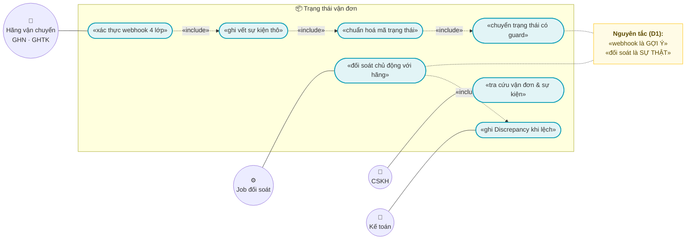
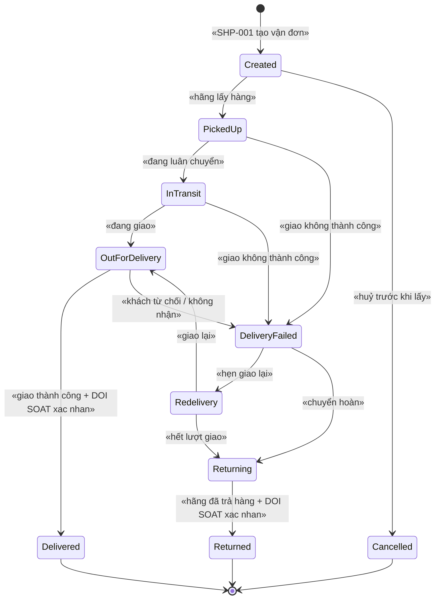
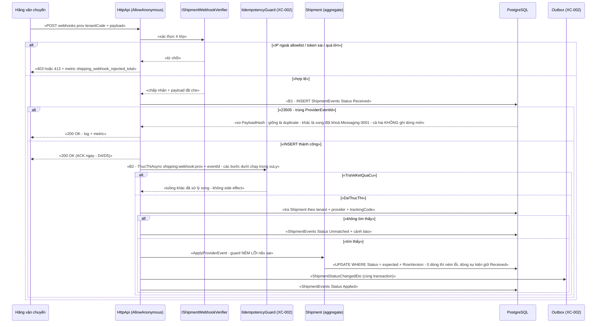

# `SHP-002` — Webhook trạng thái vận đơn & đối soát

> ⚠️ **CẢNH BÁO BẢO MẬT ĐÃ BIẾT (đọc trước mọi mục khác):** webhook của **GHTK KHÔNG có HMAC**.
> Bằng chứng trong repo: `docs/business-modules-proposal.md:549` — *"Webhook GHTK không có HMAC được tài liệu hoá (chỉ `hash` trên URL) — yếu hơn GHN"*;
> `docs/implementation-plan.md:202` và `docs/implementation-plan.md:295` (bảng rủi ro, mức 🟠 **vừa**) cùng ghi nhận.
> `docs/templates/feature-design-template.md:289` cũng yêu cầu: nếu NCC không có chữ ký thì **phải nêu biện pháp bù**.
> ⇒ Toàn bộ thiết kế ở tài liệu này được xây theo nguyên tắc **"webhook là GỢI Ý, không phải SỰ THẬT"** (xem §0.1 D1/D2).

| Thuộc tính | Nội dung |
|---|---|
| **Mã** | `SHP-002` |
| **Module** | **ShippingHub** — dự kiến tạo mới `modules/ShippingHub/eCommerce.ShippingHub.{Domain, EntityFrameworkCore, Application.Contracts, Application}` (hiện **chưa tồn tại** — xem §15.2 F1) |
| **Giai đoạn** | **GĐ3** theo lộ trình chính `05` + `07` (`D-69`; trước đây GĐ2 — `docs/implementation-plan.md:113` là lịch sử). Thuộc 18 tài liệu cổng `WP-14` (`D-71`) |
| **Ưu tiên** | **Must have** (không có nó thì đơn giao xong **không bao giờ** được đóng, COD không bao giờ được ghi nhận) |
| **Trạng thái** | 🟡 `Draft` — chờ review |
| **Người viết / người review** | *(điền)* / **Kiến trúc trưởng + người đã liên hệ GHN/GHTK** |
| **Phiên bản / ngày** | `v0.3 — 20/11/2026` (đối chiếu mô hình Nhanh, `WP-14` ①; sửa theo docreview vòng 1) |
| **Tài liệu liên quan** | `SHP-001` (adapter GHN: tính phí, tạo vận đơn) · `SHP-003` (COD, ⚠️ GHN đổi COD cần OTP) · `SHP-004` (adapter GHTK) · `SHP-001` §5.2 (cùng bảng `ShpShipments`, `D-108`/`D-109`) · `SAL-006` (RMA đơn giao vận, `D-70`) · `XC-001` (Money) · `XC-002` (outbox/inbox, idempotency) · `XC-003` (khoá phân tán) · `XC-004` (phân quyền/tenant) · `XC-005` (log/metric) · `XC-006` (thuế) · `SAL-003` (state machine 4 trục) · `REC-003` (đối soát COD) · `ACC-001` (xuất liệu kế toán) · `REP-001` (read-model) |

---

## 0. Tóm tắt & quyết định thiết kế

**Tóm tắt:** `SHP-002` chốt **cách hệ thống tiếp nhận trạng thái vận đơn từ hãng vận chuyển** (webhook),
**cách chuyển nó thành trạng thái vận đơn nội bộ** (state machine **ném lỗi** khi chuyển sai), và
**cách phát hiện khi webhook nói dối hoặc biến mất** (job đối soát chủ động).

**Vì sao tài liệu này phải tồn tại (không phải thủ tục):** webhook vận đơn là **biên vào duy nhất** mà
một bên thứ ba **có thể giả mạo** trong luồng bán hàng. Với GHTK, **không có HMAC** (xem cảnh báo đầu tài liệu).
Nếu ta tin webhook một cách ngây thơ thì hậu quả **không dừng ở dữ liệu sai**:

| Nếu tin webhook vô điều kiện | Hệ quả thật |
|---|---|
| Webhook giả `Delivered` cho đơn **chưa giao** | Trục thực hiện của đơn sang `FulfillmentStatus.Delivered` ⇒ `Order.Status` suy ra `Completed` (`modules/Sales/eCommerce.Sales.Domain/OrderStateMachine.cs:304`, `D-08`) ⇒ **doanh thu được ghi nhận** trong báo cáo và **có thể sinh hoá đơn** (`EINV-001`) ⇒ sai lệch **sổ sách và thuế** |
| Webhook giả `Returned` | Đơn sang `ReturnConfirmed` (`OrderStateMachine.cs:159`) rồi kích hoạt hoàn tiền (**RMA** — `SAL-006`) cho hàng chưa về ⇒ **mất tiền**. Kho chỉ nhập hàng hoàn khi kho đếm nhận (`Returned`, `OrderStateMachine.cs:107`, `D-39`) nên bút toán kho **không** do một webhook sinh ra |
| Webhook giả `Delivered` cho đơn **COD** | `CodRecord` được ghi "đã thu tiền" ⇒ **đối soát COD** (`REC-003`) đối chiếu với tiền thật trong tài khoản ⇒ phát hiện muộn và **không biết mất ở đâu** |

⇒ Vì vậy thiết kế ở đây **không** dựa vào chữ ký. Nó dựa vào **3 lớp** (§0.1 D1): (1) nhiều lớp xác thực
**không dùng HMAC** (IP allowlist + token trong URL + tenant tách theo đường dẫn), (2) **idempotency + ghi vết**
mọi lần nhận, và (3) **đối soát chủ động với hãng** làm **nguồn sự thật** trước khi chạm tới tiền/kho/sổ sách.

**Phạm vi:**
- ✅ Nhận webhook trạng thái vận đơn của **mọi hãng** qua một hợp đồng chung (`IShipmentWebhookVerifier`) — hãng chỉ khác ở phần xác thực.
- ✅ **Chuẩn hoá mã trạng thái của hãng** → trạng thái nội bộ; **giữ nguyên mã thô** để tra cứu.
- ✅ **State machine vận đơn** + bảng guard; chuyển sai ⇒ **NÉM LỖI có mã**; sự kiện đến **sai thứ tự** ⇒ xử lý tường minh.
- ✅ **Idempotency ở mọi biên vào** (webhook, và cả job đối soát) theo hợp đồng `XC-002` (`IIdempotencyGuard`).
- ✅ **Đối soát chủ động**: job định kỳ hỏi hãng trạng thái thật cho các vận đơn **quá hạn SLA**, ghi `Discrepancy`.
- ✅ **Sổ theo dõi append-only** (`ShipmentEvent`) — bất biến của tài liệu này.
- ✅ Phát `ShipmentStatusChangedEto` qua **outbox** để Sales/Notifications/REC tiêu thụ.
- ✅ Metric + log + `CorrelationId` theo `XC-005`.
- ✅ Tiền (`COD`, phí ship) theo `XC-001`: `decimal` + `Money`, **cấm so `==` trên tiền**.

**Không nằm trong phạm vi:**
- ❌ **Tính phí & tạo vận đơn** (gọi API ra ngoài) — thuộc `SHP-001`. Tài liệu này **chỉ nhận** trạng thái và **đọc** trạng thái từ hãng.
- ❌ **Nghiệp vụ COD**: thu hộ, **đổi COD (⚠️ GHN bắt buộc OTP)** — thuộc `SHP-003`.
- ❌ **Adapter GHTK** (địa chỉ 2 cấp/3 cấp, ⚠️ chưa xác minh) — thuộc `SHP-004`. Tài liệu này chỉ **định nghĩa** phần webhook mà `SHP-004` phải cài.
- ❌ **Import file đối soát COD theo "phiên"** — thuộc `REC-003` (`docs/implementation-plan.md:203`: *"COD không có API — bảng kê là file Excel tải thủ công theo phiên"*). Tài liệu này **tạo ra `Discrepancy`** để `REC-003` dùng.
- ❌ **Sửa state machine 4 trục của đơn hàng** (`FulfillmentStatus` 18 giá trị, `D-08`) — thuộc `SAL-003`, đã có code (`OrderStateMachine.cs`). Ta **phát ETO**, Sales tự quyết định (bảng ánh xạ đề xuất ở §7.1).
- ❌ **Ghi điểm / tiền tích luỹ / công nợ khách** — một cửa `ICustomerLedger` (`D-45`); việc của consumer Sales/`REC-003`, tài liệu này **không** gọi.
- ❌ **Bút toán tồn kho** (vector 9 chiều, `D-27`) — Sales ghi khi đơn vào `Confirmed`/`Returned` (`OrderStateMachine.cs:104-109`, `D-39`); ShippingHub **không** gọi `Inventory`.
- ❌ **Read-model/báo cáo** — thuộc `REP-001` (`docs/implementation-plan.md:216`: *"Không báo cáo nào query trực tiếp trên bảng giao dịch"*).
- ❌ **Retry/backoff tầng hạ tầng** (DLQ, phát lại) — dùng lại `XC-002`, không định nghĩa lại.

### 0.1 Quyết định thiết kế (ADR ngắn)

| # | Quyết định | Phương án đã cân nhắc | Lý do chọn | Hệ quả |
|---|---|---|---|---|
| **D1** | **Webhook là GỢI Ý, không phải SỰ THẬT**: mọi chuyển trạng thái **ảnh hưởng tiền/kho/sổ sách** (`Delivered`, `Returned`) **phải** được **đối soát chủ động** xác nhận | (a) tin webhook · (b) **webhook + đối soát chủ động** · (c) chỉ poll, bỏ webhook | GHTK **không có HMAC** ⇒ webhook **có thể bị giả mạo** (bảng ở §0). Chọn (c) thì mất tính thời gian thực và tốn quota API. Chọn (b): webhook cho **độ trễ thấp**, đối soát cho **tính đúng** | Có **2 tốc độ**: UI cập nhật ngay (nhanh), còn **đóng đơn/hoàn tiền/bút toán** chỉ khi đã xác nhận. ⚠️ Đây là **ràng buộc cứng cho `EINV-001`/`ACC-001`** (§7.3) |
| **D2** | **Không dùng chữ ký làm hàng rào duy nhất** — dùng **3 lớp**: (1) IP allowlist + `HashToken` trong URL + tenant theo path · (2) 3 mã lỗi chống giả mạo (`0201/0202/0203`) + giới hạn kích thước · (3) webhook đơn thuần (`Source = Webhook`, chưa có `ConfirmedAtUtc`) **không được** chuyển sang trạng thái ảnh hưởng tiền | (a) chỉ IP allowlist · (b) chỉ token URL · (c) **cả hai + state machine chặn** | IP allowlist **bị vượt** khi hãng dùng hạ tầng cloud/CDN dùng chung; token URL **bị lộ** qua log/proxy/referrer. Không lớp nào đủ một mình — nhưng **cùng nhau + state machine chặn** thì tạo được vùng an toàn | Phải **duy trì** allowlist IP của từng hãng (việc vận hành, có mục §15 Q2). Phải chấp nhận **độ trễ đối soát** trước khi đơn được đóng |
| **D3** | **Idempotency 2 tầng**: (t1) **transport** — unique `(TenantId, ProviderCode, ProviderEventId)` trên `ShipmentEvents`; (t2) **nghiệp vụ** — `IIdempotencyGuard` của `XC-002` với khoá ổn định `IdempotencyKey.Cua("shipping:webhook:{ProviderCode}", ProviderEventId)` (§7.3) | (a) chỉ unique index · (b) chỉ guard · (c) **cả hai** | `XC-002` D3 đã chứng minh tầng transport **không đủ** (`AbpEventInbox.MessageId` **non-unique** + đổi mỗi lần phát lại). Nhưng với webhook HTTP, unique index trên `ProviderEventId` là **hàng rào DB** cần thiết (D2 của `XC-003`: *"bỏ lock đi, DB có chặn không?"*) | Phải **bắt buộc** hãng cung cấp `ProviderEventId` **ổn định**; nếu hãng không có ⇒ dùng khoá tổng hợp và **ghi rõ rủi ro mất sự kiện** (§15 Q1) |
| **D4** | **Trả `200 OK` cho mọi webhook ĐÃ XÁC THỰC**, kể cả trùng lặp / đã áp dụng / đến sai thứ tự; **chỉ** trả `4xx` cho lỗi xác thực và payload sai | (a) trả `4xx` khi trùng · (b) trả `2xx` khi trùng | `4xx` ⇒ hãng **retry vô hạn** ⇒ tăng tải mà **không bao giờ thành công** (vì bản ghi đã tồn tại). Hãng cũng có thể **tắt webhook** sau N lần lỗi | Việc "không áp dụng được" **phải** để lại dấu vết: `ShipmentEvents.Status = IgnoredStale`/`Rejected`, hoặc — với webhook trùng — log + metric `result="duplicate"` (không có dòng riêng, A1) (nếu không ⇒ vi phạm quy ước *"guard sai phải ném lỗi **hoặc** ghi log có cấu trúc"*) |
| **D5** | **Ghi raw payload TRƯỚC khi ACK**, xử lý sau | (a) xử lý rồi mới ACK · (b) **ghi trước, ACK, xử lý sau** | Nếu xử lý trước rồi mới ACK thì sự cố giữa đường làm hãng retry ⇒ phải làm lại việc nặng. Nếu ta **chết sau khi ACK**, bản ghi `Received` còn trong DB ⇒ **job đối soát nhặt lại** — không mất sự kiện | Cần job quét `Status = Received` quá N phút (§4.2). Payload **bắt buộc đi qua hàm che dữ liệu** trước khi lưu (kế thừa `XC-005` Q6 + `PaymentTransaction.MaskSensitiveData`) |
| **D6** | **Chuẩn hoá trạng thái, KHÔNG dịch ngược**: lưu **cả** `ProviderStatusCode` (thô) **và** `Status` (nội bộ) | (a) chỉ lưu nội bộ · (b) **lưu cả hai** | Bảng mã trạng thái của hãng **thay đổi theo phiên bản API** và ta **chưa kiểm chứng** được toàn bộ (xem §15.1). Nếu chỉ lưu nội bộ và map sai một mã ⇒ **không có cách nào phát hiện lại** | Cần bảng ánh xạ là **dữ liệu** (không hard-code) + audit khi sửa; xem API `MapStatusCode` ở §6.1 |
| **D7** | **Khoá phân tán chỉ ở job định kỳ và ở thao tác sửa tay** — **KHÔNG** khoá trên mỗi webhook | (a) khoá mỗi webhook theo vận đơn · (b) **không khoá webhook** | Nếu khoá mỗi webhook thì webhook thứ 3 trở đi **hết timeout** và bị hãng coi là lỗi ⇒ mất trạng thái. Tranh chấp giữa các webhook đã được chặn ở **DB**: unique index + `UPDATE … WHERE Status = @expected` (D3 của `XC-003`: DB là hàng rào cuối) | Thao tác ghi trạng thái **bắt buộc** dùng "so-sánh-rồi-ghi" có `RowVersion`/`UPDATE WHERE`; **0 dòng** ⇒ **NÉM LỖI** (kế thừa `XC-002` BR-008) |
| **D8** | **Tenant lấy theo ĐƯỜNG DẪN URL** webhook: `POST /api/shipping/webhooks/{providerCode}/{tenantCode}` | (a) 1 URL + tra tenant từ payload · (b) **tenant trong path** · (c) 1 URL/tenant cấu hình ở hãng | (a) buộc phải **tin** payload để biết ghi vào tenant nào — **không thể**, vì payload chưa xác thực. (c) phụ thuộc UI cấu hình của hãng (nhiều hãng chỉ cho 1 URL). (b) cho phép xác định tenant **trước khi** parse payload | URL chứa `tenantCode` ⇒ **không** phải secret (khác `HashToken`). Endpoint **bắt buộc** nằm trong allowlist `[AllowAnonymous]` (test `test/eCommerce.Tests/Authorization/AllowlistCongKhaiTests.cs:42`, khai theo tên controller + lý do) **và** — `D-114` P10 — chỉ mở khi có rate limit + người duyệt từng endpoint (§15 Q10) |
| **D9** | **Job đối soát dùng `IAbpDistributedLock` + chế độ `SkipIfBusy`** (bỏ qua nhịp, **có log + metric**) | (a) chạy không khoá · (b) khoá và **ném lỗi** khi bận · (c) khoá + `SkipIfBusy` | Đúng `XC-003` D10 + A1: job định kỳ bỏ qua nhịp là **hợp lý** (nhịp sau chạy lại), còn HTTP thì phải ném lỗi. `XC-003` cũng cấm acquire lồng (D6) | Job **phải** log + tăng `lock_skipped_total{module="shipping"}` — nếu không ⇒ vi phạm `XC-003` BR-010 |
| **D10** | **Sự kiện đến sai thứ tự ⇒ KHÔNG ném lỗi** nếu nó **cũ hơn** trạng thái đã áp dụng — **bỏ qua có ghi vết**; **nhưng** chuyển trạng thái **ngược chiều** (ví dụ `Returned → InTransit`) **phải NÉM LỖI**. **"Tiến/lùi" định nghĩa theo đồ thị §3.1** (`T` *đến được* từ `S` ⇒ tiến, kể cả nhảy nhiều bước — §3.2 #16, `D-119`), **cấm** so số enum `ShipmentStatus` (số không xếp theo tiến độ, §5.2) | (a) ném lỗi mọi trường hợp sai thứ tự · (b) bỏ qua im lặng mọi trường hợp · (c) **phân biệt 2 loại** | (a) sai nghiệp vụ: webhook **vốn** không đảm bảo thứ tự (`XC-002` §7.4), ném lỗi sẽ đẩy sự kiện **hợp lệ** vào DLQ. (b) vi phạm quy ước *"guard sai phải ném lỗi"* và làm mất dấu vết lỗi thật. (c) giữ được cả hai: an toàn mà vẫn quan sát được | **Bắt buộc** có trường so sánh thời gian (`ProviderOccurredAtUtc` ↔ `Shipment.LastProviderEventAtUtc`); **không** có `AggregateVersion` ở v1 (`D-114` R0 `SHP-002-Q8`); nếu hãng **không** gửi thời gian ⇒ ghi `null`, dùng `ReceivedAtUtc` làm mốc và **luôn** xử lý theo state machine chỉ-tiến (`D-114` R2 `SHP-002-Q3`), có metric đếm (§15 Q3) |

---

## 1. Use Case Specification

| Thuộc tính | Nội dung |
|---|---|
| **Use Case ID** | `SHP-002` |
| **Use Case Name** | Nhận trạng thái vận đơn từ hãng vận chuyển, cập nhật an toàn & đối soát khi lệch |
| **Description** | *"Là hệ thống bán hàng, tôi muốn nhận trạng thái giao hàng từ hãng để đơn hàng và tiền COD được cập nhật kịp thời — nhưng tôi KHÔNG muốn một webhook giả mạo làm đơn được đóng, hàng được nhập lại kho hay tiền được ghi nhận."* |
| **Actor(s)** | **Hãng vận chuyển** (GHN/GHTK/ViettelPost… — hệ thống ngoài) · **Job đối soát** (hệ thống) · **Nhân viên CSKH** (tra cứu + sửa tay có kiểm soát) · **Kế toán** (đọc `Discrepancy`) · **Quản trị** (cấu hình allowlist/token + bảng ánh xạ mã trạng thái) |
| **Priority** | **Must have** |
| **Trigger** | (a) hãng gọi webhook khi trạng thái vận đơn đổi; (b) job đối soát chạy theo nhịp; (c) job nhặt lại sự kiện `Received` chưa xử lý; (d) CSKH sửa trạng thái thủ công |
| **Pre-Condition(s)** | • **Vận đơn đã tồn tại** trong `Shipments` (do `SHP-001` tạo) **và** `ProviderTrackingCode` đã được hãng cấp — nếu chưa, webhook bị `eCommerce:Shipping:0204`.<br>• **Tenant** được giải từ `{tenantCode}` trong URL (D8) — `ChannelCode` lấy từ `Shipment.ChannelCode` (đơn sàn), **không** từ payload.<br>• **Hãng đã được cấu hình**: IP allowlist + `HashToken` + bảng ánh xạ mã trạng thái (§6.3). Thiếu cấu hình ⇒ **từ chối** (fail-closed), **không** chấp nhận mặc định.<br>• `CorrelationId` được sinh/đọc theo `XC-005` (A2: webhook **không** có `X-Correlation-Id` ⇒ sinh mới + ghi lại mã giao dịch của hãng để tra chéo). |
| **Post-Condition(s)** | • **Mỗi webhook đã xác thực và không trùng** có **đúng 1** dòng `ShipmentEvents` (append-only) — kể cả khi bị bỏ qua (`IgnoredStale`) hoặc từ chối (`Rejected`). Webhook **trùng** (cùng `ProviderEventId`) **không** có dòng riêng: B1 bắt `23505` ⇒ giữ dòng gốc, trả `200`, log + metric `result="duplicate"` (A1).<br>• `Shipment.Status` chỉ đổi theo **guard** ở §3; mọi lần đổi có dòng `ShipmentEvents` + `UpdatedAtUtc`.<br>• Mọi lần **không** đổi được trạng thái đều có **dấu vết**: exception có mã **hoặc** log `Warning` + metric (D4/D10).<br>• Webhook đến từ IP ngoài allowlist / sai token / vượt kích thước ⇒ **không** tạo dòng nào, **có** log `Warning` + metric `shipping_webhook_rejected_total{provider,reason}`.<br>• `ShipmentStatusChangedEto` nằm trong **outbox cùng transaction** với lần đổi trạng thái (`XC-002` BR-001). |
| **Basic Flow** | 1. Hãng gọi `POST /api/shipping/webhooks/{providerCode}/{tenantCode}` (D8).<br>2. Lớp xác thực kiểm **4 điều**: IP nguồn ∈ allowlist · `HashToken` khớp · `tenantCode` hợp lệ và đang hoạt động · kích thước body ≤ ngưỡng cấu hình. Thiếu bất kỳ điều nào ⇒ §12 (từ chối) + metric, **không** parse payload.<br>3. Đọc `ProviderEventId` (hoặc khoá tổng hợp), `ProviderTrackingCode`, `ProviderStatusCode`, `ProviderOccurredAtUtc`, số tiền COD (nếu có).<br>4. **B1 — ghi `ShipmentEvents`** (`Status = Received`) **trước** khi ACK (D5); payload thô **đã che** dữ liệu nhạy cảm. `INSERT` gặp `23505` (UNIQUE `(TenantId, ProviderCode, ProviderEventId)`): đọc `PayloadHash` của dòng sẵn có — **bằng** ⇒ webhook trùng (A1); **khác** ⇒ xung đột khoá (E8). Cả hai nhánh **không** ghi dòng mới, **không** ghi đè dòng gốc, vẫn trả `200` (bước 5).<br>5. Trả `200 OK` ngay (D4).<br>6. **B2 — xử lý** (trong UoW mới): (a) `IIdempotencyGuard.ThucThiAsync(key, payloadJson, xuLy)` với `key = IdempotencyKey.Cua("shipping:webhook:{ProviderCode}", ProviderEventId)` (`modules/Messaging/eCommerce.Messaging.Domain/Idempotency/IdempotencyModels.cs:32`; guard: `IdempotencyGuard.cs:27-34`; các bước (b)–(d) chạy **trong** `xuLy`; kết quả `TraVeKetQuaCu` ⇒ luồng khác đã xử lý xong dòng này: B2 kết thúc, **không** ghi gì, metric `result="duplicate"`; `DangXuLy` ⇒ giữ `Received` cho job nhặt lại; `XungDotPayload` ⇒ dòng `Rejected` + `FailureCode = eCommerce:Messaging:0001` + log `Error`); (b) tra `Shipment` theo `(TenantId, ProviderCode, ProviderTrackingCode)`; (c) gọi `Shipment.ApplyProviderEvent(...)` — **guard ném lỗi** nếu chuyển sai; (d) ghi outbox `ShipmentStatusChangedEto`; (e) commit.<br>7. Cập nhật `ShipmentEvents.Status` = `Applied` / `IgnoredStale` / `PendingConfirmation` / `Rejected` / `Unmatched`; tăng metric tương ứng. |
| **Alternative Flow** | **A1: Webhook gửi trùng (at-least-once)** — unique `(TenantId, ProviderCode, ProviderEventId)` **chặn** dòng thứ hai: B1 bắt `23505`, `PayloadHash` **giống** dòng gốc ⇒ trả `200`, **không** ghi dòng mới, giữ nguyên dòng gốc, log `Information` + metric `shipping_webhook_received_total{result="duplicate"}`. **Không** phải lỗi. `Duplicate = 2` của enum `ShipmentEventStatus` (§5.2) chỉ **giữ chỗ** (`D-17`), v1 **không** ghi dòng nào ở trạng thái này.<br>**A2: Sự kiện đến MUỘN (cũ hơn trạng thái đã áp dụng)** — `ProviderOccurredAtUtc` < mốc đã áp dụng ⇒ **bỏ qua**, `Status = IgnoredStale`, log `Information` + metric. **Không** phải lỗi (D10).<br>**A3: Job đối soát xác nhận trạng thái khác webhook** — ghi `Discrepancy` (`Source = ` webhook/poll, `ExpectedStatus` vs `ActualStatus`) và **áp trạng thái từ đối soát** (đối soát là **nguồn sự thật theo D1**), kèm log `Warning` + `shipping_reconcile_discrepancy_total{provider,kind}`.<br>**A4: Vận đơn chưa tồn tại** (webhook đến trước khi `SHP-001` kịp lưu mã vận đơn) — **giữ** dòng `ShipmentEvents` ở `Status = Received`, thử lại trong N phút; quá N phút ⇒ `Status = Unmatched` + **cảnh báo** (⚠️ **không** được xoá — đây là dấu vết duy nhất).<br>**A5: CSKH sửa tay** — **chỉ** cho phép sửa sang trạng thái **không** ảnh hưởng tiền/kho (**không** bao giờ sang `Delivered`/`Returned` — `D-114` P4); dòng sổ `Source = Manual`, **bắt buộc** `Reason` + permission riêng + audit; sửa sang `Delivered`/`Returned` ⇒ `eCommerce:Shipping:0206`. |
| **Exception Flow** | **E1:** IP ngoài allowlist ⇒ `eCommerce:Shipping:0201` (log `Warning` + metric), trả `403`.<br>**E2:** `HashToken` sai/thiếu ⇒ `eCommerce:Shipping:0202`, trả `403`.<br>**E3:** payload sai định dạng / thiếu trường bắt buộc ⇒ `eCommerce:Shipping:0203`, trả `400`.<br>**E4:** body vượt ngưỡng kích thước ⇒ `eCommerce:Shipping:0209`, trả `413`.<br>**E5:** không tìm thấy vận đơn (sau N phút thử lại) ⇒ `eCommerce:Shipping:0204`, `Unmatched` + cảnh báo, trả `200` (D4: **không** để hãng retry vô hạn).<br>**E6:** chuyển trạng thái **không hợp lệ** (ví dụ `Returned → InTransit`) ⇒ `eCommerce:Shipping:0205`, ghi `ShipmentEvents.Status = Rejected` + log `Error`, trả `200` (đã nhận, nhưng **không** áp dụng).<br>**E7:** `UPDATE … WHERE Status = @expected` ảnh hưởng **0 dòng** (luồng khác vừa đổi) ⇒ **NÉM LỖI** `eCommerce:Shipping:0205` **trong UoW của B2** (rollback) — **cấm** coi là thành công (`XC-002` BR-008). Dòng sự kiện **giữ `Received`** (**không** `Rejected`, vì sự kiện có thể hợp lệ với trạng thái mới): `AttemptCount++` ở UoW riêng, job nhặt lại xử lý lần nữa theo trạng thái vừa đọc lại; vượt `MaxEventProcessAttempts` ⇒ `Rejected` + log `Error`. Hãng đã nhận `200` ở bước 5 nên **không** thấy lỗi này.<br>**E8:** cùng `ProviderEventId` nhưng `PayloadHash` **khác** (chỉ xảy ra khi hãng **có** cấp `ProviderEventId`; khi không cấp, khoá = `"h:" + PayloadHash` nên payload khác ⇒ khoá khác) — B1 bắt `23505`, so hash thấy khác ⇒ `eCommerce:Messaging:0001` của `XC-002` (`PayloadConflict` — **xung đột khoá**, phải điều tra thủ công; `MessagingErrorCodes.cs:14`) dùng làm `ErrorCode` của log `Error` (kèm **hash cũ/mới**, **không** kèm payload — BR-006) + metric `shipping_webhook_received_total{result="payload_conflict"}`; **cấm** ghi đè dòng gốc; payload thứ hai **không** được lưu (không có dòng); vẫn trả `200` (D4 — đã ACK, không để hãng retry vô hạn).<br>**E9:** job đối soát không giành được khoá ⇒ **bỏ qua nhịp** + log + metric `lock_skipped_total{module="shipping"}` (`XC-003` A1) — **không** ném lỗi.<br>**E10:** API hãng lỗi/timeout khi đối soát ⇒ vận đơn vẫn `InTransit`, ghi `FailureReason`, **thử lại nhịp sau**; **không** rollback dữ liệu đã ghi. |
| **Business Rules** | • **BR-SHP-002-001**: Mọi webhook **phải** đi qua 4 lớp kiểm ở Basic Flow bước 2 **trước khi** parse payload; **cấm** nhận webhook chưa xác thực.<br>• **BR-SHP-002-002**: **Idempotency ở MỌI biên vào** (webhook, job đối soát): `IIdempotencyGuard` (`XC-002`) **+** unique index ở DB. Khoá chống trùng **ổn định** qua các lần retry; **cấm** `Guid.NewGuid()`. **Sửa tay** (`OverrideStatusAsync`) **không** dùng guard idempotency: thao tác người dùng, tần suất thấp, chống trùng bằng khoá `shipping:shipment:{tenantId}:{shipmentId}` (§8.2 #6) + `UPDATE … WHERE Status = @expected` — gửi lại lần hai thì trạng thái đã đổi ⇒ 0 dòng ⇒ `0205`, không đổi gì thêm. Vi phạm ⇒ đỏ: TC-02/TC-21.<br>• **BR-SHP-002-003**: **Cấm** chuyển trạng thái vận đơn bằng gán trực tiếp; **mọi** chuyển trạng thái **phải** qua guard ở §3 (cạnh trực tiếp #1–#10 **hoặc** chuyển tiến nhiều bước #16 — `D-119`), guard sai ⇒ **NÉM LỖI có mã** `eCommerce:Shipping:0205`. Vi phạm ⇒ đỏ: TC-09, TC-11, TC-33…TC-36.<br>• **BR-SHP-002-004**: **Webhook KHÔNG đủ** để chuyển sang trạng thái **ảnh hưởng tiền/kho/sổ sách** (`Delivered`, `Returned`) — **bắt buộc** có xác nhận từ **đối soát chủ động** (D1). Chỉ `Source = Reconciliation` **mới** đặt được `ConfirmedAtUtc` và được coi là "đã xác nhận"; `Manual` **không** (`D-114` P4 — "ghi nhận khi Delivered đã đối soát"). Vi phạm ⇒ đỏ: CHECK DB (§5.2) + TC-04/TC-28/TC-29.<br>• **BR-SHP-002-005**: **Sổ theo dõi vận đơn là APPEND-ONLY** (`ShipmentEvents`): **cấm** `UPDATE`/`DELETE` payload hay trạng thái của bản ghi đã ghi; chỉ được đổi **5 cột xử lý** (`Status`, `AttemptCount`, `ProcessedAtUtc`, `FailureCode`, `MappedStatus`) và chỉ khi `Status = Received` (§5.2). Cơ chế: **trigger DB** `BEFORE UPDATE`/`BEFORE DELETE` trên `ShpShipmentEvents` (§5.2 bảng index/ràng buộc, §11). Vi phạm ⇒ đỏ: TC-06.<br>• **BR-SHP-002-006**: Raw payload **phải** được **che dữ liệu nhạy cảm** trước khi lưu **và** trước khi log (kế thừa `XC-005` Q6; dùng lại cách tiếp cận `PaymentTransaction.MaskSensitiveData`). **Cấm** log payload thô.<br>• **BR-SHP-002-007**: Tiền (`CodAmount`, `ShippingFee`) là `decimal` + `Money`; **cấm** so sánh tiền bằng `==` trên cột/biến `decimal` trần — so qua `Money.Equals` cùng `Currency` (`shared/eCommerce.Kernel/Money/Money.cs:123`); `Money` **chưa có** `ToMinorUnits()` (grep `Money.cs`, 19/11/2026), hàm đổi số nguyên VND chờ `SHP-001` Q17. Sai lệch tiền ⇒ ghi `Discrepancy`, **cấm** tự sửa số của hãng; dung sai mặc định 0 (`D-114` P1). Vi phạm ⇒ đỏ: TC-08.<br>• **BR-SHP-002-008**: Mã lỗi **phải** theo khuôn `eCommerce:Shipping:02NN` (dải `0201`–`0210`) và **do module sở hữu** (`ShippingHubErrorCodes`) — **cấm** khai ở `eCommerceConsts.ErrorCodes` (kế thừa `XC-003` F2 và cách làm của `TaxErrorCodes`).<br>• **BR-SHP-002-009**: **Cấm** hard-code endpoint / mã trạng thái / allowlist IP của hãng trong code nghiệp vụ — mọi thứ thuộc **cấu hình** (`ShippingHubOptions`) hoặc **dữ liệu** (`CarrierStatusMappings`) có audit.<br>• **BR-SHP-002-010**: Webhook `200` **cấm** dùng để kết luận "đã xử lý xong" — `ShipmentEvents.Status` là **nguồn sự thật** về việc đã xử lý hay chưa.<br>• **BR-SHP-002-011**: **Cách ly tenant**: dữ liệu tenant A **không** đọc/ghi được từ tenant B; `ShipmentEvents`/`Discrepancies` là `IMultiTenant`; handler **phải** `ICurrentTenant.Change(tenantId)` theo `{tenantCode}`.<br>• **BR-SHP-002-012**: Mọi `[Authorize]` ở **cấp class**; endpoint webhook là `[AllowAnonymous]` **có chủ ý** và **phải** nằm trong `Allowlist` của `AllowlistCongKhaiTests.cs:42` (tên controller) **kèm lý do**; mở ra production chỉ sau rate limit + người duyệt (`D-114` P10). Vi phạm ⇒ đỏ: TC-23 (thiếu khai báo ⇒ test allowlist đỏ).<br>• **BR-SHP-002-013**: Job đối soát **phải** chịu được **chạy lại** cùng kỳ (idempotent theo `(RunId, ShipmentId)`) và **phải** log + metric khi bỏ qua nhịp. **Qua nhiều kỳ**: đã có `Discrepancy` **chưa xử lý** (`ResolvedAtUtc IS NULL`) cùng `(TenantId, ShipmentId, Kind)` thì **không** ghi dòng mới và **không** phát `ShipmentDiscrepancyFoundEto` lần nữa — chỉ cập nhật `LastSeenAtUtc` (§5.2). Vi phạm ⇒ đỏ: TC-21 (cùng kỳ), TC-38 (hai kỳ liên tiếp) + partial unique ở DB.<br>• **BR-SHP-002-014**: **Cấm** dùng số liệu metric để quyết định nghiệp vụ (`XC-005`: metric có thể mất/trễ) — quyết định **chỉ** dựa trên dữ liệu DB. Vi phạm ⇒ đỏ: TC-31 (tắt/ném lỗi ở lớp metric mà kết quả DB đổi). |
| **Non-Functional Requirement** | • **NFR-SHP-002-001**: Webhook trả `200` với p95 **< 200 ms** (ghi 1 dòng + ACK; **không** chờ gọi hãng).<br>• **NFR-SHP-002-002**: **Idempotent 100 %**: gửi cùng webhook **1.000 lần** ⇒ **đúng 1** dòng `ShipmentEvents` (999 lần trùng không có dòng riêng), **0** lần đổi trạng thái thêm.<br>• **NFR-SHP-002-003**: **0** dòng `ShipmentEvents` bị `UPDATE`/`DELETE` ngoài cột xử lý (test quét + test DB).<br>• **NFR-SHP-002-004**: **0** payload lưu vào DB/log chứa mẫu dữ liệu nhạy cảm (quét tự động, kế thừa `XC-005` TC-05).<br>• **NFR-SHP-002-005**: Độ trễ **phát hiện lệch**: vận đơn quá hạn SLA ⇒ có `Discrepancy` trong **≤ 1 nhịp job** (nhịp đề xuất **15 phút**).<br>• **NFR-SHP-002-006**: `CorrelationId` hiện diện trong **100 %** log của luồng webhook (kế thừa `XC-005` NFR-002).<br>• **NFR-SHP-002-007**: **Đúng 1** khoá phân tán cho mỗi job định kỳ; **0** khoá acquire lồng; **0** acquire thiếu timeout (`XC-003` BR-004/BR-005).<br>• **NFR-SHP-002-008**: Cách ly tenant: **0** bản ghi tenant khác lọt vào truy vấn (integration test 2 tenant — ⚠️ **cần PostgreSQL**, xem `XC-004` F1).<br>• **NFR-SHP-002-009**: Job đối soát chạy khi **rỗng** ⇒ **< 10** dòng log/nhịp (đo bằng `XC-005` TC-09; `XC-005` BR-004) — chỉ log khi **có việc thật**.<br>• **NFR-SHP-002-010**: Mọi mã trạng thái thô nhận được **phải** có ánh xạ hoặc **đi vào `Discrepancy`** — **cấm** im lặng coi là "không đổi".<br>• **NFR-SHP-002-011**: **0** metric phát ra ngoài `eCommerceMetricNames` (`MetricsTests.TC06`, §13).<br>• **NFR-SHP-002-012**: **0** literal URL/mã trạng thái của hãng trong code nghiệp vụ (test grep trong CI, §13). |

---

## 2. Sơ đồ Use Case



**Chú giải:**

| Ký hiệu | Ý nghĩa |
|---|---|
| ⭕ Xanh lá | Actor (hãng vận chuyển, job, CSKH, kế toán) |
| 🟦 Bầu dục xanh dương | Use case |
| 🟨 Khung vàng | Note (nguyên tắc thiết kế) |
| `-.«include».->` | Quan hệ bao hàm |

---

## 3. Sơ đồ trạng thái (state machine)

### 3.1 Trạng thái vận đơn



> 📌 **Enum dùng chung với `SHP-001`** (`shp-001-…md` §3.1): `SHP-001` ghi `Draft`/`Submitting`/`SubmitFailed`/`Created` (+ `Cancelled` trước lấy hàng); `SHP-002` chỉ chuyển **từ `Created` trở đi**. Giá trị số: bảng ở §5.2 (`D-17`: chỉ thêm ở cuối).
> "`PendingDeliveryConfirmation`" trong tài liệu này **không** phải giá trị enum: là điều kiện `Shipment.PendingConfirmStatus IS NOT NULL` (§5.2) — webhook đã báo `Delivered`/`Returned` nhưng đối soát chưa xác nhận; `Status` **giữ nguyên**.
>
> 📌 **Chuyển tiến nhiều bước (`D-119`):** các mũi tên trên là cạnh **trực tiếp**. Hãng có thể bỏ/mất một webhook trung gian (§15.3 #1), nên hệ thống **cũng** chấp nhận nhảy từ `S` tới mọi `T` **đến được** từ `S` theo đồ thị này (§3.2 #16). "Tiến" = *đến được trên đồ thị*, **không** = số enum lớn hơn (§5.2). `Cancelled` **không** nhảy tới được: chỉ cạnh trực tiếp `Created → Cancelled`. **Không** sinh sự kiện trung gian cho các bước bị bỏ qua.

### 3.2 Bảng chuyển trạng thái & guard — **mọi chuyển sai PHẢI NÉM LỖI, không im lặng**

| # | Từ | Sang | Guard | Ai được phép chuyển | Nếu vi phạm |
|---|---|---|---|---|---|
| 1 | `Created` | `PickedUp` | `ProviderStatusCode` ánh xạ tới `PickedUp` | webhook · đối soát | `eCommerce:Shipping:0205` |
| 2 | `Created` | `Cancelled` | Hãng báo huỷ **hoặc** `SHP-001` huỷ trước khi lấy | webhook · API nội bộ | `eCommerce:Shipping:0205` |
| 3 | `PickedUp` | `InTransit` | ánh xạ hợp lệ | webhook · đối soát | `eCommerce:Shipping:0205` |
| 4 | `PickedUp`/`InTransit`/`OutForDelivery` | `DeliveryFailed` | ánh xạ hợp lệ **và** có `Reason` từ hãng | webhook · đối soát | `eCommerce:Shipping:0205` |
| 5 | `InTransit` | `OutForDelivery` | ánh xạ hợp lệ | webhook · đối soát | `eCommerce:Shipping:0205` |
| 6 | `OutForDelivery` | `Delivered` | 🚨 **`Source = Reconciliation`** — xem **BR-004** (`D-114` P4) | **đối soát** (job · `TriggerReconcileAsync`) | Webhook đơn thuần ⇒ **KHÔNG** chuyển; đặt `PendingConfirmStatus = Delivered`, event `PendingConfirmation` + metric (**không** ném lỗi — chờ đối soát). Sửa tay sang `Delivered` ⇒ `0206` |
| 7 | `DeliveryFailed` | `Redelivery` | ánh xạ hợp lệ | webhook · đối soát | `eCommerce:Shipping:0205` |
| 8 | `Redelivery` | `OutForDelivery` | ánh xạ hợp lệ | webhook · đối soát | `eCommerce:Shipping:0205` |
| 9 | `Redelivery`/`DeliveryFailed` | `Returning` | ánh xạ hợp lệ **hoặc** hết số lần giao | webhook · đối soát | `eCommerce:Shipping:0205` |
| 10 | `Returning` | `Returned` | 🚨 **`Source = Reconciliation`** + `ConfirmedAtUtc` | **đối soát** | Như #6 (`PendingConfirmStatus = Returned`) |
| 11 | `Delivered` | **BẤT KỲ** | — | **KHÔNG AI** (trạng thái **hấp thụ**) | `eCommerce:Shipping:0205` + log `Error` (**cấm** sửa; nếu hãng báo khác ⇒ `Discrepancy`) |
| 12 | `Returned` | **BẤT KỲ** | — | **KHÔNG AI** (trạng thái **hấp thụ**) | `eCommerce:Shipping:0205` |
| 13 | `Cancelled` | **BẤT KỲ** | — | **KHÔNG AI** (trạng thái **hấp thụ**) | `eCommerce:Shipping:0205` |
| 14 | Bất kỳ (trừ hấp thụ) | *(không đổi)* | `ProviderOccurredAtUtc` **cũ hơn** mốc đã áp dụng | — | **Bỏ qua có ghi vết**: `IgnoredStale` + log `Information` + metric (**D10** — đây **không** phải lỗi) |
| 15 | Bất kỳ | *(không đổi)* | `ProviderEventId` đã tồn tại, `PayloadHash` giống | — | **Bỏ qua có ghi vết**: xử lý ở **B1** (bắt `23505`), **không** có dòng `ShipmentEvents` mới; log `Information` + metric `result="duplicate"` (**A1**). `PayloadHash` khác ⇒ E8 |
| 16 | mọi `S` ∉ {`Delivered`, `Returned`, `Cancelled`} | `T ≠ S`, `T` **đến được** từ `S` trên đồ thị §3.1 (bảng bên dưới), **không** có cạnh trực tiếp #1–#10, `T ≠ Cancelled` (`D-119`) | **Guard của cạnh vào `T`**: `T ∈ {Delivered, Returned}` ⇒ chỉ `Source = Reconciliation` + `ConfirmedAtUtc` (BR-004); webhook ⇒ đặt `PendingConfirmStatus = T`, dòng `PendingConfirmation`, `Status` giữ nguyên (như #6/#10). `T = DeliveryFailed` ⇒ vẫn cần `Reason` (#4). `T` còn lại ⇒ ánh xạ hợp lệ | webhook · đối soát (`Manual` **không** — A5 chỉ dùng cạnh #1–#10) | `T` **không** đến được từ `S` (vd `Returning → Delivered`, `InTransit → PickedUp`, `DeliveryFailed → InTransit`; mọi chuyển sang `Cancelled` từ `S ≠ Created`) ⇒ `eCommerce:Shipping:0205` + `Rejected` + `Discrepancy` (D10). Áp được ⇒ **đúng 1** `ShipmentStatusChangedEto` với `FromStatus` = trạng thái thật trước đó (có thể cách nhiều bước), log `Warning` (`from`, `to`) + metric `shipping_status_skipped_total{provider,from,to}` (chỉ quan sát — BR-014) |

**Bảng đến-được** (sinh từ danh sách cạnh §3.1 — **một nguồn** cho #1–#10 và #16; cài đặt phải sinh bảng hằng từ danh sách cạnh, không viết tay hai nơi). Cột phải: `T` đến được **và không** có cạnh trực tiếp (hợp lệ theo #16):

| Từ `S` | `T` hợp lệ theo #16 |
|---|---|
| `Created` | `InTransit` · `OutForDelivery` · `DeliveryFailed` · `Redelivery` · `Returning` · `Delivered` · `Returned` |
| `PickedUp` | `OutForDelivery` · `Redelivery` · `Returning` · `Delivered` · `Returned` |
| `InTransit` | `Redelivery` · `Returning` · `Delivered` · `Returned` |
| `OutForDelivery` | `Redelivery` · `Returning` · `Returned` |
| `DeliveryFailed` | `OutForDelivery` · `Delivered` · `Returned` |
| `Redelivery` | `DeliveryFailed` · `Delivered` · `Returned` |
| `Returning` | *(không có — chỉ cạnh trực tiếp #10 sang `Returned`)* |

> 📌 **Thứ tự kiểm khi xử lý một sự kiện (B2):** #15 `Duplicate` (đã chặn ở B1) → #14 `IgnoredStale` → #11–#13 hấp thụ → cạnh trực tiếp #1–#10 → #16 → còn lại ⇒ `0205`. Metric `shipping_status_skipped_total` (6 → 7 metric, §13) và `shipping_webhook_missing_total` (§12) chỉ để quan sát.

> ⚠️ **Trạng thái hấp thụ (absorbing):** `Delivered`, `Returned`, `Cancelled`. Sau khi vào các trạng thái này,
> **mọi** chuyển trạng thái khác đều **NÉM LỖI** — kể cả khi hãng báo ngược lại. Lý do: đây là các trạng thái
> **đã chạm tới tiền/kho/sổ sách**; sửa ngược phải là **quy trình nghiệp vụ có người duyệt** (RMA/điều chỉnh),
> **không** phải một webhook.
>
> 📌 **Bài học kế thừa (ghi trong `XC-006` §3):** guard **phải ném lỗi**, không được "im lặng bỏ qua"
> (EShop `SetPaidStatus()` chỉ hành động khi `StockConfirmed`, còn lại no-op ⇒ sự kiện rơi **không để lại dấu vết**).
> Ngoại lệ duy nhất được phép "im lặng" là **#14 và #15** — và cả hai **bắt buộc** ghi vết + metric.

### 3.3 Trạng thái xử lý của một dòng `ShipmentEvents`

| Từ | Sang | Guard | Nếu vi phạm |
|---|---|---|---|
| `Received` | `Applied` | Guard §3.2 thoả (#1–#10 hoặc #16), đã ghi outbox | — |
| `Received` | `IgnoredStale` | Sự kiện cũ hơn mốc đã áp dụng (#14) | — |
| `Received` | `PendingConfirmation` | Webhook báo `Delivered`/`Returned` mà `Source ≠ Reconciliation` (#6/#10, hoặc #16 từ bất kỳ `S` đến được) ⇒ đã đặt `PendingConfirmStatus` | Thiếu dòng này ⇒ job đối soát không biết vận đơn nào chờ xác nhận (TC-04, TC-35) |
| `Received` | `Rejected` | Guard §3.2 **không** thoả (`T` **không đến được** từ `S` theo đồ thị §3.1, hoặc `S` hấp thụ) ⇒ đã ném `0205` và đã log; **hoặc** guard idempotency trả `XungDotPayload`; **hoặc** vượt `MaxEventProcessAttempts` (E7) | Thiếu log ⇒ vi phạm BR-003 |
| `Received` | `Unmatched` | Không tìm thấy vận đơn sau N phút | Phải **cảnh báo** (A4) |
| `Received` | *(giữ `Received`)* | `UPDATE … WHERE Status = @expected` trên `Shipment` 0 dòng (E7) ⇒ UoW B2 rollback, `AttemptCount++` | **Không** `Rejected`: job nhặt lại xử lý theo trạng thái mới |
| `Applied`/`IgnoredStale`/`Rejected`/`Unmatched`/`PendingConfirmation` *(và `Duplicate = 2` — giữ chỗ, v1 không ghi)* | *(bất kỳ)* | — | **Cấm** — đây là trạng thái **hấp thụ** của dòng; trigger DB (§5.2) từ chối `UPDATE`/`DELETE`, và `UPDATE … WHERE Status = 'Received'` ảnh hưởng **0 dòng** ⇒ **NÉM LỖI** (`XC-002` E7) |

---

## 4. Sequence Diagram & luồng dữ liệu

### 4.1 Webhook đến từ hãng — xác thực, ghi vết, ACK nhanh, xử lý sau



### 4.2 DFD — vì sao **webhook không đủ** để chạm tới tiền/kho/sổ sách

```mermaid
graph LR
    classDef proc fill:#cce5ff,stroke:#004085,stroke-width:2px;
    classDef warn fill:#f8d7da,stroke:#721c24,stroke-width:2px;
    classDef ok fill:#d4edda,stroke:#155724,stroke-width:2px;
    classDef store fill:#e2e3e5,stroke:#383d41,stroke-width:2px;

    WH["«Webhook hãng»<br/>KHONG co HMAC o GHTK"] --> A["«Xác thực 4 lớp»"]
    A --> B["«Ghi ShipmentEvents»<br/>append-only"]
    B --> C["«Chuyển trạng thái có guard»"]
    C --> D{"«Hai trạng thái ảnh hưởng tiền/kho?»"}
    D -- "«không»" --> E["«Áp dụng ngay»<br/>PickedUp InTransit OutForDelivery"]
    D -- "«có»" --> F["«Chờ xác nhận»<br/>PendingDeliveryConfirmation"]
    F --> G["«Job đối soát gọi API hãng»"]
    G --> H{"«Hãng xác nhận?»"}
    H -- "«có»" --> I["«Delivered hoặc Returned»<br/>Source = Reconciliation"]
    H -- "«không hoặc khác»" --> J["«Ghi Discrepancy»<br/>KHONG tự sửa số của hãng"]
    I --> K["«Outbox: ShipmentStatusChangedEto»"]
    K --> L["«Sales đóng đơn · REC-003 · EINV-001 · ACC-001»"]

    class A,B,C,E,F,G proc;
    class WH,J warn;
    class I,K,L ok;
    E --> M[("PostgreSQL<br/>Shipments · ShipmentEvents · Discrepancies")]
    class M store;
```



> 🔴 **Ghi rõ cho tài liệu khác:** nhánh `F → G → I` là **điều kiện tiên quyết** để `EINV-001` (hoá đơn)
> và `ACC-001` (xuất liệu kế toán) được phép ghi nhận doanh thu/hoàn tiền. Một đơn ở trạng thái
> `PendingDeliveryConfirmation` **chưa** được coi là đã giao. Đây là **ràng buộc bắt buộc**, không phải gợi ý —
> vì GHTK **không có HMAC** nên webhook một mình **không đủ** chứng cứ để lập chứng từ kế toán.

---

## 5. Mô hình dữ liệu

### 5.1 ERD

**Không áp dụng** — tệp đã có 4 sơ đồ Mermaid (§2, §3.1, §4.1, §4.2) và 4 bảng cùng module; thay thế bằng **Data Dictionary** ở §5.2 (đầy đủ cột + index + ràng buộc).

### 5.2 Bảng & cột (Data Dictionary)

> ⚠️ **Chưa có bảng nào tồn tại trong code.** Đã kiểm bằng `grep` toàn repo: **không** có entity `Shipment`,
> `Carrier`, `ShippingService`, `ShipmentTracking`, `CodRecord`; **không** có project `modules/ShippingHub`.
> Thứ duy nhất đang tồn tại là **cột tiền phí vận chuyển của đơn**: `Order.ShippingTotal`
> (`modules/Sales/eCommerce.Sales.Domain/Order.cs:162`) và mapping `HasPrecision(18, 4)` ở
> `modules/Sales/eCommerce.Sales.EntityFrameworkCore/SalesDbContextModelCreatingExtensions.cs:36`.
> Toàn bộ 4 bảng dưới đây là **kế hoạch GĐ3** — chưa có trong code (re-grep 19/11/2026: 0 kết quả `Shipment` ở `modules/`, `src/`).
> 📌 **`ShpShipments` dùng chung với `SHP-001`** (ADR-09 của `SHP-001`): bảng do migration `SHP-001` tạo (`shp-001-…md:880-881`); mọi cột mới của `SHP-001` **phải** được ghi ở đây trước (`D-108` (6), `D-109`).

**Bảng `ShpShipments`** — vận đơn, do `SHP-001` tạo, `SHP-002` cập nhật trạng thái

| Cột | Kiểu | Null? | Nguồn / ý nghĩa | Ghi chú |
|---|---|---|---|---|
| `Id` | `uuid` | ✖ | khoá chính | |
| `TenantId` | `uuid` | ✔ | tenant sở hữu | `IMultiTenant`; ⚠️ `NULL` = 1 tenant (xem `XC-004` F1) |
| `OrderId` | `uuid` | ✖ | đơn hàng liên quan | tham chiếu mềm sang Sales (**cấm** module gọi app: đây là **id**, không phải navigation) |
| `OrderNumber` | `varchar(64)` | ✔ | số đơn (bản chụp, để hiển thị/grep) | do `SHP-001` ghi (Pha 1) |
| `Generation` | `int` | ✖ | thứ tự `Shipment` của đơn (`D-109`): `1 + max` của mọi `Shipment` cùng `(TenantId, OrderId)`; chỉ tăng khi tạo `Shipment` **mới** | `SHP-001` ghi (Pha 1); **bất biến**; CHECK `Generation >= 1` |
| `ChannelCode` | `varchar(32)` | ✔ | kênh bán phát sinh đơn | `null` với đơn website — **lấy từ đơn, KHÔNG từ payload webhook** |
| `ProviderCode` | `varchar(32)` | ✖ | mã hãng: `ghn`, `ghtk`, `viettelpost`… | khớp `Provider` trong log `XC-005` §5.2 |
| `ProviderTrackingCode` | `varchar(64)` | ✔ | **mã vận đơn do hãng cấp** — khoá đối chiếu quan trọng nhất | `null` tới khi hãng trả mã (`SHP-001` P3); unique **partial** (xem index) |
| `ClientOrderCode` | `varchar(64)` | ✖ | mã đơn phía ta gửi hãng = `"{orderId:N}-{generation}"` (`D-109`, hàm thuần ở `ShippingHub.Domain`) | sinh một lần ở Pha 1, **bất biến**; webhook không kèm `ProviderTrackingCode` thì tra theo cột này |
| `Status` | `int` | ✖ | trạng thái nội bộ (§3.1) — enum dùng chung `SHP-001` | mặc định `Draft` (xem bảng số bên dưới) |
| `StatusSource` | `int` | ✖ | `Webhook=0` · `Reconciliation=1` · `Manual=2` · `Pull=3` | ⭐ **căn cứ của BR-004**: chỉ `Reconciliation` đặt được `ConfirmedAtUtc` |
| `ConfirmedAtUtc` | `timestamptz` | ✔ | thời điểm trạng thái **ảnh hưởng tiền** được **đối soát xác nhận** | `Delivered`/`Returned` **bắt buộc** có; `null` ⇒ **chưa** được lập chứng từ |
| `PendingConfirmStatus` | `int` | ✔ | trạng thái `Delivered`/`Returned` mà webhook đã báo nhưng **chưa** được đối soát xác nhận | `null` = không chờ; job đối soát ưu tiên các dòng `IS NOT NULL`; xoá về `null` khi đối soát xác nhận hoặc ghi `Discrepancy` |
| `ProviderStatusCode` | `varchar(64)` | ✔ | mã trạng thái **thô** của hãng (D6) | giữ để đối soát & phát hiện map sai |
| `LastProviderEventAtUtc` | `timestamptz` | ✔ | mốc `ProviderOccurredAtUtc` **lớn nhất** đã áp dụng | dùng cho guard #14 (sai thứ tự) |
| `SlaDueAtUtc` | `timestamptz` | ✔ | hạn giao dự kiến | job đối soát chọn vận đơn **quá hạn** theo cột này |
| `ReconcileAttemptCount` | `int` | ✖ | số lần gọi API hãng **thất bại liên tiếp** | mặc định `0`; `++` khi gọi thất bại, **reset về `0`** khi gọi thành công (kể cả khi hãng trả "chưa đổi"); job **bỏ qua** vận đơn có giá trị `≥ MaxReconcileAttempts` (trần tránh gọi vô hạn) tới khi `TriggerReconcileAsync` thành công (TC-39) |
| `LastReconciledAtUtc` | `timestamptz` | ✔ | lần đối soát gần nhất | |
| `CodAmount` | `numeric(18,4)` | ✖ | **số tiền thu hộ** | ⚠️ `decimal`, **không bao giờ** `double` (`XC-001` BR-008) |
| `CodCurrency` | `char(3)` | ✖ | ISO-4217, mặc định `VND` | theo `XC-001` §5.2 |
| `ShippingFee` / `ShippingFeeCurrency` | `numeric(18,4)` / `char(3)` | ✖ / ✖ | phí vận chuyển **hãng báo** | `SHP-001` ghi; CHECK `ShippingFeeCurrency ~ '^[A-Z]{3}$'` |
| `EstimatedShippingFee` | `numeric(18,4)` | ✔ | phí **ước tính** đã hiển thị cho khách | `SHP-001` ghi — để phát hiện lệch phí |
| `SubmitAttemptCount` | `int` | ✖ | số lần đã gọi hãng tạo vận đơn | `SHP-001` ghi; mặc định `0` |
| `TotalWeightGrams` | `int` | ✔ | tổng cân nặng đã gửi hãng (gram) | `SHP-001` ghi |
| *(nhóm cột snapshot giao — tên cột do `SHP-001` chọn)* | text / `int` (nullable) | ✔ | **bản sao** địa chỉ đã gửi hãng: tên + SĐT người nhận, `SchemaVersion`, mã/tên tỉnh-huyện-xã, `SoNhaDuong`, `DiaChiDayDu` (`D-108` (6), `D-77`) | `SHP-001` ghi (Pha 1), bất biến; là PII ⇒ thuộc nợ ẩn danh `ADDR-004` ADR-11 (`D-108` N3); **không** dựng lại từ `AddrCarrierMappings` |
| `FailureCode` / `FailureReason` | `varchar(64)` / `varchar(2048)` | ✔ / ✔ | lỗi gần nhất (tạo vận đơn hoặc đối soát) | **đã che** dữ liệu nhạy cảm |
| `RowVersion` | `xmin` (ánh xạ `uint`) | ✖ | optimistic concurrency | `IsRowVersion()` ⇒ cột hệ thống `xmin`, không thêm cột thật (`XC-002` §5.2.3) |

**Giá trị số `ShipmentStatus`** (✅ đã chốt theo `SHP-001-Q16` (a) — `D-114` R0, giữ số bảng này; §15 Q9; `D-17`: đã lưu DB thì **không** đổi, chỉ thêm ở cuối). ⚠️ Số **không** xếp theo tiến độ (`DeliveryFailed = 4`, `Redelivery = 5` quay về `OutForDelivery = 3`) ⇒ "tiến/lùi" **không** so số (§3.2 #16, `D-119`)

| Giá trị | Số | Giá trị | Số | Giá trị | Số |
|---|---|---|---|---|---|
| `Created` | 0 | `DeliveryFailed` | 4 | `Returned` | 8 |
| `PickedUp` | 1 | `Redelivery` | 5 | `Cancelled` | 9 |
| `InTransit` | 2 | `Returning` | 6 | `Draft` *(SHP-001)* | 10 |
| `OutForDelivery` | 3 | `Delivered` | 7 | `Submitting` · `SubmitFailed` *(SHP-001)* | 11 · 12 |

**Bảng `ShpShipmentEvents`** — ⭐ **SỔ THEO DÕI APPEND-ONLY** (bất biến của tài liệu này)

| Cột | Kiểu | Null? | Nguồn / ý nghĩa | Ghi chú |
|---|---|---|---|---|
| `Id` | `uuid` | ✖ | khoá chính | |
| `TenantId` | `uuid` | ✔ | tenant | `IMultiTenant` + query filter; ✔ nullable vì 1 tenant ⇒ `NULL` (khớp `ShpShipments`, `SHP-001-Q20` (a)) — unique bên dưới dùng `NULLS NOT DISTINCT` |
| `ProviderCode` | `varchar(32)` | ✖ | mã hãng | **lấy từ URL**, không từ payload (D8) |
| `ProviderEventId` | `varchar(128)` | ✖ | ID sự kiện **do hãng cấp**; hãng không cấp ⇒ `"h:" + PayloadHash` (`D-114` R2 `SHP-002-Q1`); dòng do đối soát: `"reconcile:{runId}:{shipmentId}"` | ⭐ **khoá chống trùng tầng transport** (D3). ⚠️ **chưa kiểm chứng** hãng nào cấp (xem §15 Q1) |
| `ProviderTrackingCode` | `varchar(64)` | ✔ | mã vận đơn trong payload | |
| `ProviderStatusCode` | `varchar(64)` | ✔ | mã trạng thái thô | |
| `MappedStatus` | `int` | ✔ | trạng thái nội bộ sau ánh xạ | `null` = **không ánh xạ được** ⇒ **bắt buộc** `Discrepancy` (NFR-010) |
| `ProviderOccurredAtUtc` | `timestamptz` | ✔ | thời điểm hãng báo sự kiện xảy ra | `null` nếu hãng không gửi ⇒ xem D10/§15 Q3 |
| `ReceivedAtUtc` | `timestamptz` | ✖ | thời điểm ta nhận | |
| `ProcessedAtUtc` | `timestamptz` | ✔ | thời điểm xử lý xong | |
| `Status` | `int` | ✖ | `Received=0` · `Applied=1` · `Duplicate=2` *(giữ chỗ — v1 không ghi, webhook trùng không có dòng riêng: A1)* · `IgnoredStale=3` · `Rejected=4` · `Unmatched=5` · `PendingConfirmation=6` | §3.3; chỉ thêm ở cuối (`D-17`) |
| `AttemptCount` | `int` | ✖ | số lần xử lý | mặc định `0` |
| `PayloadHash` | `char(64)` | ✖ | **SHA-256** payload **canonical** | phát hiện **xung đột khoá** (E8, `XC-002` BR-006) |
| `PayloadHashVersion` | `int` | ✖ | phiên bản thuật toán hash | mặc định `1` (`XC-002` Q9) |
| `RawPayloadMasked` | `text` | ✖ | raw payload **ĐÃ CHE** | ⚠️ **cấm** lưu payload thô (BR-006) |
| `SourceIp` | `varchar(64)` | ✔ | IP nguồn đã kiểm allowlist | phục vụ điều tra |
| `FailureCode` | `varchar(64)` | ✔ | mã lỗi nghiệp vụ nếu bị từ chối | ví dụ `eCommerce:Shipping:0205` |
| `CorrelationId` | `varchar(64)` | ✔ | truy vết end-to-end | `XC-005` |
| `RowVersion` | `xmin` | ✖ | optimistic concurrency | chống 2 luồng cùng xử lý 1 sự kiện |

> 🔒 **APPEND-ONLY (BR-005):** các cột **`PayloadHash`, `RawPayloadMasked`, `ProviderEventId`, `ReceivedAtUtc`**
> **cấm** `UPDATE`/`DELETE`. Chỉ **5 cột xử lý** (`Status`, `AttemptCount`, `ProcessedAtUtc`, `FailureCode`, `MappedStatus`)
> được đổi, và **chỉ** khi `Status = Received` (`UPDATE … WHERE Status = 0`) — `0` dòng ⇒ **NÉM LỖI**.
> **Cơ chế ở DB (không chỉ review):** trigger `BEFORE UPDATE` từ chối khi `OLD."Status" <> 0` **hoặc** khi một cột bất biến (`PayloadHash`, `PayloadHashVersion`, `RawPayloadMasked`, `ProviderEventId`, `ProviderCode`, `ReceivedAtUtc`, `TenantId`) đổi giá trị; trigger `BEFORE DELETE` từ chối mọi dòng. Tạo bằng SQL thô trong migration (§11). Xoá theo chính sách lưu trữ dữ liệu **ngoài phạm vi v1** — nếu cần phải qua migration có người duyệt (TC-06).

**Bảng `ShpCarrierStatusMappings`** — ánh xạ mã trạng thái hãng → nội bộ (**DỮ LIỆU, không hard-code** — D6/BR-009)

| Cột | Kiểu | Null? | Ý nghĩa | Ghi chú |
|---|---|---|---|---|
| `Id` | `uuid` | ✖ | khoá chính | |
| `TenantId` | `uuid` | ✔ | `null` = dùng chung (mặc định của hãng) | |
| `ProviderCode` | `varchar(32)` | ✖ | mã hãng | |
| `ProviderStatusCode` | `varchar(64)` | ✖ | mã thô của hãng | unique theo `(TenantId, ProviderCode, ProviderStatusCode, EffectiveFrom)` (bảng index bên dưới) — cho phép nhiều khung hiệu lực của cùng một mã |
| `InternalStatus` | `int` | ✖ | trạng thái nội bộ | |
| `IsConfirmedByCarrier` | `bool` | ✖ | mã này có được coi là **xác nhận cuối** không | ⚠️ mặc định **`false`** — bật `true` cần **kế toán + kiến trúc trưởng** duyệt (vì ảnh hưởng tiền) |
| `Note` | `varchar(512)` | ✔ | ghi chú | |
| `EffectiveFrom` / `EffectiveTo` | `date` / `date` | ✖ / ✔ | khung hiệu lực | kế thừa khuôn `XC-006` (**cấm** sửa đè bản ghi đang hiệu lực) |
| `ApprovedBy` / `ApprovedAtUtc` | `uuid` / `timestamptz` | ✔ | người duyệt | có **audit** |

**Bảng `ShpDiscrepancies`** — lệch phát hiện khi đối soát

| Cột | Kiểu | Null? | Ý nghĩa | Ghi chú |
|---|---|---|---|---|
| `Id` | `uuid` | ✖ | khoá chính | |
| `TenantId` | `uuid` | ✔ | tenant | nullable như `ShpShipments`; unique bên dưới `NULLS NOT DISTINCT` |
| `ShipmentId` | `uuid` | ✖ | vận đơn | |
| `RunId` | `varchar(40)` | ✖ | khoá chạy lại: job = `yyyyMMddHHmm` của kỳ (§7.3); phát hiện ở luồng webhook = `"evt:" + ShipmentEvents.Id` | ⭐ chống ghi lệch trùng khi job chạy lại cùng kỳ (BR-013) — `DetectedAtUtc` **đổi mỗi lần chạy** nên không thể làm khoá |
| `Kind` | `int` | ✖ | `StatusMismatch=0` · `StuckInTransit=1` · `WebhookOnly=2` · `AmountMismatch=3` · `UnmappedStatusCode=4` · `UnmatchedEvent=5` | |
| `ExpectedStatus` / `ActualStatus` | `int` | ✖ / ✖ | trạng thái ta đang giữ / trạng thái hãng trả | |
| `ExpectedAmount` / `ActualAmount` | `numeric(18,4)` | ✔ / ✔ | tiền COD ta đang giữ / hãng báo | ⚠️ so qua `Money.Equals` cùng `Currency` (**BR-007**), **cấm** `==` |
| `Currency` | `char(3)` | ✔ | ISO-4217 | |
| `DetectedAtUtc` | `timestamptz` | ✖ | thời điểm phát hiện **lần đầu** | |
| `LastSeenAtUtc` | `timestamptz` | ✖ | lần gần nhất job/webhook **thấy lại** đúng lệch này | = `DetectedAtUtc` khi tạo; cập nhật mỗi kỳ khi lệch còn đó (BR-013) — **không** tạo dòng mới |
| `ResolvedAtUtc` | `timestamptz` | ✔ | thời điểm xử lý xong | `NULL` = chưa xử lý |
| `ResolutionNote` | `varchar(2048)` | ✔ | cách xử lý | **đã che** dữ liệu nhạy cảm |

**Index & ràng buộc** *(phần hay bị bỏ sót nhất — theo `docs/templates/feature-design-template.md:216`)*

| Bảng | Loại | Cột | Mục đích |
|---|---|---|---|
| `ShpShipments` | **UNIQUE** `NULLS NOT DISTINCT`, **partial** `WHERE "ProviderTrackingCode" IS NOT NULL` | `(TenantId, ProviderCode, ProviderTrackingCode)` | tra vận đơn từ webhook — **hàng rào chống tạo 2 vận đơn cho 1 mã hãng**. 📌 Không partial thì mọi `Shipment` thứ hai chưa có mã (`NULL`) bị `23505` oan (`SHP-001` F11) |
| `ShpShipments` | **UNIQUE** `NULLS NOT DISTINCT` | `(TenantId, ProviderCode, ClientOrderCode)` | tra vận đơn khi webhook không kèm mã hãng; chống 2 vận đơn cho 1 mã phía ta (`SHP-001` BR-003) |
| `ShpShipments` | **UNIQUE** `NULLS NOT DISTINCT` | `(TenantId, OrderId, Generation)` | `D-109`: mỗi đơn một `Shipment` cho mỗi generation — chặn hai Pha 1 đồng thời (`23505`) |
| `ShpShipments` | CHECK | `Generation >= 1` | `D-109` |
| `ShpShipments` | INDEX | `(TenantId, ProviderCode, LastReconciledAtUtc) WHERE "PendingConfirmStatus" IS NOT NULL` | job đối soát ưu tiên vận đơn đang chờ xác nhận `Delivered`/`Returned` |
| `ShpShipments` | INDEX | `(TenantId, Status, SlaDueAtUtc)` | ⭐ job đối soát: *"vận đơn chưa kết thúc và đã quá hạn"* |
| `ShpShipments` | INDEX | `(TenantId, ProviderCode, LastReconciledAtUtc)` | chọn vận đơn **lâu chưa đối soát** |
| `ShpShipments` | CHECK | `CodAmount >= 0 AND ShippingFee >= 0` | bất biến tiền ở tầng DB |
| `ShpShipments` | CHECK | `CodCurrency ~ '^[A-Z]{3}$'` | theo khuyến nghị `XC-001` §5.2 |
| `ShpShipments` | CHECK | `("Status" NOT IN (7, 8)) OR ("ConfirmedAtUtc" IS NOT NULL AND "StatusSource" = 1)` (7 = `Delivered`, 8 = `Returned`, 1 = `Reconciliation` — bảng số ở trên, ✅ đã chốt Q9) | 🚨 **BR-004 ở tầng DB, đủ hai vế**: `Delivered`/`Returned` **bắt buộc** có `ConfirmedAtUtc` **và** `StatusSource = Reconciliation` — ⭐ đây là câu trả lời cho *"bỏ tầng ứng dụng đi, DB có chặn không?"* (D2 của `XC-003`) |
| `ShpShipmentEvents` | **UNIQUE** `NULLS NOT DISTINCT` | `(TenantId, ProviderCode, ProviderEventId)` | ⭐ **idempotency tầng transport** (D3) — chống webhook gửi trùng **ở DB**: `INSERT` thứ hai ⇒ `23505` (B1 bắt, A1/E8) |
| `ShpShipmentEvents` | **TRIGGER** `BEFORE UPDATE` + `BEFORE DELETE` (SQL thô trong migration) | toàn bảng | ⭐ **BR-005 ở tầng DB**: từ chối `UPDATE` khi `OLD."Status" <> 0` hoặc khi đổi cột bất biến; từ chối mọi `DELETE` (TC-06) |
| `ShpShipmentEvents` | INDEX | `(TenantId, Status, ReceivedAtUtc)` | job nhặt lại `Received` quá N phút |
| `ShpShipmentEvents` | INDEX | `(TenantId, ProviderTrackingCode, ProviderOccurredAtUtc)` | dựng lại lịch sử 1 vận đơn |
| `ShpShipmentEvents` | INDEX | `(PayloadHash)` | điều tra **xung đột khoá** (E8) |
| `ShpShipmentEvents` | CHECK | `PayloadHash ~ '^[0-9a-f]{64}$'` | bắt buộc SHA-256 hex thường |
| `ShpCarrierStatusMappings` | **UNIQUE** `NULLS NOT DISTINCT` | `(TenantId, ProviderCode, ProviderStatusCode, EffectiveFrom)` | chống trùng khung (`TenantId = NULL` = dùng chung) |
| `ShpDiscrepancies` | **UNIQUE** `NULLS NOT DISTINCT` | `(TenantId, ShipmentId, Kind, RunId)` | chống ghi lệch trùng khi job chạy lại **cùng kỳ** (BR-013) |
| `ShpDiscrepancies` | **UNIQUE** `NULLS NOT DISTINCT`, **partial** `WHERE "ResolvedAtUtc" IS NULL` | `(TenantId, ShipmentId, Kind)` | chống ghi lệch trùng **qua nhiều kỳ**: một vận đơn có tối đa **1** lệch chưa xử lý mỗi `Kind` (BR-013, TC-38); `23505` ⇒ coi là "đã có" và chỉ cập nhật `LastSeenAtUtc` |
| `ShpDiscrepancies` | INDEX | `(TenantId, ResolvedAtUtc, DetectedAtUtc)` | màn hình "lệch chưa xử lý" |

> ⚠️ **`NULLS NOT DISTINCT` (kế thừa `XC-004` F1, bất biến CLAUDE.md §7):** hệ thống chạy **1 tenant** ⇒ `TenantId` **có thể là `NULL`**,
> và unique index mặc định của PostgreSQL (`NULLS DISTINCT`) **mất tác dụng**. **MỌI** UNIQUE ở bảng trên **phải** khai `NULLS NOT DISTINCT`.
> Khuôn code đã có: Address thay index bằng SQL thô trong migration để có `NULLS NOT DISTINCT`
> (`modules/Address/eCommerce.Address.EntityFrameworkCore/AddressDbContextModelCreatingExtensions.cs:15`, `:21`).
> Chưa có migration ShippingHub ⇒ **chưa kiểm chứng** trên PostgreSQL (TC-02/TC-29 chạy trên Testcontainers). Đến lúc đó **không** coi `IIdempotencyGuard` là hàng rào duy nhất.

---

## 6. Hợp đồng API

### 6.1 Application Service & Domain Service

| Mục | Giá trị |
|---|---|
| Interface (nội bộ) | `IShipmentAppService` — đặt tại `eCommerce.ShippingHub.Application.Contracts` |
| Implementation | `ShipmentAppService` — đặt tại `eCommerce.ShippingHub.Application` |
| Interface (webhook) | `IShipmentWebhookVerifier` — **một implementation cho mỗi hãng**; chọn qua `IShipmentWebhookVerifierFactory` (khuôn giống `IChannelConnectorFactory` ở `modules/ChannelHub/eCommerce.ChannelHub.Application.Contracts/Connectors/IChannelConnector.cs:144`) |
| `[Authorize]` | **cấp CLASS** (bắt buộc — `XC-004` BR-001). **Ngoại lệ duy nhất**: controller webhook (§6.2) |

```csharp
namespace eCommerce.ShippingHub.Shipments;

/// Hợp đồng xác thực webhook — MỖI HÃNG MỘT IMPLEMENTATION.
/// 🚨 Vì sao phải là abstraction: GHTK KHÔNG có HMAC, GHN có chữ ký.
///    Nếu nhét logic xác thực vào một controller chung thì hãng yếu nhất
///    sẽ quyết định mức bảo mật của TẤT CẢ (đúng loại lỗi "mức bảo mật bằng
///    mắt xích yếu nhất" mà cảnh báo đầu tài liệu nói tới).
public interface IShipmentWebhookVerifier
{
    string ProviderCode { get; }

    /// Kiểm 4 lớp (BR-001) TRƯỚC khi parse payload.
    /// Kết quả trả về phải nói rõ LỚP NÀO thất bại (để metric có nhãn `reason` hữu hạn).
    Task<WebhookVerificationResult> VerifyAsync(
        WebhookVerificationContext context,
        CancellationToken cancellationToken = default);

    /// Chuẩn hoá payload → sự kiện chuẩn của ta. KHÔNG gọi DB, KHÔNG gọi mạng.
    Task<ProviderShipmentEvent> ParseAsync(string rawBody, CancellationToken cancellationToken = default);
}

public sealed record WebhookVerificationContext(
    string RawBody,
    string SourceIp,
    string? HashToken,
    string TenantCode,
    IReadOnlyDictionary<string, string> Headers);

public sealed record WebhookVerificationResult(
    bool Accepted,
    string? FailureCode,      // eCommerce:Shipping:NNNN
    string? FailureReason,    // nhãn hữu hạn cho metric (6 nhãn, §13): "ip_not_allowed" · "bad_token" · "too_large" · "malformed" · "not_configured" · "unknown_tenant"
    string? ProviderEventId,  // ⚠️ có thể null nếu hãng không cấp (xem §15 Q1)
    string? ProviderTrackingCode,
    string? ProviderStatusCode,
    DateTime? ProviderOccurredAtUtc,
    decimal? CodAmount,
    string RawPayloadMasked); // ⚠️ ĐÃ CHE trước khi trả ra

public interface IShipmentStatusReconciler
{
    /// Đối soát CHỦ ĐỘNG với hãng cho một vận đơn. ĐÂY LÀ NGUỒN SỰ THẬT (D1).
    Task<ReconcileResult> ReconcileAsync(Guid shipmentId, CancellationToken cancellationToken = default);

    /// Quét theo lô các vận đơn quá hạn SLA / lâu chưa đối soát (dùng index `(TenantId, Status, SlaDueAtUtc)`).
    Task<ReconcileBatchResult> ReconcileDueAsync(int maxCount, CancellationToken cancellationToken = default);
}

/// Ghi kết quả đối soát + đối chiếu tiền COD.
public interface IShipmentDiscrepancyWriter
{
    Task RecordAsync(ShipmentDiscrepancyInput input, CancellationToken cancellationToken = default);
}

/// ⭐ D6 + BR-009: ánh xạ mã trạng thái là DỮ LIỆU, có hiệu lực theo thời gian, có audit.
public interface ICarrierStatusMapper
{
    Task<CarrierStatusMapping?> ResolveAsync(
        string providerCode, string providerStatusCode, DateTime atUtc, CancellationToken ct = default);
}

public interface IShipmentRepository : IRepository<Shipment, Guid>
{
    Task<Shipment?> FindByTrackingCodeAsync(
        string providerCode, string trackingCode, CancellationToken ct = default);

    /// ⚠️ `UPDATE … WHERE Status = @expected` — trả về 0 ⇒ tầng trên PHẢI NÉM LỖI (E7/BR-003).
    Task<int> TryApplyTransitionAsync(
        Guid shipmentId, ShipmentStatus expected, ShipmentStatus next,
        ShipmentStatusSource source, DateTime? confirmedAtUtc, CancellationToken ct = default);
}
```

**Method của `IShipmentAppService`**

| Method | Input (DTO) | Output (DTO) | Permission | Ghi chú |
|---|---|---|---|---|
| `GetAsync` | `Guid id` | `ShipmentDto` | `eCommerce.Shipping.Shipments.View` | đọc vận đơn + trạng thái |
| `GetListAsync` | `GetShipmentsInput` | `PagedResultDto<ShipmentDto>` | `.View` | lọc theo trạng thái/hãng/khoảng ngày/đơn |
| `GetEventsAsync` | `GetShipmentEventsInput` | `PagedResultDto<ShipmentEventDto>` | `.View` | **chỉ đọc** (append-only ⇒ **không** có API sửa) |
| `TriggerReconcileAsync` | `Guid shipmentId` | `ReconcileResultDto` | `eCommerce.Shipping.Shipments.Reconcile` | dùng **cùng** code với job ⇒ **không** có đường logic thứ hai |
| `OverrideStatusAsync` | `OverrideShipmentStatusDto` | `ShipmentDto` | `eCommerce.Shipping.Shipments.Override` | **chỉ** trạng thái **không** ảnh hưởng tiền (A5); **bắt buộc** `Reason`; ghi audit |
| `GetDiscrepanciesAsync` | `GetDiscrepanciesInput` | `PagedResultDto<DiscrepancyDto>` | `eCommerce.Shipping.Discrepancies.View` | màn hình kế toán/CSKH |
| `ResolveDiscrepancyAsync` | `ResolveDiscrepancyDto` | `DiscrepancyDto` | `eCommerce.Shipping.Discrepancies.Resolve` | ghi `ResolutionNote` + audit |
| `GetStatusMappingsAsync` | `GetStatusMappingsInput` | `PagedResultDto<CarrierStatusMappingDto>` | `eCommerce.Shipping.StatusMappings.View` | |
| `UpsertStatusMappingAsync` | `UpsertStatusMappingDto` | `CarrierStatusMappingDto` | `eCommerce.Shipping.StatusMappings.Manage` | ⚠️ bật `IsConfirmedByCarrier = true` cần **thêm** quyền `.Approve` |
| `ApproveStatusMappingAsync` | `Guid id` | `CarrierStatusMappingDto` | `eCommerce.Shipping.StatusMappings.Approve` | có **audit** (ai · cũ · mới · khi nào) |

### 6.2 REST endpoint

| Method | Route | Auth | Permission | Mô tả |
|---|---|---|---|---|
| `POST` | `/api/shipping/webhooks/{providerCode}/{tenantCode}` | **`[AllowAnonymous]` CÓ CHỦ Ý** | — | ⚠️ **NGOẠI LỆ allowlist** (`XC-004` Q1 nhóm ⑥ "webhook nhận vào — hãng vận chuyển"). Lý do: hãng **không** có token của ta; xác thực bằng IP allowlist + `HashToken` (D2). **Bắt buộc** khai tên controller + lý do vào `Allowlist` của `test/eCommerce.Tests/Authorization/AllowlistCongKhaiTests.cs:42` (mẫu: dòng `VnPayIpnController` `:108-123`). Mở production chỉ sau rate limit + người duyệt endpoint (`D-114` P10, §15 Q10) |
| `GET` | `/api/app/shipments` | Bearer (OpenIddict) | `.View` | danh sách vận đơn |
| `GET` | `/api/app/shipments/{id}` | Bearer | `.View` | chi tiết |
| `GET` | `/api/app/shipments/{id}/events` | Bearer | `.View` | lịch sử sự kiện (append-only) |
| `POST` | `/api/app/shipments/{id}/reconcile` | Bearer | `.Reconcile` | đối soát ngay (dùng chung code với job) |
| `POST` | `/api/app/shipments/{id}/override-status` | Bearer | `.Override` | sửa tay **giới hạn** (A5) |
| `GET` | `/api/app/shipping/discrepancies` | Bearer | `.Discrepancies.View` | danh sách lệch |
| `POST` | `/api/app/shipping/discrepancies/{id}/resolve` | Bearer | `.Discrepancies.Resolve` | đánh dấu đã xử lý |
| `GET` `PUT` `POST` | `/api/app/shipping/status-mappings…` | Bearer | `.StatusMappings.View/Manage/Approve` | quản trị ánh xạ (D6) |

**Request mẫu — webhook (GHN, hãng **có** chữ ký)**

```http
POST /api/shipping/webhooks/ghn/TENANT-A?hash=<hash-token> HTTP/1.1
Content-Type: application/json
X-Correlation-Id: (tùy chọn — nếu hãng có gửi)

{ "OrderCode": "GHN123456", "Status": "delivered", "Time": "2026-10-13T09:12:00Z", "CodAmount": 250000 }
```

**Request mẫu — webhook (GHTK, hãng **KHÔNG** có HMAC)**

```http
POST /api/shipping/webhooks/ghtk/TENANT-A?hash=<hash-token> HTTP/1.1
Content-Type: application/json

{ "label_id": "S1.ABC.123", "status_id": 5, "status_text": "Đã giao hàng", "action_time": 1786000000 }
```

> ⚠️ **Hai ví dụ payload trên là MINH HOẠ CẤU TRÚC, KHÔNG phải đặc tả đã kiểm chứng.** Trường thật
> (`OrderCode`/`Status`/`label_id`/`status_id`…) **chưa đọc được tài liệu chính thức** của hãng
> ⇒ xem **§15 Q1**. Không được code theo ví dụ này mà **không** đối chiếu tài liệu hãng.

**Response mẫu — webhook (mọi nhánh D4)**

```json
{ "accepted": true, "eventStatus": "Applied", "correlationId": "aa003348cac54ee99f7d7c7114dca531" }
```

**Mã lỗi nghiệp vụ** (`ShippingHubErrorCodes` — **module tự sở hữu**, kế thừa cách làm của `TaxErrorCodes` ở `modules/Tax/eCommerce.Tax.Domain/TaxErrorCodes.cs:10`)

| Mã | HTTP | Khi nào | Thông điệp |
|---|---|---|---|
| `eCommerce:Shipping:0201` | `403` | IP nguồn **ngoài** allowlist | `Nguồn gửi không được phép.` |
| `eCommerce:Shipping:0202` | `403` | `HashToken` sai/thiếu | `Mã xác thực không hợp lệ.` |
| `eCommerce:Shipping:0203` | `400` | Payload sai định dạng / thiếu trường bắt buộc | `Dữ liệu webhook không hợp lệ.` |
| `eCommerce:Shipping:0204` | *(vẫn trả `200` — D4)* | Không tìm thấy vận đơn sau N phút | `Không tìm thấy vận đơn {trackingCode} của hãng {provider}.` |
| `eCommerce:Shipping:0205` | *(vẫn trả `200` — D4; luồng webhook/đối soát)* | Chuyển trạng thái không hợp lệ (`T` không đến được từ `S` — §3.2) · `UPDATE` 0 dòng (nội bộ, dòng sự kiện giữ `Received` — E7) · chuyển từ trạng thái hấp thụ | `Không thể chuyển vận đơn từ {from} sang {to}.` |
| `eCommerce:Shipping:0206` | `400` | Sửa tay sang trạng thái **ảnh hưởng tiền/kho** | `Không thể sửa thủ công sang trạng thái này; phải qua đối soát với hãng.` |
| `eCommerce:Shipping:0207` | `403` (hãng chưa cấu hình allowlist/token/ánh xạ — **fail-closed**) · `404` (`{tenantCode}` không tồn tại/bị tắt) | Hãng chưa được cấu hình **hoặc** tenant trong URL không hợp lệ (nhãn metric `not_configured` / `unknown_tenant`, §12) | `Hãng vận chuyển {provider} chưa được cấu hình.` |
| `eCommerce:Shipping:0208` | `409` | **Chỉ** cho `OverrideStatusAsync`: vận đơn đã ở **trạng thái hấp thụ**, không sửa tay được. Webhook/đối soát gặp tình huống này dùng `0205` (một mã cho một tình huống — bài học `XC-003` F2) | `Vận đơn đã ở trạng thái kết thúc.` |
| `eCommerce:Shipping:0209` | `413` | Body vượt ngưỡng kích thước | `Dữ liệu webhook vượt kích thước cho phép.` |
| `eCommerce:Shipping:0210` | *(không lộ ra ngoài)* | Không ánh xạ được `ProviderStatusCode` ⇒ `Discrepancy` + cảnh báo | `(dùng cho log/metric)` |
| *(không khai mã Shipping)* | *(— nội bộ, đã ACK `200` ở bước 5; không thể trả `409` cho hãng — E8, D4)* | Khoá chống trùng đã tồn tại với `PayloadHash` **khác** (B1 bắt `23505`) | Dùng `eCommerce:Messaging:0001` (`PayloadConflict`, `modules/Messaging/eCommerce.Messaging.Domain/Idempotency/MessagingErrorCodes.cs:14`) — **một** định nghĩa cho một tình huống (bài học `XC-003` F2). Dải `02xx` của module: `0201`–`0210` (`SHP-001-Q7`, hồ sơ uỷ quyền R0) |

### 6.3 Cấu hình (đề xuất) — **không hard-code endpoint hãng** (BR-009)

```jsonc
{
  "ShippingHub": {
    // Job đối soát: nhịp + trần gọi API mỗi nhịp (tránh đốt quota của hãng)
    "ReconcilePeriodSeconds": 900,          // 15 phút
    "ReconcileBatchSize": 200,
    "MaxReconcileAttempts": 10,             // trần số lần gọi hãng THẤT BẠI LIÊN TIẾP (cột Shipment.ReconcileAttemptCount, reset khi gọi thành công)
    "StuckInTransitHours": 72,              // quá 72h chưa đổi trạng thái ⇒ Discrepancy
    "UnprocessedEventRetryMinutes": 10,     // job nhặt lại ShipmentEvents.Status = Received
    "MaxEventProcessAttempts": 5,           // 🔶 trần AttemptCount của dòng Received (E7); vượt ⇒ Rejected + log Error
    "UnmatchedEventWarnMinutes": 60,        // ShipmentEvents.Status = Unmatched ⇒ cảnh báo
    "MaxWebhookBodyBytes": 65536,           // 64 KB — vượt ⇒ 413 / 0209
    "Providers": {
      "ghn": {
        "Enabled": true,
        "IpAllowlist": [],                        // rỗng ⇒ TỪ CHỐI mọi webhook (0207, fail-closed — D-114 R2 SHP-002-Q2); dải thật lấy từ tài liệu hãng (§15 Q2)
        "HashToken": "",                          // 🔒 đọc từ secret ngoài; CẤM commit (XC-004 BR-012)
        "HasSignature": true,                     // GHN: có chữ ký
        "StatusApiBaseUrl": "",                   // endpoint tra trạng thái (dùng cho đối soát)
        "TimeoutSeconds": 10,
        "MaxRetries": 3
      },
      "ghtk": {
        "Enabled": true,
        "IpAllowlist": [],                        // rỗng ⇒ từ chối (0207)
        "HashToken": "",
        "HasSignature": false,                    // 🚨 GHTK: KHÔNG có HMAC (cảnh báo đầu tài liệu)
        "StatusApiBaseUrl": "",
        "TimeoutSeconds": 10,
        "MaxRetries": 3
      }
    }
  }
}
```

> 📌 **Ngưỡng vận hành** (nhịp, trần, timeout, `StuckInTransitHours`, `SlaDueAtUtc` mặc định…) là **ABP Setting theo tenant** với mặc định = số ghi trên; **chưa đo** ⇒ 🔶 đo lại sau pilot, `reviewBefore = release` (`D-114` P8 — gồm `SHP-002-Q7`). `IpAllowlist` là ABP Setting theo hãng, rỗng ⇒ từ chối (`D-114` R2 `SHP-002-Q2`); `HashToken` là secret ngoài repo; `StatusApiBaseUrl` ở cấu hình.

### 6.4 Cấu hình bắt buộc khác

| Hạng mục | Nội dung | Nguồn |
|---|---|---|
| Khoá phân tán | `AbpDistributedLockOptions.KeyPrefix = "ecommerce:"` — **đã cấu hình** (tên khoá do module sinh **không** chứa tiền tố — §8.2) | `src/eCommerce.HttpApi.Host/eCommerceHttpApiHostModule.cs:225-238` |
| Provider lock | `RedisDistributedSynchronizationProvider` + `AbortOnConnectFail = false` — **đã cấu hình** | `src/eCommerce.HttpApi.Host/eCommerceHttpApiHostModule.cs:247-254` |
| Outbox/Inbox | `Outboxes`/`Inboxes` `UseDbContext<eCommerceDbContext>()` — ✅ **đã bật** | `src/eCommerce.EntityFrameworkCore/eCommerceEntityFrameworkCoreModule.cs:86-87`; `eCommerceDbContext.cs:35` (`IHasEventOutbox, IHasEventInbox`) |
| CorrelationId | `app.UseCorrelationId()` — **đã cấu hình** | `src/eCommerce.HttpApi.Host/eCommerceHttpApiHostModule.cs:466` |
| Health check | `/health-status` — **đã cấu hình** | `src/eCommerce.HttpApi.Host/eCommerceHttpApiHostModule.cs:508` |

---

## 7. Sự kiện, tích hợp ngoài & idempotency

### 7.1 Sự kiện phát ra (ETO)

> ETO khai ở `eCommerce.ShippingHub.Application.Contracts` (⬜ kế hoạch); consumer liên module **chỉ** tham chiếu assembly đó (`XC-002`), qua outbox.

| ETO | Phát khi | Trường dữ liệu | Ai tiêu thụ | Idempotent? |
|---|---|---|---|---|
| `ShipmentStatusChangedEto` | Mỗi lần `Shipment.Status` **đổi thực sự** (§3.2) | `TenantId`, `ShipmentId`, `OrderId`, `ChannelCode`, `ProviderCode`, `TrackingCode`, `FromStatus`, `ToStatus`, `StatusSource`, `ConfirmedAtUtc`, `OccurredAtUtc`, `CorrelationId` (**không** có `AggregateVersion` ở v1 — `D-114` R0 `SHP-002-Q8`) | **Sales** (`SAL-003`: chuyển trục thực hiện — bảng dưới, **trừ** `ToStatus ∈ {Delivered, Returned}`) · **REC-003** (kích hoạt đối soát COD) · **Notifications** (`NOT-001` gửi khách) · **REP-001** (read-model) | ✅ consumer dùng `IIdempotencyGuard` (`XC-002` BR-004); thứ tự sai ⇒ máy trạng thái của consumer **chỉ cho tiến** (Sales ném `eCommerce:Order:0001` khi cạnh không có — `OrderStateMachine.cs:75`). `FromStatus` là trạng thái **thật** trước đó và có thể **cách nhiều bước** so với `ToStatus` (§3.2 #16, `D-119`) |
| `ShipmentDeliveredEto` | Khi `ToStatus = Delivered` **và** `Source = Reconciliation` (**BR-004**) | như trên + `CodAmount`, `CodCurrency`, `DeliveredAtUtc` | **Sales** (`FulfillmentStatus.Delivered` — **event DUY NHẤT** làm Sales sang `Delivered`) · **EINV-001** (điều kiện phát hành) · **ACC-001** (ghi nhận doanh thu) · **REC-003** | ✅ **kèm cờ `ConfirmedAtUtc`** — consumer **phải** kiểm |
| `ShipmentReturnedEto` | Khi `ToStatus = Returned` **và** `Source = Reconciliation` | như trên + `ReturnedAtUtc` | **Sales** (`ReturnConfirmed`, RMA qua `SAL-006` — **event DUY NHẤT** làm Sales sang `ReturnConfirmed`) · **ACC-001** — ⚠️ **không** có `Inventory` (`D-08`/`D-39`: kho nhập hàng hoàn khi kho đếm nhận, Sales ghi) | ✅ |
| `ShipmentDiscrepancyFoundEto` | Khi ghi `Discrepancy` **mới** (cập nhật `LastSeenAtUtc` **không** phát lại — BR-013) | `TenantId`, `ShipmentId`, `Kind`, `ExpectedStatus`, `ActualStatus`, `ExpectedAmount`, `ActualAmount`, `Currency`, `DetectedAtUtc` | **REC-003** · **Notifications** (email kỹ thuật — `XC-005` Q3) | ✅ unique `(TenantId, ShipmentId, Kind, RunId)` + partial unique lệch chưa xử lý (§5.2) |

> 📌 **Một event duy nhất cho `Delivered`/`Returned`:** `ShipmentStatusChangedEto` với `ToStatus ∈ {Delivered, Returned}` **vẫn được phát** (cho REC-003/Notifications/REP-001) nhưng **Sales bỏ qua** hai giá trị này — log `Information`, **không ném** — vì Sales đã chuyển bằng `ShipmentDeliveredEto`/`ShipmentReturnedEto` (có `ConfirmedAtUtc`). Nếu cả hai đều làm Sales chuyển, event đến sau sẽ là `Delivered → Delivered` — **không** có trong `Canh` (`OrderStateMachine.cs:116-124`) ⇒ `eCommerce:Order:0001` ⇒ DLQ với mọi đơn giao thành công (TC-37).
>
> 📌 **Nợ cho `SAL-003` (`D-119` (6)):** Sales **không** có cạnh `AwaitingPickup → Delivered`/`→ Returning` (`OrderStateMachine.cs:118-124`) mà `FromStatus` của #16 có thể cách nhiều bước. Consumer phải đi qua các cạnh Sales **có sẵn** trong **một** UoW (vd `AwaitingPickup → OutForDelivery → Delivered`), **không** thêm cạnh nhảy vào `OrderStateMachine`, **không** nuốt lỗi `eCommerce:Order:0001`. ⬜ kế hoạch — chủ: BA `SAL-003`.

**Ánh xạ đề xuất `ToStatus` → trục thực hiện của đơn** (⬜ kế hoạch — consumer thuộc `SAL-003`; cạnh Sales hiện có ở `modules/Sales/eCommerce.Sales.Domain/OrderStateMachine.cs`):

| `ToStatus` (vận đơn) | `FulfillmentStatus` (đơn) | Cạnh Sales đã có |
|---|---|---|
| `PickedUp` · `InTransit` · `OutForDelivery` · `Redelivery` | `OutForDelivery` (đã ở đó ⇒ consumer bỏ qua **có log**, không ném) | `:119` `AwaitingPickup→OutForDelivery`, `:122` `DeliveryFailed→OutForDelivery` |
| `DeliveryFailed` | `DeliveryFailed` | `:121` |
| `Delivered` | `Delivered` — chỉ qua `ShipmentDeliveredEto`; consumer của `ShipmentStatusChangedEto` **bỏ qua có log** | `:120` |
| `Returning` | `Returning` | `:123`, `:158` |
| `Returned` | `ReturnConfirmed` — chỉ qua `ShipmentReturnedEto`; consumer của `ShipmentStatusChangedEto` **bỏ qua có log** (kho đếm nhận ⇒ `Returned` + `NhapHangHoan` do Sales làm — `:160`, `:107`) | `:159` |
| `Cancelled` (trước lấy hàng) | **không** đổi trục đơn: đơn ở `AwaitingPickup`, tạo `Shipment` `Generation + 1` (`D-109` (4)) | — |

> 📌 **Cơ chế:** outbox của ABP + relay (`XC-002` §6.3). ✅ Outbox/inbox **đã bật** (`eCommerceEntityFrameworkCoreModule.cs:86-87`); phát bằng `PublishAsync(..., onUnitOfWorkComplete: false, useOutbox: true)` — khuôn `src/eCommerce.Application/Messaging/DeadLetterAppService.cs:300-305`. ETO **phải** ghi cùng transaction với lần đổi trạng thái; phát trực tiếp = dual-write, vi phạm `XC-002` BR-002.
>
> ⚠️ **Bài học eShop** (ghi ở `XC-006` §7.1): outbox **thiếu relay** ⇒ vẫn dual-write; consumer **luôn `BasicAck`
> kể cả khi handler lỗi** ⇒ **mất sự kiện vĩnh viễn**. Ở đây: relay bắt buộc + DLQ.

### 7.2 Sự kiện / webhook **nhận vào** — và ⚠️ cảnh báo bảo mật đã biết

| Nguồn | Loại | **Xác thực** | Chống trùng bằng | Nếu xử lý lỗi? | Thứ tự đến |
|---|---|---|---|---|---|
| **GHN** | `webhook` | Chữ ký của hãng **nếu có** + IP allowlist + `HashToken` + tenant theo path | `UNIQUE (TenantId, ProviderCode, ProviderEventId)` + `IIdempotencyGuard` | Lưu `ShipmentEvents` + `FailureCode`; log `Warning`; metric; **job nhặt lại** | ⚠️ **CÓ THỂ SAI THỨ TỰ** ⇒ guard #14 (§3.2) + `ProviderOccurredAtUtc` |
| **GHTK** | `webhook` | 🚨 **KHÔNG có HMAC.** Chỉ có: IP allowlist + `HashToken` trên URL + tenant theo path + **đối soát chủ động là nguồn sự thật** | như trên | như trên | như trên |
| **Hãng khác** (ViettelPost/J&T/Best/Ninja Van…) | `webhook` | **Chưa kiểm chứng** — phải đọc tài liệu hãng trước (`docs/implementation-plan.md:324` đã liệt kê việc gửi email hỏi NCC) | như trên | như trên | như trên |
| **Job đối soát** | `schedule` | nội bộ | `IIdempotencyGuard` khoá `IdempotencyKey.Cua("shipping:reconcile:{providerCode}", runId)` + unique `ShpDiscrepancies (TenantId, ShipmentId, Kind, RunId)` | thử lại nhịp sau; **0** dòng ⇒ ném lỗi | ❌ không cần (job tự xác định phạm vi) |
| **Job nhặt lại sự kiện** | `schedule` | nội bộ | `UPDATE … WHERE Status = 0` (không tạo bản ghi mới) | thử lại; `AttemptCount` tăng | ❌ |

> 🚨 **CẢNH BÁO BẢO MẬT ĐÃ BIẾT — GHTK KHÔNG CÓ HMAC (bắt buộc đọc trong review):**
>
> | Mục | Nội dung |
> |---|---|
> | **Sự thật** | GHTK **không** tài liệu hoá HMAC cho webhook; chỉ có tham số `hash` trên URL (`docs/business-modules-proposal.md:549`). Ta **chưa kiểm chứng** `hash` đó được tính thế nào, có bí mật hay không (§15 Q1) |
> | **Nếu ta tin webhook vô điều kiện** | Kẻ tấn công **biết URL** (URL hay bị lộ qua log/proxy/referrer) ⇒ **gửi được webhook giả** ⇒ đóng đơn chưa giao, hoặc hoàn tiền cho hàng chưa về (bảng ở §0) |
> | **Biện pháp bù BẮT BUỘC (D1 + D2)** | 1. **IP allowlist** của hãng (fail-closed nếu chưa cấu hình — `eCommerce:Shipping:0207`).<br/>2. **`HashToken` trong URL** — không phải HMAC (vì ta không có khoá bí mật chia sẻ) nhưng **chặn** kẻ chỉ đoán URL.<br/>3. **Đối soát chủ động** là **nguồn sự thật**: webhook **không** đủ để chuyển sang `Delivered`/`Returned` (**BR-004**).<br/>4. **`UNIQUE (TenantId, ProviderCode, ProviderEventId)`** ⇒ webhook gửi lại **không** nhân đôi tác dụng.<br/>5. **Giới hạn kích thước** + **rate limit** ở tầng hạ tầng ⇒ giảm bề mặt DoS.<br/>6. **Ghi vết 100 %** (`ShipmentEvents`) ⇒ có bằng chứng điều tra |
> | **Điều KHÔNG được làm** | ❌ **Không** được coi webhook GHTK là "đủ tin" chỉ vì nó đến từ IP đúng — IP allowlist **bị vượt** khi hãng dùng hạ tầng cloud/CDN dùng chung, hoặc khi kẻ tấn công ở trong cùng dải mạng |
> | **Ảnh hưởng tới tài liệu khác** | 🔴 `EINV-001`/`ACC-001`: **cấm** lập chứng từ/ghi nhận doanh thu chỉ dựa vào webhook `Delivered`; **bắt buộc** có `ConfirmedAtUtc` (BR-004). ⚠️ Liên quan `XC-006`/`XC-001` BR-010/BR-011 (bất biến hoá đơn) |
> | **Mức độ rủi ro** | 🟠 **Trung bình–Cao** (đánh giá của tài liệu này; `docs/implementation-plan.md:295` xếp 🟠 **vừa**) — tài liệu này đưa về mức kiểm soát được **nhờ** BR-004, **không** nhờ chữ ký |

### 7.3 Gọi API **ra ngoài**

| NCC | Endpoint (base URL) | Auth | Timeout | Retry | Nếu thất bại |
|---|---|---|---|---|---|
| **GHN** | `ShippingHub:Providers:ghn:StatusApiBaseUrl` (**cấu hình**, **cấm** hard-code — BR-009) | token/key theo tài liệu GHN — ⚠️ **chưa kiểm chứng** | **10 s** (cấu hình) | **3** lần + backoff (cấu hình); `429` ⇒ giãn dần (`D-114` R2 `SHP-002-Q4`) | ghi `FailureReason`; `ReconcileAttemptCount++` (đếm thất bại **liên tiếp**, reset khi gọi thành công — §5.2); **thử lại nhịp sau**; **KHÔNG** rollback dữ liệu đã ghi; metric `shipping_reconcile_failed_total` |
| **GHTK** | `ShippingHub:Providers:ghtk:StatusApiBaseUrl` | token theo tài liệu GHTK — ⚠️ **chưa kiểm chứng** | 10 s | 3 lần + backoff | như trên |
| **Hãng khác** | chưa có | — | — | — | — |

> ⚠️ **BR-009:** mọi base URL **phải** nằm trong cấu hình. `docs/design-doc-guidelines.md:154` (quy tắc 8):
> *"Không hard-code endpoint NCC — Ghi endpoint vào cấu hình; tài liệu ghi rõ **nguồn** để xác minh."*
> 🔴 **Hiện chưa có nguồn nào để xác minh** — §15 Q1 là việc **chặn** trước khi code `SHP-001`/`SHP-004`.

**Idempotency key**

| Đối tượng | Cách sinh khoá | ⚠️ Lưu ý |
|---|---|---|
| Webhook trạng thái | `IdempotencyKey.Cua(scope, value)` (`IdempotencyModels.cs:32`; scope ≤ 64, value ≤ 256 ký tự): **scope** = `shipping:webhook:{ProviderCode}` (≤ 49 ký tự), **value** = `ProviderEventId` (≤ 128) | ⚠️ **ỔN ĐỊNH** — nếu hãng **không** cấp `ProviderEventId` ⇒ `ProviderEventId = "h:" + PayloadHash` (SHA-256 payload canonical — `D-114` R2 `SHP-002-Q1`): cùng nội dung ⇒ trùng. Rủi ro còn lại 🔶: hãng gửi lại với trường thời gian khác ⇒ hash khác ⇒ coi là sự kiện mới — vô hại vì máy trạng thái chỉ-tiến + guard #14 (xem §15 Q1) |
| Job đối soát | `IdempotencyKey.Cua("shipping:reconcile:{ProviderCode}", runId)` với `runId = yyyyMMddHHmm` (kỳ) | cùng kỳ chạy lại ⇒ **không** nhân đôi `Discrepancy` (BR-013); qua nhiều kỳ: partial unique lệch chưa xử lý (§5.2) |
| Gọi API hãng để tạo vận đơn | **không thuộc `SHP-002`** — một nguồn ở `SHP-001` §7.3 (`Create:{tenantId}:{orderId}:{generation}:{attemptNo}`, `D-109` (5)) | thiếu `generation` ⇒ guard trả kết quả cũ **im lặng** ở generation 2 |

---

## 8. Bất biến & xử lý đồng thời

### 8.1 Bất biến

| # | Bất biến | Cơ chế bảo vệ |
|---|---|---|
| 1 | Mỗi webhook **đã xác thực** có **tối đa 1** bản ghi hiệu lực | **UNIQUE** `(TenantId, ProviderCode, ProviderEventId)` + `IIdempotencyGuard` |
| 2 | **`ShipmentEvents` là APPEND-ONLY** | **Trigger DB** `BEFORE UPDATE`/`BEFORE DELETE` (§5.2) + `TC-06` chứng minh **0** `UPDATE`/`DELETE` ngoài cột xử lý (BR-005) |
| 3 | **Không** vào được `Delivered`/`Returned` từ webhook đơn thuần (kể cả nhảy nhiều bước #16) | Guard #6/#10/#16 (§3.2) + **CHECK ở DB** `ConfirmedAtUtc IS NOT NULL AND StatusSource = Reconciliation` cho `Status ∈ {Delivered, Returned}` (§5.2, BR-004) |
| 4 | Trạng thái **hấp thụ** (`Delivered`/`Returned`/`Cancelled`) **không** đổi được | Guard #11–#13 ⇒ ném `0205` |
| 5 | **Không** có chuyển trạng thái ngầm | `Shipment.Status` có setter **private**; mọi đổi **chỉ** qua `ApplyProviderEvent` |
| 6 | Chuyển trạng thái đồng thời: **đúng 1** thắng | `UPDATE … WHERE Status = @expected` + `RowVersion`; **0 dòng** ⇒ **NÉM LỖI** (E7) |
| 7 | **Không** mất sự kiện khi ta chết sau ACK | Ghi `ShipmentEvents` **trước** ACK (D5) + job nhặt lại `Status = Received` |
| 8 | Sai lệch tiền **luôn** có dấu vết | `Discrepancy.Kind = AmountMismatch`; so qua `Money.Equals` cùng `Currency` (BR-007) |
| 9 | **0** payload thô chứa dữ liệu nhạy cảm trong DB/log | `MaskSensitiveData` trước khi lưu **và** trước khi log (BR-006) + test quét `TC-07` |
| 10 | Cách ly tenant | `IMultiTenant` + query filter + `ICurrentTenant.Change(...)` + unique index có `TenantId` (⚠️ `NULLS NOT DISTINCT` — xem ghi chú §5.2) |
| 11 | Hãng **chưa** cấu hình ⇒ **fail-closed** | `eCommerce:Shipping:0207` — **cấm** mặc định chấp nhận |
| 12 | Metric **không** được dùng để ra quyết định nghiệp vụ | BR-014 + review |

### 8.2 Xử lý đồng cấp

| # | Tình huống | Cơ chế |
|---|---|---|
| 1 | **2 webhook giống nhau đến cùng lúc** | `UNIQUE (TenantId, ProviderCode, ProviderEventId)`: 1 thắng ở DB; luồng kia bắt `DbUpdateException` (`23505`) ở **B1** ⇒ đọc `PayloadHash` dòng gốc: **giống** ⇒ trả `200`, **không** ghi dòng, metric `duplicate` (**TC-02**); **khác** ⇒ log `Error` `eCommerce:Messaging:0001` + metric `payload_conflict`, trả `200`, **không** ghi đè (**TC-03**) |
| 2 | **2 webhook khác nhau (PickedUp, InTransit) đến cùng lúc** | `UPDATE … WHERE Status = @expected` ⇒ 1 thắng, luồng kia **0 dòng** ⇒ **NÉM LỖI** `0205` trong UoW B2 (rollback), dòng sự kiện **giữ `Received`**; job nhặt lại đọc trạng thái mới và xử lý theo guard (E7, TC-12). Không có lỗi 500 ra hãng vì B2 chạy **sau** ACK |
| 3 | **Job đối soát chạy trên nhiều instance** | `IAbpDistributedLock` khoá `shipping:reconcile:{providerCode}:{tenantId}` (khoá thật `ecommerce:` + tên) + `SkipIfBusy` (D9) + log + metric `lock_skipped_total{module="shipping"}` |
| 4 | **Job nhặt lại sự kiện chạy chồng** | Khoá `shipping:event-retry:{tenantId}` + `SkipIfBusy` |
| 5 | **Job đối soát chạy trong khi webhook đang xử lý cùng vận đơn** | **Không** dùng khoá (D7) ⇒ dựa vào `RowVersion` + `UPDATE WHERE`: 1 thắng; kẻ thua **ném lỗi** (E7) — nếu là dòng webhook thì giữ `Received` để job nhặt lại, đọc trạng thái mới rồi áp theo guard + `ProviderOccurredAtUtc` |
| 6 | **CSKH sửa tay trong khi webhook đến** | Khoá `shipping:shipment:{tenantId}:{shipmentId}` cho **thao tác sửa tay** (tần suất thấp ⇒ khoá rẻ); chốt cuối vẫn là DB |
| 7 | **Redis chết** | `AbortOnConnectFail = false` (đã sửa — `src/eCommerce.HttpApi.Host/eCommerceHttpApiHostModule.cs:251`) ⇒ app **vẫn chạy**, **mất** tính tuần tự của job. Webhook **vẫn được nhận và ghi vết** (B1 chỉ cần PostgreSQL, ACK `200`); **xử lý (B2) dừng** tới khi Redis về, vì `IIdempotencyGuard` giành `IAbpDistributedLock` (`IdempotencyGuard.cs:94-100`; không giành được ⇒ `DangXuLy`) — sự kiện ở `Received`, job nhặt lại cũng qua guard nên cũng chờ. Job nhặt lại **phải** log `Warning` (kèm số dòng `Received` quá `UnprocessedEventRetryMinutes`, chỉ khi > 0 — `XC-005` BR-004) để người trực biết xử lý đang dừng (TC-40). Khi Redis về, job nhặt lại xử lý hết; DB vẫn là hàng rào cuối (`XC-003` D2) |
| 8 | **Hai vận đơn cùng `ProviderTrackingCode` trong 2 tenant** | UNIQUE có `TenantId` ⇒ hợp lệ; `tenantCode` trong URL (D8) quyết định tenant nào được ghi |

**Khoá phân tán dùng trong feature** *(liệt kê chính xác tên khoá — quy tắc 6 của `docs/design-doc-guidelines.md:152`)*

| Tên khoá | Hàm sinh khoá | Phạm vi | Vì sao cần | TTL đề xuất |
|---|---|---|---|---|
| `shipping:reconcile:{providerCode}:{tenantId}` | `ShippingHubLockKeys.ReconcileRun(providerCode, tenantId)` | theo hãng + tenant | chống job đối soát chạy chồng trên nhiều instance | **300 s** |
| `shipping:event-retry:{tenantId}` | `ShippingHubLockKeys.UnprocessedEventRetry(tenantId)` | theo tenant | chống job nhặt lại sự kiện chạy chồng | **300 s** |
| `shipping:shipment:{tenantId}:{shipmentId}` | `ShippingHubLockKeys.ShipmentOverride(tenantId, shipmentId)` | theo vận đơn | chống 2 CSKH sửa tay cùng vận đơn | **30 s** |
| `shipping:webhook-allowlist:{providerCode}` | `ShippingHubLockKeys.ProviderConfig(providerCode)` | theo hãng (hạ tầng) | chống 2 admin sửa cấu hình hãng cùng lúc | **30 s** |

> 📌 **Đoạn `<module>` = `shipping`** — khớp bảng ánh xạ module → đoạn khoá của `XC-003` §5 và
> quy ước D5 của `XC-003`. Hàm sinh khoá nằm ở **`ShippingHubLockKeys`** (module sở hữu) — **cấm** viết literal
> trong code nghiệp vụ (`XC-003` BR-001).
>
> ✅ **Tiền tố khoá — đã thống nhất (đối chiếu 19/11/2026, thay đoạn "xung đột" của v0.1):** `KeyPrefix = "ecommerce:"` do host đặt
> (`eCommerceHttpApiHostModule.cs:222`, `:237`; ABP ghép `KeyPrefix + name` **không** dấu phân cách) và **tên khoá do module sinh KHÔNG chứa tiền tố**
> (`XC-003` §5.4 điều 2; code: `TaxErrorCodes.cs:46`, `ChannelHubConsts.cs:23`, `eCommerceConsts.cs:817`). Bảng trên ghi **tên khoá** (khoá Redis thật = `ecommerce:` + tên).
> Viết `ecommerce:` vào hàm sinh khoá = tiền tố **đôi** `ecommerce:ecommerce:…` (lỗi im lặng). Chưa chạy `redis-cli MONITOR` cho khoá `shipping:*` (chưa có code) — 🔶 kiểm khi có.
> 📌 `IIdempotencyGuard` tự giành khoá theo **khoá idempotency** (mỗi sự kiện một khoá, chờ tối đa 5 s — `IdempotencyGuard.cs:56`, `:94`), **không** phải khoá theo vận đơn ⇒ không trái D7.

**Idempotency key:** xem §7.3.

---

## 9. Phân quyền

| Permission | Nhóm | Method được gán | Vai trò mặc định | Ghi chú |
|---|---|---|---|---|
| `eCommerce.Shipping.Shipments.View` | Shipping | `GetAsync`, `GetListAsync`, `GetEventsAsync` | CSKH, kế toán, quản trị | **chỉ đọc** |
| `eCommerce.Shipping.Shipments.Reconcile` | Shipping | `TriggerReconcileAsync` | CSKH trưởng, quản trị | gọi API hãng ⇒ có **quota** ⇒ cần kiểm soát |
| `eCommerce.Shipping.Shipments.Override` | Shipping | `OverrideStatusAsync` | CSKH trưởng | ⚠️ **chỉ** trạng thái **không** ảnh hưởng tiền; **bắt buộc** `Reason` + audit |
| `eCommerce.Shipping.Discrepancies.View` | Shipping | `GetDiscrepanciesAsync` | kế toán, CSKH | |
| `eCommerce.Shipping.Discrepancies.Resolve` | Shipping | `ResolveDiscrepancyAsync` | **kế toán** | ảnh hưởng số liệu đối soát |
| `eCommerce.Shipping.StatusMappings.View` | Shipping | `GetStatusMappingsAsync` | kế toán, quản trị | |
| `eCommerce.Shipping.StatusMappings.Manage` | Shipping | `UpsertStatusMappingAsync` | **kế toán trưởng** | chỉ bản ghi **chưa** `IsConfirmedByCarrier = true` |
| `eCommerce.Shipping.StatusMappings.Approve` | Shipping | `ApproveStatusMappingAsync` | **kế toán trưởng** | ⭐ duyệt bật "xác nhận cuối" (**ảnh hưởng tiền** — BR-004) + **audit** |

**Cấu hình hãng**: `HashToken` + base URL nằm ở secret/cấu hình ngoài repo; `IpAllowlist` là ABP Setting (đổi qua màn Setting có quyền) ⇒ đổi allowlist/token là **thay đổi hạ tầng**, có audit ở tầng deploy. Bảng `StatusMappings` là **dữ liệu** ⇒ có permission + duyệt + audit.

📌 **Nguyên tắc ABP (đã kiểm chứng ở Phase 0):** app service **không tự được bảo vệ** ⇒ **bắt buộc `[Authorize]` ở cấp class**
(`XC-004` BR-001/BR-002; permission phải được khai báo trong `eCommercePermissionDefinitionProvider` —
`src/eCommerce.Application.Contracts/Permissions/eCommercePermissionDefinitionProvider.cs`; hằng số permission đặt ở module sở hữu, khuôn `eCommerce.Pricing.PricingPermissions` tại `:58`).
Toàn bộ permission ở bảng trên **phải** được thêm vào provider đó, nếu không ⇒ **`403` cho mọi người, kể cả admin**.

**⚠️ NGOẠI LỆ allowlist (BR-012):** endpoint webhook **phải** `[AllowAnonymous]` **có chủ ý**, và **phải** được khai
vào `Allowlist` của `AllowlistCongKhaiTests.cs:42` (theo tên controller), **kèm lý do** trong code. `D-114` P10 (vùng cấm): **không** mở endpoint ẩn danh nào tới khi có rate limit + người duyệt từng endpoint — agent chỉ viết code + test, không bật ở môi trường thật:

```csharp
// [AllowAnonymous] CÓ CHỦ Ý — lý do: hãng vận chuyển KHÔNG có token của ta.
// Xác thực bằng: IP allowlist + HashToken trong URL + tenant theo path (D2, BR-001).
// Đây là endpoint DUY NHẤT của module ShippingHub được phép vô danh.
// 🚨 GHTK KHÔNG có HMAC ⇒ webhook KHÔNG đủ để chuyển Delivered/Returned (BR-004).
```

---

## 10. UI Mockup & mapping dữ liệu

**Không có UI riêng** — màn hình vận đơn/đối soát thuộc `WEB-001` (khung + menu + phân quyền). Tài liệu này
**chốt dữ liệu** mà UI **phải** hiển thị.

| Vùng UI | Thành phần | Dữ liệu | Nguồn | Quy tắc |
|---|---|---|---|---|
| **Danh sách vận đơn** | bảng + lọc | mã vận đơn, hãng, đơn, trạng thái, **nguồn trạng thái**, hạn giao, COD | `ShipmentDto` | ⭐ **phải** hiển thị **`StatusSource`**: `Delivered (chờ xác nhận)` **khác** `Delivered (đã xác nhận)` — nếu **không** phân biệt, CSKH sẽ báo khách "đã giao" trong khi hệ thống **chưa** coi là đã giao |
| **Chi tiết vận đơn** | timeline **chỉ đọc** | mọi `ShipmentEvent` theo thời gian | `ShipmentEventDto` | **không** có nút Sửa/Xóa (append-only). Hiện **rõ** sự kiện `IgnoredStale`/`PendingConfirmation` (khác màu; webhook trùng không có dòng riêng — A1) để người dùng hiểu **không** phải lỗi |
| **Chi tiết vận đơn → nút "Đối soát ngay"** | nút | | `TriggerReconcileAsync` | hiện **quota còn lại** nếu hãng giới hạn; nút vô hiệu khi trạng thái **hấp thụ** |
| **Chi tiết vận đơn → "Sửa trạng thái"** | hộp thoại | danh sách trạng thái **cho phép** | `OverrideStatusAsync` | danh sách **ẩn** `Delivered`/`Returned` (**BR-004**); **bắt buộc** nhập `Reason`; hiện cảnh báo "thao tác này được ghi audit" |
| **Màn hình lệch (Discrepancy)** | bảng + lọc | loại lệch, trạng thái ta/hãng, **số tiền lệch (đã format VND 0 chữ số)**, thời điểm | `DiscrepancyDto` | sắp xếp **mới nhất trước**; badge đỏ cho `AmountMismatch`/`WebhookOnly` |
| **Màn hình ánh xạ mã trạng thái** | bảng + form | hãng, mã thô, trạng thái nội bộ, cờ "xác nhận cuối", hiệu lực | `CarrierStatusMappingDto` | bật cờ "xác nhận cuối" ⇒ **cần duyệt** (`Approve`) + audit; hiện **cảnh báo** "ảnh hưởng ghi nhận doanh thu" |
| **Mọi màn hình lỗi** | `CorrelationId` | response header | `XC-005` | hiển thị mã cho người dùng để tra log |

> 📌 **Ghi rõ chênh lệch (kế thừa thói quen tốt của tài liệu gốc):** số **đếm** "vận đơn đã giao" trên dashboard
> **khác** số **dòng** trong danh sách khi có bộ lọc `StatusSource` ⇒ UI **phải** ghi rõ **tổng nào đang được đếm**
> (đã xác nhận bởi đối soát **hay** theo webhook). Đây là loại lệch rất dễ bị coi là bug.

**Trạng thái rỗng:** khi chưa từng nhận webhook ⇒ hiện **hướng dẫn kiểm tra cấu hình hãng** (allowlist/token),
**không** hiện bảng trống — vì "không có dữ liệu" ở đây thường là **lỗi cấu hình**, không phải chưa có đơn.

---

## 11. Migration & seed

| Mục | Nội dung |
|---|---|
| Migration | **Có** — `Added_ShippingHub_ShipmentEventsAndDiscrepancies` (kế hoạch GĐ3; **chưa có trong code**), do EF sinh, expand-only; UNIQUE `NULLS NOT DISTINCT` + partial **và trigger append-only** `BEFORE UPDATE`/`BEFORE DELETE` của `ShpShipmentEvents` (BR-005) bằng SQL thô trong migration (khuôn Address, §5.2). Khuôn tham chiếu: `modules/Tax/eCommerce.Tax.EntityFrameworkCore/TaxDbContextModelCreatingExtensions.cs` + migration `20261013012648_Add_Tax_Module`. **Một chủ migration** (`09-parallel-sessions`): `SHP-001` đi trước |
| Bảng tạo mới | `ShpShipmentEvents`, `ShpCarrierStatusMappings`, `ShpDiscrepancies`. `ShpShipments` do migration `SHP-001` tạo (`shp-001-…md:880-881`) **đủ cột ở §5.2 này**; migration `SHP-002` chỉ thêm cột `SHP-002` còn thiếu (`StatusSource`, `ConfirmedAtUtc`, `PendingConfirmStatus`, `ProviderStatusCode`, `LastProviderEventAtUtc`, `ReconcileAttemptCount`, `LastReconciledAtUtc`) nếu `SHP-001` chưa có |
| **Bắt buộc sửa app** | 1. Khai **DbSet** cho 4 entity trong `src/eCommerce.EntityFrameworkCore/eCommerceDbContext.cs` — ⚠️ **thiếu DbSet ⇒ `IRepository<T,Guid>` KHÔNG được đăng ký** (lỗi đã gặp thật ở Phase 0; ghi ở `eCommerceDbContext.cs:95`–`96` và `modules/Tax/…/TaxEntityFrameworkCoreModule.cs:12`).<br/>2. Gọi `builder.ConfigureShippingHub()` trong `OnModelCreating` (cạnh `ConfigureChannelHub/PaymentHub/Tax` — `src/eCommerce.EntityFrameworkCore/eCommerceDbContext.cs:347`–`349`).<br/>3. Thêm project ShippingHub vào `eCommerce.slnx` (khuôn khối `/modules/ChannelHub/` `:50`–`54`, `/modules/PaymentHub/` `:65`–`69`).<br/>4. Thêm `typeof(ShippingHub...Module)` vào `[DependsOn]` của host (`src/eCommerce.HttpApi.Host/eCommerceHttpApiHostModule.cs:40`–`83`).<br/>5. Thêm permission vào `eCommercePermissionDefinitionProvider` (`src/eCommerce.Application.Contracts/Permissions/eCommercePermissionDefinitionProvider.cs`, khuôn `:58`).<br/>6. Thêm mã lỗi vào `ShippingHubErrorCodes` (**module sở hữu** — `XC-003` F2; dải `0201`–`0210`).<br/>7. Tên metric: thêm hằng số vào `eCommerceMetricNames` **và** vào `All` (`shared/eCommerce.Kernel/Observability/eCommerceMetrics.cs:13`, `:81`) + 7 instrument vào `eCommerceMetrics` + ký hiệu vào bảng "có nơi phát" (`:109`–`:130`, quét bởi `MetricEmitterTests`); cập nhật `XC-005` §5.1. `MetricsTests` **không** đếm cứng (`MetricsTests.cs:62`–`74`) nhưng đỏ nếu hằng số thiếu trong `All` (`:87`) |
| Seed | `ShpCarrierStatusMappings` cho `ghn` và `ghtk`: nạp **bộ ánh xạ mặc định** với `IsConfirmedByCarrier = false` cho **mọi** mã đã biết. ⚠️ Danh sách mã thô **chưa kiểm chứng** ⇒ seed ở GĐ3 **chỉ** nạp được những mã **đã đọc từ tài liệu hãng**. Seed **idempotent** (khuôn `src/eCommerce.DbMigrator/TaxRateScheduleDataSeedContributor.cs:52`: `GetCountAsync() > 0 ⇒ return`) |
| Cấu hình seed | **Không seed secret.** `HashToken`/`IpAllowlist` **phải** đến từ cấu hình/secret ngoài (BR-009; `XC-004` BR-012) |
| Ảnh hưởng dữ liệu cũ | **Không backfill.** Chưa có vận đơn nào tồn tại (module chưa có). Nếu `SHP-001` đã chạy trước ⇒ backfill `Status` từ trạng thái đơn tương ứng và **ghi rõ nguồn** (`StatusSource = Pull`) |
| Rollback | `Down()` xoá 3 bảng của migration này (và cột thêm). ⚠️ **An toàn chỉ khi chưa có nghiệp vụ chạy**. Nếu đã có ⇒ **phải** xử lý `Discrepancies` **chưa** `Resolved` **trước khi** rollback (kế thừa `XC-002` §11: *"không được xoá mất dấu vết sự kiện lỗi"`) |
| ⚠️ Giới hạn môi trường | Máy dev **không có Docker/PostgreSQL** (`XC-006` §14.5) ⇒ migration + ràng buộc CHECK + `NULLS NOT DISTINCT` **chưa từng chạy thật**. Việc đầu tiên khi có môi trường: người/DbMigrator áp migration (agent **không** chạy `dotnet ef database update` — `D-75`/V3) + 1 test chèn 2 webhook trùng để chứng minh UNIQUE **chặn được** + 1 test `UPDATE`/`DELETE` dòng sự kiện để chứng minh trigger **chặn được** (TC-06) |

---

## 12. Xử lý lỗi & trường hợp biên

> Phân biệt **(a) không có dữ liệu — KHÔNG phải lỗi** với **(b) lỗi thật** (theo `docs/templates/feature-design-template.md:364`).

| Tình huống | Nguyên nhân | Hành vi hệ thống | Phản hồi tới hãng/client |
|---|---|---|---|
| **Webhook đến khi chưa có vận đơn** | webhook nhanh hơn `SHP-001` | Giữ `ShipmentEvents.Status = Received`, thử lại N phút; quá N ⇒ `Unmatched` + **cảnh báo** | **`200`** (không phải lỗi — A4) |
| **Webhook gửi trùng** | at-least-once | B1 bắt `23505`, `PayloadHash` giống ⇒ **không** ghi dòng mới, **không** side effect; log `Information` + metric `duplicate` | **`200`** (A1) |
| **Sự kiện đến muộn (cũ hơn)** | webhook không đảm bảo thứ tự | `Status = IgnoredStale`; log `Information`; metric | **`200`** (A2) |
| **Chuyển trạng thái ngược chiều** (`T` **không đến được** từ `S` trên đồ thị §3.1 — gồm mọi chuyển sang `Cancelled` từ `S ≠ Created`) | hãng gửi sai / webhook giả | **NÉM** `eCommerce:Shipping:0205`; `Status = Rejected`; log `Error`; `Discrepancy` | **`200`** (đã nhận, **không** áp dụng — E6) |
| **Chuyển tiến nhiều bước** (`T` đến được từ `S`, không cạnh trực tiếp — mất webhook trung gian) | hãng bỏ/mất sự kiện trung gian | **Áp** theo §3.2 #16 (guard của đích): `Delivered`/`Returned` từ webhook ⇒ `PendingConfirmation`; log `Warning` + metric `shipping_status_skipped_total{provider,from,to}`; **không** sinh sự kiện trung gian | **`200`** (TC-33…TC-35) |
| **Trạng thái hấp thụ bị báo ngược** | hãng sửa thông tin | **NÉM** `0205`; **ghi `Discrepancy`** — **cấm** sửa | **`200`** |
| **IP ngoài allowlist** | giả mạo / cấu hình sai | **NÉM** `0201`; log `Warning`; metric `shipping_webhook_rejected_total{provider,reason="ip_not_allowed"}`; **không** parse payload | **`403`** |
| **`HashToken` sai/thiếu** | giả mạo / cấu hình sai | **NÉM** `0202`; metric `{reason="bad_token"}` | **`403`** |
| **Payload sai định dạng** | hãng đổi định dạng / phiên bản API | **NÉM** `0203`; giữ `RawPayloadMasked` để điều tra; metric `{reason="malformed"}` | **`400`** |
| **Body quá lớn** | tấn công DoS / lỗi hãng | **NÉM** `0209`; **không** đọc vào bộ nhớ; metric `{reason="too_large"}` | **`413`** |
| **Hãng chưa cấu hình** | thiếu `HashToken`/allowlist | **Fail-closed**: **NÉM** `0207`; metric `{reason="not_configured"}` | **`403`** |
| **Không ánh xạ được mã trạng thái** | hãng thêm mã mới (D6) | Ghi `MappedStatus = null` + `Discrepancy.Kind = UnmappedStatusCode` + **cảnh báo**; **KHÔNG** đoán | **`200`** (NFR-010) |
| **Lệch số tiền COD** | hãng thu khác / nhập sai | Ghi `Discrepancy.Kind = AmountMismatch` (**so qua `Money.Equals` cùng `Currency`**, BR-007); **cấm** tự sửa số của hãng | — (nội bộ) |
| **Webhook nói `Delivered`, đối soát nói chưa** | 🚨 webhook giả mạo **hoặc** hãng cập nhật chậm | Vận đơn **ở lại** trạng thái trước; `PendingConfirmStatus` về `null`; `Discrepancy.Kind = WebhookOnly`; **KHÔNG** đóng đơn; **cảnh báo** | — (nội bộ) |
| **Đối soát nói `Delivered`, chưa từng có webhook** | webhook bị mất (có thể mất cả bước trung gian — vd vận đơn đang `PickedUp`/`InTransit`) | **Áp** `Delivered` với `Source = Reconciliation` qua cạnh #6 **hoặc** chuyển tiến nhiều bước #16 (`D-119`); `ConfirmedAtUtc` được đặt; **đúng 1** `ShipmentStatusChangedEto` (`FromStatus` = trạng thái thật); metric `shipping_webhook_missing_total{provider}` (+ `shipping_status_skipped_total` nếu nhảy bước) | — (nội bộ) |
| **API hãng lỗi/timeout khi đối soát** | sự cố hãng | Ghi `FailureReason`; `ReconcileAttemptCount++` (thất bại **liên tiếp**); **thử lại nhịp sau**; **KHÔNG** rollback dữ liệu đã ghi; khi `≥ MaxReconcileAttempts` ⇒ `Discrepancy` + cảnh báo, job **bỏ qua** vận đơn tới khi `TriggerReconcileAsync` thành công; gọi **thành công** ⇒ reset `0` (TC-39) | — (nội bộ) |
| **Job không giành được khoá** | instance khác đang chạy | **Bỏ qua nhịp** + log + metric `lock_skipped_total{module="shipping"}` (`XC-003` A1) — **KHÔNG** ném lỗi | — (nội bộ) |
| **`UPDATE … WHERE Status` 0 dòng** | luồng khác vừa đổi | **NÉM LỖI** `0205` trong UoW B2 (E7) — **cấm** coi là thành công; dòng sự kiện **giữ `Received`**, `AttemptCount++`, job nhặt lại xử lý theo trạng thái mới | nội bộ (hãng đã nhận `200` ở bước 5) |
| **Cùng khoá chống trùng, khác `PayloadHash`** | dữ liệu bị sửa / lỗi sinh khoá | B1 bắt `23505` ⇒ log `Error` với `ErrorCode = eCommerce:Messaging:0001` (`XC-002`, `MessagingErrorCodes.cs:14`) + metric `result="payload_conflict"` — **cấm** ghi đè dòng gốc; **cần điều tra** (E8) | — (nội bộ, đã ACK `200`) |
| **Redis chết** | sự cố hạ tầng | App **vẫn chạy** (`AbortOnConnectFail = false`); job mất tính tuần tự; webhook **vẫn được nhận và ghi vết** (B1 chỉ cần DB) nhưng **xử lý (B2) dừng** tới khi Redis về — sự kiện ở `Received`, job nhặt lại, log `Warning` số dòng tồn (§8.2 #7, TC-40) | **`200`** (B1 đã ghi) |
| **Tenant trong URL không tồn tại/bị tắt** | URL sai / tenant bị khoá | **NÉM** `0207` (fail-closed); metric `{reason="unknown_tenant"}` | **`404`** |

**Chiến lược transaction:**

| Bước | Phạm vi | Ghi chú |
|---|---|---|
| **B1 — ghi vết** | UoW **ngắn riêng**: `INSERT ShipmentEvents` **rồi** ACK | D5: phải **bền vững trước** khi trả `200`. `INSERT` gặp `23505` ⇒ xem A1/E8: **không** ghi dòng, vẫn trả `200` |
| **B2 — xử lý** | UoW **riêng** có transaction: `UPDATE Shipment` + cập nhật `ShipmentEvents.Status` + **outbox** `ShipmentStatusChangedEto` **cùng transaction** (`XC-002` BR-001) | Outbox đã bật (§6.4); phát trực tiếp = dual-write ⇒ **cấm** (§7.1) |
| **B3 — đối soát** | Mỗi vận đơn 1 UoW (hoặc lô nhỏ). Gọi API hãng **ngoài** transaction (không giữ transaction qua HTTP call) | Tránh transaction dài + tránh giữ khoá DB khi chờ mạng |

---

## 13. Phi chức năng

| Mã | Yêu cầu | Ngưỡng đo được | Cách kiểm chứng |
|---|---|---|---|
| NFR-SHP-002-001 | Độ trễ ACK webhook | p95 **< 200 ms** (không gọi hãng) | benchmark / test tải |
| NFR-SHP-002-002 | Idempotent | gửi **1.000** lần cùng webhook ⇒ **1** bản ghi hiệu lực, **0** đổi trạng thái thêm | integration test (TC-02) |
| NFR-SHP-002-003 | Append-only | **0** `UPDATE`/`DELETE` ngoài cột xử lý | test DB (trigger/quyền) + review |
| NFR-SHP-002-004 | Không rò dữ liệu nhạy cảm | **0** mẫu khớp trong DB payload + log | quét tự động (TC-07) |
| NFR-SHP-002-005 | Độ trễ phát hiện lệch | có `Discrepancy` trong **≤ 1 nhịp job** (đề xuất **15 phút**) | integration test với đồng hồ giả (`TimeProvider` — khuôn `XC-006` NFR-004) |
| NFR-SHP-002-006 | `CorrelationId` hiện diện | **100 %** log luồng webhook | integration test (`XC-005` NFR-002) |
| NFR-SHP-002-007 | Khoá phân tán đúng quy ước | **1** khoá/job · **0** acquire lồng · **0** acquire thiếu timeout | test quét mã nguồn (`XC-003` TC-08/TC-13) |
| NFR-SHP-002-008 | Cách ly tenant | **0** bản ghi tenant khác lọt | integration test 2 tenant (⚠️ **cần PostgreSQL**) |
| NFR-SHP-002-009 | Log không ngập | job đối soát chạy khi **rỗng** ⇒ **< 10** dòng log/nhịp | đo `XC-005` TC-09 |
| NFR-SHP-002-010 | Không im lặng với mã lạ | **100 %** `ProviderStatusCode` lạ ⇒ `Discrepancy` | unit test với mã giả |
| NFR-SHP-002-011 | Metric nằm trong bảng đăng ký | **0** metric phát ra ngoài `eCommerceMetricNames` | `MetricsTests.TC06` (`test/eCommerce.Tests/Observability/MetricsTests.cs:39`) |
| NFR-SHP-002-012 | Không hard-code endpoint/mã hãng | **0** literal URL/mã trạng thái trong code nghiệp vụ | test grep trong CI (`docs/design-doc-guidelines.md:154`) |

**Metric phát ra — 7 metric (⚠️ bắt buộc cập nhật `XC-005` §5.1 và `eCommerceMetricNames.All` — hiện 16 tên, `eCommerceMetrics.cs:81`–`107`; test **không** đếm cứng)**

| Tên metric | Loại | Nhãn (hữu hạn) | Ý nghĩa / ngưỡng | Đã đăng ký? |
|---|---|---|---|---|
| `shipping_webhook_received_total` | Counter | `provider`, `result` (`applied`/`duplicate`/`stale`/`rejected`/`unmatched`/`pending_confirmation`/`payload_conflict`) | số webhook **đã xác thực** theo kết quả xử lý | ❌ **chưa có trong code** — kế hoạch GĐ3 |
| `shipping_webhook_rejected_total` | Counter | `provider`, `reason` (`ip_not_allowed`/`bad_token`/`too_large`/`malformed`/`not_configured`/`unknown_tenant`) | 🚨 webhook **bị từ chối** — tăng đột biến ⇒ **điều tra tấn công** | ❌ chưa có |
| `shipping_reconcile_failed_total` | Counter | `provider` | số lần gọi API hãng thất bại khi đối soát | ❌ chưa có |
| `shipping_reconcile_discrepancy_total` | Counter | `provider`, `kind` (`status_mismatch`/`stuck`/`webhook_only`/`amount_mismatch`/`unmapped_status`/`unmatched_event`) | số lệch phát hiện | ❌ chưa có |
| `shipping_webhook_missing_total` | Counter | `provider` | số vận đơn **đối soát phải sửa lại** vì webhook bị mất ⇒ **đo chất lượng webhook của hãng** | ❌ chưa có |
| `shipping_shipments_stuck` | Gauge | — | số vận đơn quá hạn SLA chưa kết thúc; **> 0 liên tục ⇒ cảnh báo** | ❌ chưa có |
| `shipping_status_skipped_total` | Counter | `provider`, `from`, `to` (số enum `ShipmentStatus`, hữu hạn ≤ 13) | số lần **chuyển tiến nhiều bước** (§3.2 #16, `D-119`); chỉ quan sát (BR-014); đo chất lượng webhook của hãng | ❌ chưa có |

> ✅ **Nhãn dùng lại đúng tập cho phép** ở `shared/eCommerce.Kernel/Observability/eCommerceMetrics.cs:190`–`216`
> (`provider`, `reason`, `result`, `kind`, `module`, `from`, `to` — `from`/`to` đã có ở `:207`, `:210`) — **không** thêm nhãn mới ⇒ **không** phải sửa
> `eCommerceMetricTags.Allowed`. 🚨 **Cấm** dùng `shipmentId`/`trackingCode`/`orderId` làm nhãn (`XC-005` BR-009; `Forbidden` `:219`).
>
> ⚠️ **Hệ quả bắt buộc:** thêm 7 metric ⇒ thêm 7 tên vào `eCommerceMetricNames.All` (16 → 23), 7 instrument vào
> `eCommerceMetrics` và 7 ký hiệu vào bảng "có nơi phát" (`MetricEmitterTests` quét **cả hai chiều**), đồng thời sửa `XC-005` §5.1.
> Việc này thuộc **kế hoạch GĐ3**, **chưa có trong code**.

**Log (bắt buộc có `CorrelationId` — `XC-005` §5.2)**

| Sự kiện | Mức log | Trường | Ghi chú |
|---|---|---|---|
| Webhook nhận & áp dụng | `Information` | `CorrelationId`, `Provider`, `TrackingCode`, `FromStatus`, `ToStatus`, `DurationMs` | ⚠️ **cấm** log payload (BR-006) |
| Webhook trùng / cũ | `Information` | như trên + `result` | **không** phải lỗi (D4/D10) |
| Webhook bị từ chối | `Warning` | `CorrelationId`, `Provider`, `SourceIp`, `reason`, `ErrorCode` | BR-006: **cấm** log raw payload |
| Chuyển trạng thái sai | `Error` | `CorrelationId`, `Provider`, `TrackingCode`, `from`, `to`, `ErrorCode = eCommerce:Shipping:0205` | phải có dấu vết (BR-003) |
| Vận đơn không khớp | `Warning` | `CorrelationId`, `Provider`, `TrackingCode`, `ErrorCode = 0204` | |
| Lệch phát hiện | `Warning` | `CorrelationId`, `Provider`, `ShipmentId`, `kind`, `expected`, `actual` | ⭐ `ShipmentId` **chỉ ở log** — **cấm** làm nhãn metric |
| Job khởi động/dừng/lỗi | `Information`/`Error` | `JobName`, `CorrelationId`, `DurationMs` | ⚠️ **cấm** log mỗi nhịp khi rỗng (`XC-005` BR-004) |

---

## 14. Test cases & Acceptance Criteria

### 14.1 Danh sách test case

| ID | Mục tiêu | Loại | Input chính | Expected | Phủ |
|---|---|---|---|---|---|
| **TC-01** | Webhook hợp lệ áp dụng được trạng thái | Unit | payload hợp lệ, vận đơn `Created` | `Status = PickedUp`, `ShipmentEvents = Applied`, 1 ETO trong outbox | BR-001, BR-002 |
| **TC-02** | **Gửi trùng 1.000 lần** | **Integration** | cùng `ProviderEventId` × 1.000 | **đúng 1** dòng `ShipmentEvents` (999 lần trùng **không** có dòng); **0** đổi trạng thái thêm; **200** mỗi lần; metric `duplicate` = 999 | **BR-002**, NFR-002 |
| **TC-03** | Cùng khoá, **khác** `PayloadHash` | **Integration** | cùng `ProviderEventId`, payload sửa | **200**; **không** có dòng mới; dòng gốc (`PayloadHash`, `RawPayloadMasked`) **không** đổi; log `Error` `ErrorCode = eCommerce:Messaging:0001` (kèm hash, **không** payload) + metric `result="payload_conflict"` | BR-002, E8 |
| **TC-04** | 🚨 **Webhook `Delivered` KHÔNG đóng đơn** | **Integration** | webhook `Delivered`, không có đối soát | `Status = OutForDelivery` (giữ nguyên) + `PendingConfirmStatus = Delivered` + dòng sự kiện `PendingConfirmation`; **0** `ShipmentDeliveredEto`; có metric | ⭐ **BR-004** |
| **TC-05** | **Đối soát xác nhận `Delivered`** | **Integration** | webhook `Delivered` → job đối soát hãng trả `Delivered` | `Status = Delivered`, `StatusSource = Reconciliation`, `ConfirmedAtUtc ≠ null`, `ShipmentDeliveredEto` **có** | ⭐ **BR-004** |
| **TC-06** | **`ShipmentEvents` append-only** | **Integration** | thử `UPDATE` payload / `UPDATE` dòng `Status ≠ Received` / `DELETE` bản ghi (SQL thô) | **trigger DB từ chối** (§5.2); `0` bản ghi bị sửa; `UPDATE` 5 cột xử lý khi `Status = Received` vẫn chạy được | **BR-005**, NFR-003 |
| **TC-07** | Không lưu/log payload nhạy cảm | Unit (quét) | payload chứa số điện thoại/số tài khoản | `RawPayloadMasked` đã che; **0** log payload thô | **BR-006**, NFR-004 |
| **TC-08** | Tiền COD so qua `Money.Equals` (cùng `Currency`), không `==` trên `decimal` trần | Unit | `Money.Vnd(250000.00m)` vs `Money.Vnd(250000m)`; `Money.Vnd(249999m)` | **bằng nhau** cho cặp đầu; lệch 1 đồng ⇒ **có** `Discrepancy.AmountMismatch`; khác `Currency` ⇒ **không** bằng nhau (`Equals` = `false`, `Money.cs:123`–`127`) | **BR-007** |
| **TC-09** | Chuyển trạng thái **sai** ⇒ **ném lỗi** | Unit | vận đơn `Returned`, webhook `InTransit` | `BusinessException` `eCommerce:Shipping:0205`; dòng sự kiện `Rejected` + log `Error` (có ghi vết) | ⭐ **BR-003** |
| **TC-10** | Sự kiện **đến muộn** ⇒ bỏ qua **có ghi vết** | Unit | `ProviderOccurredAtUtc` < mốc đã áp dụng | **không** ném lỗi; `IgnoredStale` + log `Information` + metric | **BR-003**, D10 |
| **TC-11** | Trạng thái **hấp thụ** không đổi được | Unit | `Delivered` → `InTransit` | `0205` + `Discrepancy` | BR-003 |
| **TC-12** | `UPDATE WHERE` **0 dòng** ⇒ **NÉM LỖI**, dòng sự kiện giữ `Received` | **Integration** | 2 luồng cùng chuyển 1 vận đơn (webhook `PickedUp` + `InTransit` đến đồng thời) | **đúng 1** thành công; luồng kia **ném lỗi** `0205` (rollback B2), **không** coi là thành công, dòng của nó **giữ `Received`** (không `Rejected`); job nhặt lại và đọc trạng thái mới: `PickedUp` thắng ⇒ dòng `InTransit` thành `Applied`; `InTransit` thắng (nhảy #16) ⇒ dòng `PickedUp` (có `ProviderOccurredAtUtc` cũ hơn) thành `IgnoredStale`; cả hai ca cuối cùng `Status = InTransit`; vượt `MaxEventProcessAttempts` ⇒ `Rejected` | **BR-003**, E7 |
| **TC-13** | IP **ngoài** allowlist ⇒ từ chối | Unit + **Integration** | IP lạ | `0201`; **không** tạo `ShipmentEvents`; metric `{reason="ip_not_allowed"}`; `403` | **BR-001** |
| **TC-14** | `HashToken` sai ⇒ từ chối | Unit | token sai/thiếu | `0202`; metric `{reason="bad_token"}`; `403` | **BR-001** |
| **TC-15** | Kích thước vượt ngưỡng ⇒ `413` | Unit | body > `MaxWebhookBodyBytes` | `0209`; **không** đọc vào bộ nhớ | BR-001 |
| **TC-16** | Hãng **chưa cấu hình** ⇒ **fail-closed** | Unit | không có `HashToken` | `0207`; **không** chấp nhận | **BR-001**, BR-009 |
| **TC-17** | Mã trạng thái **lạ** ⇒ `Discrepancy` | Unit | `ProviderStatusCode = "XYZ"` | `MappedStatus = null` + `Discrepancy.Kind = UnmappedStatusCode`; **không** đoán | **NFR-010** |
| **TC-18** | Vận đơn **chưa tồn tại** | **Integration** | webhook cho mã vận đơn lạ | `Unmatched` sau N phút + **cảnh báo**; **200**; **không** xoá bản ghi | A4, BR-010 |
| **TC-19** | **Webhook giả mạo** bị giới hạn tác dụng | **Integration** | webhook `Delivered` **giả** (IP hợp lệ, payload hợp lệ) | **0** đơn được đóng; **0** doanh thu; có `Discrepancy` | ⭐ **BR-004** (mục tiêu an ninh trung tâm) |
| **TC-20** | Job đối soát **bỏ qua nhịp** có log + metric | Unit | `SkipIfBusy`, 2 instance | **không** ném lỗi; log + `lock_skipped_total{module="shipping"}` | **BR-013**, `XC-003` BR-010 |
| **TC-21** | Job đối soát **chạy lại cùng kỳ** | **Integration** | chạy 2 lần cùng `runId` | **0** `Discrepancy` nhân đôi | **BR-013** |
| **TC-22** | Cách ly tenant | **Integration** | webhook của tenant A cho mã vận đơn **của B** | **không** chạm dữ liệu B | **BR-011**, NFR-008 |
| **TC-23** | Mọi app service có `[Authorize]` **cấp class**; webhook nằm trong allowlist | Unit (reflection) | quét assembly ShippingHub | `0` vi phạm; **1** `[AllowAnonymous]` **đã khai** | **BR-012** (`XC-004` BR-001/BR-004) |
| **TC-24** | Không hard-code endpoint/mã hãng | Unit (grep) | quét mã nguồn | **0** literal URL/mã trạng thái | **BR-009**, NFR-012 |
| **TC-25** | Metric nằm trong bảng đăng ký | Unit | so với `eCommerceMetricNames.All` | **0** metric ngoài bảng; **0** nhãn cardinality cao | **NFR-011**, `XC-005` BR-008/BR-009 |
| **TC-26** | Log có `CorrelationId` | **Integration** | gửi webhook | **100 %** dòng log có `CorrelationId` | **NFR-006** |
| **TC-27** | Không log `Information` khi job rỗng | **Integration** | hệ thống rỗng 1 nhịp | **< 10** dòng log | **NFR-009**, `XC-005` BR-004 |
| **TC-28** | Sửa tay sang trạng thái **ảnh hưởng tiền** bị chặn | Unit | `OverrideStatusAsync(Delivered)` | `eCommerce:Shipping:0206` | A5, BR-004 |
| **TC-29** | Check constraint `ConfirmedAtUtc` | **Integration** | chèn `Delivered` với `ConfirmedAtUtc = null` **hoặc** với `StatusSource ≠ Reconciliation` bằng SQL thô | **DB chặn** cả hai ca | ⭐ **BR-004** (hàng rào DB — D2 của `XC-003`) |
| **TC-30** | Webhook bị mất ⇒ đối soát vẫn đóng được đơn | **Integration** | vận đơn `PickedUp`, **không** webhook nào sau đó, job đối soát hãng trả `Delivered` | `Delivered` + `StatusSource = Reconciliation` + `ConfirmedAtUtc ≠ null` + **đúng 1** `ShipmentStatusChangedEto` (`FromStatus = PickedUp`) + metric `shipping_webhook_missing_total` | BR-004, BR-003, NFR-005 |
| **TC-31** | Quyết định nghiệp vụ **không** phụ thuộc metric | Unit | chạy TC-01 và TC-05 hai lần: (a) metric bình thường · (b) listener tắt / instrument ném lỗi | cùng kết quả DB (`Status`, `ConfirmedAtUtc`, `ShipmentEvents.Status`, outbox); lỗi metric **không** làm hỏng giao dịch | **BR-014** |
| **TC-32** | `ShipmentReturnedEto` không sinh bút toán kho; đối soát `Returned` đưa đơn sang `ReturnConfirmed` | Integration *(chờ consumer Sales)* | `Returning` + đối soát hãng báo `Returned` | `ToStatus = Returned`, `StatusSource = Reconciliation`; 0 lời gọi `Inventory` từ ShippingHub (quét `using`); Sales: `ReturnConfirmed`, **không** `NhapHangHoan` tới khi kho đếm nhận (`D-08`/`D-39`) | BR-004, §7.1 |
| **TC-33** | Chuyển tiến nhiều bước: đối soát nhảy tới `Delivered` (`D-119`) | **Integration** | vận đơn `InTransit` (không có `OutForDelivery`), job đối soát hãng trả `Delivered` | `Status = Delivered` + `StatusSource = Reconciliation` + `ConfirmedAtUtc ≠ null`; **đúng 1** dòng sự kiện + **đúng 1** `ShipmentStatusChangedEto` (`FromStatus = InTransit`); **0** sự kiện trung gian; metric `shipping_status_skipped_total` | BR-003, BR-004 |
| **TC-34** | Webhook `InTransit` khi vận đơn còn `Created` (`D-119`) | Unit | vận đơn `Created`, webhook `InTransit` | `Status = InTransit`, dòng `Applied` (**không** `Rejected`); log `Warning` (`from`, `to`) | BR-003 |
| **TC-35** | Webhook `Delivered` từ trạng thái xa (`D-119`) | Unit | vận đơn `PickedUp`, webhook `Delivered` | dòng `PendingConfirmation`; `Status` **giữ `PickedUp`**; `PendingConfirmStatus = Delivered`; `ConfirmedAtUtc = null`; **0** `ShipmentDeliveredEto` | BR-003, BR-004 |
| **TC-36** | Đích **không đến được** vẫn NÉM (`D-119`) | Unit (bảng) | `Cancelled` khi `InTransit`; `Returning → Delivered`; `InTransit → PickedUp`; `DeliveryFailed → InTransit`; thêm ca bảng: mọi cặp `(S,T)` của enum so với bảng đến-được sinh từ §3.1 | `eCommerce:Shipping:0205` + `Rejected` (+ `Discrepancy` cho `Cancelled`); kết quả mọi cặp = `Applied`/`PendingConfirmation`/`0205` đúng bảng (sửa một cạnh mà không sửa bảng ⇒ đỏ) | BR-003 |
| **TC-37** | Sales chỉ chuyển `Delivered` qua **một** event | Integration *(chờ consumer Sales)* | `Delivered` đã xác nhận ⇒ phát `ShipmentStatusChangedEto` (`ToStatus = Delivered`) **và** `ShipmentDeliveredEto` | đơn sang `FulfillmentStatus.Delivered` **đúng 1 lần** (bằng `ShipmentDeliveredEto`); consumer của `ShipmentStatusChangedEto` bỏ qua có log; **0** `eCommerce:Order:0001`, **0** thông điệp vào DLQ; tương tự `Returned`/`ReturnConfirmed` | BR-004, §7.1 |
| **TC-38** | `Discrepancy` không nhân đôi qua nhiều kỳ | **Integration** | vận đơn `StuckInTransit`, job chạy 2 kỳ liên tiếp (`runId` khác nhau) | **1** dòng `ShpDiscrepancies` chưa xử lý; `LastSeenAtUtc` đổi ở kỳ 2; **1** `ShipmentDiscrepancyFoundEto`; sau `ResolvedAtUtc` đặt, kỳ kế còn lệch ⇒ dòng **mới**; chèn trực tiếp dòng thứ hai cùng `(TenantId, ShipmentId, Kind)` chưa xử lý ⇒ `23505` | **BR-013** |
| **TC-39** | `ReconcileAttemptCount` = thất bại liên tiếp | Unit | gọi hãng: thất bại × 3 rồi thành công; thất bại × `MaxReconcileAttempts` | sau thành công `= 0`; chạm trần ⇒ job **bỏ qua** vận đơn, `Discrepancy` + cảnh báo; `TriggerReconcileAsync` thành công ⇒ `= 0` và job chọn lại được | NFR-005, §12 |
| **TC-40** | Redis chết: nhận được, xử lý dừng, hồi phục | **Integration** | tắt Redis, gửi webhook hợp lệ; bật lại Redis | `200`; dòng `Received` (B1 bền vững); **0** thay đổi `Shipment`; job nhặt lại log `Warning` số dòng tồn; sau khi Redis về ⇒ dòng `Applied` | BR-010, NFR-005 |

### 14.2 Fixture skeleton (xUnit)

```csharp
public class ShipmentWebhookTests
{
    // TC-13/TC-14/TC-16 — xác thực 4 lớp (BR-001). Chạy được KHÔNG cần DB.
    [Theory]
    [InlineData("203.0.113.9",  "ok",         "eCommerce:Shipping:0201")] // IP ngoài allowlist
    [InlineData("198.51.100.7", "sai-token",  "eCommerce:Shipping:0202")]
    [InlineData("198.51.100.7", null,         "eCommerce:Shipping:0202")] // thiếu token
    public async Task TC13_TC14_tu_choi_webhook_khong_hop_le(string ip, string? token, string mongDoi)
    {
        var sut = TaoVerifier(allowlist: ["198.51.100.7/32"], hashToken: "ok");

        var kq = await sut.VerifyAsync(new WebhookVerificationContext(
            RawBody: "{}", SourceIp: ip, HashToken: token, TenantCode: "TENANT-A",
            Headers: new Dictionary<string, string>()));

        Assert.False(kq.Accepted);
        Assert.Equal(mongDoi, kq.FailureCode);
    }

    // TC-09 — guard trạng thái PHẢI NÉM LỖI (BR-003), KHÔNG được im lặng.
    [Fact]
    public void TC09_chuyen_trang_thai_nguoc_chieu_thi_nem_0205()
    {
        var shipment = TaoVanDon(ShipmentStatus.Returned);

        var ex = Assert.Throws<BusinessException>(() =>
            shipment.ApplyProviderEvent(ShipmentStatus.InTransit, ShipmentStatusSource.Webhook));

        Assert.Equal("eCommerce:Shipping:0205", ex.Code);
    }

    // TC-04 — ⭐ mục tiêu an ninh trung tâm: webhook một mình KHÔNG đóng được đơn (BR-004).
    [Fact]
    public void TC04_webhook_delivered_khong_du_de_xac_nhan_giao_hang()
    {
        var shipment = TaoVanDon(ShipmentStatus.OutForDelivery);

        var daAp = shipment.ApplyProviderEvent(ShipmentStatus.Delivered, ShipmentStatusSource.Webhook);

        Assert.True(daAp);                                          // đã ghi nhận sự kiện
        Assert.Null(shipment.ConfirmedAtUtc);                       // NHƯNG chưa xác nhận
        Assert.False(shipment.IsDeliveryConfirmed);                 // ⇒ chưa được lập chứng từ

        // Chỉ đối soát mới xác nhận được:
        shipment.ConfirmFromReconciliation(ShipmentStatus.Delivered, ThoiDiem);
        Assert.NotNull(shipment.ConfirmedAtUtc);
    }

    // TC-08 — tiền so qua Money.Equals cùng Currency, CẤM dùng == trên decimal trần (BR-007).
    [Fact]
    public void TC08_so_tien_cod_qua_money_equals()
    {
        // `Money.Vnd(...)` — shared/eCommerce.Kernel/Money/Money.cs:39 (không có `Money.Of`/`ToMinorUnits()`).
        var cuaTa   = Money.Vnd(250000.00m);
        var cuaHang = Money.Vnd(250000m);

        Assert.Equal(cuaTa, cuaHang);
        // Lệch 1 đồng ⇒ PHẢI sinh Discrepancy, không được coi là khớp.
        Assert.NotEqual(cuaTa, Money.Vnd(249999m));
    }
}
```

> ⚠️ **Giới hạn môi trường (kế thừa `XC-006` §14.5):** máy dev **không có PostgreSQL/Docker** ⇒
> các test đánh dấu **Integration** (TC-02, TC-03, TC-05, TC-06, TC-12, TC-19, TC-21, TC-22, TC-29, TC-33, TC-38, TC-40…)
> **chưa chạy được** ở môi trường hiện tại. **Phải** chạy trên Testcontainers PostgreSQL trước khi `SHP-002` được coi là xong.

### 14.3 Acceptance Criteria (Definition of Done)

- [ ] 40 test case pass, phủ **hết 14 BR** và **12 NFR** (NFR-001…012, §1)
- [ ] ⭐ **TC-04 + TC-19 pass**: chứng minh **webhook một mình KHÔNG** đóng được đơn ⇒ đây là **điều kiện sống còn** vì GHTK **không có HMAC**
- [ ] ⭐ **TC-29 pass**: CHECK constraint `ConfirmedAtUtc` **chặn ở tầng DB** (trả lời câu hỏi *"bỏ tầng ứng dụng đi, DB có chặn không?"* — `XC-003` D2)
- [ ] **TC-02 pass**: 1.000 lần gửi trùng ⇒ **1** bản ghi hiệu lực
- [ ] **TC-06 pass**: chứng minh `ShipmentEvents` **append-only** (không có đường UPDATE/DELETE ngoài cột xử lý)
- [ ] **TC-09/TC-10 pass**: phân biệt đúng **"chuyển sai ⇒ ném lỗi"** và **"đến muộn ⇒ bỏ qua có ghi vết"**
- [ ] Endpoint webhook **đã** khai vào `Allowlist` của `AllowlistCongKhaiTests.cs:42` **kèm lý do**; `TC-23` xanh. **Bật ở môi trường thật** chỉ sau rate limit + người duyệt endpoint (`D-114` P10, Q10)
- [ ] **7 metric mới** thêm vào `eCommerceMetricNames` + `All` + `eCommerceMetrics` + bảng ký hiệu; **`XC-005` §5.1 đã cập nhật**; `MetricsTests` + `MetricEmitterTests` xanh
- [ ] **Tên khoá lock** **không** chứa `ecommerce:` (tiền tố do `KeyPrefix`; §8.2); test quét `ShippingHubLockKeys` xanh
- [ ] `SHP-001` đã tồn tại (cần `ProviderTrackingCode` để webhook khớp được); outbox đã bật ✅ (`eCommerceEntityFrameworkCoreModule.cs:86-87`)
- [ ] **IP allowlist + tài liệu API của ít nhất 1 hãng đã có** (việc chặn — §15 Q1/Q2); **chưa có** ⇒ `SHP-002` **không** được coi là xong
- [ ] **Kế toán trưởng xác nhận** (chặn **release**, không chặn code trên nhánh — `D-114` P4, `D-115`): (a) "đã giao" để ghi nhận doanh thu = `Delivered` + `Source = Reconciliation`; (b) `BR-004` không được nới lỏng cho bất kỳ hãng nào
- [ ] Tài liệu này cập nhật khớp code (nếu code lệch ⇒ **sửa tài liệu trước** — `docs/design-doc-guidelines.md:138`)

### 14.4 Definition of Ready

- [x] ✅ Đã kiểm hiện trạng: **không** có module `ShippingHub`, **không** có entity/bảng vận đơn trong code (§15.2 F1)
- [x] ✅ Đã xác định **điều kiện tiên quyết**: `SHP-001` (có mã vận đơn) + outbox đã bật (`XC-002`) + `XC-001/003/004/005` đã Approved
- [x] ✅ Đã chốt **nguyên tắc nền**: webhook là **gợi ý**, đối soát là **sự thật** (D1) — **bắt buộc** vì GHTK không có HMAC
- [ ] 🔴 **Q1** — payload webhook thật + API tra trạng thái của GHN/GHTK **đã đọc tài liệu chính thức** (chặn)
- [ ] 🔴 **Q2** — **IP allowlist** của hãng đã có (chặn)
- [x] ✅ **Q5** — tiền tố khoá đã thống nhất (§8.2) · **Q6** — "đã giao" = đối soát (`D-114` P4) · **Q8** — không `AggregateVersion` ở v1
- [ ] **Q1** (phần `ProviderEventId`) — nguồn `ProviderEventId` của từng hãng đã xác nhận (không có ⇒ khoá `"h:" + PayloadHash`, rủi ro đã ghi §7.3)
- [ ] **Q7** — SLA giao hàng theo vùng/hãng: mặc định Setting (`D-114` P8), đo lại sau pilot
- [x] ✅ **Q9** — số `ShipmentStatus` đã chốt (`D-114` R0 = `SHP-001-Q16` (a); `SHP-001` §14.4 cùng ghi đã chốt) — [ ] số cụ thể gán khi code
- [ ] **Q10** — người duyệt endpoint ẩn danh (chặn bật production)
- [ ] Kế toán trưởng **ký** xác nhận BR-004 (điều kiện để ghi nhận doanh thu — chặn release)

---

## 15. Câu hỏi mở, giả định & lịch sử thay đổi

### 15.1 Câu hỏi mở

| # | Câu hỏi | Cần ai | Trạng thái | Ảnh hưởng |
|---|---|---|---|---|
| **Q1** | Payload webhook + API tra trạng thái của **GHN/GHTK** có cấu trúc thế nào? Hãng có cấp **`ProviderEventId` ổn định** không? Tham số `hash` của GHTK được tính thế nào và có **bí mật** không? | **Người đã liên hệ NCC** (`docs/implementation-plan.md:324` còn treo việc gửi email — nay là R3-2, chủ dự án lo, `D-114`) | 🔴 **`Open` (sự thật NCC)** — thiết kế tạm theo `D-114` R2: khoá = `ProviderEventId` nếu có, không thì `"h:" + PayloadHash` (§7.3); tham số `hash` GHTK chờ NCC | 🔴 **CHẶN code.** Không có ⇒ **không** viết được `ParseAsync`/`StatusApiBaseUrl`; nếu `hash` **không** bí mật ⇒ **phải** nâng `HashToken` thành secret do **ta** sinh và **bắt buộc** hãng gửi kèm (hoặc chấp nhận rủi ro đã ghi ở §7.2) |
| **Q2** | **IP allowlist** thật của từng hãng? Hãng có dùng CDN/cloud dùng chung (⇒ allowlist **vô hiệu**)? | NCC + Vận hành | 🔴 **`Open` (sự thật NCC)** — thiết kế tạm theo `D-114` R2: allowlist là Setting, rỗng ⇒ từ chối (`0207`); không tin webhook, đối soát chủ động | 🔴 **CHẶN**: allowlist là lớp 1 của D2. Nếu hãng dùng dải dùng chung ⇒ **lớp 1 mất giá trị**, phải **tăng** trọng số lớp 3 (đối soát) và cân nhắc **mTLS** |
| **Q3** | Hãng có gửi **thời điểm sự kiện xảy ra** (không chỉ thời điểm gửi) không? | NCC | 🟡 **`Open`** — tạm chốt theo `D-114` R2: **không chặn**, dùng `ReceivedAtUtc`, máy trạng thái chỉ-tiến (§0.1 D10) | Nếu **không** ⇒ guard #14 (sai thứ tự) **không** dùng được ⇒ **luôn** xử lý theo state machine (an toàn hơn nhưng nhiều `Rejected` giả) + cần metric đếm |
| **Q4** | Hãng có **giới hạn số lần gọi** API tra trạng thái (quota) không? Bao nhiêu? | NCC | 🟡 **`Open`** — tạm chốt theo `D-114` R2: chu kỳ + trần gọi là Setting mặc định thấp, `429` ⇒ giãn dần (§7.3) | Quyết định `ReconcileBatchSize` + nhịp job. Vượt quota ⇒ **mất khả năng đối soát** ⇒ **mất** hàng rào thật (D1) ⇒ rủi ro **cao** |
| **Q5** | 🚨 **Xung đột tiền tố khoá lock (F3 §15.2):** khoá module sinh có chứa `ecommerce:` hay `KeyPrefix` lo việc đó? Chọn **một** quy ước cho toàn hệ thống | **Kiến trúc trưởng** | ✅ **`Closed`** — code + `XC-003` §5.4 điều 2 đã trả lời: tên khoá module **không** có tiền tố, `KeyPrefix = "ecommerce:"` lo (hồ sơ uỷ quyền R0, `D-114`); §8.2 đã sửa | (đã đóng — lịch sử) Nếu chọn sai ⇒ khoá thật thành `ecommerce:ecommerce:…` (tiền tố đôi) ⇒ **khoá không bảo vệ gì** (đúng lỗi im lặng `XC-003` F1/F5). Ảnh hưởng `SHP-002` **và** `ChannelHub`/`Tax`/`Inventory` |
| **Q6** | Trạng thái nào được coi là **"đã giao"** để ghi nhận doanh thu: chỉ `Delivered` + `Source = Reconciliation`, hay cho phép `Manual`? | **Kế toán trưởng** + Kiến trúc trưởng | ✅ **`Đã chốt — D-114`** (P4): chỉ `Delivered` + `Source = Reconciliation`; `Manual` **không** ghi nhận (§3.2 #6, BR-004). Kế toán trưởng vẫn xác nhận trước release | Quyết định **độ trễ đóng đơn** và **độ chặt của BR-004**. Ảnh hưởng trực tiếp `EINV-001`/`ACC-001` |
| **Q7** | **SLA giao hàng** theo vùng/hãng là bao lâu (để đặt `SlaDueAtUtc` và ngưỡng "stuck")? | Vận hành | ✅ **`Đã chốt — D-114`** (P8): ABP Setting + mặc định đề xuất (`StuckInTransitHours` = 72…), đo lại sau pilot, `reviewBefore = release` | Không có ⇒ **không** biết vận đơn nào "quá hạn" ⇒ job đối soát chạy **dàn trải** ⇒ tốn quota (liên quan Q4) |
| **Q8** | Có cần **webhook đến SAI THỨ TỰ** ở mức "thiếu bản trung gian" (kiểu `AggregateVersion` của `XC-002` §7.4) không? | Kiến trúc trưởng | ✅ **`Đã chốt — D-114`** (R0): v1 **không** `AggregateVersion`; sự kiện thô idempotent, chỉ chuyển tiến (§0.1 D10, §7.1) | (đã đóng) Không `AggregateVersion` ở v1: vận đơn ít trạng thái, guard + đối soát đủ |
| **Q9** | **Giá trị số `ShipmentStatus`** (dùng chung `SHP-001`, trùng `SHP-001` Q16): chấp nhận bảng ở §5.2 (`Created`=0 … `Cancelled`=9, `Draft`/`Submitting`/`SubmitFailed`=10/11/12)? | Kiến trúc trưởng (DEC) | ✅ **`Đã chốt — D-114`** (R0 `SHP-001-Q16` (a): giữ số bảng `SHP-002`, thêm cuối dải; `D-17`) — cùng câu với `SHP-001` Q16 | Không còn chặn migration đầu; CHECK `BR-004` ở §5.2 dùng số 7/8 |
| **Q10** | **Mở endpoint webhook `[AllowAnonymous]` ở môi trường thật**: người duyệt endpoint + rate limit nào? | Người (vùng cấm P10, `D-114`) | 🟡 **`Open`** — khuyến nghị: code + test trước, **không bật** tới khi có rate limit + người duyệt | Chặn bật production, không chặn code |

### 15.2 🚨 Phát hiện khi viết tài liệu này

| # | Vấn đề | Bằng chứng | Mức độ | Xử lý |
|---|---|---|---|---|
| **F1** | **Module `ShippingHub` CHƯA TỒN TẠI** trong code: không project, không entity, không `DbSet`, không permission `eCommerce.Shipping.*`. `grep` toàn repo cho `Shipment`/`Carrier`/`CodRecord` **không** ra entity nào. Thứ duy nhất đang có là **cột tiền phí vận chuyển của đơn** | `eCommerce.slnx` (không có khối ShippingHub — đối chiếu 19/11/2026) · `modules/Sales/eCommerce.Sales.Domain/Order.cs:162` (`ShippingTotal`) · `modules/Sales/eCommerce.Sales.EntityFrameworkCore/SalesDbContextModelCreatingExtensions.cs:36` (`HasPrecision(18,4)`) | 🟡 **Thấp** (đúng kế hoạch — `SHP-002` là tài liệu **GĐ3**, viết trước khi code) | ✅ **Không phải lỗi.** Ghi rõ **toàn bộ** §5 là kế hoạch GĐ3 ⇒ 7 việc "bắt buộc sửa app" ở §11 |
| **F2** | 🚨 **Webhook GHTK KHÔNG có HMAC** — biên vào **có thể bị giả mạo**, và nếu tin ngây thơ thì hậu quả **lan sang sổ sách/thuế** (doanh thu giả, hoá đơn giả), không chỉ dữ liệu vận đơn | `docs/business-modules-proposal.md:549` · `docs/implementation-plan.md:202` · `docs/implementation-plan.md:295` (🟠 **vừa**) · `docs/templates/feature-design-template.md:289` | 🔴 **Cao** | ✅ **Đã xử lý trong thiết kế**: **D1** (webhook là gợi ý, đối soát là sự thật) + **D2** (3 lớp) + ⭐ **BR-004** + CHECK constraint **ở tầng DB** (§5.2) + `TC-04`/`TC-19`/`TC-29`. ⚠️ **Vẫn** cần Q1/Q2 để chốt lớp 1 |
| **F3** | ~~Hai quy ước tiền tố khoá lock~~ — **đã thống nhất** trong code: mọi module sinh khoá **không** tiền tố, `KeyPrefix = "ecommerce:"` do host đặt | `ChannelHubConsts.cs:23` · `TaxErrorCodes.cs:46` · `eCommerceConsts.cs:817` · `eCommerceHttpApiHostModule.cs:222`, `:237` · `XC-003` §5.4 điều 2 | 🟢 Đã đóng | ✅ §8.2 đã sửa (bỏ `ecommerce:` khỏi tên khoá `shipping:*`); Q5 `Closed`. 🔶 chưa `MONITOR` khoá `shipping:*` (chưa có code) |
| **F4** 🆕 | **`XC-003` §5 tự mâu thuẫn về tiền tố:** bảng đăng ký ghi `ecommerce:channel:…` (đủ tiền tố) nhưng §5.4 (đã sửa theo `MONITOR`) nói *"Tên khoá do module sinh **KHÔNG** chứa tiền tố"*. Bảng §5 của `XC-003` **chưa** được cập nhật theo §5.4 | `docs/features/cross-cutting/XC-003-khoa-phan-tan-quy-uoc.md:206`–`213` (bảng, có `ecommerce:`) vs `:255`–`256` (§5.4, nói **không** có) | 🟠 **Trung bình** (tài liệu tự mâu thuẫn ⇒ người đọc sau chọn nhầm) | ⬜ **Chưa sửa** — thuộc `XC-003`, cần một lượt sửa tài liệu. Ghi nhận ở đây để **không** quên |
| **F5** | ~~`Order.SetStatus` gán không guard~~ — **đã xoá** (`SAL-003` D4); đơn đi qua `OrderStateMachine` có guard NÉM `eCommerce:Order:0001` | `modules/Sales/eCommerce.Sales.Domain/Order.cs:360-361` · `OrderStateMachine.cs:75` | 🟢 Đã đóng | ✅ `SHP-002` **chỉ** phát ETO; Sales chuyển trục theo bảng §7.1 (consumer ⬜ kế hoạch) |

### 15.3 Giả định

| # | Giả định | Nếu SAI |
|---|---|---|
| 1 | Hãng gửi webhook **at-least-once** (có thể trùng) | Nếu **at-most-once** (có thể **mất**) ⇒ **đối soát chủ động** (D1) trở thành **nguồn duy nhất** ⇒ **bắt buộc** và **phải** tăng tần suất job + cảnh báo khi vận đơn lâu không đổi trạng thái |
| 2 | Hãng cấp **`ProviderEventId` ổn định** qua các lần gửi lại | Nếu **không** ⇒ dùng khoá tổng hợp (§7.3) và **chấp nhận** rủi ro **mất sự kiện** khi 2 sự kiện khác nội dung trùng khoá ⇒ **phải** chuyển sang chống trùng bằng `PayloadHash` + `(TrackingCode, Status, OccurredAt)` và **ghi rõ** trong `XC-002` |
| 3 | Webhook **có thể đến sai thứ tự** | Nếu hãng **đảm bảo** thứ tự ⇒ vẫn giữ guard (rẻ) nhưng **bỏ** `IgnoredStale` để **giảm** phức tạp |
| 4 | Số hãng vận chuyển **nhỏ (2–5)** ⇒ `provider` là **nhãn hữu hạn** | Nếu > 20 hãng ⇒ vẫn **ổn** (nhãn hữu hạn theo số hãng, không theo số vận đơn) — **không** cần sửa (`XC-005` NFR-003) |
| 5 | **Đối soát chủ động là khả thi** (có API tra trạng thái + quota đủ) | 🚨 Nếu **KHÔNG** có API tra trạng thái ⇒ **D1 sụp đổ** ⇒ **không** có cách nào xác nhận `Delivered` ngoài webhook ⇒ **phải** chuyển sang: (a) **upload file bảng kê** thủ công như `REC-003`, hoặc (b) **xác nhận thủ công** bởi CSKH **có** quyền + audit, hoặc (c) **chấp nhận rủi ro** và **ghi rõ** trong tài liệu rủi ro |
| 6 | `tenantCode` trong URL **không** phải secret (chỉ là định danh tenant) | Nếu là secret ⇒ phải **che** trong log (`SourceIp` + đường dẫn hiện được log bởi hạ tầng) → phải thêm `MaskSensitiveData` cho **đường dẫn** |
| 7 | **`XC-002` (`IIdempotencyGuard`, outbox/inbox) đã được triển khai** trước `SHP-002` — ✅ đã có (`IdempotencyGuard.cs:27`, `eCommerceEntityFrameworkCoreModule.cs:86-87`) | Nếu **chưa** ⇒ `SHP-002` **phải** tự làm chống trùng bằng unique index (đã có — `UNIQUE (TenantId, ProviderCode, ProviderEventId)`) nhưng **mất** tính nhất quán tra cứu vận hành ⇒ **nên** chờ `XC-002` |
| 8 | Webhook **không** mang dữ liệu nhạy cảm ngoài **số điện thoại/địa chỉ người nhận** | Nếu hãng gửi thêm **số tài khoản/thông tin thanh toán** ⇒ **phải** bổ sung mẫu che cho `RawPayloadMasked` + test `TC-07` **trước** khi lưu |

### 15.4 Lịch sử thay đổi

| Phiên bản | Ngày | Người | Thay đổi |
|---|---|---|---|
| v0.1 | 13/10/2026 | *(điền)* | Bản nháp đầu — theo đúng cấu trúc 16 mục của `XC-003`. **Chốt nguyên tắc nền**: webhook là **gợi ý**, đối soát là **sự thật** (`BR-004`) vì **GHTK không có HMAC** (F2). Lập **Data Dictionary** 4 bảng (**chưa có trong code** — F1) + bảng index gồm **CHECK constraint `ConfirmedAtUtc`** làm hàng rào DB cho `BR-004`. Phát hiện **F3/F4** (xung đột tiền tố khoá lock + `XC-003` §5 tự mâu thuẫn) và **F5** (`Order.SetStatus` không guard — thuộc `SAL-003`). 10 ADR · 14 BR · 12 NFR · **30 test case** · **4 sơ đồ Mermaid** |
| v0.2 | 19/11/2026 | BA (WP-14 ①, `D-108`/`D-109`/`D-114`) | Đối chiếu mô hình Nhanh + code thật: mã lỗi dải `02xx`; `Manual` bỏ khỏi xác nhận `Delivered`/`Returned` (P4); cột `Generation`/snapshot/`PendingConfirmStatus`/`RunId`; bảng số `ShipmentStatus`; tên khoá không tiền tố; ETO bỏ `AggregateVersion` + bảng ánh xạ trục Sales; thêm Q9, Q10, TC-31, TC-32. **14 BR · 32 test case** |
| v0.3 | 20/11/2026 | BA (WP-14 ①, `D-119`, docreview `SHP-002` vòng 1) | Sửa theo `docs/reviews/SHP-002-docreview.md` #1–#12: chuyển tiến nhiều bước §3.2 #16 (`D-119`); webhook trùng không có dòng riêng + xung đột khoá ở B1; E7 giữ `Received`; một event duy nhất cho `Delivered`/`Returned` của Sales; trigger append-only; `Discrepancy` chống trùng qua nhiều kỳ; `ReconcileAttemptCount` = thất bại liên tiếp; Q9 `Đã chốt — D-114`; Redis chết dừng B2. Thêm TC-33…TC-40, NFR-011/012 vào §1, metric thứ 7. **14 BR · 40 test case** |

---

## Đối chiếu mô hình Nhanh (20/11/2026)

| D-xx | Tài liệu cũ nói (§mục) | Đã sửa thành (§mục) | Code thật (file:dòng) / kế hoạch |
|---|---|---|---|
| D-08 | §0, §7.1: đơn "đóng" (`OrderStatus.Completed`), `ShipmentStatusChangedEto` cập nhật "trạng thái đơn" | §0, §7.1: ánh xạ sang trục thực hiện `FulfillmentStatus`; `Completed` chỉ là nhãn suy ra | `OrderStateMachine.cs:104-160`, `:304`; consumer Sales ⬜ kế hoạch |
| D-17 | §5.2: `Status` mặc định `Created = 0`, CHECK `(3, 9)` không có bảng số | §5.2: bảng số `ShipmentStatus` + `Status` sự kiện thêm `PendingConfirmation=6` ở cuối | kế hoạch (chưa có enum); Q9 |
| D-27 / D-39 | §7.1: `ShipmentReturnedEto` ⇒ Inventory nhập lại kho | §0, §7.1: không gọi Inventory; Sales ghi `NhapHangHoan` khi kho đếm nhận | `OrderStateMachine.cs:104-109` |
| D-45 | (không nói) | §0: ShippingHub không ghi điểm/công nợ khách | `Customers.Application.Contracts/IDataScopeResolver.cs:60` |
| D-69 / D-70 | Header: GĐ2 | Header: GĐ3; RMA đơn giao vận = `SAL-006` | `docs/agents/anh-xa-lo-trinh-d69.md:29` |
| D-108 | §5.2 thiếu cột snapshot địa chỉ đã gửi hãng | §5.2: nhóm cột snapshot (tên cột do `SHP-001` chọn) + `OrderNumber`, phí/cân nặng của `SHP-001` | kế hoạch |
| D-109 | §5.2 thiếu `Generation`; §7.3 khoá `Create:{tenant}:{order}:{attemptNo}` | §5.2: `Generation`, 3 UNIQUE; §7.3 trỏ `SHP-001` §7.3 | kế hoạch |
| D-114 (P4/P8/P10, R2, R0) | §0.1, §1, §3.2, §6.3, §15: `Manual` xác nhận được; allowlist `0.0.0.0/0`; Q5–Q8 mở | `Manual` bị chặn; allowlist rỗng ⇒ `0207`; Q5 Closed, Q6/Q7/Q8 `Đã chốt — D-114`, Q1–Q4 tạm chốt; thêm Q10 | `AllowlistCongKhaiTests.cs:42` |
| D-116 | (không nói) | §6.1 `IShipmentAppService` dùng chung với `SHP-001` (chủ tệp interface = `SHP-001`): không lệch | kế hoạch |
| D-119 | §3.2 chỉ cạnh từng bước; §12 + TC-30 đòi áp `Delivered` từ `Created` (tự mâu thuẫn) | §3.1 ghi chú, §3.2 #16 + bảng đến-được + thứ tự kiểm, §0.1 D10, §3.3 `Rejected`, §7.1 (`FromStatus` nhiều bước, nợ `SAL-003`), §12, TC-30, TC-33…TC-36 | `OrderStateMachine.cs:111-124` (Sales không có cạnh nhảy); kế hoạch |
| D-114 (docreview vòng 1) | §5.2/§15 Q9 `Open`; `ToMinorUnits()` còn ở §5.2/§12 | Q9 `Đã chốt — D-114` (khớp `SHP-001` Q16); `Money.Equals`; guard idempotency `IdempotencyKey.Cua(scope, value)` | `IdempotencyModels.cs:32`; `Money.cs:123` |
| Code thật (không có D-xx) | §1/§4/§6/§8/§11/§13: `AcquireAsync`, `Messaging:0002`, `Money.Of`/`ToMinorUnits`, outbox chưa bật, khoá `ecommerce:shipping:*`, số 12 metric, mốc `file:dòng` cũ | `ThucThiAsync`, `Messaging:0001`, `Money.Vnd`/`Equals`, outbox đã bật, khoá không tiền tố, `All` không đếm cứng, mốc mới | `IdempotencyGuard.cs:27-34`, `MessagingErrorCodes.cs:14`, `Money.cs:39,123`, `eCommerceEntityFrameworkCoreModule.cs:86-87` |
