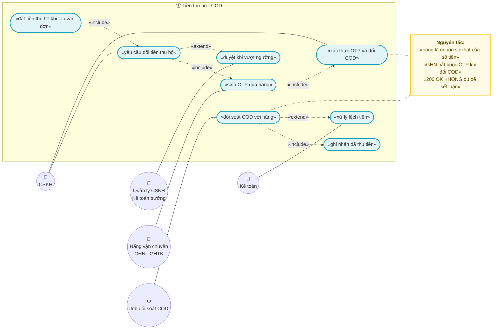
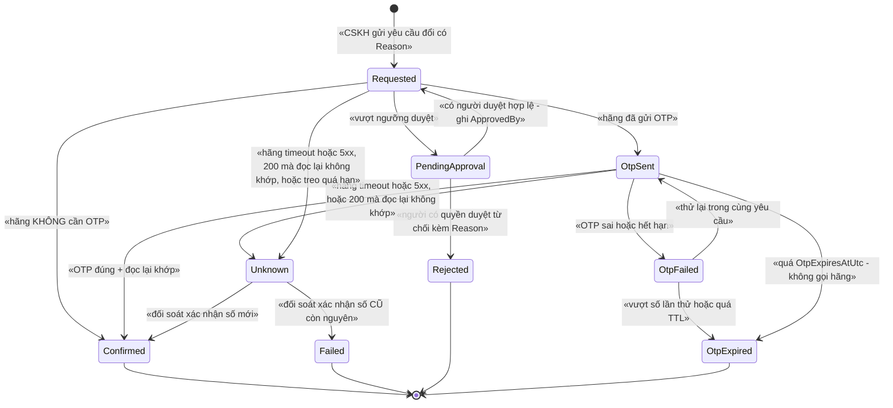
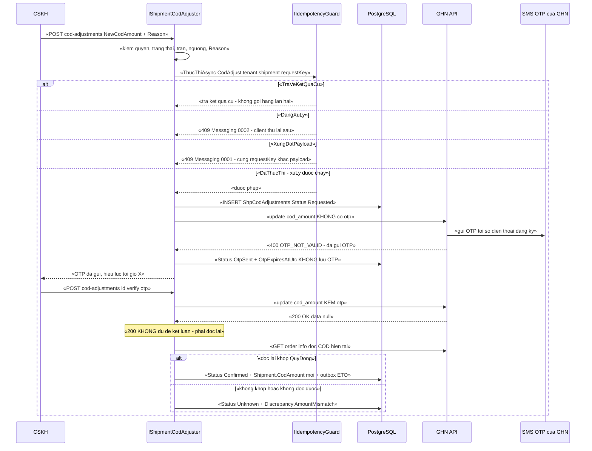

# `SHP-003` — COD: thu hộ, đổi COD (⚠️ GHN cần OTP)

> ⚠️ **CẢNH BÁO ĐỌC TRƯỚC:** việc **đổi tiền thu hộ (COD)** của một vận đơn **đã tạo** là thao tác
> **sửa một con số tiền mà một bên thứ ba sẽ đi thu của khách**. Với **GHN**, đổi `cod_amount` **bắt buộc OTP**
> gửi tới số điện thoại đăng ký của tài khoản — xem §7.3 có **trích dẫn tài liệu chính thức**.
> Nghĩa là: **hệ thống ta KHÔNG tự quyết định được** việc đổi COD. Đây là ràng buộc **bên ngoài**, không phải
> lựa chọn thiết kế ⇒ mọi luồng đổi COD phải mô hình hoá **2 bước** (yêu cầu → xác thực OTP), không được giả định 1 bước.
>
> ⚠️ **CẢNH BÁO LIÊN QUAN (`SHP-004`):** với **GHTK**, rủi ro nằm ở **khâu TRƯỚC** — **xác minh địa chỉ 2 cấp**
> trước khi gửi. Nếu địa chỉ không hợp lệ thì **không tạo được vận đơn** ⇒ **không có COD để đổi**.
> Trạng thái kiểm chứng: **chưa kiểm chứng** (xem §15.2 **F2**) — chi tiết thuộc `SHP-004`.

| Thuộc tính | Nội dung |
|---|---|
| **Mã** | `SHP-003` |
| **Module** | **ShippingHub** — dự kiến `modules/ShippingHub/eCommerce.ShippingHub.{Domain, EntityFrameworkCore, Application.Contracts, Application}`. ⚠️ **CHƯA TỒN TẠI trong code** (kiểm bằng `glob`/`grep` — xem §15.2 **F1**) |
| **Giai đoạn** | **GĐ3 — vận chuyển / đối soát COD** theo lộ trình chính `05` + `07` (`D-69`; `docs/agents/anh-xa-lo-trinh-d69.md:30`), cùng đợt với `SHP-001`/`SHP-002`/`SHP-004` — bản v0.1 ghi GĐ2 theo `implementation-plan.md` (lộ trình đó đã là lịch sử) |
| **Ưu tiên** | **Must have** — COD là **phần lớn dòng tiền** của thương mại điện tử VN; không có nó thì **không đối soát được tiền thật về tài khoản** |
| **Trạng thái** | 🟡 `Draft` — chờ review |
| **Người viết / người review** | *(điền)* / **Kiến trúc trưởng + Kế toán trưởng + người đã liên hệ GHN/GHTK** |
| **Phiên bản / ngày** | `v0.4 — 20/11/2026` (áp `D-117`, `D-114`, `D-82`, `D-116`, `D-118`, `D-119`; sửa theo DOCREV vòng 1; đối chiếu mô hình Nhanh, WP-14 — mục cuối tài liệu) |
| **Tài liệu liên quan** | `SHP-001` (tạo vận đơn — **tiền đề**, cấp `ProviderTrackingCode`) · `SHP-002` (**webhook trạng thái**, `CodAmount` trên `ShpShipments`, `Discrepancy`, khoá lock `shipping`) · `SHP-004` (adapter GHTK — ⚠️ xác minh địa chỉ 2 cấp) · `XC-001` (Money/`decimal`, **cấm `==` trên tiền**) · `XC-002` (outbox/inbox + `IIdempotencyGuard` ở **mọi** biên vào) · `XC-003` (khoá phân tán) · `XC-004` (`[Authorize]` cấp class, permission, tenant) · `XC-005` (log/`CorrelationId`/metric) · `REC-003` (đối soát COD theo phiên) · `SAL-003` (state machine 4 trục của đơn) · `ACC-001` (xuất liệu kế toán) |

---

## 0. Tóm tắt & quyết định thiết kế

**Tóm tắt:** `SHP-003` chốt **vòng đời của số tiền thu hộ (COD)** — từ lúc **đặt** (khi tạo vận đơn) → **đổi** (thao tác
rủi ro nhất, vì **GHN bắt buộc OTP**) → **ghi nhận đã thu** → **đối soát với tiền thật về tài khoản**.

**Vì sao phải có tài liệu riêng (không phải thủ tục):** `SHP-002` đã chốt rằng **webhook trạng thái là GỢI Ý, đối soát
mới là SỰ THẬT**. `SHP-003` là tài liệu **duy nhất** nói về **con số tiền mà hãng sẽ đi thu**. Ba hệ quả thật:

| Nếu làm ẩu | Hệ quả thật |
|---|---|
| Đổi COD **chỉ ở DB của ta** mà không gọi API hãng | **Shipper đi thu số CŨ** ⇒ khách trả ít hơn ⇒ **mất tiền thật**, và không có lỗi biên dịch nào |
| Gọi API đổi COD rồi **coi `200 OK` là "đã đổi xong"** | Trạng thái đổi COD của GHN là **bất đồng bộ** (tài liệu ghi `data: null`) ⇒ DB ta **lệch** trạng thái hãng ⇒ đối soát sai vào cuối ngày |
| Lưu / log **mã OTP** để "tiện gỡ lỗi" | Rò **bí mật dùng một lần** + dữ liệu PII (số điện thoại) ⇒ sự cố bảo mật, vi phạm `XC-005` **BR-005/D6** |

**Phạm vi:**

- ✅ **Vòng đời số tiền COD** nội bộ (`CodRecord`): `Pending → Collected → Remitted → Reconciled`, kèm trạng thái **hoàn/huỷ**.
- ✅ **Vòng đời YÊU CẦU đổi COD** (`CodAdjustment`) — **state machine 2 bước có OTP**, guard **NÉM LỖI**.
- ✅ **Ánh xạ ràng buộc của từng hãng** (GHN cần OTP; GHN có trần `5.000.000`; trạng thái vận đơn nào cho phép đổi) — là **DỮ LIỆU**, không hard-code.
- ✅ **Idempotency ở MỌI biên vào** của feature (yêu cầu đổi, xác thực OTP, webhook COD, job đối soát) theo `XC-002`.
- ✅ **Tiền**: `decimal` + `Money`, **cấm** `==` trên tiền (`XC-001` BR-003/D3).
- ✅ Metric + log + `CorrelationId` theo `XC-005`; **cấm** log OTP.

**Không nằm trong phạm vi:**

- ❌ **Tạo vận đơn / tính phí / gửi hàng** — thuộc `SHP-001` (tài liệu này **giả định** vận đơn đã tồn tại và đã có `CodAmount`). COD **ban đầu** của vận đơn do `SHP-001` đọc từ đơn đã chốt qua hợp đồng Sales, client không gõ (`D-108`; đơn hiện có `Order.CodAmount` — `modules/Sales/eCommerce.Sales.Domain/Order.cs:121`); SHP-003 chỉ lo việc **đổi sau khi đã có vận đơn**.
- ❌ **Nhận webhook trạng thái & đối soát trạng thái** — thuộc `SHP-002` (tài liệu này **chỉ đọc** `Shipment.Status`).
- ❌ **Xác minh địa chỉ 2 cấp của GHTK** — thuộc `SHP-004` (nêu ở đây **chỉ** vì nó chặn khả năng có COD).
- ❌ **Import bảng kê COD theo phiên + đối chiếu tiền về ngân hàng** — thuộc `REC-003`.
- ❌ **Ghi nhận công nợ/doanh thu/hoàn tiền** — thuộc `ACC-001` (GĐ3 = công nợ + xuất Excel/MISA, bút toán kép ở GĐ4 — `D-03`); `SHP-003` **chỉ phát ETO**. Không ghi điểm/công nợ khách (`D-45`: chỉ qua `ICustomerLedger`, `modules/Customers/eCommerce.Customers.Application.Contracts/IDataScopeResolver.cs:60`).
- ❌ **Hàng hoàn / trả hàng / hoàn tiền của đơn giao vận** — thuộc `SAL-006` (`D-70`); SHP-003 chỉ đặt `ShpCodRecords` sang `Cancelled` khi vận đơn huỷ/hoàn (§3.3).
- ❌ **Sửa state machine 4 trục của đơn** (`FulfillmentStatus` 18 giá trị — `D-08`, `src/eCommerce.Domain.Shared/Enums.cs:151`) — thuộc `SAL-003`; SHP-003 **không** đổi trạng thái đơn, chỉ phát ETO.

### 0.1 Quyết định thiết kế (ADR ngắn)

| # | Quyết định | Phương án đã cân nhắc | Lý do chọn | Hệ quả |
|---|---|---|---|---|
| **D1** | **COD là số tiền của HÃNG, không phải của ta**: nguồn sự thật là **API hãng**; DB ta chỉ là **bản sao có dấu vết** | (a) ta là nguồn sự thật, hãng theo ta · (b) **hãng là nguồn sự thật, ta ghi vết** | Hãng mới là bên **đi thu tiền** và có **quyền từ chối** đổi COD (OTP sai, trạng thái không cho sửa). Nếu ta tự cho mình là nguồn sự thật thì sinh ra "số tiền trong DB" ≠ "số tiền shipper thu" | Mọi thay đổi COD **phải** chờ hãng xác nhận; DB ta có trạng thái `AdjustmentPending` (chưa chắc đã đổi được) |
| **D2** | **KHÔNG hard-code "GHN cần OTP" trong code nghiệp vụ** — đó là **thuộc tính cấu hình của từng hãng** (`RequiresOtpToChangeCod`, `MaxCodAmount`, danh sách trạng thái cho phép đổi) | (a) `if (provider == "ghn")` · (b) **thuộc tính cấu hình/dữ liệu** | `SHP-002` BR-009 đã cấm hard-code hãng. Thêm nữa: **cùng một hãng có 2 endpoint khác nhau** và tài liệu **không nói giống nhau** về OTP (xem §7.3) ⇒ nhúng vào code là **khoá cứng một điều chưa kiểm chứng** | Phải có `ShippingHubOptions.Providers.{code}.Cod.*`; hãng mới = thêm cấu hình, **không** sửa code |
| **D3** | **Đổi COD là luồng 2 BƯỚC bắt buộc** — `Yêu cầu` (sinh OTP) rồi `Xác thực OTP` | (a) 1 bước "gọi API kèm OTP do người dùng nhập" · (b) **2 bước có bản ghi trung gian** | Với (a), nếu request đứt giữa đường thì **không biết** OTP đã được sinh hay chưa; và **không** có chỗ để ghi vết "ai yêu cầu đổi, lúc nào, vì sao" — mà đây là thao tác **sửa tiền** | Có bảng `ShpCodAdjustments`; `OTP` **không** lưu (D10); bản ghi là **append-only** |
| **D4** | **KHÔNG tin `200 OK`** — mọi lần đổi COD **phải đọc lại** `COD` từ hãng **trước khi** kết luận "đã đổi" | (a) tin response · (b) **đọc lại để xác nhận** | Tài liệu GHN ghi response thành công có `data: null` ⇒ response **không mang** giá trị COD mới. Nếu tin response thì DB ta ghi "đã đổi" trong khi hãng có thể chưa áp dụng | `CodAdjustment` chỉ sang `Confirmed` khi **có bằng chứng đọc lại** khớp `QuyDong()` (số nguyên đồng — BR-009); hãng không khai khả năng đọc lại ⇒ NÉM (BR-010, `D-114`/P5); nếu không ⇒ `Unknown` + `Discrepancy` (kế thừa `SHP-002` D1) |
| **D5** | **Giới hạn & duyệt theo giá trị**: đổi COD **vượt ngưỡng** (hoặc khi ngưỡng **chưa được điền**) phải qua **người có quyền `.Approve`** duyệt; Setting `Cod.RequireDistinctApprover` (mặc định **tắt**) bật ⇒ người duyệt **≠** người yêu cầu (`D-114`/P1+P12) | (a) ai có quyền thì đổi được mọi số · (b) **ngưỡng + duyệt** | Đổi COD là đường **hợp pháp hoá chênh lệch tiền**. Không ngưỡng ⇒ một tài khoản CSKH bị lộ là **mất tiền ở quy mô lớn** | Cần permission `.Approve` khi **trị tuyệt đối của** `mới − cũ` **> ngưỡng** **hoặc ngưỡng trống**; ngưỡng và trần số lần đổi/ngày là **Setting theo tenant, mặc định TRỐNG** (§6.3); **luôn** audit |
| **D6** | **Idempotency key ổn định cho mỗi YÊU CẦU đổi**: client sinh **một** `RequestKey` (`Guid`) **khi mở form**; **nguồn sự thật = trường BẮT BUỘC `RequestKey`** (chuỗi 1–64 ký tự, không toàn khoảng trắng) **trong body** `RequestCodAdjustmentDto` (khuôn `PosController.cs:28-30,75-86`, `CheckoutDtos.cs:62-69`; `D-120`), header `Idempotency-Key` **tuỳ chọn** chỉ là bản sao; khoá = `CodAdjust:{tenantId}:{shipmentId}:{requestKey}`. `AttemptNo` do **server** cấp (tuần tự theo vận đơn, trong khoá lock — chỉ để audit và đếm trần), **không** phải khoá | (a) server tự `AttemptNo++` mỗi POST · (b) khoá theo nội dung `(shipmentId, NewCodAmount, RequestedBy)` · (c) **client giữ `RequestKey` ổn định, retry gửi lại y nguyên** | `XC-002` BR-007: khoá mới mỗi retry ⇒ mỗi retry là một giao dịch mới. Với (a), bấm đúp/BFF retry khi timeout ⇒ `AttemptNo` khác ⇒ khoá khác ⇒ dòng thứ hai + OTP thứ hai ⇒ có thể phát `CodAdjustmentConfirmedEto` hai lần (ACC-001/REC-003 điều chỉnh phải thu hai lần — tác hại `D-117`). (b) cho hai CSKH khác nhau cùng số mới vẫn là hai yêu cầu. (c) là khuôn `Idempotency-Key` chuẩn, rẻ nhất | POST lặp cùng `RequestKey` ⇒ trả lại bản ghi cũ, **không** sinh OTP mới, **không** gọi hãng lần hai; **thiếu** `RequestKey`, hoặc header có mà **≠** body ⇒ NÉM `eCommerce:Shipping:0315` ở **app service**, trước mọi ghi/gọi hãng (fail-closed, 0 dòng ghi; HTTP và lời gọi in-process cùng ra `0315`); **server không sinh khoá thay**; muốn thử lại sau `OtpExpired` ⇒ mở form mới (`RequestKey` mới) và bị tính vào **trần số lần**. Giữ 3 unique index §5.2. ✅ Đã chốt `D-120` (§15.1 Q12) |
| **D7** | **Khoá phân tán cho tài nguyên chia sẻ**: đổi COD của **một vận đơn** + cấu hình COD của **một hãng** | (a) không khoá (tin DB) · (b) **khoá theo vận đơn + theo hãng** | Hai CSKH cùng đổi COD một vận đơn ⇒ 2 luồng gọi API hãng, **OTP cuối** thắng ⇒ kết quả **không xác định**. Ngoài ra, thao tác này **không** chạy ở tần suất cao nên khoá **rẻ** | TTL **30 s** — chỉ bao lúc **tạo/chuyển** yêu cầu (bước 3–7), **không** bao vòng đời `OtpSent` (OTP 300 s) ⇒ phải có thêm **bất biến "tối đa MỘT yêu cầu chưa hấp thụ trên mỗi vận đơn"** (§8.1 #14, partial UNIQUE §5.2, `0313`); **cấm** acquire lồng (`XC-003` D6 — cấm lồng **cùng tên khoá**; khoá `messaging:idempotency:*` bên trong `shipping:cod-adjust:*` không vi phạm); hàng rào cuối **vẫn** là DB (`XC-003` D2) |
| **D8** | **Thao tác ghi đi qua Unit of Work của ABP** (transaction tự động) — **cấm** gọi API hãng **bên trong** transaction | (a) giữ transaction qua lời gọi HTTP · (b) **gọi hãng NGOÀI transaction** | Giữ transaction qua HTTP call ⇒ transaction dài + giữ khoá DB khi chờ mạng (bài học `SHP-002` **B3**). ⚠️ Host đặt `TransactionBehavior = Auto` (`src/eCommerce.HttpApi.Host/eCommerceHttpApiHostModule.cs:94`) ⇒ **UoW ngầm của app service tự mở transaction** — nên chỉ "gọi sau `CompleteAsync`" là **chưa đủ**: method điều phối phải tắt transaction ngầm | Điều phối (app service + job) gắn `[UnitOfWork(isTransactional: false)]`; mỗi pha ghi mở `Begin(requiresNew: true, isTransactional: true)` + `CompleteAsync`: **ghi ý định (UoW ngắn)** → **gọi hãng (ngoài transaction)** → **ghi kết quả (UoW ngắn)** — cùng khuôn `SHP-001` §4.2/BR-002 (`DeadLetterAppService.cs:226`) |
| **D9** | **Một đường duy nhất để sửa COD** — `IShipmentCodAdjuster` trong `ShippingHub`; **cấm** module khác (hoặc script vận hành) sửa `CodAmount` | (a) cho phép sửa qua SQL/khác module · (b) **một cửa** | Quy ước bất biến: **module sở hữu entity của mình, module gọi app BỊ CẤM**. Nhiều cửa ⇒ không đối soát được "vì sao số tiền đổi" | Mọi đường khác bị **chặn ở review** + `CodAmount` có setter **private** |
| **D10** | **OTP là bí mật dùng-một-lần**: **KHÔNG** sinh trong hệ thống ta, **KHÔNG** lưu, **KHÔNG** log, **KHÔNG** trả ra DTO; chỉ tồn tại trong **bộ nhớ của request xác thực** | (a) lưu OTP để "thử lại nhanh" · (b) **không lưu gì** | OTP do **hãng** sinh và gửi tới số điện thoại đăng ký của **tài khoản ta**. Lưu lại = mở rộng bề mặt tấn công vô ích; log = vi phạm `XC-005` BR-005 | Có test quét mã nguồn (`TC-05`); DTO `VerifyCodAdjustmentDto` **không** có trường nào bị ghi log |
| **D11** | **Khi trạng thái hãng KHÔNG XÁC ĐỊNH** ⇒ **KHÔNG retry mù** — chuyển sang **đối soát** và ghi `Discrepancy` | (a) retry tới khi `200` · (b) **dừng và đối soát** | Đổi COD **không idempotent ở phía hãng theo nghĩa nội dung**: gửi lại một yêu cầu "đổi sang X" khi yêu cầu trước **đã thành công** là vô hại, **nhưng** gửi lại khi ta **không biết** số nào đang áp dụng thì có thể ghi đè một thay đổi hợp lệ khác của người khác | Có `CodAdjustmentStatus.Unknown`; job đối soát COD (nhịp riêng) là đường thoát; metric đếm |

---

## 1. Use Case Specification

| Thuộc tính | Nội dung |
|---|---|
| **Use Case ID** | `SHP-003` |
| **Use Case Name** | Đặt, đổi và đối soát **tiền thu hộ (COD)** của một vận đơn — có ràng buộc OTP của hãng |
| **Description** | *"Là CSKH/kế toán, tôi muốn sửa số tiền thu hộ của một vận đơn đang trên đường (vì khách đổi ý, đơn bớt 1 món, hoặc nhập sai từ đầu) — nhưng tôi muốn hệ thống **buộc** tôi làm đúng quy trình của hãng (OTP), **ghi lại** ai đổi vì sao, và **không bao giờ** để sổ sách của ta lệch với số tiền shipper thực thu."* |
| **Actor(s)** | **CSKH** (yêu cầu đổi) · **Người có quyền `.Approve`** (mặc định admin tenant; duyệt khi vượt ngưỡng hoặc khi ngưỡng chưa điền) · **Kế toán** (đối soát, xử lý lệch) · **Hệ thống** (job đối soát COD, job nhặt lại yêu cầu treo) · **Hãng vận chuyển** (GHN/GHTK — sinh OTP, thu tiền, trả trạng thái) |
| **Priority** | **Must have** |
| **Trigger** | (a) CSKH bấm "Đổi tiền thu hộ"; (b) khách xác nhận OTP; (c) webhook/đối soát của hãng báo **số tiền thu thực tế**; (d) job đối soát COD chạy theo nhịp |
| **Pre-Condition(s)** | • **Vận đơn đã tồn tại** trong `ShpShipments` và đã có `ProviderTrackingCode` do hãng cấp (do `SHP-001` tạo). Chưa có ⇒ `eCommerce:Shipping:0301` (mã **riêng** của `SHP-003`: API đồng bộ trả `400` — khác `0204` của `SHP-002`, nơi webhook vẫn trả `200`).<br>• **Trạng thái vận đơn cho phép đổi COD** — với GHN, tập trường được sửa **co lại** theo trạng thái (xem §7.3). Không cho phép ⇒ `eCommerce:Shipping:0302`.<br>• **Hãng đã được cấu hình** `Cod.RequiresOtpToChangeCod` (kiểu `bool?`) / `Cod.MaxCodAmount` / `Cod.CodChangeApiPath` / `Cod.CodReadApiPath` (khả năng **đọc lại** COD — D4, Q8) **và** Setting tenant `Cod.OtpTtlSeconds` / `Cod.OtpMaxAttempts` (§6.3; chỉ khi hãng cần OTP). Thiếu một giá trị (`null`/rỗng; endpoint **không có mặc định**) ⇒ **fail-closed**: `eCommerce:Shipping:0207` (không có đường đọc lại ⇒ không có đường `Confirmed` ⇒ không cho bắt đầu đổi).<br>• **Tenant hiện tại** (`ICurrentTenant`) — COD luôn thuộc tenant sở hữu vận đơn.<br>• `CorrelationId` theo `XC-005` (sinh mới nếu không có). |
| **Post-Condition(s)** | • **Mỗi yêu cầu đổi COD qua được bước 2** (Basic Flow) có **đúng 1** dòng `ShpCodAdjustments` (append-only) — kể cả khi OTP sai. Yêu cầu bị chặn ở bước 2 (E1–E5, E13, E15–E17, `0207`) **NÉM** và **không** ghi dòng nào. **Mỗi vận đơn có tối đa MỘT** dòng `ShpCodAdjustments` ở trạng thái chưa hấp thụ (`Requested`/`PendingApproval`/`OtpSent`/`OtpFailed`/`Unknown`) — §8.1 #14.<br>• **`CodAmount` chỉ đổi** khi có **bằng chứng xác nhận** từ hãng (D4); mọi lần đổi có `OldCodAmount`/`NewCodAmount` + `Reason` + `ChangedBy`.<br>• **`OTP` không tồn tại** ở bất kỳ bảng/log/DTO nào (D10).<br>• Mọi lần **không** đổi được đều có dấu vết: exception có mã **hoặc** log `Warning` + metric.<br>• Lệch giữa COD ta giữ và COD hãng báo ⇒ **có** `ShpDiscrepancies` với `Kind = AmountMismatch` — **cấm** tự sửa số của hãng.<br>• Sự kiện phát ra nằm trong **outbox cùng transaction** với lần ghi (`XC-002` BR-001). |
| **Basic Flow** | 1. CSKH mở vận đơn, bấm **"Đổi tiền thu hộ"**, nhập `NewCodAmount` + **`Reason` bắt buộc**.<br>2. Hệ thống kiểm **7 điều**: quyền · `RequestKey` trong body (D6, `D-120`; thiếu/rỗng/> 64 ký tự, hoặc header `Idempotency-Key` có mà ≠ body ⇒ `0315`, E15) · trạng thái vận đơn cho phép · `NewCodAmount ≥ 0`, là **số nguyên đồng** (lẻ ⇒ `0111`, E13) và `≤ Cod.MaxCodAmount` · **trần số lần đổi/vận đơn/ngày** · **ngưỡng cần duyệt** (D5) · `Reason` đủ dài. Vi phạm ⇒ §12 (E1–E6, E13, E15).<br>3. Giành khoá `shipping:cod-adjust:{tenantId}:{shipmentId}` (TTL 30 s; tên không tiền tố — §8.2). Không giành được ⇒ `eCommerce:Lock:0001` — **không** im lặng. **Trong khoá**, đọc yêu cầu chưa hấp thụ của vận đơn: **có cùng `RequestKey`** ⇒ trả lại bản ghi đó (POST lặp, không ghi/không gọi hãng; payload khác ⇒ E12); **có `RequestKey` khác** ⇒ NÉM `0313` (E16).<br>4. Ghi `ShpCodAdjustments` (`Status = Requested`, `OldCodAmount = ShpShipments.CodAmount` hiện hành, `AttemptNo` = server cấp tuần tự theo vận đơn) **trong UoW ngắn**; phát `CodAdjustmentRequestedEto` qua **outbox**.<br>5. **Ngoài** transaction (D8): gọi API hãng để **sinh OTP** (GHN: `POST /v2/shipping-order/update` kèm `cod_amount` **thiếu/không** `otp` ⇒ hãng trả `OTP_NOT_VALID` và **gửi OTP** — ⚠️ xem **Q2** §15.1 về cách sinh OTP **tường minh**).<br>6. Ghi `Status = OtpSent` + `OtpSentAtUtc` + `OtpExpiresAtUtc = OtpSentAtUtc + Cod.OtpTtlSeconds` (**không** lưu OTP).<br>7. Trả về UI: "OTP đã gửi tới số điện thoại đăng ký, hiệu lực tới {giờ}".<br>8. CSKH nhập OTP khách đọc → request xác thực **giành lại** khoá `shipping:cod-adjust:{tenantId}:{shipmentId}` (khoá bước 3 đã nhả từ request trước), rồi gọi API hãng **kèm `otp`**.<br>9. `200` ⇒ **bước 10**; lỗi ⇒ §12 (E7–E10).<br>10. **Đọc lại COD từ hãng** (D4). Khớp `QuyDong()` ⇒ trong **một** UoW ngắn (B3): `UPDATE ShpShipments SET CodAmount = New WHERE Id = @id AND CodAmount = Old` (**so-và-đặt**, §8.1 #15) + `Status = Confirmed` + cập nhật `ShpCodRecords.Amount` (§3.3) + ghi `CodAdjustmentConfirmedEto`. **Không** khớp hoặc không đọc được ⇒ `Status = Unknown` + `Discrepancy` (D11). |
| **Alternative Flow** | **A1: Hãng KHÔNG cần OTP** (`Cod.RequiresOtpToChangeCod = false`, ví dụ cấu hình cho một hãng cụ thể) ⇒ bước 5–7 **bỏ qua**; `Requested → Confirmed` trong **một** lần gọi API. **Không** tạo OTP giả.<br>**A2: OTP hết hạn** ⇒ `Status = OtpExpired` — hệ thống/job (0 lời gọi hãng: chỉ so `now > OtpExpiresAtUtc`) **không** tự thử lại, **không** tự gửi lại OTP (TTL `300 s` / `5` lần là **đề xuất CHƯA KIỂM CHỨNG** — Q3, R3-2); muốn tiếp ⇒ mở form mới (**`RequestKey` mới**, D6) và **tính vào trần** — **cấm** "gửi lại OTP miễn phí" không giới hạn.<br>**A3: Vượt ngưỡng duyệt, hoặc ngưỡng/trần chưa được điền** (D5, `D-114`/P1) ⇒ `Status = PendingApproval`; **không** gọi API hãng cho tới khi có người có quyền `.Approve` **phê duyệt** (`ApproveAsync`: ghi `ApprovedBy` → `Requested`, rồi **chính lời gọi đó** chạy tiếp bước 5–7 (hoặc A1) ngoài transaction — D8; yêu cầu **không** quay lại `PendingApproval`, §3.2 #1) hoặc **từ chối** (`RejectAdjustmentAsync` → `Rejected`, A6). `PendingApproval` **không** tự hết hạn; trong lúc đó vận đơn **không** nhận yêu cầu mới (`0313`) — `D-120` (Q13): chỉ duyệt/từ chối mới giải phóng; CSKH tự huỷ là nợ §15.2 F9.<br>**A4: Webhook/đối soát báo số tiền thu khác** ⇒ **ghi `Discrepancy`**, **giữ nguyên** `CodAmount` của ta, **chờ kế toán**; **cấm** tự ghi đè (`SHP-002` BR-007).<br>**A5: Đổi COD khi đơn đã giao nhưng chưa đối soát** ⇒ **từ chối** (`eCommerce:Shipping:0302`): số tiền đã được shipper thu **trên thực tế**, sửa trong hệ thống **không** sửa được thực tế ⇒ phải đi đường **điều chỉnh/đối soát**, không phải đường "đổi COD".<br>**A6: Người có `.Approve` từ chối** yêu cầu `PendingApproval` (kèm `Reason` ≥ 10 ký tự) ⇒ `Status = Rejected` (hấp thụ), phát `CodAdjustmentFailedEto`; **0** lời gọi hãng. Người không có quyền, hoặc yêu cầu không ở `PendingApproval` ⇒ `0305`. |
| **Exception Flow** | **E1:** `NewCodAmount < 0` ⇒ `eCommerce:Shipping:0308`.<br>**E2:** `NewCodAmount > Cod.MaxCodAmount` (GHN: **5.000.000**) ⇒ `eCommerce:Shipping:0308` — trần **là cấu hình**, không hard-code (D2).<br>**E3:** trạng thái vận đơn **không** cho phép sửa COD ⇒ `eCommerce:Shipping:0302`.<br>**E4:** vượt **trần số lần đổi** (Setting tenant `Cod.MaxAdjustmentsPerShipmentPerDay`; **trống** ⇒ không so mà vào `PendingApproval` — A3) ⇒ `eCommerce:Shipping:0304`.<br>**E5:** thiếu `Reason` / `Reason` < **10 ký tự** ⇒ `eCommerce:Shipping:0312` (mã riêng — `0310` là lệch tiền khi đối soát).<br>**E6:** `ApproveAsync` bị gọi bởi người **không** có quyền `.Approve`, hoặc trên yêu cầu **không** ở `PendingApproval` ⇒ `eCommerce:Shipping:0305`. (Người yêu cầu **không** có `.Approve` mà vượt ngưỡng **không** bị ném: yêu cầu được ghi `PendingApproval` theo A3 — nếu ném thì A3 và §3.1 không bao giờ chạy tới, và vi phạm Post-condition "mỗi yêu cầu có đúng 1 dòng".)<br>**E7:** OTP **sai/hết hạn** (GHN `OTP_NOT_VALID`) ⇒ `eCommerce:Shipping:0303`; `AttemptNo` **không** tăng (cùng một OTP còn hiệu lực), nhưng **đếm số lần thử** `OtpAttemptCount++; vượt `OtpMaxAttempts` ⇒ **chuyển `OtpExpired`** (chống dò OTP).<br>**E8:** tài khoản hãng **không có quyền sửa COD** (GHN `PERMISSION_DENIED_EDIT_COD`) ⇒ `eCommerce:Shipping:0302` — **không** phải lỗi tạm thời ⇒ **cấm retry**.<br>**E9:** hãng báo **không tìm thấy vận đơn / không thuộc tài khoản** ⇒ `eCommerce:Shipping:0301`.<br>**E10:** hãng **timeout / 5xx** ⇒ `Status = Unknown` (D11) + **đối soát**, **cấm** retry mù.<br>**E11:** không giành được khoá ⇒ `eCommerce:Lock:0001` (`XC-003` `eCommerce:Lock:0001`) — **cấm** bỏ qua im lặng.<br>**E12:** cùng `IdempotencyKey` (cùng `RequestKey`) nhưng payload khác ⇒ `eCommerce:Messaging:0001` (`PayloadConflict`, `MessagingErrorCodes.cs:14`; `XC-002` BR-006) — **cấm** ghi đè. Hai POST **đồng thời** cùng khoá ⇒ `eCommerce:Messaging:0002` (`DangXuLy`, `MessagingErrorCodes.cs:17`, `409`) — client thử lại sau.<br>**E13:** `NewCodAmount` **có phần thập phân** (vd CSKH nhập `250000.5`) ⇒ **NÉM** `eCommerce:Shipping:0111` (`SHP-001` khai — BR-009, `D-114`/Q11); kiểm ở bước 2 ⇒ **0** dòng `ShpCodAdjustments`, **0** lời gọi hãng, **không** làm tròn.<br>**E14:** hãng báo **hết hạn mức API (quota)** khi đổi COD ⇒ **NÉM** `eCommerce:Shipping:0311`, đúng **1** lời gọi hãng (**cấm** retry mù — D11), yêu cầu sang `Unknown` + `CodAdjustUnknown` để đối soát (số lần đổi/quota thật của hãng: Q4, R3-1/R3-2 — **chưa xác minh**).<br>**E15:** thiếu trường `RequestKey` trong body (hoặc rỗng/toàn khoảng trắng/dài > 64 ký tự), **hoặc** header `Idempotency-Key` có mà **≠** `RequestKey` trong body ⇒ **NÉM** `eCommerce:Shipping:0315` ở **app service** (không chỉ dựa `[Required]` của DTO), trước mọi ghi/gọi hãng; **0** dòng ghi, **0** lời gọi hãng (fail-closed — D6, `D-120`). Header vắng mà body hợp lệ ⇒ **không** lỗi. Server **không** sinh khoá thay.<br>**E16:** vận đơn **đã có** một yêu cầu chưa hấp thụ với `RequestKey` **khác** ⇒ **NÉM** `eCommerce:Shipping:0313` (`409`); **0** dòng ghi, **0** lời gọi hãng. Chống lại: hai CSKH đổi hai số khác nhau cho một vận đơn (§8.1 #14).<br>**E17:** khi `Confirmed`, `ShpShipments.CodAmount` hiện hành **≠** `OldCodAmount` của yêu cầu (so bằng `QuyDong()`) ⇒ yêu cầu sang `Unknown` + `Discrepancy.AmountMismatch` (UoW riêng, **không** sửa `CodAmount`), rồi **NÉM** `eCommerce:Shipping:0314` (`409`) — hãng đã áp số mới nhưng sổ ta **không** tự đặt đè (§8.1 #15). |
| **Business Rules** | • **BR-SHP-003-001**: **Mọi** thay đổi COD **phải** đi qua API của hãng (nguồn sự thật — D1); **cấm** sửa `CodAmount` cục bộ mà không gọi hãng.<br>• **BR-SHP-003-002**: **Cấm** hard-code "hãng nào cần OTP / trần COD / trạng thái cho phép đổi" trong code nghiệp vụ — **phải** là cấu hình của hãng (D2).<br>• **BR-SHP-003-003**: Đổi COD **phải** theo luồng **2 bước** khi hãng yêu cầu OTP (D3); **cấm** bỏ bước ghi vết yêu cầu.<br>• **BR-SHP-003-004**: 🚨 **OTP**: **cấm** sinh trong hệ thống ta, **cấm** lưu vào DB, **cấm** ghi log, **cấm** trả ra DTO (D10).<br>• **BR-SHP-003-005**: **OTP có TTL** bắt buộc; hết hạn ⇒ `OtpExpired`; **cấm** chấp nhận OTP không kiểm TTL.<br>• **BR-SHP-003-006**: **Giới hạn số lần thử OTP** (`OtpMaxAttempts`) — vượt ⇒ **khoá yêu cầu đó**; **cấm** cho dò vô hạn.<br>• **BR-SHP-003-007**: **Ngưỡng duyệt** theo giá trị tuyệt đối của chênh lệch (D5); vượt ⇒ **bắt buộc** người có quyền `.Approve` duyệt. Ngưỡng `Cod.ApprovalThresholdAmount` và trần `Cod.MaxAdjustmentsPerShipmentPerDay` là **Setting theo tenant, mặc định TRỐNG**; **trống ⇒ MỌI lần đổi vào `PendingApproval`** (`D-114`/P1+M4; `2.000.000`/`3` chỉ là ví dụ **chưa duyệt**). Setting `Cod.RequireDistinctApprover` (mặc định **tắt**) bật ⇒ người duyệt **≠** người yêu cầu, tự duyệt ⇒ `0302`. Yêu cầu `PendingApproval` có **hai** lối ra: duyệt (`ApproveAsync`) hoặc từ chối (`RejectAdjustmentAsync`, cùng quyền `.Approve`, A6). **Luôn** audit. Vi phạm ⇒ `TC-12`/`TC-13`/`TC-43`/`TC-48` đỏ.<br>• **BR-SHP-003-008**: `Reason` **bắt buộc**, **≥ 10 ký tự**, **không** chứa PII của khách quá mức cần thiết.<br>• **BR-SHP-003-009**: Tiền COD là `decimal` + `Money`; **cấm** so sánh tiền bằng `==` — so bằng **số nguyên đồng** (`long`) quy từ `Money` qua **đúng MỘT** hàm `decimal → long` đặt ở `ShippingHub.Domain`, do `SHP-001` khai (BR-SHP-001-008; ký hiệu **`QuyDong()`** trong tài liệu này, tên thật do `SHP-001` chốt) (`XC-001` BR-003). **COD lẻ (có phần thập phân) ⇒ NÉM `eCommerce:Shipping:0111`** (`CodKhongLaSoNguyenVnd`, `SHP-001` khai) — **không** làm tròn, **không** dùng `IRoundingPolicy`, **không** thêm `ToMinorUnits()` vào Kernel (`D-114`/`SHP-001`-Q17, đã chốt Q11). 🔶 `Money` hiện chỉ có `Cua`/`Vnd`/`CompareTo` (`shared/eCommerce.Kernel/Money/Money.cs:36-39`). Vi phạm ⇒ `TC-40`/`TC-41` đỏ.<br>• **BR-SHP-003-010**: **Cấm** kết luận "đã đổi" chỉ từ `200 OK` — **phải** có bước **đọc lại** (D4). Adapter **khai báo khả năng đọc lại COD**, mặc định `null` = **không có** ⇒ NÉM `0207`, **không** `Confirmed` chỉ vì `200 OK`; GHN chỉ bật sau sandbox (`D-114`/P5; Q8, Q2) — vi phạm ⇒ `TC-44`/`TC-45` đỏ.<br>• **BR-SHP-003-011**: Mọi lần **không xác định** trạng thái hãng ⇒ `Unknown` + `Discrepancy`; **cấm** retry mù (D11).<br>• **BR-SHP-003-012**: **Idempotency ở MỌI biên vào** (yêu cầu đổi, xác thực OTP, webhook COD, job đối soát) qua `IIdempotencyGuard` **+** unique index ở DB (`XC-002` BR-004/BR-005); khoá **ổn định** — **cấm** `Guid.NewGuid()` (D6).<br>• **BR-SHP-003-013**: **State machine** (§3) **NÉM LỖI** khi chuyển sai; **cấm** no-op im lặng (quy ước #11).<br>• **BR-SHP-003-014**: **Cấm** tự sửa số tiền của hãng khi lệch — chỉ ghi `Discrepancy` (`SHP-002` BR-007).<br>• **BR-SHP-003-015**: Khoá phân tán **chỉ** sinh từ `ShippingHubLockKeys` của module; **cấm** literal khoá trong nghiệp vụ (`XC-003` BR-001/D3); tên khoá **không** có tiền tố `ecommerce:` (`D-82`, `docs/coding-conventions.md:79,83-84` — vi phạm ⇒ `TC-42` đỏ); **cấm** acquire lồng (`XC-003` BR-005).<br>• **BR-SHP-003-016**: **Mọi** app service **phải** `[Authorize]` ở **cấp class**; **cấm** magic string permission (`XC-004` BR-001/BR-003).<br>• **BR-SHP-003-017**: Mã lỗi **phải** thuộc `ShippingHubErrorCodes` của module; **cấm** khai ở `eCommerceConsts.ErrorCodes` (kế thừa `XC-003` F2 / `TaxErrorCodes`). Vi phạm ⇒ `TC-33` đỏ (quét: mã `eCommerce:Shipping:*` dùng trong module mà không có trong `ShippingHubErrorCodes`, hoặc có trong `eCommerceConsts.ErrorCodes`).<br>• **BR-SHP-003-018**: Mọi thao tác **ghi** **phải** qua **Unit of Work**; **cấm** giữ transaction qua lời gọi HTTP tới hãng (D8) — app service/job điều phối **phải** `[UnitOfWork(isTransactional: false)]` và mỗi pha ghi `Begin(requiresNew: true, …)`. Vi phạm ⇒ `TC-34` đỏ (quét mã nguồn: thiếu attribute, thiếu `requiresNew`, hoặc gọi `ICodProviderClient` bên trong một `Begin`).<br>• **BR-SHP-003-019**: Unique index có `TenantId` **phải** `NULLS NOT DISTINCT` — vì hiện chạy **1 tenant** và `TenantId` **có thể `NULL`** (`XC-004` F1; nếu không, index **mất tác dụng**).<br>• **BR-SHP-003-020**: Metric **không** được dùng để ra quyết định nghiệp vụ (`XC-005`); mọi tên metric **phải** nằm trong `eCommerceMetricNames`.<br>• **BR-SHP-003-021**: `Order.CodAmount` **theo** COD đã đổi (`D-117`): **chỉ** qua **một** hàm so-và-đặt trên `Order` (`OldCodAmount` phải khớp `CodAmount` hiện tại, so bằng `Money`) do handler Sales tiêu thụ `CodAdjustmentConfirmedEto` gọi; lệch / âm / khác tiền tệ / `CodAmount = null` ⇒ **NÉM** (không làm tròn `null` về `0`); **không** ghi `OrderStatusHistory`, **không** đổi trạng thái đơn, Sales **không** phát lại ETO COD (§7.1). Vi phạm ⇒ `TC-35`…`TC-39` đỏ.<br>• **BR-SHP-003-022**: Mỗi vận đơn có **tối đa MỘT** yêu cầu đổi COD chưa hấp thụ (`Requested`/`PendingApproval`/`OtpSent`/`OtpFailed`/`Unknown`); yêu cầu thứ hai khác `RequestKey` ⇒ **NÉM** `0313`. Khi `Confirmed`, `ShpShipments.CodAmount` chỉ được đặt bằng so-và-đặt `WHERE CodAmount = OldCodAmount`; lệch ⇒ `Unknown` + `Discrepancy` + `0314`, **không** ghi đè. Vi phạm ⇒ `TC-49`/`TC-50` đỏ (chèn trực tiếp dòng thứ hai chưa hấp thụ ⇒ `23505`). |
| **Non-Functional Requirement** | • **NFR-SHP-003-001**: Bước **sinh OTP** (không tính độ trễ mạng của hãng) p95 **< 300 ms** ở phía ta.<br>• **NFR-SHP-003-002**: Bước **xác thực OTP** end-to-end p95 **< 2 s** (gồm 1 lời gọi hãng + 1 lần đọc lại).<br>• **NFR-SHP-003-003**: **0** lần OTP xuất hiện trong DB/log/DTO — quét mã nguồn + kiểm DB thật.<br>• **NFR-SHP-003-004**: **Idempotent 100 %**: gửi cùng một yêu cầu đổi **100 lần** ⇒ **đúng 1** lời gọi hãng có hiệu lực, **1** dòng `ShpCodAdjustments`.<br>• **NFR-SHP-003-005**: **0** `double`/`float` trong mọi biểu thức/entity/DTO tiền của module.<br>• **NFR-SHP-003-006**: **0** so sánh `==` trên trường tiền (test quét mã nguồn).<br>• **NFR-SHP-003-007**: **0** khoá acquire lồng **cùng tên khoá** (`XC-003` D6/E3); **0** acquire thiếu timeout; **1** khoá cho mỗi thao tác đổi COD (`XC-003` BR-004/BR-005).<br>• **NFR-SHP-003-008**: **100 %** log của luồng đổi COD có `CorrelationId` (`XC-005` NFR-002).<br>• **NFR-SHP-003-009**: **0** lần ghi log ở mức `Information` trong vòng lặp job đối soát COD (`XC-005` BR-004).<br>• **NFR-SHP-003-010**: Phát hiện lệch tiền COD trong **≤ 1 nhịp** job đối soát (nhịp đề xuất **15 phút**, thống nhất `SHP-002` NFR-005).<br>• **NFR-SHP-003-011**: **100 %** yêu cầu đổi COD **treo** được job đóng trong **≤ 2 nhịp**: `Requested` quá `Cod.StaleRequestMinutes` (chưa biết hãng đã nhận chưa) ⇒ `Unknown` + `Discrepancy`; `OtpSent` quá `OtpExpiresAtUtc` ⇒ `OtpExpired` (không `Discrepancy`). `PendingApproval` **không** thuộc diện treo (chờ người).<br>• **NFR-SHP-003-012**: Cách ly tenant: **0** bản ghi COD của tenant khác lọt vào truy vấn (⚠️ **cần PostgreSQL** — xem §14.4).<br>• **NFR-SHP-003-013**: **100 %** lần đổi COD thành công có `Reason` + `ChangedBy` + `ChangedAtUtc` (audit đầy đủ). |
| **Shorthand BR/NFR trong các bảng dưới** | `BR-01`…`BR-22` ≡ `BR-SHP-003-001`…`BR-SHP-003-022`; `NFR-01`…`NFR-13` ≡ `NFR-SHP-003-001`…`NFR-SHP-003-013`. Cách viết này kế thừa đúng thói quen của `XC-003`/`SHP-002`. |

---

## 2. Sơ đồ Use Case



**Chú giải:**

| Ký hiệu | Ý nghĩa |
|---|---|
| ⭕ Xanh lá | Actor (CSKH, quản lý/kế toán trưởng, kế toán, hãng vận chuyển, job) |
| 🟦 Bầu dục xanh dương | Use case |
| 🟨 Khung vàng | Note — nguyên tắc thiết kế |
| `-.«include».->` / `-.«extend».->` | Quan hệ bao hàm / mở rộng |

> 📌 **Ghi rõ:** `UC1` (đặt COD khi tạo vận đơn) thuộc **`SHP-001`**, `UC3` (sinh OTP) do **hãng** thực hiện —
> `SHP-003` **chỉ** gọi và ghi vết. Chúng được vẽ ở đây vì nếu thiếu thì **không hiểu được** vòng đời số tiền.

---

## 3. Sơ đồ trạng thái (state machine)

### 3.1 Vòng đời **yêu cầu đổi COD** (`ShpCodAdjustments.Status`)



### 3.2 Bảng chuyển trạng thái & guard — **mọi chuyển sai PHẢI NÉM LỖI, không im lặng**

| # | Từ | Sang | Guard | Ai được phép | Nếu vi phạm |
|---|---|---|---|---|---|
| 1 | `Requested` | `PendingApproval` | **`ApprovedBy IS NULL`** **và** (`Cod.ApprovalThresholdAmount` (Setting tenant) **trống**, **hoặc** `\|New − Old\| > Cod.ApprovalThresholdAmount`; trần `Cod.MaxAdjustmentsPerShipmentPerDay` trống cũng vào đây — `D-114`/P1). Yêu cầu đã có `ApprovedBy` **không bao giờ** được đánh giá lại về `PendingApproval` | hệ thống (lúc tạo yêu cầu) | — (đây là nhánh bình thường của A3, không ném; `0305` chỉ ở #2/#3) |
| 2 | `PendingApproval` | `Requested` | Người duyệt có quyền `.Approve` **và** (Setting `Cod.RequireDistinctApprover` **tắt** — mặc định — **hoặc** người duyệt ≠ người tạo yêu cầu); ghi `ApprovedBy`/`ApprovedAtUtc`; luôn audit. `ApproveAdjustmentAsync` **tiếp tục** bước 5–7 (hoặc A1) trong cùng lời gọi, ngoài transaction (D8) | người có `.Approve` (mặc định admin tenant) | `eCommerce:Shipping:0305` (thiếu quyền, hoặc yêu cầu không ở `PendingApproval`) · tự duyệt khi Setting **bật** ⇒ `eCommerce:Shipping:0302` |
| 3 | `PendingApproval` | `Rejected` | Người có `.Approve` từ chối (`RejectAdjustmentAsync`) + `Reason` ≥ 10 ký tự; phát `CodAdjustmentFailedEto` | người có `.Approve` | `eCommerce:Shipping:0305` (thiếu quyền / sai trạng thái) · `Reason` ngắn ⇒ `eCommerce:Shipping:0312` |
| 4 | `Requested` | `OtpSent` | `Cod.RequiresOtpToChangeCod = true` **và** hãng đã gửi OTP **và** `OtpAttemptCount = 0` | hệ thống | `eCommerce:Shipping:0307` |
| 5 | `Requested` | `Confirmed` | `Cod.RequiresOtpToChangeCod = false` **và** gọi hãng `200` **và** đọc lại khớp | hệ thống | `eCommerce:Shipping:0302` |
| 6 | `OtpSent` | `Confirmed` | OTP hợp lệ **và** `now ≤ OtpExpiresAtUtc` **và** `CanChangeCodInStatus(ShpShipments.Status hiện hành)` (đánh giá lại lúc xác thực: vận đơn có thể đã chuyển tiến nhiều bước sang `Delivered`/`Returned`/`Cancelled` khi yêu cầu đang `OtpSent` — `D-119`) **và** đọc lại khớp `QuyDong()` | CSKH (nhập OTP) | `eCommerce:Shipping:0303` (OTP/TTL) · `eCommerce:Shipping:0302` (trạng thái vận đơn không còn cho đổi — **0** lời gọi hãng) |
| 7 | `OtpSent` | `OtpFailed` | Hãng trả `OTP_NOT_VALID` | hệ thống | — |
| 8 | `OtpFailed` | `OtpSent` | `OtpAttemptCount < Cod.OtpMaxAttempts` **và** `now ≤ OtpExpiresAtUtc` | CSKH | vượt ⇒ `eCommerce:Shipping:0306` |
| 9 | `OtpSent` · `OtpFailed` | `OtpExpired` | `now > OtpExpiresAtUtc` (**0** lời gọi hãng — chỉ so đồng hồ), **hoặc** `OtpAttemptCount ≥ Cod.OtpMaxAttempts` | hệ thống · job nhặt lại · `VerifyAsync` khi thấy quá hạn | — (đóng tại chỗ; `VerifyAsync` trên bản ghi đã hết hạn ⇒ `0303`, không gọi hãng) |
| 10 | `Requested`/`OtpSent` | `Unknown` | Hãng **timeout**/**5xx**/response không parse được; hoặc hãng báo **quota** (E14 — NÉM `eCommerce:Shipping:0311`, đúng 1 lời gọi); hoặc `Requested` treo quá `Cod.StaleRequestMinutes` (chưa biết hãng đã nhận hay chưa — job, ≤ 2 nhịp, NFR-011). `OtpSent` treo quá TTL **không** vào đây mà đi #9 | hệ thống · job | `eCommerce:Shipping:0309` (quota: `0311`) |
| 11 | `Requested`/`OtpSent` | `Unknown` | 🚨 Hãng trả `200` nhưng **đọc lại** (D4) **không** thấy số mới / không đọc được (hãng chậm) — đọc lại diễn ra **trước** `Confirmed`, nên `Confirmed` (hấp thụ, #14) **không** bao giờ quay về `Unknown` | hệ thống | **Ghi `Discrepancy`** (`CodAdjustNotApplied`) — **cấm** sửa `CodAmount` |
| 12 | `Unknown` | `Confirmed` | Job đối soát đọc lại COD **của hãng** (không phải `CodAmount` của ta) = **số mới**; áp so-và-đặt `WHERE CodAmount = OldCodAmount` (§8.1 #15) | kế toán · job | lệch so-và-đặt ⇒ #17 |
| 13 | `Unknown` | `Failed` | Job đối soát đọc lại COD của hãng = **số cũ** (`OldCodAmount`) | kế toán · job | — |
| 17 | `Unknown` | *(giữ `Unknown`)* | COD hãng **khác cả số cũ lẫn số mới** (hoặc không đọc được): **không** tự chuyển; ghi `Discrepancy.AmountMismatch` (dedup theo `SHP-002` BR-013) và chờ kế toán xử lý (`ResolveDiscrepancyAsync`) rồi mới đi #12/#13 | job · kế toán | — (không ném; log `Warning` + metric; **không** coi là thành công) |
| 14 | `Confirmed` | **BẤT KỲ** | — | **KHÔNG AI** — trạng thái **hấp thụ** | `eCommerce:Shipping:0302` + log `Error` |
| 15 | `Failed` · `Rejected` · `OtpExpired` | **BẤT KỲ** | — | **KHÔNG AI** — **hấp thụ**; muốn làm lại ⇒ **tạo yêu cầu MỚI** (`RequestKey` mới; server cấp `AttemptNo` kế tiếp) | `eCommerce:Shipping:0302` |
| 16 | Bất kỳ → bất kỳ | *(không đổi)* | `UPDATE … WHERE Status = @expected` ảnh hưởng **0 dòng** | — | 🚨 **NÉM LỖI** `eCommerce:Shipping:0309` — **cấm** coi là thành công (`XC-002` BR-008 / E7) |

### 3.3 Vòng đời **số tiền COD** (`ShpCodRecords.Status`)

| Từ | Sang | Guard | Nếu vi phạm |
|---|---|---|---|
| `Pending` | `Collected` | **Dòng đối soát `REC-003` khớp** vận đơn + số tiền (`QuyDong()`) **và** `Shipment.Status = Delivered` **và** `ConfirmedAtUtc ≠ null` (`SHP-002` **BR-004**). Trạng thái do hãng báo (webhook/đọc lại) chỉ là **tham khảo**, **không** đủ một mình (`D-114`/P4, Q7) | `eCommerce:Shipping:0310` — **cấm** ghi "đã thu" từ webhook đơn thuần hoặc khi chưa có dòng `REC-003` khớp |
| `Pending` | `Cancelled` | Vận đơn `Cancelled` hoặc `Returned` | — |
| `Collected` | `Remitted` | Hãng xác nhận **đã chuyển tiền** (đối soát `REC-003`) | `eCommerce:Shipping:0310` |
| `Collected`/`Remitted` | `Reconciled` | Số tiền về tài khoản **khớp** `CodAmount` của ta (`QuyDong()`) | Lệch ⇒ **KHÔNG** sang `Reconciled`; ghi `Discrepancy` (`Kind = AmountMismatch`) |
| `Cancelled`/`Reconciled` | *(bất kỳ)* | — | **Hấp thụ** — `eCommerce:Shipping:0310` |

**Ai tạo và cập nhật dòng `ShpCodRecords`** (module chủ **ShippingHub**, cùng module nên đọc `ShpShipments` trực tiếp):

- **Tạo:** handler `IDistributedEventHandler<ShipmentCreatedEto>` (`ShipmentCreatedEto` do `SHP-001` §7.1 phát) tạo **một** dòng `Status = Pending`, `Amount = ShpShipments.CodAmount` (kể cả `0` — để đổi COD từ `0` lên số khác vẫn có dòng để cập nhật). Chống trùng: inbox + `IIdempotencyGuard` khoá `CodRecordCreate:{tenantId}:{shipmentId}`; hàng rào cuối UNIQUE `(TenantId, ShipmentId)` (§5.2). Thiếu dòng khi `Confirmed` (sự kiện tạo vận đơn chưa tới) ⇒ B3 **tạo** dòng `Pending` cùng UoW thay vì bỏ qua. ⬜ kế hoạch.
- **`Amount` theo COD hiện hành:** khi yêu cầu sang `Confirmed` (§1 bước 10, hoặc #12), B3 cập nhật `ShpCodRecords.Amount = ShpShipments.CodAmount` **cùng UoW**, `WHERE Status = Pending`; dòng đã `Collected`/`Remitted`/`Reconciled`/`Cancelled` ⇒ **không** đổi `Amount` (vận đơn ở trạng thái đó không cho đổi COD — A5/#4) và nếu vẫn xảy ra ⇒ `Discrepancy.AmountMismatch`. Nhờ vậy guard `Reconciled` ở trên (so với `CodAmount` của ta) không lệch giả sau mỗi lần đổi COD.

> ⚠️ **Trạng thái hấp thụ:** `Confirmed` (yêu cầu đổi), `Reconciled`/`Cancelled` (số tiền). Sau khi vào các trạng thái này,
> **mọi** chuyển khác **NÉM LỖI** — kể cả khi hãng báo ngược lại. Lý do: đây là các trạng thái **đã chạm tới tiền**;
> sửa ngược phải là **quy trình nghiệp vụ có người duyệt** (điều chỉnh/đối soát), **không** phải một lần bấm nút.
>
> 📌 **Bài học kế thừa** (`XC-002` §0 bảng bài học eShop, `XC-006` §3): guard **phải ném lỗi**, không được no-op im lặng —
> `SetPaidStatus()` của eShop chỉ hành động khi `StockConfirmed`, còn lại **rơi không dấu vết**. Ở đây, `SHP-003`
> **cố ý** đặt `Unknown` làm trạng thái **có dấu vết** thay vì "thử lại tới cùng".

---

## 4. Sequence Diagram & luồng dữ liệu

### 4.1 Sequence — đổi COD có OTP của GHN, và vì sao **đọc lại** là bắt buộc



### 4.2 Luồng dữ liệu — bốn nguồn có thể **nói khác nhau** về cùng một số tiền COD

**Không áp dụng sơ đồ thứ 3 — lý do:** giới hạn **tối đa 3 sơ đồ** cho tài liệu này (2 sơ đồ đã dùng ở §2 và §3,
sơ đồ thứ 3 là sequence ở §4.1). Thay thế bằng bảng dưới đây — nội dung tương đương và **kiểm chứng được bằng SQL**:

| Nguồn | Ở đâu | Ai ghi | Có phải nguồn sự thật? | Nếu lệch với `Shipments.CodAmount` |
|---|---|---|---|---|
| **API hãng** (đọc lại) | hệ thống của hãng | hãng | ✅ **CÓ** (D1) | Lấy **của hãng**; ghi `Discrepancy` để giải trình chênh lệch |
| **Webhook trạng thái** | `ShpShipmentEvents.RawPayloadMasked` | hãng gửi | ❌ **KHÔNG** (`SHP-002` D1: webhook là **gợi ý**) | Ghi `Discrepancy.Kind = AmountMismatch`; **cấm** tự sửa |
| **DB của ta** | `ShpShipments.CodAmount` | hệ thống, qua `IShipmentCodAdjuster` (D9) | ❌ chỉ là **bản sao có dấu vết** | Là **đầu vào** để so, không phải chân lý |
| **Bảng kê/tiền về tài khoản** | `REC-003` | kế toán (file theo phiên) | ✅ cho **đối soát tiền thật** | Không khớp ⇒ **lệch thật** ⇒ phải điều tra (không thuộc `SHP-003`) |

> 🔴 **Ghi rõ cho tài liệu khác:** `ACC-001` (xuất liệu kế toán) **cấm** ghi nhận doanh thu COD chỉ dựa trên
> `ShpShipments.CodAmount`; **bắt buộc** dựa trên `ShpCodRecords.Status = Remitted/Reconciled` **kèm** dấu vết đối soát.
> Đây là ràng buộc **kế thừa trực tiếp** `SHP-002` **BR-004** và được kế toán trưởng xác nhận (xem §14.3).

**Chiến lược transaction:**

| Bước | Phạm vi | Ghi chú |
|---|---|---|
| **B1 — ghi ý định** | UoW **ngắn riêng**: `INSERT ShpCodAdjustments (Requested)` + outbox ETO | Phải **bền vững trước** khi gọi hãng — nếu không, yêu cầu "biến mất" mà OTP vẫn được gửi |
| **B2 — gọi hãng** | **NGOÀI** transaction/UoW (D8) | **Cấm** giữ transaction qua HTTP call |
| **B3 — ghi kết quả** | UoW **ngắn riêng**: `UPDATE … WHERE Status = @expected` + `UPDATE Shipment.CodAmount` + outbox ETO | `0` dòng ⇒ **NÉM LỖI** (§3.2 #16) |
| **B4 — đối soát** | Mỗi vận đơn 1 UoW (hoặc lô nhỏ); gọi API hãng **ngoài** transaction | Kế thừa `SHP-002` **B3** |

---

## 5. Mô hình dữ liệu

### 5.1 ERD

**Không áp dụng sơ đồ ERD — lý do:** giới hạn **tối đa 3 sơ đồ Mermaid** cho tài liệu này (đã dùng ở §2, §3, §4.1).
Thay thế bằng **Data Dictionary** đầy đủ ở §5.2 (cột + index + ràng buộc) — đúng cách `SHP-002` §5.1 đã làm.

> ⚠️ **CHƯA CÓ BẢNG VẬN ĐƠN/COD NÀO TRONG CODE** (kiểm lại 19/11/2026): `grep "ShpShipment|ShpCod|ShippingHub|ICodProviderClient|IShipmentCodAdjuster"`
> trên mọi `*.cs` ⇒ **0 kết quả**; [`eCommerce.slnx`](../../../eCommerce.slnx) có 16 thư mục module, **không** có `ShippingHub`.
> Phần **đang có** liên quan: cột tiền/COD **trên đơn** do Sales sở hữu — `Order.CodAmount` (`decimal?`),
> `CarrierCode`, `TrackingNumber`, `ShippingFeeActual`, `ShippingTotal`
> ([`Order.cs:111-127,162`](../../../modules/Sales/eCommerce.Sales.Domain/Order.cs); setter `DatVanChuyen` `:292-334` cấm COD âm).
> ⇒ **Toàn bộ §5.2 là KẾ HOẠCH** (`ShpShipments` do `SHP-001`/`SHP-002` tạo; `ShpCodAdjustments`,
> `ShpCodRecords`, `ShpDiscrepancies` là **mở rộng của `SHP-003`**). `Order.CodAmount` **có** theo COD đã đổi (`D-117`, Q10 đã chốt): handler Sales + một hàm so-và-đặt trên `Order` (§7.1) — ⬜ kế hoạch, **0 cột mới** ở `Orders`.

### 5.2 Bảng & cột (Data Dictionary)

**Bảng `ShpShipments`** — *(do `SHP-001` tạo; `SHP-003` **chỉ đọc** `CodAmount`, `CodCurrency`, `OrderId`, `Status`)*

| Cột | Kiểu | Null? | Ý nghĩa | Ghi chú |
|---|---|---|---|---|
| `Id` | `uuid` | ✖ | khoá chính | |
| `TenantId` | `uuid` | ✔ | tenant sở hữu | `IMultiTenant`; ⚠️ `NULL` = 1 tenant (`XC-004` F1) |
| `OrderId` | `uuid` | ✖ | đơn hàng liên quan | tham chiếu **mềm** (id, **không** navigation) |
| `ProviderCode` | `varchar(32)` | ✖ | `ghn`, `ghtk`, … | khớp `Provider` trong log `XC-005` §5.2 |
| `ProviderTrackingCode` | `varchar(64)` | ✖ | mã vận đơn do hãng cấp | unique theo `(TenantId, ProviderCode)` |
| `Status` | `int` | ✖ | trạng thái vận đơn | `SHP-002` §3.1 — **đầu vào** của guard §3.2 #4/#5 |
| `ConfirmedAtUtc` | `timestamptz` | ✔ | thời điểm trạng thái ảnh hưởng tiền được **xác nhận** | `SHP-002` **BR-004**; `null` ⇒ **chưa** được lập chứng từ |
| **`CodAmount`** | `numeric(18,4)` | ✖ | **số tiền thu hộ hiện hành** | ⭐ **chỉ** đổi qua `IShipmentCodAdjuster` (D9); setter **private** |
| **`CodCurrency`** | `char(3)` | ✖ | ISO-4217, mặc định `VND` | `XC-001` §5.2 |
| **`CodLastConfirmedAtUtc`** | `timestamptz` | ✔ | lần **đọc lại** xác nhận COD từ hãng | 🆕 `SHP-003` — căn cứ D4 |
| `ShippingFee` | `numeric(18,4)` | ✖ | phí vận chuyển | do `SHP-001` |
| `RowVersion` | `xmin` → `uint` | ✖ | optimistic concurrency | `IsRowVersion()` — **không** thêm cột thật |

**Bảng `ShpCodAdjustments`** — ⭐ **SỔ YÊU CẦU ĐỔI COD (APPEND-ONLY)** — **mở rộng của `SHP-003`**

| Cột | Kiểu | Null? | Ý nghĩa | Ghi chú |
|---|---|---|---|---|
| `Id` | `uuid` | ✖ | khoá chính | |
| `TenantId` | `uuid` | ✔ | tenant | `IMultiTenant` + query filter; ⚠️ `NULL` = 1 tenant (`XC-004` F1, BR-019) — cùng `ShpShipments.TenantId` |
| `ShipmentId` | `uuid` | ✖ | vận đơn | tham chiếu mềm |
| `AttemptNo` | `int` | ✖ | **số thứ tự yêu cầu** của vận đơn, do **server** cấp tuần tự trong khoá lock | dùng để audit và đếm trần/ngày; **không** còn là thành phần khoá idempotency (khoá dùng `RequestKey` — D6) |
| `OldCodAmount` | `numeric(18,4)` | ✖ | số tiền **trước** khi đổi | snapshot = `ShpShipments.CodAmount` lúc tạo yêu cầu — **cấm** suy ra từ bảng khác; khi `Confirmed` phải còn **khớp** `ShpShipments.CodAmount` (so-và-đặt, §8.1 #15) |
| `NewCodAmount` | `numeric(18,4)` | ✖ | số tiền **muốn đổi thành** | phải là **số nguyên đồng** (lẻ ⇒ `0111` ở app, trước khi ghi dòng — E13); cột giữ `numeric(18,4)` cho khớp `Order.CodAmount` |
| `Currency` | `char(3)` | ✖ | ISO-4217 | ⚠️ **cấm** so sánh tiền bằng `==` |
| `Reason` | `varchar(512)` | ✖ | **lý do** — bắt buộc ≥ 10 ký tự | BR-08; **đã che** dữ liệu nhạy cảm |
| `Status` | `int` | ✖ | §3.1 (`Requested=0` · `PendingApproval=1` · `OtpSent=2` · `OtpFailed=3` · `OtpExpired=4` · `Confirmed=5` · `Unknown=6` · `Failed=7` · `Rejected=8`) | **chỉ** đổi qua guard; enum **chỉ thêm ở cuối** (`D-17`), CHECK bên dưới dùng đúng các số này nên đổi số = migration + sửa CHECK |
| `RequiresOtp` | `bool` | ✖ | hãng có bắt buộc OTP cho lần đổi này không | ⭐ **chụp lại cấu hình tại thời điểm gọi** — vì cấu hình có thể đổi (D2) |
| `OtpSentAtUtc` | `timestamptz` | ✔ | thời điểm hãng gửi OTP | |
| `OtpExpiresAtUtc` | `timestamptz` | ✔ | hạn hiệu lực OTP | = `OtpSentAtUtc + Cod.OtpTtlSeconds`; BR-05 |
| `OtpAttemptCount` | `int` | ✖ | số lần **thử** OTP | trần `Cod.OtpMaxAttempts`; BR-06 |
| 🔒 **`Otp`** | — | — | **KHÔNG TỒN TẠI CỘT NÀY** | 🚨 **BR-04/D10** — ghi rõ ở đây để không ai "tiện tay" thêm vào |
| `IdempotencyKey` | `varchar(160)` | ✖ | `CodAdjust:{tenantId}:{shipmentId}:{requestKey}` (`requestKey` = trường `RequestKey` trong body, 1–64 ký tự — `D-120`) | ⭐ `XC-002` BR-005/BR-007 |
| `PayloadHash` | `char(64)` | ✖ | SHA-256 payload **canonical** | phát hiện **xung đột khoá** (E12) |
| `ProviderRequestRef` | `varchar(128)` | ✔ | tham chiếu request phía hãng (nếu có) | ⚠️ **không** chứa OTP |
| `FailureCode` | `varchar(64)` | ✔ | mã lỗi nghiệp vụ | ví dụ `eCommerce:Shipping:0303` |
| `FailureReason` | `varchar(2048)` | ✔ | thông điệp hãng trả **đã che** | **cấm** log payload thô |
| `ConfirmedAtUtc` | `timestamptz` | ✔ | thời điểm hãng **xác nhận** (đọc lại khớp) | D4 |
| `ApprovedBy` / `ApprovedAtUtc` | `uuid` / `timestamptz` | ✔ | người duyệt khi vượt ngưỡng | D5; tự duyệt chỉ bị cấm khi Setting `Cod.RequireDistinctApprover` bật |
| `RequestedBy` / `RequestedAtUtc` | `uuid` / `timestamptz` | ✖ | ai yêu cầu, lúc nào | audit |
| `CorrelationId` | `varchar(64)` | ✔ | truy vết end-to-end | `XC-005` |
| `RowVersion` | `xmin` | ✖ | optimistic concurrency | chống 2 luồng cùng đổi |

> 🔒 **APPEND-ONLY:** các cột **`OldCodAmount`, `NewCodAmount`, `Reason`, `IdempotencyKey`, `PayloadHash`,
> `RequestedBy`, `RequestedAtUtc`** **cấm** `UPDATE`/`DELETE`. Chỉ **cột xử lý** (`Status`, `OtpAttemptCount`,
> `OtpSentAtUtc`, `OtpExpiresAtUtc`, `ConfirmedAtUtc`, `FailureCode`, `FailureReason`, `ApprovedBy`, `ApprovedAtUtc`)
> được đổi, và **chỉ** khi `Status` **chưa** ở trạng thái hấp thụ ⇒ `UPDATE … WHERE Status = @expected`;
> **`0` dòng** ⇒ **NÉM LỖI**.

**Bảng `ShpCodRecords`** — số tiền COD theo từng vận đơn + trạng thái thu/đối soát

| Cột | Kiểu | Null? | Ý nghĩa | Ghi chú |
|---|---|---|---|---|
| `Id` | `uuid` | ✖ | khoá chính | |
| `TenantId` | `uuid` | ✔ | tenant | `IMultiTenant`; ⚠️ `NULL` = 1 tenant (BR-019) — cùng `ShpShipments.TenantId` |
| `ShipmentId` | `uuid` | ✖ | vận đơn | **unique** `(TenantId, ShipmentId)` |
| `OrderId` | `uuid` | ✖ | đơn | để đối soát ngược về Sales |
| `Amount` | `numeric(18,4)` | ✖ | số tiền COD **hiện hành** = `ShpShipments.CodAmount` (tạo lúc có vận đơn, cập nhật khi đổi COD `Confirmed` — §3.3) | ⚠️ `decimal`, **không bao giờ** `double` (`XC-001` BR-008) |
| `Currency` | `char(3)` | ✖ | ISO-4217 | |
| `Status` | `int` | ✖ | §3.3 (`Pending=0` · `Collected=1` · `Remitted=2` · `Reconciled=3` · `Cancelled=4`) | |
| `CollectedAtUtc` | `timestamptz` | ✔ | thời điểm dòng đối soát `REC-003` **khớp** (trạng thái hãng chỉ tham khảo — `D-114`/P4) | **bắt buộc** khi `Status = Collected` (CHECK) |
| `RemittedAtUtc` | `timestamptz` | ✔ | hãng chuyển tiền | |
| `ReconciledAtUtc` | `timestamptz` | ✔ | khớp tiền về tài khoản | |
| `ReconciledByRunId` | `varchar(32)` | ✔ | kỳ đối soát (`yyyyMMddHHmm`) | idempotency job |
| `RowVersion` | `xmin` | ✖ | concurrency | |

**Bảng `ShpDiscrepancies`** — *(do `SHP-002` định nghĩa; `SHP-003` **dùng lại**, **thêm 2 `Kind` mới)*

| `Kind` | Giá trị | Nguồn | Ý nghĩa |
|---|---|---|---|
| `AmountMismatch` | `3` | `SHP-002` | Số tiền COD ta giữ ≠ hãng báo (so bằng `QuyDong()`) |
| `CodAdjustNotApplied` | 🆕 `6` | **`SHP-003`** | Yêu cầu đổi COD báo `200` nhưng **đọc lại không** thấy số mới |
| `CodAdjustUnknown` | 🆕 `7` | **`SHP-003`** | Hãng timeout/5xx khi đổi COD ⇒ trạng thái **không xác định** (D11) |

**Index & ràng buộc** *(phần hay bị bỏ sót nhất — theo `docs/templates/feature-design-template.md:214`)*

| Bảng | Loại | Cột | Mục đích |
|---|---|---|---|
| `ShpCodAdjustments` | **UNIQUE** | `(TenantId, ShipmentId, AttemptNo)` — `NULLS NOT DISTINCT` | số thứ tự server cấp **không trùng** khi hai luồng cùng cấp (hàng rào cuối nếu Redis chết — §8.2 #7); `ProviderCode` **không** có trong bảng này (tra qua `ShpShipments`) |
| `ShpCodAdjustments` | **UNIQUE** | `(TenantId, IdempotencyKey)` — `NULLS NOT DISTINCT` | ⭐ **idempotency ở DB**: cùng `RequestKey` **không** sinh 2 yêu cầu; khớp `XC-002` BR-005 |
| `ShpCodAdjustments` | **UNIQUE, partial** | `(TenantId, ShipmentId) WHERE "Status" IN (0,1,2,3,6)` — `NULLS NOT DISTINCT` | ⭐ **BR-022/§8.1 #14**: tối đa **MỘT** yêu cầu chưa hấp thụ (`Requested`/`PendingApproval`/`OtpSent`/`OtpFailed`/`Unknown`) mỗi vận đơn; `23505` ⇒ NÉM `0313`. Số trạng thái theo bảng `Status` ở trên — đổi số ⇒ sửa index (D-17) |
| `ShpCodAdjustments` | INDEX | `(TenantId, Status, RequestedAtUtc)` | job nhặt lại yêu cầu **treo** (NFR-011) |
| `ShpCodAdjustments` | INDEX | `(TenantId, ShipmentId, RequestedAtUtc)` | lịch sử đổi COD của một vận đơn (màn hình CSKH) |
| `ShpCodAdjustments` | CHECK | `NewCodAmount >= 0 AND OldCodAmount >= 0` | bất biến tiền ở tầng DB |
| `ShpCodAdjustments` | CHECK | `Currency ~ '^[A-Z]{3}$'` | theo khuyến nghị `XC-001` §5.2 |
| `ShpCodAdjustments` | CHECK | `Status NOT IN (2,3) OR OtpSentAtUtc IS NOT NULL` | 🚨 **BR-03 ở tầng DB**: trạng thái OTP **bắt buộc** có dấu vết gửi |
| `ShpCodAdjustments` | CHECK | `Status NOT IN (2,3) OR RequiresOtp` | 🚨 chặn "có OTP" ở nơi hãng **không** cần OTP |
| `ShpCodAdjustments` | CHECK | `length(btrim(Reason)) >= 10` | BR-08 ở tầng DB |
| `ShpCodAdjustments` | CHECK | `Status <> 5 OR ConfirmedAtUtc IS NOT NULL` | 🚨 **BR-10 ở tầng DB**: `Confirmed` **bắt buộc** có bằng chứng xác nhận |
| `ShpCodRecords` | **UNIQUE** | `(TenantId, ShipmentId)` — `NULLS NOT DISTINCT` | 1 vận đơn ⇒ 1 dòng COD |
| `ShpCodRecords` | CHECK | `Amount >= 0` | |
| `ShpCodRecords` | CHECK | `Status <> 1 OR CollectedAtUtc IS NOT NULL` | chặn "đã thu" không có dấu vết |
| `ShpDiscrepancies` | *(không thêm index)* | — | Bảng và hai UNIQUE chống trùng (`(TenantId, ShipmentId, Kind, RunId)` + partial `WHERE ResolvedAtUtc IS NULL`) thuộc **`SHP-002`** §5.2 + BR-013; hai `Kind` mới của `SHP-003` đi qua **đúng** luật `RunId`/`LastSeenAtUtc` đó (job COD ghi `RunId = yyyyMMddHHmm`; luồng yêu cầu ghi `RunId = "adj:" + AdjustmentId`) |

> ⚠️ **`NULLS NOT DISTINCT` (kế thừa `XC-004` F1):** hệ thống đang chạy **1 tenant** ⇒ `TenantId` **có thể là `NULL`**
> và mặc định của PostgreSQL là `NULLS DISTINCT` ⇒ unique index **mất tác dụng**. Ghi chú này **áp cho MỌI** unique index ở trên.
> **Tiền lệ trong code:** index có `NULLS NOT DISTINCT` được thay bằng SQL thô trong migration, EF không tự sinh
> (`modules/Address/eCommerce.Address.EntityFrameworkCore/AddressDbContextModelCreatingExtensions.cs:15`) — migration của SHP-003 làm theo; `TC-04` (integration, DB thật) kiểm.
> `IIdempotencyGuard` **đã có** (`modules/Messaging/eCommerce.Messaging.Domain/Idempotency/IdempotencyGuard.cs:27`; bảng `MsgIdempotencyRecords`, unique
> `IX_MsgIdempotencyRecords_TenantId_Scope_KeyValue` — `MessagingDbContextModelCreatingExtensions.cs:14-17`) — xem §7.3 và §15.2 **F4**.

---

## 6. Hợp đồng API

### 6.1 Application Service & Domain Service

| Mục | Giá trị |
|---|---|
| Interface (nội bộ) | `IShipmentCodAppService` — đặt tại `eCommerce.ShippingHub.Application.Contracts`. Đây là **interface thứ hai** mà `TC-53` của `SHP-001` cho phép theo danh sách đóng `{IShipmentAppService, IShipmentCodAppService}` (`D-118`, `D-116`): **không** khai method vận đơn (`CreateShipmentAsync`/`CancelShipmentAsync`/`EstimateOrderFeeAsync`/`EstimateCartFeeAsync`), chỉ method COD. `GetDiscrepanciesAsync`/`ResolveDiscrepancyAsync` **không** khai lại ở đây — dùng bản của `SHP-002` §6.1 (bảng dưới) |
| Implementation | `ShipmentCodAppService` — đặt tại `eCommerce.ShippingHub.Application` |
| Port (nghiệp vụ) | `IShipmentCodAdjuster` — **một cửa duy nhất** để đổi COD (D9) |
| Port (hãng) | `ICodProviderClient` — **một implementation cho mỗi hãng**; chọn qua factory (khuôn `IChannelConnectorFactory` ở [`IChannelConnector.cs`](../../../modules/ChannelHub/eCommerce.ChannelHub.Application.Contracts/Connectors/IChannelConnector.cs)) |
| `[Authorize]` | **cấp CLASS** (bắt buộc — `XC-004` BR-001). **Không** có ngoại lệ `[AllowAnonymous]` trong feature này (khác `SHP-002`) |

```csharp
namespace eCommerce.ShippingHub.Cod;

/// ⭐ MỘT CỬA DUY NHẤT để đổi COD (D9). Cấm module khác / script sửa CodAmount.
public interface IShipmentCodAdjuster
{
    /// Bước 1: ghi ý định + (nếu hãng cần OTP) yêu cầu hãng sinh OTP.
    Task<CodAdjustmentDto> RequestAsync(RequestCodAdjustmentDto input, CancellationToken ct = default);

    /// Bước 2: xác thực OTP bằng cách gọi hãng, rồi ĐỌC LẠI để xác nhận (D4).
    /// 🚨 `otp` KHÔNG được log, KHÔNG được lưu (BR-04).
    Task<CodAdjustmentDto> VerifyAsync(VerifyCodAdjustmentDto input, CancellationToken ct = default);

    /// Duyệt khi vượt ngưỡng hoặc ngưỡng trống (D5). Tự duyệt bị cấm CHỈ khi Setting RequireDistinctApprover bật (mặc định tắt). Luôn audit.
    /// Sau khi ghi ApprovedBy (PendingApproval → Requested) CHÍNH lời gọi này chạy tiếp bước 5–7 (hoặc A1) ngoài transaction (D8) —
    /// ⇒ [UnitOfWork(isTransactional: false)] như RequestAsync/VerifyAsync; giành khoá shipping:cod-adjust trước khi gọi hãng.
    Task<CodAdjustmentDto> ApproveAsync(Guid adjustmentId, CancellationToken ct = default);

    /// Từ chối yêu cầu PendingApproval (→ Rejected, hấp thụ) kèm Reason ≥ 10 ký tự; 0 lời gọi hãng; phát CodAdjustmentFailedEto.
    Task<CodAdjustmentDto> RejectAsync(Guid adjustmentId, string reason, CancellationToken ct = default);

    /// Đọc lại COD từ hãng cho một vận đơn (không đổi gì) — dùng cho đối soát.
    Task<CodSnapshotDto> ReadFromProviderAsync(Guid shipmentId, CancellationToken ct = default);
}

/// Hợp đồng với hãng — MỖI HÃNG MỘT IMPLEMENTATION.
/// 🚨 Vì sao là abstraction: GHN bắt buộc OTP, hãng khác có thể không; trần COD và
///    tập trạng thái cho phép đổi KHÁC NHAU. Nhét vào một class chung ⇒ hãng "dễ" nhất
///    quyết định thiết kế của TẤT CẢ.
public interface ICodProviderClient
{
    string ProviderCode { get; }

    /// Hãng có bắt buộc OTP để đổi COD không — ĐỌC TỪ CẤU HÌNH, không hard-code (D2).
    /// 🚨 `bool?`: null = CHƯA CẤU HÌNH ⇒ FAIL-CLOSED, NÉM 0207 TRƯỚC mọi lời gọi hãng. Cấm ánh null → false
    /// (false = "một bước, KHÔNG OTP" — sẽ MỞ thay vì ĐÓNG ngay khi CodChangeApiPath được điền mà cờ này còn trống).
    bool? RequiresOtpToChangeCod { get; }

    /// Trần COD của hãng (GHN: 5.000.000 VND theo tài liệu §7.3).
    long? MaxCodAmountMinorUnits { get; }

    /// Trạng thái vận đơn nào cho phép sửa COD (GHN: tập co lại theo trạng thái).
    bool CanChangeCodInStatus(int shipmentStatus);

    /// Bước 1 — yêu cầu hãng sinh OTP. Trả về true nếu hãng ĐÃ gửi OTP.
    Task<CodProviderOtpRequestResult> RequestOtpAsync(CodChangeRequest request, CancellationToken ct = default);

    /// Bước 2 — gửi OTP kèm yêu cầu đổi. ⚠️ KHÔNG trả OTP ra ngoài.
    Task<CodProviderChangeResult> ChangeCodWithOtpAsync(CodChangeRequest request, string otp, CancellationToken ct = default);

    /// Khả năng ĐỌC LẠI COD (D4) — adapter tự khai báo. Mặc định null = KHÔNG CÓ ⇒ NÉM 0207, không bao giờ Confirmed
    /// chỉ vì 200 OK (D-114/P5). GHN chỉ khai true sau khi chạy sandbox (Q2, R3-2).
    bool? SupportsReadBackCod { get; }

    /// Đọc lại COD hiện tại của vận đơn — BẮT BUỘC để xác nhận (D4). Gọi khi SupportsReadBackCod != true ⇒ NÉM.
    Task<CodProviderSnapshot> ReadCodAsync(string providerTrackingCode, CancellationToken ct = default);
}

/// Kết quả đổi COD — phân biệt RÕ "hãng từ chối" với "KHÔNG BIẾT" (D11).
public enum CodProviderOutcome
{
    Success = 0,            // hãng trả 200 — CHƯA đủ để kết luận (phải đọc lại)
    OtpInvalid = 1,         // OTP_NOT_VALID
    PermissionDenied = 2,   // PERMISSION_DENIED_EDIT_COD — CẤM retry
    StatusNotAllowed = 3,   // trạng thái vận đơn không cho sửa
    AmountInvalid = 4,      // vượt trần / số âm
    NotFound = 5,           // không tìm thấy vận đơn / không thuộc tài khoản
    Unknown = 6,            // timeout / 5xx / không parse được ⇒ đi ĐỐI SOÁT
    QuotaExceeded = 7       // hãng báo hết hạn mức API ⇒ NÉM 0311, đúng 1 lời gọi, sang Unknown (E14) — thêm ở cuối (D-17)
}

public interface IShipmentCodRepository : IRepository<ShipmentCodAdjustment, Guid>
{
    /// ⚠️ `UPDATE … WHERE Status = @expected` — 0 dòng ⇒ tầng trên PHẢI NÉM LỖI (§3.2 #16).
    Task<int> TryApplyTransitionAsync(
        Guid adjustmentId, CodAdjustmentStatus expected, CodAdjustmentStatus next,
        CancellationToken ct = default);
}

public interface IShipmentCodReconciler
{
    Task<CodReconcileResult> ReconcileAsync(Guid shipmentId, CancellationToken ct = default);
    Task<CodReconcileBatchResult> ReconcileDueAsync(int maxCount, CancellationToken ct = default);
}
```

**Method của `IShipmentCodAppService`**

| Method | Input (DTO) | Output (DTO) | Permission | Ghi chú |
|---|---|---|---|---|
| `GetAsync` | `Guid shipmentId` | `ShipmentCodDto` | `eCommerce.Shipping.Cod.View` | đọc COD hiện hành + trạng thái |
| `GetAdjustmentsAsync` | `GetCodAdjustmentsInput` | `PagedResultDto<CodAdjustmentDto>` | `.View` | **chỉ đọc** (append-only ⇒ **không** có API sửa) |
| `RequestAdjustmentAsync` | `RequestCodAdjustmentDto` (gồm trường **bắt buộc** `RequestKey`, 1–64 ký tự) + header `Idempotency-Key` **tuỳ chọn** (bản sao) | `CodAdjustmentDto` | `.Adjust` | bước 1; **bắt buộc** `Reason` và `RequestKey` (thiếu, hoặc header ≠ body ⇒ `0315`, kiểm ở app service trước mọi ghi/gọi hãng — `D-120`); `[UnitOfWork(isTransactional: false)]` |
| `VerifyAdjustmentAsync` | `VerifyCodAdjustmentDto` | `CodAdjustmentDto` | `.Adjust` | bước 2; `Otp` **chỉ đi vào**, **không** ra; `[UnitOfWork(isTransactional: false)]` |
| `ApproveAdjustmentAsync` | `Guid adjustmentId` | `CodAdjustmentDto` | `.Approve` | vượt ngưỡng hoặc ngưỡng trống (D5); tự duyệt bị cấm khi Setting `Cod.RequireDistinctApprover` bật; luôn audit; chạy tiếp bước 5–7 (§3.2 #2); `[UnitOfWork(isTransactional: false)]` |
| `RejectAdjustmentAsync` | `Guid adjustmentId`, `string reason` | `CodAdjustmentDto` | `.Approve` | `PendingApproval → Rejected` (A6, §3.2 #3); luôn audit |
| `TriggerReconcileAsync` | `Guid shipmentId` | `CodReconcileResultDto` | `.Reconcile` | dùng **cùng** code với job ⇒ **không** có đường logic thứ hai |
| `GetDiscrepanciesAsync` · `ResolveDiscrepancyAsync` | — | — | `eCommerce.Shipping.Discrepancies.View` / `.Resolve` | **không khai lại** — dùng bản của `SHP-002` §6.1 và route `/api/app/shipping/discrepancies` (`SHP-002` §6.2); màn hình COD chỉ lọc theo `Kind ∈ (AmountMismatch, CodAdjustNotApplied, CodAdjustUnknown)` |

### 6.2 REST endpoint

| Method | Route | Auth | Permission | Mô tả |
|---|---|---|---|---|
| `GET` | `/api/app/shipping/shipments/{id}/cod` | Bearer | `.View` | COD hiện hành của vận đơn |
| `GET` | `/api/app/shipping/shipments/{id}/cod-adjustments` | Bearer | `.View` | lịch sử yêu cầu đổi (append-only) |
| `POST` | `/api/app/shipping/shipments/{id}/cod-adjustments` | Bearer | `.Adjust` | **bước 1** — yêu cầu đổi, sinh OTP nếu hãng cần |
| `POST` | `/api/app/shipping/cod-adjustments/{adjustmentId}/verify` | Bearer | `.Adjust` | **bước 2** — gửi OTP + đọc lại xác nhận |
| `POST` | `/api/app/shipping/cod-adjustments/{adjustmentId}/approve` | Bearer | `.Approve` | duyệt khi vượt ngưỡng; chạy tiếp bước 5–7 |
| `POST` | `/api/app/shipping/cod-adjustments/{adjustmentId}/reject` | Bearer | `.Approve` | từ chối yêu cầu `PendingApproval` (body `{ "reason": "…" }`) |
| `POST` | `/api/app/shipping/shipments/{id}/cod-reconcile` | Bearer | `.Reconcile` | đối soát ngay (chung code với job) |

Lệch tiền COD đọc/xử lý qua route của `SHP-002` (`GET /api/app/shipping/discrepancies`, `POST /api/app/shipping/discrepancies/{id}/resolve`, `.Discrepancies.View`/`.Resolve`) — `SHP-003` **không** thêm route thứ hai cho cùng bảng.

**Request mẫu — bước 1 (đổi COD, GHN cần OTP)**

```http
POST /api/app/shipping/shipments/8f1c.../cod-adjustments HTTP/1.1
Authorization: Bearer <token>
Idempotency-Key: 6b1f2c3e-…   (tuỳ chọn, chỉ là bản sao của requestKey trong body — lệch ⇒ 0315)
Content-Type: application/json

{ "requestKey": "6b1f2c3e-…", "newCodAmount": 350000, "currency": "VND", "reason": "Khách xác nhận bớt 1 sản phẩm trong đơn" }
// requestKey: BẮT BUỘC, sinh MỘT lần khi mở form; retry gửi lại y nguyên — D6, D-120
```

**Response mẫu — bước 1**

```json
{
  "id": "c0d1...",
  "status": "OtpSent",
  "requiresOtp": true,
  "otpExpiresAtUtc": "2026-10-13T09:22:00Z",
  "message": "OTP đã gửi tới số điện thoại đăng ký của tài khoản hãng."
}
```

**Request mẫu — bước 2**

```http
POST /api/app/shipping/cod-adjustments/c0d1.../verify HTTP/1.1
Authorization: Bearer <token>
Content-Type: application/json

{ "otp": "123456" }
```

> 🚨 **GHI RÕ:** trường `otp` **chỉ tồn tại trong request này**. Nó **không** được ghi vào DB, **không** được
> log, **không** được trả lại trong bất kỳ DTO nào, **không** được ghi vào `CorrelationId` hay `Reason`
> (`XC-005` BR-005/D6). Có **test quét mã nguồn** + kiểm DB thật (`TC-05`).

**Mã lỗi nghiệp vụ** (`ShippingHubErrorCodes` — **module tự sở hữu**, kế thừa `TaxErrorCodes`)

| Mã | HTTP | Khi nào | Thông điệp |
|---|---|---|---|
| `eCommerce:Shipping:0207` | `403` | **Dùng lại mã của `SHP-002`** §6.2 (cùng nghĩa "hãng chưa được cấu hình", không khai bản thứ hai): giá trị `Cod.*` `null`/rỗng, `RequiresOtpToChangeCod = null`, endpoint đổi/đọc lại `null`, adapter không khai khả năng đọc lại — **fail-closed**; tenant không tồn tại/bị tắt cũng `403` ở đây (tenant lấy từ token, **không** từ URL như webhook nên không có nhánh `404` của `SHP-002`) | `Hãng vận chuyển {provider} chưa được cấu hình cho nghiệp vụ thu hộ.` |
| 🆕 `eCommerce:Shipping:0301` | `400` | Không tìm thấy vận đơn / vận đơn không thuộc tài khoản hãng của ta khi đổi COD qua API đồng bộ. **Mã riêng** của `SHP-003`, **không** dùng `0204` của `SHP-002` (webhook vẫn trả `200` — `SHP-002` D4; nghĩa HTTP khác) | `Không tìm thấy vận đơn {trackingCode} của hãng {provider}.` |
| 🆕 `eCommerce:Shipping:0302` | `400` | Hãng/trạng thái **không cho** đổi COD · **không có quyền sửa COD ở tài khoản hãng** · tự duyệt yêu cầu của mình **khi Setting `Cod.RequireDistinctApprover` bật** · chuyển trạng thái sau **hấp thụ** | `Không thể đổi tiền thu hộ cho vận đơn ở trạng thái hiện tại.` |
| 🆕 `eCommerce:Shipping:0303` | `400` | OTP **sai** hoặc **hết hạn** (GHN `OTP_NOT_VALID`) | `Mã OTP không đúng hoặc đã hết hiệu lực.` |
| 🆕 `eCommerce:Shipping:0304` | `429` | Vượt **trần số lần đổi** COD của vận đơn/ngày | `Vận đơn đã vượt số lần đổi tiền thu hộ cho phép trong ngày.` |
| 🆕 `eCommerce:Shipping:0305` | `403` | Duyệt/từ chối bởi người **thiếu quyền `.Approve`** hoặc trên yêu cầu không ở `PendingApproval` (vượt ngưỡng tự nó **không** ném — A3) | `Thay đổi tiền thu hộ vượt ngưỡng cho phép, cần người có quyền phê duyệt.` |
| 🆕 `eCommerce:Shipping:0306` | `429` | Vượt **số lần thử OTP** ⇒ yêu cầu bị **khoá** | `Đã vượt số lần thử OTP. Vui lòng tạo yêu cầu mới.` |
| 🆕 `eCommerce:Shipping:0307` | `400` | Hãng **yêu cầu OTP** nhưng **không** sinh được OTP | `Không gửi được OTP tới số điện thoại đăng ký của tài khoản hãng.` |
| 🆕 `eCommerce:Shipping:0308` | `400` | Số tiền **âm** hoặc **vượt trần** COD của hãng | `Số tiền thu hộ không hợp lệ hoặc vượt giới hạn của hãng.` |
| 🆕 `eCommerce:Shipping:0309` | *(không lộ ra ngoài — hoặc `409` nội bộ)* | **Trạng thái hãng không xác định** (timeout/5xx) · `UPDATE … WHERE` **0 dòng** | `Không xác định được trạng thái đổi tiền thu hộ; hệ thống sẽ đối soát lại.` |
| 🆕 `eCommerce:Shipping:0310` | `400` | Lệch tiền khi đối soát · ghi "đã thu"/"đã nộp" không đủ điều kiện đối soát (§3.3) | `Số tiền thu hộ không khớp với dữ liệu của hãng hoặc chưa đủ điều kiện đối soát.` |
| 🆕 `eCommerce:Shipping:0311` | `429` | Hãng báo **hết hạn mức API (quota)** khi đổi COD — đúng 1 lời gọi, yêu cầu sang `Unknown` (E14; chưa xác minh quota thật — Q4) | `Hãng vận chuyển đang giới hạn số lần gọi, hệ thống sẽ đối soát lại.` |
| `eCommerce:Shipping:0111` | `400` | **COD lẻ** (có phần thập phân) — do **`SHP-001`** khai trong `ShippingHubErrorCodes` (`CodKhongLaSoNguyenVnd`), `SHP-003` **dùng lại**, không khai bản thứ hai (E13; `D-114`/Q11) | `Tiền thu hộ phải là số nguyên đồng.` |
| 🆕 `eCommerce:Shipping:0312` | `400` | `Reason` thiếu / < 10 ký tự (yêu cầu đổi, từ chối) — **mã riêng**, không dùng chung `0310` (E5) | `Lý do phải có ít nhất 10 ký tự.` |
| 🆕 `eCommerce:Shipping:0313` | `409` | Vận đơn **đã có** yêu cầu đổi COD chưa hấp thụ với `RequestKey` khác (E16; partial UNIQUE `23505` cũng ánh về mã này) | `Vận đơn đang có một yêu cầu đổi tiền thu hộ chưa hoàn tất.` |
| 🆕 `eCommerce:Shipping:0314` | `409` | Khi `Confirmed`, `ShpShipments.CodAmount` ≠ `OldCodAmount` — so-và-đặt thất bại, yêu cầu đã sang `Unknown` (E17) | `Tiền thu hộ của vận đơn đã thay đổi; hệ thống sẽ đối soát lại.` |
| 🆕 `eCommerce:Shipping:0315` | `400` | Thiếu/rỗng/> 64 ký tự trường `RequestKey` trong body, **hoặc** header `Idempotency-Key` có mà ≠ body, ở bước 1 (E15; ném ở app service trước mọi ghi/gọi hãng — `D-120`) | `Thiếu mã chống gửi trùng của yêu cầu.` |
| `eCommerce:Messaging:0001` | `409` | `PayloadConflict`: cùng `IdempotencyKey` + **khác** `PayloadHash` (`XC-002` BR-006; `MessagingErrorCodes.cs:14`, gắn bởi `IdempotencyGuard.cs:115-116`) | `Xung đột khoá chống trùng — cần điều tra thủ công.` |
| `eCommerce:Messaging:0002` | `409` | `DangXuLy`: hai yêu cầu **đồng thời** cùng khoá (`MessagingErrorCodes.cs:17`) — client thử lại sau, **không** điều tra | `Yêu cầu đang được xử lý, vui lòng thử lại.` |
| `eCommerce:Lock:0001` | `409` | Không giành được khoá phân tán (`XC-003` §6.2) | `Tài nguyên đang được xử lý bởi tiến trình khác, vui lòng thử lại.` |

> ✅ **Dải mã chia theo trăm (`D-114` R0 `SHP-001`-Q7; `shp-001` §6.3):** `SHP-001` = `01xx` · `SHP-002` = `02xx` · **`SHP-003` = `03xx`** · `SHP-004` = `04xx`, cùng khai trong **một** class `ShippingHubErrorCodes`.
> `SHP-003` khai `0301`–`0315`; **dùng lại** `0207` (chủ: `SHP-002`) và `0111` (chủ: `SHP-001`) — **không** khai bản thứ hai (tránh đúng lỗi `XC-003` F2/F4). Bản v0.1–v0.3 dùng `0004`/`0007`/`0016`–`0025` (dải cũ) — đã đổi toàn bộ.
> `0301` **khác** `0204` có chủ ý: cùng tình huống "không tìm thấy vận đơn" nhưng webhook (`SHP-002`) trả `200` còn API đồng bộ (`SHP-003`) trả `400` — hai nghĩa HTTP ⇒ hai mã. ✅ Đã chốt giữ `0301` riêng, **không** gộp `0204` (`D-120`/Q14: gộp buộc đổi hợp đồng `SHP-002` §6.2 vì `AbpExceptionHttpStatusCodeOptions.Map` gắn một mã với một HTTP status).

### 6.3 Cấu hình (đề xuất) — **không hard-code tham số của hãng** (BR-02)

```jsonc
{
  "ShippingHub": {
    // Kế thừa SHP-002
    "ReconcilePeriodSeconds": 900,
    "Providers": {
      "ghn": {
        "Enabled": true,
        "HasSignature": true,                 // SHP-002: GHN có chữ ký
        "Cod": {
          // ⭐ Cấu hình THAY CHO hard-code (D2) — giá trị dưới đây lấy từ TÀI LIỆU GHN (§7.3)
          "Enabled": true,
          "RequiresOtpToChangeCod": true,     // GHN: LUÔN luồng 2 bước OTP (D3) — cấm đặt false chỉ vì updateCOD không nêu otp, tới khi R3-2 (Q2) trả lời
          "MaxCodAmount": 5000000,            // GHN: tối đa 5.000.000 VND
          "MinCodAmount": 0,
          // OtpTtlSeconds + OtpMaxAttempts KHÔNG nằm ở đây: là Setting theo tenant (bảng dưới JSON) — R3 SHP-003-Q3 (đổi lúc chạy, không deploy)
          // ApprovalThresholdAmount + MaxAdjustmentsPerShipmentPerDay KHÔNG nằm ở đây: là Setting theo tenant (bảng dưới JSON)
          "StaleRequestMinutes": 15,          // job nhặt lại yêu cầu treo (NFR-011)
          "CodChangeApiPath": null,           // 🔒 option KHÔNG có mặc định; null/rỗng ⇒ NÉM 0207. Điền từ tài liệu GHN sau sandbox (Q2)
          "CodReadApiPath": null              // bước ĐỌC LẠI (D4); null ⇒ adapter không khai khả năng đọc lại ⇒ NÉM 0207 (D-114/P5)
        }
      },
      "ghtk": {
        "Enabled": true,
        "HasSignature": false,                // 🚨 SHP-002: GHTK KHÔNG có HMAC
        "Cod": {
          "Enabled": true,
          "RequiresOtpToChangeCod": null,     // ⚠️ CHƯA KIỂM CHỨNG (Q1 §15.1) — null ⇒ FAIL-CLOSED (bool? — §6.1), không cho đổi
          "MaxCodAmount": null,               // ⚠️ CHƯA KIỂM CHỨNG
          "StaleRequestMinutes": 15,
          "CodChangeApiPath": null,           // GHTK fail-closed: đổi COD = null ⇒ NÉM 0207 (Q1, R3-1)
          "CodReadApiPath": null
        }
      }
    }
  }
}
```

> ⚠️ **Quy tắc fail-closed (kế thừa `SHP-002` BR-007):** giá trị `null`/rỗng ở `Cod.*` ⇒ **KHÔNG** cho đổi COD
> ⇒ `eCommerce:Shipping:0207`. **Cấm** mặc định "cho phép" khi thiếu cấu hình.

**Setting theo tenant** (`D-114`/P1+M4+P12; **không** thuộc cấu hình hãng — kế toán điền, đổi được lúc chạy; tên đầy đủ do BE đặt theo `coding-conventions.md`, ở đây ghi dạng rút gọn)

| Setting | Kiểu | Mặc định | Ý nghĩa khi trống / tắt |
|---|---|---|---|
| `Cod.ApprovalThresholdAmount` | `decimal` VND (số nguyên đồng) | **TRỐNG** | trống ⇒ **mọi** lần đổi vào `PendingApproval` (§3.2 #1) |
| `Cod.MaxAdjustmentsPerShipmentPerDay` | `int` | **TRỐNG** | trống ⇒ không so trần, **mọi** lần đổi vào `PendingApproval`; có giá trị và bị vượt ⇒ `0304` |
| `Cod.RequireDistinctApprover` | `bool` | **tắt** | tắt ⇒ người có `.Approve` được duyệt yêu cầu của chính mình; bật ⇒ tự duyệt ⇒ `0302`. **Luôn** audit cả hai trường hợp |
| `Cod.OtpTtlSeconds` | `int` | **TRỐNG** | trống ⇒ **fail-closed** `0207` trước mọi lời gọi hãng (hãng bắt OTP mà ta không biết hạn ⇒ không cho bắt đầu). `300` là **đề xuất CHƯA KIỂM CHỨNG** (Q3, R3-2); là Setting để đổi không cần deploy (R3 `SHP-003-Q3`) |
| `Cod.OtpMaxAttempts` | `int` | **TRỐNG** | trống ⇒ **fail-closed** `0207`. `5` là **đề xuất CHƯA KIỂM CHỨNG** (Q3, R3-2); vượt ⇒ `OtpExpired` + `0306` (BR-006) |

> 🚨 `2.000.000` VND / `3` lần/ngày (bản v0.1–v0.2 ghi ở JSON) chỉ là **ví dụ nhãn "chưa duyệt"**, **không** phải mặc định. Permission `eCommerce.Shipping.Cod.Approve` mặc định cấp cho **admin tenant** (§9).
> **Chặn release** tới khi kế toán (= chủ dự án, `D-114` M4/R3-3) điền hai Setting đầu và duyệt lô (§14.3, §15.1 Q6).

### 6.4 Cấu hình bắt buộc khác (đã có trong code — kiểm chứng)

| Hạng mục | Nội dung | Bằng chứng trong repo |
|---|---|---|
| Tiền tố khoá lock | `AbpDistributedLockOptions.KeyPrefix = "ecommerce:"` — **đã cấu hình** | [`eCommerceHttpApiHostModule.cs:222,237`](../../../src/eCommerce.HttpApi.Host/eCommerceHttpApiHostModule.cs) (ABP ghép `KeyPrefix + tên`, không dấu phân cách — `:229`) |
| Provider lock + fail-open | `RedisDistributedSynchronizationProvider` + `AbortOnConnectFail = false` — **đã cấu hình** | [`eCommerceHttpApiHostModule.cs:251,254`](../../../src/eCommerce.HttpApi.Host/eCommerceHttpApiHostModule.cs) |
| Unit of Work | `TransactionBehavior = Auto` — **đã cấu hình** (⇒ UoW ngầm có transaction, xem D8/BR-018) | [`eCommerceHttpApiHostModule.cs:94`](../../../src/eCommerce.HttpApi.Host/eCommerceHttpApiHostModule.cs) |
| `CorrelationId` | `app.UseCorrelationId()` — **đã cấu hình** | [`eCommerceHttpApiHostModule.cs:466`](../../../src/eCommerce.HttpApi.Host/eCommerceHttpApiHostModule.cs) |
| Health check | `/health-status` — **đã cấu hình** | [`eCommerceHttpApiHostModule.cs:508`](../../../src/eCommerce.HttpApi.Host/eCommerceHttpApiHostModule.cs) |
| Metric phát thật | `eCommerceMetricNames` (16 tên, `:16-78`) + `All` (`:81`) + `eCommerceMetricTags.Allowed` (`:212`) — **đã có** | [`eCommerceMetrics.cs`](../../../shared/eCommerce.Kernel/Observability/eCommerceMetrics.cs) |
| Outbox/Inbox | ✅ **đã bật** — `eCommerceDbContext : IHasEventOutbox, IHasEventInbox` + `ConfigureEventOutbox()`/`ConfigureEventInbox()` | [`eCommerceDbContext.cs:35,378-379`](../../../src/eCommerce.EntityFrameworkCore/eCommerceDbContext.cs); test khoá: `test/eCommerce.Tests/CrossCutting/OutboxInboxBatBuocTests.cs:24` |
| `IIdempotencyGuard` | ✅ **đã có** — `ThucThiAsync(IdempotencyKey, payloadJson, xuLy)`; khoá `IdempotencyKey.Cua(scope, value)` | [`IdempotencyGuard.cs:27-34`](../../../modules/Messaging/eCommerce.Messaging.Domain/Idempotency/IdempotencyGuard.cs) · [`IdempotencyModels.cs:15,32`](../../../modules/Messaging/eCommerce.Messaging.Domain/Idempotency/IdempotencyModels.cs) |

---

## 7. Sự kiện, tích hợp ngoài & idempotency

### 7.1 Sự kiện phát ra (ETO)

| ETO | Phát khi | Trường dữ liệu | Ai tiêu thụ | Idempotent? |
|---|---|---|---|---|
| `CodAdjustmentRequestedEto` | Ghi yêu cầu đổi COD (`Requested`) | `EventId`, `OccurredOn`, `AggregateId = AdjustmentId`, `AggregateVersion = AttemptNo`, `TenantId`, `ChannelCode`, `CorrelationId` + `ShipmentId`, `OrderId`, `ProviderCode`, `OldCodAmount`, `NewCodAmount`, `Currency`, `Reason`, `RequestedBy` | **Notifications** (báo CSKH — `NOT-*` tối thiểu, `D-70`). Sales **không** đổi trạng thái đơn theo sự kiện này (`D-08`: trục do `SAL-003` điều khiển) | ✅ qua `IIdempotencyGuard`, khoá `CodAdjust:{adjustmentId}` |
| `CodAdjustmentConfirmedEto` | `Status = Confirmed` — **có bằng chứng đọc lại** (D4) | như trên + `ConfirmedAtUtc`, `OtpAttemptCount` (⚠️ **không** có OTP) | **Sales** (cập nhật `Order.CodAmount` theo `D-117` — xem khối dưới) · **ACC-001** (điều chỉnh số phải thu — công nợ/xuất liệu, `D-03`) · **REC-003** | ✅ khoá `CodAdjustConfirmed:{tenantId}:{adjustmentId}` (phía Sales: inbox + `IIdempotencyGuard`) |
| `CodAdjustmentFailedEto` | `Status ∈ (Failed, Rejected, OtpExpired)` | như trên + `FailureCode`, `FailureReason` (**đã che**) | **Notifications** (báo CSKH) | ✅ |
| `CodCollectedEto` | `ShpCodRecords.Status = Collected` | `ShipmentId`, `OrderId`, `Amount`, `Currency`, `CollectedAtUtc`, `ProviderCode`, `CorrelationId` | **Sales** · **ACC-001** · **REC-003** | ✅ khoá `CodCollected:{tenantId}:{shipmentId}` |
| `CodDiscrepancyFoundEto` | Ghi `Discrepancy` mới | như `SHP-002` §7.1 + `Kind ∈ (AmountMismatch, CodAdjustNotApplied, CodAdjustUnknown)` | **REC-003** · **Notifications** (email kỹ thuật — `XC-005` Q3) | ✅ theo `SHP-002` §5.2 + BR-013: unique `(TenantId, ShipmentId, Kind, RunId)` + partial lệch chưa xử lý; chỉ phát khi **tạo dòng mới** (cập nhật `LastSeenAtUtc` không phát lại) |

> 📌 **Sales tiêu thụ `CodAdjustmentConfirmedEto` (`D-117`, Q10)** — ⬜ kế hoạch, chưa có trong code (mẫu có sẵn: `modules/Sales/eCommerce.Sales.Application/OrderPaymentStatusHandler.cs:12-51`):
> 1. **Handler** mới `IDistributedEventHandler<CodAdjustmentConfirmedEto>` ở `eCommerce.Sales.Application`, khuôn `OrderPaymentStatusHandler`. ETO đặt ở `eCommerce.ShippingHub.Application.Contracts/Events` (như `PaymentEvents.cs`) ⇒ Sales chỉ tham chiếu **Contracts** của ShippingHub, ShippingHub chỉ tham chiếu `Sales.Application.Contracts` (`D-108`) — không vòng. Chống trùng: inbox + `IIdempotencyGuard` khoá `CodAdjustConfirmed:{tenantId}:{adjustmentId}`.
> 2. **Một hàm mới trên `Order`** (tên gợi ý `CapNhatCodTheoVanDon(Money codCu, Money codMoi, Guid adjustmentId)`) — cửa **duy nhất** đổi `CodAmount` theo vận đơn. Kiểm: COD mới **âm** ⇒ NÉM (cùng luật `DatVanChuyen`, `Order.cs:300-305`); tiền tệ ETO ≠ `Order.Currency` ⇒ NÉM; **so-và-đặt**: `CodAmount` hiện tại phải **bằng** `OldCodAmount` (so bằng `Money`, không `==`), lệch ⇒ NÉM mã mới cuối dải lỗi `Order` (số do BA `SAL-003` gán — §15.2 F8). `CodAmount = null` **không** quy về `0`: coi là lệch ⇒ NÉM (cùng cách `SHP-001` đọc COD khi gửi hãng — `null` ≠ `0`, NÉM `0109`).
> 3. **NÉM ⇒** inbox thử lại → DLQ (sự kiện mang dữ liệu fail-closed, `coding-conventions.md` §6.2). Hai lần đổi đến sai thứ tự tự lành khi thử lại (lần sau chỉ áp được khi lần trước đã áp). **Không thấy đơn ⇒ NÉM** (outbox bên phát đã commit, NÉM không rollback chứng cứ nào).
> 4. **Dấu vết** = `ShpCodAdjustments` append-only (`OldCodAmount`/`NewCodAmount`/`Reason`/`AdjustmentId`) + log `Information` có `AdjustmentId`, `OrderId` + audit ABP của `Order`. **Không** ghi `OrderStatusHistory` (bảng là trục trạng thái `int FromStatus/ToStatus` — `OrderStatusHistory.cs:24-31`).
> 5. Sales **không** đổi trạng thái đơn (`D-08`) và **không** phát ETO COD mới (ACC-001/REC-003 đã nghe thẳng `CodAdjustmentConfirmedEto` ⇒ phát lại = điều chỉnh phải thu hai lần). Sau khi đổi, vận đơn `Generation` mới (`D-109`) đọc COD mới từ đơn qua hợp đồng Sales (`SHP-001`).
> Test: `TC-35`…`TC-39`.
>
> 📌 **Cơ chế:** outbox của ABP + relay (`XC-002` §6.3) — **đã bật** (`eCommerceDbContext.cs:35,378`; §6.4). ETO ghi vào outbox **cùng UoW** với lần đổi trạng thái (B1/B3 §4.2), không phát trực tiếp (`XC-002` BR-002).
> 📌 **Báo cáo (`D-47`/`D-48`):** các ETO COD **không** là nguồn doanh thu — REP-001 không tiêu thụ chúng để tính doanh thu (doanh thu = Σ thành tiền dòng chứng từ bán − chiết khấu chứng từ; COD là hình thức thu tiền). Nếu cần báo cáo tiền COD ⇒ đi read-model riêng, thuộc tài liệu báo cáo.
> 📌 **`D-45`:** consumer nào cần ghi điểm/công nợ khách từ ETO COD **phải** qua `ICustomerLedger` cùng UoW — SHP-003 không tự ghi.

### 7.2 Sự kiện / webhook **nhận vào**

| Nguồn | Loại | Xác thực | Chống trùng bằng | Nếu xử lý lỗi? | Thứ tự đến |
|---|---|---|---|---|---|
| **Webhook trạng thái có kèm số tiền COD** (GHN/GHTK) | `webhook` | **do `SHP-002`** (IP allowlist + `HashToken` + tenant theo path) | `UNIQUE (TenantId, ProviderCode, ProviderEventId)` + `IIdempotencyGuard` — **đã định nghĩa ở `SHP-002`** | Lưu `ShipmentEvents` + `FailureCode`; log `Warning`; metric; **job nhặt lại** | ⚠️ **CÓ THỂ SAI THỨ TỰ** ⇒ `SHP-002` guard #14 |
| **Kết quả đổi COD trả về muộn / bất đồng bộ** | `poll` (job đối soát COD) | nội bộ | `IIdempotencyGuard` khoá `CodReconcile:{providerCode}:{runId}` + unique `ShpDiscrepancies` của `SHP-002` (`(TenantId, ShipmentId, Kind, RunId)` + partial lệch chưa xử lý, §5.2) | thử lại nhịp sau; **0** dòng ⇒ ném lỗi | ❌ không cần |
| **Job nhặt lại yêu cầu COD treo** | `schedule` | nội bộ | `UPDATE … WHERE Status = @expected` (không tạo bản ghi mới) | thử lại; `AttemptCount` tăng | ❌ |
| **`ShipmentCreatedEto` của `SHP-001`** (tạo dòng `ShpCodRecords`, §3.3) | `event` (outbox → inbox) | nội bộ | inbox + `IIdempotencyGuard` khoá `CodRecordCreate:{tenantId}:{shipmentId}` + UNIQUE `ShpCodRecords (TenantId, ShipmentId)` | NÉM ⇒ inbox thử lại → DLQ | ❌ (tạo dòng, không phụ thuộc thứ tự) |

> 🚨 **CẢNH BÁO (kế thừa `SHP-002`):** webhook **KHÔNG** đủ để kết luận "đã thu tiền COD".
> Với **GHTK không có HMAC**, một webhook giả có thể khai `Collected` ⇒ làm **sai sổ COD**.
> ⇒ Bắt buộc: `ShpCodRecords` **chỉ** sang `Collected` khi `Shipment.ConfirmedAtUtc ≠ null` **và** dòng đối soát `REC-003` **khớp** —
> đây là **guard tầng ứng dụng** (§3.3, `TC-21`); kết quả đọc lại từ hãng chỉ là **tham khảo** (`D-114`/P4, Q7 đã chốt).
> DB chỉ chặn được một điều: `Status = Collected` mà thiếu `CollectedAtUtc` (CHECK ở §5.2 — một CHECK không đọc được bảng khác).

### 7.3 Gọi API **ra ngoài** — ⭐ **trích dẫn tài liệu chính thức**

| NCC | Endpoint | Auth | Tham số then chốt | Nguồn |
|---|---|---|---|---|
| **GHN — đổi COD (kèm OTP)** | `POST https://online-gateway.ghn.vn/shiip/public-api/v2/shipping-order/update` | header `Token` + `ShopId` | `order_code` · `cod_amount` · 🔑 **`otp`** — *"One-time code, **required only when changing `cod_amount`**. GHN sends it to your account's registered phone. A wrong/missing code fails with `OTP_NOT_VALID`"* | [GHN — Update Order](https://developer.ghn.vn/en/docs/order/update) |
| **GHN — endpoint đổi COD RIÊNG** | `POST https://online-gateway.ghn.vn/shiip/public-api/v2/shipping-order/updateCOD` | header `Token` + `ShopId` | `order_code` · `cod_amount` (**Int**, *"Maximum `5,000,000`"*, *"`0` clears the COD"*) — ⚠️ **tài liệu KHÔNG nêu `otp` cho endpoint này** | [GHN — Update COD of Order](https://developer.ghn.vn/en/docs/order/update-cod) |
| **GHN — trần COD & tập trường theo trạng thái** | (cùng trang Update Order) | — | Bảng *"Which fields you can update, by status"*: `ready_to_pick` cho sửa **mọi** trường; `cod_amount` còn sửa được tới `delivering`/`delivery_fail`/`waiting_to_return`; **`delivered`/`returned`/`cancel` ⇒ KHÔNG sửa được gì** | [GHN — Update Order](https://developer.ghn.vn/en/docs/order/update) |
| **GHN — mã lỗi** | — | — | `OTP_NOT_VALID` (400) · `PERMISSION_DENIED_EDIT_COD` (400) · `CLIENT_NOT_OWNER_OF_SHOP` (400) · `PHONE_INVALID` · `SERVER_ERROR_COMMON` (500) | [GHN — Update Order](https://developer.ghn.vn/en/docs/order/update) |
| **GHN — webhook trạng thái (kèm dòng tiền COD)** | `/en/docs/webhook/callback-order-status` | — | *"GHN pushes order status changes **and COD cash flow** to your system in real time"* | [GHN Developer](https://developer.ghn.vn/en) · [Callback order status](https://api.ghn.vn/home/docs/detail?id=47) |
| **GHTK — đổi COD** | 🔴 **CHƯA KIỂM CHỨNG** | — | Không có nguồn chính thức đọc được trong lần viết này (xem Q1 §15.1) | [GHTK Shipping APIs](https://pro-docs.ghtk.vn/3-shipping_api/) — ⚠️ chưa đọc được toàn văn |
| **GHTK — địa chỉ (liên quan `SHP-004`)** | `GET` danh mục địa chỉ cấp 4 | — | *"API lấy danh sách địa chỉ cấp 4"* — **chưa kiểm chứng** nội dung | [GHTK — API lấy danh sách địa chỉ cấp 4](https://docs.giaohangtietkiem.vn/docs/submit-order/api-get-specific-addresses/) |

**Ba kết luận rút ra (đọc kỹ vì đây là gốc của thiết kế):**

| # | Kết luận | Hệ quả thiết kế |
|---|---|---|
| **1** | 🔶 **GHN bắt buộc OTP khi đổi `cod_amount`** qua endpoint `update` — theo tài liệu GHN (ngày tra: lần viết v0.1, 13/10/2026), **chưa đo trên sandbox** (Q2, R3-2); OTP gửi tới **số điện thoại đăng ký của tài khoản** (không phải của khách) | Luồng **2 bước** (D3) là **bắt buộc**; người nhập OTP là **CSKH** (đọc từ điện thoại của shop), **không** phải khách trên web |
| **2** | ⚠️ **MÂU THUẪN TRONG TÀI LIỆU GHN**: endpoint `updateCOD` được mô tả **không** có tham số `otp`, trong khi `update` **bắt buộc** `otp` khi đổi `cod_amount` | 🚨 **KHÔNG** được chọn endpoint "dễ hơn" để **bỏ qua OTP**. Phải **gọi thử trên Staging** để xác định endpoint nào **thật sự** bắt OTP (Q2 §15.1). Thiết kế mặc định: **cần OTP nếu cấu hình nói cần** (D2) |
| **3** | 🔶 **Trần COD của GHN = `5.000.000`** và **tập trường sửa được co lại theo trạng thái** — theo tài liệu GHN, **chưa đo sandbox** (Q2, R3-2); `delivered`/`returned`/`cancel` ⇒ **không sửa được gì** | Trần + tập trạng thái là **cấu hình/dữ liệu** (D2/BR-02), **không** hard-code; guard §3.2 #4/#5 dùng `CanChangeCodInStatus` |

> ⚠️ **BR-02 (một lần nữa):** các base URL và đường dẫn trên **phải** nằm trong cấu hình
> (`ShippingHub:Providers:*:Cod:CodChangeApiPath`). `docs/design-doc-guidelines.md` quy tắc 7:
> *"Không hard-code endpoint NCC — Ghi endpoint vào cấu hình; tài liệu ghi rõ **nguồn** để xác minh."*

**Idempotency key**

| Đối tượng | Cách sinh khoá | ⚠️ Lưu ý |
|---|---|---|
| **Yêu cầu đổi COD** | `CodAdjust:{tenantId}:{shipmentId}:{requestKey}` (`requestKey` = trường `RequestKey` trong body do client sinh một lần khi mở form; header `Idempotency-Key` chỉ là bản sao — `D-120`) | ⭐ **ỔN ĐỊNH**. POST lặp cùng `requestKey` ⇒ trả lại bản ghi cũ, **không** sinh OTP mới, **không** gọi hãng lần hai (D6). **Thiếu** `requestKey` ⇒ `0315` (không có khoá tự sinh phía server — nếu có thì là `Guid.NewGuid()` bị cấm, BR-012) |
| **Xác thực OTP** | `CodAdjustVerify:{adjustmentId}:{otpAttemptNo}` | ⚠️ **`otpAttemptNo`** (không phải giá trị OTP) — **cấm** đưa OTP vào khoá idempotency (khoá có thể bị ghi log!) |
| **Đối soát COD** | `CodReconcile:{providerCode}:{runId}` với `runId = yyyyMMddHHmm` | cùng kỳ chạy lại ⇒ **không** nhân đôi `Discrepancy` (`SHP-002` BR-013) |
| **Job nhặt lại yêu cầu treo** | `CodAdjustRetry:{tenantId}:{adjustmentId}:{scheduledMinute}` | **cấm** `Guid.NewGuid()` (`XC-002` BR-007) |

> ✅ **`IIdempotencyGuard` đã có** (`modules/Messaging/eCommerce.Messaging.Domain/Idempotency/IdempotencyGuard.cs:27`; Sales đã dùng:
> `MarketplaceOrderIntakeHandler.cs:47`). Cách dùng: chuỗi khoá ở bảng trên → `IdempotencyKey.Cua(scope, value)` (scope = tên loại, vd `CodAdjust`;
> value = phần còn lại), `payloadJson` = payload canonical; trùng khoá **khác** payload ⇒ `XungDotPayload` ⇒ NÉM `eCommerce:Messaging:0001` (`PayloadConflict`, E12); hai POST đồng thời ⇒ `DangXuLy` ⇒ `eCommerce:Messaging:0002` (`IdempotencyModels.cs:85-98`, `IdempotencyGuard.cs:115-116`).
> Guard là hàng rào thứ nhất, unique index §5.2 là hàng rào cuối (rủi ro `TenantId = NULL` ⇒ `NULLS NOT DISTINCT`). `shipmentId` đã duy nhất theo từng
> `Generation` của vận đơn (`D-109`) nên khoá `CodAdjust:{tenantId}:{shipmentId}:{requestKey}` không cần thêm `generation`.

---

## 8. Bất biến & xử lý đồng thời

### 8.1 Bất biến

| # | Bất biến | Cơ chế bảo vệ |
|---|---|---|
| 1 | `CodAmount` **chỉ** đổi qua `IShipmentCodAdjuster` (D9) | Setter **private** trên entity + review; **cấm** sửa qua SQL/khác module |
| 2 | **Không** có yêu cầu đổi COD nào ở trạng thái `Confirmed` mà **không** có `ConfirmedAtUtc` | Guard §3.2 #6 + **CHECK ở DB** `Status <> 5 OR ConfirmedAtUtc IS NOT NULL` |
| 3 | **OTP không tồn tại** trong DB/log/DTO | Không có cột (BR-04) + test quét mã nguồn `TC-05` + không có trường trong DTO |
| 4 | Yêu cầu đổi COD **idempotent**: cùng `(TenantId, ShipmentId, RequestKey)` ⇒ **đúng 1** bản ghi | **UNIQUE** `(TenantId, IdempotencyKey)` (khoá chứa `RequestKey`) + `IIdempotencyGuard` (D6/BR-12); thiếu `RequestKey` ⇒ `0315` |
| 5 | Trạng thái **hấp thụ** (`Confirmed`/`Failed`/`Rejected`/`OtpExpired`) **không** đổi được | Guard §3.2 #14/#15 ⇒ **NÉM LỖI** `0302` |
| 6 | Chuyển trạng thái đồng thời: **đúng 1** thắng | `UPDATE … WHERE Status = @expected` + `RowVersion`; **0 dòng** ⇒ **NÉM LỖI** `0309` (§3.2 #16) |
| 7 | **Không** ghi "đã thu COD" từ webhook đơn thuần, **cũng không** từ trạng thái hãng đơn thuần: chỉ khi dòng đối soát `REC-003` khớp (`D-114`/P4) | **Guard tầng ứng dụng** §3.3 (`Shipment.ConfirmedAtUtc ≠ null` — `SHP-002` BR-004 — **và** dòng `REC-003` khớp; `TC-21`). DB chỉ chặn một phần: CHECK `Status <> 1 OR CollectedAtUtc IS NOT NULL` (không đọc được bảng khác) |
| 8 | Lệch tiền **luôn** có dấu vết | `Discrepancy.Kind ∈ (AmountMismatch, CodAdjustNotApplied, CodAdjustUnknown)`; so bằng `QuyDong()` (BR-09/BR-11) |
| 9 | **0** `double`/`float` trong biểu thức tiền | `decimal` + `HasPrecision(18, 4)` + test reflection `TC-30` |
| 10 | Cách ly tenant | `IMultiTenant` + query filter + unique index có `TenantId` (⚠️ `NULLS NOT DISTINCT` — §5.2) |
| 11 | Hãng **chưa** cấu hình COD ⇒ **fail-closed** | `eCommerce:Shipping:0207` — **cấm** mặc định cho phép |
| 12 | Mọi thao tác ghi đi qua **Unit of Work**; **không** có transaction bao quanh lời gọi HTTP | `[UnitOfWork(isTransactional: false)]` trên app service/job điều phối (vì host đặt `TransactionBehavior = Auto` — `eCommerceHttpApiHostModule.cs:94`) + `Begin(requiresNew: true, …)` mỗi pha + chiến lược B1–B4 (§4.2) + `TC-34` |
| 13 | Metric **không** được dùng để ra quyết định nghiệp vụ | BR-20 + review (`XC-005`) |
| 14 | Mỗi vận đơn có **tối đa MỘT** yêu cầu đổi COD chưa hấp thụ (`Status ∈ {0,1,2,3,6}`) — khoá `shipping:cod-adjust` TTL 30 s chỉ bao lúc tạo/chuyển, **không** bao vòng đời `OtpSent` (OTP 300 s) | **Partial UNIQUE** `(TenantId, ShipmentId) WHERE Status IN (0,1,2,3,6)` `NULLS NOT DISTINCT` (§5.2) + pre-check trong khoá (§1 bước 3) ⇒ `0313`; đỏ khi vi phạm: `TC-49` |
| 15 | `ShpShipments.CodAmount` chỉ đổi khi `OldCodAmount` còn **khớp** (so-và-đặt) — chặn hai yêu cầu cùng `Old` cộng dồn sai phải thu | B3: `UPDATE ShpShipments SET CodAmount = @new WHERE Id = @id AND CodAmount = @old` (so bằng `QuyDong()`); 0 dòng ⇒ `Unknown` + `Discrepancy.AmountMismatch` + `0314`, **không** ghi đè; đỏ khi vi phạm: `TC-50` |

### 8.2 Xử lý đồng thời

| # | Tình huống | Cơ chế |
|---|---|---|
| 1 | **2 CSKH cùng đổi COD một vận đơn** | Khoá `shipping:cod-adjust:{tenantId}:{shipmentId}` (TTL **30 s**) ⇒ người thứ hai **chờ tới timeout** rồi nhận `eCommerce:Lock:0001` — **không** im lặng (D7, `XC-003` D10). Khoá chỉ bao 30 s đầu; người thứ hai tới **sau** khi khoá nhả (trong lúc yêu cầu A còn `OtpSent`/`PendingApproval`/`Unknown`) bị chặn bởi **partial UNIQUE** §8.1 #14 ⇒ `0313` (không có yêu cầu thứ hai, không có `OldCodAmount` lỗi thời) |
| 2 | **2 luồng cùng xác thực OTP** | `UPDATE … WHERE Status = 'OtpSent'` + `RowVersion` ⇒ 1 thắng; luồng kia `0` dòng ⇒ **NÉM** `eCommerce:Shipping:0309` (`409`, §3.2 #16, `TC-17`) — **không** coi là thành công kể cả khi bản ghi đã `Confirmed`; client đọc lại bằng `GetAdjustmentsAsync` |
| 3 | **2 admin cùng sửa cấu hình COD của một hãng** | Khoá `shipping:cod-provider-config:{providerCode}` (TTL **30 s**) |
| 4 | **Job đối soát COD chạy trên nhiều instance** | Khoá `shipping:cod-reconcile:{providerCode}:{tenantId}` + **`SkipIfBusy`** + log + metric `lock_skipped_total{module="shipping"}` (`XC-003` A1/BR-010) |
| 5 | **Job nhặt lại yêu cầu treo chạy chồng** | Khoá `shipping:cod-adjust-retry:{tenantId}` + `SkipIfBusy` |
| 6 | **Đổi COD trong khi webhook trạng thái đang xử lý cùng vận đơn** | **Không** dùng khoá chung (kế thừa `SHP-002` D7) ⇒ dựa vào `RowVersion` + `UPDATE WHERE`: 1 thắng; kẻ thua **đọc lại**; nếu trạng thái vận đơn đã sang `delivered` ⇒ guard §3.2 #4 **NÉM** `0302` |
| 7 | **Redis chết** | `AbortOnConnectFail = false` — **đã cấu hình** ([`eCommerceHttpApiHostModule.cs:251`](../../../src/eCommerce.HttpApi.Host/eCommerceHttpApiHostModule.cs)) ⇒ app **vẫn chạy**, **mất** tính tuần tự ⇒ 2 CSKH có thể cùng gọi hãng. Hàng rào cuối **vẫn** là DB (unique index + `UPDATE WHERE`) — đúng `XC-003` D2 |

**Khoá phân tán dùng trong feature** *(quy tắc 6 của `docs/design-doc-guidelines.md`)*

| Tên khoá | Hàm sinh khoá | Phạm vi | Vì sao cần | TTL |
|---|---|---|---|---|
| `shipping:cod-adjust:{tenantId}:{shipmentId}` | `ShippingHubLockKeys.CodAdjustment(tenantId, shipmentId)` | theo vận đơn | chống 2 CSKH cùng đổi COD một vận đơn (D7) | **30 s** |
| `shipping:cod-provider-config:{providerCode}` | `ShippingHubLockKeys.CodProviderConfig(providerCode)` | theo hãng | chống 2 admin sửa cấu hình COD cùng lúc | **30 s** |
| `shipping:cod-reconcile:{providerCode}:{tenantId}` | `ShippingHubLockKeys.CodReconcileRun(providerCode, tenantId)` | hãng + tenant | chống job đối soát COD chạy chồng | **300 s** |
| `shipping:cod-adjust-retry:{tenantId}` | `ShippingHubLockKeys.CodAdjustRetry(tenantId)` | theo tenant | chống job nhặt lại yêu cầu treo chạy chồng | **300 s** |
| `shipping:shipment:{tenantId}:{shipmentId}` | `ShippingHubLockKeys.ShipmentOverride(tenantId, shipmentId)` | theo vận đơn | **do `SHP-002` định nghĩa** — `SHP-003` **dùng lại**, **không** định nghĩa bản thứ hai | **30 s** |

> 📌 **Tiền tố khoá — hiện trạng code (kiểm lại 19/11/2026):** `AbpDistributedLockOptions.KeyPrefix = "ecommerce:"` ghép `KeyPrefix + name` **không** có
> dấu phân cách ([`eCommerceHttpApiHostModule.cs:222,229,237`](../../../src/eCommerce.HttpApi.Host/eCommerceHttpApiHostModule.cs)); **mọi** hàm sinh khoá
> hiện có đều **không** mang `ecommerce:`: `tax:…` ([`TaxErrorCodes.cs:46,50`](../../../modules/Tax/eCommerce.Tax.Domain/TaxErrorCodes.cs)),
> `inventory:…` ([`InventoryLockKeys.cs:17`](../../../src/eCommerce.Domain.Shared/InventoryLockKeys.cs) — comment `:6` nêu rõ lý do),
> `channel:…` ([`ChannelHubConsts.cs:23`](../../../modules/ChannelHub/eCommerce.ChannelHub.Domain/ChannelHubConsts.cs)),
> `address:…` ([`AdministrativeUnitSyncWorker.cs:38`](../../../modules/Address/eCommerce.Address.Application/Sync/AdministrativeUnitSyncWorker.cs), `D-82`).
> ⇒ các tên ở bảng trên **không** có tiền tố (khớp code); tên Redis thật = `ecommerce:` + tên. Bản v0.1 ghi dạng **có** `ecommerce:` (gây tiền tố **đôi**) — đã sửa.
> **Q5 + F3 đã chốt** (`D-82` + `docs/coding-conventions.md:79,83-84`): khoá do module sinh **không** có tiền tố `ecommerce:`; quét `TC-42` (0 literal bắt đầu `ecommerce:` trong `modules/ShippingHub`). **Chưa kiểm chứng** bằng `redis-cli MONITOR` (cần Redis thật).

**Idempotency key:** xem §7.3.

---

## 9. Phân quyền

| Permission | Nhóm | Method được gán | Vai trò mặc định | Ghi chú |
|---|---|---|---|---|
| `eCommerce.Shipping.Cod.View` | Shipping | `GetAsync`, `GetAdjustmentsAsync` | CSKH, kế toán, quản trị | **chỉ đọc** |
| `eCommerce.Shipping.Cod.Adjust` | Shipping | `RequestAdjustmentAsync`, `VerifyAdjustmentAsync` | CSKH (có kiểm soát) | ⚠️ **sửa tiền** ⇒ `Reason` bắt buộc + audit |
| `eCommerce.Shipping.Cod.Approve` | Shipping | `ApproveAdjustmentAsync`, `RejectAdjustmentAsync` | **admin tenant** (mặc định, `D-114`/P12); tenant tự gán thêm cho quản lý CSKH/kế toán trưởng | vượt ngưỡng hoặc ngưỡng trống (D5); tự duyệt bị cấm **khi** Setting `Cod.RequireDistinctApprover` bật (mặc định tắt); **luôn** audit |
| `eCommerce.Shipping.Cod.Reconcile` | Shipping | `TriggerReconcileAsync` | CSKH trưởng, kế toán | gọi API hãng ⇒ có **quota** ⇒ cần kiểm soát |
| `eCommerce.Shipping.Discrepancies.View` · `.Resolve` | Shipping | `GetDiscrepanciesAsync` · `ResolveDiscrepancyAsync` (của `SHP-002`) | kế toán, CSKH · **kế toán** | **Khai ở `SHP-002` §9** — `SHP-003` **chỉ dùng**, **không** khai lại trong `PermissionDefinitionProvider` (khai trùng tên permission ⇒ ABP lỗi khi khởi động) |

📌 **Nguyên tắc ABP (đã kiểm chứng ở Phase 0):** app service **không tự được bảo vệ** ⇒ **bắt buộc `[Authorize]` ở cấp class**
(`XC-004` BR-001/BR-002); permission **phải** được khai trong `eCommercePermissionDefinitionProvider`
([`eCommercePermissionDefinitionProvider.cs:21`–`60`](../../../src/eCommerce.Application.Contracts/Permissions/eCommercePermissionDefinitionProvider.cs)).
Thiếu khai báo ⇒ **`403` cho mọi người, kể cả admin** (comment tại file đó dòng 8–11 đã ghi đúng lỗi này).

**Ngoại lệ `[AllowAnonymous]`:** **KHÔNG CÓ** trong `SHP-003`. Khác `SHP-002` (webhook hãng bắt buộc vô danh).
Nếu sau này cần endpoint cho hãng gọi về **riêng cho COD**, nó **thuộc** `SHP-002` **kèm** 3 lớp xác thực — **cấm**
mở endpoint vô danh mới trong tài liệu này.

> 📌 **Phạm vi `[Authorize]`:** theo quy ước bất biến của dự án — **`[Authorize]` ở CẤP CLASS**, không đặt ở từng method.

---

## 10. UI Mockup & mapping dữ liệu

**Không có UI riêng** — màn hình vận đơn/COD thuộc `WEB-001` (khung + menu + phân quyền). Tài liệu này
**chốt dữ liệu** mà UI **phải** hiển thị.

| Vùng UI | Thành phần | Dữ liệu | Nguồn | Quy tắc |
|---|---|---|---|---|
| **Danh sách vận đơn** | cột COD | `CodAmount` + `CodCurrency` | `ShipmentCodDto` | Format `vi-VN`, VND **0 chữ số thập phân** (`XC-001` §10) |
| **Chi tiết vận đơn → khối "Tiền thu hộ"** | thẻ | số tiền hiện hành, **nguồn**, `CodLastConfirmedAtUtc` | `ShipmentCodDto` | ⭐ **phải** phân biệt `Đã xác nhận với hãng` **khác** `Chưa xác nhận` — nếu **không**, CSKH báo khách sai số tiền |
| **Nút "Đổi tiền thu hộ"** | form | `NewCodAmount`, `Reason`, cảnh báo ngưỡng; `RequestKey` (`Guid` sinh **một lần khi mở form**, gửi trong **body**, header `Idempotency-Key` tuỳ chọn là bản sao; giữ nguyên khi bấm lại/retry — D6, `D-120`) | `RequestAdjustmentAsync` | Ẩn/hiện theo permission `.Adjust`; **bắt buộc** `Reason`; nếu hãng cần OTP ⇒ hiện **bước 2**; vận đơn đã có yêu cầu chưa hoàn tất ⇒ hiện yêu cầu đó thay vì form (tránh `0313`) |
| **Hộp thoại OTP** | form 6 số | mã OTP + **đồng hồ đếm ngược** tới `OtpExpiresAtUtc` | `VerifyAdjustmentAsync` | 🚨 Hiện rõ **"OTP gửi tới số điện thoại đăng ký của tài khoản hãng"** — **KHÔNG** phải điện thoại khách. **Cấm** hiển thị lại OTP; **cấm** cho copy |
| **Timeline yêu cầu đổi COD** | bảng **chỉ đọc** | mọi `CodAdjustmentDto` theo thời gian | `GetAdjustmentsAsync` | **không** có nút Sửa/Xóa (append-only). Hiện `OtpFailed`/`Unknown` **khác màu** để người dùng hiểu **không** phải lỗi hệ thống |
| **Hộp thoại duyệt** | form | chênh lệch tiền, lý do, người yêu cầu | `ApproveAdjustmentAsync` · `RejectAdjustmentAsync` | Hiện **cảnh báo đỏ**: "thao tác này được ghi audit"; **chặn** tự duyệt khi Setting `Cod.RequireDistinctApprover` bật; có nút **Từ chối** (bắt buộc lý do ≥ 10 ký tự) |
| **Màn hình lệch tiền COD** | bảng + lọc | loại lệch, số tiền ta/hãng (**đã format**), thời điểm | `DiscrepancyDto` | Sắp xếp **mới nhất trước**; badge đỏ cho `AmountMismatch` |
| **Mọi màn hình lỗi** | `CorrelationId` | response header | `XC-005` | Hiển thị mã cho người dùng để tra log |

> 📌 **Ghi rõ chênh lệch (kế thừa thói quen tốt của tài liệu gốc):** số **đếm** "COD đã thu" trên dashboard
> **khác** số **dòng** trong danh sách khi có bộ lọc theo `ShpCodRecords.Status` ⇒ UI **phải** ghi rõ
> **đang đếm theo nguồn nào** (`Pending` = chưa thu · `Collected` = hãng báo đã thu · `Reconciled` = **tiền đã về tài khoản**).
> Đây là loại lệch rất dễ bị coi là bug — và tệ hơn: dễ bị dùng để **báo cáo doanh thu sai**.

**Trạng thái rỗng:** khi hãng **chưa** được cấu hình COD ⇒ hiện **hướng dẫn kiểm tra cấu hình** (`Cod.Enabled`, API path),
**không** hiện form đổi COD — vì "không đổi được" ở đây thường là **lỗi cấu hình**, không phải lỗi nghiệp vụ.

---

## 11. Migration & seed

| Mục | Nội dung |
|---|---|
| Migration | **Có** — `Added_ShippingHub_Cod` (kế hoạch; **chưa có trong code**). Khuôn tham chiếu: [`TaxDbContextModelCreatingExtensions.cs`](../../../modules/Tax/eCommerce.Tax.EntityFrameworkCore/TaxDbContextModelCreatingExtensions.cs) + migration `20261013012648_Add_Tax_Module` ([`Migrations/`](../../../src/eCommerce.EntityFrameworkCore/Migrations/)). Migration **do EF sinh, expand-only** (`CLAUDE.md` §7); riêng unique index `NULLS NOT DISTINCT` + các CHECK ở §5.2 thay bằng SQL thô trong migration (tiền lệ `AddressDbContextModelCreatingExtensions.cs:15`) |
| Bảng tạo mới | `ShpCodAdjustments`, `ShpCodRecords`. ⚠️ `ShpShipments`/`ShpShipmentEvents`/`ShpDiscrepancies` do **`SHP-002`** tạo ⇒ **`SHP-003` KHÔNG tạo lại**; chỉ **thêm 2 giá trị `Kind`** vào `ShpDiscrepancies` (`CodAdjustNotApplied = 6`, `CodAdjustUnknown = 7`) + **1 cột** trên `ShpShipments` (`CodLastConfirmedAtUtc`) và **sửa CHECK** của `CodAmount` (phần của `SHP-002` — sửa `SHP-002` §5.2 trước, ADR-09 của `SHP-001`) |
| **Bắt buộc sửa app** | 1. Khai **`DbSet`** cho `ShipmentCodAdjustment` + `ShipmentCodRecord` trong [`eCommerceDbContext.cs`](../../../src/eCommerce.EntityFrameworkCore/eCommerceDbContext.cs) — ⚠️ **thiếu `DbSet` ⇒ `IRepository<T, Guid>` KHÔNG được đăng ký** (lỗi **đã gặp thật** ở Phase 0; ghi rõ ở [`eCommerceDbContext.cs:41`, `:279`](../../../src/eCommerce.EntityFrameworkCore/eCommerceDbContext.cs)).<br/>2. Gọi `builder.ConfigureShippingHubCod()` trong `OnModelCreating` (cùng chỗ `ConfigureChannelHub()`/`ConfigurePaymentHub()`/`ConfigureTax()` — [`eCommerceDbContext.cs:347`–`349`](../../../src/eCommerce.EntityFrameworkCore/eCommerceDbContext.cs)).<br/>3. Thêm project ShippingHub vào [`eCommerce.slnx`](../../../eCommerce.slnx) (khuôn một thư mục `/modules/«Tên»/` 4 project, vd `/modules/Pos/` dòng 21–26; hiện **không** có `ShippingHub`).<br/>4. Thêm `typeof(ShippingHub...Module)` vào `[DependsOn]` của host ([`eCommerceHttpApiHostModule.cs:40`](../../../src/eCommerce.HttpApi.Host/eCommerceHttpApiHostModule.cs)).<br/>5. Thêm **4 permission mới** (`eCommerce.Shipping.Cod.View`/`.Adjust`/`.Approve`/`.Reconcile`) vào [`eCommercePermissionDefinitionProvider.cs`](../../../src/eCommerce.Application.Contracts/Permissions/eCommercePermissionDefinitionProvider.cs); `eCommerce.Shipping.Discrepancies.View`/`.Resolve` do `SHP-002` khai — **không** khai lại.<br/>6. Thêm mã lỗi `0301`–`0315` vào `ShippingHubErrorCodes` (**module sở hữu** — `XC-003` F2); `0207` do `SHP-002` và `0111` do `SHP-001` khai, **không** khai lại.<br/>7. **Metric**: thêm **6 tên mới** vào [`eCommerceMetricNames`](../../../shared/eCommerce.Kernel/Observability/eCommerceMetrics.cs) (hằng `:16-78` **và** danh sách `All` `:81`) + **6 instrument** vào lớp `eCommerceMetrics`, **đồng thời** cập nhật `XC-005` §5.1. `MetricsTests` **không** còn đếm cứng số lượng (đã bỏ `Assert.Equal(12, …)` — [`MetricsTests.cs:64-74`](../../../test/eCommerce.Tests/Observability/MetricsTests.cs)); nó đỏ nếu hằng **không** có trong `All`, trùng tên, hoặc metric phát ra mà chưa đăng ký<br/>8. **Phía Sales** (`D-117`, ⬜ kế hoạch, 0 migration, 0 cột): handler `CodAdjustmentConfirmedEto` ở `eCommerce.Sales.Application` + **một** hàm so-và-đặt trên `Order` + mã lỗi mới cuối dải `OrderErrorCodes` (đặc tả và số mã do BA `SAL-003` — §15.2 F8); thêm tham chiếu `eCommerce.ShippingHub.Application.Contracts` vào `Sales.Application` (chỉ Contracts — không vòng, `D-108`). Lùi: xoá handler + hàm; `Order.CodAmount` đã đổi vẫn khớp `ShpShipments.CodAmount` ⇒ không backfill<br/>9. **Setting theo tenant** `Cod.ApprovalThresholdAmount`, `Cod.MaxAdjustmentsPerShipmentPerDay`, `Cod.RequireDistinctApprover`, `Cod.OtpTtlSeconds`, `Cod.OtpMaxAttempts` (§6.3) — khai `SettingDefinitionProvider`, mặc định trống/trống/tắt/trống/trống; **không** seed giá trị<br/>10. **Handler** `IDistributedEventHandler<ShipmentCreatedEto>` tạo `ShpCodRecords` (§3.3) + chỉ mục partial UNIQUE `ShpCodAdjustments` (§5.2) — SQL thô trong migration, kèm `TC-49` |
| Seed | **Không seed dữ liệu COD.** ⚠️ **Cấm** seed secret/API path — tất cả đến từ cấu hình/secret ngoài (`XC-004` BR-012). Seed **duy nhất có thể có**: một `ShpCarrierStatusMappings` mẫu khi có tài liệu hãng (thuộc `SHP-002`) |
| Cấu hình seed | **Không.** `ShippingHub:Providers:*:Cod:*` đọc từ `appsettings`/secret |
| Ảnh hưởng dữ liệu cũ | **Không backfill.** Chưa có vận đơn nào tồn tại (module chưa có — §15.2 F1). Nếu `SHP-001`/`SHP-002` đã chạy trước ⇒ backfill `ShpCodRecords` từ `ShpShipments.CodAmount` với `Status = Pending` và **ghi rõ nguồn** (`Source = Backfill`) |
| Rollback | `Down()` xoá 2 bảng mới + 1 cột mới. ⚠️ **An toàn chỉ khi chưa có nghiệp vụ chạy**. Nếu đã có ⇒ **phải** xử lý `Discrepancies` **chưa** `Resolved` **trước khi** rollback (kế thừa `XC-002` §11: *"không được xoá mất dấu vết sự kiện lỗi"*) |
| ⚠️ Giới hạn môi trường | Máy dev **không có Docker/PostgreSQL** ⇒ migration + ràng buộc `CHECK` + `NULLS NOT DISTINCT` **chưa từng chạy thật**. Việc đầu tiên khi có môi trường: `dotnet ef database update` + 1 test chèn **2 dòng `ShpCodAdjustments` chưa hấp thụ cho cùng vận đơn** (và 2 dòng cùng `IdempotencyKey`) để chứng minh partial UNIQUE + UNIQUE **chặn được** (`TC-49`) — kể cả chạy thật các biểu thức CHECK/UNIQUE ở §5.2 (chưa chạy: không có PostgreSQL) |

---

## 12. Xử lý lỗi & trường hợp biên

> Phân biệt **(a) không có dữ liệu / đang chờ — KHÔNG phải lỗi** với **(b) lỗi thật**
> (theo `docs/templates/feature-design-template.md`).

| Tình huống | Nguyên nhân | Hành vi hệ thống | Phản hồi tới client |
|---|---|---|---|
| **Hãng chưa cấu hình COD** | thiếu `Cod.Enabled`/API path/`RequiresOtpToChangeCod = null`/Setting `Cod.OtpTtlSeconds`/`Cod.OtpMaxAttempts` trống | **Fail-closed**: **NÉM** `0207` **trước** mọi lời gọi hãng; metric `{reason="not_configured"}` | `403` |
| **Trạng thái vận đơn không cho sửa COD** | đơn đã `delivered`/`returned`/`cancel`; GHN co tập trường theo trạng thái | **NÉM** `0302`; **KHÔNG** gọi hãng | `400` |
| **Tài khoản hãng không có quyền sửa COD** | GHN `PERMISSION_DENIED_EDIT_COD` | **NÉM** `0302`; metric `{reason="permission_denied"}`; **CẤM retry** | `400` |
| **Số tiền âm / vượt trần** | nhập sai | **NÉM** `0308`; **không** gọi hãng | `400` |
| **`Reason` thiếu / < 10 ký tự** | nhập thiếu | **NÉM** `0312`; **0** dòng ghi, **0** lời gọi hãng | `400` |
| **Thiếu `RequestKey` trong body, hoặc header `Idempotency-Key` ≠ body** | client không gửi `RequestKey` / proxy sửa header | **NÉM** `0315` ở app service; **0** dòng ghi, **0** lời gọi hãng | `400` |
| **POST lặp cùng `RequestKey`** | bấm đúp / BFF retry khi timeout | trả lại **bản ghi cũ** (`TraVeKetQuaCu`); **0** OTP mới, **0** lời gọi hãng | `200` |
| **Vận đơn đã có yêu cầu chưa hấp thụ, `RequestKey` khác** | hai CSKH / form thứ hai | **NÉM** `0313`; **0** dòng ghi, **0** lời gọi hãng | `409` |
| **So-và-đặt `CodAmount` lệch khi `Confirmed`** | `ShpShipments.CodAmount` ≠ `OldCodAmount` (đường ngoài `IShipmentCodAdjuster` — D9 cấm) | yêu cầu → `Unknown` + `Discrepancy.AmountMismatch` (UoW riêng, **không** ghi đè `CodAmount`) rồi **NÉM** `0314`; log `Error` | `409` |
| **Vượt trần số lần đổi/ngày** | lạm dụng / lỗi thao tác | **NÉM** `0304`; metric `{reason="rate_limited"}` | `429` |
| **Vượt ngưỡng duyệt, hoặc ngưỡng/trần Setting còn trống** | thao tác lớn / chưa cấu hình (`D-114`/P1) | `Status = PendingApproval` (ghi bản ghi, **không** ném); thông báo cho người duyệt. `0305` chỉ khi `ApproveAsync`/`RejectAdjustmentAsync` bị gọi bởi người thiếu quyền `.Approve` hoặc trên yêu cầu không ở `PendingApproval`. Lối ra: duyệt (chạy tiếp bước 5–7) hoặc từ chối (`Rejected`); **không** tự hết hạn (`D-120`/Q13) | `202` (yêu cầu) · `403` (`ApproveAsync`/`RejectAdjustmentAsync` thiếu quyền) |
| **Tự duyệt yêu cầu của mình** | lạm dụng quyền | Setting `Cod.RequireDistinctApprover` **bật** ⇒ **NÉM** `0302`; log `Warning` + audit. **Tắt** (mặc định) ⇒ cho duyệt, **vẫn** audit | `400` (khi bật) |
| **COD lẻ (có phần thập phân)** | CSKH nhập `250000.5` | **NÉM** `0111` ở bước 2 — **0** dòng `ShpCodAdjustments`, **0** lời gọi hãng, **không** làm tròn (BR-009) | `400` |
| **Hãng không khai khả năng đọc lại COD / endpoint đổi hoặc đọc `null`** | GHN chưa qua sandbox · GHTK chưa có tài liệu (Q1, Q2, Q8) | **NÉM** `0207`; **0** lời gọi hãng; **không** `Confirmed` chỉ vì `200 OK` | `403` |
| **Hãng báo quota API** | vượt hạn mức (Q4) | **NÉM** `0311`; đúng **1** lời gọi; `Unknown` + `CodAdjustUnknown`; **không** retry mù | `429` |
| **Hãng yêu cầu OTP nhưng không gửi được OTP** | số điện thoại tài khoản sai / lỗi hãng | **NÉM** `0307`; `Status = Unknown` + đối soát | `400` |
| **OTP sai** | nhập sai | **NÉM** `0303`; `OtpAttemptCount++`; `Status = OtpFailed`; metric | `400` |
| **OTP hết hạn (TTL)** | chậm thao tác | `Status = OtpExpired` (**0** lời gọi hãng — so đồng hồ; §3.2 #9); `VerifyAsync` trên bản ghi đã hết hạn ⇒ `0303`; **không** tự thử lại / tự gửi lại OTP; muốn tiếp ⇒ CSKH mở form mới (**`RequestKey` mới**) | `400` |
| **Vượt số lần thử OTP** | dò OTP | `Status = OtpExpired`; **khoá yêu cầu**; **NÉM** `0306`; log `Warning` + metric | `429` |
| **Hãng trả `200` nhưng đọc lại KHÔNG thấy số mới** | hãng áp dụng chậm / bất đồng bộ | `Status = Unknown` + `Discrepancy.CodAdjustNotApplied`; metric; **KHÔNG** đổi `CodAmount` | `200` + `status=Unknown` |
| **Hãng timeout / `5xx` khi đổi COD** | sự cố hãng | `Status = Unknown` + `Discrepancy.CodAdjustUnknown`; **CẤM retry mù** (D11) | `200` + `status=Unknown` |
| **Hãng báo số tiền thu khác số ta giữ** | hãng thu khác / webhook giả | Ghi `Discrepancy.Kind = AmountMismatch` (**so bằng `QuyDong()`**); **cấm** tự sửa số của hãng | — (nội bộ) |
| **Webhook khai `Collected` nhưng chưa đối soát** | 🚨 webhook giả mạo (GHTK không HMAC) **hoặc** hãng cập nhật chớp nhoáng | **KHÔNG** chuyển `ShpCodRecords` sang `Collected`; ghi lệch; **cảnh báo** | — (nội bộ) |
| **Yêu cầu `Requested` treo quá `StaleRequestMinutes`** | tiến trình chết giữa B1 và B3 (chưa biết hãng đã nhận chưa) | Job: quá **2 nhịp** (NFR-011) ⇒ `Unknown` + `Discrepancy.CodAdjustUnknown`; **cấm** xoá bản ghi. (`OtpSent` quá TTL ⇒ `OtpExpired`, **không** `Discrepancy`; `PendingApproval` không thuộc diện treo) | — (nội bộ) |
| **`UPDATE … WHERE Status` 0 dòng** | luồng khác vừa đổi | **NÉM LỖI** `0309` — **cấm** coi là thành công (`XC-002` BR-008/E7) | `409` |
| **Cùng khoá chống trùng, khác `PayloadHash`** | dữ liệu bị sửa / lỗi sinh khoá | **NÉM** `eCommerce:Messaging:0001` (`PayloadConflict`) — **cấm** ghi đè; **cần điều tra** | `409` |
| **Hai POST đồng thời cùng khoá chống trùng** | bấm đúp rất nhanh | `DangXuLy` ⇒ `eCommerce:Messaging:0002`; client thử lại sau | `409` |
| **Không giành được khoá lock** | instance/luồng khác đang chạy | **NÉM** `eCommerce:Lock:0001`; job thì **bỏ qua nhịp** + log + metric `lock_skipped_total{module="shipping"}` | `409` |
| **Redis chết** | sự cố hạ tầng | App **vẫn chạy** (`AbortOnConnectFail = false`); mất tuần tự; **OTP vẫn gửi được** (không phụ thuộc Redis) | bình thường |
| **Tenant không tồn tại / bị tắt** | token của tenant khác / tenant bị khoá | **NÉM** `0207` (fail-closed; tenant từ token, không từ URL — §6.2); metric `{reason="unknown_tenant"}` | `403` |

**Chiến lược transaction:** xem §4.2 bảng **B1–B4**.
🔒 **Cấm** gọi API hãng **bên trong** transaction; **cấm** giữ khoá DB khi chờ mạng.

---

## 13. Phi chức năng

| Mã | Yêu cầu | Ngưỡng đo được | Cách kiểm chứng |
|---|---|---|---|
| NFR-SHP-003-001 | Độ trễ **sinh OTP** phía ta | p95 **< 300 ms** (không tính mạng hãng) | benchmark, hãng giả trả ngay, 100 lần (`TC-51`) |
| NFR-SHP-003-002 | Độ trễ **xác thực OTP** end-to-end | p95 **< 2 s** (1 gọi hãng + 1 đọc lại) | integration test có đồng hồ giả, hãng giả trễ cố định 200 ms mỗi lời gọi, 100 lần (`TC-51`) |
| NFR-SHP-003-003 | **OTP không rò rỉ** | **0** lần OTP trong DB/log/DTO | test quét mã nguồn + đọc DB thật (`TC-05`) |
| NFR-SHP-003-004 | Idempotent | gửi **100** lần cùng yêu cầu ⇒ **1** lời gọi hãng hiệu lực, **1** dòng | integration test (`TC-04`) |
| NFR-SHP-003-005 | Không `double`/`float` | **0** xuất hiện trong assembly module | test reflection (`XC-001` NFR-004 khuôn) |
| NFR-SHP-003-006 | Không `==` trên tiền | **0** match khi quét mã nguồn | test quét (`TC-31`) |
| NFR-SHP-003-007 | Khoá phân tán đúng quy ước | **1** khoá/thao tác · **0** acquire lồng **cùng tên khoá** · **0** acquire thiếu timeout | test quét mã nguồn (`TC-52`; khuôn `XC-003` TC-08/TC-13) |
| NFR-SHP-003-008 | `CorrelationId` hiện diện | **100 %** log luồng đổi COD | integration test (`TC-53`; khuôn `XC-005` NFR-002) |
| NFR-SHP-003-009 | Log không ngập | job đối soát chạy khi **rỗng** ⇒ **< 10** dòng/nhịp | đo (`TC-54`; khuôn `XC-005` TC-09) |
| NFR-SHP-003-010 | Độ trễ phát hiện lệch tiền | ≤ **1 nhịp** job (đề xuất **15 phút**) | integration test với `TimeProvider` (`TC-55`) |
| NFR-SHP-003-011 | Không bỏ quên yêu cầu treo | **100 %** yêu cầu treo được đóng trong **≤ 2 nhịp** (`Requested` ⇒ `Unknown`, `OtpSent` ⇒ `OtpExpired`) | integration test + metric (`TC-32`) |
| NFR-SHP-003-012 | Cách ly tenant | **0** bản ghi tenant khác lọt | integration test 2 tenant (⚠️ **cần PostgreSQL**) |
| NFR-SHP-003-013 | Audit đầy đủ | **100 %** lần đổi thành công có `Reason` + `ChangedBy` + `ChangedAtUtc` (≡ `Reason` + `RequestedBy` + `ConfirmedAtUtc` ở §5.2) | integration test đọc dữ liệu (`TC-56`) |

**Metric phát ra** — ⚠️ **DANH SÁCH NÀY CHƯA CÓ TRONG CODE** (kế hoạch). Bảng đăng ký hiện có **16 hằng tên**
([`eCommerceMetrics.cs:16-78`](../../../shared/eCommerce.Kernel/Observability/eCommerceMetrics.cs), danh sách `All` `:81`); test
**không** còn đếm cứng số lượng ([`MetricsTests.cs:64-74`](../../../test/eCommerce.Tests/Observability/MetricsTests.cs)).

| Tên metric | Loại | Nhãn (hữu hạn) | Ý nghĩa / ngưỡng | Đã đăng ký? |
|---|---|---|---|---|
| `shipping_cod_adjust_requested_total` | Counter | `provider`, `result` (`otp_sent`/`no_otp`/`pending_approval`) | số yêu cầu đổi COD đã ghi nhận | ❌ **chưa có** — kế hoạch GĐ2 |
| `shipping_cod_adjust_confirmed_total` | Counter | `provider` | số lần đổi COD **đã xác nhận bằng đọc lại** (D4) | ❌ chưa có |
| `shipping_cod_adjust_failed_total` | Counter | `provider`, `reason` (`otp_invalid`/`otp_expired`/`permission_denied`/`status_not_allowed`/`amount_invalid`/`unknown`) | ⭐ phân biệt **hãng từ chối** vs **không xác định** | ❌ chưa có |
| `shipping_cod_amount_mismatch_total` | Counter | `provider` | số lần lệch tiền COD (so bằng `QuyDong()`) | ❌ chưa có |
| `shipping_cod_collected_amount_total` | Counter | `provider` | tổng tiền COD đã thu (đơn vị: **đồng** — ghi rõ đơn vị) | ❌ chưa có |
| `shipping_cod_pending_amount` | Gauge | — | tổng COD **chưa thu** đang tồn; **> ngưỡng liên tục ⇒ cảnh báo** | ❌ chưa có |

> ✅ **Nhãn dùng lại đúng tập cho phép** ở [`eCommerceMetrics.cs:192-212`](../../../shared/eCommerce.Kernel/Observability/eCommerceMetrics.cs) (`Allowed`)
> (`provider`, `reason`, `result`, `kind`, `status`, `module`…) ⇒ **không** phải sửa `eCommerceMetricTags.Allowed`.
> 🚨 **CẤM** dùng `shipmentId`/`trackingCode`/`orderId`/`adjustmentId`/`otp` làm nhãn (`XC-005` BR-009 —
> mỗi giá trị nhãn tạo **một chuỗi thời gian riêng** ⇒ **nổ** hệ thống metric). `adjustmentId` **chỉ** được ở **log**.
>
> ⚠️ **Hệ quả bắt buộc:** thêm 6 metric ⇒ **phải** thêm 6 hằng + vào `eCommerceMetricNames.All` + 6 instrument vào
> `eCommerceMetrics`, **đồng thời** sửa `XC-005` §5.1; thiếu một trong các bước ⇒ `MetricsTests` **ĐỎ** (§11 mục 7).
> 📌 **Việc này thuộc KẾ HOẠCH — chưa có trong code.**

**Log (bắt buộc có `CorrelationId` — `XC-005` §5.2)**

| Sự kiện | Mức log | Trường | Ghi chú |
|---|---|---|---|
| Yêu cầu đổi COD đã ghi nhận | `Information` | `CorrelationId`, `Provider`, `ShipmentId`, `AdjustmentId`, `OldCodAmount`, `NewCodAmount`, `DurationMs` | **cấm** log `Reason` nếu chứa PII khách (phải che) |
| OTP đã gửi | `Information` | `CorrelationId`, `Provider`, `AdjustmentId`, `OtpExpiresAtUtc` | 🚨 **TUYỆT ĐỐI KHÔNG** log giá trị OTP (BR-04) |
| OTP **thất bại** | `Warning` | `CorrelationId`, `AdjustmentId`, `OtpAttemptCount`, `ErrorCode = eCommerce:Shipping:0303` | phải có dấu vết (BR-13) |
| Đổi COD đã xác nhận | `Information` | `CorrelationId`, `Provider`, `ShipmentId`, `AdjustmentId`, `NewCodAmount`, `ConfirmedAtUtc` | |
| Trạng thái **không xác định** | `Error` | `CorrelationId`, `Provider`, `AdjustmentId`, `ErrorCode = eCommerce:Shipping:0309` | kèm lý do **đã che** |
| Lệch tiền | `Warning` | `CorrelationId`, `Provider`, `ShipmentId`, `kind`, `expected`, `actual` (đã format) | ⭐ `ShipmentId` **chỉ ở log** — **cấm** làm nhãn metric |
| Vượt ngưỡng duyệt | `Information` | `CorrelationId`, `AdjustmentId`, `RequestedBy`, `Threshold` | **không** log số điện thoại |
| Job khởi động/dừng/lỗi | `Information`/`Error` | `JobName`, `CorrelationId`, `DurationMs` | ⚠️ **cấm** log mỗi nhịp khi rỗng (`XC-005` BR-004) |

---

## 14. Test cases & Acceptance Criteria

### 14.1 Danh sách test case

| ID | Mục tiêu | Loại | Input chính | Expected | Phủ |
|---|---|---|---|---|---|
| **TC-01** | Đổi COD **có OTP** chạy đúng 2 bước | Unit | hãng `RequiresOtp = true` | `Requested → OtpSent`; **không** lưu OTP; `Verify` ⇒ `Confirmed` | BR-01, BR-03 |
| **TC-02** | Hãng **KHÔNG** cần OTP | Unit | `RequiresOtp = false` | `Requested → Confirmed` **1 bước**; **0** OTP sinh ra | BR-03, **BR-02** |
| **TC-03** | 🚨 **OTP sai ⇒ NÉM `0303`**, không đổi `CodAmount` | Unit | OTP sai | `BusinessException` `eCommerce:Shipping:0303`; `OtpAttemptCount = 1` | **BR-13** |
| **TC-04** | **Idempotent**: gửi 100 lần cùng `RequestKey` (trường body) — gồm ca **POST lặp mất header** (BFF/proxy bỏ `Idempotency-Key`) và ca **POST lặp không mang khoá** | **Integration** | (a) cùng `RequestKey` × 100 (tuần tự **và** 10 luồng đồng thời) · (b) POST thứ hai **không** có `RequestKey` trong body; kèm ca POST thứ hai **mất header nhưng body vẫn có `RequestKey`** ⇒ vẫn trả bản ghi cũ | (a) **1** dòng `ShpCodAdjustments`; **1** lời gọi hãng; mọi lần trả bản ghi cũ (`200`) hoặc `Messaging:0002` khi đồng thời, **không** có OTP thứ hai · (b) `0315`, **0** dòng ghi (không có khoá tự sinh — `D-120`); mất header mà body có khoá ⇒ **không** lỗi, trả bản ghi cũ (`200`) | **BR-12**, NFR-004 |
| **TC-05** | 🚨 **OTP không rò rỉ** | Unit (quét) + **Integration** | payload có `otp` | **0** cột DB chứa OTP; **0** dòng log chứa OTP; DTO ra **không** có trường `otp` | ⭐ **BR-04**, NFR-003 |
| **TC-06** | Tiền so bằng **số nguyên đồng** (`QuyDong()`) | Unit | `350000.0` vs `350000.00` VND | **bằng nhau**; lệch 1 đồng ⇒ **có** `Discrepancy` | **BR-09**, NFR-006 |
| **TC-07** | **`200 OK` KHÔNG đủ** — đọc lại không khớp | Unit | hãng trả `200`, đọc lại ra số **cũ** | `Status = Unknown` + `Discrepancy.CodAdjustNotApplied`; **`CodAmount` KHÔNG đổi** | ⭐ **BR-10**, BR-11 |
| **TC-08** | **Trần COD của hãng** | Unit (lý thuyết) | `5_000_001` | `BusinessException` `eCommerce:Shipping:0308` | **BR-02** |
| **TC-09** | **Trạng thái vận đơn không cho sửa** | Unit | `delivered` | `eCommerce:Shipping:0302`; **0** lời gọi hãng | **BR-01** |
| **TC-10** | **Hết hạn OTP (TTL)** | Unit (đồng hồ giả) | yêu cầu `OtpSent` có `now > OtpExpiresAtUtc` (cả ca job tự đóng lẫn ca CSKH nhập OTP đúng) | `OtpSent → OtpExpired` (cạnh §3.2 #9, **không** đi qua `OtpFailed`); nhập OTP đúng vẫn bị từ chối `0303`; **0** yêu cầu mới tự sinh, **0** lời gọi hãng (fake đếm), **0** lần gửi lại OTP tự động, **0** `Discrepancy` (TTL `300 s` là đề xuất chưa kiểm chứng — Q3) | **BR-05** |
| **TC-11** | **Vượt số lần thử OTP** | Unit | 6 lần sai (`OtpMaxAttempts = 5`) | lần 6 ⇒ `eCommerce:Shipping:0306`; `Status = OtpExpired` | **BR-06** |
| **TC-12** | **Ngưỡng duyệt** | Unit | (a) chênh lệch > ngưỡng · (b) sau đó `ApproveAdjustmentAsync` bởi người có `.Approve` | (a) `Status = PendingApproval`; **0** lời gọi hãng · (b) `PendingApproval → Requested` rồi **cùng lời gọi** chạy tiếp: đúng **1** lời gọi sinh OTP → `OtpSent` (hoặc `Confirmed` nếu A1); **không** quay lại `PendingApproval` dù ngưỡng trống/vẫn bị vượt (guard #1 có `ApprovedBy IS NULL`) | **BR-07** |
| **TC-13** | **Tự duyệt theo Setting** | Unit | người duyệt = người yêu cầu; hai ca: `Cod.RequireDistinctApprover` bật / tắt (mặc định) | bật ⇒ `eCommerce:Shipping:0302` + log `Warning` + audit; tắt ⇒ duyệt được, **vẫn** có audit | **BR-07** |
| **TC-14** | **`Reason` bắt buộc** | Unit | `Reason = null` / `"abc"` (cả `RequestAsync` và `RejectAsync`) | `eCommerce:Shipping:0312`; **0** dòng ghi | **BR-08** |
| **TC-15** | **Trần số lần đổi/ngày** | Unit | lần thứ 4 trong ngày | `eCommerce:Shipping:0304` | **BR-01** |
| **TC-16** | **Hãng chưa cấu hình ⇒ fail-closed** | Unit | `Cod.Enabled = false` / path rỗng / Setting `Cod.OtpTtlSeconds` hoặc `Cod.OtpMaxAttempts` trống khi hãng cần OTP | `eCommerce:Shipping:0207`; **không** chấp nhận mặc định | **BR-02** |
| **TC-17** | **`UPDATE … WHERE Status` 0 dòng ⇒ NÉM LỖI** | **Integration** | 2 luồng cùng `Verify` | **đúng 1** thành công; luồng kia **NÉM** `0309` | **BR-13** (`XC-002` E7) |
| **TC-18** | **Trạng thái hấp thụ** | Unit | `Confirmed → OtpSent` | `eCommerce:Shipping:0302` + log `Error` | **BR-13** |
| **TC-19** | **Timeout hãng ⇒ KHÔNG retry mù** | Unit | hãng ném timeout | `Status = Unknown` + `CodAdjustUnknown`; **0** lần gọi lại trong cùng request | ⭐ **BR-11** |
| **TC-20** | **Lệch tiền ⇒ `Discrepancy`, không tự sửa** | **Integration** | hãng báo khác | `CodAmount` **giữ nguyên**; có `Discrepancy`; ETO phát ra | **BR-14** |
| **TC-21** | **`Collected` chỉ khi dòng đối soát `REC-003` khớp** (`D-114`/P4) | **Integration** | (a) webhook `Collected`, chưa đối soát · (b) hãng báo `Delivered` + đọc lại ra đã thu, **chưa** có dòng `REC-003` · (c) có dòng `REC-003` khớp · (d) dòng `REC-003` lệch số | (a)(b) `ShpCodRecords` **≠** `Collected` (trạng thái hãng chỉ tham khảo), có `Discrepancy`, `0310` nếu cố chuyển · (c) `Collected` + `CollectedAtUtc` + ETO `CodCollectedEto` · (d) **không** `Collected`, `Discrepancy.AmountMismatch` | **BR-14** + `SHP-002` BR-004 |
| **TC-22** | **Job đối soát bỏ qua nhịp có log + metric** | Unit | `SkipIfBusy`, 2 instance | **không** ném; log + `lock_skipped_total{module="shipping"}` | **BR-15** (`XC-003` BR-010) |
| **TC-23** | **Job chạy lại cùng kỳ / qua nhiều kỳ** (luật `RunId` + partial unique của `SHP-002` BR-013, áp cho `Kind` `CodAdjustNotApplied`/`CodAdjustUnknown`) | **Integration** | (a) 2 lần cùng `runId` · (b) 2 kỳ khác `runId` khi lệch còn đó | (a) **0** `Discrepancy` nhân đôi · (b) vẫn **1** dòng chưa xử lý mỗi `(ShipmentId, Kind)`, `LastSeenAtUtc` đổi, **1** `CodDiscrepancyFoundEto` | **BR-12** |
| **TC-24** | **Cách ly tenant** | **Integration** | yêu cầu của tenant A cho vận đơn của B | **không** chạm dữ liệu B | **BR-19**, NFR-012 |
| **TC-25** | **`[Authorize]` cấp class** | Unit (reflection) | quét assembly ShippingHub | **0** vi phạm; **0** `[AllowAnonymous]` trong `SHP-003` | **BR-16** (`XC-004` BR-001) |
| **TC-26** | **Mọi permission dùng trong `[Authorize]` đã định nghĩa** | Unit (quét) | so với `eCommercePermissionDefinitionProvider` | **0** permission "mồ côi" | **BR-16** |
| **TC-27** | **Không hard-code tham số hãng** | Unit (grep) | tìm `ghn`, `5000000`, URL trong `modules/ShippingHub` | **0** literal trong code nghiệp vụ | ⭐ **BR-02** |
| **TC-28** | **Metric nằm trong bảng đăng ký + nhãn hữu hạn** | Unit | so `eCommerceMetricNames.All` | **0** metric ngoài bảng; **0** nhãn cardinality cao | **BR-20** (`XC-005` BR-008/BR-009) |
| **TC-29** | **CHECK constraint ở tầng DB thật** | **Integration** | chèn `Confirmed` với `ConfirmedAtUtc = null`/`OtpSent` với `RequiresOtp = false` bằng SQL thô | **DB CHẶN** | ⭐ **BR-10/B3** — trả lời *"bỏ tầng ứng dụng đi, DB có chặn không?"* (`XC-003` D2) |
| **TC-30** | **`0` `double`/`float` trong module** | Unit (reflection) | duyệt mọi property/field | **0** xuất hiện | NFR-005 |
| **TC-31** | **`0` so sánh `==` trên tiền** | Unit (quét) | quét mã nguồn module | **0** match | NFR-006, **BR-09** |
| **TC-32** | **Yêu cầu treo được job đóng** (đồng hồ giả) | **Integration** | (a) `Requested` quá `StaleRequestMinutes` · (b) `OtpSent` quá `OtpExpiresAtUtc` · (c) `PendingApproval` lâu bao nhiêu cũng được | (a) sau ≤ **2 nhịp** ⇒ `Unknown` + `Discrepancy.CodAdjustUnknown` · (b) ⇒ `OtpExpired`, **0** `Discrepancy`, **0** lời gọi hãng · (c) **không** đổi (chờ người) | NFR-011 |
| **TC-33** | **Mã lỗi chỉ ở `ShippingHubErrorCodes`** | Unit (quét) | quét `modules/ShippingHub` + `eCommerceConsts.ErrorCodes` | **0** literal `eCommerce:Shipping:*` ngoài `ShippingHubErrorCodes`; **0** mã Shipping trong `eCommerceConsts.ErrorCodes`; thêm vi phạm ⇒ **đỏ**; mỗi mã `0301`–`0315` khai **đúng 1** lần và **không** còn `0004`/`0007`/`0016`–`0025` (dải cũ — `D-114` R0 `SHP-001`-Q7); `0207`/`0111` dùng lại của `SHP-002`/`SHP-001`, không khai bản thứ hai | **BR-17** (`XC-003` F2) |
| **TC-34** | **Không giữ transaction qua lời gọi hãng** | Unit (quét) + **Integration** | đọc mã nguồn `ShipmentCodAppService`/`IShipmentCodAdjuster` + job nhặt lại/đối soát; integration: gọi hãng giả có độ trễ, đo `pg_stat_activity` | (a) mỗi method/job điều phối có `[UnitOfWork(isTransactional: false)]`; (b) mọi `IUnitOfWorkManager.Begin` có `requiresNew: true`; (c) **0** lời gọi `ICodProviderClient` **bên trong** một `Begin`; (d) integration: **0** transaction mở trong lúc chờ hãng. Thiếu (a)/(b)/(c)/(d) ⇒ **đỏ** | ⭐ **BR-18** (D8), tương ứng `SHP-001` `TC-08` |
| **TC-35** | 🚨 **`Order` so-và-đặt COD** (`D-117`) — hàm mới trên `Order` | Unit (Sales.Domain) | `Order.CodAmount = 100_000`: (a) `codCu = 90_000` (b) `codMoi` âm (c) tiền tệ ≠ `Order.Currency` (d) `CodAmount = null` (e) `codCu = 100_000`, `codMoi = 80_000` | (a)(c)(d) NÉM mã mới cuối dải `OrderErrorCodes`; (b) NÉM (cùng luật `DatVanChuyen`, `Order.cs:300-305`); mọi ca NÉM ⇒ `CodAmount` **giữ nguyên**; (e) `CodAmount = 80_000`, **0** dòng `OrderStatusHistory`, trạng thái đơn **không đổi** | **BR-21**, BR-09 |
| **TC-36** | **Handler Sales idempotent + sai thứ tự** (`D-117`) | Unit (Sales.Application) | (a) cùng `CodAdjustmentConfirmedEto` 2 lần · (b) A(`100_000 → 80_000`), B(`80_000 → 70_000`), B đến **trước** A · (c) đơn không tồn tại | (a) đổi **đúng 1** lần · (b) B **NÉM** (inbox thử lại), sau khi A áp thì B áp được, kết quả `70_000` · (c) **NÉM** (không nuốt im lặng) | **BR-21**, BR-12 |
| **TC-37** | **Vận đơn `Generation = 2` nhận COD mới** (`D-109`/`D-117`) | **Integration** | đổi COD `Confirmed` → huỷ vận đơn → tạo lại | `Shipment` `Generation = 2` đọc COD **mới** qua hợp đồng Sales (không phải COD cũ) | **BR-21**, BR-01 |
| **TC-38** | **ETO COD phải có người nhận** | Unit (`EventCoverageScanTests`, `test/eCommerce.Tests/EventCoverage/`) | quét assembly có Sales + ShippingHub | `CodAdjustmentConfirmedEto` có ≥ 1 handler (Sales); xoá handler ⇒ **đỏ** | **BR-21** |
| **TC-39** | **Sales không phát lại ETO COD, không đổi trạng thái đơn** | Unit (quét) | quét `modules/Sales` | **0** lời gọi `PublishAsync` kiểu `Cod*Eto`; handler **không** ghi `OrderStatusHistory`, **không** gọi hàm đổi trạng thái đơn | **BR-21** |
| **TC-40** | 🚨 **COD lẻ ⇒ NÉM `0111`** (`D-114`/Q11) | Unit | CSKH nhập `NewCodAmount = 250000.5` | `eCommerce:Shipping:0111`; **0** dòng `ShpCodAdjustments`; **0** lời gọi hãng (fake đếm); **không** làm tròn | **BR-09** |
| **TC-41** | **Đúng MỘT hàm `decimal → long`** | Unit (quét kiến trúc) | quét `modules/ShippingHub` + `shared/eCommerce.Kernel` | **1** hàm đổi ở `ShippingHub.Domain` (do `SHP-001` khai); **0** `IRoundingPolicy` trong luồng COD; **0** `ToMinorUnits` thêm ở Kernel; thêm hàm thứ hai ⇒ **đỏ** | **BR-09** |
| **TC-42** | **Khoá lock không tiền tố `ecommerce:`** (`D-82`, Q5) | Unit (quét) | quét `modules/ShippingHub` (gồm `ShippingHubLockKeys`) | **0** literal chuỗi bắt đầu `ecommerce:` | **BR-15** |
| **TC-43** | **Setting trống ⇒ `PendingApproval`** (`D-114`/P1) | Unit | (a) `Cod.ApprovalThresholdAmount` trống · (b) `Cod.MaxAdjustmentsPerShipmentPerDay` trống · (c) ngưỡng `X`, chênh lệch ≤ `X` | (a)(b) `Status = PendingApproval`, **0** lời gọi hãng, có audit · (c) không vào `PendingApproval` | **BR-07** |
| **TC-44** | **Hãng không đọc lại được ⇒ NÉM** (`D-114`/P5) | Unit | provider giả `SupportsReadBackCod = null` (mặc định), hãng trả `200` | `eCommerce:Shipping:0207`; **không** `Confirmed`; **0** lời gọi đổi COD | **BR-10**, BR-02 |
| **TC-45** | **GHN endpoint `null` ⇒ NÉM** | Unit | GHN `CodChangeApiPath = null` hoặc `CodReadApiPath = null` | `eCommerce:Shipping:0207`; **0** lời gọi hãng; `Cod.RequiresOtpToChangeCod = true` vẫn là luồng 2 bước | **BR-02**, BR-10 |
| **TC-46** | **GHTK fail-closed** (Q1) và **`RequiresOtpToChangeCod = null` không bị ánh về `false`** | Unit | (a) `ghtk.Cod.RequiresOtpToChangeCod = null`, đổi COD `null` · (b) hãng giả có `CodChangeApiPath` + `CodReadApiPath` **đã điền** nhưng `RequiresOtpToChangeCod = null` | (a)(b) `eCommerce:Shipping:0207` **trước** mọi lời gọi hãng (fake đếm **0**); (b) **không** đi nhánh A1 một bước/không OTP | **BR-02** |
| **TC-47** | **Quota hãng ⇒ NÉM, đúng 1 lời gọi** (Q4) | Unit | provider giả trả `QuotaExceeded` | `eCommerce:Shipping:0311`; fake đếm **đúng 1** lời gọi; `Unknown` + `CodAdjustUnknown`; **0** retry | **BR-11** |
| **TC-48** | **Từ chối yêu cầu `PendingApproval`** (A6, §3.2 #3) | Unit | (a) người có `.Approve` từ chối kèm `Reason` ≥ 10 ký tự · (b) người thiếu quyền · (c) yêu cầu đang `OtpSent` · (d) `Reason` `"abc"` | (a) `Rejected`, `CodAdjustmentFailedEto` phát, **0** lời gọi hãng; sau đó vận đơn nhận được yêu cầu mới (bản `Rejected` hấp thụ, không còn chiếm partial UNIQUE) · (b)(c) `0305` · (d) `0312` | **BR-07**, BR-13 |
| **TC-49** | 🚨 **Tối đa MỘT yêu cầu chưa hấp thụ / vận đơn** (§8.1 #14) | **Integration** | CSKH A yêu cầu `250k→300k` (đang `OtpSent`), CSKH B (khoá TTL đã nhả) yêu cầu `250k→350k` với `RequestKey` khác; lặp với A ở `PendingApproval`/`OtpFailed`/`Unknown`; chèn SQL thô dòng thứ hai chưa hấp thụ | B nhận `0313`, **0** dòng ghi, **0** lời gọi hãng; ở A `Confirmed`/`Failed`/`OtpExpired`/`Rejected` thì B được tạo; SQL thô ⇒ `23505` | ⭐ **BR-22** |
| **TC-50** | 🚨 **So-và-đặt `ShpShipments.CodAmount` khi `Confirmed`** (§8.1 #15, E17) | **Integration** | yêu cầu `Old = 250k`, `New = 300k`, trước B3 một đường ngoài đổi `CodAmount = 270k` (mô phỏng vi phạm D9) | B3 `UPDATE … WHERE CodAmount = 250k` ảnh hưởng **0** dòng ⇒ yêu cầu `Unknown` + `Discrepancy.AmountMismatch`, `CodAmount` **giữ 270k**, **không** phát `CodAdjustmentConfirmedEto`, `0314`; ca thuận (`CodAmount = 250k`) ⇒ `300k` + đúng 1 ETO | ⭐ **BR-22**, BR-14 |
| **TC-51** | **Độ trễ sinh OTP / xác thực OTP** | Integration (benchmark) | hãng giả: (a) trả ngay · (b) trễ cố định 200 ms/lời gọi; 100 lần mỗi ca | (a) p95 bước sinh OTP **< 300 ms** · (b) p95 xác thực end-to-end **< 2 s** | NFR-001, NFR-002 |
| **TC-52** | **Khoá phân tán đúng quy ước** | Unit (quét) | quét `modules/ShippingHub` | **1** khoá/thao tác đổi COD · **0** acquire lồng **cùng tên khoá** · **0** acquire thiếu timeout | NFR-007, **BR-15** |
| **TC-53** | **`CorrelationId` có ở mọi log luồng đổi COD** | Integration | chạy trọn luồng yêu cầu → xác thực → `Confirmed`, thu log | **100 %** dòng log của luồng có `CorrelationId` | NFR-008 |
| **TC-54** | **Job đối soát không ngập log** | Integration | job chạy khi **rỗng** 1 nhịp | **< 10** dòng log/nhịp, **0** dòng `Information` trong vòng lặp | NFR-009 |
| **TC-55** | **Phát hiện lệch tiền trong ≤ 1 nhịp** | Integration (`TimeProvider`) | hãng giả báo COD khác số ta giữ | `Discrepancy.AmountMismatch` xuất hiện sau **≤ 1** nhịp job (15 phút giả) | NFR-010 |
| **TC-56** | **Audit đầy đủ** | Integration | đổi COD tới `Confirmed` | dòng `ShpCodAdjustments` có `Reason` + `RequestedBy` + `ConfirmedAtUtc` (+ `ApprovedBy` nếu có duyệt): **100 %** | NFR-013, **BR-08** |
| **TC-57** | **Thiếu `RequestKey` hoặc header ≠ body ⇒ NÉM** (E15, D6, `D-120`) | Unit | (a) `RequestAsync` không có/rỗng/toàn khoảng trắng/65 ký tự `RequestKey` · (b) header `Idempotency-Key = "A"` mà body `RequestKey = "B"` · (c) header vắng, body hợp lệ · (d) header = body | (a)(b) `eCommerce:Shipping:0315` ném ở app service (gọi in-process không qua HTTP cũng ném); **0** dòng `ShpCodAdjustments`, **0** lời gọi hãng, **0** `Guid` do server sinh · (c)(d) không ném `0315`, ghi 1 dòng | **BR-12** |
| **TC-58** | **Xung đột khoá chống trùng** (E12) | Unit + Integration | (a) cùng `RequestKey` khác `NewCodAmount` · (b) hai POST đồng thời cùng khoá | (a) `eCommerce:Messaging:0001` (`PayloadConflict`), **không** ghi đè · (b) một bên `eCommerce:Messaging:0002` (`DangXuLy`), không OTP thứ hai | **BR-12** |
| **TC-59** | **`Unknown` khi COD hãng khác cả cũ lẫn mới** (§3.2 #17) | Unit | yêu cầu `Unknown` (`Old = 250k`, `New = 300k`), job đọc lại ra `270k` | giữ `Unknown`; có `Discrepancy.AmountMismatch` (không nhân đôi qua kỳ); `CodAmount` **không** đổi; chỉ sau `ResolveDiscrepancy` + đọc lại ra `250k`/`300k` mới đi `Failed`/`Confirmed` (#13/#12) | **BR-11**, BR-14 |
| **TC-60** | **Tạo/cập nhật `ShpCodRecords`** (§3.3) | **Integration** | (a) `ShipmentCreatedEto` 2 lần · (b) đổi COD `Confirmed` khi dòng `Pending` · (c) `Confirmed` khi chưa có dòng | (a) **1** dòng `Pending`, `Amount = CodAmount` · (b) `Amount` = COD mới cùng UoW · (c) B3 tạo dòng `Pending` thay vì bỏ qua | **BR-14**, BR-12 |

### 14.2 Fixture skeleton (xUnit)

```csharp
public class CodAdjustmentTests
{
    // TC-18 — guard trạng thái PHẢI NÉM LỖI (BR-13), KHÔNG được no-op im lặng.
    [Fact]
    public void TC18_trang_thai_hap_thu_thi_nem_0302()
    {
        var yc = TaoYeuCauDoiCod(CodAdjustmentStatus.Confirmed);

        var ex = Assert.Throws<BusinessException>(() =>
            yc.MarkOtpSent(ThoiDiem, otpTtlSeconds: 300));

        Assert.Equal("eCommerce:Shipping:0302", ex.Code);
    }

    // TC-07 — ⭐ 200 OK KHÔNG đủ: phải đọc lại mới được kết luận (D4 / BR-10).
    [Fact]
    public void TC07_doc_lai_khong_khop_thi_status_Unknown()
    {
        var yc = TaoYeuCauDoiCod(CodAdjustmentStatus.OtpSent, oldAmount: 250_000m, newAmount: 350_000m);

        // Hãng trả 200 nhưng đọc lại vẫn ra số CŨ:
        yc.ApplyProviderSuccess();
        yc.ApplyReadBack(soTienDocLai: 250_000m, ThoiDiem);

        Assert.Equal(CodAdjustmentStatus.Unknown, yc.Status);
        Assert.Null(yc.ConfirmedAtUtc);
    }

    // TC-06 — tiền so bằng số nguyên đồng (QuyDong), CẤM dùng == trên decimal (BR-09).
    [Fact]
    public void TC06_so_tien_cod_theo_minor_units()
    {
        // 🔶 `Money` chỉ có `Cua`/`Vnd`/`CompareTo` (`Money.cs:36-39`). Skeleton dùng `CompareTo` tạm vì hàm `decimal → long` duy nhất
        // (`QuyDong()`) do SHP-001 khai (Q11 đã chốt, D-114) chưa có. ⚠️ TC-06 đỏ-trước-xanh: khi SHP-001 khai `QuyDong()`, đổi hai dòng Assert
        // dưới sang `Assert.Equal(QuyDong(cuaTa), QuyDong(cuaHang))` — TC-06 mô tả so bằng `QuyDong()`, không phải `CompareTo`. Kiểm hàm duy nhất ở TC-40/TC-41.
        var cuaTa   = Money.Vnd(350000.00m);
        var cuaHang = Money.Vnd(350000m);

        Assert.Equal(0, cuaTa.CompareTo(cuaHang));
        Assert.NotEqual(0, cuaTa.CompareTo(Money.Vnd(349999m)));
    }

    // TC-05 — 🚨 OTP KHÔNG được xuất hiện trong bất kỳ DTO/log nào (BR-04).
    [Fact]
    public void TC05_dto_khong_bao_gio_lo_otp()
    {
        var tenTruong = typeof(CodAdjustmentDto).GetProperties().Select(p => p.Name).ToList();

        Assert.DoesNotContain(tenTruong, n => n.Contains("Otp", StringComparison.OrdinalIgnoreCase)
                                              && !n.Equals("OtpSentAtUtc", StringComparison.Ordinal)
                                              && !n.Equals("OtpExpiresAtUtc", StringComparison.Ordinal)
                                              && !n.Equals("OtpAttemptCount", StringComparison.Ordinal)
                                              && !n.Equals("RequiresOtp", StringComparison.Ordinal));
    }

    // TC-08 — trần COD là CẤU HÌNH của hãng (BR-02), không hard-code.
    [Fact]
    public async Task TC08_vuot_tran_cod_cua_hang_thi_nem_0308()
    {
        var sut = TaoCodAdjuster(maxCodAmount: 5_000_000m);

        var ex = await Assert.ThrowsAsync<BusinessException>(() =>
            sut.RequestAsync(new RequestCodAdjustmentDto
            {
                ShipmentId = Guid.NewGuid(),
                RequestKey = Guid.NewGuid().ToString("N"), // bắt buộc (D-120); thiếu ⇒ 0315 ném TRƯỚC 0308
                NewCodAmount = 5_000_001m,
                Currency = "VND",
                Reason = "Khách đổi số lượng sản phẩm trong đơn"
            }));

        Assert.Equal("eCommerce:Shipping:0308", ex.Code);
    }
}
```

> ⚠️ **Giới hạn môi trường (kế thừa `XC-006` §14.5 / `SHP-002` §14.2):** máy dev **không có PostgreSQL/Docker**
> ⇒ các test đánh dấu **Integration** (TC-04, TC-17, TC-20, TC-21, TC-23, TC-24, TC-29, TC-32, TC-37, TC-49, TC-50, TC-60…)
> **chưa chạy được** ở môi trường hiện tại. **Phải** chạy trên Testcontainers PostgreSQL trước khi `SHP-003`
> được coi là xong. ⚠️ **chưa kiểm chứng**: trong lần viết tài liệu này **không** chạy `dotnet test`.

### 14.3 Acceptance Criteria (Definition of Done)

- [ ] 60 test case pass (`TC-01`…`TC-60`), phủ **hết 22 BR** và **13 NFR** (cột "Phủ" §14.1: NFR-001/002 ⇒ `TC-51`, NFR-003 ⇒ `TC-05`, NFR-004 ⇒ `TC-04`, NFR-005 ⇒ `TC-30`, NFR-006 ⇒ `TC-31`, NFR-007 ⇒ `TC-52`, NFR-008 ⇒ `TC-53`, NFR-009 ⇒ `TC-54`, NFR-010 ⇒ `TC-55`, NFR-011 ⇒ `TC-32`, NFR-012 ⇒ `TC-24`, NFR-013 ⇒ `TC-56`)
- [ ] ⭐ **TC-05 + TC-29 pass**: chứng minh **OTP không rò rỉ** và **CHECK constraint chặn ở tầng DB**
      (trả lời *"bỏ tầng ứng dụng đi, DB có chặn không?"* — `XC-003` D2)
- [ ] ⭐ **TC-07 pass**: chứng minh **`200 OK` không đủ** — có bước **đọc lại** (D4/BR-10)
- [ ] **TC-02 + TC-27 pass**: chứng minh **không hard-code** "GHN cần OTP" (D2/BR-02)
- [ ] **TC-04 pass**: **100** lần gửi cùng yêu cầu ⇒ **1** lời gọi hãng có hiệu lực
- [ ] ⭐ **Gọi thử trên Staging của GHN** để trả lời **Q2** (endpoint nào **thật sự** bắt OTP) — **chặn**, xem §15.1
- [ ] **6 metric mới** thêm vào `eCommerceMetricNames` (+ `All`) + `eCommerceMetrics`; **`XC-005` §5.1 đã cập nhật**;
      `MetricsTests` xanh (không còn hằng số đếm cứng — [`MetricsTests.cs:64-74`](../../../test/eCommerce.Tests/Observability/MetricsTests.cs))
- [ ] **Mã lỗi `0301`–`0315`** (dải `03xx` của `SHP-003`, `D-114` R0 `SHP-001`-Q7) đã khai trong `ShippingHubErrorCodes`; `0207` (`SHP-002`) và `0111` (`SHP-001`) dùng lại, không khai bản thứ hai (§6.2, `TC-33`)
- [ ] **Tên khoá lock** khớp quy ước (không tiền tố, §8.2; `D-82`, `TC-42` xanh) — Q5 đã chốt
- [ ] ⭐ **Chặn release:** kế toán (= chủ dự án) đã **điền** Setting `Cod.ApprovalThresholdAmount` + `Cod.MaxAdjustmentsPerShipmentPerDay` và **duyệt lô** (`D-114` P1/M4); `TC-43` xanh
- [ ] **`D-117`:** `TC-35`…`TC-39` xanh; `SAL-003` đã nhận đặc tả hàm `Order` + mã lỗi (§15.2 F8) trước WP code đầu tiên của `SHP-003`
- [ ] `SHP-001` đã tồn tại (cần `ProviderTrackingCode`); `SHP-002` có bảng `ShpDiscrepancies`; outbox đã bật (`eCommerceDbContext.cs:35`) và
      `IIdempotencyGuard` đã có (`IdempotencyGuard.cs:27`) — hai điều kiện này **đã thoả**
- [ ] **Có văn bản xác nhận của kế toán trưởng** rằng: (a) `CodCollected` **không** được dùng để ghi nhận doanh thu;
      (b) ngưỡng duyệt (§6.3) là **đúng chính sách nội bộ**; (c) quy trình xử lý lệch tiền COD
- [ ] Tài liệu này cập nhật khớp code (nếu code lệch ⇒ **sửa tài liệu trước** — `docs/design-doc-guidelines.md`)

### 14.4 Definition of Ready

- [x] ✅ Đã kiểm hiện trạng (lại 19/11/2026): **không** có module `ShippingHub`, **không** có entity/bảng COD trong code (§15.2 **F1**); chỉ có `Order.CodAmount` của Sales
- [x] 🔶 Đã đọc **tài liệu chính thức của GHN**: đổi `cod_amount` qua `update` **bắt buộc `otp`** (§7.3) — theo tài liệu GHN, **chưa đo sandbox** (Q2, R3-2)
- [x] ✅ Đã xác định **điều kiện tiên quyết**: `SHP-001` (có `ProviderTrackingCode`) + `SHP-002` (bảng `Discrepancies`)
      (⬜ chưa có code) + outbox đã bật ✅ + `IIdempotencyGuard` (`XC-002`) đã có ✅
- [ ] 🔴 **Q2** (R3-2) — gọi thử **Staging** GHN: endpoint `updateCOD` có bắt `otp` không? (**chặn** code `ICodProviderClient` của GHN; trong lúc chờ: GHN luôn 2 bước OTP, endpoint là option không mặc định)
- [ ] 🔴 **Q1** (R3-1) — tài liệu **GHTK**: có đổi COD được qua API không? có OTP không? (**chặn `SHP-004`**; trong lúc chờ: GHTK fail-closed)
- [x] ✅ **Q5** — quy ước tiền tố khoá lock: đã chốt (`D-82`, `coding-conventions.md:79,83-84`)
- [x] ✅ **Q10** — đã chốt `D-117`; **Q11** — đã chốt `D-114` (`SHP-001`-Q17); **Q6/Q7/Q8** — đã chốt `D-114` (P1+M4 / P4 / P5)
- [ ] 🟠 **Q3** (R3-2) — `Cod.OtpTtlSeconds`/`Cod.OtpMaxAttempts` thật của hãng (Setting tenant, mặc định **trống** ⇒ fail-closed; `300 s`/`5` chỉ là **đề xuất chưa kiểm chứng**)
- [ ] 🟠 **Q6 (phần số)** — kế toán điền Setting ngưỡng duyệt & trần số lần đổi/ngày (**chặn release**, không chặn code)
- [ ] Kế toán trưởng **ký** xác nhận: `CodCollected` **không** phải căn cứ ghi doanh thu

---

## 15. Câu hỏi mở, giả định & lịch sử thay đổi

### 15.1 Câu hỏi mở

| # | Câu hỏi | Cần ai | Trạng thái | Ảnh hưởng |
|---|---|---|---|---|
| **Q1** | **GHTK**: có API đổi tiền thu hộ không? Có yêu cầu OTP/xác minh gì không? Trần COD là bao nhiêu? | **Người đã liên hệ NCC** + Dev (**R3-1**, `docs/agents/uy-quyen-chu-du-an.md`:78) | 🔴 **`Open`** (`needs: NCC`). **Trong lúc chờ:** GHTK **fail-closed** — `RequiresOtpToChangeCod = null`, `CodChangeApiPath = null` ⇒ đổi COD NÉM `0207` (`TC-46`) | 🔴 **CHẶN `SHP-004` + chặn cấu hình `ghtk.Cod.*`.** Không có ⇒ `RequiresOtpToChangeCod = null` ⇒ **fail-closed** ⇒ **không đổi được COD cho đơn GHTK** |
| **Q2** | 🚨 **MÂU THUẪN TÀI LIỆU GHN**: `POST /v2/shipping-order/update` **bắt buộc** `otp` khi đổi `cod_amount`, nhưng `POST /v2/shipping-order/updateCOD` **không** được mô tả có `otp`. **Endpoint nào thật sự bắt OTP?** | **Dev (gọi thử Staging)** + NCC (**R3-2** — sandbox GHN + SĐT nhận OTP, `uy-quyen-chu-du-an.md`:79) | 🔴 **`Open`** (`needs: NCC`). **Trong lúc chờ:** GHN **luôn** luồng 2 bước OTP (`RequiresOtpToChangeCod = true`); endpoint là option **không có mặc định** (`CodChangeApiPath = null` ⇒ NÉM `0207`, `TC-45`) | 🔴 **CHẶN code `ICodProviderClient`.** Nếu chọn `updateCOD` để "né OTP" mà thực tế vẫn bắt ⇒ lỗi runtime; ngược lại nếu **không** bắt ⇒ ta đang **bắt khách chờ OTP vô ích**. ⚠️ **Cấm** kết luận khi chưa gọi thử |
| **Q3** | **OTP có TTL bao lâu?** Cho phép thử **mấy lần**? OTP gửi tới **số điện thoại nào** (chủ tài khoản hay nhân viên)? | NCC + Vận hành (**R3-2**) | 🟠 **`Open`** (`needs: NCC`). **Trong lúc chờ:** `300 s` / `5` lần là nhãn **CHƯA KIỂM CHỨNG**; hết hạn ⇒ `OtpExpired`, **không** tự thử lại (`TC-10`) | Ảnh hưởng `OtpTtlSeconds`/`OtpMaxAttempts` (đang **đề xuất** 300 s / 5 lần — **chưa kiểm chứng**). Sai ⇒ **khoá OTP sớm** (CSKH không kịp nhập) hoặc **mở quá lâu** (rủi ro dò) |
| **Q4** | Hãng có **giới hạn số lần đổi COD** cho một vận đơn không? Có **quota API** không? Bao nhiêu? | NCC | 🟠 **`Open`** (`needs: NCC`) — **đề nghị thêm Q4 vào R3-1/R3-2** của hồ sơ uỷ quyền (hiện chưa có trong bảng ánh xạ R3). **Trong lúc chờ:** hãng báo quota ⇒ NÉM `0311`, đúng 1 lời gọi, không retry mù (`TC-47`); nhịp job đối soát giữ đề xuất 15 phút | Quyết định `MaxAdjustmentsPerShipmentPerDay` + nhịp job đối soát. Vượt quota ⇒ **mất khả năng đối soát** ⇒ mất hàng rào thật |
| **Q5** | **Quy ước tiền tố khoá lock (F3)**: tên khoá do module sinh **không** chứa `ecommerce:` (`KeyPrefix` lo) — **code hiện đã thống nhất theo hướng này** (§8.2; `D-82` chỉ chốt cho khoá của `Address`). Chốt thành quy ước toàn hệ thống? | **Kiến trúc trưởng** (DEC) | ✅ **`Closed (D-82)`** — chốt không tiền tố theo `D-82` + `docs/coding-conventions.md:79,83-84` (khuyến nghị cũ: chốt "không tiền tố") | Đã áp: tên khoá không tiền tố khớp code, `TC-42` quét 0 literal `ecommerce:`. (Nếu quyết định ngược ⇒ khoá thật thành `ecommerce:ecommerce:…` hoặc thiếu tiền tố ⇒ khoá không bảo vệ gì — `XC-003` F1/F5.) Ảnh hưởng `SHP-003`, `ChannelHub`, `Tax`, `Inventory`, `Address` |
| **Q6** | **Ngưỡng duyệt** (`ApprovalThresholdAmount`) và **trần số lần đổi/ngày** là bao nhiêu? Ai được duyệt? | **Kế toán trưởng** | ✅ **`Closed (D-114/P1+M4)`** — `Cod.ApprovalThresholdAmount` và `Cod.MaxAdjustmentsPerShipmentPerDay` là Setting theo tenant, mặc định **TRỐNG**; trống ⇒ mọi lần đổi vào `PendingApproval`; `2.000.000`/`3` chỉ là ví dụ nhãn "chưa duyệt"; `.Approve` mặc định admin tenant; "người duyệt ≠ người yêu cầu" là Setting mặc định **tắt**; luôn audit; **chặn release** tới khi kế toán (= chủ dự án) điền (§6.3, §14.3) | Đã áp ở D5, BR-007, §3.2 #1-#2, §6.3, §9, `TC-13`, `TC-43` |
| **Q7** | Trạng thái nào của hãng được coi là **"đã thu tiền COD"** để chuyển `ShpCodRecords → Collected`? | **Kế toán trưởng** + NCC | ✅ **`Closed (D-114/P4)`** — `ShpCodRecords → Collected` **chỉ khi** dòng đối soát `REC-003` khớp; trạng thái do hãng báo chỉ tham khảo | Đã áp §3.3, §5.2, §7.2, §8.1 #7, `TC-21`. Kế thừa `SHP-002` **Q6**; ảnh hưởng `ACC-001`/`REC-003` |
| **Q8** | `SHP-003` có cần **API tra cứu COD** (`ReadCodAsync`) cho **từng hãng** không, hay dùng chung webhook? | NCC + Dev | ✅ **`Closed (D-114/P5)`** — adapter **khai báo** khả năng đọc lại COD (`SupportsReadBackCod`), mặc định `null` = không có ⇒ NÉM `0207`, **không** `Confirmed` chỉ vì `200 OK`; GHN chỉ bật sau sandbox (Q2) | Đã áp D4, BR-010, §6.1, §6.3, `TC-44`, `TC-45`. **D4 (đọc lại)** vẫn bắt buộc; hãng không có API đọc ⇒ không có đường `Confirmed` ⇒ phải đi `Collected` bằng bảng kê `REC-003` (Q7) — kế thừa `SHP-002` §15.3 giả định 5 |
| **Q9** | GHN có trả tiền COD về theo **phiên/lô** để đối soát tự động không, hay **chỉ có file Excel tải thủ công**? | NCC + Kế toán (**R3-4** — file bảng kê COD thật + hỏi GHN có API đối soát, `uy-quyen-chu-du-an.md`:81) | 🟠 **`Open`** (`needs: NCC`). **Trong lúc chờ:** mặc định **nhập file tay** (bán tự động) cho `REC-003` | `docs/implementation-plan.md` ghi *"COD không có API — bảng kê là file Excel tải thủ công theo phiên"* ⇒ nếu đúng thì đối soát COD **bán tự động**; ảnh hưởng `REC-003` và NFR-010 |
| **Q10** | Khi một lần đổi COD sang `Confirmed`, **`Order.CodAmount`** (Sales sở hữu — `Order.cs:121`) có được cập nhật theo không? (a) **Có**, Sales tiêu thụ `CodAdjustmentConfirmedEto` và ghi qua **một** hàm của `Order` · (b) **Không**: `Order.CodAmount` giữ COD **đã chốt ban đầu**, COD hiện hành chỉ ở `ShpShipments.CodAmount` | Kiến trúc trưởng + BA `SAL-003` (DEC) | ✅ **`Closed (D-117)`** — chọn (a): handler Sales + hàm so-và-đặt trên `Order` (`OldCodAmount` phải khớp, lệch/âm/khác tiền tệ ⇒ NÉM); **không** ghi `OrderStatusHistory`, **không** đổi trạng thái đơn, Sales **không** phát lại ETO COD | Đã áp §5.1, §7.1, §11 mục 8, BR-021, `TC-35`…`TC-39`; nợ nhận chủ ở §15.2 F8 |
| **Q11** | `Money` **không** có `ToMinorUnits()` (`Money.cs:36-39`); cách quy `Money` → số nguyên đồng để so với hãng (GHN `cod_amount` là `Int`, §7.3)? (a) COD có phần lẻ ⇒ **NÉM** (fail-closed) · (b) làm tròn theo `IRoundingPolicy` — cùng câu `SHP-001` **Q17** | Kiến trúc trưởng (DEC) | ✅ **`Closed (D-114)`** — chọn (a) theo `SHP-001`-Q17: COD lẻ ⇒ NÉM `eCommerce:Shipping:0111`; **đúng MỘT** hàm `decimal → long` ở `ShippingHub.Domain` do `SHP-001` khai; **không** `IRoundingPolicy`, **không** `ToMinorUnits` ở Kernel | Đã áp BR-009, §3.2 #6, §5.2, §12, §13, E13, `TC-06`, `TC-40`, `TC-41` |
| **Q12** | **Nguồn của khoá chống gửi trùng yêu cầu đổi COD (D6)**: (a) client gửi `RequestKey` ở header `Idempotency-Key`, sinh một lần khi mở form (`AttemptNo` do server cấp chỉ để audit) · (b) khoá theo nội dung `(shipmentId, NewCodAmount, RequestedBy)` cho yêu cầu chưa hấp thụ · (c) server tự `AttemptNo++` mỗi POST | Kiến trúc trưởng (DEC) | ✅ **`Closed (D-120)`** — chọn (a), nguồn = trường bắt buộc `RequestKey` (1–64 ký tự) trong body; header `Idempotency-Key` tuỳ chọn là bản sao; thiếu hoặc header ≠ body ⇒ `0315` ở app service trước mọi ghi/gọi hãng; server không sinh khoá; giữ 3 unique index §5.2 | Đã áp D6, §1 bước 2 + E15, §5.2, §6.1–§6.2, §7.3, §10, §12, `TC-04`, `TC-57` |
| **Q13** | Yêu cầu `PendingApproval` **không tự hết hạn** và (cùng yêu cầu `Unknown`) chiếm chỗ **một** yêu cầu chưa hấp thụ của vận đơn (BR-022): (a) giữ vậy — chỉ duyệt/từ chối mới giải phóng · (b) thêm Setting `Cod.PendingApprovalTtlHours`, quá hạn ⇒ `Rejected` tự động (người dùng `system`) | Kiến trúc trưởng + Kế toán (DEC) | ✅ **`Closed (D-120)`** — chọn (a): `PendingApproval` chỉ qua duyệt/từ chối (`.Approve`), `Unknown` chỉ qua đối soát/kế toán; **không** TTL, job nhặt treo không đụng `PendingApproval`. CSKH tự huỷ: **không** thêm lúc này, ghi nợ §15.2 F9 | Đã áp A3, §3.2, BR-007/BR-022, §12; hệ quả: vận đơn có yêu cầu bị bỏ quên không đổi COD được tới khi có người duyệt/từ chối |
| **Q14** | Mã "không tìm thấy vận đơn": giữ `0301` (SHP-003, `400`) riêng hay gộp vào `0204` của `SHP-002` (webhook trả `200` — D4 `SHP-002`)? | Chủ `SHP-002` + Kiến trúc trưởng (DEC) | ✅ **`Closed (D-120)`** — giữ `0301` (`400`) riêng, **không** gộp `0204`; `shp-002` không phải sửa | Đã áp §6.2, §1 Pre-Condition, TC-33 |

### 15.2 🚨 Phát hiện khi viết tài liệu này

| # | Vấn đề | Bằng chứng (đã kiểm bằng `read`/`grep`) | Mức độ | Xử lý |
|---|---|---|---|---|
| **F1** | **Module `ShippingHub` CHƯA TỒN TẠI** trong code: không project, không entity, không `DbSet`, không permission `eCommerce.Shipping.*`. `grep "ShpShipment\|ShpCod\|ShippingHub\|ICodProviderClient\|IShipmentCodAdjuster"` trên mọi `*.cs` ⇒ **0 kết quả** (19/11/2026). Phần đang có: cột vận chuyển/COD **trên đơn** (Sales) | [`eCommerce.slnx`](../../../eCommerce.slnx) (16 thư mục module, không có `ShippingHub`) · [`Order.cs:111-127,162,292-334`](../../../modules/Sales/eCommerce.Sales.Domain/Order.cs) (`CarrierCode`, `TrackingNumber`, `CodAmount`, `ShippingFeeActual`, `ShippingTotal`, `DatVanChuyen`) | 🟡 **Thấp** (đúng kế hoạch — `SHP-003` viết trước khi code) | ✅ **Không phải lỗi.** **Toàn bộ** §5 là **kế hoạch** + 10 việc "bắt buộc sửa app" ở §11 |
| **F2** | **GHTK: xác minh địa chỉ 2 cấp** là **rủi ro ở khâu TRƯỚC** (không tạo được vận đơn ⇒ **không có COD để đổi**). Trạng thái: **CHƯA KIỂM CHỨNG** — không đọc được tài liệu GHTK trong lần viết này (trang `docs.giaohangtietkiem.vn` chuyển hướng sang `api.ghtk.vn`, không lấy được toàn văn) | `SHP-002` §12 (trang `SHP-004`); nỗ lực `web_fetch` `https://docs.giaohangtietkiem.vn/docs/submit-order/api-get-specific-addresses/` ⇒ **redirect, không đọc được** | 🟠 **Trung bình** | ⬜ **Chuyển `SHP-004`.** `SHP-003` chỉ ghi nhận: **thiếu địa chỉ hợp lệ ⇒ `Cod.*` không bao giờ được dùng**. Việc kiểm chứng thuộc `SHP-004` |
| **F3** 🆕 | **Tiền tố khoá lock** — v0.1 ghi "hai quy ước cùng tồn tại"; kiểm lại 19/11/2026: **mọi** hàm sinh khoá trong code đều **không** có `ecommerce:` (`tax:`, `inventory:`, `channel:`, `address:`), `KeyPrefix` ghép khi chạy | [`TaxErrorCodes.cs:46,50`](../../../modules/Tax/eCommerce.Tax.Domain/TaxErrorCodes.cs) · [`InventoryLockKeys.cs:17`](../../../src/eCommerce.Domain.Shared/InventoryLockKeys.cs) · [`ChannelHubConsts.cs:23`](../../../modules/ChannelHub/eCommerce.ChannelHub.Domain/ChannelHubConsts.cs) · [`eCommerceHttpApiHostModule.cs:222,237`](../../../src/eCommerce.HttpApi.Host/eCommerceHttpApiHostModule.cs) | 🟡 **Thấp** (hết xung đột trong code; còn thiếu quyết định chính thức) | ✅ Tài liệu sửa tên khoá không tiền tố (§8.2). ⬜ Chưa kiểm chứng `redis-cli MONITOR`; **Q5** đã chốt `D-82` (§15.1) |
| **F4** 🆕 | ~~`IIdempotencyGuard` và outbox/inbox chưa có~~ — **đã có**: `IdempotencyGuard.cs:27`, `eCommerceDbContext.cs:35,378-379` | §6.4, §7.3 | ✅ **Đã xử lý** (19/11/2026) | Giữ làm điều kiện tiên quyết đã thoả (§14.3); rủi ro còn lại: unique index `NULLS NOT DISTINCT` phải do migration SQL thô (§5.2, §11) |
| **F5** 🆕 | **Dải mã lỗi `eCommerce:Shipping:*`** — v0.1–v0.3 dùng `0004`/`0007`/`0016`–`0025` và coi `0001`–`0011` là của `SHP-002`; thực tế `SHP-002` §6.2 nay là `0201`–`0210` và `D-114` R0 `SHP-001`-Q7 chia dải trăm (`SHP-001` = `01xx`, `SHP-002` = `02xx`, `SHP-003` = `03xx`, `SHP-004` = `04xx`) ⇒ **đã đổi toàn bộ sang `0301`–`0315`**, dùng lại `0207` (`SHP-002`) và `0111` (`SHP-001`) | `shp-001-adapter-ghn-tinh-phi-van-don.md` §6.3 (`:630`) · `shp-002-webhook-trang-thai-van-don.md` §6.2 · §6.2 của tài liệu này | 🟡 **Thấp** (chưa có code) | ✅ **Đã sửa** (v0.4). ⬜ Còn: ghi dải trăm vào `coding-conventions.md` (việc của `SHP-001`/ARCH). Q14 đã chốt giữ `0301` riêng (`D-120`). Hai định dạng mã kênh vẫn là ví dụ của lỗi `XC-003` F2 — ghi chú đúng ở [`eCommerceConsts.cs:496-498`](../../../src/eCommerce.Domain.Shared/eCommerceConsts.cs) |
| **F6** 🆕 | **Bảng đăng ký metric** (16 hằng tên) có test đối chiếu hai chiều thay cho con số cứng `12` của v0.1: metric mới **bắt buộc** thêm hằng + `All` + instrument **và** `XC-005` §5.1 | [`eCommerceMetrics.cs:16-81`](../../../shared/eCommerce.Kernel/Observability/eCommerceMetrics.cs) · [`MetricsTests.cs:58-77`](../../../test/eCommerce.Tests/Observability/MetricsTests.cs) | 🟡 **Thấp** (là **thiết kế tốt** — CI bắt lỗi) | ✅ **Không phải lỗi** — việc bắt buộc (§11 mục 7). Quên ⇒ `MetricsTests` đỏ |
| **F7** 🆕 | **Hai mâu thuẫn nội bộ v0.1** (WP-14): (1) §3.2 #11 + sơ đồ cho `Confirmed → Unknown` trong khi `Confirmed` là hấp thụ (#14) và D4 buộc đọc lại **trước** `Confirmed`; (2) E6/§12 ném `0305` (nay; v0.1–v0.3 ghi `0019`) ngay lúc yêu cầu vượt ngưỡng trong khi A3 ghi `PendingApproval` | §3.1, §3.2 #1/#11, §1 E6, §12, §6.2 `0305` | 🟠 **Trung bình** (BR-13 vô hiệu nếu cạnh trái luật tồn tại) | ✅ **Đã sửa tại chỗ** (v0.2): `Unknown` chỉ từ `Requested`/`OtpSent`; `0305` chỉ ở `ApproveAsync`/`RejectAdjustmentAsync` |
| **F8** 🆕 | **Nợ phía Sales từ `D-117`** (chưa có trong code): **(N1)** `DatVanChuyen` (`Order.cs:292-334`) vẫn **ghi đè** `CodAmount` tự do — có chặn khi đơn đã có vận đơn đang hoạt động hay không; **(N2)** đặc tả hàm so-và-đặt trên `Order` + mã lỗi mới cuối dải `OrderErrorCodes` (số chưa gán) thuộc tài liệu Sales. Trong lúc chờ, so-và-đặt bắt lệch bằng NÉM, không im lặng | `modules/Sales/eCommerce.Sales.Domain/Order.cs:292-334` (dòng 330 `CodAmount = codAmount`) · `D-117` ① (N1, N2) | 🟡 **Thấp** (chưa code; so-và-đặt chặn lệch) | ⬜ **Chủ: BA `SAL-003`** — N1 + N2 làm khi doc-gate `SAL-003`; `shp-003` chỉ trỏ sang, không đặc tả hàm `Order` |
| **F9** 🆕 | **Nợ từ `D-120`/Q13: CSKH tự huỷ yêu cầu.** Hiện yêu cầu `PendingApproval` chỉ có hai lối ra (duyệt/từ chối, `.Approve`); người yêu cầu không tự rút được | `D-120` ① Q13(c) · §3.2 #2–#3 · BR-022 | 🟡 **Thấp** (chưa code; ưu tiên thấp, thêm sau là additive: 1 method + 1 permission, đích `Rejected` có sẵn, 0 enum mới) | ⬜ **Chủ: BA `SHP-003`.** Nếu làm thì **chỉ** cho `PendingApproval` (chưa gọi hãng), **không bao giờ** `Requested`/`OtpSent`/`OtpFailed`/`Unknown` (đã gọi hoặc chưa biết hãng đã nhận). Hỗ trợ người trong lúc chờ: danh sách lọc `Status = PendingApproval` sắp theo `RequestedAtUtc` trên index `(TenantId, Status, RequestedAtUtc)` — chỉ đọc |

### 15.3 Giả định

| # | Giả định | Nếu SAI |
|---|---|---|
| 1 | **GHN là hãng đầu tiên** được triển khai COD (vì **đã có tài liệu chính thức** + bắt buộc OTP) | Nếu GHTK làm trước ⇒ **Q1 chặn**: chưa có tài liệu ⇒ `RequiresOtpToChangeCod = null` ⇒ **fail-closed** ⇒ tính năng **không dùng được** |
| 2 | Hãng có **API đọc lại COD** của một vận đơn (điều kiện của **D4**) | 🚨 Nếu **KHÔNG** ⇒ **D4 sụp đổ** ⇒ không có cách xác nhận đổi COD ngoài "tin response" ⇒ adapter **không** khai khả năng đọc lại ⇒ NÉM `0207`, **không** có đường "chấp nhận rủi ro tin response"; xác nhận tiền đi bằng bảng kê `REC-003` (Q7). Q8 đã chốt `D-114`/P5 |
| 3 | **OTP do HÃNG sinh và gửi tới số điện thoại đăng ký của TÀI KHOẢN TA** (không phải điện thoại khách) | Nếu gửi tới **khách** ⇒ luồng phải đổi: khách nhập OTP trên **storefront** ⇒ cần route công khai + xác thực khác ⇒ **thiết kế lại §4.1**. (Tài liệu GHN ghi *"your account's registered phone"* ⇒ giả định này **có bằng chứng**, xem §7.3) |
| 4 | Trạng thái vận đơn (`ShpShipments.Status`) **luôn** cập nhật **trước** khi ai đó đổi COD | Nếu **không** (webhook trễ) ⇒ guard §3.2 #4 dùng trạng thái **cũ** ⇒ có thể gọi hãng và **bị từ chối** ⇒ sinh `0302` **giả**. Giảm thiểu: **luôn** để hãng là người phán quyết cuối (D1) và log rõ `reason` |
| 5 | **Số lần đổi COD rất nhỏ** (vài chục/ngày cho toàn hệ thống) | Nếu **lớn** ⇒ khoá theo vận đơn vẫn ổn, nhưng **quota API** của hãng (Q4) có thể thành **nút cổ chai**; phải thêm hàng đợi + rate limit |
| 6 | **Kế toán chấp nhận** việc `CodCollected` **chưa** đồng nghĩa "tiền đã về" | Nếu kế toán dùng `Collected` để ghi nhận doanh thu/tiền ⇒ **sai sổ** (vì hãng thu rồi nhưng **chưa chuyển**). Đã ghi thành **AC bắt buộc** (§14.3) để chặn |
| 7 | `SHP-002` (bảng `ShpShipments`/`ShpShipmentEvents`/`ShpDiscrepancies`) đã được triển khai **trước** `SHP-003` | Nếu **chưa** ⇒ `SHP-003` phải tự tạo/định nghĩa phần mình dùng ⇒ **nguy cơ hai định nghĩa cho cùng một bảng** (đúng loại lỗi `XC-003` F1). ⇒ **Bắt buộc** thứ tự: `SHP-001` → `SHP-002` → `SHP-003` |
| 8 | **Webhook/đọc lại không mang dữ liệu nhạy cảm** ngoài số điện thoại/địa chỉ người nhận | Nếu hãng gửi thêm **số tài khoản/thông tin thanh toán** ⇒ phải bổ sung mẫu che cho `FailureReason`/`RawPayloadMasked` + test **trước** khi lưu (`SHP-002` BR-006) |

### 15.4 Lịch sử thay đổi

| Phiên bản | Ngày | Người | Thay đổi |
|---|---|---|---|
| v0.1 | 13/10/2026 | *(điền)* | Bản nháp đầu — theo **đúng 16 mục** của `XC-003` (`§0`, `§0.1` ADR, `§1`–`§15`). **Chốt**: hãng là **nguồn sự thật** của số tiền COD (**D1**); **cấm hard-code** "GHN cần OTP" (**D2**); luồng **2 bước có OTP** (**D3**); 🚨 **`200 OK` KHÔNG đủ — phải đọc lại** (**D4**); **OTP không được lưu/log/trả ra** (**D10**). **Bằng chứng chính thức của GHN** (đổi `cod_amount` **bắt buộc `otp`**, trần **5.000.000**, tập trường co theo trạng thái) ghi ở **§7.3**. **11 ADR · 20 BR · 13 NFR · 32 test case · 3 sơ đồ Mermaid**. Phát hiện **F1–F6** (§15.2), trong đó **F3** (xung đột tiền tố khoá) và **F4** (`IIdempotencyGuard`/outbox **chưa có trong code**) là **điều kiện tiên quyết**. ⚠️ **Chưa kiểm chứng**: mâu thuẫn **2 endpoint COD của GHN** (**Q2**) và toàn bộ thông tin **GHTK** (**Q1/F2**) |
| v0.2 | 19/11/2026 | BA (WP-14) | Đối chiếu mô hình Nhanh + code thật (mục cuối). Sửa tại chỗ: hiện trạng code (outbox, `IIdempotencyGuard`, `Money`, tiền tố khoá, metric, `Order.CodAmount`), D8/BR-018 (`isTransactional: false`), 2 mâu thuẫn nội bộ (F7), bỏ REP-001 khỏi consumer ETO (`D-47`/`D-48`), GĐ2 → GĐ3 (`D-69`). Thêm `TC-33`/`TC-34` (BR-17/BR-18), Q10, Q11. **Q1–Q9 vẫn Mở** (chưa có `D-xx` trả lời) |
| v0.3 | 20/11/2026 | BA (WP-14) | Áp quyết định DEC/uỷ quyền: **Q10 → `D-117`** (Sales tiêu thụ `CodAdjustmentConfirmedEto`, hàm so-và-đặt, BR-021, `TC-35`…`39`, F8) · **Q11 → `D-114`** (COD lẻ ⇒ `0111`, một hàm `decimal → long`, `QuyDong()` thay `ToMinorUnits()`, E13, `TC-40/41`) · **Q5 → `D-82`** (`TC-42`) · **Q6 → `D-114`/P1+M4** (Setting tenant mặc định trống, `RequireDistinctApprover`, `TC-43`) · **Q7 → P4** (`Collected` chỉ khi `REC-003` khớp, `TC-21`) · **Q8 → P5** (`SupportsReadBackCod`, `TC-44/45`) · Q1–Q4, Q9 giữ `Open` kèm mã R3 + việc làm trong lúc chờ (GHTK fail-closed `TC-46`, quota `0025` `TC-47`). 47 test case · 21 BR |
| v0.4 | 20/11/2026 | BA (WP-14) | Sửa theo DOCREV vòng 1 (3 P1 + 12 P2 + 11 P3): mã lỗi đổi sang dải `03xx` (`0301`–`0315`, dùng lại `0207`/`0111`; `D-114` R0 `SHP-001`-Q7) · khoá idempotency theo `RequestKey` client (D6, Q12) · **BR-022** tối đa một yêu cầu chưa hấp thụ + so-và-đặt `CodAmount` (§8.1 #14–15, `TC-49`/`TC-50`) · `RejectAdjustmentAsync` + cạnh `OtpSent → OtpExpired` + guard `ApprovedBy IS NULL` + #17 · `TenantId` nullable · `bool?` · dùng lại `Discrepancy`/permission của `SHP-002` · tạo `ShpCodRecords` từ `ShipmentCreatedEto` · OTP TTL/số lần là Setting · hạ nhãn 🔶 hành vi GHN. Thêm Q12–Q14. 60 test case · 22 BR |
| v0.5 | 20/11/2026 | BA (WP-14) | Áp `D-120`: Q12 `RequestKey` là trường body bắt buộc (header tuỳ chọn, lệch ⇒ `0315`) · Q13 `PendingApproval`/`Unknown` không TTL, nợ F9 · Q14 giữ `0301`; `TC-04`/`TC-57` mở rộng. 60 test case · 22 BR |

---

## Đối chiếu mô hình Nhanh (20/11/2026)

| D-xx | Tài liệu cũ nói (§mục) | Đã sửa thành (§mục) | Code thật (file:dòng) / kế hoạch |
|---|---|---|---|
| D-03 | §0: ACC-001 "bút toán" không nói giai đoạn · §7.1 "điều chỉnh số phải thu" | §0, §7.1: ACC-001 GĐ3 = công nợ + xuất Excel/MISA, bút toán kép GĐ4 | kế hoạch (`ACC-001` chưa có code) |
| D-08 | §7.1: Sales "treo đơn nếu COD đang đổi" | §0, §7.1: SHP-003 không đổi trạng thái đơn (4 trục, 18 giá trị do `SAL-003`) | `src/eCommerce.Domain.Shared/Enums.cs:151` |
| D-17 | §5.2: `Status` không nêu luật enum | §5.2: chỉ thêm ở cuối; CHECK dùng đúng số đã chốt | kế hoạch (enum chưa có) |
| D-45 | không nói về điểm/công nợ | §0, §7.1: không tự ghi điểm/công nợ, chỉ qua `ICustomerLedger` | `modules/Customers/eCommerce.Customers.Application.Contracts/IDataScopeResolver.cs:60` |
| D-47/D-48 | §7.1: REP-001 tiêu thụ 3 ETO COD | §7.1: ETO COD không là nguồn doanh thu, bỏ REP-001 khỏi consumer | `modules/Reporting/eCommerce.Reporting.Domain/BangSuKien/FactSalesLine.cs` (grain dòng chứng từ bán) |
| D-69/D-70 | Header: GĐ2; §0 không nói RMA | Header: GĐ3; §0: RMA/hoàn hàng đơn giao vận thuộc `SAL-006` | `docs/agents/anh-xa-lo-trinh-d69.md:30` |
| D-108 | §0: COD của vận đơn không nói nguồn | §0: COD ban đầu đọc từ đơn qua hợp đồng Sales (không client gõ); Q10 đã chốt (`D-117`, dòng dưới) | `Order.cs:121` (`CodAmount`), hợp đồng Sales ⬜ kế hoạch |
| D-117 | §5.1/§7.1/§15.1 Q10: "Sales có cập nhật `Order.CodAmount` hay không" còn mở | §7.1 + §11 mục 8 + BR-021 + `TC-35`…`TC-39` + §15.2 F8: Sales tiêu thụ `CodAdjustmentConfirmedEto`, hàm so-và-đặt, không ghi `OrderStatusHistory`, không đổi trạng thái đơn, không phát lại ETO COD | `Order.cs:292-334` (`DatVanChuyen` ghi đè `CodAmount` — N1), `OrderPaymentStatusHandler.cs:12-51` (khuôn) · ⬜ kế hoạch |
| D-114 | §0/§1/§3.2/§6.3/§9/§12: `ToMinorUnits()` chờ Q11; ngưỡng `2.000.000`/`3` làm mặc định; tự duyệt luôn cấm; `Collected` theo trạng thái hãng; D4 giả định hãng đọc lại được | BR-009 (COD lẻ ⇒ `0111`, `QuyDong()`), BR-007 + §6.3 (Setting tenant mặc định trống, `RequireDistinctApprover` tắt), §3.3 (`REC-003` khớp), BR-010 + §6.1 (`SupportsReadBackCod`), E13/E14, `0311`; Q5/Q6/Q7/Q8/Q11 Closed; Q1–Q4, Q9 Open kèm R3 | kế hoạch (module chưa có); `Money.cs:36-39` |
| D-114 (R0 `SHP-001`-Q7, R3 `SHP-003`-Q3) | §6.2/§1/§12/§14/F5: mã `0004`/`0007`/`0016`–`0025`, dùng lại `0004`/`0007` "của SHP-002"; `OtpTtlSeconds`/`OtpMaxAttempts` trong `appsettings` | §6.2: dải `03xx` (`0301`–`0315`), dùng lại `0207`/`0111`; §6.3: hai giá trị OTP là Setting tenant mặc định trống (fail-closed) | `shp-001-…md` §6.3 `:630`; `shp-002-…md` §6.2 `0201`–`0210` · ⬜ kế hoạch |
| D-116 · D-118 | §6.1: chưa nêu quan hệ với `IShipmentAppService` | §6.1: `IShipmentCodAppService` là interface thứ hai trong danh sách đóng `TC-53` của `SHP-001`, không khai method vận đơn; `GetDiscrepancies/Resolve` dùng bản `SHP-002` (§6.1, §9, §11) | ⬜ kế hoạch (chưa có `.cs`) |
| D-119 | §3.2 #6: không nói trạng thái vận đơn có thể nhảy nhiều bước | §3.2 #6: đánh giá lại `CanChangeCodInStatus` lúc xác thực OTP (nhảy bước sang `Delivered` ⇒ `0302`, 0 lời gọi hãng) | ⬜ kế hoạch (`SHP-002` §3.2 #16) |
| D-120 | D6, §1 bước 2 + E15, §6.1–§6.2 (`0315`), `TC-04`/`TC-57`: khoá chống trùng = header `Idempotency-Key`, "chưa có `D-xx`"; Q12–Q14 `Open` | `RequestKey` là trường bắt buộc trong body (header tuỳ chọn, lệch ⇒ `0315` ở app service); `PendingApproval`/`Unknown` không TTL, CSKH tự huỷ = nợ §15.2 F9; giữ `0301` riêng; Q12–Q14 Closed; đồng bộ §5.2/§7.3/§10/§12 | `PosController.cs:28-30,75-86` · `CheckoutDtos.cs:62-69` · ⬜ kế hoạch (module chưa có) |
| D-82 | §8.2: Q5 "vẫn Mở" | §8.2 + BR-015 + `TC-42`: khoá không tiền tố `ecommerce:`; Q5 + F3 Closed | `docs/coding-conventions.md:79,83-84` · `eCommerceHttpApiHostModule.cs:222,237` |
| D-109 | §7.3: khoá idempotency không nói `generation` | §7.3: `shipmentId` đã duy nhất theo `Generation`, không thêm vào khoá | kế hoạch (bảng chưa có) |
| Hiện trạng | §5.1/§6.4/§7.1/§7.3/§15.2 F4: outbox + `IIdempotencyGuard` "chưa có"; `Money.Of`/`ToMinorUnits()` (nay `QuyDong()`, Q11 Closed); tên khoá có `ecommerce:`; `MetricsTests` đếm cứng 12; D8 dựa vào `TransactionBehavior = Auto` | Có (outbox, guard); `Money` chỉ `Cua`/`Vnd`/`CompareTo` (Q11); tên khoá không tiền tố; MetricsTests không đếm cứng; D8/BR-018 → `isTransactional: false` + `TC-34`; thêm `TC-33` | `eCommerceDbContext.cs:35,378` · `IdempotencyGuard.cs:27` · `Money.cs:36-39` · `InventoryLockKeys.cs:17` · `MetricsTests.cs:64-74` · `eCommerceHttpApiHostModule.cs:94` |
| Nội bộ | §3.2 #11 `Confirmed → Unknown`; E6/§12 ném `0019` (nay `0305`) khi yêu cầu vượt ngưỡng | §3.1, §3.2 #1/#11, §1 E6, §12, §6.2: `Unknown` chỉ từ `Requested`/`OtpSent`; `0305` chỉ ở `ApproveAsync`/`RejectAdjustmentAsync` | — |
| Không lệch | D-06, D-07, D-18/D-42, D-27, D-31 | Không liên quan (không có variant, POS, tồn kho, số lượng) | — |
