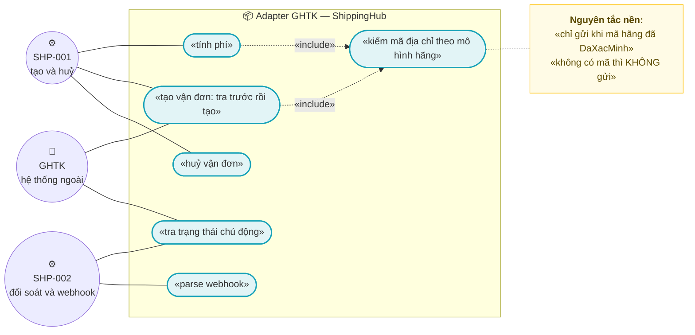
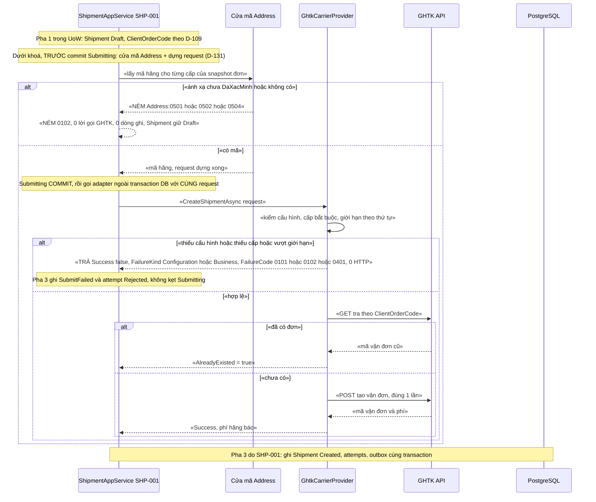

# `SHP-004` — Adapter GHTK (xác minh địa chỉ 2 cấp trước)

> 🔴 **RỦI RO CHẶN — ĐỌC TRƯỚC MỌI MỤC KHÁC: GHTK vẫn dùng payload địa chỉ 3 CẤP và ta CHƯA xác minh được cờ tương đương `is_new_to_address`.**
> Bằng chứng **trong repo** (không suy đoán):
> • `docs/implementation-plan.md:427` — *"| SHP-004 | Adapter **GHTK** (⚠️ xác minh địa chỉ 2 cấp trước) |"*
> • `docs/implementation-plan.md:199` — *"⚠️ **GHTK: xác minh địa chỉ 2 cấp TRƯỚC khi thiết kế**"*
> • `docs/implementation-plan.md:290` — bảng rủi ro, dòng 2, mức **🔴 cao**: *"**GHTK chưa xác nhận địa chỉ 2 cấp** … Hỏi GHTK trước khi chốt mô hình địa chỉ"*
> • `docs/business-modules-proposal.md:546` — *"⚠️ **GHTK vẫn dùng payload 3 cấp** (`province`/`district`/`ward`) và **KHÔNG tìm thấy** cờ tương đương `is_new_to_address`"*
> • `docs/business-modules-proposal.md:570` — *"**cờ địa chỉ 2 cấp của GHTK**"* nằm trong danh sách **16 mục KHÔNG TÌM THẤY**
> ⇒ Tài liệu này giữ **một** nguyên tắc: **chỉ gửi địa chỉ khi mã hãng đã được `Address` xác minh (`DaXacMinh`), FAIL-CLOSED** — không có mã ⇒ **KHÔNG gửi** (`ADR-02`, `BR-SHP-004-002`). Q1 chưa có trả lời GHTK ⇒ `SHP-004` nằm trong danh sách đỏ có điều kiện của `D-114` (`docs/agents/uy-quyen-chu-du-an.md:35`).
>
> ⚠️ **Phân biệt với `SHP-003` (đổi COD ở GHN cần OTP):** cảnh báo đó thuộc `docs/features/shipping/shp-003-cod-thu-ho-doi-cod.md`. `SHP-004` **không** làm nghiệp vụ đổi COD (§0 phạm vi).

| Thuộc tính | Nội dung |
|---|---|
| **Mã** | `SHP-004` |
| **Module** | **ShippingHub** — dự kiến tạo mới `modules/ShippingHub/eCommerce.ShippingHub.{Domain, EntityFrameworkCore, Application.Contracts, Application}` (hiện **chưa tồn tại** — §15.2 F1). `SHP-004` **không có bảng riêng** (§5) |
| **Giai đoạn** | **GĐ3** (`D-69`; `docs/agents/anh-xa-lo-trinh-d69.md:28`) — lộ trình cũ ghi GĐ2 (`docs/implementation-plan.md:113`, `:427`) chỉ còn là lịch sử |
| **Ưu tiên** | **Must have** — nhưng là **adapter thứ HAI** (`docs/implementation-plan.md:338`: *"GHN … GHTK làm sau, cần xác minh địa chỉ 2 cấp trước"*) |
| **Trạng thái** | 🟡 `Draft` — chờ review |
| **Người viết / người review** | *(điền)* / **Kiến trúc trưởng + người đã liên hệ GHTK** (`docs/design-doc-guidelines.md:134`: tích hợp NCC ngoài ⇒ review bởi người **đã liên hệ NCC**) |
| **Phiên bản / ngày** | `v0.5 — 21/11/2026` (v0.1 — 15/10/2026; v0.2 đối chiếu mô hình Nhanh WP-14; v0.3 áp `D-128`; v0.4 sửa theo `docs/reviews/SHP-004-docreview.md` vòng 1; v0.5 áp `D-129`/`D-130`/`D-131`) |
| **Tài liệu liên quan** | `SHP-001` (**chủ** `IShippingCarrierProvider`, `ShpShipments`, `ShpShipmentCreateAttempts`, `IShipmentAppService`) · `SHP-002` (webhook + đối soát; **chủ** `IShipmentWebhookVerifier`, `ICarrierStatusMapper`) · `SHP-003` (COD) · `ADDR-002` (ánh xạ mã hãng, **chủ** `AddrCarrierMappings`) · `XC-001` · `XC-002` · `XC-003` · `XC-004` · `XC-005` · `REC-003` · `SAL-003` · `docs/implementation-plan.md` · `docs/business-modules-proposal.md` · `docs/design-doc-guidelines.md` |

**Quy ước mã dùng trong tài liệu:** BR ⇒ `BR-SHP-004-nn` · NFR ⇒ `NFR-SHP-004-nn` · quyết định thiết kế ⇒ `ADR-nn` · test ⇒ `TC-nn`.

---

## 0. Tóm tắt & quyết định thiết kế

**Tóm tắt:** `SHP-004` cài **adapter GHTK** — một implementation của `IShippingCarrierProvider` (do `SHP-001` định nghĩa, `docs/features/shipping/shp-001-adapter-ghn-tinh-phi-van-don.md` §6.1) gồm **tính phí · tạo vận đơn · huỷ**, cộng đọc trạng thái chủ động và `VerifyAsync` + `ParseAsync` webhook GHTK cho `SHP-002` (`shp-002-webhook-trang-thai-van-don.md:56`). **Không** có luồng tạo vận đơn, bảng hay job riêng (ADR-12). Ràng buộc **trung tâm** là **dữ liệu địa chỉ**: sau **01/07/2025** Việt Nam **bỏ cấp huyện** và sáp nhập tỉnh (**63 → 34**) — `docs/business-modules-proposal.md:509` — trong khi **GHTK vẫn mô tả payload 3 cấp** và ta **chưa tìm thấy** cờ tương đương `is_new_to_address` của GHN (`:513` nói **GHN đã thích ứng**; `:546` nói **GHTK chưa xác minh**).

**Vì sao phải "chỉ gửi khi mã hãng đã xác minh" chứ không phải "gửi rồi sửa":**

| Nếu gửi vận đơn với địa chỉ CHƯA xác minh | Hệ quả thật |
|---|---|
| Hãng từ chối payload ⇒ ta **retry mù** | Tốn quota, log nhiễu; **mỗi lần thử là một lần gọi API tính vào hạn mức** |
| Hãng **chấp nhận** nhưng `district` là mã **đã bị bỏ** sau 01/07/2025 | Vận đơn đi vào **địa chỉ không còn tồn tại** ⇒ giao thất bại ⇒ **phí 2 chiều** + **COD treo**. **Lỗi im lặng** — API trả thành công |
| Đơn có COD, giao sai địa chỉ | `REC-003` đối soát với file của hãng **không khớp** ⇒ không biết mất ở đâu |
| Hàng bị trả về kho | Luồng hoàn hàng thuộc `SAL-006` (`D-70`) ⇒ phát sinh nghiệp vụ **ngoài** adapter |

**Phạm vi:**
- ✅ **Adapter GHTK** `GhtkCarrierProvider : IShippingCarrierProvider` (tính phí, tạo, huỷ) — tầng nghiệp vụ **không** biết GHTK.
- ✅ **Kiểm địa chỉ theo mô hình hãng ở chính adapter** (defense-in-depth, fail-closed): request không đủ cấp bắt buộc của `AddressModel` ⇒ **trả** `Success = false` + `FailureKind = Business` + `FailureCode = 0102` (không NÉM — ADR-13), **0** lời gọi GHTK.
- ✅ `GetTrackingAsync` (đọc trạng thái chủ động cho job đối soát) + `VerifyAsync` (`hash` + IP allowlist, BR-017) + `ParseAsync` GHTK theo `IShipmentWebhookVerifier` của `SHP-002`.
- ✅ Tiền `decimal` qua `Money` (`shared/eCommerce.Kernel/Money/Money.cs:39`), số nguyên minor units ở biên hãng; log + `CorrelationId` + metric theo `XC-005`.

**Không nằm trong phạm vi:**
- ❌ **Luồng tạo vận đơn 3 pha, `Shipment`, nhật ký thử, `ClientOrderCode`, job thử lại, khoá phân tán** — thuộc `SHP-001` (`D-109`, `D-116`, `D-118`; ADR-12).
- ❌ **Danh mục/ánh xạ mã địa chỉ của hãng và job đồng bộ** — thuộc `Address` (`ADDR-002`, `D-83`, `D-89`, `D-110`); `SHP-004` chỉ đọc qua **cửa mã** (ADR-04).
- ❌ **Nhận & xử lý webhook** (endpoint, chống trùng, đổi trạng thái) — thuộc `SHP-002`; `SHP-004` chỉ cài `VerifyAsync` + `ParseAsync` cho GHTK (`SHP-002` :56).
- ❌ **Nghiệp vụ COD** (thu hộ, đổi COD, OTP) — thuộc `SHP-003`.
- ❌ **Adapter GHN** — thuộc `SHP-001`. **Import Excel đối soát COD** — `REC-003`. **Read-model/báo cáo** — `REP-001`/`REP-003`.
- ❌ **RMA/hoàn hàng đơn giao vận** — `SAL-006` (`D-70`). **State machine 4 trục của đơn** — `SAL-003` (`D-08`): ta chỉ để `SHP-001`/`SHP-002` phát ETO.
- ❌ **Ghi điểm/công nợ khách** — chỉ `Customer.GhiNhanMuaHang` qua `ICustomerLedger` (`D-45`); `SHP-004` không đụng.

### 0.1 Quyết định thiết kế (ADR ngắn)

| # | Quyết định | Phương án đã cân nhắc | Lý do chọn | Hệ quả |
|---|---|---|---|---|
| **ADR-01** | GHTK là **một implementation** của `IShippingCarrierProvider` (`SHP-001` §6.1); app service **không** gọi HTTP trực tiếp | (a) gọi HTTP trong app service · (b) adapter riêng mỗi hãng chung interface · (c) adapter chung `if provider == "ghtk"` | Khuôn **đã có thật**: `IChannelConnector` (`modules/ChannelHub/eCommerce.ChannelHub.Application.Contracts/Connectors/IChannelConnector.cs:122`) và `IPaymentProvider` (`modules/PaymentHub/eCommerce.PaymentHub.Domain/Payments/IPaymentProvider.cs:58`) ghi *"chi tiết riêng của từng [đối tác] nằm SAU interface này"*. (c) dồn mọi hãng vào một class | Thêm hãng = thêm class + **một dòng** đăng ký (khuôn `ChannelConnectorFactory` — `.../Connectors/ChannelConnectorFactory.cs:9`) |
| **ADR-02** | ⭐ **Chỉ gửi địa chỉ khi mã hãng của từng cấp bắt buộc đã `DaXacMinh` (nguồn: cửa mã `Address`), FAIL-CLOSED**; thiếu ⇒ **trả** `Business` + `0102` (ADR-13), **không** gọi GHTK | (a) gửi rồi xử lý lỗi hãng · (b) gửi với `district` suy đoán · (c) **fail-closed** | (a)/(b) tạo **lỗi im lặng**: hãng có thể **chấp nhận** mã huyện đã bị bỏ (`docs/business-modules-proposal.md:509`). `Address` đã fail-closed: chỉ ánh xạ `DaXacMinh` dùng được, còn lại NÉM `0501`/`0502`/`0504` (`D-86`, `D-89`) | Adapter **kiểm lại** lớp mô hình (`AddressModel`) dù `SHP-001` đã kiểm — hai lớp độc lập (TC-02/TC-03) |
| **ADR-03** | Mô hình địa chỉ hỗ trợ **CẢ HAI** cấu trúc, **canonical = 2 cấp**; `district` là trường **dẫn xuất/nullable**, không là khoá. Mô hình riêng của GHTK = cột `ShpCarriers.AddressModel` (`SHP-001` §5.2) — **nguồn duy nhất**: không có khoá `AddressModel` trong `appsettings` (§6.3), adapter nhận qua `SupportedAddressModel` do factory cấp | (a) chỉ 2 cấp · (b) chỉ 3 cấp · (c) cả hai | `D-114` (Q1 của `SHP-001`: hỗ trợ cả hai; mô hình riêng từng hãng ⇒ `SHP-004-Q1`); `docs/business-modules-proposal.md:516`, `:658`. Mặc định GHTK = `ThreeLevel` (phía an toàn, **chưa xác minh** — Q1) | Mọi DTO địa chỉ có `DistrictCode` nullable (`CarrierAddress` — `SHP-001` §6.1). Đổi sang `TwoLevel` **không** cần release |
| **ADR-04** | **Không có danh mục/bảng ánh xạ địa chỉ riêng** (thay `ShpCarrierAddressMappings` + job đồng bộ + `MaxCatalogueAgeDays` của v0.1). Mã hãng **chỉ** lấy qua cửa mã `Address.Application.Contracts` | (a) bảng của `SHP-004` · (b) tự truy vấn `AddrCarrierMappings` · (c) **cửa mã của `Address`** | `D-114` (R0 `SHP-004-Q2`: dùng `IAddressDirectory` + mã hãng — `D-89`, `D-110`); `D-89` N1: bảng riêng là **nguồn sự thật thứ hai** của `AddrCarrierMappings`; `D-83`: ánh xạ sửa tại chỗ + hàng rào `0506`–`0508` chặn đồng bộ xấu — độ cũ danh mục là việc của `ADDR-002` | `SHP-004` **mất** lỗi 0014 (danh mục cũ): lượt đồng bộ hỏng ⇒ ánh xạ `NghiNgo` ⇒ `Address:0502` ⇒ `SHP-001` NÉM `0102` |
| **ADR-05** | **Địa chỉ nội bộ là nguồn duy nhất**: địa chỉ + COD + dòng hàng đi từ **snapshot đơn** qua hợp đồng Sales (`D-108`); adapter **không** nhận địa chỉ từ payload/response của hãng | (a) tin payload · (b) **đọc từ đơn** | Payload webhook GHTK **không xác thực được nguồn** (`docs/business-modules-proposal.md:547`; `SHP-002` D1/D2) ⇒ nếu lấy địa chỉ từ payload thì kẻ giả mạo điều khiển **nơi hàng đi tới** | `GetTrackingAsync`/`ParseAsync` **không** trả trường địa chỉ (TC-09) |
| **ADR-06** | **`ClientOrderCode` = hàm thuần `TaoClientOrderCode(orderId, generation)` của `SHP-001` (`D-109`)**; adapter dùng **đúng** chuỗi nhận vào, chỉ kiểm độ dài theo giới hạn GHTK ⇒ vượt thì **trả** `Business` + `0401`, **cấm** cắt/băm/tự sinh; `ClientOrderCodeMaxLength = 0` là "CHƯA biết giới hạn" — **không bao giờ** dùng làm ngưỡng so độ dài | (a) `"{tenantCode}-{orderNumber}"` (v0.1) · (b) `Guid.NewGuid()` · (c) **hàm D-109** | (a) có thể > giới hạn hãng, hệ chưa có `tenantCode`, không phân biệt lần tạo lại; (b) vi phạm `XC-002` BR-007. Hãng **có thể** đã tạo mà response mất ⇒ adapter **tra theo mã trước khi tạo** (`BR-SHP-004-006`) | Khoá guard `Create:{tenantId}:{orderId}:{generation}:{attemptNo}` thuộc `SHP-001` §7.3 |
| **ADR-07** | **Không có khoá phân tán, job, UoW riêng**: khoá `shipping:shipment-create:…` và job thử lại là của `SHP-001` §8.2 (tên khoá **không** tiền tố `ecommerce:` — `D-82`, `D-114` R0 `SHP-004-Q5`) | (a) khoá riêng trong adapter · (b) **không** khoá ở adapter | Adapter chạy **ngoài** transaction DB (Pha 2 của `SHP-001`) và **không ghi DB** ⇒ khoá ở adapter không bảo vệ gì thêm; `XC-003` D6 cấm acquire lồng | Adapter không tham chiếu `IAbpDistributedLock`/repository (TC-10) |
| **ADR-08** | Tiền: `decimal`; ra biên hãng là **số nguyên minor units**; so bằng `Money.Equals`/`CompareTo`, **cấm** `==` trên `decimal` | (a) `double` · (b) `decimal` + `==` · (c) **`Money` + số nguyên ở biên** | `XC-001` BR-003/D3; `Money` **đã có** nhưng chỉ `Vnd`/`CompareTo`/`Equals` (`Money.cs:39,112,123`), **không** có `Money.Of`/`ToMinorUnits()` (Q11 của `SHP-003`, `D-114`) | Phí hãng báo → `Money.Vnd(...)`; COD lẻ đã bị `SHP-001` NÉM `0111` **trước** khi tới adapter |
| **ADR-09** | **Không** gọi API GHTK thật khi `EnableLiveCalls = false` (khuôn PoC) | (a) luôn thật · (b) luôn mô phỏng · (c) **cờ cấu hình** | Khuôn **đã có**: `ShopeeOptions.EnableLiveCalls` (`modules/ChannelHub/eCommerce.ChannelHub.Application/ChannelHubOptions.cs:47`); `ShopeeConnector` mô phỏng khi tắt, `NotImplementedException` khi bật mà chưa cài (`.../Connectors/ShopeeConnector.cs:80-102`) | Chạy được toàn luồng **trước** khi có credential; ⚠️ **cấm** bật ở production khi chưa có Q1 (cổng release §14.3) |
| **ADR-10** | `HttpClient` qua `IHttpClientFactory`, **đăng ký ở Host**, **không** thêm gói mới | (a) thêm `Volo.Abp.Http.Client` · (b) **`AddHttpClient` ở Host** · (c) SDK hãng | `D-114` (R0 `SHP-004-Q6`). Khuôn **đã có**: `AddHttpClient<...>` ở Host (`src/eCommerce.HttpApi.Host/eCommerceHttpApiHostModule.cs:171`), module `Address` ghi rõ **không** đặt `AddHttpClient` ở project thư viện (`modules/Address/eCommerce.Address.Application/AddressApplicationModule.cs:31`). Mọi gói `Volo.Abp.*` ghim `10.7.0` | Thiếu `AddHttpClient` ⇒ lỗi **cấu hình**, **không** coi là thành công (khuôn `VnPayPaymentProvider.cs:264`) — §15.2 F5 |
| **ADR-11** | **Webhook GHTK không phải bằng chứng**; adapter **chủ động** đọc trạng thái | (a) tin webhook · (b) đối soát chủ động · (c) bỏ webhook | `SHP-002` D1: *"Webhook là GỢI Ý"* — **bắt buộc** vì GHTK không có HMAC | `GetTrackingAsync` bắt buộc (BR-014); quota là tài nguyên cần quản (Q7) |
| **ADR-12** | ⭐ **`SHP-004` không có luồng tạo/aggregate riêng**: dùng `Shipment` + `ShpShipmentCreateAttempts` của `SHP-001`; **bỏ** `ShpShipmentSubmissions` + máy trạng thái Submission + `CreateShipmentAsync` riêng của v0.1 | (a) giữ Submission riêng · (b) **dùng `Shipment` của `SHP-001`** | `D-116`/`D-118`: `CreateShipmentAsync`/`CancelShipmentAsync`/`EstimateOrderFeeAsync`/`EstimateCartFeeAsync` khai **đúng 1** lần ở `IShipmentAppService` (`SHP-001` TC-53); `D-109`: `Generation` + unique trên `ShpShipments`; `SHP-001` ADR-09: `SHP-001` là chủ `ShpShipments`. Hai máy trạng thái cho cùng việc tạo vận đơn ⇒ lệch im lặng | **Đã chốt — `D-128`** (Q9): `SHP-004` 0 bảng/0 DbSet (TC-10); `SHP-001` không phải sửa |
| **ADR-13** | ⭐ **Sau khi `SHP-001` đã commit `Submitting`, adapter TRẢ kết quả (`FailureKind` + `FailureCode`), KHÔNG NÉM `BusinessException`** cho lỗi nghiệp vụ/cấu hình của `CreateShipmentAsync`/`CancelShipmentAsync`/`GetFeeAsync` | (a) **trả `Business`/`Configuration`** · (b) thêm bước kiểm thuần chạy **trước Pha 1** vào `IShippingCarrierProvider` (đổi hợp đồng `SHP-001` §6.1) · (c) NÉM từ adapter | `SHP-001` §4.1 :252–256 chỉ xử lý kết quả `FailureKind` ở Pha 3; không có nhánh cho ngoại lệ của provider, và `Submitting` không có cạnh ra nào ngoài Pha 3/job (`SHP-001` §3.2 #4, #6: không huỷ được `Submitting`) ⇒ (c) làm vận đơn **kẹt `Submitting`** (đơn COD > trần, cân > trần, số lượng lẻ…) mà không đường gỡ ngoài sửa DB. (a) không đổi hợp đồng `SHP-001` | `SHP-001` Pha 3 ghi `SubmitFailed` + attempt `Rejected` — đúng điều kiện tạo lại của `D-109` (4); `SHP-001` giữ nguyên `FailureCode` của adapter, cả `Configuration` vào `Rejected` (`D-130`). Ngoại lệ NÉM duy nhất: `GetTrackingAsync` (không nằm giữa hai pha ghi DB) và lỗi lập trình (`ArgumentNullException`, huỷ `CancellationToken`) |

> 📌 Ghi lại **phương án bị loại** và lý do — để 6 tháng sau không ai hỏi lại "sao không làm cách kia" (`docs/design-doc-guidelines.md:63`).

---

## 1. Use Case Specification

| Thuộc tính | Nội dung |
|---|---|
| **Use Case ID** | `SHP-004` |
| **Use Case Name** | Gửi / huỷ / tra vận đơn **GHTK** qua adapter, địa chỉ **chỉ gửi khi mã hãng đã xác minh** |
| **Description** | *"Là hệ thống bán hàng, tôi muốn đẩy đơn sang GHTK — nhưng KHÔNG muốn vận đơn đi tới địa chỉ không còn tồn tại, và KHÔNG muốn tạo trùng vận đơn chỉ vì mạng lỗi rồi thử lại."* |
| **Actor(s)** | **`ShipmentAppService`/job thử lại của `SHP-001`** (gọi adapter) · **Job đối soát của `SHP-002`** (gọi `GetTrackingAsync`) · **Hãng GHTK** (hệ thống ngoài) · **Quản trị** (cấu hình hãng) |
| **Priority** | **Must have** (adapter thứ hai) |
| **Trigger** | (a) `SHP-001` Pha 2 gọi `CreateShipmentAsync`/`CancelShipmentAsync`/`GetFeeAsync` của provider `ghtk`; (b) `SHP-002` gọi `GetTrackingAsync`; (c) `SHP-002` gọi `VerifyAsync` rồi `ParseAsync` khi có webhook |
| **Pre-Condition(s)** | • `ShpCarriers` có dòng `ghtk` với `IsEnabled = true` (cờ bật hãng **duy nhất**) và `AddressModel` (nguồn **duy nhất** của mô hình địa chỉ) (`SHP-001` §5.2); cấu hình `ShippingHub:Providers:ghtk:*` đủ theo chế độ (BR-013: `FromAddress` luôn bắt buộc; `BaseUrl`/token/`PartnerCode`/`ClientOrderCodeMaxLength`/`AddHttpClient` khi `EnableLiveCalls = true`) — thiếu ⇒ adapter **trả** `Configuration` + `eCommerce:Shipping:0101` (fail-closed).<br>• `SHP-001` đã dựng `CarrierCreateShipmentRequest` từ **snapshot đơn** qua hợp đồng Sales (`D-108`; địa chỉ/COD/dòng hàng **không** từ DTO của API) và lấy mã hãng qua **cửa mã** `Address` (`D-110`) — cả hai ⬜ kế hoạch (grep `*.cs` = 0).<br>• `ClientOrderCode` đã do `SHP-001` sinh ở Pha 1 (`D-109`).<br>• `CorrelationId` theo `XC-005`. |
| **Post-Condition(s)** | • Adapter **không ghi DB, không phát ETO** (BR-008): kết quả trả về `CarrierCreateShipmentResult`/`CarrierCancelResult`; `SHP-001` Pha 3 ghi `ShpShipments` + `ShpShipmentCreateAttempts` + outbox.<br>• `CreateShipmentAsync`/`CancelShipmentAsync`/`GetFeeAsync` thất bại luôn **trả** `FailureKind` (`None/Business/Transient/Configuration`) + `FailureCode` — **không NÉM** lỗi nghiệp vụ/cấu hình (BR-018, ADR-13); chỉ `GetTrackingAsync` NÉM `0404`/`0402` — **cấm** im lặng.<br>• Tiền ra biên hãng là **số nguyên**; phí hãng báo về là `decimal` qua `Money`. |
| **Basic Flow** | 1. `SHP-001` Pha 2 gọi `GhtkCarrierProvider.CreateShipmentAsync(request)`.<br>2. **Kiểm cấu hình theo chế độ** (BR-013): `FromAddress` đủ cấp bắt buộc (luôn); khi `EnableLiveCalls = true` thêm `BaseUrl`, token, `PartnerCode`, `ClientOrderCodeMaxLength > 0`, `AddHttpClient` — thiếu ⇒ **trả** `Configuration` + `0101` (E9).<br>3. **Kiểm** `request.ToAddress` đủ các cấp mã bắt buộc của `AddressModel` (BR-002) — thiếu ⇒ **trả** `Business` + `0102`.<br>4. Kiểm giới hạn (cân, COD, số lượng lẻ; độ dài `ClientOrderCode` **chỉ khi** `ClientOrderCodeMaxLength > 0`) — vượt ⇒ **trả** `Business` + `0401`.<br>5. `EnableLiveCalls = false` ⇒ trả kết quả mô phỏng + log `Information` (A4).<br>6. **Tra theo `ClientOrderCode`** (GET, được retry) — hãng đã có ⇒ `AlreadyExisted = true` + `ProviderTrackingCode`, **không** POST.<br>7. Chưa có ⇒ POST tạo vận đơn (**không** retry mù).<br>8. Ánh xạ response ⇒ `CarrierCreateShipmentResult` (mã vận đơn bắt buộc khác rỗng khi `Success`; phí hãng báo là nguồn sự thật). |
| **Alternative Flow** | **A1: Hãng báo trùng `ClientOrderCode`** ⇒ tra lại, trả `AlreadyExisted = true`; **không** phải lỗi.<br>**A2: Mất response/timeout sau khi hãng đã tạo** ⇒ POST trả `FailureKind = Transient`; lần thử sau của `SHP-001` **tra trước** (bước 6) ⇒ không tạo vận đơn thứ hai. Tra cũng lỗi ⇒ `Transient` (không đoán).<br>**A3: Huỷ** ⇒ `CancelShipmentAsync` chỉ gọi khi có `ProviderTrackingCode` (`SHP-001` §6.1); hãng không cho huỷ ⇒ `Success = false` + `FailureKind = Business` + `0403`.<br>**A4: `EnableLiveCalls = false`** (PoC/dev) ⇒ mô phỏng; toàn bộ luồng lock/worker/event của `SHP-001` vẫn chạy (khuôn `ShopeeConnector.cs:80-102`).<br>**A5: Tra trạng thái** ⇒ `GetTrackingAsync` (GET) cho job đối soát `SHP-002`. |
| **Exception Flow** | **E1:** `ToAddress` thiếu cấp bắt buộc của `AddressModel` ⇒ adapter **trả** `Success = false`, `FailureKind = Business`, `FailureCode = eCommerce:Shipping:0102` (`SHP-001` §6.3), 0 lời gọi GHTK; `SHP-001` Pha 3 ghi `SubmitFailed` + attempt `Rejected`, giữ nguyên `FailureCode` của adapter (`D-130`) — **không** kẹt `Submitting`.<br>**E2:** cửa mã `Address` NÉM (`Address:0001`/`0005`/`0501`/`0502`/`0504` hoặc > 1 ánh xạ `DaXacMinh` — `D-89`) ⇒ `SHP-001` bọc thành `0102` kèm `InnerErrorCode`; adapter **không** được gọi.<br>**E3:** cân/COD/số lượng vượt giới hạn hãng hoặc số lượng lẻ không đổi được sang payload ⇒ adapter **trả** `FailureKind = Business` + **`eCommerce:Shipping:0401`** (`SHP-001` phản hồi `400`), 0 HTTP. **Không** làm tròn.<br>**E4:** hãng `5xx`/timeout ⇒ tạo/huỷ: `FailureKind = Transient` (thử lại do `SHP-001`); **tính phí**: **trả** kết quả lỗi mềm (`FailureKind = Transient` + `0404`, không có phí) — **không** NÉM, để checkout dùng ước tính dự phòng như GHN (`SHP-001` §7.3 :750); **tra trạng thái**: NÉM **`0404`**, `502` (job `SHP-002` bắt và thử nhịp sau).<br>**E5:** token/`PartnerCode` sai/hết hạn (401/403) ⇒ tạo/huỷ/tính phí: `FailureKind = Configuration` + **`0402`**; tra trạng thái: NÉM `0402`, `502`; **cấm** retry (retry không làm token đúng).<br>**E6:** huỷ khi hãng không cho ⇒ **trả** `Success = false` + `FailureKind = Business` + **`0403`** (`SHP-001` phản hồi `409`); **cấm** tự đánh dấu "đã huỷ".<br>**E7:** hãng 4xx nghiệp vụ / "thành công" mà không có mã vận đơn ⇒ `Business` ⇒ `SHP-001` NÉM `0103` (`0103` chỉ dùng khi hãng từ chối không có mã riêng/mã rỗng — `D-130`).<br>**E8:** cùng `ClientOrderCode` nhưng nội dung khác ⇒ do `SHP-001` (`RequestPayloadHash` + `eCommerce:Messaging:0001` — `modules/Messaging/eCommerce.Messaging.Domain/Idempotency/MessagingErrorCodes.cs:14`), **không** ở adapter.<br>**E9:** cấu hình thiếu theo chế độ (bước 2; gồm `FromAddress` thiếu/không đủ cấp, `ClientOrderCodeMaxLength = 0` khi live, thiếu `AddHttpClient`) ⇒ **trả** `FailureKind = Configuration` + **`0101`**, 0 HTTP; **cấm** coi là thành công. |
| **Business Rules** | • **BR-SHP-004-001**: Mọi lời gọi HTTP tới GHTK **phải** nằm trong assembly riêng `eCommerce.ShippingHub.Carriers.Ghtk` (`GhtkCarrierProvider`/`GhtkTrackingReader`/`GhtkWebhookVerifier` — `D-128` ⑤, §6.1); **cấm** gọi từ app service, job hay domain, và **cấm** kiểu ngoài assembly đó tham chiếu `GhtkOptions`/typed client GHTK. Đỏ: `TC-01`.<br>• **BR-SHP-004-002**: ⭐ Địa chỉ **chỉ** được gửi khi `request.ToAddress` đủ mã hãng cho **mọi** cấp bắt buộc của `AddressModel` (mã do `Address` trả, `DaXacMinh`): `TwoLevel` = tỉnh + xã; `ThreeLevel` = tỉnh + huyện + xã; `Both` = đủ tỉnh + xã là đủ, `DistrictCode` có thì gửi (chưa xác minh — Q1). Chuỗi rỗng/khoảng trắng coi như thiếu. `ToAddress` thiếu ⇒ **trả** `Business` + `0102`, **0** lời gọi GHTK; `FromAddress` (từ cấu hình hãng, `SHP-001` §6.4) thiếu cấp ⇒ **trả** `Configuration` + `0101` (BR-013). `AddressModel` đọc **chỉ** từ `ShpCarriers.AddressModel` qua `SupportedAddressModel` (ADR-03). Đỏ: `TC-02`, `TC-03`, `TC-28`.<br>• **BR-SHP-004-003**: `district` **không** là khoá định danh, **không** được adapter tự suy ra (từ tên, từ bảng cứng); chỉ dùng `DistrictCode` mà `Address` đã trả. Đỏ: `TC-04`.<br>• **BR-SHP-004-004**: `ShippingHub` **không** có bảng ánh xạ/danh mục địa chỉ hãng, **không** tự truy vấn `AddrCarrierMappings`, **không** hard-code mã tỉnh/huyện/xã (`D-89`, `D-110`). Đỏ: `TC-05`.<br>• **BR-SHP-004-005**: **Cấm** hard-code base URL/endpoint/mã trạng thái GHTK — nằm ở cấu hình `ShippingHub:Providers:ghtk:*` hoặc dữ liệu (`docs/design-doc-guidelines.md:118`). Đỏ: `TC-06`.<br>• **BR-SHP-004-006**: ⭐ Adapter dùng **đúng** `request.ClientOrderCode` (hàm `D-109`); độ dài vượt `ClientOrderCodeMaxLength` (**chỉ so khi** `> 0`; `0` = chưa biết giới hạn, không bao giờ làm ngưỡng) ⇒ **trả** `Business` + `0401`, **cấm** cắt/băm/tự sinh; **tra theo mã trước** khi POST. Đỏ: `TC-07`, `TC-08`.<br>• **BR-SHP-004-007**: Địa chỉ gửi hàng **chỉ** từ dữ liệu nội bộ; `GetTrackingAsync`/`ParseAsync` **không** trả/dùng địa chỉ do hãng gửi (ADR-05). Đỏ: `TC-09`.<br>• **BR-SHP-004-008**: Adapter **không** ghi DB, mở UoW, phát ETO hay giành khoá phân tán — thuộc `SHP-001`/`SHP-002`. Đỏ: `TC-10`.<br>• **BR-SHP-004-009**: Tiền ra biên hãng là **số nguyên** (`long` minor units); phí hãng báo về qua `Money`; **cấm** `double`/`float`, **cấm** `==` trên `decimal` tiền. Đỏ: `TC-11`.<br>• **BR-SHP-004-010**: Payload gửi/nhận **phải che** trước khi lưu (`RawPayloadMasked`, `FailureMessage`) **và** trước khi log, bằng **hàm che riêng của adapter** (hàm thuần, khuôn `PaymentTransaction.MaskSensitiveData` — `modules/PaymentHub/eCommerce.PaymentHub.Domain/Entities/PaymentTransaction.cs:313`, **mở rộng**: hàm khuôn chỉ che trường tên `password/secret/token/card_number/cvv/otp/pin` và chuỗi 12–19 chữ số — `:321–334` — nên **không** che `PartnerCode`, SĐT, địa chỉ). Phải che: (i) theo **tên trường** (không phân biệt hoa/thường): token, `Authorization`, `PartnerCode`, `hash`, SĐT, địa chỉ, tên người nhận; (ii) theo **giá trị đã biết** của request/cấu hình (`ApiToken`, `PartnerCode`, `WebhookHashToken`, `RecipientName`, `RecipientPhone`, `AddressLine`, tên các cấp) thay thế ở **mọi chỗ** trong chuỗi, kể cả thông điệp lỗi do hãng trả (tên trường GHTK chưa xác minh — Q1, nên lớp (ii) là lớp chắc chắn). **Cấm** log token. Đỏ: `TC-12`.<br>• **BR-SHP-004-011**: `ParseAsync` trả mã trạng thái **thô nguyên văn**; ánh xạ sang trạng thái nội bộ là **dữ liệu** của `SHP-002` (`ICarrierStatusMapper`); mã chưa ánh xạ ⇒ `Discrepancy` (`SHP-002` `0210`), **cấm** coi là "không đổi". Đỏ: `TC-13`.<br>• **BR-SHP-004-012**: Mã lỗi theo khuôn `eCommerce:Shipping:NNNN`, do `ShippingHubErrorCodes` sở hữu (khuôn `TaxErrorCodes` — `modules/Tax/eCommerce.Tax.Domain/TaxErrorCodes.cs:10`); **dải `0401`–`0499` dành cho `SHP-004`** (`D-114`, R0 `SHP-001`-Q7); **cấm** dùng lại `0012`–`0021` của v0.1 và **cấm** khai ở `eCommerceConsts.ErrorCodes`. Đỏ: `TC-14`.<br>• **BR-SHP-004-013**: `EnableLiveCalls = false` là mặc định; Cấu hình bắt buộc **theo chế độ**: **luôn** `FromAddress` đủ cấp theo `AddressModel`; khi `true` thêm `BaseUrl`, token, `PartnerCode`, `ClientOrderCodeMaxLength > 0`, `AddHttpClient`. Thiếu ⇒ **trả** `Configuration` + `0101`, 0 HTTP, **không** coi là thành công. **Thứ tự kiểm cố định** (§1 bước 2→4, §3): cấu hình (`0101`) → địa chỉ (`0102`) → giới hạn (`0401`) → nhánh mô phỏng → tra → POST; nhờ đó chế độ mô phỏng mặc định (`ClientOrderCodeMaxLength = 0`) **không** bị `0401`. Đỏ: `TC-15`.<br>• **BR-SHP-004-014**: Adapter **phải** có `GetTrackingAsync` (GET chủ động); `ParseAsync` là hàm **thuần** (không DB, không mạng) và không bao giờ tự quyết trạng thái (ADR-11). Đỏ: `TC-16`.<br>• **BR-SHP-004-015**: `POST` tạo vận đơn **không** retry mù ở tầng HTTP (đúng 1 POST mỗi lần gọi); `GET` được retry ≤ `MaxRetries` (`SHP-001` §6.4). Đỏ: `TC-17`.<br>• **BR-SHP-004-016**: Mọi metric phát ra **phải** nằm trong `eCommerceMetricNames` (`shared/eCommerce.Kernel/Observability/eCommerceMetrics.cs:13`), nhãn **chỉ** từ `eCommerceMetricTags.Allowed` (`:212`), cấm nhãn trong `Forbidden` (`:219`: `orderId`/`sku`/…). `SHP-004` **không** thêm metric/nhãn mới — dùng `shipping_carrier_call_failed_total{provider,reason}` của `SHP-001` §13 (`provider`, `reason` đều ∈ `Allowed`; `reason` ∈ `timeout`/`transient`/`business`/`not_configured`/`invalid_address`, `SHP-001` :981). Muốn phân biệt thao tác ⇒ `SHP-001` thêm nhãn vào `Allowed` (cùng PR `XC-005` §5.1), `SHP-004` **không** tự thêm. Đỏ: `TC-18`.<br>• **BR-SHP-004-017**: `GhtkWebhookVerifier.VerifyAsync` là lớp xác thực **duy nhất** của webhook GHTK (không HMAC — `docs/business-modules-proposal.md:547`): kiểm **IP nguồn ∈ `WebhookAllowedIps`** (sai ⇒ `Accepted = false`, `FailureReason = "ip_not_allowed"`) và **`hash` khớp `WebhookHashToken`** của tenant theo path (sai/thiếu ⇒ `"bad_token"`); thiếu `WebhookAllowedIps`/`WebhookHashToken` ⇒ **fail-closed** `Accepted = false`, `"not_configured"` (**cấm** coi allowlist rỗng là "cho tất cả"). Nhãn thuộc 6 nhãn của `SHP-002` §6.1 (`shp-002-webhook-trang-thai-van-don.md:515`); `too_large`/`unknown_tenant`/`malformed` do lớp chung của `SHP-002`. **Cấm** log `hash`. Đỏ: `TC-25`, `TC-26`, `TC-27`.<br>• **BR-SHP-004-018**: Sau khi `SHP-001` đã commit `Submitting`, `CreateShipmentAsync`/`CancelShipmentAsync`/`GetFeeAsync` **không NÉM** `BusinessException` cho lỗi nghiệp vụ/cấu hình — **trả** `FailureKind` + `FailureCode` (ADR-13). Vi phạm ⇒ vận đơn kẹt `Submitting` (không cạnh ra, `SHP-001` §3.2). Đỏ: `TC-29` (mọi nhánh lỗi của TC-03/04/08/15/19/20/21 không ném) + `TC-22`. |
| **Non-Functional Requirement** | • **NFR-SHP-004-001**: Dựng payload GHTK từ request (hàm thuần, 0 I/O) p95 **< 5 ms** với đơn 50 dòng — đo bằng test hiệu năng đơn vị (`TC-23`).<br>• **NFR-SHP-004-002**: **0** lời gọi HTTP tới GHTK khi địa chỉ thiếu mã bắt buộc — đếm bằng `HttpMessageHandler` giả trên ≥ 100 ca (`TC-03`: 126 ca sinh bằng theory; `TC-02`).<br>• **NFR-SHP-004-003**: Idempotent: gọi `CreateShipmentAsync` **100 lần** cùng `ClientOrderCode` với hãng giả đã có đơn ⇒ **0** POST (`TC-07`).<br>• **NFR-SHP-004-004**: **0** `double`/`float` trong DTO/payload của assembly `eCommerce.ShippingHub.Carriers.Ghtk` — test reflection (`TC-11`).<br>• **NFR-SHP-004-005**: Phí hãng và phí nội bộ khớp theo `Money.Equals` **100 %**; lệch ≥ 1 đồng ⇒ `shipping_fee_discrepancy_total` (`SHP-001`), **0** lần tự sửa số của hãng (`TC-11`).<br>• **NFR-SHP-004-006**: `CorrelationId` hiện diện trong **100 %** dòng log của lời gọi hãng — test thu log (`TC-24`).<br>• **NFR-SHP-004-007**: **0** token/`PartnerCode`/`Authorization`/`hash`/SĐT/địa chỉ/tên người nhận **nguyên văn** trong log và payload đã lưu — quét tự động trên payload mẫu có đủ các trường đó (`TC-12`).<br>• **NFR-SHP-004-008**: Mỗi lời gọi hãng có timeout ≤ `CallTimeoutSeconds` (mặc định **10 s**, `SHP-001` §6.4); **0** `HttpClient` không đặt timeout — quét mã nguồn (`TC-17`).<br>• **NFR-SHP-004-009**: **0** literal endpoint/mã trạng thái/mã địa chỉ trong code nghiệp vụ — grep CI (`TC-06`).<br>• **NFR-SHP-004-010**: **0** metric ngoài bảng đăng ký — `MetricsTests` (`test/eCommerce.Tests/Observability/MetricsTests.cs:64`) (`TC-18`). |

---

## 2. Sơ đồ Use Case



### Chú giải

| Ký hiệu | Ý nghĩa |
|---|---|
| ⭕ Xanh lá | Actor (luồng của tài liệu khác gọi adapter + hãng ngoài) |
| 🟦 Bầu dục xanh dương | Use Case |
| 🟨 Khung vàng | Note (nguyên tắc nền) |
| `───` | Liên kết Actor ↔ Use Case |
| `-.«include».->` | Quan hệ bao hàm |

---

## 3. Sơ đồ trạng thái (state machine)

**Không áp dụng.** `SHP-004` **không sở hữu aggregate/trạng thái nào** (ADR-12): vòng đời tạo vận đơn (`Draft → Submitting → Created/SubmitFailed/Cancelled`) thuộc `SHP-001` §3; vòng đời theo hãng (`Created → PickedUp → … → Delivered`) thuộc `SHP-002` §3 (`D-119`: chuyển nhiều bước). Adapter là hàm **không trạng thái**: mỗi lời gọi trả một kết quả, trạng thái nằm ở `ShpShipments`.

Bảng thay thế — **nhánh kết quả của một lời gọi tạo vận đơn**, kiểm **theo đúng thứ tự #1 → #6** (guard sai thì làm gì, L4). Nhánh #1–#3 **TRẢ** kết quả, **không NÉM** (ADR-13, BR-018):

| # | Điều kiện | Kết quả adapter | Nếu guard sai thì? |
|---|---|---|---|
| 1 | Cấu hình thiếu theo chế độ (`FromAddress` luôn; `BaseUrl`/token/`PartnerCode`/`ClientOrderCodeMaxLength > 0`/`AddHttpClient` khi live) | `Configuration` + `0101`, 0 HTTP | **Không** mặc định chấp nhận (BR-013) |
| 2 | `ToAddress` thiếu cấp bắt buộc của `AddressModel` | `Business` + `0102`, 0 HTTP | **Không** "bỏ qua" — chặn fail-closed (BR-002) |
| 3 | Vượt giới hạn cân/COD/số lượng lẻ; độ dài mã (chỉ khi `ClientOrderCodeMaxLength > 0`) | `Business` + `0401`, 0 HTTP | **Không** làm tròn/cắt (BR-006, E3) |
| 4 | `EnableLiveCalls = false` | Mô phỏng, 0 HTTP | Bật mà thiếu cấu hình ⇒ nhánh #1 |
| 5 | Tra theo `ClientOrderCode` thấy đơn | `AlreadyExisted = true`, 0 POST | — |
| 6 | Chưa có đơn | 1 POST; `Success`/`Business`/`Transient`/`Configuration` | POST lỗi mạng ⇒ `Transient`, **không** retry (BR-015) |

---

## 4. Sequence Diagram & luồng dữ liệu

### 4.1 Tạo vận đơn GHTK — adapter trong Pha 2 của `SHP-001`



> 📌 Từ lúc `Submitting` đã commit, mọi lỗi của adapter phải đi qua Pha 3 (kết quả `FailureKind`) — NÉM ở đây làm vận đơn kẹt (ADR-13). Cửa mã `Address` + dựng request chạy **trước** commit `Submitting`, dưới khoá, cho cả ba đường vào Pha 2 (bấm đầu, A5 gặp `Draft`, job thử lại); lỗi ở đó NÉM, 0 dòng ghi, `Shipment` giữ trạng thái cũ; request truyền nguyên cho adapter, cấm tra cửa mã lần hai (`D-131`, đã chốt Q12). `SHP-001` §4.1 chưa vẽ bước này — BA `SHP-001` sửa trước WP code `SHP-001` (`D-131` việc kèm).

---

## 5. Mô hình dữ liệu

### 5.1 ERD

**Không áp dụng** — `SHP-004` không có bảng riêng (ADR-04, ADR-12). Dữ liệu mà adapter đọc/ghi thuộc module khác:

### 5.2 Bảng & cột (Data Dictionary)

> ⚠️ **Chưa có bảng `Shp*` nào trong code** — module `ShippingHub` chưa tồn tại (`eCommerce.slnx`, thư mục `modules/` không có `ShippingHub`; §15.2 F1). Mọi cột dưới đây là **kế hoạch** của tài liệu chủ.

| Dữ liệu `SHP-004` dùng | **Module chủ** / tài liệu chủ | Cách `SHP-004` dùng | Ghi chú |
|---|---|---|---|
| `ShpCarriers` (dòng `ghtk`: `IsEnabled`, `AddressModel`, `ConfigKey`) | ShippingHub / `SHP-001` §5.2 | đọc qua factory; **nguồn duy nhất** của `AddressModel` (cấp cho provider qua `SupportedAddressModel`) và của cờ bật hãng `IsEnabled`; phần còn lại đọc từ options (§6.3) | mặc định đề nghị `IsEnabled = false`, `AddressModel = ThreeLevel` (Q1, chưa xác minh) |
| `ShpShipments`, `ShpShipmentCreateAttempts` (`ClientOrderCode`, `Generation`, `RequestPayloadHash`, `ProviderTrackingCode`) | ShippingHub / `SHP-001` §5.2 | **không ghi** — `SHP-001` Pha 2/3 ghi | UNIQUE `(TenantId, ProviderCode, ClientOrderCode)` `NULLS NOT DISTINCT` là hàng rào DB (`SHP-001` §5.2) |
| Snapshot mã hãng đã gửi: `CarrierCode` + `CarrierAddressCode` + tên đã gửi | ShippingHub / `SHP-001` §5.2 (nhóm cột snapshot) | adapter nhận trong `CarrierAddress`, `SHP-001` lưu | `D-83`: **cấm** dựng lại từ `AddrCarrierMappings` (ánh xạ sửa tại chỗ — `D-86`) ⇒ nợ ở §15.2 F3 |
| `AddrCarrierMappings` | Address / `ADDR-002` | **chỉ** gián tiếp qua cửa mã (`D-89`, `D-110`) | `SHP-004` **không** tham chiếu bảng/entity này (BR-004) |
| Ánh xạ mã trạng thái GHTK → trạng thái nội bộ (`CarrierStatusMapping`) | ShippingHub / `SHP-002` §5.2 | adapter chỉ trả mã thô (BR-011) | không seed giá trị suy đoán (§11) |

**Ghi chú:** các bảng/index/CHECK/`NULLS NOT DISTINCT` của v0.1 (`ShpShipmentSubmissions`, `ShpCarrierAddressMappings`, `ShpCarrierAddressPolicies`) **đã bỏ** — thay thế bởi bảng của `SHP-001` + `ADDR-002` (`Đối chiếu` cuối tài liệu).

---

## 6. Hợp đồng API

### 6.1 Application Service & Domain Service

| Mục | Giá trị |
|---|---|
| Interface hãng (nội bộ) | `IShippingCarrierProvider` + `IShippingCarrierProviderFactory` — `eCommerce.ShippingHub.Carriers`, **chủ = `SHP-001`** §6.1 (3 method: `GetFeeAsync`, `CreateShipmentAsync`, `CancelShipmentAsync`; thuộc tính `SupportedAddressModel`) |
| Implementation | `GhtkCarrierProvider` (`SHP-004`), `GhtkTrackingReader`, `GhtkWebhookVerifier` — **assembly riêng `eCommerce.ShippingHub.Carriers.Ghtk`** (`D-128` ⑤), **không** nằm trong `ShippingHub.Application`; chỉ tham chiếu assembly hợp đồng chứa interface của `SHP-001`/`SHP-002` (vị trí do chủ interface chốt) + `eCommerce.Kernel`, **không** tham chiếu `Application`/`Domain`/`EntityFrameworkCore` của ShippingHub; đăng ký DI **một dòng** (khuôn `ChannelConnectorFactory.cs:9`; `AddHttpClient` ở Host — ADR-10). ⬜ kế hoạch |
| Interface xác thực webhook | `IShipmentWebhookVerifier` — **chủ = `SHP-002`** §6.1 (`VerifyAsync`, `ParseAsync`); `SHP-004` cài **cả** `VerifyAsync` (hash + IP allowlist, BR-017) **và** `ParseAsync` cho GHTK (không HMAC — `SHP-002` D2; `shp-002-webhook-trang-thai-van-don.md:56`) |
| App service | **Không có** — `SHP-004` **không** thêm method vào `IShipmentAppService` (`D-116`/`D-118`: danh sách đóng; `CreateShipmentAsync` khai đúng 1 lần ở `SHP-001`). `[Authorize]` cấp class, permission: thuộc `SHP-001` §9 |

```csharp
namespace eCommerce.ShippingHub.Carriers.Ghtk;

/// ⬜ KẾ HOẠCH — module chưa có code (F1). Chi tiết GHTK nằm SAU IShippingCarrierProvider (ADR-01).
/// 🚨 Chi tiết payload (tên trường, tên hay mã, endpoint) CHƯA xác minh — Q1. KHÔNG viết dựa trên suy đoán.
public sealed class GhtkCarrierProvider : IShippingCarrierProvider
{
    public string ProviderCode => "ghtk";

    /// Do factory cấp từ cột ShpCarriers.AddressModel — NGUỒN DUY NHẤT (ADR-03). KHÔNG đọc từ options, KHÔNG hard-code.
    /// Mặc định ThreeLevel tới khi Q1 có trả lời.
    public CarrierAddressModel SupportedAddressModel { get; }

    // GetFeeAsync / CreateShipmentAsync / CancelShipmentAsync — chữ ký theo SHP-001 §6.1.
    // CreateShipmentAsync: kiểm cấu hình (0101) → cấp bắt buộc (0102) → giới hạn (0401) → mô phỏng → GET theo ClientOrderCode → POST đúng 1 lần.
    //   MỌI nhánh lỗi TRẢ CarrierCreateShipmentResult(Success: false, FailureKind, FailureCode) — KHÔNG NÉM (ADR-13, BR-018).
    // GetFeeAsync: lỗi hãng/token TRẢ kết quả lỗi mềm (FailureKind + FailureCode), KHÔNG NÉM — như GHN (SHP-001 §7.3).
    //   CarrierFeeResult(Success, Fee, CurrencyCode, FailureCode, FailureKind, FailureMessage): khai ở SHP-001 §6.1 + bất biến theo D-129; IsEstimate/FailureReason ở tầng app.
}

/// Hợp đồng SHP-002 §6.1 — SHP-004 cài CẢ hai method cho GHTK (BR-017).
public sealed class GhtkWebhookVerifier : IShipmentWebhookVerifier
{
    // VerifyAsync: IP ∈ WebhookAllowedIps → hash khớp WebhookHashToken → thiếu cấu hình ⇒ fail-closed (Accepted = false).
    //   FailureReason ∈ ip_not_allowed · bad_token · not_configured (nhãn của SHP-002 §6.1).
    // ParseAsync: hàm THUẦN (0 DB, 0 mạng), mã trạng thái thô nguyên văn (BR-011, BR-014).
}

/// ⭐ ĐỀ XUẤT — dùng cho job đối soát của SHP-002 (ADR-11). Chủ interface = SHP-002; SHP-001/SHP-002 chưa khai (F2).
public interface ICarrierTrackingReader
{
    string ProviderCode { get; }
    Task<CarrierTrackingSnapshot> GetTrackingAsync(string providerTrackingCode, CancellationToken ct = default);
}

/// KHÔNG có trường địa chỉ (BR-007). CodAmount cùng kiểu decimal? với WebhookVerificationResult của SHP-002.
public sealed record CarrierTrackingSnapshot(
    string ProviderTrackingCode,
    string ProviderStatusCode,        // mã thô nguyên văn (BR-011)
    DateTime? ProviderOccurredAtUtc,
    decimal? CodAmount,
    string RawPayloadMasked);         // ⚠️ ĐÃ CHE (BR-010)
```

### 6.2 REST endpoint

**`SHP-004` không thêm endpoint nào.** Route do tài liệu khác sở hữu:

| Method | Route | Thuộc | Ghi chú |
|---|---|---|---|
| `POST` | `/api/app/shipping/orders/{orderId}/shipments` · `/api/app/shipping/shipments/{id}/cancel` | `SHP-001` §6.2 (:581–582) | tạo/huỷ — gọi adapter ở Pha 2 |
| `POST` | `/api/shipping/webhooks/ghtk/{tenantCode}` | `SHP-002` §6.2 | `[AllowAnonymous]` có chủ ý; `SHP-004` chỉ cài `VerifyAsync` + `ParseAsync` |

**Cách phát lỗi:** `CreateShipmentAsync`/`CancelShipmentAsync`/`GetFeeAsync` **trả** mã qua `FailureCode` (ADR-13); chỉ `GetTrackingAsync` NÉM. Cột HTTP là mã `SHP-001`/`SHP-002` dùng khi chuyển lỗi thành phản hồi (hoặc khi `GetTrackingAsync` NÉM).

**Mã lỗi nghiệp vụ** (`ShippingHubErrorCodes`, dải **`0401`–`0499`** — `D-114`; mã **kế thừa** không khai lại ở đây: `0101` hãng chưa cấu hình, `0102` địa chỉ không hợp lệ, `0103` hãng từ chối, `0105` chuyển trạng thái sai — `SHP-001` §6.3; `eCommerce:Messaging:0001` xung đột khoá — `MessagingErrorCodes.cs:14`):

| Mã | HTTP | Khi nào | Thông điệp |
|---|---|---|---|
| `eCommerce:Shipping:0401` (`GhtkVuotGioiHan`) | `400` | Cân/COD/số lượng/độ dài `ClientOrderCode` vượt giới hạn GHTK, hoặc số lượng lẻ không đổi được sang payload (không làm tròn) | `Đơn vượt giới hạn của hãng {provider}: {chiTiet}.` |
| `eCommerce:Shipping:0402` (`GhtkXacThucThatBai`) | `502` | Token/`PartnerCode` sai/hết hạn (401/403): tạo/huỷ/tính phí ⇒ trả `Configuration`; tra trạng thái ⇒ NÉM | `Xác thực với hãng {provider} thất bại — kiểm tra cấu hình.` |
| `eCommerce:Shipping:0403` (`GhtkKhongChoHuy`) | `409` | Hãng không cho huỷ vận đơn ở trạng thái hiện tại | `Hãng {provider} không cho huỷ vận đơn ở trạng thái hiện tại.` |
| `eCommerce:Shipping:0404` (`GhtkKhongPhanHoi`) | `502` | `5xx`/timeout khi **tính phí** (trả kết quả lỗi mềm `Transient`, không ném) hoặc **tra trạng thái** (NÉM); đường tạo/huỷ trả `FailureKind = Transient`, không ném | `Hãng {provider} tạm thời không phản hồi.` |

Số kế hoạch `0012`–`0021` của v0.1 **bỏ**: `0012`/`0013`/`0014` ⇒ `0102` (+ `Address:05xx`); `0016` ⇒ `0404`/`Transient`; `0017` ⇒ `eCommerce:Messaging:0001`; `0018` ⇒ `0107`/`0110` của `SHP-001`; `0019` ⇒ `0105`; `0015`/`0020`/`0021` ⇒ `0401`/`0402`/`0403`.

### 6.3 Cấu hình (đề xuất) — **không hard-code endpoint hãng** (`BR-SHP-004-005`)

```jsonc
{
  "ShippingHub": {
    // Timeout, MaxRetries, SubmitRetryPeriodSeconds, MaxSubmitAttempts: dùng CHUNG của SHP-001 §6.4 (không lặp ở đây).
    "Providers": {
      "ghtk": {
        // ⚠️ CHƯA KIỂM CHỨNG — §15 Q1. KHÔNG commit giá trị thật. Token đọc từ secret ngoài repo.
        // KHÔNG có khoá "Enabled" (cờ bật hãng = ShpCarriers.IsEnabled) và KHÔNG có "AddressModel" (nguồn duy nhất = ShpCarriers.AddressModel) — ADR-03.
        "BaseUrl": "",
        "ApiToken": "",
        "PartnerCode": "",
        "EnableLiveCalls": false,            // ADR-09: khuôn ShopeeOptions.EnableLiveCalls
        "FromAddress": {                     // địa chỉ lấy hàng — DỮ LIỆU THEO HÃNG, cùng khuôn SHP-001 §6.4 (CarrierAddress). Thiếu/không đủ cấp ⇒ Configuration + 0101 (BR-013)
          "Name": "", "Phone": "", "AddressLine": "",
          "ProvinceCode": "", "DistrictCode": "", "WardCode": ""
        },
        "DefaultServiceId": "",              // mã dịch vụ mặc định — GHTK có cần không: CHƯA xác minh (Q1); nếu cần ⇒ thêm vào danh sách bắt buộc của BR-013
        "WebhookHashToken": "",              // 🔒 secret ngoài repo: giá trị `hash` GHTK gắn trên URL webhook (BR-017) — cách GHTK cấp/theo tenant: CHƯA xác minh (Q1)
        "WebhookAllowedIps": [],             // IP nguồn webhook GHTK — CHƯA xác minh (Q1); rỗng ⇒ VerifyAsync fail-closed "not_configured"
        "ClientOrderCodeMaxLength": 0,       // 0 = CHƯA biết giới hạn ⇒ KHÔNG dùng làm ngưỡng; EnableLiveCalls=true mà còn 0 ⇒ 0101 (BR-013, D-109 ≤ 43 ký tự)
        "MaxCodAmount": 50000000,            // mặc định đề xuất, CHƯA xác minh (R3-1) — ABP Setting theo P8 của D-114
        "MaxWeightInGrams": 50000            // như trên
      }
    }
  }
}
```

> 🚨 Cấu trúc payload GỬI SANG GHTK (tên trường `province`/`district`/`ward`, tên hay mã, endpoint) **CHƯA được kiểm chứng**: nguồn duy nhất trong repo là mô tả gián tiếp `docs/business-modules-proposal.md:546`. Theo `D-114` (R2 `SHP-004-Q4`) payload mang **tên snapshot nguyên văn**; nếu Q1 xác nhận GHTK cần **mã**, mã hãng đã có sẵn trong `CarrierAddress.*Code`. ⇒ **Chặn code** `GhtkCarrierProvider` thật: xem Q1.

---

## 7. Sự kiện, tích hợp ngoài & idempotency

### 7.1 Sự kiện phát ra (ETO)

**`SHP-004` không phát ETO** (BR-008). `ShipmentCreatedEto`/`ShipmentCreationFailedEto` do `SHP-001` §7.1 phát qua outbox cùng transaction ở Pha 3. Outbox **đã bật** (`src/eCommerce.EntityFrameworkCore/eCommerceEntityFrameworkCoreModule.cs:86-87`).

### 7.2 Sự kiện / webhook **nhận vào**

| Nguồn | Loại | **Xác thực** | Chống trùng bằng | Nếu xử lý lỗi? | Thuộc |
|---|---|---|---|---|---|
| **GHTK** (trạng thái vận đơn) | `webhook` | 🚨 **KHÔNG có HMAC** — `hash` trên URL + IP allowlist + tenant theo path (`docs/business-modules-proposal.md:547`) | `UNIQUE (TenantId, ProviderCode, ProviderEventId)` + `IIdempotencyGuard` (`SHP-002` §7.2) | `SHP-002` lưu sự kiện + `FailureCode`, job nhặt lại | ⚠️ **`SHP-002`** sở hữu luồng; `SHP-004` cài `VerifyAsync` (hash + IP allowlist, BR-017) + `ParseAsync` (hàm thuần) |
| **`SHP-001` Pha 2** | gọi nội bộ | tin cậy nội bộ | `ClientOrderCode` (`D-109`) + unique `(TenantId, ProviderCode, ClientOrderCode)` ở DB | adapter trả `FailureKind`, `SHP-001` ghi attempt | adapter (kết quả) |
| **Job đối soát `SHP-002`** | gọi nội bộ | tin cậy nội bộ | chỉ đọc (GET), không ghi | `0404` ⇒ job thử nhịp sau | `GetTrackingAsync` |

### 7.3 Gọi API **ra ngoài**

| NCC | Endpoint (base URL) | Auth | Timeout | Retry | Nếu thất bại |
|---|---|---|---|---|---|
| **GHTK** | `ShippingHub:Providers:ghtk:BaseUrl` (**cấu hình**, **cấm** hard-code — BR-005) | token/`PartnerCode` theo tài liệu GHTK — 🔴 **CHƯA KIỂM CHỨNG** (Q1) | `CallTimeoutSeconds` = **10 s** (`SHP-001` §6.4) | `GET`: ≤ `MaxRetries` (3) + backoff; ⚠️ **`POST` tạo vận đơn: KHÔNG retry** (BR-015) | tạo/huỷ/tính phí: **trả** `FailureKind` + `FailureCode` (ADR-13), `SHP-001` ghi attempt; tra trạng thái: NÉM `0404`/`0402`; metric `shipping_carrier_call_failed_total{provider,reason}` (`reason` theo `SHP-001` §13: `timeout`/`transient`/`business`/`not_configured`/`invalid_address`) |

> 🚨 `GET` (tính phí, tra trạng thái, tra theo `ClientOrderCode`) an toàn để retry; `POST` tạo vận đơn **không** — hãng có thể đã tạo mà response mất. ⇒ trình tự **"tra trước – tạo sau"** (BR-006). ⚠️ **Chưa kiểm chứng**: GHTK có coi `ClientOrderCode` là khoá chống trùng phía hãng hay không (Q3) và có API tra theo mã hay không (§15.3 giả định 2/3).

**Idempotency key**

| Đối tượng | Cách sinh khoá | ⚠️ Lưu ý |
|---|---|---|
| Tạo vận đơn | `ClientOrderCode = TaoClientOrderCode(orderId, generation)` (`D-109`) + guard `Create:{tenantId}:{orderId}:{generation}:{attemptNo}` (`SHP-001` §7.3) | ⭐ **ỔN ĐỊNH** qua retry; **cấm** `Guid.NewGuid()` (`XC-002` BR-007); adapter **không** sinh khoá |
| Webhook trạng thái (thuộc `SHP-002`) | `Webhook:ghtk:{ProviderEventId}` | ⚠️ GHTK có cấp `ProviderEventId` **ổn định** không — **chưa kiểm chứng** (`SHP-002` Q1) |

---

## 8. Bất biến & xử lý đồng thời

### 8.1 Bất biến

| # | Bất biến | Cơ chế bảo vệ |
|---|---|---|
| 1 | ⭐ **Không** có lời gọi tạo vận đơn GHTK khi địa chỉ thiếu mã hãng bắt buộc | Kiểm ở `SHP-001` (cửa mã fail-closed) **và** ở adapter (BR-002) — `TC-02`/`TC-03` |
| 2 | **Đúng một** vận đơn cho một `ClientOrderCode` trong một tenant+hãng | UNIQUE `NULLS NOT DISTINCT` của `SHP-001` §5.2 + tra trước khi POST (BR-006) |
| 3 | `district` **không** là khoá, không tự suy ra | BR-003 + `TC-04` |
| 4 | `SHP-004` **không** có nguồn địa chỉ hãng thứ hai | BR-004 + `TC-05` |
| 5 | **0** token/`PartnerCode`/SĐT/địa chỉ/tên người nhận nguyên văn trong DB/log | hàm che riêng của adapter (BR-010) trước lưu **và** log + `TC-12` |
| 6 | Tiền **luôn** `decimal`, ra biên hãng là số nguyên | BR-009 + `TC-11` |
| 7 | Adapter **không ghi DB** | BR-008 + `TC-10` |
| 8 | Hãng **chưa** cấu hình ⇒ **fail-closed** | trả `Configuration` + `0101` — **cấm** mặc định chấp nhận (`TC-15`) |
| 9 | Metric **không** dùng để ra quyết định nghiệp vụ | Review (`XC-005` §7) |
| 10 | Sau khi `SHP-001` commit `Submitting`, adapter **không NÉM** lỗi nghiệp vụ/cấu hình (không kẹt `Submitting`) | BR-018 + `TC-29` |
| 11 | Webhook GHTK **không** được nhận khi sai `hash`/IP hoặc thiếu cấu hình | BR-017 + `TC-25`…`TC-27` |

### 8.2 Xử lý đồng thời

Adapter **không giữ trạng thái và không khoá** (ADR-07). Mọi tình huống đồng thời thuộc `SHP-001` §8.2:

| # | Tình huống | Cơ chế (chủ) |
|---|---|---|
| 1 | 2 người cùng bấm "Tạo vận đơn" | Pha 1 + `23505` + khoá `shipping:shipment-create:{tenantId}:{orderId}` (`SHP-001` §8.2 #1; **không** tiền tố `ecommerce:` — `D-82`) |
| 2 | Job thử lại chạy nhiều instance | `shipping:submit-retry:{tenantId}` + `SkipIfBusy` (`SHP-001` §8.2 #3) |
| 3 | Hãng đã tạo nhưng response mất | adapter **tra trước – tạo sau** (BR-006); tra cũng lỗi ⇒ `Transient`, không đoán |
| 4 | Redis chết | `AbortOnConnectFail = false`; hàng rào cuối là UNIQUE ở DB (`SHP-001` §8.2 #7) |

**Khoá phân tán dùng trong feature:** **không có** khoá riêng của `SHP-004`. Tên khoá (`ShippingHubLockKeys`) khai ở `SHP-001` §8.2.

**Idempotency key:** xem §7.3.

---

## 9. Phân quyền

`SHP-004` **không thêm permission** — adapter không phải điểm vào của người dùng.

| Permission | Nhóm | Method được gán | Chủ | Ghi chú |
|---|---|---|---|---|
| `eCommerce.Shipping.Shipments.Create` / `.Cancel` / `.Estimate` / `.View` | Shipping | `CreateShipmentAsync`, `CancelShipmentAsync`, `Estimate*`, `Get*` | `SHP-001` §9 | tạo/tính phí gọi adapter ⇒ **tốn quota** GHTK (Q7) |

📌 `[Authorize]` ở **cấp CLASS** và khai permission ở `eCommercePermissionDefinitionProvider` (`src/eCommerce.Application.Contracts/Permissions/eCommercePermissionDefinitionProvider.cs`) do `SHP-001` làm; hiện **chưa** có nhóm Shipping (⬜ kế hoạch).

**Cấu hình hãng** (`ShippingHub:Providers:ghtk:*`) nằm ở `appsettings`/secret — đổi là **thay đổi hạ tầng**, có audit ở tầng deploy. **Chính sách địa chỉ** là `ShpCarriers.AddressModel` — thuộc quyền `.Carriers.Manage` của `SHP-001` (đổi ⇒ audit). Endpoint webhook (`[AllowAnonymous]`) thuộc `SHP-002`.

---

## 10. UI Mockup & mapping dữ liệu

**Không có UI riêng** — màn hình vận đơn thuộc `WEB-001`/`SHP-001`. Dữ liệu UI **phải** hiển thị để CSKH không bị "lỗi im lặng":

| Vùng UI | Dữ liệu | Nguồn | Quy tắc |
|---|---|---|---|
| **Lỗi tạo vận đơn** | `0102` + `InnerErrorCode` (`Address:0502`…) | `SHP-001` | ⭐ **phải** hiện lý do bằng chữ ("ánh xạ địa chỉ GHTK chưa xác minh") — không để người dùng thấy lỗi chung |
| **Khối địa chỉ** | tỉnh/(huyện)/xã snapshot | snapshot đơn | với đơn **2 cấp**, `district` **rỗng là ĐÚNG** — **không** đánh dấu "thiếu"; hiện nhãn *"2 cấp (không có quận/huyện)"* (hệ quả bỏ cấp huyện 01/07/2025 — `docs/business-modules-proposal.md:509`) |
| **Phí vận chuyển** | `ShippingFee` + currency | `GetFeeAsync` | định dạng `vi-VN`, VND **0 chữ số thập phân** (`XC-001` §10); so với phí dự kiến bằng `Money` |

---

## 11. Migration & seed

| Mục | Nội dung |
|---|---|
| **Module mới** | ⚠️ **Chưa có trong code.** `modules/ShippingHub/…` + `eCommerce.slnx` do `SHP-001` tạo (F1) |
| **Bảng / migration / DbSet** | **Không có** (ADR-04, ADR-12). `SHP-004` không thêm DbSet vào `src/eCommerce.EntityFrameworkCore/eCommerceDbContext.cs` |
| **Seed — `ShpCarriers`** | **Đề nghị** `SHP-001` seed dòng `ghtk`, `IsEnabled = false`, `AddressModel = ThreeLevel` (fail-closed tới khi Q1). Bảng thuộc `SHP-001` |
| **Seed — ánh xạ trạng thái GHTK** | ❌ **KHÔNG seed giá trị suy đoán** — mã trạng thái GHTK **chưa xác minh** (R3-1); nạp sau khi có tài liệu hãng (bảng thuộc `SHP-002`) |
| **Seed — danh mục địa chỉ** | ❌ Không thuộc `SHP-004` — ánh xạ mã hãng do `ADDR-002` đồng bộ (`D-83`) |
| **Đăng ký HTTP ở Host** | `AddHttpClient<…Ghtk…>` thêm ở `src/eCommerce.HttpApi.Host/eCommerceHttpApiHostModule.cs` (khuôn `:171`) — **không** thêm gói NuGet (ADR-10); ⬜ kế hoạch (F5) |
| **Ảnh hưởng dữ liệu cũ** | **Không backfill** — chưa có vận đơn nào |
| **Rollback** | Gỡ dòng đăng ký provider + cấu hình. ⚠️ Không rollback được dữ liệu **đã gửi sang hãng** |

---

## 12. Xử lý lỗi & trường hợp biên

| Tình huống | Nguyên nhân | Hành vi adapter | Phản hồi |
|---|---|---|---|
| ⭐ **Thiếu cấp mã bắt buộc** (vd ThreeLevel nhưng `DistrictCode = null`) | đơn 2 cấp + GHTK chưa thích ứng (`docs/business-modules-proposal.md:546`) hoặc `Address` không có mã huyện (`D-89` N2) | **Trả** `Business` + `0102`; **0** HTTP; cảnh báo vận hành | `400` (`SHP-001`) |
| **Cửa mã `Address` NÉM** | ánh xạ `ChuaXacMinh`/`NghiNgo`, đơn vị đóng, > 1 ánh xạ `DaXacMinh` | adapter **không được gọi** — `SHP-001` NÉM `0102` kèm `InnerErrorCode` | `400` |
| **Hãng chưa cấu hình** | thiếu `FromAddress` (mọi chế độ) hoặc `BaseUrl`/token/`PartnerCode`/`ClientOrderCodeMaxLength = 0` khi bật live | **Trả** `Configuration` + `0101` (fail-closed) | `400` (`SHP-001`) |
| **Vượt giới hạn / số lượng lẻ** | cân/COD/số lượng; độ dài mã (chỉ khi `ClientOrderCodeMaxLength > 0`) | **Trả** `Business` + `0401`; **không** làm tròn/cắt | `400` (`SHP-001`) |
| **Hãng trả trùng `ClientOrderCode`** | lần thử trước đã tạo | `AlreadyExisted = true`; log `Information` | `200` (không phải lỗi) |
| **Timeout sau khi hãng đã tạo** | mạng/response mất | tạo ⇒ `Transient`; lần sau **tra trước** | `502`/attempt |
| **Token hãng sai/hết hạn** | cấu hình sai | `Configuration` + `0402` + cảnh báo; **cấm** retry | `502` |
| **Huỷ khi hãng không cho** | hãng đã lấy hàng | `0403`; **cấm** tự đánh dấu đã huỷ (`SHP-001` giữ `Created`) | `409` |
| **Tính phí lỗi mạng** | hãng 5xx/timeout | **Trả** kết quả lỗi mềm (`Transient` + `0404`, không phí), **không** NÉM — checkout dùng ước tính dự phòng | `200` ước tính (`SHP-001`) |
| **Tra trạng thái lỗi mạng** | hãng 5xx/timeout | NÉM `0404` (job `SHP-002` thử nhịp sau) | `502` |
| **Thiếu `AddHttpClient` ở Host** | quên đăng ký | **Trả** `Configuration` + `0101` khi live, không coi là thành công (khuôn `VnPayPaymentProvider.cs:264`) | `400` (`SHP-001`) |
| **Webhook sai `hash` / IP ngoài allowlist / thiếu cấu hình** | giả mạo hoặc cấu hình thiếu | `VerifyAsync` trả `Accepted = false` + `FailureReason` (`bad_token`/`ip_not_allowed`/`not_configured`); **không** parse (BR-017) | do `SHP-002` |
| **Mã trạng thái thô chưa ánh xạ** | hãng thêm mã mới | `ParseAsync` trả nguyên văn ⇒ `Discrepancy` của `SHP-002` (BR-011) | — |
| **Cùng mã, nội dung khác** | lập trình sai | thuộc `SHP-001` (`RequestPayloadHash`, `eCommerce:Messaging:0001`) | `409` |

**Chiến lược transaction:** adapter chạy **ngoài** transaction DB (Pha 2 của `SHP-001`, `isTransactional: false` — `SHP-001` BR-002); mọi ghi DB + outbox ở Pha 1/3 của `SHP-001`.

---

## 13. Phi chức năng

| Mã | Yêu cầu | Ngưỡng đo được | Cách kiểm chứng |
|---|---|---|---|
| NFR-SHP-004-001 | Dựng payload GHTK (hàm thuần) | p95 **< 5 ms**, đơn 50 dòng | test hiệu năng đơn vị (`TC-23`) |
| NFR-SHP-004-002 | Không gọi GHTK khi thiếu mã bắt buộc | **0** lời gọi / ≥ 100 ca | `HttpMessageHandler` giả (`TC-03`: 126 ca theory; `TC-02`) |
| NFR-SHP-004-003 | Idempotent tạo vận đơn | 100 lần cùng mã ⇒ **0** POST (hãng giả đã có) | `TC-07` |
| NFR-SHP-004-004 | Không `double`/`float` | **0** trong assembly `eCommerce.ShippingHub.Carriers.Ghtk` | reflection (`TC-11`) |
| NFR-SHP-004-005 | Tiền khớp | **100 %** `Money.Equals`; lệch ≥ 1 đồng ⇒ `Discrepancy` | `TC-11` |
| NFR-SHP-004-006 | `CorrelationId` hiện diện | **100 %** log lời gọi hãng | `TC-24` |
| NFR-SHP-004-007 | Không rò bí mật/PII | **0** token/`PartnerCode`/`Authorization`/`hash`/SĐT/địa chỉ/tên người nhận nguyên văn trong log + payload lưu | quét tự động payload mẫu `TC-12` |
| NFR-SHP-004-008 | Timeout mọi lời gọi hãng | ≤ **10 s** (`CallTimeoutSeconds`); **0** `HttpClient` không timeout | quét mã nguồn `TC-17` |
| NFR-SHP-004-009 | Không hard-code endpoint/mã | **0** literal trong code nghiệp vụ | grep CI `TC-06` |
| NFR-SHP-004-010 | Metric nằm trong bảng đăng ký | **0** metric ngoài `eCommerceMetricNames` | `MetricsTests.cs:64` (`TC-18`) |

**Metric:** `SHP-004` **không thêm metric** — dùng `shipping_carrier_call_failed_total{provider,reason}` và `shipping_fee_discrepancy_total` đã khai ở `SHP-001` §13 (:981; không thêm nhãn `operation` — không có trong `Allowed`) (`MetricsTests` không còn đếm cứng — `MetricsTests.cs:64-74`). Nhãn chỉ từ `eCommerceMetricTags.Allowed` (`eCommerceMetrics.cs:212`); cấm `orderId`/`sku`/`userId`/`correlationId` (`:219`).

---

## 14. Test cases & Acceptance Criteria

### 14.1 Danh sách test case

| ID | Mục tiêu | Loại | Input chính | Expected | Phủ |
|---|---|---|---|---|---|
| **TC-01** | HTTP GHTK chỉ trong assembly provider | Unit (quét kiểu theo namespace/assembly) | quét mọi assembly `eCommerce.ShippingHub.*`: kiểu tham chiếu `GhtkOptions`/typed client GHTK hoặc đọc khoá cấu hình `ShippingHub:Providers:ghtk`; **loại trừ** namespace provider của hãng khác (GHN — `SHP-001`) | **0** kiểu ngoài assembly `eCommerce.ShippingHub.Carriers.Ghtk` (`D-128` ⑤) | **BR-001** |
| **TC-02** | ⭐ Thiếu mã ⇒ không gọi hãng | Unit | cửa mã giả NÉM `Address:0502` (ánh xạ `NghiNgo`) | `SHP-001` NÉM `0102` + `InnerErrorCode`; **0** HTTP | **BR-002**, NFR-002 |
| **TC-03** | ⭐ Adapter tự kiểm cấp bắt buộc (cả `ToAddress` và `FromAddress`) | Unit (theory **126 ca** = 7 tổ hợp cấp thiếu × 3 mô hình × 3 dạng rỗng `null`/`""`/khoảng trắng × 2 địa chỉ) | vd `AddressModel = ThreeLevel`, `ToAddress.DistrictCode = null`; `FromAddress` thiếu `WardCode` | expected theo bảng BR-002 (`TwoLevel` thiếu huyện ⇒ hợp lệ): `ToAddress` thiếu ⇒ **trả** `Success = false`, `Business`, `0102`; `FromAddress` thiếu ⇒ `Configuration`, `0101`; **không NÉM**; **0** HTTP | **BR-002**, **BR-013**, **BR-018**, NFR-002 |
| **TC-04** | Không tự suy `district` | Unit | đơn 2 cấp, model ThreeLevel | **trả** `Business` + `0102`; payload builder **không** được gọi; 0 bảng tra quận trong assembly | **BR-003** |
| **TC-05** | Không có nguồn địa chỉ hãng thứ hai | Unit (quét) | tham chiếu trong `eCommerce.ShippingHub.*` | **0** tham chiếu `eCommerce.Address.Domain`/`.Application`/`.EntityFrameworkCore`; **0** entity `ShpCarrierAddress*` | **BR-004** |
| **TC-06** | Không hard-code endpoint/mã | Unit (quét) | grep `http`/mã trạng thái/mã địa chỉ trong code nghiệp vụ | **0** match | **BR-005**, NFR-009 |
| **TC-07** | ⭐ Tra trước – tạo sau, idempotent | Unit (HTTP giả) | hãng giả đã có `ClientOrderCode`; gọi 100 lần | **0** POST; `AlreadyExisted = true` | **BR-006**, NFR-003 |
| **TC-08** | Dùng đúng `ClientOrderCode`, không cắt | Unit | mã 43 ký tự; `ClientOrderCodeMaxLength = 40`; thêm ca `ClientOrderCodeMaxLength = 0` + mô phỏng | `40`: **trả** `Business` + `0401` (không ném); payload (khi hợp lệ) chứa **nguyên văn** mã nhận vào; `0`: **không** so độ dài (mô phỏng chạy, 0 HTTP) | **BR-006**, **BR-018** |
| **TC-09** | Không địa chỉ từ hãng | Unit (reflection) | `CarrierTrackingSnapshot`, `ProviderShipmentEvent` | **0** thuộc tính địa chỉ; `ParseAsync` bỏ qua trường địa chỉ của payload | **BR-007** |
| **TC-10** | Adapter không ghi DB/khoá/ETO | Unit (reflection) | tham chiếu + kiểu sử dụng của assembly `eCommerce.ShippingHub.Carriers.Ghtk` (riêng, `D-128`); quét tên kiểu + `DbSet` của `eCommerce.ShippingHub.*` | trong assembly Ghtk: **0** `IRepository<,>`, `IUnitOfWorkManager`, `IDistributedEventBus`, `IAbpDistributedLock`, `DbContext`, tham chiếu `ShippingHub.Application`/`.Domain`/`.EntityFrameworkCore`; trong `eCommerce.ShippingHub.*`: **0** kiểu có tên chứa `Submission`; **0** `DbSet` mới do `SHP-004` thêm | **BR-008** |
| **TC-11** | Tiền: số nguyên + `Money` | Unit | COD `250000L`; phí hãng `22000` vs nội bộ `22001` | payload COD là số nguyên; `Money.Equals` **false** ⇒ `Discrepancy`; reflection **0** `double`/`float` | **BR-009**, NFR-004/005 |
| **TC-12** | Không rò bí mật/PII | Unit (quét) | payload mẫu request + response + thông điệp lỗi hãng chứa `ApiToken`, `PartnerCode`, `Authorization`, `hash`, **SĐT 10 số**, **địa chỉ**, **tên người nhận** (cả dạng khoá JSON và dạng giá trị nằm trong chuỗi tự do) | sau hàm che (`RawPayloadMasked`, `FailureMessage`, log) **0** giá trị nguyên văn của các trường đó; ca giá trị-trong-chuỗi-tự-do cũng bị che (lớp (ii) BR-010) | **BR-010**, NFR-007 |
| **TC-13** | Mã trạng thái thô nguyên văn | Unit | payload webhook mã lạ | `ProviderStatusCode` giữ **nguyên văn**; 0 bảng mã cứng; `SHP-002` ghi `Discrepancy` | **BR-011** |
| **TC-14** | Mã lỗi đúng dải/chủ | Unit (reflection) | liệt kê `ShippingHubErrorCodes` | mã `SHP-004` ∈ `0401`–`0499`; **0** mã `0012`–`0021`; `eCommerceConsts.ErrorCodes` **0** mã Shipping | **BR-012** |
| **TC-15** | Fail-closed cấu hình + `EnableLiveCalls` + thứ tự kiểm | Unit | (a) `false`, `ClientOrderCodeMaxLength = 0`, mã 34 ký tự; (b) `true` + `BaseUrl` rỗng; (c) `true` + `ClientOrderCodeMaxLength = 0`; (d) `FromAddress` thiếu (cả `false` và `true`); (e) thiếu `AddHttpClient` + `true` | (a) **0** HTTP + mô phỏng + log `Information` (**không** `0401`); (b)(c)(d)(e) **trả** `Configuration` + `0101` (**không** `0401`, không NÉM) | **BR-013**, **BR-018** |
| **TC-16** | `ParseAsync` thuần + `GetTrackingAsync` | Unit | `DbContext`/HTTP giả NÉM nếu bị gọi trong `ParseAsync` | `ParseAsync` không chạm DB/mạng; `GetTrackingAsync` gọi đúng 1 GET | **BR-014** |
| **TC-17** | POST không retry mù; timeout đặt | Unit (HTTP giả) | POST timeout lần 1; GET timeout | đúng **1** POST, `Transient`; GET retry ≤ 3; quét: 0 `HttpClient` không timeout | **BR-015**, NFR-008 |
| **TC-18** | Metric trong bảng đăng ký | Unit | `MeterListener` + `MetricsTests` | tên ∈ `eCommerceMetricNames`; nhãn ∈ `Allowed`; `shipping_carrier_call_failed_total` chỉ mang `{provider, reason}` (**0** nhãn `operation`), `reason` ∈ 5 giá trị của `SHP-001` §13 | **BR-016**, NFR-010 |
| **TC-19** | Vượt giới hạn hãng | Unit | COD > `MaxCodAmount` (vd 60.000.000 đ); cân > `MaxWeightInGrams`; số lượng `1.5` | **trả** `Business` + `0401` (**không** NÉM — vận đơn không kẹt `Submitting`); **0** HTTP; **không** làm tròn | **BR-006**, **BR-009**, **BR-018** |
| **TC-20** | Token sai ⇒ không retry | Unit (HTTP giả) | 401/403 | `Configuration` + `0402`; đúng 1 lời gọi | **BR-015** |
| **TC-21** | Huỷ bị hãng từ chối | Unit (HTTP giả) | hãng trả lỗi không cho huỷ | `Success = false` + `0403`; adapter không tự đánh dấu huỷ | **BR-008** |
| **TC-22** | Lỗi mạng tính phí/tra trạng thái | Unit (HTTP giả) | 5xx/timeout ở `GetFeeAsync`/`GetTrackingAsync`; 401 ở `GetFeeAsync` | `GetFeeAsync`: **trả** kết quả lỗi mềm (`Transient` + `0404`; 401 ⇒ `Configuration` + `0402`), **không** NÉM; `GetTrackingAsync`: NÉM `0404`; tạo ⇒ `Transient` không ném | **BR-015**, **BR-018** |
| **TC-23** | Hiệu năng dựng payload | Unit (đo) | đơn 50 dòng, 1.000 lần | p95 **< 5 ms** | NFR-001 |
| **TC-24** | `CorrelationId` trong log | Unit (thu log) | một lượt tạo + một lượt tra | **100 %** dòng log có `CorrelationId` | NFR-006 |
| **TC-25** | ⭐ `hash` webhook sai/thiếu | Unit | `WebhookVerificationContext` với `HashToken` sai, `null`, đúng (IP hợp lệ, cấu hình đủ) | sai/`null` ⇒ `Accepted = false`, `FailureReason = "bad_token"`, **không** parse; đúng ⇒ `Accepted = true`; `hash` **không** xuất hiện trong log | **BR-017** |
| **TC-26** | ⭐ IP ngoài allowlist | Unit | `SourceIp` ngoài `WebhookAllowedIps`; `hash` đúng | `Accepted = false`, `FailureReason = "ip_not_allowed"` | **BR-017** |
| **TC-27** | Thiếu cấu hình webhook ⇒ fail-closed | Unit | (a) `WebhookAllowedIps` rỗng; (b) `WebhookHashToken` rỗng; IP + `hash` "đúng" | `Accepted = false`, `FailureReason = "not_configured"` (**không** coi allowlist rỗng là "cho tất cả") | **BR-017** |
| **TC-28** | `AddressModel` một nguồn | Unit (reflection + mô phỏng) | (a) reflection `GhtkOptions`; (b) factory cấp `SupportedAddressModel = TwoLevel` (cột DB đổi), `ToAddress` 2 cấp | (a) **0** thuộc tính `AddressModel`/`Enabled` trong options; (b) adapter **không** đòi `DistrictCode`, **không** trả `0102`, theo cột DB | **BR-002** |
| **TC-29** | ⭐ Sau `Submitting` không NÉM | Unit (theory) | mọi input lỗi của TC-03/04/08/15/19/20/21 (thiếu cấp, vượt giới hạn, thiếu cấu hình, 401/403, huỷ bị từ chối) gọi qua `CreateShipmentAsync`/`CancelShipmentAsync` | `Record.ExceptionAsync` = `null`; kết quả `Success = false` với `FailureKind ≠ None` + `FailureCode` đúng bảng §6.2 | **BR-018** |

### 14.2 Fixture skeleton (xUnit)

```csharp
public class GhtkCarrierProviderTests
{
    // TC-03 — ⭐ mục tiêu trung tâm: địa chỉ thiếu cấp bắt buộc thì KHÔNG được gọi hãng (BR-002)
    // và KHÔNG được NÉM — adapter chạy sau khi SHP-001 đã commit Submitting (BR-018, ADR-13).
    [Fact]
    public async Task TC03_thieu_ma_huyen_voi_mo_hinh_ba_cap_thi_tra_Business_0102_va_khong_goi_hang()
    {
        var http = TaoHttpGia();                              // đếm số lời gọi
        var sut  = TaoProvider(http, mo_hinh: CarrierAddressModel.ThreeLevel);

        var kq = await sut.CreateShipmentAsync(TaoRequest(districtCode: null));   // KHÔNG ném

        Assert.False(kq.Success);
        Assert.Equal(CarrierFailureKind.Business, kq.FailureKind);
        Assert.Equal("eCommerce:Shipping:0102", kq.FailureCode);
        Assert.Equal(0, http.SoLanGoi);                       // ⭐ KHÔNG gọi hãng
    }

    // TC-07 — tra trước – tạo sau: hãng đã có mã thì 0 POST (BR-006).
    [Fact]
    public async Task TC07_hang_da_co_ClientOrderCode_thi_khong_POST()
    {
        var http = TaoHttpGia(daCoVanDon: "GHTK-123");
        var sut  = TaoProvider(http);

        for (var i = 0; i < 100; i++)
        {
            var kq = await sut.CreateShipmentAsync(TaoRequest());
            Assert.True(kq.AlreadyExisted);
        }

        Assert.Equal(0, http.SoLanGoiPost);
    }

    // TC-11 — tiền: so bằng Money, không dùng == trên decimal (BR-009).
    [Fact]
    public void TC11_phi_lech_mot_dong_thi_khong_khop()
    {
        var cuaHang = Money.Vnd(22000m);
        var cuaTa   = Money.Vnd(22001m);

        Assert.False(cuaHang.Equals(cuaTa));
    }
}
```

> ⚠️ **Môi trường:** `SHP-004` **không có bảng** nên **mọi** TC ở trên là unit test với `HttpMessageHandler` giả — **không** cần PostgreSQL/Docker. Test tích hợp DB (unique `ClientOrderCode`, `NULLS NOT DISTINCT`) thuộc `SHP-001` (`TC-32`, `TC-49`).
> 🔴 **`TC-03` và `TC-07` là hai test sống còn:** chúng chứng minh điều duy nhất mà tài liệu này bảo vệ — **không gửi hàng tới địa chỉ chưa xác minh** và **không tạo vận đơn trùng**.

### 14.3 Acceptance Criteria (Definition of Done)

- [ ] 29 test case pass, phủ **hết 18 BR** và **10 NFR**
- [ ] ⭐ **`TC-02`/`TC-03` pass**: địa chỉ thiếu mã ⇒ **0** lời gọi HTTP tới hãng
- [ ] ⭐ **`TC-07` pass**: tra trước – tạo sau (không có vận đơn trùng khi mất response)
- [ ] ⭐ **`TC-29` pass**: sau `Submitting` adapter không NÉM lỗi nghiệp vụ/cấu hình (không kẹt `Submitting`); **`TC-25`/`TC-26`/`TC-27` pass**: webhook sai `hash`/IP/thiếu cấu hình bị từ chối (fail-closed)
- [ ] **`TC-05`/`TC-10` pass**: `ShippingHub` không có nguồn địa chỉ hãng thứ hai; adapter không ghi DB
- [ ] **`TC-06`/`TC-18` pass**: **0** hard-code endpoint/mã hãng; metric nằm trong bảng đăng ký; `MetricsTests` xanh
- [ ] ⚠️ **Điều kiện tiên quyết đã xong:** `SHP-001` (interface `IShippingCarrierProvider` + `ShpShipments`) · cửa mã `Address` (`D-89`, `D-110` — ⬜ WP-15) · hợp đồng Sales đọc snapshot đơn (`D-108`) · `AddHttpClient` ở Host (F5)
- [ ] 🔴 **Q1 (payload/endpoint/địa chỉ 2 cấp của GHTK) đã có câu trả lời bằng văn bản từ GHTK** — **chưa có** ⇒ `SHP-004` **không** được coi là xong
- [ ] 🔴 **`EnableLiveCalls = false` và `ShpCarriers.IsEnabled = false`** trên **mọi** môi trường chưa có Q1 — có test cấu hình (`TC-15`) và là cổng release
- [ ] Có **văn bản xác nhận của kiến trúc trưởng** cho `AddressModel` của GHTK
- [ ] Tài liệu này cập nhật khớp code (code lệch ⇒ **sửa tài liệu trước** — `docs/design-doc-guidelines.md:102`)

### 14.4 Definition of Ready

- [x] ✅ Đã kiểm hiện trạng: **không** có module `ShippingHub`, **không** có entity/bảng vận đơn, **không** có permission Shipping (§15.2 F1)
- [x] ✅ Đã chốt **nguyên tắc nền**: chỉ gửi khi mã hãng đã xác minh, fail-closed (ADR-02)
- [x] ✅ Q2, Q4, Q5, Q6, Q8 đã chốt `D-114`
- [ ] 🔴 **Q1** — payload/endpoint/quy tắc địa chỉ **thật** của GHTK đã đọc từ tài liệu chính thức (**CHẶN code**)
- [ ] **Q3** — GHTK có khoá chống trùng `ClientOrderCode` phía hãng không (R3-1)
- [ ] **Q7** — quota API GHTK đã biết (R3-1)
- [x] ✅ **Q9** — đã chốt `D-128`: xác nhận ADR-12 (không có Submission riêng)

---

## 15. Câu hỏi mở, giả định & lịch sử thay đổi

### 15.1 Câu hỏi mở

| # | Câu hỏi | Cần ai | Trạng thái | Ảnh hưởng |
|---|---|---|---|---|
| **Q1** | 🔴 **GHTK có hỗ trợ địa chỉ 2 CẤP không?** Payload tạo vận đơn gồm trường nào (`province`/`district`/`ward` là **tên** hay **mã**)? Có cờ tương đương `is_new_to_address` không? Base URL + endpoint thật? Giới hạn độ dài mã đơn? Webhook: giá trị `hash` do GHTK cấp thế nào (theo tenant/shop?) và dải IP nguồn? | **Người đã liên hệ GHTK** (R3-1; email treo ở `docs/implementation-plan.md:324`) | 🔴 **`Open`** (R3 — chủ dự án nhận liên hệ) | 🔴 **CHẶN code** `GhtkCarrierProvider` thật; `AddressModel`/`ClientOrderCodeMaxLength` đang là phía an toàn (`ThreeLevel`, `0`). Dây chuyền làm tiếp: adapter + cấu hình + fail-closed + chặn release (`D-114` P5) |
| **Q2** | `AddressHub` (master data địa chỉ) làm trước `SHP-004` không? Ai sở hữu lớp ánh xạ mã hãng? | — | ✅ **Đã chốt — `D-114`** (R0): module `Address` đã có (`modules/Address/`); mã hãng chỉ qua cửa mã (`D-89`, `D-110`); `SHP-004` không có bảng ánh xạ (ADR-04) | §0, §5 |
| **Q3** | GHTK có **khoá chống trùng** phía hãng cho `ClientOrderCode` không? | NCC (R3-1) | 🔴 **`Open` — tạm chốt (R3, `D-114`)**: giả định **không** chống trùng ⇒ tra trước rồi tạo + nhật ký attempt của `SHP-001` | `BR-SHP-004-006`; nếu hãng không chống trùng ⇒ cửa sổ rủi ro giữa GET và POST (§15.3 #2) |
| **Q4** | Chuẩn hoá tên địa chỉ để khớp danh mục: có bỏ dấu không? | — | ✅ **Đã chốt — `D-114`** (R2): khớp danh mục qua chuẩn hoá của `ADDR-003`; **gửi hãng tên snapshot nguyên văn**; adapter không chuẩn hoá tên | §6.3 |
| **Q5** | Tiền tố khoá lock có `ecommerce:` không? | — | ✅ **Đã chốt — `D-114`** (R0) + `D-82`: khoá **không** tiền tố (`KeyPrefix` lo); `SHP-004` không có khoá riêng | §8.2 |
| **Q6** | Thêm `Microsoft.Extensions.Http`? | — | ✅ **Đã chốt — `D-114`** (R0): dùng `IHttpClientFactory` như `Address`/`PaymentHub`, **đăng ký ở Host**, không gói mới (`eCommerceHttpApiHostModule.cs:171`) | ADR-10, §11 |
| **Q7** | **Quota** API GHTK (số lần gọi/ngày/theo tài khoản)? | NCC (R3-1) | 🟡 **`Open` — tạm chốt (R3, `D-114`)**: chu kỳ poll + trần gọi là Setting mặc định thấp, `429` ⇒ giãn dần (như `SHP-002`-Q4, theo hãng) | tần suất job đối soát; vượt quota ⇒ mất đối soát chủ động (ADR-11) |
| **Q8** | Đổi COD (`SHP-003`) có ảnh hưởng thiết kế `Submission` không? | — | ✅ **Đã chốt — `D-114`** (R0): không — đổi COD là lệnh/aggregate riêng của `SHP-003` (`IShipmentCodAppService`, `D-116`/`D-118`); `SHP-004` không có Submission | §0 phạm vi |
| **Q9** 🆕 | ADR-12 (bỏ `ShpShipmentSubmissions` + máy trạng thái Submission + `CreateShipmentAsync` riêng; dùng `Shipment` + `ShpShipmentCreateAttempts` của `SHP-001`) có được xác nhận không? | DEC | ✅ **Đã chốt — `D-128`**: xác nhận ADR-12 (căn cứ `D-109`, `D-116`, `D-118`, `SHP-001` ADR-09); `SHP-004` 0 bảng/0 DbSet, chỉ cài `IShippingCarrierProvider` | §3, §5.2, §6.1 |
| **Q10** 🆕 | `CarrierFeeResult` chỉ có chữ ký ở `SHP-001` §6.1 (:456) mà **chưa** khai trường; `GetFeeAsync` của GHTK cần nhánh lỗi mềm (E4, ADR-13). Chọn: (a) `SHP-001` thêm `Success`, `FailureKind`, `FailureCode`, `FailureMessage` vào `CarrierFeeResult` theo khuôn `CarrierCreateShipmentResult` · (b) chỉ trả `IsEstimate` + `FailureReason` như :750 | DEC (BA `SHP-001` sửa nếu chọn (a)) | ✅ **Closed (`D-129`)** — chọn **(a)**: `CarrierFeeResult(Success, Fee, CurrencyCode, FailureCode, FailureKind, FailureMessage)`; `IsEstimate`/`FailureReason` giữ ở tầng app | §6.1, E4, `TC-22` — BA `SHP-001` sửa §6.1/§7.3/§14 (việc kèm `D-129`); `SHP-004` **không** sửa `SHP-001` |
| **Q11** 🆕 | Adapter **trả** `FailureKind = Business`/`Configuration` + `FailureCode` riêng (`0101`/`0102`/`0401`/`0402`/`0403`) — `SHP-001` Pha 3 có (a) ghi `SubmitFailed` + attempt `Rejected` (kể cả `Configuration`, vì enum `Result` của `ShpShipmentCreateAttempts` không có giá trị `Configuration`) và **giữ nguyên** `FailureCode` của adapter, hay (b) đổi hết thành `0103`? | DEC (BA `SHP-001` ghi §3.2 #4/§12 nếu cần) | ✅ **Closed (`D-130`)** — chọn **(a)**: `Business`/`Configuration` ⇒ `SubmitFailed` + attempt `Rejected`, giữ nguyên `FailureCode` adapter; `0103` chỉ cho mã rỗng/hãng từ chối không mã riêng | E1, ADR-13, `TC-29` |
| **Q12** 🆕 | Cửa mã `Address` (`D-110`) + dựng `CarrierCreateShipmentRequest` chạy **trước** hay **sau** commit `Submitting` của `SHP-001` §4.2 P2? Chọn: (a) **trước** (lỗi ở đó chỉ để lại `Draft`, `SHP-001` A5 đi tiếp được) · (b) giữ như hiện tại (không nêu) | DEC (BA `SHP-001`) | ✅ **Closed (`D-131`)** — chọn **(a)**: cửa mã + dựng request chạy **trước** commit `Submitting`, dưới khoá | §4.1 |

### 15.2 🚨 Phát hiện khi đối chiếu

| # | Vấn đề | Bằng chứng | Mức độ | Xử lý |
|---|---|---|---|---|
| **F1** | **Module `ShippingHub` CHƯA TỒN TẠI**: không project, entity, `DbSet`, permission `eCommerce.Shipping.*` | thư mục `modules/` chỉ có `Address`…`Tax` (không `ShippingHub`); `grep` `GhtkCarrier\|IShippingCarrier` trong `*.cs` = 0 (chỉ có chuỗi `ghtk` trong test `Address`) | 🟡 Thấp (đúng kế hoạch) | ✅ Toàn bộ §5/§6/§11 là **kế hoạch** |
| **F2** | **Không có interface tra trạng thái chủ động**: `IShippingCarrierProvider` của `SHP-001` §6.1 chỉ có `GetFee`/`Create`/`Cancel`; `SHP-002` §6.1 khai `IShipmentStatusReconciler` nhưng không nói gọi hãng qua interface nào | `shp-001-…md` §6.1; `shp-002-…md` §6.1 | 🟠 Trung bình | ⬜ `SHP-004` **đề xuất** `ICarrierTrackingReader` (§6.1); chủ interface = `SHP-002` ⇒ BA `SHP-002` chốt |
| **F3** | **`D-83` nợ có nhận chủ**: ánh xạ sửa tại chỗ ⇒ `Shipment` phải tự lưu snapshot `CarrierCode` + `CarrierAddressCode` + tên đã gửi; `SHP-001` §5.2 nhóm cột snapshot (`D-108` (6)) chưa nói rõ là mã **hãng** | `D-83`, `shp-001-…md` §5.2 | 🟠 Trung bình | ⬜ BA `SHP-001` ghi rõ khi rà; `SHP-004` ghi yêu cầu ở §5.2 |
| **F4** | **`D-89` N2**: đơn vị 2 cấp mới có thể ứng **nhiều** mã hãng (GHTK còn mã cũ) ⇒ cửa mã NÉM ⇒ GHTK 3 cấp **bị chặn** với đơn 2 cấp tới khi có đường gỡ (`ADDR-003`) | `D-89` N2, `D-110` (3) | 🟠 Trung bình | ⬜ Chủ = BA khi chốt Q1; không quyết ở đây |
| **F5** | **`AddHttpClient` cho GHTK chưa đăng ký** ở Host (chỉ có cho `Address`/VNPay) | `src/eCommerce.HttpApi.Host/eCommerceHttpApiHostModule.cs:171` | 🟡 Thấp | ⬜ Làm ở WP code của `SHP-004` (khuôn `:171`) |

### 15.3 Giả định

| # | Giả định | Nếu **SAI** |
|---|---|---|
| 1 | GHTK **bắt buộc** `district` ⇒ `AddressModel = ThreeLevel` mặc định | GHTK đã hỗ trợ 2 cấp ⇒ đổi `ShpCarriers.AddressModel = TwoLevel` (không cần release) — gỡ cả một lớp chặn oan |
| 2 | GHTK **không** chống trùng phía hãng (Q3) | "tra trước – tạo sau" là hàng rào **duy nhất** ⇒ `TC-07` sống còn; ghi cửa sổ rủi ro vào tài liệu vận hành |
| 3 | GHTK **có** API tra theo `ClientOrderCode` và tra trạng thái (cần cho ADR-11 + BR-006) | 🚨 Nếu **không** ⇒ mất đối soát chủ động (nghiêm trọng vì webhook không HMAC) ⇒ chuyển sang bảng kê thủ công của `REC-003` (`docs/implementation-plan.md:200`) |
| 4 | Số hãng vận chuyển **nhỏ (2–5)** ⇒ nhãn `provider` hữu hạn | Vẫn ổn — nhãn theo số hãng (`SHP-002` §15.3) |
| 5 | Payload gửi/nhận **có** dữ liệu nhạy cảm (token, `PartnerCode`, SĐT, địa chỉ, tên người nhận) — che bằng hàm riêng theo tên trường **và** giá trị đã biết (BR-010) | Nhiều hơn (số tài khoản, CCCD) ⇒ bổ sung mẫu che + `TC-12` |

### 15.4 Lịch sử thay đổi

| Phiên bản | Ngày | Người | Thay đổi |
|---|---|---|---|
| v0.1 | 15/10/2026 | *(điền)* | Bản nháp đầu — nguyên tắc nền: xác minh địa chỉ 2 cấp ở biên gửi, fail-closed. 12 ADR · 16 BR · 12 NFR · 26 test case · 3 bảng `Shp*` · dải mã `0012`–`0021` |
| v0.2 | 20/11/2026 | BA (WP-14 ①) | Đối chiếu mô hình Nhanh: bỏ Submission + danh mục địa chỉ + job đồng bộ (ADR-04/ADR-12), dùng `Shipment` của `SHP-001` + cửa mã `Address`; `ClientOrderCode` theo `D-109`; mã lỗi `04xx`; đóng Q2/Q4/Q5/Q6/Q8 theo `D-114`; thêm Q9. **16 BR · 10 NFR · 24 test case**, 0 bảng |
| v0.3 | 20/11/2026 | BA (WP-14 ①) | Áp `D-128`: Q9 → `Đã chốt`; `TC-10` thêm quét 0 kiểu `Submission` + 0 DbSet mới |
| v0.4 | 21/11/2026 | BA (WP-14 ①) | Sửa theo `docs/reviews/SHP-004-docreview.md` vòng 1 (P1 + P2): ADR-13 adapter **trả** `FailureKind`, không NÉM sau `Submitting`; thứ tự kiểm cấu hình → địa chỉ → giới hạn → mô phỏng; `VerifyAsync` thuộc `SHP-004` (BR-017); metric `{provider,reason}`; `GetFeeAsync` lỗi mềm; assembly riêng `Carriers.Ghtk`; `AddressModel` một nguồn; `FromAddress`; che PII (BR-010). **18 BR · 10 NFR · 29 test case**; thêm Q10–Q12 |
| v0.5 | 21/11/2026 | BA (WP-14 ①) | Áp `D-129` (Q10 → `CarrierFeeResult` theo khuôn lỗi chung), `D-130` (Q11 → `Business`/`Configuration` ⇒ `SubmitFailed` + `Rejected`, giữ `FailureCode`), `D-131` (Q12 → cửa mã + dựng request trước commit `Submitting`); đóng Q10–Q12; sửa §0 ADR-13, E1, E7, §4.1, §6.1. Số BR/NFR/TC không đổi |

---

## Đối chiếu mô hình Nhanh (20/11/2026)

| D-xx | Tài liệu cũ nói (§mục) | Đã sửa thành (§mục) | Code thật (file:dòng) / kế hoạch |
|---|---|---|---|
| D-83 | §5.2: bảng `ShpCarrierAddressMappings` + job đồng bộ + `MaxCatalogueAgeDays` (nguồn sự thật thứ hai) | §0 ADR-04, §5.2, §11: bỏ; ánh xạ do `Address`; `Shipment` tự lưu snapshot mã hãng (F3) | `modules/Address/` (`CarrierAddressMapping`); ⬜ kế hoạch |
| D-89 · D-110 | ADR-04, §6.1: `IShippingAddressVerifier` tự tra danh mục | ADR-02/04, BR-002/004: chỉ qua cửa mã `Address`, adapter kiểm lại cấp bắt buộc (TC-02…TC-05) | ⬜ WP-15 (grep `ResolveCarrierAddressCode*` trong `*.cs` = 0) |
| D-109 | §7.3: `ClientOrderCode = "{tenantCode}-{orderNumber}"`; unique có `AttemptNo` | ADR-06, BR-006, §7.3: hàm `D-109`, adapter dùng nguyên văn; unique thuộc `SHP-001` | ⬜ kế hoạch (`ShipmentCodes.TaoClientOrderCode`, `SHP-001`) |
| D-116 · D-118 · D-128 | §6.1: `CreateShipmentAsync`/`VerifyAddressAsync`/`GetQuoteAsync` riêng + `IShippingCarrier` | ADR-12, §6.1: dùng `IShippingCarrierProvider` + `IShipmentAppService` của `SHP-001`; không thêm method; Q9 đã chốt `D-128` (TC-10 quét 0 kiểu `Submission`, 0 DbSet mới); adapter ở assembly riêng `eCommerce.ShippingHub.Carriers.Ghtk` (§6.1, `D-128` ⑤); `VerifyAsync` + `ParseAsync` do `SHP-004` cài (BR-017) | ⬜ kế hoạch (F1) |
| D-108 | §1: `CreateShipmentAsync(OrderId, "ghtk", addressInput)` (client gõ địa chỉ, COD) | ADR-05, §1: địa chỉ/COD/dòng hàng từ snapshot đơn qua Sales; adapter không đọc địa chỉ từ hãng | `modules/Sales/eCommerce.Sales.Domain/Order.cs:121,130`; hợp đồng Sales ⬜ |
| D-114 | §6.2 `0012`–`0021`; §15 Q2/Q4/Q5/Q6/Q8 `Open` | §6.2: dải `0401`–`0404`; Q2/Q4/Q5/Q6/Q8 `Đã chốt — D-114`; Q1/Q3/Q7 `Open` (R3); `EnableLiveCalls`/`IsEnabled` mặc định tắt | `docs/agents/uy-quyen-chu-du-an.md:35,78` |
| D-129 | §6.1: `CarrierFeeResult` chưa có hình dạng (Q10 `Open`) | §6.1, §15.1 Q10: `CarrierFeeResult(Success, Fee, CurrencyCode, FailureCode, FailureKind, FailureMessage)` theo `SHP-001` §6.1 + `D-129` | ⬜ kế hoạch (F1) |
| D-130 | ADR-13, E1: "chờ xác nhận ở Q11" | ADR-13, E1, E7, Q11: `Business`/`Configuration` ⇒ `SubmitFailed` + `Rejected`, giữ `FailureCode` adapter; `0103` chỉ cho mã rỗng | ⬜ kế hoạch (F1) |
| D-131 | §4.1 ghi chú: thứ tự cửa mã so với commit `Submitting` chưa chốt (Q12) | §4.1: sơ đồ + ghi chú — cửa mã + dựng request trước commit `Submitting`; Q12 đóng | ⬜ kế hoạch (F1) |
| D-82 | §8.2: khoá `ecommerce:shipping:…` + F3 "xung đột tiền tố" | §8.2, Q5: không tiền tố, không khoá riêng | `docs/coding-conventions.md:79,83-84` |
| D-08 · D-69/D-70 | Header: GĐ2; §1 `OrderStatus.Confirmed` | Header: GĐ3; RMA = `SAL-006`; adapter không đổi trạng thái đơn (4 trục, `D-08`) | `docs/agents/anh-xa-lo-trinh-d69.md:28` |
| Hiện trạng | §7.1/§15.2 F4–F6: outbox, `Money`, `HttpClient` "chưa có"; mốc `file:dòng` cũ | Có outbox, `Money` (`Vnd`/`Equals`, không `ToMinorUnits`), `AddHttpClient` ở Host | `eCommerceEntityFrameworkCoreModule.cs:86-87` · `Money.cs:39,123` · `eCommerceHttpApiHostModule.cs:171` · `PaymentTransaction.cs:313` |
| Không lệch | D-03, D-06, D-07, D-17, D-18/D-42, D-27, D-31, D-45, D-47/D-48 | Không liên quan (không có enum lưu DB, POS, tồn kho, số lượng lưu, ledger, báo cáo) | — |
