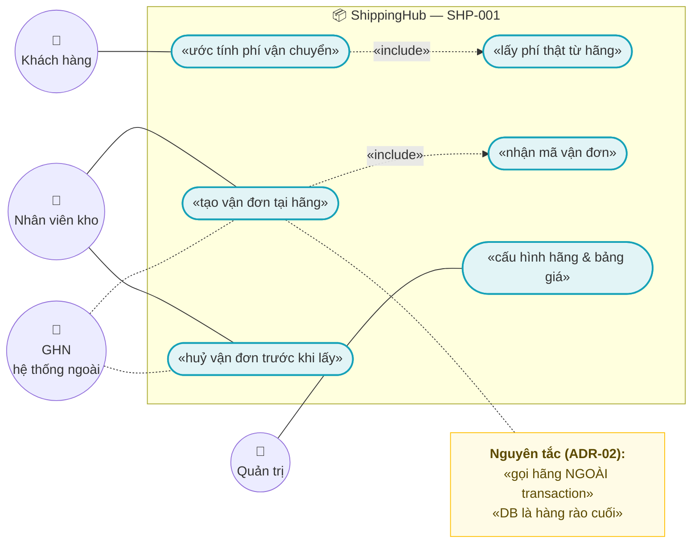
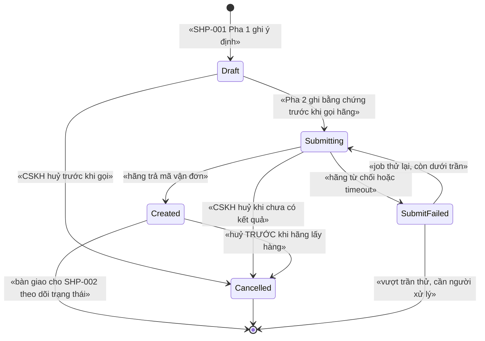
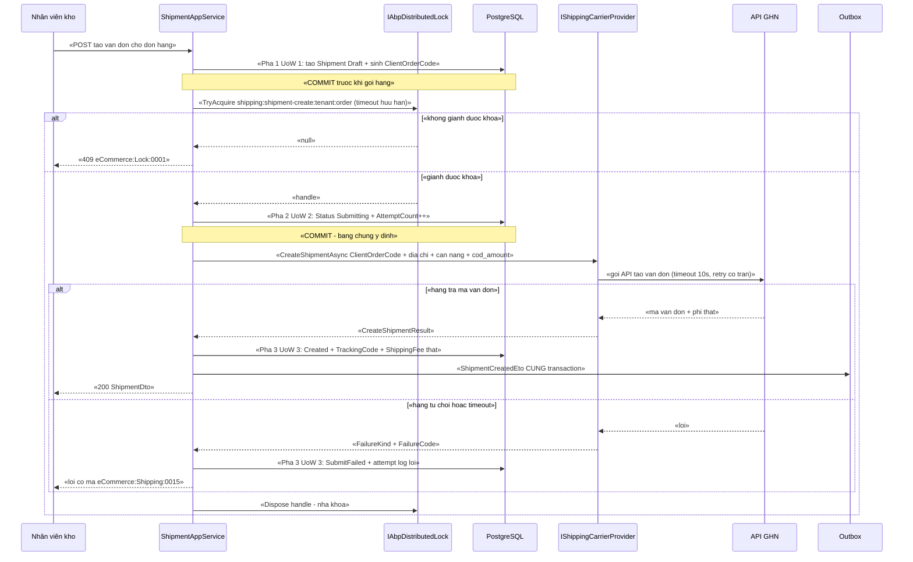

# `SHP-001` — Adapter GHN: tính phí và tạo vận đơn

> ⚠️ **HAI CẢNH BÁO PHẢI ĐỌC TRƯỚC KHI REVIEW TÀI LIỆU NÀY** (kế thừa từ tài liệu khác, **có bằng chứng trong repo**):
>
> **1. GHN đổi COD bắt buộc OTP ⇒ KHÔNG tự động hoá được.** Bằng chứng: `docs/implementation-plan.md:199`
> (*"đổi COD ở GHN cần **OTP** ⇒ có bước thủ công"*) và `docs/implementation-plan.md:426`
> (*"`SHP-003` | **COD**: thu hộ, đổi COD (⚠️ GHN cần OTP)"*), `docs/business-modules-proposal.md:548`.
> ⇒ Hệ quả **cứng cho tài liệu này**: `SHP-001` **chỉ truyền** `cod_amount` tại thời điểm tạo vận đơn;
> **cấm** expose bất kỳ method/endpoint nào *đổi* COD (xem **ADR-07**, **BR-SHP-001-014**).
>
> **2. GHTK phải xác minh địa chỉ 2 cấp TRƯỚC khi gửi.** Bằng chứng: `docs/implementation-plan.md:290`
> (*"GHTK chưa xác nhận địa chỉ 2 cấp — mức **cao** — hỏi GHTK trước khi chốt mô hình địa chỉ"*),
> `docs/implementation-plan.md:338` (*"GHTK làm sau, cần xác minh địa chỉ 2 cấp trước"*) và
> `docs/business-modules-proposal.md:546` (*"GHTK vẫn dùng payload 3 cấp `province`/`district`/`ward` và
> **KHÔNG tìm thấy** cờ tương đương `is_new_to_address`"*).
> ⇒ Hệ quả **cứng cho tài liệu này**: abstraction của `SHP-001` **không được** nhốt mô hình địa chỉ của GHN
> vào hợp đồng dùng chung (xem **ADR-06**).

| Thuộc tính | Nội dung |
|---|---|
| **Mã** | `SHP-001` |
| **Module** | **ShippingHub** — dự kiến tạo mới `modules/ShippingHub/eCommerce.ShippingHub.{Domain, EntityFrameworkCore, Application.Contracts, Application}` (hiện **chưa tồn tại** — xem §15.2 **F1**). Khuôn đặt tên project theo `docs/structure-and-techstack.md:87`–`95` |
| **Giai đoạn** | **GĐ2 — Vận hành & tuân thủ VN** (`docs/implementation-plan.md:194`, `docs/implementation-plan.md:199`) |
| **Ưu tiên** | **Must have** (không có nó thì đơn **không có mã vận đơn** ⇒ `SAL-003` **không** chuyển được `Packing → AwaitingPickup`: `docs/features/sal-003-state-machine-4-truc.md:237`) |
| **Trạng thái** | 🟡 `Draft` — chờ review |
| **Người viết / người review** | *(điền)* / **Kiến trúc trưởng + người đã liên hệ GHN** |
| **Phiên bản / ngày** | `v0.1 — 14/10/2026` |
| **Tài liệu liên quan** | `SHP-002` (webhook trạng thái vận đơn & đối soát — **tiêu thụ** `ShpShipments` do tài liệu này tạo) · `SHP-003` (COD, ⚠️ GHN đổi COD cần OTP) · `SHP-004` (adapter GHTK, ⚠️ địa chỉ 2 cấp) · `XC-001` (Money) · `XC-002` (outbox/inbox, idempotency) · `XC-003` (khoá phân tán) · `XC-004` (phân quyền/tenant) · `XC-005` (log/metric) · `SAL-002` (đặt hàng) · `SAL-003` (state machine 4 trục) · `REC-003` (đối soát COD) · `CAT-001` (cân nặng SKU) · `docs/structure-and-techstack.md` |

---

## 0. Tóm tắt & quyết định thiết kế

**Tóm tắt:** `SHP-001` chốt **cách hệ thống gọi API GHN** để làm đúng **hai việc**: (a) **tính phí vận chuyển**,
(b) **tạo vận đơn** và nhận **mã vận đơn** từ hãng. Hai việc này đi qua **một cổng adapter duy nhất**
(`IShippingCarrierProvider` + factory) để `SHP-004` (GHTK) cắm vào mà **không sửa lõi**, và để
`PaymentHub`/`ChannelHub` giữ nguyên khuôn đã có trong repo.

**Vì sao tài liệu này phải tồn tại (không phải thủ tục):** tạo vận đơn là **ghi dữ liệu ra một hệ thống KHÔNG
rollback được cùng transaction của ta**. Đây là loại lỗi mà transaction DB **không cứu được**:

| Nếu làm sai | Hệ quả thật |
|---|---|
| Gọi API tạo vận đơn **trong** transaction DB rồi transaction rollback | Hãng **đã** tạo vận đơn thật, ta **không** có mã vận đơn ⇒ shipper tới lấy hàng mà hệ thống không biết ⇒ trạng thái đơn treo vĩnh viễn |
| Retry tạo vận đơn **không có khoá ổn định** | **2 vận đơn thật** cho 1 đơn hàng ⇒ hãng tính phí 2 lần, lấy hàng 2 lần, COD bị nhân đôi ở khâu thu hộ |
| Lấy phí ước tính nội bộ rồi **không** đối chiếu với phí hãng báo lúc tạo vận đơn | Thu khách **thiếu** tiền ship; sai lệch chỉ lộ ra ở `REC-003` (đối soát COD bằng file Excel thủ công — `docs/implementation-plan.md:200`) |
| Tự động hoá **đổi COD** như một API thường | 🚨 GHN **bắt buộc OTP** ⇒ luồng sẽ dừng giữa đường, hoặc tệ hơn là bị "vá" bằng cách bỏ qua OTP |

**Phạm vi:**
- ✅ Cổng adapter hãng vận chuyển (`IShippingCarrierProvider`) + factory chọn theo `ProviderCode`.
- ✅ **Tính phí**: gọi API hãng (nguồn sự thật) + bảng giá nội bộ để **ước tính** trước khi đặt hàng.
- ✅ **Tạo vận đơn**: sinh khoá chống trùng **ổn định**, gọi hãng **ngoài transaction**, lưu mã vận đơn + phí thật.
- ✅ **Huỷ vận đơn trước khi hãng lấy hàng** (khớp guard `Created → Cancelled` của `SHP-002` §3.2 dòng #2).
- ✅ Entity `Shipment` (+ 4 bảng danh mục/nhật ký) — **`SHP-002` chỉ đọc & cập nhật trạng thái**, không tạo bảng mới.
- ✅ **Idempotency ở mọi biên vào** (API tạo vận đơn, job thử lại) theo hợp đồng `XC-002`.
- ✅ **Khoá phân tán** cho thao tác tạo vận đơn theo đơn hàng + job đồng bộ bảng giá.
- ✅ Phát `ShipmentCreatedEto` / `ShipmentCreationFailedEto` qua **outbox**.
- ✅ Tiền theo `XC-001`: `decimal` + `Money`, **cấm so `==` trên tiền**, ra biên hãng là **số nguyên**.
- ✅ Metric + log + `CorrelationId` theo `XC-005`.
- ✅ **Một hợp đồng địa chỉ trung tính** mang **cả** 2 cấp (mới) **và** 3 cấp (cũ) — vì GHN đã có cờ
  `is_new_to_address` còn GHTK thì **chưa xác minh** (`docs/business-modules-proposal.md:513`, `:546`).

**Không nằm trong phạm vi:**
- ❌ **Nhận webhook trạng thái & đối soát chủ động** — thuộc `SHP-002`. Tài liệu này **chỉ** tạo vận đơn và
  **trả** `ProviderTrackingCode` cho `SHP-002` dùng làm khoá đối chiếu.
- ❌ **Nghiệp vụ COD**: thu hộ, **đổi COD (⚠️ GHN bắt buộc OTP)** — thuộc `SHP-003`. `SHP-001` **chỉ truyền**
  `cod_amount` đã được Sales chốt, và **cấm** expose method đổi COD (**ADR-07**).
- ❌ **Adapter GHTK** (địa chỉ 2/3 cấp, ⚠️ chưa xác minh) — thuộc `SHP-004`. Tài liệu này **chỉ định nghĩa**
  hợp đồng mà `SHP-004` phải cài.
- ❌ **Master data địa chỉ** (tỉnh/phường) — thuộc `AddressHub` (kế hoạch `docs/structure-and-techstack.md:73`,
  hiện **chưa có** trong code). `SHP-001` coi *"địa chỉ gửi đối tác"* là **dữ liệu đồng bộ theo hãng**, không phải
  master data — đúng `docs/business-modules-proposal.md:517`.
- ❌ **Đối soát COD theo "phiên" / import file Excel** — thuộc `REC-003` (`docs/implementation-plan.md:200`).
- ❌ **Sửa state machine 4 trục của đơn** — thuộc `SAL-003`. Ta phát ETO, Sales tự quyết định.
- ❌ **Read-model/báo cáo** — thuộc `REP-001`/`REP-003`.
- ❌ **Tích hợp máy in nhãn / phần cứng** — chỉ **trả về** nội dung nhãn nếu hãng cung cấp qua API.
- ❌ **Ghi nhận doanh thu/kế toán** — thuộc `EINV-001`/`ACC-001`.
- ❌ **Retry/backoff tầng hạ tầng** (DLQ, phát lại) — dùng lại `XC-002`, không định nghĩa lại.

### 0.1 Quyết định thiết kế (ADR ngắn)

| # | Quyết định | Phương án đã cân nhắc | Lý do chọn | Hệ quả |
|---|---|---|---|---|
| **ADR-01** | **Một cổng adapter hãng vận chuyển** `IShippingCarrierProvider` + `IShippingCarrierProviderFactory`; app service **chỉ** biết interface | (a) gọi HTTP GHN thẳng trong app service · (b) một `switch (providerCode)` khổng lồ · (c) **interface + factory** | Khuôn này **đã có thật** trong repo: `IPaymentProvider` (`modules/PaymentHub/eCommerce.PaymentHub.Domain/Payments/IPaymentProvider.cs:58`), `IChannelConnector` (`modules/ChannelHub/eCommerce.ChannelHub.Application.Contracts/Connectors/IChannelConnector.cs:95`), `ChannelConnectorFactory` (`modules/ChannelHub/eCommerce.ChannelHub.Application/Connectors/ChannelConnectorFactory.cs:9`). Đi theo khuôn ⇒ `SHP-004` chỉ thêm 1 class + 1 dòng | `SHP-001` **không** được chứa chi tiết GHN trong tầng app service; mọi thứ riêng của GHN nằm **sau** interface |
| **ADR-02** | 🚨 **Gọi API hãng NGOÀI transaction DB**: 3 pha rời (ghi ý định → gọi hãng → ghi kết quả) | (a) gọi hãng trong transaction · (b) gọi trước rồi ghi 1 lần · (c) **3 pha rời** | Pha (a): hãng tạo vận đơn thật rồi ta rollback ⇒ **mất mã vận đơn** (bảng §0). Pha (b): ta chết sau khi hãng tạo ⇒ **không có dấu vết ý định** ⇒ không thể tra ngược. Pha (c) giữ **transaction ngắn** và để lại **bằng chứng trước khi gọi** | Phải chấp nhận: DB có thể có `Shipment` ở trạng thái `Submitting` mà chưa biết kết quả ⇒ **cần job quét** `Submitting` quá N phút (§4.2, §12) |
| **ADR-03** | **Khoá chống trùng ổn định** `ClientOrderCode` sinh **một lần**, **lưu DB trước** khi gọi hãng; gọi lại dùng **đúng** giá trị cũ | (a) `Guid.NewGuid()` mỗi lần gọi · (b) khoá sinh từ `(tenantId, orderId, attemptNo)` và **lưu DB** | `XC-002` **BR-XC-002-007** cấm `Guid.NewGuid()` cho mỗi lần gọi; `XC-002` §7.3 ghi rõ khoá phải **ổn định qua retry**; `SHP-002` §7.3 đã đặt tên khoá `Create:{tenantId}:{orderId}:{attemptNo}` cho chính `SHP-001`. Có **2 hàng rào**: unique index ở DB + hãng từ chối mã trùng | ⚠️ Phụ thuộc hãng **thật sự** chống trùng theo mã đơn phía ta — **chưa kiểm chứng** (§15.1 Q3). Nếu hãng **không** chống trùng ⇒ hàng rào duy nhất là DB của ta ⇒ phải **tuyệt đối** không sinh mã mới khi retry |
| **ADR-04** | **Phí hãng là NGUỒN SỰ THẬT** tại thời điểm tạo vận đơn; bảng `ShpShippingRates` nội bộ **chỉ để ước tính** | (a) chỉ dùng bảng giá nội bộ · (b) chỉ gọi API hãng · (c) **cả hai, hãng là chốt** | (a) sai khi hãng đổi biểu phí/phụ phí ⇒ thu thiếu tiền. (b) làm mỗi lần hiển phí ở checkout đều gọi hãng ⇒ tốn quota, chậm. (c) cho phép ước tính nhanh và **vẫn** chốt bằng số thật | Mọi lệch phí **phải** được **ghi nhận** (không tự sửa số của hãng — kế thừa `SHP-002` BR-SHP-002-007). Cần bảng `ShpShippingRates` + job đồng bộ |
| **ADR-05** | Tiền: `decimal` + `Money`; ra biên hãng chuyển sang **số nguyên VND** (`ToMinorUnits()`); **cấm** `==` trên tiền | (a) `double` · (b) `decimal` trần · (c) **`Money`** | `XC-001` BR-XC-001-003/007/008. Tiền lệ **thật trong repo**: `VnPayPaymentProvider` nhân 100 bằng `decimal.Round(..., MidpointRounding.AwayFromZero)` và **không** dùng `double` (`modules/PaymentHub/eCommerce.PaymentHub.Application/Providers/VnPayPaymentProvider.cs:72`) | ⚠️ **`Money`/`Currency`/`MoneyAllocator` CHƯA có trong code** (`grep "struct Money|class Money"` = **0**; `eCommerce.slnx:2`–`30` **không** có project `Kernel`) ⇒ `SHP-001` **phụ thuộc `XC-001` GĐ1**. Trước khi có `Money`, cột DB vẫn là `numeric(18,4)` + `char(3)` như `eCommerceDbContext.cs:173`–`178` |
| **ADR-06** | **Hợp đồng địa chỉ TRUNG TÍNH** mang **cả 2 cấp và 3 cấp** + cờ "địa chỉ kiểu mới"; **map riêng trong adapter** | (a) hợp đồng chỉ có 2 cấp (mô hình mới) · (b) hợp đồng chỉ có 3 cấp (mô hình cũ) · (c) **trung tính, mang cả hai** | GHN đã thích ứng bằng cờ `is_new_to_address`/`is_new_from_address`/`is_new_return_address` (`docs/business-modules-proposal.md:513`–`514`) **nhưng** GHTK vẫn dùng `province`/`district`/`ward` và **chưa tìm thấy** cờ tương đương (`:546`), và quyết định đã chốt là **hỗ trợ CẢ HAI** (`:658`) | Hợp đồng dùng chung **không** được có `IsNewToAddress` kiểu GHN; trường "kiểu địa chỉ" là **dữ liệu cấu hình theo hãng** ⇒ `SHP-004` thêm adapter **không** phải sửa `SHP-001` |
| **ADR-07** | **KHÔNG có API đổi COD.** `SHP-001` **chỉ nhận** `cod_amount` lúc tạo vận đơn; đổi COD là **quy trình thủ công có OTP** (`SHP-003`) | (a) làm API đổi COD gọi thẳng hãng · (b) **không** làm, chuyển `SHP-003` | 🚨 GHN **bắt buộc OTP** để đổi COD (`docs/implementation-plan.md:199`, `:426`; `docs/business-modules-proposal.md:548`). Nếu ta expose API "đổi COD" thì hoặc **luồng dừng giữa đường**, hoặc có người sẽ "vá" bằng cách bỏ OTP ⇒ **thao tác tiền không có xác thực** | Màn hình vận đơn **không** có nút "sửa COD" (chỉ có nút "Yêu cầu đổi COD" ghi nhận yêu cầu cho người vận hành — thuộc `SHP-003`) |
| **ADR-08** | **Khoá phân tán chỉ ở 2 chỗ**: tạo vận đơn theo `(tenantId, orderId)` và job đồng bộ bảng giá; **DB là hàng rào cuối** | (a) khoá ở mọi lời gọi API hãng · (b) **không** khoá gì · (c) **2 chỗ như trên** | `XC-003` D2: *"bỏ lock đi, DB có chặn không?"*. Khoá mọi lời gọi ⇒ lời gọi thứ 3 hết timeout và bị hãng coi là lỗi. Khoá **không** thay được unique index (đúng `XC-003` §7.3) | Lock **không reentrant** (`XC-003` D6) ⇒ **cấm** acquire lồng; TTL khoá phải **lớn hơn** thời gian gọi hãng tối đa + retry |
| **ADR-09** | Bảng `ShpShipments` do **`SHP-001` tạo**; `SHP-002` **chỉ đọc và cập nhật trạng thái** | (a) mỗi tài liệu tự định nghĩa bảng riêng · (b) **một bảng, một chủ sở hữu** | `SHP-002` §5.2 đã định nghĩa **đầy đủ** cột cho `ShpShipments` và ghi rõ *"do `SHP-001` tạo, `SHP-002` cập nhật trạng thái"*. Hai định nghĩa song song ⇒ **hai nguồn sự thật** cho cùng một bảng (đúng loại lỗi `XC-003` F1/F2) | ⚠️ **Cột của `ShpShipments` phải KHỚP `SHP-002` §5.2**; nếu `SHP-001` cần thêm cột ⇒ **sửa `SHP-002` trước**, không tự thêm |
| **ADR-10** | Mã lỗi **do module sở hữu**: `ShippingHubErrorCodes` dạng `eCommerce:Shipping:NNNN` | (a) khai ở `eCommerceConsts.ErrorCodes` của app · (b) **ở module** | Quy ước bất biến: *"module sở hữu entity/hằng số của mình, module gọi app BỊ CẤM"* (`src/eCommerce.Domain.Shared/eCommerceConsts.cs:80`–`84`). Khuôn **đã có thật**: `TaxErrorCodes` (`modules/Tax/eCommerce.Tax.Domain/TaxErrorCodes.cs:10`) và `ChannelHubErrorCodes` (`modules/ChannelHub/eCommerce.ChannelHub.Domain/ChannelHubConsts.cs:36`) | Mã lỗi **phải** trùng dải với `SHP-002` §6.2 — **không** được đánh số chồng (xem §6.3: dải `0013+` để dành cho `SHP-001`) |
| **ADR-11** | Cấu hình hãng trong `ShippingHubOptions` (`BaseUrl`, token, `ShopId`, `EnableLiveCalls`), **cấm** hard-code | (a) hard-code endpoint · (b) **options + configuration** | `docs/design-doc-guidelines.md:118` (quy tắc 7) cấm hard-code endpoint NCC. Khuôn **đã có thật**: `ChannelHubOptions` + `ShopeeOptions.EnableLiveCalls` (`modules/ChannelHub/eCommerce.ChannelHub.Application/ChannelHubOptions.cs:47`), đăng ký tại host (`src/eCommerce.HttpApi.Host/eCommerceHttpApiHostModule.cs:148`–`149`) | `EnableLiveCalls = false` cho phép chạy **toàn bộ luồng** (lock, outbox, ETO) mà **không cần credential** GHN — đúng cách `ShopeeConnector` đang làm (`modules/ChannelHub/eCommerce.ChannelHub.Application/Connectors/ShopeeConnector.cs:80`–`87`) |
| **ADR-12** | `[Authorize]` ở **cấp CLASS** cho mọi app service; **không** có endpoint vô danh trong `SHP-001` | (a) `[Authorize]` ở từng method · (b) **cấp class** | `XC-004` D3 + BR-XC-004-001; bài học thật đã ghi trong code: `ChannelAppService` đặt `[Authorize]` cấp class **có chủ ý** vì *"GetShopsAsync từng là API CÔNG KHAI"* (`src/eCommerce.Application/Channels/ChannelAppService.cs:21`–`27`) | ⚠️ Endpoint webhook của `SHP-002` là **ngoại lệ `[AllowAnonymous]`** và **chưa** nằm trong allowlist đã chốt của `XC-004` Q1 (`docs/features/XC-004-xac-thuc-phan-quyen-tenant.md:505`) ⇒ **xung đột phải xử lý** (xem §15.2 **F4**) |

---

## 1. Use Case Specification

| Thuộc tính | Nội dung |
|---|---|
| **Use Case ID** | `SHP-001` |
| **Use Case Name** | Lấy phí vận chuyển và tạo vận đơn tại hãng (GHN) **không tạo trùng, không mất mã vận đơn** |
| **Description** | *"Là hệ thống bán hàng, tôi muốn biết phí vận chuyển để thu đúng tiền của khách, và muốn tạo được vận đơn thật ở hãng để shipper tới lấy hàng — nhưng tôi KHÔNG muốn tạo 2 vận đơn cho 1 đơn, cũng KHÔNG muốn hãng đã tạo vận đơn mà hệ thống tôi không biết."* |
| **Actor(s)** | **Nhân viên kho/CSKH** (bấm tạo vận đơn) · **Khách hàng** (nhận phí ước tính ở checkout) · **Job thử lại** (hệ thống) · **GHN** (hệ thống ngoài) · **Quản trị** (cấu hình hãng, bảng giá) |
| **Priority** | **Must have** |
| **Trigger** | (a) checkout cần **ước tính phí** để hiển thị cho khách; (b) đơn đã được xác nhận ⇒ kho bấm **"Tạo vận đơn"**; (c) job thử lại quét `Shipment` ở trạng thái `Submitting` quá N phút; (d) CSKH **huỷ vận đơn** trước khi hãng lấy hàng |
| **Pre-Condition(s)** | • **Tenant hiện tại** (`TenantId` từ `ICurrentTenant`) — bắt buộc.<br>• **`ChannelCode`** lấy từ **đơn hàng** (`src/eCommerce.Domain/Entities/Orders/Order.cs:18`), **không** từ payload hãng; `ChannelCode` quyết định bảng giá/kênh hiển thị phí.<br>• **Đơn hàng tồn tại** và có **dòng hàng** (`Order.cs:56`) để tính **cân nặng** — cân nặng lấy từ `ProductVariant.WeightInGrams` (`src/eCommerce.Domain/Entities/Catalog/Product.cs:76`).<br>• **Hãng đã được cấu hình** (`ShippingHubOptions.Providers["ghn"]`: `BaseUrl`, token, `ShopId`, `FromAddress`, `EnableLiveCalls`). Thiếu ⇒ **fail-closed**, **không** dùng giá trị mặc định (§12).<br>• **Địa chỉ nhận** hợp lệ theo **mô hình địa chỉ của hãng** (2 cấp **hoặc** 3 cấp) — `AddressHub` **chưa có** trong code ⇒ **cần chốt** (§15.1 Q1).<br>• `CorrelationId` được sinh/đọc theo `XC-005`.<br>• **Outbox đã bật** để phát ETO — ⚠️ **hiện CHƯA bật** (`XC-002` §6.3; host **không** cấu hình `AbpDistributedEventBusOptions` — `src/eCommerce.HttpApi.Host/eCommerceHttpApiHostModule.cs:56`–`184` **không** có `Outboxes`/`Inboxes`). |
| **Post-Condition(s)** | • Nếu **tạo vận đơn thành công**: `Shipment.Status = Created`, `ProviderTrackingCode` **khác rỗng**, `ShippingFee` = **phí hãng báo**, và **đúng 1** dòng `ShpShipmentCreateAttempts` cho lần gọi đó.<br>• Nếu **thất bại**: `Shipment.Status = SubmitFailed` + `FailureCode` + **có** dòng attempt ghi lỗi ⇒ **không** mất thông tin để thử lại.<br>• Mỗi `ClientOrderCode` **chỉ** tương ứng **tối đa một** vận đơn ở hãng (hàng rào DB + hàng rào hãng).<br>• `ShipmentCreatedEto` nằm trong **cùng transaction** với lần cập nhật `Shipment` (`XC-002` BR-XC-002-001).<br>• Mọi lời gọi hãng **có** metric + log có `CorrelationId`; **không** log token.<br>• **Không** tồn tại đường code nào đổi `cod_amount` sau khi vận đơn đã tạo (**BR-SHP-001-014**). |
| **Basic Flow** | 1. **Tính phí (ước tính)**: `EstimateFeeAsync` nạp `Order` + dòng hàng + cân nặng; tra `ShpShippingRates` **trước**; nếu `EnableLiveCalls` và cần số thật ⇒ gọi `IShippingCarrierProvider.GetFeeAsync` (ADR-04).<br>2. Trả `ShippingFeeEstimateDto` (Money + `EstimatedAtUtc` + `IsEstimate = true`).<br>3. **Tạo vận đơn**: `CreateShipmentAsync(orderId, input)` mở **Pha 1 (UoW #1)**: kiểm tra đơn ∈ tenant, chưa có `Shipment` hiệu lực ⇒ tạo `Shipment` `Status = Draft`, **sinh `ClientOrderCode`** (ADR-03) và **commit**.<br>4. Giành **khoá phân tán** `shipping:shipment-create:{tenantId}:{orderId}` (ADR-08, timeout hữu hạn).<br>5. **Pha 2 (UoW #2)**: ghi `Status = Submitting` + `SubmitAttemptCount++` + **commit** — đây là *bằng chứng ý định* trước khi gọi hãng (ADR-02).<br>6. Gọi hãng **ngoài transaction**: `IShippingCarrierProvider.CreateShipmentAsync` (có timeout + retry có backoff).<br>7. **Pha 3 (UoW #3)**: ghi kết quả: `ProviderTrackingCode`, `ShippingFee` (phí **thật**), `Status = Created`; ghi dòng `ShpShipmentCreateAttempts` (`Result = Created`); ghi **outbox** `ShipmentCreatedEto` — **cùng transaction**.<br>8. Cập nhật `Order.SetTotals(taxTotal, shippingTotal)` **chỉ khi** phí thật **khác** phí đã lưu ⇒ việc này do `SAL-002` quyết định qua ETO, **không** tự ý ghi vào đơn (xem §7.1).<br>9. Trả `ShipmentDto`. Nhả khoá khi hết phạm vi `await using`. |
| **Alternative Flow** | **A1: Hãng báo "mã đơn phía bạn đã tồn tại"** — `ClientOrderCode` đã được dùng ⇒ **KHÔNG** tạo vận đơn mới; tra lại vận đơn theo `ClientOrderCode`; nếu hãng trả được mã vận đơn ⇒ ghi `Created` và **ghi nhận** sự kiện "đã tồn tại" (metric).<br>**A2: Job thử lại gặp `Submitting` quá N phút** — cập nhật lại trạng thái bằng cách **hỏi hãng** (nếu hãng có API tra theo `ClientOrderCode`) trước khi thử tạo lại; ⚠️ **chưa kiểm chứng** hãng có API này (§15.1 Q3).<br>**A3: `EnableLiveCalls = false` (PoC/dev)** — provider trả kết quả **mô phỏng** (mã vận đơn giả có tiền tố `poc-`), toàn bộ luồng lock/UoW/outbox vẫn chạy — đúng cách `ShopeeConnector` đang làm (`modules/ChannelHub/eCommerce.ChannelHub.Application/Connectors/ShopeeConnector.cs:80`–`87`).<br>**A4: Huỷ vận đơn trước khi hãng lấy** — chỉ cho phép từ `Draft`/`Submitting`/`Created`; gọi `CancelShipmentAsync`; ghi attempt `Result = Cancelled`. Sau khi hãng đã lấy hàng ⇒ **NÉM LỖI** (khớp `SHP-002` §3.2 #2: huỷ **chỉ** trước khi lấy).<br>**A5: Đơn đã có `Shipment` hiệu lực** — trả **vận đơn hiện có** (idempotent), **không** gọi hãng lần hai. |
| **Exception Flow** | **E1:** hãng không được cấu hình (thiếu token/`BaseUrl`/`ShopId`) ⇒ **fail-closed** `eCommerce:Shipping:0013`, `400`.<br>**E2:** địa chỉ không hợp lệ với mô hình của hãng (thiếu cấp bắt buộc) ⇒ `eCommerce:Shipping:0014`, `400` — **không** gọi hãng.<br>**E3:** hãng từ chối (4xx nghiệp vụ) ⇒ `eCommerce:Shipping:0015`; `Status = SubmitFailed`; ghi `FailureCode` + `FailureReason` (**đã che** dữ liệu nhạy cảm); **NÉM LỖI** (không nuốt).<br>**E4:** hãng timeout / 5xx ⇒ `Status = SubmitFailed` + `FailureKind = Transient`; **thử lại nhịp sau** (job); **KHÔNG** rollback dữ liệu đã ghi; metric `shipping_carrier_call_failed_total`.<br>**E5:** vượt `MaxSubmitAttempts` ⇒ `Status = SubmitFailed` (hấp thụ) + `eCommerce:Shipping:0016` + **cảnh báo** cho vận hành — **KHÔNG** thử vô hạn.<br>**E6:** không giành được khoá trong timeout ⇒ `eCommerce:Lock:0001` của `XC-003` (`409`) — **cấm** im lặng bỏ qua ở đường HTTP.<br>**E7:** `UPDATE … WHERE Status = @expected` ảnh hưởng **0 dòng** ⇒ **NÉM LỖI** `eCommerce:Shipping:0017` — **cấm** coi là thành công (`XC-002` BR-XC-002-008).<br>**E8:** phí hãng báo **lệch** phí ước tính ⇒ **KHÔNG** ném lỗi (vận đơn đã tạo thật); ghi `FeeDiscrepancy` + log `Warning` + metric `shipping_fee_discrepancy_total` (ADR-04).<br>**E9:** yêu cầu **đổi COD** ⇒ `eCommerce:Shipping:0018` — **cấm** tự động hoá (ADR-07). |
| **Business Rules** | • **BR-SHP-001-001**: **Mọi** lời gọi API hãng vận chuyển **phải** đi qua `IShippingCarrierProvider`; **cấm** gọi HTTP trực tiếp từ app service/controller/job.<br>• **BR-SHP-001-002**: 🚨 **Cấm** giữ transaction DB mở trong lúc gọi API hãng (ADR-02). Ba pha **phải** là ba UoW rời.<br>• **BR-SHP-001-003**: Mọi yêu cầu tạo vận đơn **phải** có `ClientOrderCode` **ổn định**, sinh **một lần** và **lưu DB TRƯỚC** khi gọi hãng; 🚨 **cấm** `Guid.NewGuid()` cho mỗi lần gọi (kế thừa `XC-002` BR-XC-002-007).<br>• **BR-SHP-001-004**: Gọi lại với **cùng** `ClientOrderCode` **không** được tạo vận đơn thứ hai; nếu hãng báo đã tồn tại ⇒ **dùng lại** kết quả cũ.<br>• **BR-SHP-001-005**: **Mọi** chuyển trạng thái `Shipment` **phải** qua guard ở §3.2; guard sai ⇒ **NÉM LỖI có mã**; **cấm** gán trực tiếp (bài học `Order.SetStatus` — `src/eCommerce.Domain/Entities/Orders/Order.cs:111` hiện **chưa** có guard, thuộc `SAL-003`).<br>• **BR-SHP-001-006**: Trạng thái **hấp thụ** của `SHP-001`: `Cancelled`, `SubmitFailed` (sau khi vượt trần thử), `Created` **chỉ** được huỷ theo A4, **không** được sửa sang trạng thái khác.<br>• **BR-SHP-001-007**: Tiền **phải** là `decimal` + `Money`; 🚨 **cấm** so sánh tiền bằng `==`; so bằng `ToMinorUnits()` (`XC-001` BR-XC-001-003).<br>• **BR-SHP-001-008**: Ra biên hãng, tiền truyền dưới dạng **số nguyên** (VND); 🚨 **cấm** `double`/`float` trong mọi biểu thức tiền (`XC-001` BR-XC-001-007/008).<br>• **BR-SHP-001-009**: Phí dùng để **chốt** là phí **hãng báo tại thời điểm tạo vận đơn**; bảng giá nội bộ chỉ để **ước tính**; lệch ⇒ **ghi nhận**, 🚨 **cấm** tự sửa số của hãng (ADR-04; kế thừa `SHP-002` BR-SHP-002-007).<br>• **BR-SHP-001-010**: **Mọi** thao tác ghi **phải** qua **Unit of Work** của ABP (đã bật `TransactionBehavior.Auto` — `src/eCommerce.HttpApi.Host/eCommerceHttpApiHostModule.cs:60`–`64`).<br>• **BR-SHP-001-011**: 🚨 **Cấm** hard-code endpoint, mã dịch vụ, mã quận/huyện, hay token của hãng trong code nghiệp vụ — **mọi thứ** thuộc `ShippingHubOptions` hoặc **dữ liệu** (`ShpCarriers`/`ShpShippingServices`).<br>• **BR-SHP-001-012**: Mọi lỗi hãng trả về **phải** có log có cấu trúc + mã lỗi nghiệp vụ; 🚨 **cấm** log token/secret/payload chứa PII (kế thừa `XC-005` BR-XC-005-005/013 và hàm che `PaymentTransaction.MaskSensitiveData` — `modules/PaymentHub/eCommerce.PaymentHub.Domain/Entities/PaymentTransaction.cs:147`).<br>• **BR-SHP-001-013**: Mọi lời gọi hãng **phải** có **timeout hữu hạn** và retry **có trần** + backoff; 🚨 **cấm** retry vô hạn.<br>• **BR-SHP-001-014**: 🚨 **Cấm** expose API/method **đổi COD**. Đổi COD ở GHN **bắt buộc OTP** ⇒ thuộc quy trình **thủ công** của `SHP-003` (`docs/implementation-plan.md:199`, `:426`; `docs/business-modules-proposal.md:548`).<br>• **BR-SHP-001-015**: Token/secret của hãng **cấm** commit; đọc từ cấu hình/secret ngoài (`XC-004` BR-XC-004-012).<br>• **BR-SHP-001-016**: **Mọi** app service **phải** có `[Authorize]` ở **cấp class** (`XC-004` BR-XC-004-001); `SHP-001` **không** có endpoint vô danh.<br>• **BR-SHP-001-017**: **Idempotency ở MỌI biên vào** (API tạo vận đơn, job thử lại, và callback của `SHP-002`): **cả** `IIdempotencyGuard` (`XC-002`) **lẫn** unique index ở DB.<br>• **BR-SHP-001-018**: Nhãn metric **chỉ** lấy từ `eCommerceMetricTags.Allowed` (`src/eCommerce.Domain.Shared/Observability/eCommerceMetrics.cs:75`–`78`); 🚨 **cấm** `orderId`/`trackingCode`/`sku`/`correlationId` làm nhãn (`XC-005` BR-XC-005-009).<br>• **BR-SHP-001-019**: Thêm/đổi tên metric **phải** cập nhật **đồng thời** `eCommerceMetricNames` (`eCommerceMetrics.cs:38`), instrument trong `eCommerceMetrics` (`:98`), `XC-005` §5.1 **và** hằng số `12` trong `test/eCommerce.Tests/Observability/MetricsTests.cs:64` — trong **cùng** PR, nếu không **CI đỏ**. |
| **Non-Functional Requirement** | • **NFR-SHP-001-001**: `GetFeeAsync` khi hãng phản hồi bình thường ⇒ **p95 < 2 s** (không tính độ trễ mạng của hãng).<br>• **NFR-SHP-001-002**: `CreateShipmentAsync` end-to-end ⇒ **p95 < 5 s**; **p99 < 12 s**.<br>• **NFR-SHP-001-003**: **0** vận đơn trùng khi gọi `CreateShipmentAsync` **1.000 lần** cho cùng một đơn (integration test).<br>• **NFR-SHP-001-004**: **0** UoW nào mở trong lúc chờ HTTP tới hãng (test quét + review; ADR-02).<br>• **NFR-SHP-001-005**: **100 %** dòng log của luồng gọi hãng có `CorrelationId` (`XC-005` NFR-XC-005-002).<br>• **NFR-SHP-001-006**: **0** secret/token hãng trong repo (quét mã nguồn).<br>• **NFR-SHP-001-007**: **0** bản ghi tenant khác lọt vào truy vấn (integration test 2 tenant — ⚠️ **cần PostgreSQL**, xem `XC-004` F1).<br>• **NFR-SHP-001-008**: **0** metric phát ra ngoài `eCommerceMetricNames.All` (`test/eCommerce.Tests/Observability/MetricsTests.cs:50`).<br>• **NFR-SHP-001-009**: Cấu hình mặc định: timeout **10 s**/lời gọi; retry tối đa **3** lần, backoff **1 s → 5 s → 25 s**; trần thử tạo vận đơn **5** (kế thừa khuyến nghị retry của `NOT-002` NFR-NOT-002-006 — cần chốt, §15.1 Q6).<br>• **NFR-SHP-001-010**: **0** literal endpoint/mã hãng trong code nghiệp vụ (test grep trong CI — `docs/design-doc-guidelines.md:118`). |

---

## 2. Sơ đồ Use Case



**Chú giải:**

| Ký hiệu | Ý nghĩa |
|---|---|
| ⭕ Xanh lá | Actor (khách, kho, quản trị) |
| 🟦 Bầu dục xanh dương | Use case |
| 🟨 Khung vàng | Note (nguyên tắc thiết kế) |
| `-.«include».->` | Quan hệ bao hàm |
| `-.-` | Tham chiếu (hãng ngoài / note) |

---

## 3. Sơ đồ trạng thái (state machine)

### 3.1 Vòng đời **tạo** vận đơn (`Shipment.Status` giai đoạn `SHP-001` sở hữu)



> ⚠️ **Phân chia trách nhiệm rõ ràng:** `SHP-001` sở hữu **giai đoạn tạo** (`Draft` → `Created`).
> Từ `Created` trở đi, vòng đời **thuộc `SHP-002`** (`docs/features/shp-002-webhook-trang-thai-van-don.md` §3.1):
> `Created → PickedUp → InTransit → … → Delivered/Returned`. **Hai tài liệu KHÔNG được định nghĩa hai state machine
> chồng nhau cho cùng một enum** — enum `ShipmentStatus` **dùng chung**, `SHP-001` chỉ ghi được các giá trị trong
> hình trên (xem §5.2 và §15.2 **F2**).

### 3.2 Bảng chuyển trạng thái & guard — **mọi chuyển sai PHẢI NÉM LỖI, không im lặng**

| # | Từ | Sang | Guard | Ai được phép chuyển | Nếu vi phạm |
|---|---|---|---|---|---|
| 1 | `[*]` | `Draft` | Đơn ∈ tenant hiện tại **và** chưa có `Shipment` hiệu lực cho đơn đó | app service (Pha 1) | Trả vận đơn hiện có (**A5**) — không phải lỗi |
| 2 | `Draft` | `Submitting` | `ClientOrderCode` **đã có** và khác rỗng; hãng **đã** cấu hình | app service (Pha 2) | `eCommerce:Shipping:0013` (**E1**) |
| 3 | `Submitting` | `Created` | Hãng trả `ProviderTrackingCode` **khác rỗng** | app service (Pha 3) | `eCommerce:Shipping:0015` (**E3**) — hãng "thành công" mà không có mã vận đơn là **lỗi** |
| 4 | `Submitting` | `SubmitFailed` | Hãng từ chối (4xx) **hoặc** timeout/5xx **hoặc** `UPDATE … WHERE` | app service (Pha 3) | `eCommerce:Shipping:0017` (**E7**) khi `WHERE` 0 dòng |
| 5 | `SubmitFailed` | `Submitting` | `SubmitAttemptCount < MaxSubmitAttempts` | **job thử lại** (không phải HTTP) | Vượt trần ⇒ `eCommerce:Shipping:0016` (**E5**) + cảnh báo |
| 6 | `Draft`/`Submitting`/`Created` | `Cancelled` | 🚨 Hãng **CHƯA** lấy hàng (`LastProviderEventAtUtc` chưa có sự kiện `PickedUp` — cột này do `SHP-002` cập nhật, `SHP-002` §5.2) | CSKH có quyền `.Cancel` | `eCommerce:Shipping:0017` + log `Error` (**A4**) |
| 7 | `Cancelled` | **BẤT KỲ** | — | **KHÔNG AI** (trạng thái **hấp thụ**) | `eCommerce:Shipping:0017` |
| 8 | `Created` | `Cancelled` | **chỉ** khi chưa `PickedUp` (giống #6) | CSKH có quyền | `0017` |
| 9 | Bất kỳ | *(không đổi)* | `ClientOrderCode` đã tồn tại **và** hãng báo trùng | — | **Không phải lỗi**: dùng lại kết quả (**A1**, **A5**) + metric `shipping_shipment_duplicate_ignored_total` |
| 10 | Bất kỳ | *(không đổi)* | `cod_amount` **khác** giá trị đã gửi hãng | — | 🚨 `eCommerce:Shipping:0018` (**E9**) — **cấm** tự động hoá (ADR-07) |

> 📌 **Bài học kế thừa** (`XC-006` §3 và `SHP-002` §3.2): guard **phải ném lỗi**, không được "im lặng bỏ qua".
> Ngoại lệ duy nhất được phép "im lặng" ở đây là **#9** — và nó **bắt buộc** ghi metric + dòng attempt.

---

## 4. Sequence Diagram & luồng dữ liệu

### 4.1 Sequence — 3 pha tạo vận đơn (gọi hãng **ngoài** transaction)



### 4.2 Ba pha — phạm vi UoW, ghi gì, vì sao

| Pha | UoW | Ghi gì | Vì sao phải **commit** ở đây | Nếu chết ngay sau pha này |
|---|---|---|---|---|
| **P1 — ý định** | UoW #1 (ngắn) | `INSERT Shipment` (`Draft`) + `ClientOrderCode` | `ClientOrderCode` **phải bền vững TRƯỚC** khi gọi hãng ⇒ mọi lần thử lại đọc **đúng** giá trị đó (BR-003) | DB có `Shipment` `Draft`, hãng **chưa** biết gì ⇒ **an toàn**; job nhặt lại |
| **P2 — bằng chứng** | UoW #2 (ngắn) | `UPDATE Status = Submitting`, `SubmitAttemptCount++` (`WHERE Status = Draft`) | Nếu chết **trong lúc** chờ hãng, ta **biết** mình đã gọi ⇒ job quét để tra lại, **không** tạo mù (ADR-02) | DB có `Submitting` "mồ côi" ⇒ **job quét** `Submitting` quá N phút (§12) |
| **P3 — kết quả** | UoW #3 (ngắn) | `UPDATE` kết quả + `INSERT ShpShipmentCreateAttempts` + **outbox** ETO (`WHERE Status = Submitting`) | Outbox **phải** cùng transaction với lần đổi trạng thái (`XC-002` BR-XC-002-001) | DB có `Submitting`; lần thử sau **phải** hỏi hãng trước (A2) |
| *(ngoài UoW)* | — | **lời gọi HTTP tới GHN** | **Không** được nằm trong transaction (BR-002, NFR-004) | — |

> 🔴 **Ghi rõ cho tài liệu khác:** `SHP-002` §12 B2 yêu cầu outbox trong **cùng** transaction với lần đổi trạng thái.
> `SHP-001` áp **cùng** quy tắc cho `ShipmentCreatedEto`. ⚠️ **Outbox hiện CHƯA bật** (`XC-002` §6.3; host không cấu
> hình `AbpDistributedEventBusOptions`) ⇒ nếu code `SHP-001` trước bước đó thì ETO sẽ phát **trực tiếp** ⇒ vi phạm
> `XC-002` BR-XC-002-002. **Điều kiện tiên quyết của `SHP-001`: outbox đã bật.**

---

## 5. Mô hình dữ liệu

### 5.1 ERD

**Không áp dụng — lý do:** tài liệu này đã dùng **3 sơ đồ Mermaid** (§2, §3.1, §4.1) — chạm **giới hạn tối đa 3**.
Thay thế bằng **Data Dictionary** đầy đủ ở §5.2 (cột + index + ràng buộc), đúng cách `SHP-002` §5.1 đã làm.

> ⚠️ **Chưa có bảng nào tồn tại trong code.** Đã kiểm bằng `grep` toàn repo cho `*.cs`:
> `ShippingHub|Shipment|Carrier|CodRecord` ⇒ **0** kết quả trong `src/`, `modules/`, `test/`.
> `eCommerce.slnx:2`–`17` chỉ có `ChannelHub` · `PaymentHub` · `Tax` — **không** có `ShippingHub`.
> Thứ duy nhất liên quan đang tồn tại:
> • `Order.ShippingTotal` — `src/eCommerce.Domain/Entities/Orders/Order.cs:45`, mapping `HasPrecision(18,4)` tại
>   `src/eCommerce.EntityFrameworkCore/eCommerceDbContext.cs:176`;
> • `ProductVariant.WeightInGrams` (`int?`) — `src/eCommerce.Domain/Entities/Catalog/Product.cs:76`, chú thích
>   *"Khối lượng (gram) để tính phí vận chuyển"*.
> ⇒ Toàn bộ 5 bảng dưới đây là **kế hoạch GĐ2 — chưa có trong code**.

### 5.2 Bảng & cột (Data Dictionary)

**Bảng `ShpCarriers`** — danh mục hãng vận chuyển (DỮ LIỆU, không hard-code — BR-011)

| Cột | Kiểu | Null? | Nguồn / ý nghĩa | Ghi chú |
|---|---|---|---|---|
| `Id` | `uuid` | ✖ | khoá chính | |
| `TenantId` | `uuid` | ✔ | `null` = dùng chung cho mọi tenant | `IMultiTenant`; ⚠️ `NULL` = 1 tenant (xem `XC-004` F1) |
| `ProviderCode` | `varchar(32)` | ✖ | `ghn`, `ghtk`, `viettelpost`… | khớp `Provider` trong log `XC-005` §5.2 |
| `DisplayName` | `varchar(256)` | ✖ | tên hiển thị | |
| `IsEnabled` | `bool` | ✖ | hãng có đang dùng không | **fail-closed**: `false` ⇒ từ chối (**E1**) |
| `AddressModel` | `int` | ✖ | `TwoLevel=0` · `ThreeLevel=1` · `Both=2` | ⭐ **ADR-06** — GHN hỗ trợ cờ "địa chỉ mới" còn GHTK **chưa xác minh** (`docs/business-modules-proposal.md:513`, `:546`) |
| `ConfigKey` | `varchar(64)` | ✖ | khoá tra trong `ShippingHubOptions.Providers` | **không** lưu token trong DB (BR-015) |

**Bảng `ShpShippingServices`** — dịch vụ của hãng (DỮ LIỆU đồng bộ từ hãng)

| Cột | Kiểu | Null? | Ý nghĩa | Ghi chú |
|---|---|---|---|---|
| `Id` | `uuid` | ✖ | khoá chính | |
| `TenantId` | `uuid` | ✔ | tenant | |
| `CarrierId` | `uuid` | ✖ | hãng | tham chiếu nội bộ module |
| `ProviderServiceId` | `varchar(64)` | ✖ | mã dịch vụ **của hãng** | ⚠️ **giá trị thật CHƯA kiểm chứng** (§15.1 Q2) |
| `Name` | `varchar(256)` | ✖ | tên dịch vụ | |
| `IsEnabled` | `bool` | ✖ | dùng hay không | mặc định `true` |
| `EffectiveFrom` / `EffectiveTo` | `date` / `date` | ✖ / ✔ | khung hiệu lực | kế thừa khuôn `XC-006` (**cấm** sửa đè bản ghi đang hiệu lực — `TaxErrorCodes.CannotModifyActive`, `modules/Tax/eCommerce.Tax.Domain/TaxErrorCodes.cs:28`) |

**Bảng `ShpShippingRates`** — bảng giá nội bộ **để ƯỚC TÍNH** (ADR-04). 🚨 **Đây KHÔNG phải nguồn sự thật.**

| Cột | Kiểu | Null? | Ý nghĩa | Ghi chú |
|---|---|---|---|---|
| `Id` | `uuid` | ✖ | khoá chính | |
| `TenantId` | `uuid` | ✔ | tenant | |
| `ShippingServiceId` | `uuid` | ✖ | dịch vụ | |
| `FromProvinceCode` / `ToProvinceCode` | `varchar(32)` | ✖ / ✔ | cấp tỉnh | `null` `ToProvinceCode` = mọi tỉnh |
| `WeightFromGrams` / `WeightToGrams` | `int` | ✖ / ✔ | bậc cân nặng | `null` = không giới hạn trên |
| `BaseFee` / `BaseFeeCurrency` | `numeric(18,4)` / `char(3)` | ✖ / ✖ | phí cơ bản | ⚠️ `decimal`, **không bao giờ** `double` (`XC-001` BR-008) |
| `ExtraFeePerKg` | `numeric(18,4)` | ✔ | phụ phí mỗi kg vượt | |
| `EffectiveFrom` / `EffectiveTo` | `date` / `date` | ✖ / ✔ | khung hiệu lực | **cấm** sửa đè |
| `Source` | `int` | ✖ | `Manual=0` · `SyncedFromCarrier=1` | để biết số liệu đến từ đâu |
| `SyncedAtUtc` | `timestamptz` | ✔ | lần đồng bộ gần nhất | |

**Bảng `ShpShipments`** — vận đơn. ⭐ **Do `SHP-001` tạo; `SHP-002` cập nhật trạng thái** (ADR-09).

> 🔴 **BẮT BUỘC KHỚP `SHP-002` §5.2.** Bảng dưới đây liệt kê **các cột `SHP-001` cần** và đánh dấu cột nào
> **đã** được `SHP-002` định nghĩa. Nếu `SHP-001` cần thêm cột **mới** ⇒ **sửa `SHP-002` trước** (quy tắc vàng
> `docs/design-doc-guidelines.md:102`), **không** tự thêm.

| Cột | Kiểu | Null? | Nguồn / ý nghĩa | Ai ghi | Ghi chú |
|---|---|---|---|---|---|
| `Id` | `uuid` | ✖ | khoá chính | SHP-001 | |
| `TenantId` | `uuid` | ✔ | tenant | SHP-001 | `IMultiTenant` |
| `OrderId` | `uuid` | ✖ | đơn hàng | SHP-001 | tham chiếu **mềm** sang Sales (**cấm** module gọi app) |
| `OrderNumber` | `varchar(64)` | ✔ | số đơn (snapshot) | SHP-001 | ⭐ **CỘT MỚI so với `SHP-002`** — để hiển thị/grep mà không phải join; **phải sửa `SHP-002` trước** (§15.2 **F2**) |
| `ChannelCode` | `varchar(32)` | ✔ | kênh bán, lấy từ **đơn** | SHP-001 | `null` với đơn website — **KHÔNG** lấy từ payload hãng |
| `ProviderCode` | `varchar(32)` | ✖ | mã hãng | SHP-001 | |
| `ClientOrderCode` | `varchar(64)` | ✖ | ⭐ **mã đơn phía TA gửi sang hãng** | SHP-001 | 🚨 khoá chống trùng **ổn định** (BR-003); unique theo `(TenantId, ProviderCode)` |
| `ProviderTrackingCode` | `varchar(64)` | ✔ | **mã vận đơn do hãng cấp** | SHP-001 (P3) | `null` cho tới khi tạo thành công |
| `Status` | `int` | ✖ | trạng thái nội bộ (**enum dùng chung với `SHP-002`**) | cả hai | mặc định `Draft` |
| `StatusSource` | `int` | ✖ | `Webhook=0` · `Reconciliation=1` · `Manual=2` · `Pull=3` | SHP-002 | `SHP-001` **không** ghi cột này (trừ `Pull` nếu có) |
| `ConfirmedAtUtc` | `timestamptz` | ✔ | xác nhận trạng thái ảnh hưởng tiền | SHP-002 | ⭐ **BR-004 của `SHP-002`** — `SHP-001` **không** ghi |
| `ProviderStatusCode` | `varchar(64)` | ✔ | mã trạng thái thô của hãng | SHP-002 | |
| `LastProviderEventAtUtc` | `timestamptz` | ✔ | mốc sự kiện hãng lớn nhất đã áp | SHP-002 | ⭐ **guard #6/#8 §3.2 dùng cột này** để biết hãng **đã lấy hàng chưa** |
| `SlaDueAtUtc` | `timestamptz` | ✔ | hạn giao dự kiến | SHP-001 (P3, nếu hãng trả) | job đối soát của `SHP-002` dùng |
| `ReconcileAttemptCount` / `LastReconciledAtUtc` | `int` / `timestamptz` | ✖ / ✔ | số lần đối soát | SHP-002 | |
| `CodAmount` / `CodCurrency` | `numeric(18,4)` / `char(3)` | ✖ / ✖ | **số tiền thu hộ ĐÃ GỬI hãng** | SHP-001 (P3) | ⚠️ `decimal`; 🚨 **ghi một lần**, **cấm** update (BR-014) |
| `ShippingFee` / `ShippingFeeCurrency` | `numeric(18,4)` / `char(3)` | ✖ / ✖ | **phí hãng BÁO** (nguồn sự thật) | SHP-001 (P3) | ⭐ `SHP-002` §5.2 chỉ có `ShippingFee` — **cần bổ sung cột currency** (§15.2 **F2**) |
| `EstimatedShippingFee` | `numeric(18,4)` | ✔ | phí **ước tính** đã hiển thị cho khách | SHP-001 | ⭐ **CỘT MỚI** — để phát hiện lệch phí (**E8**) |
| `SubmitAttemptCount` | `int` | ✖ | số lần đã gọi hãng tạo vận đơn | SHP-001 | mặc định `0`; trần `MaxSubmitAttempts` = **5** |
| `TotalWeightGrams` | `int` | ✔ | tổng cân nặng đã gửi hãng | SHP-001 | tính từ `ProductVariant.WeightInGrams` |
| `FailureCode` / `FailureReason` | `varchar(64)` / `varchar(2048)` | ✔ / ✔ | lỗi gần nhất | SHP-001 | ⚠️ **đã che** dữ liệu nhạy cảm (BR-012) |
| `CreatedAtUtc` | `timestamptz` | ✖ | thời điểm tạo bản ghi | SHP-001 | |
| `RowVersion` | `xmin` (ánh xạ `uint`) | ✖ | optimistic concurrency | cả hai | `IsRowVersion()` ⇒ cột hệ thống `xmin` (`XC-002` §5.2.3) |

**Bảng `ShpShipmentCreateAttempts`** — ⭐ **NHẬT KÝ APPEND-ONLY** cho mỗi lần gọi hãng (do `SHP-001` sở hữu)

| Cột | Kiểu | Null? | Ý nghĩa | Ghi chú |
|---|---|---|---|---|
| `Id` | `uuid` | ✖ | khoá chính | |
| `TenantId` | `uuid` | ✖ | tenant | **bắt buộc** |
| `ShipmentId` | `uuid` | ✖ | vận đơn | |
| `AttemptNo` | `int` | ✖ | lần thử thứ mấy | ⭐ nằm trong unique index (idempotency) |
| `ClientOrderCode` | `varchar(64)` | ✖ | mã đã gửi hãng | **phải trùng** `ShpShipments.ClientOrderCode` |
| `Result` | `int` | ✖ | `Created=0` · `Rejected=1` · `TransientFailure=2` · `DuplicateIgnored=3` · `Cancelled=4` | |
| `FailureCode` | `varchar(64)` | ✔ | mã lỗi nghiệp vụ | |
| `FailureMessage` | `varchar(2000)` | ✔ | thông điệp **đã cắt ngắn + đã che** | 🚨 **cấm** PII |
| `RequestPayloadHash` | `char(64)` | ✖ | SHA-256 của payload **canonical** đã gửi | phát hiện xung đột khoá (kế thừa `XC-002` BR-XC-002-005) |
| `DurationMs` | `int` | ✖ | thời gian lời gọi | `XC-005` §5.2 |
| `CorrelationId` | `varchar(64)` | ✔ | truy vết end-to-end | |
| `OccurredAtUtc` | `timestamptz` | ✖ | thời điểm | |
| `RowVersion` | `xmin` | ✖ | optimistic concurrency | |

> 🔒 **APPEND-ONLY:** `ClientOrderCode`, `RequestPayloadHash`, `AttemptNo`, `OccurredAtUtc` **cấm** `UPDATE`/`DELETE`.
> Sửa sai ⇒ ghi dòng mới. Đây là **dấu vết duy nhất** chứng minh ta đã gọi hãng hay chưa (ADR-02 Pha 2).

**Index & ràng buộc** *(phần hay bị bỏ sót nhất — `docs/templates/feature-design-template.md:214`)*

| Bảng | Loại | Cột | Mục đích |
|---|---|---|---|
| `ShpShipments` | **UNIQUE** | `(TenantId, ProviderCode, ClientOrderCode)` | ⭐ **hàng rào chống tạo 2 vận đơn cho 1 đơn** (BR-003/004) — câu trả lời cho *"bỏ lock đi, DB có chặn không?"* (`XC-003` D2) |
| `ShpShipments` | **UNIQUE** | `(TenantId, ProviderCode, ProviderTrackingCode)` | tra vận đơn từ webhook (`SHP-002` §5.2) — **cùng định nghĩa**, không được lệch |
| `ShpShipments` | INDEX | `(TenantId, Status, SubmitAttemptCount)` | ⭐ job thử lại: *"vận đơn `Submitting`/`SubmitFailed` chưa vượt trần"* |
| `ShpShipments` | INDEX | `(TenantId, OrderId)` | tra vận đơn theo đơn (**A5**) |
| `ShpShipments` | INDEX | `(TenantId, Status, SlaDueAtUtc)` | job đối soát `SHP-002` |
| `ShpShipments` | CHECK | `CodAmount >= 0 AND ShippingFee >= 0 AND EstimatedShippingFee >= 0` | bất biến tiền ở tầng DB |
| `ShpShipments` | CHECK | `CodCurrency ~ '^[A-Z]{3}$' AND ShippingFeeCurrency ~ '^[A-Z]{3}$'` | theo khuyến nghị `XC-001` §5.2 |
| `ShpShipments` | CHECK | `Status <> 0 OR ClientOrderCode <> ''` | **không** có `Shipment` nào thiếu `ClientOrderCode` |
| `ShpShipmentCreateAttempts` | **UNIQUE** | `(TenantId, ShipmentId, AttemptNo)` | chống ghi trùng nhật ký khi 2 luồng cùng thử |
| `ShpShipmentCreateAttempts` | INDEX | `(TenantId, ClientOrderCode)` | tra lịch sử gọi hãng của một mã đơn |
| `ShpShipmentCreateAttempts` | UNIQUE | `(TenantId, ShipmentId, Result) WHERE Result = 0` | ⭐ **chỉ MỘT** lần `Created` cho mỗi vận đơn — hàng rào DB thứ hai cho BR-004 |
| `ShpShipmentCreateAttempts` | CHECK | `RequestPayloadHash ~ '^[0-9a-f]{64}$'` | bắt buộc SHA-256 hex thường |
| `ShpShippingRates` | **UNIQUE** | `(TenantId, ShippingServiceId, FromProvinceCode, ToProvinceCode, WeightFromGrams, EffectiveFrom)` | chống trùng khung giá — ⚠️ cần `NULLS NOT DISTINCT` (xem ghi chú dưới) |
| `ShpCarriers` | **UNIQUE** | `(TenantId, ProviderCode)` | một hãng một bản ghi/tenant |
| `ShpShippingServices` | **UNIQUE** | `(TenantId, CarrierId, ProviderServiceId, EffectiveFrom)` | chống trùng khung hiệu lực |

> ⚠️ **`NULLS NOT DISTINCT` (kế thừa `XC-004` F1 và `SHP-002` §5.2):** hệ thống hiện chạy **1 tenant** ⇒ `TenantId`
> **có thể là `NULL`**, và unique index **mất tác dụng** (`NULLS DISTINCT` là mặc định của PostgreSQL).
> Ghi chú này **áp cho MỌI** unique index ở bảng trên. Việc sửa thuộc kế hoạch GĐ1 bước 6
> (`docs/implementation-plan.md:169`) — **chưa thực hiện**. Trong lúc chưa sửa: **hàng rào DB cho BR-003 KHÔNG
> được đảm bảo** khi `TenantId = NULL` ⇒ **khoá phân tán (§8.2) trở thành hàng rào duy nhất** và **phải** test kỹ
> (**TC-05**).

---

## 6. Hợp đồng API

### 6.1 Application Service & Domain Service

| Mục | Giá trị |
|---|---|
| Interface (nội bộ) | `IShipmentAppService` — `eCommerce.ShippingHub.Application.Contracts`. ⚠️ **Trùng tên với `SHP-002` §6.1** ⇒ **một** app service cho cả hai tài liệu, method chia theo tài liệu sở hữu (§15.1 Q7) |
| Implementation | `ShipmentAppService` — `eCommerce.ShippingHub.Application` |
| Interface (adapter) | `IShippingCarrierProvider` — **một implementation cho mỗi hãng**; chọn qua `IShippingCarrierProviderFactory` (khuôn giống `ChannelConnectorFactory` — `modules/ChannelHub/eCommerce.ChannelHub.Application/Connectors/ChannelConnectorFactory.cs:9`–`40`) |
| `[Authorize]` | **cấp CLASS** (bắt buộc — `XC-004` BR-XC-004-001; tiền lệ `src/eCommerce.Application/Channels/ChannelAppService.cs:27`). `SHP-001` **không** có ngoại lệ |

```csharp
namespace eCommerce.ShippingHub.Carriers;

/// 🚨 Vì sao phải là abstraction: GHN (2 cấp, có cờ "địa chỉ mới") KHÁC GHTK (3 cấp, chưa xác minh).
///    Nếu nhét chi tiết GHN vào tầng app service thì SHP-004 sẽ phải SỬA LÕI (ADR-01, ADR-06).
public interface IShippingCarrierProvider
{
    /// Mã hãng: "ghn", "ghtk"… Phải khớp ShpCarriers.ProviderCode.
    string ProviderCode { get; }

    /// Mô hình địa chỉ hãng chấp nhận — để tầng trên biết địa chỉ này có gửi được không (E2).
    CarrierAddressModel SupportedAddressModel { get; }

    /// Lấy phí. KHÔNG ghi DB, KHÔNG đổi trạng thái.
    Task<CarrierFeeResult> GetFeeAsync(CarrierFeeRequest request, CancellationToken ct = default);

    /// ⭐ Tạo vận đơn. BẮT BUỘC idempotent theo request.ClientOrderCode (BR-SHP-001-003/004).
    Task<CarrierCreateShipmentResult> CreateShipmentAsync(
        CarrierCreateShipmentRequest request, CancellationToken ct = default);

    /// Huỷ vận đơn — CHỈ hợp lệ khi hãng CHƯA lấy hàng (A4).
    Task<CarrierCancelResult> CancelShipmentAsync(
        CarrierCancelRequest request, CancellationToken ct = default);
}

/// Địa chỉ TRUNG TÍNH — mang CẢ 2 cấp và 3 cấp (ADR-06). KHÔNG có trường riêng của GHN.
public sealed record CarrierAddress(
    string RecipientName,
    string RecipientPhone,
    string AddressLine,
    string? ProvinceCode,
    string? ProvinceName,
    string? DistrictCode,      // cấp huyện — rỗng với mô hình 2 cấp
    string? DistrictName,
    string? WardCode,
    string? WardName);

public sealed record CarrierCreateShipmentRequest(
    string ClientOrderCode,             // 🚨 khoá chống trùng ỔN ĐỊNH (BR-003)
    CarrierAddress ToAddress,
    CarrierAddress FromAddress,
    int TotalWeightGrams,
    long CodAmountMinorUnits,           // ⭐ số NGUYÊN minor units, KHÔNG decimal (BR-008)
    string CurrencyCode,
    string? ProviderServiceId,
    string? Note,
    IReadOnlyList<CarrierShipmentItem> Items,
    string CorrelationId);

public sealed record CarrierCreateShipmentResult(
    bool Success,
    bool AlreadyExisted,                // hãng báo "mã đơn đã tồn tại" (A1)
    string? ProviderTrackingCode,       // ⭐ bắt buộc khác rỗng khi Success (§3.2 #3)
    decimal? ActualShippingFee,         // phí HÃNG báo — nguồn sự thật (ADR-04)
    string? CurrencyCode,
    DateTime? SlaDueAtUtc,
    string? ProviderServiceId,
    string? FailureCode,                // mã lỗi nghiệp vụ của TA
    CarrierFailureKind FailureKind,     // None / Business / Transient / Configuration
    string? FailureMessage);            // ⚠️ ĐÃ CHE trước khi trả ra

public enum CarrierFailureKind { None = 0, Business = 1, Transient = 2, Configuration = 3 }

/// Chọn provider theo mã hãng. Thêm hãng mới = thêm một implementation (SHP-004).
public interface IShippingCarrierProviderFactory
{
    IShippingCarrierProvider Get(string providerCode);
    bool IsSupported(string providerCode);
}
```

**Method của `IShipmentAppService` — phần do `SHP-001` sở hữu**

| Method | Input (DTO) | Output (DTO) | Permission | Ghi chú |
|---|---|---|---|---|
| `EstimateFeeAsync` | `EstimateShippingFeeDto` | `ShippingFeeEstimateDto` | `eCommerce.Shipping.Shipments.Estimate` | ⚠️ **chỉ ước tính** (`IsEstimate = true`); **cấm** dùng số này để chốt sổ (ADR-04) |
| `CreateShipmentAsync` | `Guid orderId` + `CreateShipmentDto` | `ShipmentDto` | `eCommerce.Shipping.Shipments.Create` | 3 pha (ADR-02); idempotent (A5) |
| `CancelShipmentAsync` | `Guid shipmentId` + `string reason` | `ShipmentDto` | `eCommerce.Shipping.Shipments.Cancel` | **bắt buộc** `reason`; guard #6/#8 §3.2 |
| `GetAsync` / `GetListAsync` | `Guid id` / `GetShipmentsInput` | `ShipmentDto` / `PagedResultDto<ShipmentDto>` | `.View` | **chia sẻ** với `SHP-002` §6.1 (cùng method, cùng DTO) |
| `GetCreateAttemptsAsync` | `Guid shipmentId` | `PagedResultDto<ShipmentCreateAttemptDto>` | `.View` | **chỉ đọc** (append-only ⇒ **không** có API sửa) |
| `GetCarriersAsync` / `UpsertCarrierAsync` | … | `CarrierDto` | `.Carriers.View` / `.Carriers.Manage` | thay đổi `IsEnabled`/`AddressModel` ⇒ **audit** |
| `GetRatesAsync` / `ImportRatesAsync` | … | `PagedResultDto<ShippingRateDto>` | `.Rates.View` / `.Rates.Manage` | import **idempotent** theo `(khoá ổn định + content hash)` — kế thừa `XC-002` §7.3 |

> 🚨 **KHÔNG có** `ChangeCodAmountAsync` — **cấm** (BR-SHP-001-014, ADR-07). Đổi COD ở GHN cần **OTP**
> (`docs/implementation-plan.md:199`, `:426`). Yêu cầu đổi COD ⇒ `eCommerce:Shipping:0018` và chuyển cho
> quy trình thủ công của `SHP-003`.

### 6.2 REST endpoint

| Method | Route | Auth | Permission | Mô tả |
|---|---|---|---|---|
| `POST` | `/api/app/shipping/shipments/estimate-fee` | Bearer (OpenIddict) | `.Estimate` | ước tính phí cho giỏ/đơn |
| `POST` | `/api/app/shipping/orders/{orderId}/shipments` | Bearer | `.Create` | ⭐ tạo vận đơn (idempotent) |
| `POST` | `/api/app/shipping/shipments/{id}/cancel` | Bearer | `.Cancel` | huỷ trước khi hãng lấy hàng |
| `GET` | `/api/app/shipping/shipments` · `/{id}` | Bearer | `.View` | danh sách / chi tiết (**dùng chung** với `SHP-002`) |
| `GET` | `/api/app/shipping/shipments/{id}/create-attempts` | Bearer | `.View` | nhật ký gọi hãng (append-only) |
| `GET` `PUT` | `/api/app/shipping/carriers…` | Bearer | `.Carriers.View` / `.Carriers.Manage` | cấu hình hãng (không có secret ở đây — BR-015) |
| `GET` `POST` | `/api/app/shipping/rates…` | Bearer | `.Rates.View` / `.Rates.Manage` | bảng giá ước tính |

> 📌 **KHÔNG có endpoint vô danh nào trong `SHP-001`** (BR-016). Endpoint webhook **duy nhất** của module
> (`POST /api/shipping/webhooks/{providerCode}/{tenantCode}`) thuộc `SHP-002` §6.2 và là **ngoại lệ
> `[AllowAnonymous]`** — xem **F4** ở §15.2 về xung đột allowlist với `XC-004` Q1.

**Request mẫu — tạo vận đơn**

```json
{
  "recipientName": "Nguyễn Văn A",
  "recipientPhone": "0900000000",
  "addressLine": "123 Đường Lê Lợi",
  "provinceCode": "79",
  "wardCode": "26734",
  "districtCode": null,
  "codAmount": 250000,
  "currency": "VND",
  "note": "Giao giờ hành chính",
  "items": [ { "sku": "SKU-1", "quantity": 2, "weightGrams": 450 } ]
}
```

**Response mẫu**

```json
{
  "id": "…",
  "orderId": "…",
  "providerCode": "ghn",
  "clientOrderCode": "SHIP-79-20261014-000123",
  "providerTrackingCode": "GHN123456",
  "status": "Created",
  "shippingFee": 38500,
  "shippingFeeCurrency": "VND",
  "estimatedShippingFee": 37000,
  "codAmount": 250000,
  "submitAttemptCount": 1,
  "correlationId": "aa003348cac54ee99f7d7c7114dca531"
}
```

> ⚠️ **Mã vận đơn `GHN123456` và endpoint thật là MINH HOẠ CẤU TRÚC, KHÔNG phải đặc tả đã kiểm chứng.**
> Tài liệu API chính thức của GHN **chưa được đọc** trong lần viết tài liệu này (§15.1 Q2);
> việc gửi email hỏi NCC vẫn **đang treo** (`docs/implementation-plan.md:321`). Không được code theo ví dụ này.

### 6.3 Mã lỗi nghiệp vụ (`ShippingHubErrorCodes` — **module tự sở hữu**, ADR-10)

> 🔴 **Dải số phải được CHIA giữa `SHP-001` và `SHP-002`.** `SHP-002` §6.2 đã dùng `0001`–`0011`.
> `SHP-001` vì vậy **bắt đầu từ `0013`** (bỏ trống `0012` để dành). ⚠️ Đây là **xung đột tiềm ẩn cần chốt**
> (§15.1 Q7) vì hai tài liệu cùng khai một class `ShippingHubErrorCodes`.

| Mã | HTTP | Khi nào | Thông điệp |
|---|---|---|---|
| `eCommerce:Shipping:0013` | `400` | Hãng **chưa** được cấu hình (thiếu `BaseUrl`/token/`ShopId`/`FromAddress`) — **fail-closed** | `Hãng vận chuyển {provider} chưa được cấu hình.` |
| `eCommerce:Shipping:0014` | `400` | Địa chỉ **không hợp lệ** với mô hình địa chỉ của hãng (thiếu cấp bắt buộc) | `Địa chỉ giao hàng không hợp lệ với hãng {provider}.` |
| `eCommerce:Shipping:0015` | `400` | Hãng **từ chối** tạo vận đơn (4xx nghiệp vụ) hoặc "thành công" mà **không** có mã vận đơn | `Hãng vận chuyển từ chối tạo vận đơn: {reason}.` |
| `eCommerce:Shipping:0016` | `409` | Vượt trần `MaxSubmitAttempts` — cần người xử lý | `Đã thử tạo vận đơn quá {n} lần, cần xử lý thủ công.` |
| `eCommerce:Shipping:0017` | `409` | Chuyển trạng thái **không hợp lệ** · `UPDATE … WHERE Status` **0 dòng** · huỷ sau khi hãng đã lấy hàng | `Không thể chuyển vận đơn từ {from} sang {to}.` |
| `eCommerce:Shipping:0018` | `400` | Yêu cầu **đổi COD** (bị cấm tự động hoá — ADR-07) | `Đổi tiền thu hộ cần xác thực OTP với hãng; vui lòng dùng quy trình thủ công.` |
| `eCommerce:Lock:0001` | `409` | Không giành được khoá trong timeout (dùng mã của `XC-003`) | `Tài nguyên đang được xử lý bởi tiến trình khác, vui lòng thử lại.` |

### 6.4 Cấu hình (đề xuất) — **không hard-code endpoint hãng** (BR-011 / ADR-11)

```jsonc
{
  "ShippingHub": {
    // ⚠️ KHÔNG có secret thật trong file này — token đọc từ cấu hình/secret ngoài (BR-015).
    "SubmitRetryPeriodSeconds": 300,        // job thử lại: 5 phút
    "MaxSubmitAttempts": 5,                 // trần thử tạo vận đơn (E5)
    "StuckSubmittingMinutes": 15,           // Submitting quá N phút ⇒ job tra lại (A2)
    "RateSyncPeriodSeconds": 86400,         // đồng bộ bảng giá: 1 ngày
    "CallTimeoutSeconds": 10,               // timeout mỗi lời gọi hãng (NFR-009)
    "MaxRetries": 3,                        // backoff 1s → 5s → 25s (NFR-009)
    "LockTimeoutSeconds": 30,               // TTL/lock > thời gian gọi tối đa + retry (ADR-08)
    "Providers": {
      "ghn": {
        "Enabled": true,
        "BaseUrl": "",                      // 🔴 CHƯA có nguồn xác minh — §15.1 Q2; CẤM commit giá trị thật
        "ApiToken": "",                     // 🔒 đọc từ secret ngoài; CẤM commit (XC-004 BR-012)
        "ShopId": "",                       // GHN yêu cầu ShopId — CHƯA kiểm chứng
        "AddressModel": "TwoLevel",         // GHN có cờ địa chỉ mới (business-modules-proposal.md:513)
        "FromAddress": {                    // địa chỉ kho gửi — DỮ LIỆU ĐỒNG BỘ theo hãng, KHÔNG phải master data
          "Name": "", "Phone": "", "AddressLine": "",
          "ProvinceCode": "", "DistrictCode": "", "WardCode": ""
        },
        "DefaultServiceId": "",             // mã dịch vụ mặc định của hãng — CHƯA kiểm chứng
        "EnableLiveCalls": false            // ⭐ false ⇒ provider mô phỏng, luồng vẫn chạy đủ (A3)
      }
    }
  }
}
```

> 📌 `EnableLiveCalls` **sao chép đúng khuôn đã có**: `ShopeeOptions.EnableLiveCalls`
> (`modules/ChannelHub/eCommerce.ChannelHub.Application/ChannelHubOptions.cs:47`) và cách `ShopeeConnector`
> dùng nó để chạy toàn bộ luồng mà **không** cần credential (`.../Connectors/ShopeeConnector.cs:80`–`87`).
> Đăng ký options ở host theo khuôn `src/eCommerce.HttpApi.Host/eCommerceHttpApiHostModule.cs:148`–`149`.

### 6.5 Cấu hình bắt buộc khác (đã có / còn nợ — **kiểm bằng `read`**)

| Hạng mục | Nội dung | Nguồn |
|---|---|---|
| Khoá phân tán — tiền tố | `AbpDistributedLockOptions.KeyPrefix = "ecommerce:"` — **đã** cấu hình | `src/eCommerce.HttpApi.Host/eCommerceHttpApiHostModule.cs:127` |
| Khoá phân tán — provider | `RedisDistributedSynchronizationProvider` + `AbortOnConnectFail = false` — **đã** cấu hình | `src/eCommerce.HttpApi.Host/eCommerceHttpApiHostModule.cs:137`–`145` |
| Unit of Work | `TransactionBehavior.Auto` — **đã** cấu hình | `src/eCommerce.HttpApi.Host/eCommerceHttpApiHostModule.cs:60`–`64` |
| CorrelationId | `app.UseCorrelationId()` — **đã** cấu hình | `src/eCommerce.HttpApi.Host/eCommerceHttpApiHostModule.cs:202` |
| Health check | `/health-status` — **đã** cấu hình | `src/eCommerce.HttpApi.Host/eCommerceHttpApiHostModule.cs:220`–`223` |
| **Outbox/Inbox** | ⚠️ **CHƯA** bật: host **không** cấu hình `AbpDistributedEventBusOptions.Outboxes/Inboxes` | `XC-002` §6.3; `docs/implementation-plan.md:166`; đối chiếu `eCommerceHttpApiHostModule.cs:56`–`184` |
| **`Money`/`Currency` (XC-001)** | ⚠️ **CHƯA** có trong code (`eCommerce.Kernel` **không** tồn tại; `eCommerce.slnx:2`–`30` **không** có project Kernel) | §15.2 **F5** |
| **`IIdempotencyGuard` (XC-002)** | ⚠️ **CHƯA** có trong code (`grep IIdempotencyGuard` trên `*.cs` = **0**) | §15.2 **F5** |
| **Module ShippingHub** | ⚠️ **CHƯA** tồn tại (`eCommerce.slnx:2`–`17`) | §15.2 **F1** |

---

## 7. Sự kiện, tích hợp ngoài & idempotency

### 7.1 Sự kiện phát ra (ETO)

| ETO | Khi nào | Trường dữ liệu | Ai tiêu thụ | Idempotent? |
|---|---|---|---|---|
| `ShipmentCreatedEto` | Pha 3 thành công (`Status = Created`) | `TenantId`, `ShipmentId`, `OrderId`, `OrderNumber`, `ChannelCode`, `ProviderCode`, `ClientOrderCode`, `ProviderTrackingCode`, `ShippingFee`, `ShippingFeeCurrency`, `CodAmount`, `CodCurrency`, `TotalWeightGrams`, `SlaDueAtUtc`, `AggregateVersion`, `CorrelationId` | **Sales** (`SAL-003`: điền mã vận đơn để mở khoá `Packing → AwaitingPickup`) · **Notifications** (`NOT-002`: báo khách mã vận đơn) · **REP-001** (read-model) | ✅ consumer dùng `IIdempotencyGuard` với `Key = Shipment:{shipmentId}:Created` (`XC-002` BR-XC-002-004) |
| `ShipmentCreationFailedEto` | Pha 3 thất bại (E3/E4/E5) | như trên + `FailureCode`, `FailureKind`, `AttemptCount` | **CSKH/Notifications** (email kỹ thuật — `XC-005` Q3) · **REP-001** | ✅ `Key = Shipment:{shipmentId}:CreationFailed:{attemptNo}` |
| `ShipmentCancelledEto` | Huỷ thành công (A4) | `TenantId`, `ShipmentId`, `OrderId`, `ProviderCode`, `Reason`, `CancelledAtUtc`, `AggregateVersion`, `CorrelationId` | **Sales** · **Notifications** | ✅ `Key = Shipment:{shipmentId}:Cancelled` |

> 📌 **Cơ chế:** outbox của ABP + relay (`XC-002` §6.3). 🔴 **Outbox hiện CHƯA bật** ⇒ **điều kiện tiên quyết
> của `SHP-001`** (§4.2). Nếu code trước bước đó ⇒ ETO phát **trực tiếp** (dual-write) — vi phạm
> `XC-002` BR-XC-002-002.
>
> 🚨 **Payload ETO ≤ 100 KB** (`XC-002` NFR-XC-002-012): ETO **chỉ** mang **tham chiếu + số tiền**, **cấm** nhét
> danh sách dòng hàng đầy đủ hay payload hãng.
>
> ⚠️ **Ghi rõ cho `SAL-002`:** `SHP-001` **KHÔNG** tự ghi `Order.ShippingTotal`
> (`src/eCommerce.Domain/Entities/Orders/Order.cs:45`, chỉ ghi được qua `SetTotals` — `:104`). Việc cập nhật phí
> thật trên đơn là quyết định của `SAL-002` khi tiêu thụ `ShipmentCreatedEto` — vì **module sở hữu entity của
> mình** và **module gọi app BỊ CẤM**.

### 7.2 Sự kiện / webhook **nhận vào**

| Nguồn | Loại | Xác thực | Chống trùng bằng | Nếu xử lý lỗi? | Thứ tự đến |
|---|---|---|---|---|---|
| **Webhook trạng thái hãng** | `webhook` | — | — | — | — |

**Không áp dụng cho `SHP-001` — lý do:** `SHP-001` **chỉ gọi RA**, **không nhận** dữ liệu từ hãng. Webhook trạng
thái vận đơn là **biên vào** của `SHP-002` (`docs/features/shp-002-webhook-trang-thai-van-don.md` §7.2), nơi đã
định nghĩa 4 lớp xác thực + `UNIQUE (TenantId, ProviderCode, ProviderEventId)` + `IIdempotencyGuard`.
Tài liệu này **không** định nghĩa lại. ✅ **Nhưng** `SHP-001` **phải** tạo ra **`ProviderTrackingCode`** —
khoá đối chiếu mà webhook của `SHP-002` cần để khớp vận đơn (nếu không có nó, `SHP-002` chỉ có thể trả
`eCommerce:Shipping:0004`).

### 7.3 Gọi API **ra ngoài**

| NCC | Endpoint (base URL) | Auth | Timeout | Retry | Nếu thất bại |
|---|---|---|---|---|---|
| **GHN — tính phí** | `ShippingHub:Providers:ghn:BaseUrl` + path **cấu hình** (`ShippingHub:Providers:ghn:FeePath`) | token/key theo tài liệu GHN — 🔴 **chưa kiểm chứng** | **10 s** (cấu hình) | **3** lần + backoff 1s→5s→25s | **Không** ném lỗi cứng cho checkout; trả `IsEstimate` + `FailureReason`; log `Warning` + metric `shipping_carrier_call_failed_total` |
| **GHN — tạo vận đơn** | `ShippingHub:Providers:ghn:BaseUrl` + `CreatePath` | token/key — 🔴 **chưa kiểm chứng** | **10 s** | **3** lần + backoff, **chỉ** với `FailureKind = Transient` | `Status = SubmitFailed`; ghi attempt; **KHÔNG** rollback dữ liệu đã ghi; job thử lại nhịp sau; vượt `MaxSubmitAttempts` ⇒ E5 |
| **GHN — huỷ vận đơn** | `ShippingHub:Providers:ghn:BaseUrl` + `CancelPath` | như trên | 10 s | 3 lần | Giữ `Status` hiện tại + `FailureCode`; **không** đánh dấu đã huỷ khi hãng chưa xác nhận |
| **GHN — tra theo `ClientOrderCode`** | chưa có | — | — | — | 🔴 **CHƯA kiểm chứng hãng có API này** (§15.1 Q3) ⇒ nếu **không** có, **A2** phải làm thủ công |
| Hãng khác (GHTK…) | chưa có | — | — | — | thuộc `SHP-004` |

> 🚨 **BR-011 / `docs/design-doc-guidelines.md:118` (quy tắc 7):** mọi path/base URL **phải** nằm trong cấu hình.
> 🔴 **Hiện chưa có nguồn nào để xác minh** base URL và cấu trúc payload của GHN: `docs/implementation-plan.md:321`
> còn treo việc *"Gửi email **MISA / GHTK / FPT IS / M-Invoice / VNPost / J&T / Best / Ninja Van** hỏi API"*, và
> `docs/implementation-plan.md:322` còn treo *"Đăng ký tài khoản **sandbox**: … + **GHN** + **GHTK**"*.
> 💡 **Gợi ý có bằng chứng:** `docs/business-modules-proposal.md:559` ghi GHN **publish `llms.txt` + `llms-full.txt`**
> và `docs/implementation-plan.md:338` chốt *"hãng vận chuyển nào làm trước? **GHN** — REST, có sandbox, có
> `llms.txt` cho coding agent"* ⇒ **nguồn để xác minh là tài liệu GHN công bố cho coding agent**, **không** phải
> tài liệu này.

**Idempotency key** *(khoá phải ỔN ĐỊNH qua các lần retry — `XC-002` BR-XC-002-007)*

| Đối tượng | Cách sinh khoá | ⚠️ Lưu ý |
|---|---|---|
| **Tạo vận đơn tại hãng** | `Create:{tenantId}:{orderId}:{attemptNo}` — ⭐ **kế thừa `SHP-002` §7.3**; giá trị gửi hãng **chính là** `ClientOrderCode` | 🚨 **CẤM** `Guid.NewGuid()` mỗi lần gọi. `attemptNo` **phải** đọc từ `Shipment.SubmitAttemptCount` **đã** lưu ở Pha 2 — **không** sinh mới trong bộ nhớ |
| **Chống tạo 2 vận đơn cho 1 đơn** | `(TenantId, ProviderCode, ClientOrderCode)` — **unique index DB** | ⚠️ Mất tác dụng khi `TenantId = NULL` nếu chưa có `NULLS NOT DISTINCT` (xem §5.2 ghi chú) |
| **Job thử lại** | `RetrySubmit:{tenantId}:{kỳ}` với `kỳ = yyyyMMddHHmm` cắt theo `SubmitRetryPeriodSeconds` | cùng kỳ chạy lại ⇒ **không** nhân đôi attempt (kế thừa `XC-002` §7.3) |
| **Đồng bộ bảng giá** | `RateSync:{providerCode}:{tenantId}:{kỳ}` | cùng kỳ ⇒ **không** tạo bản ghi giá trùng |
| **Import bảng giá từ file** | `Import:{tenantId}:{sha256(fileContent)}` | import lại **cùng file** ⇒ trả kết quả cũ + cờ `AlreadyImported` (kế thừa `XC-002` §7.3) |

---

## 8. Bất biến & xử lý đồng thời

### 8.1 Bất biến

| # | Bất biến | Cơ chế bảo vệ |
|---|---|---|
| 1 | **Không** có 2 vận đơn cho 1 `(tenant, provider, ClientOrderCode)` | **UNIQUE** `(TenantId, ProviderCode, ClientOrderCode)` (DB) — **câu trả lời cho "bỏ lock đi, DB có chặn không?"** ⚠️ cần `NULLS NOT DISTINCT` |
| 2 | **Đúng một** lần gọi hãng "thành công" cho mỗi vận đơn | **UNIQUE có filter** `(TenantId, ShipmentId, Result) WHERE Result = 0` trên `ShpShipmentCreateAttempts` |
| 3 | `ClientOrderCode` là **bất biến** sau khi đã lưu | Setter private + **cấm** `UPDATE` (BR-SHP-001-003); DB CHECK khác rỗng |
| 4 | **Không** có UoW mở trong lúc chờ HTTP tới hãng | Ba pha rời (ADR-02) + review + test `TC-09` |
| 5 | `Status = Created` ⇒ `ProviderTrackingCode` **khác rỗng** | Guard §3.2 #3 + CHECK `(Status <> <Created>) OR ProviderTrackingCode IS NOT NULL` |
| 6 | `CodAmount` **bất biến** sau khi tạo vận đơn | **Cấm** method/endpoint đổi COD (BR-SHP-001-014, ADR-07) + review + test `TC-19` |
| 7 | Trạng thái **hấp thụ** (`Cancelled`) **không** đổi được | Guard §3.2 #7 ⇒ ném `0017` |
| 8 | **Không** có chuyển trạng thái ngầm | `Shipment.Status` setter **private**; mọi đổi **chỉ** qua `ApplyCreate*` có guard |
| 9 | Chuyển trạng thái đồng thời: **đúng 1** thắng | `UPDATE … WHERE Status = @expected` + `RowVersion`; **0 dòng** ⇒ **NÉM LỖI** (E7, `XC-002` BR-XC-002-008) |
| 10 | **Zero** secret của hãng trong repo | Cấu hình/secret ngoài (BR-015) + quét mã nguồn `TC-22` |
| 11 | Cách ly tenant | `IMultiTenant` + query filter + `ICurrentTenant` + mọi unique index **có** `TenantId` |
| 12 | Hãng **chưa** cấu hình ⇒ **fail-closed** | `eCommerce:Shipping:0013` — **cấm** mặc định chấp nhận (E1) |
| 13 | Metric **không** dùng để ra quyết định nghiệp vụ | Review + BR-018 |

### 8.2 Xử lý đồng thời

| # | Tình huống | Cơ chế |
|---|---|---|
| 1 | **2 nhân viên cùng bấm "Tạo vận đơn"** cho cùng đơn | Khoá `shipping:shipment-create:{tenantId}:{orderId}` ⇒ luồng thứ hai chờ; sau khi giành khoá thì **double-check** thấy `Shipment` đã `Created` ⇒ trả vận đơn hiện có (**A5**). Chốt cuối: **UNIQUE** ở DB |
| 2 | **2 luồng cùng chuyển `Draft → Submitting`** | `UPDATE … WHERE Status = Draft` ⇒ 1 thắng; luồng kia **0 dòng** ⇒ **NÉM** `0017` (E7) |
| 3 | **Job thử lại chạy trên nhiều instance** | `IAbpDistributedLock` khoá `shipping:submit-retry:{tenantId}` + **`SkipIfBusy`** + log + metric `lock_skipped_total{module="shipping"}` (`XC-003` A1, D10) |
| 4 | **Job đồng bộ bảng giá chạy chồng** | Khoá `shipping:rate-sync:{providerCode}:{tenantId}` + `SkipIfBusy` |
| 5 | **Nhân viên huỷ trong khi Pha 3 đang ghi `Created`** | `UPDATE … WHERE Status = @expected`: 1 thắng, kẻ thua **0 dòng** ⇒ **NÉM LỖI**, đọc lại trạng thái và xử lý theo guard — **cấm** coi là thành công |
| 6 | **CSKH huỷ vận đơn trong khi webhook `PickedUp` của `SHP-002` đến** | Guard #6/#8 §3.2 dùng `LastProviderEventAtUtc` (do `SHP-002` ghi) ⇒ nếu hãng **đã** lấy hàng thì huỷ bị **NÉM** `0017`; **không** dùng khoá (webhook **không** khoá — `SHP-002` D7) |
| 7 | **Redis chết** | `AbortOnConnectFail = false` (`src/eCommerce.HttpApi.Host/eCommerceHttpApiHostModule.cs:141`) ⇒ app **vẫn chạy**, mất tính tuần tự. ⚠️ Trong trường hợp này **hàng rào duy nhất** còn lại là **UNIQUE index ở DB** ⇒ 🔴 **nếu `TenantId = NULL` và chưa có `NULLS NOT DISTINCT` thì KHÔNG còn hàng rào nào** (rủi ro đã ghi ở §5.2) |
| 8 | **2 vận đơn cùng `ClientOrderCode` ở 2 tenant** | UNIQUE **có** `TenantId` ⇒ hợp lệ; `TenantId` từ `ICurrentTenant` quyết định ghi vào tenant nào |
| 9 | **Provider `GetFeeAsync` bị gọi đồng thời rất nhiều từ checkout** | **Không** khoá (đọc thuần, không side effect — `XC-003` D9: *"không dùng distributed lock cho việc thuần trong 1 tiến trình"*). Giảm tải bằng **cache ngắn** theo `(route, weight bucket)` — ⚠️ **chưa chốt TTL** (§15.1 Q5) |

**Khoá phân tán dùng trong feature** *(liệt kê chính xác tên khoá — quy tắc 6 của `docs/design-doc-guidelines.md:116`)*

| Tên khoá | Hàm sinh khoá | Phạm vi | Vì sao cần | TTL đề xuất |
|---|---|---|---|---|
| `shipping:shipment-create:{tenantId}:{orderId}` | `ShippingHubLockKeys.ShipmentCreate(tenantId, orderId)` | theo đơn hàng | chống 2 nhân viên/2 instance cùng tạo vận đơn cho 1 đơn | **120 s** (phải **>** 3 lần gọi hãng × 10 s + backoff) |
| `shipping:submit-retry:{tenantId}` | `ShippingHubLockKeys.SubmitRetry(tenantId)` | theo tenant | chống job thử lại chạy chồng trên nhiều instance | **300 s** |
| `shipping:rate-sync:{providerCode}:{tenantId}` | `ShippingHubLockKeys.RateSync(providerCode, tenantId)` | theo hãng + tenant | chống 2 instance cùng ghi bảng giá | **300 s** |
| `shipping:provider-config:{providerCode}` | `ShippingHubLockKeys.ProviderConfig(providerCode)` | theo hãng (hạ tầng) | chống 2 admin sửa cấu hình hãng cùng lúc | **30 s** |

> 🚨 **XUNG ĐỘT QUY ƯỚC TIỀN TỐ KHOÁ — PHÁT HIỆN MỚI, CHƯA SỬA (ghi ở §15.2 F3):**
>
> **Sự thật 1 (đọc code):** `AbpDistributedLockOptions.KeyPrefix = "ecommerce:"`
> — `src/eCommerce.HttpApi.Host/eCommerceHttpApiHostModule.cs:127`.
> **Sự thật 2 (đọc comment ngay trên):** ABP ghép **`KeyPrefix + name` KHÔNG có dấu phân cách**
> — `src/eCommerce.HttpApi.Host/eCommerceHttpApiHostModule.cs:119`–`121`.
> **Sự thật 3 (đọc code):** có **hai** quy ước đang cùng tồn tại:
> • **KHÔNG** chứa `ecommerce:` — `ChannelHubConsts.LockKeys.ChannelTokenRefresh` → `channel:{…}:token-refresh`
>   (`modules/ChannelHub/eCommerce.ChannelHub.Domain/ChannelHubConsts.cs:22`–`31`);
> • **CÓ** chứa `ecommerce:` — `TaxLockKeys.Classification` → `ecommerce:tax:classification:{…}`
>   (`modules/Tax/eCommerce.Tax.Domain/TaxErrorCodes.cs:45`–`46`) và `eCommerceConsts.LockKeys.InventorySku`
>   → `ecommerce:inventory:{…}:{sku}` (`src/eCommerce.Domain.Shared/eCommerceConsts.cs:103`–`104`).
>
> ⇒ **Hệ quả suy ra từ 3 sự thật trên** (chưa chạy `redis-cli MONITOR` trong lần viết tài liệu này —
> **chưa kiểm chứng**): với `KeyPrefix = "ecommerce:"`, khoá của `ChannelHub` cho ra **ĐÚNG**
> `ecommerce:channel:…`, còn khoá của `Tax`/`Inventory` cho ra **TIỀN TỐ ĐÔI** `ecommerce:ecommerce:tax:…`.
> Đây **đúng** loại lỗi im lặng của `XC-003` F1/F5 mà `XC-003` §5.4 đã sửa **một nửa**
> (`XC-003` §5.4 kết luận *"tên khoá do module sinh **KHÔNG** chứa tiền tố"*, nhưng bảng §5 của `XC-003`
> **vẫn** ghi khoá **có** `ecommerce:` — mâu thuẫn đã được `SHP-002` §15.2 **F4** ghi nhận).
>
> **Quyết định cho `SHP-001`:** `ShippingHubLockKeys` sinh khoá **KHÔNG** chứa `ecommerce:`
> (tức `shipping:…`), theo **`XC-003` §5.4** + sự thật 2.
> ⚠️ Điều này **ngược** với lựa chọn của `SHP-002` §8.2 (chọn dạng **có** `ecommerce:`) ⇒ **hai tài liệu cùng
> module đang chọn hai quy ước khác nhau** ⇒ **BẮT BUỘC chốt một** trước khi code (**§15.1 Q4**, **F3**).

**Idempotency key:** xem §7.3.

---

## 9. Phân quyền

| Permission | Nhóm | Method được gán | Vai trò mặc định | Ghi chú |
|---|---|---|---|---|
| `eCommerce.Shipping.Shipments.View` | Shipping | `GetAsync`, `GetListAsync`, `GetCreateAttemptsAsync` | CSKH, kế toán, quản trị | **chỉ đọc** (dùng chung với `SHP-002`) |
| `eCommerce.Shipping.Shipments.Estimate` | Shipping | `EstimateFeeAsync` | mọi vai trò bán hàng, **và** khách ở checkout | không side effect; ⚠️ **có** quota của hãng ⇒ cần rate limit |
| `eCommerce.Shipping.Shipments.Create` | Shipping | `CreateShipmentAsync` | nhân viên kho, CSKH trưởng | ⭐ **có** hệ quả tài chính (phí thật) + gọi hãng ⇒ **audit** |
| `eCommerce.Shipping.Shipments.Cancel` | Shipping | `CancelShipmentAsync` | CSKH trưởng | **bắt buộc** `reason` + audit |
| `eCommerce.Shipping.Carriers.View` | Shipping | `GetCarriersAsync` | quản trị, vận hành | |
| `eCommerce.Shipping.Carriers.Manage` | Shipping | `UpsertCarrierAsync` | quản trị | đổi `IsEnabled`/`AddressModel` ⇒ **audit** |
| `eCommerce.Shipping.Rates.View` | Shipping | `GetRatesAsync` | kế toán, quản trị | |
| `eCommerce.Shipping.Rates.Manage` | Shipping | `ImportRatesAsync` | **kế toán trưởng** | ảnh hưởng phí hiển thị cho khách |

**🚨 BẮT BUỘC làm — nếu không ⇒ `403` cho MỌI người, kể cả admin:**
`src/eCommerce.Application.Contracts/Permissions/eCommercePermissionDefinitionProvider.cs:23`–`59` hiện **chỉ**
khai permission của Products/Inventory/Channels/Orders/Payments/Tax — **KHÔNG** có `eCommerce.Shipping.*`.
Phải `AddPermission` + `AddChild` cho **toàn bộ** permission ở bảng trên trong file đó (bài học đã ghi trong
chính comment của file: *"permission KHÔNG được định nghĩa thì ABP luôn coi là bị từ chối ⇒ API trả 403 dù user
có role admin"* — `eCommercePermissionDefinitionProvider.cs:8`–`11`).

📌 **Nguyên tắc ABP (đã kiểm chứng ở Phase 0):** app service **không tự được bảo vệ** ⇒ **bắt buộc `[Authorize]`
ở cấp class** (`XC-004` BR-XC-004-001/002). Tiền lệ **thật** trong repo:
`src/eCommerce.Application/Channels/ChannelAppService.cs:21`–`27`.

> 📌 **Ngoại lệ `[AllowAnonymous]`:** `SHP-001` **không có**. Ngoại lệ duy nhất của module là **webhook** của
> `SHP-002`. ⚠️ `XC-004` Q1 đã **đóng** allowlist chỉ gồm `/connect/*`, `/api/abp/application-configuration`,
> `/health-status`, Swagger dev (`docs/features/XC-004-xac-thuc-phan-quyen-tenant.md:505`) — **KHÔNG** có webhook
> hãng vận chuyển ⇒ **xung đột** phải xử lý (xem §15.2 **F4**).

---

## 10. UI Mockup & mapping dữ liệu

**Không có UI riêng** — màn hình vận đơn thuộc `WEB-001` (khung + menu + phân quyền). Tài liệu này **chốt dữ
liệu** mà UI **phải** hiển thị.

| Vùng UI | Thành phần | Dữ liệu | Nguồn | Quy tắc |
|---|---|---|---|---|
| **Checkout — bước vận chuyển** | dòng phí + nhãn | phí, tiền tệ, `IsEstimate` | `ShippingFeeEstimateDto` | ⭐ **BẮT BUỘC** hiện nhãn **"phí tạm tính"** khi `IsEstimate = true` và **"có thể thay đổi theo hãng"** — vì phí **chốt** là phí hãng báo lúc tạo vận đơn (ADR-04). 🚨 **Cấm** hiển thị phí ước tính như số cuối cùng |
| **Đơn hàng → nút "Tạo vận đơn"** | nút | — | `CreateShipmentAsync` | vô hiệu khi đơn **đã có** `Shipment` hiệu lực (A5); hiện spinner vì có thể chờ tới **p99 12 s** (NFR-002) |
| **Đơn hàng → khối vận đơn** | bảng nhỏ | mã vận đơn, hãng, trạng thái, **phí thật**, COD, cân nặng | `ShipmentDto` | ⭐ nếu `ShippingFee` **khác** `EstimatedShippingFee` ⇒ hiện **cả hai cạnh nhau** + badge vàng *"phí hãng cao/thấp hơn tạm tính n đồng"* (**E8**). 🚨 **Không** tự sửa số của hãng |
| **Khối vận đơn → "Lịch sử gọi hãng"** | timeline **chỉ đọc** | mọi `ShipmentCreateAttempt` | `ShipmentCreateAttemptDto` | **không** có nút Sửa/Xóa (append-only). Hiện rõ `Result = DuplicateIgnored` khác màu để người dùng hiểu **không** phải lỗi |
| **Khối vận đơn → nút "Huỷ vận đơn"** | hộp thoại | — | `CancelShipmentAsync` | 🚨 **ẩn/vô hiệu** khi hãng **đã lấy hàng** (`LastProviderEventAtUtc` có sự kiện `PickedUp`) — nếu không, người dùng sẽ gặp `0017` khó hiểu. **Bắt buộc** nhập `reason` |
| **Khối vận đơn → giá trị COD** | nhãn **chỉ đọc** | `CodAmount` + `CodCurrency` | `ShipmentDto` | 🚨 **KHÔNG** có ô nhập/không có nút sửa. Hiện chú thích *"Đổi tiền thu hộ cần xác thực OTP với hãng — liên hệ vận hành"* (**ADR-07**, **BR-SHP-001-014**) |
| **Màn hình cấu hình hãng** | bảng + form | `ProviderCode`, `IsEnabled`, `AddressModel`, `ConfigKey` | `CarrierDto` | 🚨 **KHÔNG** hiển thị/không nhập token ở đây — token ở cấu hình/secret ngoài (BR-015); hiện `ConfigKey` để người vận hành biết **tra ở đâu** |
| **Màn hình bảng giá ước tính** | bảng + import | khung giá, hiệu lực, `Source` | `ShippingRateDto` | hiện **cảnh báo vàng**: *"bảng giá này chỉ để TẠM TÍNH; phí chốt là phí hãng báo"* (ADR-04) |
| **Mọi màn hình lỗi** | `CorrelationId` | response header | `XC-005` | hiển thị mã cho người dùng để tra log |

> 📌 **Ghi rõ chênh lệch (kế thừa thói quen tốt của tài liệu gốc — `docs/design-doc-guidelines.md:119`):**
> **tổng phí vận chuyển trên báo cáo** (`REP-*`) **khác** `Order.ShippingTotal`
> khi phí thật của hãng khác phí đã thu khách. UI **phải** ghi rõ **đang đếm số nào** (phí **đã thu khách** hay
> phí **hãng đã báo**). Đây là loại lệch rất dễ bị coi là bug — và liên quan trực tiếp `REC-003` (đối soát COD
> bằng **file Excel thủ công** theo phiên — `docs/implementation-plan.md:200`).

**Trạng thái rỗng:** khi chưa từng tạo vận đơn ⇒ hiện **hướng dẫn kiểm tra cấu hình hãng**
(`IsEnabled`, `ConfigKey`, `EnableLiveCalls`), **không** hiện bảng trống — vì "không có dữ liệu" ở đây thường là
**lỗi cấu hình**, không phải chưa có đơn.

---

## 11. Migration & seed

| Mục | Nội dung |
|---|---|
| Migration | **Có** — `Added_ShippingHub_CarriersAndShipments` (kế hoạch GĐ2; **chưa có trong code**). Khuôn tham chiếu: `modules/Tax/eCommerce.Tax.EntityFrameworkCore/TaxDbContextModelCreatingExtensions.cs` + migration `20261013012648_Add_Tax_Module` (`src/eCommerce.EntityFrameworkCore/Migrations/`) |
| Bảng tạo mới | `ShpCarriers`, `ShpShippingServices`, `ShpShippingRates`, `ShpShipments`, `ShpShipmentCreateAttempts` |
| **Bắt buộc sửa app** | 1. Khai **`DbSet`** cho 5 entity trong `src/eCommerce.EntityFrameworkCore/eCommerceDbContext.cs` — ⚠️ **thiếu `DbSet` ⇒ `IRepository<T,Guid>` KHÔNG được đăng ký**; lỗi này **đã gặp thật** và **đã ghi trong chính file**: `eCommerceDbContext.cs:48`–`52` (*"The requested service `IRepository<ChannelShop, Guid>` has not been registered"*) và lặp lại ở `eCommerceDbContext.cs:61`–`62`.<br/>2. Gọi `builder.ConfigureShippingHub()` trong `OnModelCreating` — theo khuôn `eCommerceDbContext.cs:76`–`78`.<br/>3. Tạo `modules/ShippingHub/eCommerce.ShippingHub.EntityFrameworkCore` với `ShippingHubEntityFrameworkCoreModule` **rỗng** (chỉ `[DependsOn]`), đúng khuôn `modules/Tax/eCommerce.Tax.EntityFrameworkCore/TaxEntityFrameworkCoreModule.cs:19`–`25` — **KHÔNG** DbContext riêng.<br/>4. Thêm 4 project ShippingHub vào `eCommerce.slnx` (khuôn `eCommerce.slnx:14`–`17`).<br/>5. Thêm `typeof(ShippingHub...Module)` vào `[DependsOn]` của host — `src/eCommerce.HttpApi.Host/eCommerceHttpApiHostModule.cs:36`–`53`.<br/>6. `Configure<ShippingHubOptions>(configuration.GetSection("ShippingHub"))` — khuôn `eCommerceHttpApiHostModule.cs:148`–`149`.<br/>7. Thêm **8 permission** `eCommerce.Shipping.*` vào `eCommercePermissionDefinitionProvider` (`src/eCommerce.Application.Contracts/Permissions/eCommercePermissionDefinitionProvider.cs:23`) — xem §9.<br/>8. Thêm mã lỗi **`0013`–`0018`** vào `ShippingHubErrorCodes` (**module sở hữu** — ADR-10).<br/>9. ⭐ Thêm metric mới vào `eCommerceMetricNames` (`src/eCommerce.Domain.Shared/Observability/eCommerceMetrics.cs:38`) + instrument (`:98`) + **`XC-005` §5.1** + **sửa hằng số `12`** ở `test/eCommerce.Tests/Observability/MetricsTests.cs:64` — ⚠️ **cùng lúc**, nếu không **CI đỏ** (`MetricsTests.TC06_phat_ra_DUNG_12_metric_da_dang_ky` — `MetricsTests.cs:39`).<br/>10. Bật **outbox/inbox** (`XC-002` §6.3) — **điều kiện tiên quyết**, hiện **chưa** bật. |
| Seed | `ShpCarriers` cho `ghn`: `IsEnabled = false` mặc định ⚠️ (**fail-closed**, tránh gọi hãng ngoài ý muốn ở môi trường dev) + `AddressModel = TwoLevel` + `ConfigKey = "ghn"`. `ShpShippingServices`/`ShpShippingRates`: **KHÔNG seed** — vì mã dịch vụ và biểu phí **chưa kiểm chứng** (§15.1 Q2). Seed **idempotent** (khuôn `src/eCommerce.DbMigrator/TaxRateScheduleDataSeedContributor.cs:52`: `GetCountAsync() > 0 ⇒ return`) |
| Cấu hình seed | 🚨 **Không seed secret.** `ApiToken`/`ShopId` **phải** đến từ cấu hình/secret ngoài (BR-015; `XC-004` BR-XC-004-012) |
| Ảnh hưởng dữ liệu cũ | **Không backfill.** Chưa có vận đơn nào tồn tại (module chưa có). `Order.ShippingTotal` (`src/eCommerce.Domain/Entities/Orders/Order.cs:45`) đã tồn tại và **giữ nguyên** — `SHP-001` **không** ghi cột đó (xem §7.1) |
| Rollback | `Down()` xoá 5 bảng. ⚠️ **An toàn chỉ khi chưa có nghiệp vụ chạy.** Nếu đã có ⇒ **phải** xử lý `ShpShipments` ở trạng thái `Submitting`/`SubmitFailed` **trước khi** rollback (chúng là **dấu vết duy nhất** của một lời gọi hãng có thể đã thành công — ADR-02 Pha 2) |
| ⚠️ Giới hạn môi trường | Máy dev **không có PostgreSQL/Docker** (kế thừa `XC-006` §14.5, `SHP-002` §11) ⇒ migration + ràng buộc **UNIQUE có filter** + `NULLS NOT DISTINCT` **chưa từng chạy thật**. Việc **đầu tiên** khi có môi trường: `dotnet ef database update` + **1 test chèn 2 `Shipment` cùng `ClientOrderCode`** để chứng minh UNIQUE **chặn được** (`TC-05`) |

---

## 12. Xử lý lỗi & trường hợp biên

> Phân biệt **(a) không có dữ liệu — KHÔNG phải lỗi** với **(b) lỗi thật** (`docs/templates/feature-design-template.md:362`).

| Tình huống | Nguyên nhân | Hành vi hệ thống | Phản hồi tới client |
|---|---|---|---|
| **Đơn chưa có dòng hàng / cân nặng rỗng** | dữ liệu chưa đủ | **Không** phải lỗi: dùng `DefaultWeightGrams` cấu hình + log `Information` 1 lần | **`200`** + `IsEstimate = true` + cờ `WeightIsDefault` |
| **Hãng không hỗ trợ tuyến** | tuyến ngoài vùng phủ | **Không** phải lỗi hệ thống: trả danh sách dịch vụ **rỗng** + lý do | **`200`** (rỗng) — không `500` |
| **Hãng chưa cấu hình** | thiếu token/`BaseUrl`/`ShopId` | **Fail-closed**: **NÉM** `eCommerce:Shipping:0013`; **không** gọi hãng | **`400`** (E1) |
| **Địa chỉ không hợp lệ với mô hình hãng** | thiếu cấp bắt buộc (3 cấp vs 2 cấp) | **NÉM** `eCommerce:Shipping:0014` **trước khi** gọi hãng; metric `{reason="invalid_address"}` | **`400`** (E2) |
| **Hãng từ chối (4xx nghiệp vụ)** | dữ liệu sai / hãng đổi quy tắc | **NÉM** `eCommerce:Shipping:0015`; `Status = SubmitFailed`; ghi attempt `Rejected`; log `Warning`; **KHÔNG** rollback `ClientOrderCode` đã ghi | **`400`** (E3) |
| **Hãng "thành công" mà KHÔNG có mã vận đơn** | lỗi hãng / đổi phiên bản API | **NÉM** `0015` — **cấm** coi là thành công; log `Error`; metric | **`500`** (lỗi tích hợp) |
| **Hãng timeout / 5xx** | sự cố hãng | `Status = SubmitFailed`, `FailureKind = Transient`; **KHÔNG** rollback; **thử lại nhịp sau**; metric `shipping_carrier_call_failed_total{provider,reason="transient"}` | **`202`** hoặc lỗi có mã (tùy chọn đồng bộ) — **không** `500` trần |
| **Hãng báo "mã đơn đã tồn tại"** | lần thử trước đã tạo thật | ⭐ **Không** phải lỗi: `AlreadyExisted = true`; tra lại vận đơn; ghi attempt `DuplicateIgnored`; metric `shipping_shipment_duplicate_ignored_total` | **`200`** (A1) |
| **Vượt trần thử** | lỗi kéo dài | `Status = SubmitFailed` (**hấp thụ**) + `eCommerce:Shipping:0016` + **cảnh báo** cho vận hành; **cấm** thử vô hạn | **`409`** (E5) |
| **`Submitting` mồ côi** (ta chết trong lúc chờ hãng) | tiến trình bị kill | **Job** quét `Submitting` quá `StuckSubmittingMinutes` ⇒ tra hãng theo `ClientOrderCode` (nếu có API — §15.1 Q3); nếu **không** tra được ⇒ **cảnh báo** cho vận hành, **KHÔNG** tự tạo lại mù | — (nội bộ) |
| **Không giành được khoá (đường HTTP)** | instance/nhân viên khác đang chạy | **NÉM** `eCommerce:Lock:0001` (`XC-003` D10 — HTTP **phải** ném, **cấm** `SkipIfBusy`) | **`409`** (E6) |
| **Không giành được khoá (job định kỳ)** | instance khác đang chạy | **Bỏ qua nhịp** + log + metric `lock_skipped_total{module="shipping"}` (`XC-003` A1) — **KHÔNG** ném lỗi | — (nội bộ) |
| **`UPDATE … WHERE Status` 0 dòng** | luồng khác vừa đổi | **NÉM LỖI** `eCommerce:Shipping:0017` — **cấm** coi là thành công (`XC-002` BR-XC-002-008) | **`409`** (E7) |
| **Phí hãng báo LỆCH phí ước tính** | biểu phí đổi / phụ phí | **KHÔNG** ném lỗi (vận đơn đã tạo thật): ghi `EstimatedShippingFee` vs `ShippingFee` + log `Warning` + metric `shipping_fee_discrepancy_total{provider}`; **cấm** tự sửa số của hãng | — (nội bộ) + badge trên UI (§10) |
| **Yêu cầu ĐỔI COD** | người dùng muốn sửa tiền thu hộ | **NÉM** `eCommerce:Shipping:0018` — 🚨 **cấm** tự động hoá: GHN **bắt buộc OTP** (`docs/implementation-plan.md:199`, `:426`) | **`400`** + hướng dẫn quy trình thủ công (E9) |
| **Huỷ vận đơn sau khi hãng đã lấy hàng** | nhân viên bấm muộn | **NÉM** `0017`; log `Error`; **KHÔNG** gọi API huỷ | **`409`** (§3.2 #6) |
| **`TenantId = NULL` + chưa có `NULLS NOT DISTINCT`** | 🔴 nợ kỹ thuật đã biết (`XC-004` F1) | ⚠️ **Hàng rào DB mất tác dụng** ⇒ **chỉ** còn khoá phân tán. **Phải** có test `TC-05` và **cảnh báo trong log** khi `TenantId` rỗng | — (nội bộ) |
| **Redis chết** | sự cố hạ tầng | App **vẫn chạy** (`AbortOnConnectFail = false` — `eCommerceHttpApiHostModule.cs:141`); ⚠️ mất tính tuần tự ⇒ xem dòng trên | Bình thường |
| **`EnableLiveCalls = false` (dev)** | cấu hình PoC | Provider trả kết quả **mô phỏng**; luồng lock/UoW/outbox **vẫn chạy đủ** (A3) | **`200`** + `providerTrackingCode` tiền tố `poc-` |
| **Payload/response hãng chứa PII** | hãng gửi thêm dữ liệu | **Bắt buộc** đi qua hàm che **trước khi** lưu/log — dùng lại cách tiếp cận `PaymentTransaction.MaskSensitiveData` (`modules/PaymentHub/eCommerce.PaymentHub.Domain/Entities/PaymentTransaction.cs:147`) | — (nội bộ) |

**Chiến lược transaction:**

| Bước | Phạm vi | Ghi chú |
|---|---|---|
| **Pha 1 — ý định** | UoW **ngắn riêng**: `INSERT Shipment (Draft)` + `ClientOrderCode` ⇒ **commit** | `ClientOrderCode` **phải bền vững TRƯỚC** khi gọi hãng (BR-003). Chết sau đây ⇒ **an toàn** |
| **Pha 2 — bằng chứng** | UoW **ngắn riêng**: `UPDATE Status = Submitting, SubmitAttemptCount++` (`WHERE Status = Draft`) ⇒ **commit** | Để lại **bằng chứng đã gọi** ⇒ job quét được (ADR-02) |
| **Pha 2b — gọi hãng** | ⚠️ **NGOÀI mọi transaction và NGOÀI UoW** | Tránh transaction dài + tránh giữ khoá DB khi chờ mạng (kế thừa `SHP-002` §12 B3) |
| **Pha 3 — kết quả** | UoW **riêng** có transaction: `UPDATE` kết quả (`WHERE Status = Submitting`) + `INSERT ShpShipmentCreateAttempts` + **outbox** ETO **cùng transaction** (`XC-002` BR-XC-002-001) | `0` dòng ⇒ **NÉM LỖI** (E7). Nếu outbox chưa bật ⇒ **chặn** `SHP-001` (§4.2) |
| **Job thử lại** | Mỗi vận đơn 1 UoW (hoặc lô nhỏ); gọi hãng **ngoài** transaction | `AttemptCount` tăng; vượt trần ⇒ E5 |
| **Phạm vi khoá** | `await using` **bao ngoài** các UoW (tầng app service/job) | Khoá được nhả **sau** khi transaction kết thúc (`XC-003` §12) |

---

## 13. Phi chức năng

| Mã | Yêu cầu | Ngưỡng đo được | Cách kiểm chứng |
|---|---|---|---|
| NFR-SHP-001-001 | Độ trễ lấy phí | p95 **< 2 s** | benchmark với provider giả |
| NFR-SHP-001-002 | Độ trễ tạo vận đơn | p95 **< 5 s** · p99 **< 12 s** | benchmark + test tải |
| NFR-SHP-001-003 | Không tạo vận đơn trùng | gọi **1.000 lần** cùng đơn ⇒ **1** vận đơn, **1** attempt `Created` | integration test (`TC-05`) |
| NFR-SHP-001-004 | Không giữ transaction khi chờ mạng | **0** UoW mở trong lúc HTTP | review + test quét mã nguồn (`TC-09`) |
| NFR-SHP-001-005 | `CorrelationId` hiện diện | **100 %** log luồng gọi hãng | integration test (`XC-005` NFR-XC-005-002) |
| NFR-SHP-001-006 | Không rò secret | **0** secret/token hãng trong repo | quét mã nguồn CI (`TC-22`) |
| NFR-SHP-001-007 | Cách ly tenant | **0** bản ghi tenant khác lọt | integration test 2 tenant (⚠️ **cần PostgreSQL**) |
| NFR-SHP-001-008 | Metric nằm trong bảng đăng ký | **0** metric phát ra ngoài `eCommerceMetricNames.All` | `MetricsTests.TC06_khong_co_metric_phat_ra_ngoai_bang_dang_ky` (`test/eCommerce.Tests/Observability/MetricsTests.cs:50`) |
| NFR-SHP-001-009 | Timeout & retry | timeout **10 s**; retry **≤ 3**; backoff **1→5→25 s**; trần thử **5** | test cấu hình (`TC-21`) |
| NFR-SHP-001-010 | Không hard-code endpoint/mã hãng | **0** literal URL/mã dịch vụ trong code nghiệp vụ | test grep trong CI (`TC-23`) |
| NFR-SHP-001-011 | Log không ngập | job chạy khi **rỗng** ⇒ **< 10** dòng log/nhịp | đo `XC-005` TC-09 (`TC-24`) |
| NFR-SHP-001-012 | Độ trễ phát ETO | `Created` ⇒ ETO ra khỏi outbox **p95 ≤ 2 s** khi hệ thống rảnh | kế thừa `XC-002` NFR-XC-002-001 |

**Metric phát ra** *(⚠️ bắt buộc cập nhật `XC-005` §5.1 — bảng đăng ký hiện có **đúng 12 tên** và test **chốt số 12**)*

| Tên metric | Loại | Nhãn (hữu hạn) | Ý nghĩa / ngưỡng | Đã đăng ký? |
|---|---|---|---|---|
| `shipping_carrier_call_failed_total` | Counter | `provider`, `reason` (`timeout`/`transient`/`business`/`not_configured`/`invalid_address`) | số lời gọi hãng thất bại. Tăng đột biến ⇒ điều tra hãng | ❌ **chưa có trong code** — kế hoạch GĐ2 |
| `shipping_fee_discrepancy_total` | Counter | `provider` | ⭐ số lần **phí hãng LỆCH** phí ước tính (**E8**). **> 0 liên tục ⇒ bảng giá ước tính đã lỗi thời** | ❌ chưa có |
| `shipping_shipment_duplicate_ignored_total` | Counter | `provider` | số lần hãng báo "mã đơn đã tồn tại" (**A1**) ⇒ đo chất lượng idempotency | ❌ chưa có |
| `shipping_shipments_pending_submit` | Gauge | — | số `Shipment` ở `Submitting`/`SubmitFailed` chưa kết thúc. **> 0 liên tục ⇒ cảnh báo** | ❌ chưa có |

> ✅ **Nhãn dùng lại đúng tập cho phép** ở `src/eCommerce.Domain.Shared/Observability/eCommerceMetrics.cs:75`–`78`
> (`provider`, `reason`, `kind`, `result`, `module`…) — **không** thêm nhãn mới ⇒ **không** phải sửa
> `eCommerceMetricTags.Allowed`. 🚨 **Cấm** dùng `orderId`/`shipmentId`/`trackingCode`/`clientOrderCode` làm nhãn
> (`XC-005` BR-XC-005-009; danh sách cấm đã có trong code: `eCommerceMetrics.cs:81`–`84`).
>
> ⚠️ **Hệ quả bắt buộc:** thêm **4** metric ⇒ `eCommerceMetricNames.All` thành **16**
> (`eCommerceMetrics.cs:38`–`52`) **và** phải thêm **4** instrument vào `eCommerceMetrics` (`:98`)
> **đồng thời** sửa `XC-005` §5.1 và hằng số `12` trong `test/eCommerce.Tests/Observability/MetricsTests.cs:64`.
> Nếu không ⇒ **CI đỏ**. ⚠️ **Cộng dồn với 6 metric của `SHP-002`** ⇒ tổng sẽ là **22** ⇒ **hai tài liệu phải
> sửa registry trong cùng một PR** (§15.1 Q8).

**Log (bắt buộc có `CorrelationId` — `XC-005` §5.2)**

| Sự kiện | Mức log | Trường | Ghi chú |
|---|---|---|---|
| Ước tính phí | **Không log** khi thành công (vòng lặp nóng — checkout gọi liên tục) | — | `XC-005` BR-XC-005-004: chỉ log khi **có việc thật** hoặc khi lỗi |
| Lấy phí thất bại | `Warning` | `CorrelationId`, `Provider`, `reason`, `DurationMs`, `ErrorCode` | **cấm** log payload thô |
| Bắt đầu gọi tạo vận đơn | `Information` | `CorrelationId`, `Provider`, `ClientOrderCode`, `AttemptNo`, `TotalWeightGrams` | 🚨 **cấm** log token |
| Tạo vận đơn thành công | `Information` | + `ProviderTrackingCode`, `ShippingFee`, `DurationMs` | ⭐ dùng **`ProviderTrackingCode`**, **không** dùng `ShipmentId` làm nhãn metric |
| Hãng báo mã đơn đã tồn tại | `Information` | + `result="duplicate_ignored"` | **không** phải lỗi (A1) |
| Hãng từ chối | `Warning` | `CorrelationId`, `Provider`, `ClientOrderCode`, `FailureCode`, `DurationMs` | BR-012 |
| Timeout / 5xx | `Warning` | như trên + `reason="transient"`, `AttemptNo` | thử lại nhịp sau |
| Lệch phí | `Warning` | `CorrelationId`, `Provider`, `ClientOrderCode`, `EstimatedFee`, `ActualFee` | ⭐ `EstimatedFee`/`ActualFee` **chỉ ở log** — **cấm** làm nhãn metric |
| Yêu cầu đổi COD bị từ chối | `Warning` | `CorrelationId`, `ShipmentId`, `ErrorCode = eCommerce:Shipping:0018` | ADR-07 |
| `UPDATE` 0 dòng | `Error` | + `expected`, `actual`, `ErrorCode = 0017` | phải có dấu vết (BR-005) |
| Job thử lại khởi động/dừng/lỗi | `Information`/`Error` | `JobName`, `CorrelationId`, `DurationMs` | ⚠️ **cấm** log mỗi nhịp khi rỗng (`XC-005` BR-XC-005-011) |

---

## 14. Test cases & Acceptance Criteria

### 14.1 Danh sách test case

| ID | Mục tiêu | Loại | Input chính | Expected | Phủ |
|---|---|---|---|---|---|
| **TC-01** | Ước tính phí từ bảng giá nội bộ | Unit | tuyến + cân nặng khớp `ShpShippingRates` | trả `IsEstimate = true` + số đúng; **0** lời gọi hãng | ADR-04 |
| **TC-02** | Ước tính phí khi `EnableLiveCalls = false` | Unit | provider mô phỏng | kết quả mô phỏng; luồng chạy đủ | A3, ADR-11 |
| **TC-03** | Hãng chưa cấu hình ⇒ **fail-closed** | Unit | thiếu `ApiToken`/`BaseUrl` | `eCommerce:Shipping:0013`; **0** lời gọi hãng | **BR-011**, ADR-11, E1 |
| **TC-04** | Địa chỉ thiếu cấp bắt buộc ⇒ từ chối **trước khi** gọi hãng | Unit | `AddressModel = ThreeLevel`, thiếu `DistrictCode` | `eCommerce:Shipping:0014`; **0** HTTP call | **BR-011**, ADR-06, E2 |
| **TC-05** | 🚨 **Gọi 1.000 lần cùng đơn ⇒ đúng 1 vận đơn** | **Integration** | 1.000 lời gọi song song/liên tiếp cùng `orderId` | **1** `Shipment`, **1** attempt `Created`; **0** vận đơn trùng | ⭐ **BR-003/004**, **NFR-003**, ADR-03 |
| **TC-06** | Hãng báo "mã đơn đã tồn tại" ⇒ dùng lại kết quả | Unit | provider trả `AlreadyExisted = true` | `Status = Created`; attempt `DuplicateIgnored`; metric tăng | **A1**, §3.2 #9 |
| **TC-07** | `ClientOrderCode` **ổn định** qua các lần retry | Unit | 3 lần thử liên tiếp | **cùng** `ClientOrderCode` cả 3 lần; **0** `Guid.NewGuid()` | ⭐ **BR-003** |
| **TC-08** | Tạo vận đơn **đúng 3 pha** | Unit (quét) | đọc mã nguồn `ShipmentAppService` | **0** chỗ gọi provider **bên trong** `IUnitOfWorkManager.Begin` | ⭐ **BR-002**, **NFR-004**, ADR-02 |
| **TC-09** | Không UoW nào mở trong lúc chờ HTTP | **Integration** | provider giả trì hoãn 2 s | trong 2 s đó **0** transaction DB đang mở | **BR-002**, NFR-004 |
| **TC-10** | Chuyển trạng thái **sai** ⇒ **NÉM LỖI** | Unit | `Cancelled → Submitting` | `BusinessException` `eCommerce:Shipping:0017` | ⭐ **BR-005**, §3.2 #7 |
| **TC-11** | `UPDATE … WHERE Status` **0 dòng** ⇒ **NÉM LỖI** | **Integration** | 2 luồng cùng `Draft → Submitting` | **đúng 1** thành công; luồng kia **ném lỗi**, **không** coi là thành công | **BR-005**, E7 |
| **TC-12** | Hãng "thành công" mà **không có** mã vận đơn | Unit | provider trả `Success = true`, `ProviderTrackingCode = null` | `eCommerce:Shipping:0015` — **cấm** `Created` | **§3.2 #3**, E3 |
| **TC-13** | Hãng timeout ⇒ `SubmitFailed` + thử lại được | Unit | provider ném timeout | `Status = SubmitFailed`, `FailureKind = Transient`; attempt ghi lỗi; **0** rollback `ClientOrderCode` | **E4**, **BR-013** |
| **TC-14** | Vượt trần thử ⇒ **hấp thụ** + cảnh báo | Unit | `SubmitAttemptCount = MaxSubmitAttempts` | `eCommerce:Shipping:0016`; **0** lần gọi hãng thêm | **E5**, **BR-013** |
| **TC-15** | Lệch phí ⇒ **ghi nhận**, **không** ném lỗi | Unit | estimate `37000`, hãng báo `38500` | `Status = Created`; `ShippingFee = 38500`; metric `shipping_fee_discrepancy_total` tăng | ⭐ **ADR-04**, **E8**, **BR-009** |
| **TC-16** | Tiền so bằng **minor units** | Unit | `38500.0` vs `38500.00` VND | **bằng nhau**; **0** phép `==` trên tiền trong mã nguồn | ⭐ **BR-007** |
| **TC-17** | Ra biên hãng tiền là **số nguyên** | Unit | request tới provider | `CodAmountMinorUnits` là `long`; **0** `double`/`float` trong payload | **BR-008** |
| **TC-18** | Đơn **đã có** vận đơn hiệu lực ⇒ trả vận đơn cũ | Unit | gọi `CreateShipmentAsync` lần 2 | **0** lời gọi hãng; trả vận đơn hiện có | **A5**, **BR-004** |
| **TC-19** | 🚨 **Không tồn tại** đường đổi COD | Unit (quét) | quét `*AppService` của ShippingHub tìm `Cod`/`Otp`/`ChangeCod` | **0** method đổi COD; **0** endpoint | ⭐ **BR-014**, **ADR-07** |
| **TC-20** | Huỷ sau khi hãng đã lấy hàng ⇒ **NÉM LỖI** | Unit | `LastProviderEventAtUtc` có sự kiện `PickedUp` | `eCommerce:Shipping:0017`; **0** lời gọi huỷ | **§3.2 #6**, A4 |
| **TC-21** | Timeout & retry theo cấu hình | Unit | `CallTimeoutSeconds = 10`, `MaxRetries = 3` | **đúng** 3 lần thử; **0** retry vô hạn; **0** HttpClient mặc định 100 s | **BR-013**, **NFR-009** |
| **TC-22** | Không có secret trong repo | Unit (quét) | grep token/key/secret của hãng | **0** match ngoài placeholder rỗng | **BR-015**, NFR-006 |
| **TC-23** | Không hard-code endpoint/mã dịch vụ | Unit (grep) | quét mã nguồn | **0** literal URL/`ServiceId` | **BR-011**, NFR-010 |
| **TC-24** | Job rỗng ⇒ không ngập log | **Integration** | để hệ thống rỗng 1 nhịp job | **< 10** dòng log | NFR-011, `XC-005` BR-XC-005-004 |
| **TC-25** | `[Authorize]` **cấp class** cho mọi app service | Unit (reflection) | quét assembly ShippingHub | **100 %** có `[Authorize]` ở cấp class; **0** `[AllowAnonymous]` trong `SHP-001` | ⭐ **BR-016**, `XC-004` BR-XC-004-001 |
| **TC-26** | `Shipment` tạo ra có **đủ** `ProviderTrackingCode` để `SHP-002` khớp được | **Integration** | tạo vận đơn → mô phỏng webhook của `SHP-002` | webhook khớp được vận đơn theo `(TenantId, ProviderCode, ProviderTrackingCode)` | §7.2, ADR-09 |
| **TC-27** | Cách ly tenant | **Integration** | tenant A tạo vận đơn cho đơn **của B** | **không** chạm dữ liệu B | **NFR-007**, BR-011 |
| **TC-28** | Không giành được khoá: HTTP ⇒ **NÉM**, job ⇒ **bỏ qua có log** | Unit | 2 chế độ | HTTP: `eCommerce:Lock:0001`; job: **0** ném + log + `lock_skipped_total{module="shipping"}` | **BR-017**, `XC-003` BR-010/D10 |
| **TC-29** | Metric nằm trong bảng đăng ký + không nhãn cardinality cao | Unit | so với `eCommerceMetricNames.All` và `eCommerceMetricTags.Forbidden` | **0** metric ngoài bảng; **0** nhãn cấm | **BR-018/019**, NFR-008 |
| **TC-30** | Ghi dữ liệu **đã che** PII | Unit | response hãng chứa số điện thoại/số tài khoản | `FailureMessage` đã che; **0** log payload thô | **BR-012** |
| **TC-31** | Cùng `(tenant, provider, ClientOrderCode)` **khác** `RequestPayloadHash` | **Integration** | 2 request khác nội dung, cùng mã | `eCommerce:Messaging:0002` (`XC-002`) — **cấm** ghi đè | **BR-017**, `XC-002` E1 |
| **TC-32** | UNIQUE index **chặn ở tầng DB** (khi `TenantId` **khác** `NULL`) | **Integration** | chèn thẳng 2 `Shipment` cùng `ClientOrderCode` bằng SQL thô | **DB chặn** | ⭐ **BR-003** (hàng rào DB — `XC-003` D2) |

### 14.2 Fixture skeleton (xUnit)

```csharp
public class GhnAdapterTests
{
    // TC-03/TC-04 — fail-closed + địa chỉ: chạy được KHÔNG cần DB, KHÔNG cần hãng.
    [Fact]
    public async Task TC03_hang_chua_cau_hinh_thi_fail_closed()
    {
        var sut = TaoProvider(options: new GhnOptions { ApiToken = "", BaseUrl = "" });

        var ex = await Assert.ThrowsAsync<BusinessException>(() =>
            sut.CreateShipmentAsync(TaoRequest(), CancellationToken.None));

        Assert.Equal("eCommerce:Shipping:0013", ex.Code);
    }

    // TC-07 — khoá chống trùng PHẢI ổn định (XC-002 BR-XC-002-007 cấm Guid.NewGuid mỗi lần).
    [Fact]
    public void TC07_client_order_code_on_dinh_qua_cac_lan_retry()
    {
        var shipment = TaoShipment(tenantId: Guid.Parse("…"), orderId: Guid.Parse("…"));

        var lan1 = shipment.EnsureClientOrderCode();
        var lan2 = shipment.EnsureClientOrderCode();

        Assert.Equal(lan1, lan2);                    // KHÔNG sinh mã mới
        Assert.DoesNotContain(Guid.Empty.ToString(), lan1);
    }

    // TC-10 — guard trạng thái PHẢI NÉM LỖI (BR-005), KHÔNG được im lặng.
    [Fact]
    public void TC10_chuyen_trang_thai_sai_thi_nem_0017()
    {
        var shipment = TaoShipment(status: ShipmentStatus.Cancelled);

        var ex = Assert.Throws<BusinessException>(() =>
            shipment.BeginSubmit());

        Assert.Equal("eCommerce:Shipping:0017", ex.Code);
    }

    // TC-15 — lệch phí KHÔNG phải lỗi; số CHỐT là số của hãng (ADR-04).
    [Fact]
    public void TC15_lech_phi_thi_ghi_nhan_khong_nem_loi()
    {
        var shipment = TaoShipment();
        shipment.RecordEstimate(Money.Of(37000m, Currency.Vnd));

        shipment.ApplyCarrierSuccess(
            trackingCode: "GHN123456",
            actualFee: Money.Of(38500m, Currency.Vnd),
            slaDueAtUtc: null);

        Assert.Equal(ShipmentStatus.Created, shipment.Status);
        Assert.Equal(38500m, shipment.ShippingFee!.Value.Amount);
        Assert.NotEqual(
            shipment.EstimatedShippingFee!.Value.ToMinorUnits(),
            shipment.ShippingFee!.Value.ToMinorUnits());   // lệch ⇒ metric, KHÔNG sửa số hãng
    }

    // TC-19 — 🚨 CẤM tồn tại đường đổi COD (GHN bắt buộc OTP — implementation-plan.md:199, :426).
    [Fact]
    public void TC19_khong_co_duong_doi_cod()
    {
        var tenMethod = typeof(IShipmentAppService).GetMethods()
            .Select(m => m.Name)
            .Where(n => n.Contains("Cod", StringComparison.OrdinalIgnoreCase))
            .Where(n => n.Contains("Change", StringComparison.OrdinalIgnoreCase)
                     || n.Contains("Update", StringComparison.OrdinalIgnoreCase)
                     || n.Contains("Set", StringComparison.OrdinalIgnoreCase))
            .ToList();

        Assert.Empty(tenMethod);   // chỉ được ĐỌC cod_amount, không được ĐỔI
    }
}
```

> ⚠️ **Giới hạn môi trường (kế thừa `XC-006` §14.5 và `SHP-002` §14.2):** máy dev **không có PostgreSQL/Docker**
> ⇒ các test đánh dấu **Integration** (TC-05, TC-09, TC-11, TC-24, TC-26, TC-27, TC-31, TC-32)
> **chưa chạy được** ở môi trường hiện tại. **Phải** chạy trên **Testcontainers PostgreSQL** trước khi `SHP-001`
> được coi là xong. ⚠️ Các test dùng `Money`/`Currency` (TC-15, TC-16) **cũng chưa chạy được** cho tới khi
> `XC-001` (GĐ1) có code (§15.2 **F5**).

### 14.3 Acceptance Criteria (Definition of Done)

- [ ] **32 test case pass**, phủ **hết 19 BR** và **12 NFR**
- [ ] ⭐ **TC-05 pass**: gọi **1.000 lần** cho cùng đơn ⇒ **đúng 1** vận đơn, **1** attempt `Created`
- [ ] ⭐ **TC-08 + TC-09 pass**: chứng minh **không** có lời gọi hãng nào nằm trong transaction (ADR-02, BR-002)
- [ ] ⭐ **TC-19 pass**: chứng minh **0** đường đổi COD — vì **GHN bắt buộc OTP** (`docs/implementation-plan.md:199`, `:426`)
- [ ] ⭐ **TC-32 pass**: UNIQUE index **chặn ở tầng DB** (trả lời *"bỏ lock đi, DB có chặn không?"* — `XC-003` D2)
- [ ] **TC-07 pass**: `ClientOrderCode` **ổn định** qua mọi lần retry (**0** `Guid.NewGuid()`)
- [ ] **TC-04 pass**: địa chỉ sai mô hình hãng bị chặn **trước khi** gọi hãng (ADR-06, chuẩn bị cho `SHP-004`)
- [ ] **TC-10/TC-12/TC-20 pass**: các guard **ném lỗi**, **không** im lặng
- [ ] **4 metric mới** thêm vào `eCommerceMetricNames` + `eCommerceMetrics`; **`XC-005` §5.1 đã cập nhật**; hằng số `12` trong `MetricsTests` đã sửa; `MetricsTests` xanh
- [ ] **8 permission** `eCommerce.Shipping.*` đã khai trong `eCommercePermissionDefinitionProvider`; **TC-25** xanh
- [ ] **Điều kiện tiên quyết đã xong**: **outbox đã bật** (`XC-002` §6.3) · **`XC-001`** đã có `Money` · **`XC-002`** đã có `IIdempotencyGuard`
- [ ] 🚨 **Xung đột tiền tố khoá (F3) đã được CHỐT** và ghi vào `XC-003` — **hai tài liệu `SHP-001`/`SHP-002` phải dùng CÙNG một quy ước**
- [ ] 🔴 **Tài liệu API GHN chính thức đã đọc** (base URL + payload tạo vận đơn + payload tính phí + cấu trúc địa chỉ) — **chưa có** ⇒ `SHP-001` **không** được coi là xong (§15.1 Q2)
- [ ] 🔴 **Đã xác minh hãng có chống trùng theo mã đơn phía ta** hay không (ADR-03) — **chưa có** ⇒ ghi rõ rủi ro nếu **không** có
- [ ] **Đã chốt mô hình địa chỉ** (2 cấp / 3 cấp / cả hai) và cập nhật **cả** `SHP-004` (§15.1 Q1; `docs/implementation-plan.md:290`)
- [ ] **Xung đột allowlist `XC-004` Q1 ↔ webhook `SHP-002`** đã được xử lý (F4) — vì nó quyết định `SHP-002` có chạy được không
- [ ] Tài liệu này cập nhật khớp code (nếu code lệch ⇒ **sửa tài liệu trước** — `docs/design-doc-guidelines.md:102`)

### 14.4 Definition of Ready

- [x] ✅ Đã kiểm hiện trạng: **không** có module `ShippingHub`, **không** có entity/bảng vận đơn, **không** có permission `eCommerce.Shipping.*` (§15.2 **F1**)
- [x] ✅ Đã kiểm: **chưa** có `Money`/`Currency` (`XC-001`) và **chưa** có `IIdempotencyGuard` (`XC-002`) trong code (§15.2 **F5**)
- [x] ✅ Đã xác định **khuôn adapter**: `IPaymentProvider` + `IChannelConnector` + `ChannelConnectorFactory` là **tiền lệ thật** trong repo (ADR-01)
- [x] ✅ Đã xác định **khoá chống trùng** kế thừa từ `SHP-002` §7.3: `Create:{tenantId}:{orderId}:{attemptNo}` (ADR-03)
- [ ] 🔴 **Q2** — tài liệu API GHN **đã đọc chính thức** (base URL, payload, mã dịch vụ) — **CHẶN code**
- [ ] 🔴 **Q3** — hãng có **chống trùng theo `ClientOrderCode`** không, và có API **tra theo mã đơn phía ta** không — **CHẶN** thiết kế A1/A2
- [ ] 🔴 **Q1** — mô hình địa chỉ đã chốt (2 cấp/3 cấp/cả hai) + `AddressHub` đã có kế hoạch — **CHẶN**
- [ ] **Q4** — xung đột tiền tố khoá (F3) đã chốt **một** quy ước cho `SHP-001` + `SHP-002`
- [ ] **Q7/Q8** — dải mã lỗi và cách gộp registry metric giữa `SHP-001` và `SHP-002` đã chốt
- [ ] Chốt `DefaultWeightGrams` và quy tắc làm tròn cân nặng lên bậc (Q5)

---

## 15. Câu hỏi mở, giả định & lịch sử thay đổi

### 15.1 Câu hỏi mở

| # | Câu hỏi | Cần ai | Trạng thái | Ảnh hưởng |
|---|---|---|---|---|
| **Q1** | **Mô hình địa chỉ** dùng để gửi hãng: 2 cấp (mới) · 3 cấp (cũ) · hay **cả hai**? Và `AddressHub` (đã xếp **🔴 P0** — `docs/structure-and-techstack.md:73`) có trước `SHP-001` không? | Kiến trúc trưởng + **người đã liên hệ GHTK** | 🔴 **`Open`** | 🔴 **CHẶN.** GHN đã có cờ `is_new_to_address`/`is_new_from_address`/`is_new_return_address` và `to_district_name` **required khi cờ = false** (`docs/business-modules-proposal.md:513`–`514`); GHTK **chưa xác minh** (`:546`) và quyết định `:658` là **hỗ trợ CẢ HAI**. Không chốt ⇒ `CarrierAddress` (ADR-06) **không** thiết kế được |
| **Q2** | 🔴 **Tài liệu API GHN chính thức**: base URL, payload **tính phí**, payload **tạo vận đơn**, mã dịch vụ, cấu trúc địa chỉ? | **Người đã liên hệ GHN** (việc gửi email **đang treo** — `docs/implementation-plan.md:321`; đăng ký sandbox **đang treo** — `:322`) | 🔴 **`Open`** | 🔴 **CHẶN code.** Không có ⇒ **không** viết được `GetFeeAsync`/`CreateShipmentAsync`, **không** điền được `ShippingHub:Providers:ghn:*`. 💡 **Nguồn có bằng chứng:** GHN publish **`llms.txt` + `llms-full.txt`** (`docs/business-modules-proposal.md:559`) và `docs/implementation-plan.md:338` chốt chọn GHN **vì** có chúng |
| **Q3** | Hãng có **chống trùng theo `ClientOrderCode`** không? Có API **tra vận đơn theo mã đơn phía ta** không? | **Người đã liên hệ GHN** | 🔴 **`Open`** | 🔴 **CHẶN thiết kế A1/A2.** (a) Nếu **không** chống trùng ⇒ ADR-03 mất **một** hàng rào ⇒ hàng rào còn lại **chỉ** là unique index của ta (**và nó mất tác dụng khi `TenantId = NULL`** — §5.2). (b) Nếu **không** có API tra ⇒ **A2** phải làm **thủ công** bằng người |
| **Q4** | 🚨 **Xung đột tiền tố khoá lock (F3):** `ShippingHubLockKeys` sinh khoá **có** hay **không** có `ecommerce:`? | **Kiến trúc trưởng** | 🟠 **`Open`** | Nếu chọn sai ⇒ khoá thật thành `ecommerce:ecommerce:…` (**tiền tố đôi**) ⇒ **khoá không bảo vệ gì** (đúng lỗi im lặng `XC-003` F1/F5). ⚠️ `SHP-001` (tài liệu này) chọn **KHÔNG** có; `SHP-002` §8.2 chọn **CÓ** ⇒ **hai tài liệu cùng module đang mâu thuẫn** |
| **Q5** | **Cân nặng** lấy thế nào khi `ProductVariant.WeightInGrams` (`src/eCommerce.Domain/Entities/Catalog/Product.cs:76`) là `null`? Làm tròn lên bậc thế nào? | Dev + Vận hành | 🟡 **`Open`** | Ảnh hưởng **số tiền** khách trả. Không chốt ⇒ phí ước tính **sai** ⇒ `shipping_fee_discrepancy_total` **luôn** tăng |
| **Q6** | **Timeout / retry / trần thử** có đúng đề xuất (10 s · 3 lần · backoff 1→5→25 s · trần thử 5) không? | Kiến trúc trưởng | 🟡 **`Open`** | Quá ngắn ⇒ `SubmitFailed` giả; quá dài ⇒ nhân viên kho chờ lâu (NFR-002) |
| **Q7** | **Dải mã lỗi** `eCommerce:Shipping:*`: `SHP-001` dùng `0013`–`0018` có chấp nhận không? Và `IShipmentAppService` **dùng chung** một class cho `SHP-001` + `SHP-002` hay tách hai? | Kiến trúc trưởng | 🟠 **`Open`** | Hai tài liệu cùng khai **một** `ShippingHubErrorCodes` và **một** `IShipmentAppService` ⇒ phải chốt **trước** khi code, nếu không sẽ có **hai nguồn sự thật** (đúng loại lỗi `XC-003` F1/F2) |
| **Q8** | **Registry metric**: `SHP-001` thêm **4** và `SHP-002` thêm **6** ⇒ tổng **22**. Gộp trong **một** PR hay hai PR? | Kiến trúc trưởng | 🟠 **`Open`** | ⚠️ `MetricsTests` **chốt cứng số 12** (`test/eCommerce.Tests/Observability/MetricsTests.cs:64`) ⇒ nếu làm hai PR thì **CI đỏ ở PR thứ nhất** |
| **Q9** | Có cần **cache** kết quả `GetFeeAsync` không? TTL bao lâu? | Kiến trúc trưởng | 🟡 **`Open`** | Không cache ⇒ tốn **quota** của hãng (`docs/implementation-plan.md:322` còn treo việc đăng ký sandbox); cache quá lâu ⇒ phí **sai** |
| **Q10** | **Ai** được bấm "Tạo vận đơn" — chỉ kho, hay cả CSKH? Có cần **duyệt** khi COD vượt ngưỡng? | BA + Vận hành | 🟡 **`Open`** | Ảnh hưởng §9 (permission) và §10 (UI) |

### 15.2 🚨 Phát hiện khi viết tài liệu này

| # | Vấn đề | Bằng chứng | Mức độ | Xử lý |
|---|---|---|---|---|
| **F1** | **Module `ShippingHub` CHƯA TỒN TẠI** trong code: không project, không entity, không `DbSet`, không permission `eCommerce.Shipping.*`. `grep` trên mọi `*.cs` cho `ShippingHub\|Shipment\|Carrier\|CodRecord` = **0** kết quả trong `src/`, `modules/`, `test/` | `eCommerce.slnx:2`–`17` (chỉ có ChannelHub/PaymentHub/Tax) · `src/eCommerce.Domain/Entities/Orders/Order.cs:45` (`ShippingTotal`) · `src/eCommerce.EntityFrameworkCore/eCommerceDbContext.cs:176` (`HasPrecision(18,4)`) · `src/eCommerce.Application.Contracts/Permissions/eCommercePermissionDefinitionProvider.cs:23`–`59` | 🟡 **Thấp** (đúng kế hoạch — đây là tài liệu **GĐ2** viết trước khi code) | ✅ **Không phải lỗi.** Ghi rõ **toàn bộ** §5 là kế hoạch GĐ2 ⇒ 10 việc "bắt buộc sửa app" ở §11 |
| **F2** | 🚨 **`ShpShipments` được định nghĩa ở HAI tài liệu** (`SHP-001` tài liệu này **và** `SHP-002` §5.2) với **cột KHÁC NHAU**: `SHP-002` §5.2 **không** có `OrderNumber`, `ClientOrderCode` (**có** — `:319`), `ShippingFeeCurrency`, `EstimatedShippingFee`, `SubmitAttemptCount`, `TotalWeightGrams`. Tài liệu này cần **4 cột** mà `SHP-002` **chưa** liệt kê | `docs/features/shp-002-webhook-trang-thai-van-don.md:309`–`332` vs §5.2 tài liệu này | 🟠 **Trung bình** (hai nguồn sự thật cho **cùng một bảng** — đúng loại lỗi `XC-003` F1) | ⬜ **Chưa sửa** — **quyết định của tài liệu này (ADR-09):** `SHP-001` **là chủ sở hữu** bảng và **4 cột mới** phải được **bổ sung vào `SHP-002` §5.2** trong **cùng** PR sửa tài liệu, **trước** khi code |
| **F3** 🆕 | 🚨 **Hai quy ước tiền tố khoá lock cùng tồn tại** ⇒ **với `KeyPrefix = "ecommerce:"`**, khoá của `Tax`/`Inventory` cho ra **TIỀN TỐ ĐÔI** `ecommerce:ecommerce:…`. **Suy ra từ 3 sự thật đọc được trong code** (chưa chạy `redis-cli MONITOR` ⇒ **chưa kiểm chứng** bằng thực nghiệm) | (1) `src/eCommerce.HttpApi.Host/eCommerceHttpApiHostModule.cs:127` (`KeyPrefix = "ecommerce:"`) · (2) `:119`–`121` (ABP ghép **không** dấu phân cách) · (3) `modules/Tax/eCommerce.Tax.Domain/TaxErrorCodes.cs:46` + `src/eCommerce.Domain.Shared/eCommerceConsts.cs:104` (**có** `ecommerce:`) **vs** `modules/ChannelHub/eCommerce.ChannelHub.Domain/ChannelHubConsts.cs:23`–`31` (**không** có) | 🔴 **Cao** (lỗi **im lặng** — đúng loại `XC-003` F1/F5) | ⬜ **CHƯA SỬA — CHƯA kiểm chứng.** `SHP-001` **chọn** dạng **KHÔNG** có `ecommerce:` (theo `XC-003` §5.4) — **ngược** với `SHP-002` §8.2. **Cần:** (a) `redis-cli MONITOR` để biết khoá **thật**; (b) chốt **một** quy ước (`§15.1 Q4`); (c) ghi vào `XC-003` §5.4 + `coding-guide` |
| **F4** 🆕 | 🚨 **Xung đột allowlist:** `XC-004` Q1 đã **đóng** danh sách `[AllowAnonymous]` **chỉ** gồm `/connect/*`, `/api/abp/application-configuration`, `/health-status`, Swagger dev — **KHÔNG** có webhook hãng vận chuyển. Nhưng `SHP-002` §6.2 **bắt buộc** endpoint webhook phải `[AllowAnonymous]` và *"phải khai vào allowlist của test `TC-03`"* | `docs/features/XC-004-xac-thuc-phan-quyen-tenant.md:505` vs `docs/features/shp-002-webhook-trang-thai-van-don.md:522` | 🟠 **Trung bình–Cao** (nếu không sửa ⇒ test `TC-03` của `XC-004` **và** webhook của `SHP-002` **không thể cùng xanh**) | ⬜ **Chưa sửa** — cần sửa **`XC-004` Q1** (thêm webhook vận chuyển vào allowlist **kèm lý do**) hoặc ghi rõ ngoại lệ. ⚠️ `SHP-001` **không** bị ảnh hưởng trực tiếp (**0** endpoint vô danh) nhưng **phải** biết vì `SHP-002` là tài liệu kế tiếp của cùng module |
| **F5** | ⚠️ **Ba phụ thuộc nền CHƯA có trong code:** (a) `Money`/`Currency`/`MoneyAllocator` (`XC-001`) — `eCommerce.Kernel` **không** tồn tại; (b) `IIdempotencyGuard` (`XC-002`) — grep = **0**; (c) **outbox CHƯA bật** — host **không** cấu hình `AbpDistributedEventBusOptions` | (a) `eCommerce.slnx:2`–`30` không có project Kernel; `grep "struct Money\|class Money"` = **0** (đã được `einv-001` **F3** và `loy-001` **G1** ghi nhận) · (b) `grep IIdempotencyGuard` trên `*.cs` = **0** · (c) `XC-002` §6.3 + đối chiếu `src/eCommerce.HttpApi.Host/eCommerceHttpApiHostModule.cs:56`–`184` (không có `Outboxes`/`Inboxes`) | 🟠 **Trung bình** nhưng **chặn** (BR-007/008/017 và §4.2 đều dựa trên chúng) | ⬜ Ghi **phụ thuộc** thay vì giả định đã có. `XC-001`/`XC-002` là việc **bắt buộc trước GĐ1/GĐ2**; outbox là **điều kiện tiên quyết** của `SHP-001` (§4.2) |
| **F6** 🆕 | **`ChannelTokenManager` ghi log `Warning` + bỏ qua khi không giành được khoá, cho **mọi** ngữ cảnh** — không phân biệt job định kỳ với đường HTTP | `modules/ChannelHub/eCommerce.ChannelHub.Application/Sync/ChannelTokenManager.cs:74`–`83` (`handle is null` ⇒ `LogWarning` + `return (…, false)`) | 🟡 **Thấp–Trung bình** | ⬜ **Ngoài phạm vi `SHP-001`** (thuộc `ChannelHub`). Ghi nhận: `XC-003` D10 nói **mặc định phải NÉM LỖI** và `SkipIfBusy` **chỉ** cho job định kỳ. `SHP-001` **không** lặp lại mẫu này: đường HTTP ⇒ **NÉM** `eCommerce:Lock:0001`; job ⇒ `SkipIfBusy` + log + metric (**TC-28**) |

### 15.3 Giả định

| # | Giả định | Nếu SAI thì sao |
|---|---|---|
| 1 | **GHN là hãng làm trước** (REST, có sandbox, publish `llms.txt`) | Nếu làm GHTK trước ⇒ 🔴 **phải** xác minh **địa chỉ 2 cấp** trước (`docs/implementation-plan.md:290`, `:338`) ⇒ `CarrierAddress` (ADR-06) **phải** sửa trước khi code |
| 2 | **Hãng chống trùng theo `ClientOrderCode`** (mã đơn phía ta) | Nếu **không** ⇒ hàng rào **duy nhất** là UNIQUE index của ta — **và nó mất tác dụng khi `TenantId = NULL`** (§5.2) ⇒ 🔴 **rủi ro tạo 2 vận đơn thật trở thành hiện hữu** ⇒ **phải** thêm khoá phân tán + đối soát chủ động |
| 3 | **Hãng có API tra vận đơn theo `ClientOrderCode`** | Nếu **không** ⇒ **A2** (xử lý `Submitting` mồ côi) **không** tự động được ⇒ **phải** có người vận hành tra cứu ⇒ cần màn hình + SLA thủ công |
| 4 | **Gọi hãng là "at-least-once" an toàn** khi idempotent theo khoá | Nếu hãng trả **429/quota** ⇒ luồng tạo vận đơn bị **chặn** giữa đường ⇒ **phải** có backoff tôn trọng quota + cảnh báo (liên quan Q9) |
| 5 | **Số hãng vận chuyển nhỏ (2–5)** ⇒ `provider` là **nhãn hữu hạn** | Nếu > 20 hãng ⇒ vẫn **ổn** (nhãn hữu hạn theo số hãng, **không** theo số vận đơn) — không cần sửa (`XC-005` NFR-XC-005-003) |
| 6 | **Một vận đơn = một lần gửi hàng**, không gộp nhiều đơn vào một vận đơn | Nếu nghiệp vụ cần **gộp đơn** (consolidation) ⇒ `ClientOrderCode` phải sinh theo **lô**, và **bảng `ShpShipmentOrders`** (nhiều-nhiều) là **bắt buộc** ⇒ §5.2 phải thiết kế lại |
| 7 | **`ProductVariant.WeightInGrams` là đủ** để tính phí | Nếu phải dùng **thể tích quy đổi** (volumetric weight) ⇒ cần thêm `Length/Width/Height` trên biến thể (`src/eCommerce.Domain/Entities/Catalog/Product.cs:55`–`88` hiện **chỉ** có `WeightInGrams`) ⇒ **phải** sửa `CAT-001` trước |
| 8 | **`Order.ShippingTotal` do `SAL-002` quản lý**, `SHP-001` **chỉ** phát ETO | Nếu `SHP-001` **tự** ghi `Order.ShippingTotal` ⇒ **vi phạm** quy ước *"module sở hữu entity của mình"* + `Order.SetTotals` là method của aggregate `Order` (`src/eCommerce.Domain/Entities/Orders/Order.cs:104`) ⇒ **module gọi app BỊ CẤM** |
| 9 | **`EnableLiveCalls = false` ở dev** đủ để phát triển toàn bộ luồng | Nếu dev **bắt buộc** gọi GHN thật ⇒ phải có **tài khoản sandbox** (việc đăng ký **đang treo** — `docs/implementation-plan.md:322`) và **phải** cẩn thận không tạo vận đơn thật ngoài ý muốn |

### 15.4 Lịch sử thay đổi

| Phiên bản | Ngày | Người | Thay đổi |
|---|---|---|---|
| v0.1 | 14/10/2026 | *(điền)* | Bản nháp đầu — theo **đúng cấu trúc 16 mục** của `XC-003` (§0, §0.1, §1..§15). **Chốt nguyên tắc nền:** 🚨 **gọi hãng NGOÀI transaction (3 pha)** (`ADR-02`) + **khoá chống trùng ỔN ĐỊNH** (`ADR-03`) + **GHN đổi COD cần OTP ⇒ cấm tự động hoá** (`ADR-07`/`BR-014`) + **địa chỉ trung tính** để `SHP-004` cắm vào (`ADR-06`). Lập **Data Dictionary 5 bảng** (**chưa có trong code** — **F1**) + bảng index gồm **UNIQUE `(TenantId, ProviderCode, ClientOrderCode)`** làm hàng rào DB cho `BR-003` và **UNIQUE có filter `Result = Created`** làm hàng rào thứ hai. Phát hiện **F2** (`ShpShipments` định nghĩa ở 2 tài liệu với cột khác nhau), **F3** (🚨 hai quy ước tiền tố khoá lock ⇒ **tiền tố đôi** — suy từ code, **chưa** kiểm chứng bằng `MONITOR`), **F4** (xung đột allowlist `XC-004` Q1 ↔ webhook `SHP-002`), **F5** (3 phụ thuộc nền `Money`/`IIdempotencyGuard`/outbox **chưa có**), **F6** (`ChannelTokenManager` bỏ qua khi bận cho **mọi** ngữ cảnh, khác `XC-003` D10). **12 ADR · 19 BR · 12 NFR · 32 test case · 3 sơ đồ Mermaid** |
