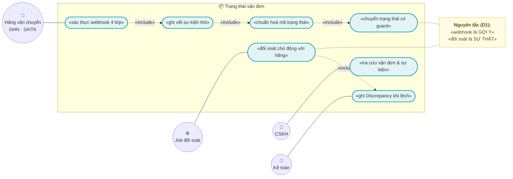
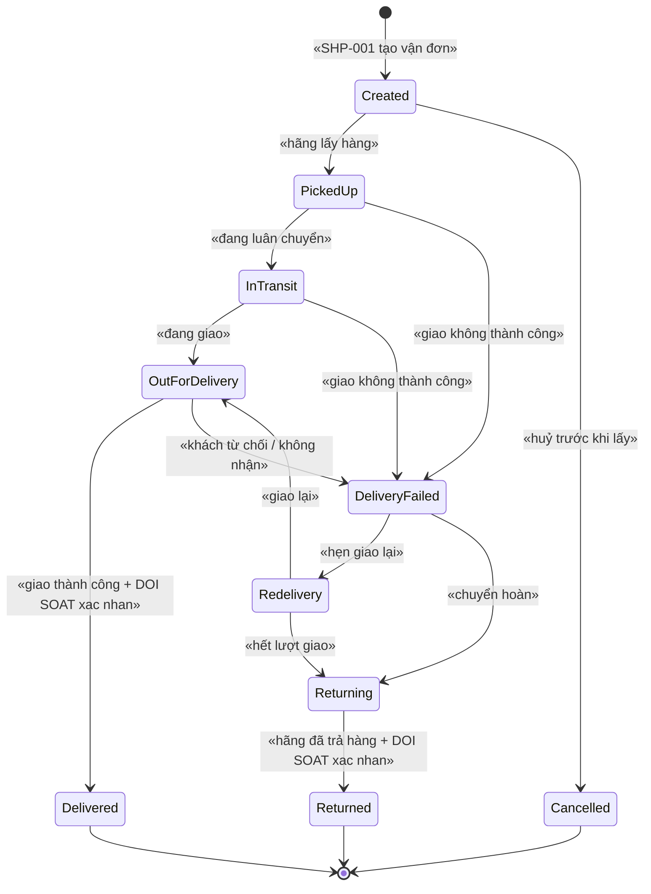
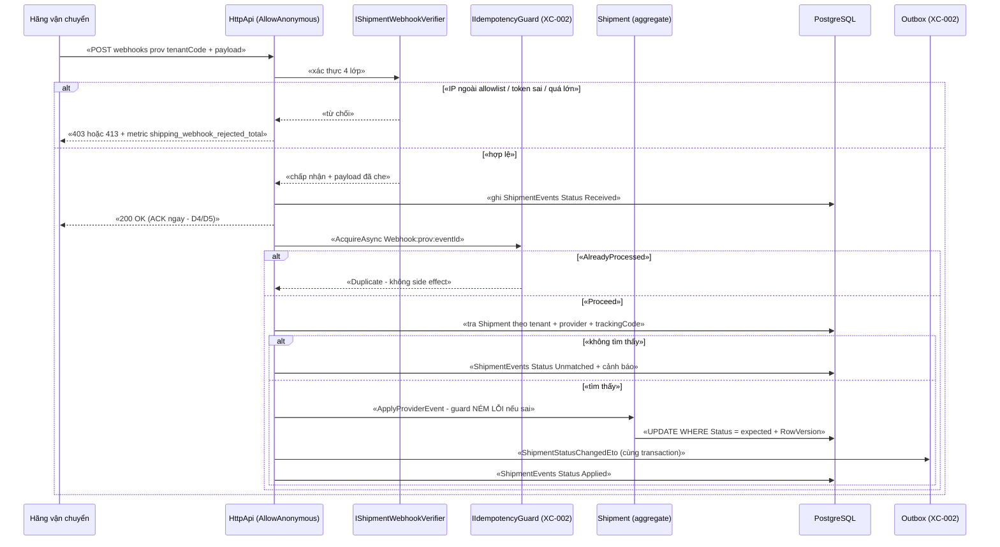

# `SHP-002` — Webhook trạng thái vận đơn & đối soát

> ⚠️ **CẢNH BÁO BẢO MẬT ĐÃ BIẾT (đọc trước mọi mục khác):** webhook của **GHTK KHÔNG có HMAC**.
> Bằng chứng trong repo: `docs/business-modules-proposal.md:547` — *"Webhook GHTK không có HMAC được tài liệu hoá (chỉ `hash` trên URL) — yếu hơn GHN"*;
> `docs/implementation-plan.md:199` và `docs/implementation-plan.md:292` (bảng rủi ro, mức **cao**) cùng ghi nhận.
> `docs/templates/feature-design-template.md:287` cũng yêu cầu: nếu NCC không có chữ ký thì **phải nêu biện pháp bù**.
> ⇒ Toàn bộ thiết kế ở tài liệu này được xây theo nguyên tắc **"webhook là GỢI Ý, không phải SỰ THẬT"** (xem §0.1 D1/D2).

| Thuộc tính | Nội dung |
|---|---|
| **Mã** | `SHP-002` |
| **Module** | **ShippingHub** — dự kiến tạo mới `modules/ShippingHub/eCommerce.ShippingHub.{Domain, EntityFrameworkCore, Application.Contracts, Application}` (hiện **chưa tồn tại** — xem §15.2 F1) |
| **Giai đoạn** | **GĐ2 — Vận hành & tuân thủ VN** (`docs/implementation-plan.md:113`, `docs/implementation-plan.md:425`) |
| **Ưu tiên** | **Must have** (không có nó thì đơn giao xong **không bao giờ** được đóng, COD không bao giờ được ghi nhận) |
| **Trạng thái** | 🟡 `Draft` — chờ review |
| **Người viết / người review** | *(điền)* / **Kiến trúc trưởng + người đã liên hệ GHN/GHTK** |
| **Phiên bản / ngày** | `v0.1 — 13/10/2026` |
| **Tài liệu liên quan** | `SHP-001` (adapter GHN: tính phí, tạo vận đơn) · `SHP-003` (COD, ⚠️ GHN đổi COD cần OTP) · `SHP-004` (adapter GHTK) · `XC-001` (Money) · `XC-002` (outbox/inbox, idempotency) · `XC-003` (khoá phân tán) · `XC-004` (phân quyền/tenant) · `XC-005` (log/metric) · `XC-006` (thuế) · `SAL-003` (state machine 4 trục) · `REC-003` (đối soát COD) · `ACC-001` (xuất liệu kế toán) · `REP-001` (read-model) |

---

## 0. Tóm tắt & quyết định thiết kế

**Tóm tắt:** `SHP-002` chốt **cách hệ thống tiếp nhận trạng thái vận đơn từ hãng vận chuyển** (webhook),
**cách chuyển nó thành trạng thái vận đơn nội bộ** (state machine **ném lỗi** khi chuyển sai), và
**cách phát hiện khi webhook nói dối hoặc biến mất** (job đối soát chủ động).

**Vì sao tài liệu này phải tồn tại (không phải thủ tục):** webhook vận đơn là **biên vào duy nhất** mà
một bên thứ ba **có thể giả mạo** trong luồng bán hàng. Với GHTK, **không có HMAC** (xem cảnh báo đầu tài liệu).
Nếu ta tin webhook một cách ngây thơ thì hậu quả **không dừng ở dữ liệu sai**:

| Nếu tin webhook vô điều kiện | Hệ quả thật |
|---|---|
| Webhook giả `Delivered` cho đơn **chưa giao** | Đơn được đóng (`OrderStatus.Completed`) ⇒ **doanh thu được ghi nhận** trong báo cáo và **có thể sinh hoá đơn** (`EINV-001`) ⇒ sai lệch **sổ sách và thuế** |
| Webhook giả `Returned` | Hệ thống nhập lại kho + hoàn tiền (**RMA**) cho hàng chưa về ⇒ **mất hàng, mất tiền** |
| Webhook giả `Delivered` cho đơn **COD** | `CodRecord` được ghi "đã thu tiền" ⇒ **đối soát COD** (`REC-003`) đối chiếu với tiền thật trong tài khoản ⇒ phát hiện muộn và **không biết mất ở đâu** |

⇒ Vì vậy thiết kế ở đây **không** dựa vào chữ ký. Nó dựa vào **3 lớp** (§0.1 D1): (1) nhiều lớp xác thực
**không dùng HMAC** (IP allowlist + token trong URL + tenant tách theo đường dẫn), (2) **idempotency + ghi vết**
mọi lần nhận, và (3) **đối soát chủ động với hãng** làm **nguồn sự thật** trước khi chạm tới tiền/kho/sổ sách.

**Phạm vi:**
- ✅ Nhận webhook trạng thái vận đơn của **mọi hãng** qua một hợp đồng chung (`IShipmentWebhookVerifier`) — hãng chỉ khác ở phần xác thực.
- ✅ **Chuẩn hoá mã trạng thái của hãng** → trạng thái nội bộ; **giữ nguyên mã thô** để tra cứu.
- ✅ **State machine vận đơn** + bảng guard; chuyển sai ⇒ **NÉM LỖI có mã**; sự kiện đến **sai thứ tự** ⇒ xử lý tường minh.
- ✅ **Idempotency ở mọi biên vào** (webhook, và cả job đối soát) theo hợp đồng `XC-002` (`IIdempotencyGuard`).
- ✅ **Đối soát chủ động**: job định kỳ hỏi hãng trạng thái thật cho các vận đơn **quá hạn SLA**, ghi `Discrepancy`.
- ✅ **Sổ theo dõi append-only** (`ShipmentEvent`) — bất biến của tài liệu này.
- ✅ Phát `ShipmentStatusChangedEto` qua **outbox** để Sales/Notifications/REC tiêu thụ.
- ✅ Metric + log + `CorrelationId` theo `XC-005`.
- ✅ Tiền (`COD`, phí ship) theo `XC-001`: `decimal` + `Money`, **cấm so `==` trên tiền**.

**Không nằm trong phạm vi:**
- ❌ **Tính phí & tạo vận đơn** (gọi API ra ngoài) — thuộc `SHP-001`. Tài liệu này **chỉ nhận** trạng thái và **đọc** trạng thái từ hãng.
- ❌ **Nghiệp vụ COD**: thu hộ, **đổi COD (⚠️ GHN bắt buộc OTP)** — thuộc `SHP-003`.
- ❌ **Adapter GHTK** (địa chỉ 2 cấp/3 cấp, ⚠️ chưa xác minh) — thuộc `SHP-004`. Tài liệu này chỉ **định nghĩa** phần webhook mà `SHP-004` phải cài.
- ❌ **Import file đối soát COD theo "phiên"** — thuộc `REC-003` (`docs/implementation-plan.md:200`: *"COD không có API — bảng kê là file Excel tải thủ công theo phiên"*). Tài liệu này **tạo ra `Discrepancy`** để `REC-003` dùng.
- ❌ **Sửa state machine 4 trục của đơn hàng** — thuộc `SAL-003`. Ta **phát ETO**, Sales tự quyết định.
- ❌ **Read-model/báo cáo** — thuộc `REP-001` (`docs/implementation-plan.md:213`: *"Không báo cáo nào query trực tiếp trên bảng giao dịch"*).
- ❌ **Retry/backoff tầng hạ tầng** (DLQ, phát lại) — dùng lại `XC-002`, không định nghĩa lại.

### 0.1 Quyết định thiết kế (ADR ngắn)

| # | Quyết định | Phương án đã cân nhắc | Lý do chọn | Hệ quả |
|---|---|---|---|---|
| **D1** | **Webhook là GỢI Ý, không phải SỰ THẬT**: mọi chuyển trạng thái **ảnh hưởng tiền/kho/sổ sách** (`Delivered`, `Returned`) **phải** được **đối soát chủ động** xác nhận | (a) tin webhook · (b) **webhook + đối soát chủ động** · (c) chỉ poll, bỏ webhook | GHTK **không có HMAC** ⇒ webhook **có thể bị giả mạo** (bảng ở §0). Chọn (c) thì mất tính thời gian thực và tốn quota API. Chọn (b): webhook cho **độ trễ thấp**, đối soát cho **tính đúng** | Có **2 tốc độ**: UI cập nhật ngay (nhanh), còn **đóng đơn/hoàn tiền/bút toán** chỉ khi đã xác nhận. ⚠️ Đây là **ràng buộc cứng cho `EINV-001`/`ACC-001`** (§7.3) |
| **D2** | **Không dùng chữ ký làm hàng rào duy nhất** — dùng **3 lớp**: (1) IP allowlist + `HashToken` trong URL + tenant theo path · (2) 3 mã lỗi chống giả mạo (`0001/0002/0003`) + giới hạn kích thước · (3) lượt webhook `Unverified` **không được** chuyển sang trạng thái ảnh hưởng tiền | (a) chỉ IP allowlist · (b) chỉ token URL · (c) **cả hai + state machine chặn** | IP allowlist **bị vượt** khi hãng dùng hạ tầng cloud/CDN dùng chung; token URL **bị lộ** qua log/proxy/referrer. Không lớp nào đủ một mình — nhưng **cùng nhau + state machine chặn** thì tạo được vùng an toàn | Phải **duy trì** allowlist IP của từng hãng (việc vận hành, có mục §15 Q2). Phải chấp nhận **độ trễ đối soát** trước khi đơn được đóng |
| **D3** | **Idempotency 2 tầng**: (t1) **transport** — unique `(TenantId, ProviderCode, ProviderEventId)` trên `ShipmentEvents`; (t2) **nghiệp vụ** — `IIdempotencyGuard` của `XC-002` với khoá ổn định `Webhook:{ProviderCode}:{ProviderEventId}` | (a) chỉ unique index · (b) chỉ guard · (c) **cả hai** | `XC-002` D3 đã chứng minh tầng transport **không đủ** (`AbpEventInbox.MessageId` **non-unique** + đổi mỗi lần phát lại). Nhưng với webhook HTTP, unique index trên `ProviderEventId` là **hàng rào DB** cần thiết (D2 của `XC-003`: *"bỏ lock đi, DB có chặn không?"*) | Phải **bắt buộc** hãng cung cấp `ProviderEventId` **ổn định**; nếu hãng không có ⇒ dùng khoá tổng hợp và **ghi rõ rủi ro mất sự kiện** (§15 Q1) |
| **D4** | **Trả `200 OK` cho mọi webhook ĐÃ XÁC THỰC**, kể cả trùng lặp / đã áp dụng / đến sai thứ tự; **chỉ** trả `4xx` cho lỗi xác thực và payload sai | (a) trả `4xx` khi trùng · (b) trả `2xx` khi trùng | `4xx` ⇒ hãng **retry vô hạn** ⇒ tăng tải mà **không bao giờ thành công** (vì bản ghi đã tồn tại). Hãng cũng có thể **tắt webhook** sau N lần lỗi | Việc "không áp dụng được" **phải** để lại dấu vết: `ShipmentEvents.Status = IgnoredStale/Duplicate` + log + metric (nếu không ⇒ vi phạm quy ước *"guard sai phải ném lỗi **hoặc** ghi log có cấu trúc"*) |
| **D5** | **Ghi raw payload TRƯỚC khi ACK**, xử lý sau | (a) xử lý rồi mới ACK · (b) **ghi trước, ACK, xử lý sau** | Nếu xử lý trước rồi mới ACK thì sự cố giữa đường làm hãng retry ⇒ phải làm lại việc nặng. Nếu ta **chết sau khi ACK**, bản ghi `Received` còn trong DB ⇒ **job đối soát nhặt lại** — không mất sự kiện | Cần job quét `Status = Received` quá N phút (§4.2). Payload **bắt buộc đi qua hàm che dữ liệu** trước khi lưu (kế thừa `XC-005` Q6 + `PaymentTransaction.MaskSensitiveData`) |
| **D6** | **Chuẩn hoá trạng thái, KHÔNG dịch ngược**: lưu **cả** `ProviderStatusCode` (thô) **và** `Status` (nội bộ) | (a) chỉ lưu nội bộ · (b) **lưu cả hai** | Bảng mã trạng thái của hãng **thay đổi theo phiên bản API** và ta **chưa kiểm chứng** được toàn bộ (xem §15.1). Nếu chỉ lưu nội bộ và map sai một mã ⇒ **không có cách nào phát hiện lại** | Cần bảng ánh xạ là **dữ liệu** (không hard-code) + audit khi sửa; xem API `MapStatusCode` ở §6.1 |
| **D7** | **Khoá phân tán chỉ ở job định kỳ và ở thao tác sửa tay** — **KHÔNG** khoá trên mỗi webhook | (a) khoá mỗi webhook theo vận đơn · (b) **không khoá webhook** | Nếu khoá mỗi webhook thì webhook thứ 3 trở đi **hết timeout** và bị hãng coi là lỗi ⇒ mất trạng thái. Tranh chấp giữa các webhook đã được chặn ở **DB**: unique index + `UPDATE … WHERE Status = @expected` (D3 của `XC-003`: DB là hàng rào cuối) | Thao tác ghi trạng thái **bắt buộc** dùng "so-sánh-rồi-ghi" có `RowVersion`/`UPDATE WHERE`; **0 dòng** ⇒ **NÉM LỖI** (kế thừa `XC-002` BR-008) |
| **D8** | **Tenant lấy theo ĐƯỜNG DẪN URL** webhook: `POST /api/shipping/webhooks/{providerCode}/{tenantCode}` | (a) 1 URL + tra tenant từ payload · (b) **tenant trong path** · (c) 1 URL/tenant cấu hình ở hãng | (a) buộc phải **tin** payload để biết ghi vào tenant nào — **không thể**, vì payload chưa xác thực. (c) phụ thuộc UI cấu hình của hãng (nhiều hãng chỉ cho 1 URL). (b) cho phép xác định tenant **trước khi** parse payload | URL chứa `tenantCode` ⇒ **không** phải secret (khác `HashToken`). Endpoint **bắt buộc** nằm trong allowlist `[AllowAnonymous]` của `XC-004` BR-004 + **ghi rõ lý do** |
| **D9** | **Job đối soát dùng `IAbpDistributedLock` + chế độ `SkipIfBusy`** (bỏ qua nhịp, **có log + metric**) | (a) chạy không khoá · (b) khoá và **ném lỗi** khi bận · (c) khoá + `SkipIfBusy` | Đúng `XC-003` D10 + A1: job định kỳ bỏ qua nhịp là **hợp lý** (nhịp sau chạy lại), còn HTTP thì phải ném lỗi. `XC-003` cũng cấm acquire lồng (D6) | Job **phải** log + tăng `lock_skipped_total{module="shipping"}` — nếu không ⇒ vi phạm `XC-003` BR-010 |
| **D10** | **Sự kiện đến sai thứ tự ⇒ KHÔNG ném lỗi** nếu nó **cũ hơn** trạng thái đã áp dụng — **bỏ qua có ghi vết**; **nhưng** chuyển trạng thái **ngược chiều** (ví dụ `Returned → InTransit`) **phải NÉM LỖI** | (a) ném lỗi mọi trường hợp sai thứ tự · (b) bỏ qua im lặng mọi trường hợp · (c) **phân biệt 2 loại** | (a) sai nghiệp vụ: webhook **vốn** không đảm bảo thứ tự (`XC-002` §7.4), ném lỗi sẽ đẩy sự kiện **hợp lệ** vào DLQ. (b) vi phạm quy ước *"guard sai phải ném lỗi"* và làm mất dấu vết lỗi thật. (c) giữ được cả hai: an toàn mà vẫn quan sát được | **Bắt buộc** có trường so sánh thời gian (`ProviderOccurredAtUtc`) và `AppliedVersion`; nếu hãng **không** gửi thời gian ⇒ ghi `null` và **luôn** xử lý theo state machine (an toàn hơn), có metric đếm (§15 Q3) |

---

## 1. Use Case Specification

| Thuộc tính | Nội dung |
|---|---|
| **Use Case ID** | `SHP-002` |
| **Use Case Name** | Nhận trạng thái vận đơn từ hãng vận chuyển, cập nhật an toàn & đối soát khi lệch |
| **Description** | *"Là hệ thống bán hàng, tôi muốn nhận trạng thái giao hàng từ hãng để đơn hàng và tiền COD được cập nhật kịp thời — nhưng tôi KHÔNG muốn một webhook giả mạo làm đơn được đóng, hàng được nhập lại kho hay tiền được ghi nhận."* |
| **Actor(s)** | **Hãng vận chuyển** (GHN/GHTK/ViettelPost… — hệ thống ngoài) · **Job đối soát** (hệ thống) · **Nhân viên CSKH** (tra cứu + sửa tay có kiểm soát) · **Kế toán** (đọc `Discrepancy`) · **Quản trị** (cấu hình allowlist/token + bảng ánh xạ mã trạng thái) |
| **Priority** | **Must have** |
| **Trigger** | (a) hãng gọi webhook khi trạng thái vận đơn đổi; (b) job đối soát chạy theo nhịp; (c) job nhặt lại sự kiện `Received` chưa xử lý; (d) CSKH sửa trạng thái thủ công |
| **Pre-Condition(s)** | • **Vận đơn đã tồn tại** trong `Shipments` (do `SHP-001` tạo) **và** `ProviderTrackingCode` đã được hãng cấp — nếu chưa, webhook bị `eCommerce:Shipping:0004`.<br>• **Tenant** được giải từ `{tenantCode}` trong URL (D8) — `ChannelCode` lấy từ `Shipment.ChannelCode` (đơn sàn), **không** từ payload.<br>• **Hãng đã được cấu hình**: IP allowlist + `HashToken` + bảng ánh xạ mã trạng thái (§6.3). Thiếu cấu hình ⇒ **từ chối** (fail-closed), **không** chấp nhận mặc định.<br>• `CorrelationId` được sinh/đọc theo `XC-005` (A2: webhook **không** có `X-Correlation-Id` ⇒ sinh mới + ghi lại mã giao dịch của hãng để tra chéo). |
| **Post-Condition(s)** | • **Mỗi webhook đã xác thực** có **đúng 1** dòng `ShipmentEvents` (append-only) — kể cả khi trùng hoặc bị bỏ qua.<br>• `Shipment.Status` chỉ đổi theo **guard** ở §3; mọi lần đổi có dòng `ShipmentEvents` + `UpdatedAtUtc`.<br>• Mọi lần **không** đổi được trạng thái đều có **dấu vết**: exception có mã **hoặc** log `Warning` + metric (D4/D10).<br>• Webhook đến từ IP ngoài allowlist / sai token / vượt kích thước ⇒ **không** tạo dòng nào, **có** log `Warning` + metric `shipping_webhook_rejected_total{provider,reason}`.<br>• `ShipmentStatusChangedEto` nằm trong **outbox cùng transaction** với lần đổi trạng thái (`XC-002` BR-001). |
| **Basic Flow** | 1. Hãng gọi `POST /api/shipping/webhooks/{providerCode}/{tenantCode}` (D8).<br>2. Lớp xác thực kiểm **4 điều**: IP nguồn ∈ allowlist · `HashToken` khớp · `tenantCode` hợp lệ và đang hoạt động · kích thước body ≤ ngưỡng cấu hình. Thiếu bất kỳ điều nào ⇒ §12 (từ chối) + metric, **không** parse payload.<br>3. Đọc `ProviderEventId` (hoặc khoá tổng hợp), `ProviderTrackingCode`, `ProviderStatusCode`, `ProviderOccurredAtUtc`, số tiền COD (nếu có).<br>4. **Ghi `ShipmentEvents`** (`Status = Received`) **trước** khi ACK (D5); payload thô **đã che** dữ liệu nhạy cảm.<br>5. Trả `200 OK` ngay (D4).<br>6. Xử lý (trong UoW mới): (a) `IIdempotencyGuard.AcquireAsync` với khoá `Webhook:{ProviderCode}:{ProviderEventId}` (`XC-002` §6.4); (b) tra `Shipment` theo `(TenantId, ProviderCode, ProviderTrackingCode)`; (c) gọi `Shipment.ApplyProviderEvent(...)` — **guard ném lỗi** nếu chuyển sai; (d) ghi outbox `ShipmentStatusChangedEto`; (e) commit.<br>7. Cập nhật `ShipmentEvents.Status` = `Applied` / `Duplicate` / `IgnoredStale` / `Rejected`; tăng metric tương ứng. |
| **Alternative Flow** | **A1: Webhook gửi trùng (at-least-once)** — unique `(TenantId, ProviderCode, ProviderEventId)` **chặn** dòng thứ hai ⇒ trả `200`, `ShipmentEvents.Status = Duplicate`, metric `shipping_webhook_received_total{result="duplicate"}`. **Không** phải lỗi.<br>**A2: Sự kiện đến MUỘN (cũ hơn trạng thái đã áp dụng)** — `ProviderOccurredAtUtc` < mốc đã áp dụng ⇒ **bỏ qua**, `Status = IgnoredStale`, log `Information` + metric. **Không** phải lỗi (D10).<br>**A3: Job đối soát xác nhận trạng thái khác webhook** — ghi `Discrepancy` (`Source = ` webhook/poll, `ExpectedStatus` vs `ActualStatus`) và **áp trạng thái từ đối soát** (đối soát là **nguồn sự thật theo D1**), kèm log `Warning` + `shipping_reconcile_discrepancy_total{provider,kind}`.<br>**A4: Vận đơn chưa tồn tại** (webhook đến trước khi `SHP-001` kịp lưu mã vận đơn) — **giữ** dòng `ShipmentEvents` ở `Status = Received`, thử lại trong N phút; quá N phút ⇒ `Status = Unmatched` + **cảnh báo** (⚠️ **không** được xoá — đây là dấu vết duy nhất).<br>**A5: CSKH sửa tay** — **chỉ** cho phép sửa sang trạng thái **không** ảnh hưởng tiền/kho; bút toán `Source = Manual`, **bắt buộc** `Reason` + permission riêng + audit; sửa sang `Delivered`/`Returned` ⇒ `eCommerce:Shipping:0006`. |
| **Exception Flow** | **E1:** IP ngoài allowlist ⇒ `eCommerce:Shipping:0001` (log `Warning` + metric), trả `403`.<br>**E2:** `HashToken` sai/thiếu ⇒ `eCommerce:Shipping:0002`, trả `403`.<br>**E3:** payload sai định dạng / thiếu trường bắt buộc ⇒ `eCommerce:Shipping:0003`, trả `400`.<br>**E4:** body vượt ngưỡng kích thước ⇒ `eCommerce:Shipping:0009`, trả `413`.<br>**E5:** không tìm thấy vận đơn (sau N phút thử lại) ⇒ `eCommerce:Shipping:0004`, `Unmatched` + cảnh báo, trả `200` (D4: **không** để hãng retry vô hạn).<br>**E6:** chuyển trạng thái **không hợp lệ** (ví dụ `Returned → InTransit`) ⇒ `eCommerce:Shipping:0005`, ghi `ShipmentEvents.Status = Rejected` + log `Error`, trả `200` (đã nhận, nhưng **không** áp dụng).<br>**E7:** `UPDATE … WHERE Status = @expected` ảnh hưởng **0 dòng** (luồng khác vừa đổi) ⇒ **NÉM LỖI** `eCommerce:Shipping:0005` — **cấm** coi là thành công (`XC-002` BR-008).<br>**E8:** cùng khoá chống trùng nhưng `PayloadHash` **khác** ⇒ `eCommerce:Messaging:0002` của `XC-002` (**xung đột khoá**, phải điều tra thủ công) — **cấm** ghi đè.<br>**E9:** job đối soát không giành được khoá ⇒ **bỏ qua nhịp** + log + metric `lock_skipped_total{module="shipping"}` (`XC-003` A1) — **không** ném lỗi.<br>**E10:** API hãng lỗi/timeout khi đối soát ⇒ vận đơn vẫn `InTransit`, ghi `FailureReason`, **thử lại nhịp sau**; **không** rollback dữ liệu đã ghi. |
| **Business Rules** | • **BR-SHP-002-001**: Mọi webhook **phải** đi qua 4 lớp kiểm ở Basic Flow bước 2 **trước khi** parse payload; **cấm** nhận webhook chưa xác thực.<br>• **BR-SHP-002-002**: **Idempotency ở MỌI biên vào** (webhook, job đối soát, sửa tay): `IIdempotencyGuard` (`XC-002`) **+** unique index ở DB. Khoá chống trùng **ổn định** qua các lần retry; **cấm** `Guid.NewGuid()`.<br>• **BR-SHP-002-003**: **Cấm** chuyển trạng thái vận đơn bằng gán trực tiếp; **mọi** chuyển trạng thái **phải** qua guard ở §3, guard sai ⇒ **NÉM LỖI có mã** `eCommerce:Shipping:0005`.<br>• **BR-SHP-002-004**: **Webhook KHÔNG đủ** để chuyển sang trạng thái **ảnh hưởng tiền/kho/sổ sách** (`Delivered`, `Returned`) — **bắt buộc** có xác nhận từ **đối soát chủ động** (D1). Trạng thái `Delivered` chỉ có `Source = Reconciliation` hoặc `Source = Manual` (A5) **mới** được coi là "đã xác nhận".<br>• **BR-SHP-002-005**: **Sổ theo dõi vận đơn là APPEND-ONLY** (`ShipmentEvents`): **cấm** `UPDATE`/`DELETE` payload hay trạng thái của bản ghi đã ghi; chỉ được đổi **cột xử lý** (`Status`, `AttemptCount`, `ProcessedAtUtc`, `FailureCode`).<br>• **BR-SHP-002-006**: Raw payload **phải** được **che dữ liệu nhạy cảm** trước khi lưu **và** trước khi log (kế thừa `XC-005` Q6; dùng lại cách tiếp cận `PaymentTransaction.MaskSensitiveData`). **Cấm** log payload thô.<br>• **BR-SHP-002-007**: Tiền (`CodAmount`, `ShippingFee`) là `decimal` + `Money`; **cấm** so sánh tiền bằng `==` — so bằng `ToMinorUnits()` (`XC-001` BR-003/D3). Sai lệch tiền ⇒ ghi `Discrepancy`, **cấm** tự sửa số của hãng.<br>• **BR-SHP-002-008**: Mã lỗi **phải** theo khuôn `eCommerce:Shipping:NNNN` và **do module sở hữu** (`ShippingHubErrorCodes`) — **cấm** khai ở `eCommerceConsts.ErrorCodes` (kế thừa `XC-003` F2 và cách làm của `TaxErrorCodes`).<br>• **BR-SHP-002-009**: **Cấm** hard-code endpoint / mã trạng thái / allowlist IP của hãng trong code nghiệp vụ — mọi thứ thuộc **cấu hình** (`ShippingHubOptions`) hoặc **dữ liệu** (`CarrierStatusMappings`) có audit.<br>• **BR-SHP-002-010**: Webhook `200` **cấm** dùng để kết luận "đã xử lý xong" — `ShipmentEvents.Status` là **nguồn sự thật** về việc đã xử lý hay chưa.<br>• **BR-SHP-002-011**: **Cách ly tenant**: dữ liệu tenant A **không** đọc/ghi được từ tenant B; `ShipmentEvents`/`Discrepancies` là `IMultiTenant`; handler **phải** `ICurrentTenant.Change(tenantId)` theo `{tenantCode}`.<br>• **BR-SHP-002-012**: Mọi `[Authorize]` ở **cấp class**; endpoint webhook là `[AllowAnonymous]` **có chủ ý** và **phải** nằm trong allowlist của `XC-004` BR-004 **kèm lý do**.<br>• **BR-SHP-002-013**: Job đối soát **phải** chịu được **chạy lại** cùng kỳ (idempotent theo `(RunId, ShipmentId)`) và **phải** log + metric khi bỏ qua nhịp.<br>• **BR-SHP-002-014**: **Cấm** dùng số liệu metric để quyết định nghiệp vụ (`XC-005`: metric có thể mất/trễ) — quyết định **chỉ** dựa trên dữ liệu DB. |
| **Non-Functional Requirement** | • **NFR-SHP-002-001**: Webhook trả `200` với p95 **< 200 ms** (ghi 1 dòng + ACK; **không** chờ gọi hãng).<br>• **NFR-SHP-002-002**: **Idempotent 100 %**: gửi cùng webhook **1.000 lần** ⇒ **đúng 1** dòng `ShipmentEvents` hiệu lực, **0** lần đổi trạng thái thêm.<br>• **NFR-SHP-002-003**: **0** dòng `ShipmentEvents` bị `UPDATE`/`DELETE` ngoài cột xử lý (test quét + test DB).<br>• **NFR-SHP-002-004**: **0** payload lưu vào DB/log chứa mẫu dữ liệu nhạy cảm (quét tự động, kế thừa `XC-005` TC-05).<br>• **NFR-SHP-002-005**: Độ trễ **phát hiện lệch**: vận đơn quá hạn SLA ⇒ có `Discrepancy` trong **≤ 1 nhịp job** (nhịp đề xuất **15 phút**).<br>• **NFR-SHP-002-006**: `CorrelationId` hiện diện trong **100 %** log của luồng webhook (kế thừa `XC-005` NFR-002).<br>• **NFR-SHP-002-007**: **Đúng 1** khoá phân tán cho mỗi job định kỳ; **0** khoá acquire lồng; **0** acquire thiếu timeout (`XC-003` BR-004/BR-005).<br>• **NFR-SHP-002-008**: Cách ly tenant: **0** bản ghi tenant khác lọt vào truy vấn (integration test 2 tenant — ⚠️ **cần PostgreSQL**, xem `XC-004` F1).<br>• **NFR-SHP-002-009**: **0** lần ghi log ở mức `Information` trong vòng lặp của job đối soát (`XC-005` BR-004) — chỉ log khi **có việc thật**.<br>• **NFR-SHP-002-010**: Mọi mã trạng thái thô nhận được **phải** có ánh xạ hoặc **đi vào `Discrepancy`** — **cấm** im lặng coi là "không đổi". |

---

## 2. Sơ đồ Use Case



**Chú giải:**

| Ký hiệu | Ý nghĩa |
|---|---|
| ⭕ Xanh lá | Actor (hãng vận chuyển, job, CSKH, kế toán) |
| 🟦 Bầu dục xanh dương | Use case |
| 🟨 Khung vàng | Note (nguyên tắc thiết kế) |
| `-.«include».->` | Quan hệ bao hàm |

---

## 3. Sơ đồ trạng thái (state machine)

### 3.1 Trạng thái vận đơn



### 3.2 Bảng chuyển trạng thái & guard — **mọi chuyển sai PHẢI NÉM LỖI, không im lặng**

| # | Từ | Sang | Guard | Ai được phép chuyển | Nếu vi phạm |
|---|---|---|---|---|---|
| 1 | `Created` | `PickedUp` | `ProviderStatusCode` ánh xạ tới `PickedUp` | webhook · đối soát | `eCommerce:Shipping:0005` |
| 2 | `Created` | `Cancelled` | Hãng báo huỷ **hoặc** `SHP-001` huỷ trước khi lấy | webhook · API nội bộ | `eCommerce:Shipping:0005` |
| 3 | `PickedUp` | `InTransit` | ánh xạ hợp lệ | webhook · đối soát | `eCommerce:Shipping:0005` |
| 4 | `PickedUp`/`InTransit`/`OutForDelivery` | `DeliveryFailed` | ánh xạ hợp lệ **và** có `Reason` từ hãng | webhook · đối soát | `eCommerce:Shipping:0005` |
| 5 | `InTransit` | `OutForDelivery` | ánh xạ hợp lệ | webhook · đối soát | `eCommerce:Shipping:0005` |
| 6 | `OutForDelivery` | `Delivered` | 🚨 **`Source ∈ (Reconciliation, Manual)`** — xem **BR-004** | **đối soát** · sửa tay có quyền | Webhook đơn thuần ⇒ **KHÔNG** chuyển; ghi `PendingDeliveryConfirmation` + metric (**không** ném lỗi — chờ đối soát) |
| 7 | `DeliveryFailed` | `Redelivery` | ánh xạ hợp lệ | webhook · đối soát | `eCommerce:Shipping:0005` |
| 8 | `Redelivery` | `OutForDelivery` | ánh xạ hợp lệ | webhook · đối soát | `eCommerce:Shipping:0005` |
| 9 | `Redelivery`/`DeliveryFailed` | `Returning` | ánh xạ hợp lệ **hoặc** hết số lần giao | webhook · đối soát | `eCommerce:Shipping:0005` |
| 10 | `Returning` | `Returned` | 🚨 **`Source ∈ (Reconciliation, Manual)`** + `ReturnedAtUtc` | **đối soát** · sửa tay có quyền | Như #6 |
| 11 | `Delivered` | **BẤT KỲ** | — | **KHÔNG AI** (trạng thái **hấp thụ**) | `eCommerce:Shipping:0005` + log `Error` (**cấm** sửa; nếu hãng báo khác ⇒ `Discrepancy`) |
| 12 | `Returned` | **BẤT KỲ** | — | **KHÔNG AI** (trạng thái **hấp thụ**) | `eCommerce:Shipping:0005` |
| 13 | `Cancelled` | **BẤT KỲ** | — | **KHÔNG AI** (trạng thái **hấp thụ**) | `eCommerce:Shipping:0005` |
| 14 | Bất kỳ (trừ hấp thụ) | *(không đổi)* | `ProviderOccurredAtUtc` **cũ hơn** mốc đã áp dụng | — | **Bỏ qua có ghi vết**: `IgnoredStale` + log `Information` + metric (**D10** — đây **không** phải lỗi) |
| 15 | Bất kỳ | *(không đổi)* | `ProviderEventId` đã tồn tại | — | **Bỏ qua có ghi vết**: `Duplicate` + metric (**A1**) |

> ⚠️ **Trạng thái hấp thụ (absorbing):** `Delivered`, `Returned`, `Cancelled`. Sau khi vào các trạng thái này,
> **mọi** chuyển trạng thái khác đều **NÉM LỖI** — kể cả khi hãng báo ngược lại. Lý do: đây là các trạng thái
> **đã chạm tới tiền/kho/sổ sách**; sửa ngược phải là **quy trình nghiệp vụ có người duyệt** (RMA/điều chỉnh),
> **không** phải một webhook.
>
> 📌 **Bài học kế thừa (ghi trong `XC-006` §3):** guard **phải ném lỗi**, không được "im lặng bỏ qua"
> (EShop `SetPaidStatus()` chỉ hành động khi `StockConfirmed`, còn lại no-op ⇒ sự kiện rơi **không để lại dấu vết**).
> Ngoại lệ duy nhất được phép "im lặng" là **#14 và #15** — và cả hai **bắt buộc** ghi vết + metric.

### 3.3 Trạng thái xử lý của một dòng `ShipmentEvents`

| Từ | Sang | Guard | Nếu vi phạm |
|---|---|---|---|
| `Received` | `Applied` | Guard §3.2 thoả, đã ghi outbox | — |
| `Received` | `Duplicate` | `ProviderEventId` đã có | — |
| `Received` | `IgnoredStale` | Sự kiện cũ hơn mốc đã áp dụng | — |
| `Received` | `Rejected` | Guard §3.2 **không** thoả ⇒ đã ném `0005` và đã log | Thiếu log ⇒ vi phạm BR-003 |
| `Received` | `Unmatched` | Không tìm thấy vận đơn sau N phút | Phải **cảnh báo** (A4) |
| `Applied`/`Duplicate`/`IgnoredStale`/`Rejected`/`Unmatched` | *(bất kỳ)* | — | **Cấm** — đây là trạng thái **hấp thụ**; `UPDATE … WHERE Status = 'Received'` ảnh hưởng **0 dòng** ⇒ **NÉM LỖI** (`XC-002` E7) |

---

## 4. Sequence Diagram & luồng dữ liệu

### 4.1 Webhook đến từ hãng — xác thực, ghi vết, ACK nhanh, xử lý sau



### 4.2 DFD — vì sao **webhook không đủ** để chạm tới tiền/kho/sổ sách

```mermaid
graph LR
    classDef proc fill:#cce5ff,stroke:#004085,stroke-width:2px;
    classDef warn fill:#f8d7da,stroke:#721c24,stroke-width:2px;
    classDef ok fill:#d4edda,stroke:#155724,stroke-width:2px;
    classDef store fill:#e2e3e5,stroke:#383d41,stroke-width:2px;

    WH["«Webhook hãng»<br/>KHONG co HMAC o GHTK"] --> A["«Xác thực 4 lớp»"]
    A --> B["«Ghi ShipmentEvents»<br/>append-only"]
    B --> C["«Chuyển trạng thái có guard»"]
    C --> D{"«Hai trạng thái ảnh hưởng tiền/kho?»"}
    D -- "«không»" --> E["«Áp dụng ngay»<br/>PickedUp InTransit OutForDelivery"]
    D -- "«có»" --> F["«Chờ xác nhận»<br/>PendingDeliveryConfirmation"]
    F --> G["«Job đối soát gọi API hãng»"]
    G --> H{"«Hãng xác nhận?»"}
    H -- "«có»" --> I["«Delivered hoặc Returned»<br/>Source = Reconciliation"]
    H -- "«không hoặc khác»" --> J["«Ghi Discrepancy»<br/>KHONG tự sửa số của hãng"]
    I --> K["«Outbox: ShipmentStatusChangedEto»"]
    K --> L["«Sales đóng đơn · REC-003 · EINV-001 · ACC-001»"]

    class A,B,C,E,F,G proc;
    class WH,J warn;
    class I,K,L ok;
    E --> M[("PostgreSQL<br/>Shipments · ShipmentEvents · Discrepancies")]
    class M store;
```



> 🔴 **Ghi rõ cho tài liệu khác:** nhánh `F → G → I` là **điều kiện tiên quyết** để `EINV-001` (hoá đơn)
> và `ACC-001` (xuất liệu kế toán) được phép ghi nhận doanh thu/hoàn tiền. Một đơn ở trạng thái
> `PendingDeliveryConfirmation` **chưa** được coi là đã giao. Đây là **ràng buộc bắt buộc**, không phải gợi ý —
> vì GHTK **không có HMAC** nên webhook một mình **không đủ** chứng cứ để lập chứng từ kế toán.

---

## 5. Mô hình dữ liệu

### 5.1 ERD

**Không áp dụng** — vượt giới hạn 3 sơ đồ Mermaid. Thay thế bằng **Data Dictionary** ở §5.2 (đầy đủ cột + index + ràng buộc).

### 5.2 Bảng & cột (Data Dictionary)

> ⚠️ **Chưa có bảng nào tồn tại trong code.** Đã kiểm bằng `grep` toàn repo: **không** có entity `Shipment`,
> `Carrier`, `ShippingService`, `ShipmentTracking`, `CodRecord`; **không** có project `modules/ShippingHub`.
> Thứ duy nhất đang tồn tại là **cột tiền phí vận chuyển của đơn**: `Order.ShippingTotal`
> (`src/eCommerce.Domain/Entities/Orders/Order.cs:45`) và mapping `HasPrecision(18, 4)` ở
> `src/eCommerce.EntityFrameworkCore/eCommerceDbContext.cs:176`.
> Toàn bộ 4 bảng dưới đây là **kế hoạch GĐ2** — chưa có trong code.

**Bảng `ShpShipments`** — vận đơn, do `SHP-001` tạo, `SHP-002` cập nhật trạng thái

| Cột | Kiểu | Null? | Nguồn / ý nghĩa | Ghi chú |
|---|---|---|---|---|
| `Id` | `uuid` | ✖ | khoá chính | |
| `TenantId` | `uuid` | ✔ | tenant sở hữu | `IMultiTenant`; ⚠️ `NULL` = 1 tenant (xem `XC-004` F1) |
| `OrderId` | `uuid` | ✖ | đơn hàng liên quan | tham chiếu mềm sang Sales (**cấm** module gọi app: đây là **id**, không phải navigation) |
| `ChannelCode` | `varchar(32)` | ✔ | kênh bán phát sinh đơn | `null` với đơn website — **lấy từ đơn, KHÔNG từ payload webhook** |
| `ProviderCode` | `varchar(32)` | ✖ | mã hãng: `ghn`, `ghtk`, `viettelpost`… | khớp `Provider` trong log `XC-005` §5.2 |
| `ProviderTrackingCode` | `varchar(64)` | ✖ | **mã vận đơn do hãng cấp** — khoá đối chiếu quan trọng nhất | unique theo `(TenantId, ProviderCode)` |
| `ClientOrderCode` | `varchar(64)` | ✔ | mã đơn phía ta gửi sang hãng (nếu hãng hỗ trợ) | dùng khi webhook không kèm `ProviderTrackingCode` |
| `Status` | `int` | ✖ | trạng thái nội bộ (§3.1) | mặc định `Created = 0` |
| `StatusSource` | `int` | ✖ | `Webhook=0` · `Reconciliation=1` · `Manual=2` · `Pull=3` | ⭐ **căn cứ của BR-004** — quyết định trạng thái đã "xác nhận" hay chưa |
| `ConfirmedAtUtc` | `timestamptz` | ✔ | thời điểm trạng thái **ảnh hưởng tiền** được **xác nhận** | `Delivered`/`Returned` **bắt buộc** có; `null` ⇒ **chưa** được lập chứng từ |
| `ProviderStatusCode` | `varchar(64)` | ✔ | mã trạng thái **thô** của hãng (D6) | giữ để đối soát & phát hiện map sai |
| `LastProviderEventAtUtc` | `timestamptz` | ✔ | mốc `ProviderOccurredAtUtc` **lớn nhất** đã áp dụng | dùng cho guard #14 (sai thứ tự) |
| `SlaDueAtUtc` | `timestamptz` | ✔ | hạn giao dự kiến | job đối soát chọn vận đơn **quá hạn** theo cột này |
| `ReconcileAttemptCount` | `int` | ✖ | số lần đã gọi API hãng | mặc định `0`; có trần để tránh gọi vô hạn |
| `LastReconciledAtUtc` | `timestamptz` | ✔ | lần đối soát gần nhất | |
| `CodAmount` | `numeric(18,4)` | ✖ | **số tiền thu hộ** | ⚠️ `decimal`, **không bao giờ** `double` (`XC-001` BR-008) |
| `CodCurrency` | `char(3)` | ✖ | ISO-4217, mặc định `VND` | theo `XC-001` §5.2 |
| `ShippingFee` | `numeric(18,4)` | ✖ | phí vận chuyển | |
| `FailureReason` | `varchar(2048)` | ✔ | lý do lỗi gần nhất khi đối soát | **đã che** dữ liệu nhạy cảm |
| `RowVersion` | `xmin` (ánh xạ `uint`) | ✖ | optimistic concurrency | `IsRowVersion()` ⇒ cột hệ thống `xmin`, không thêm cột thật (`XC-002` §5.2.3) |

**Bảng `ShpShipmentEvents`** — ⭐ **SỔ THEO DÕI APPEND-ONLY** (bất biến của tài liệu này)

| Cột | Kiểu | Null? | Nguồn / ý nghĩa | Ghi chú |
|---|---|---|---|---|
| `Id` | `uuid` | ✖ | khoá chính | |
| `TenantId` | `uuid` | ✖ | tenant | **bắt buộc** — `IMultiTenant` + query filter |
| `ProviderCode` | `varchar(32)` | ✖ | mã hãng | **lấy từ URL**, không từ payload (D8) |
| `ProviderEventId` | `varchar(128)` | ✖ | ID sự kiện **do hãng cấp** | ⭐ **khoá chống trùng tầng transport** (D3). ⚠️ **chưa kiểm chứng** hãng nào cấp (xem §15 Q1) |
| `ProviderTrackingCode` | `varchar(64)` | ✔ | mã vận đơn trong payload | |
| `ProviderStatusCode` | `varchar(64)` | ✔ | mã trạng thái thô | |
| `MappedStatus` | `int` | ✔ | trạng thái nội bộ sau ánh xạ | `null` = **không ánh xạ được** ⇒ **bắt buộc** `Discrepancy` (NFR-010) |
| `ProviderOccurredAtUtc` | `timestamptz` | ✔ | thời điểm hãng báo sự kiện xảy ra | `null` nếu hãng không gửi ⇒ xem D10/§15 Q3 |
| `ReceivedAtUtc` | `timestamptz` | ✖ | thời điểm ta nhận | |
| `ProcessedAtUtc` | `timestamptz` | ✔ | thời điểm xử lý xong | |
| `Status` | `int` | ✖ | `Received=0` · `Applied=1` · `Duplicate=2` · `IgnoredStale=3` · `Rejected=4` · `Unmatched=5` | §3.3 |
| `AttemptCount` | `int` | ✖ | số lần xử lý | mặc định `0` |
| `PayloadHash` | `char(64)` | ✖ | **SHA-256** payload **canonical** | phát hiện **xung đột khoá** (E8, `XC-002` BR-006) |
| `PayloadHashVersion` | `int` | ✖ | phiên bản thuật toán hash | mặc định `1` (`XC-002` Q9) |
| `RawPayloadMasked` | `text` | ✖ | raw payload **ĐÃ CHE** | ⚠️ **cấm** lưu payload thô (BR-006) |
| `SourceIp` | `varchar(64)` | ✔ | IP nguồn đã kiểm allowlist | phục vụ điều tra |
| `FailureCode` | `varchar(64)` | ✔ | mã lỗi nghiệp vụ nếu bị từ chối | ví dụ `eCommerce:Shipping:0005` |
| `CorrelationId` | `varchar(64)` | ✔ | truy vết end-to-end | `XC-005` |
| `RowVersion` | `xmin` | ✖ | optimistic concurrency | chống 2 luồng cùng xử lý 1 sự kiện |

> 🔒 **APPEND-ONLY (BR-005):** các cột **`PayloadHash`, `RawPayloadMasked`, `ProviderEventId`, `ReceivedAtUtc`**
> **cấm** `UPDATE`/`DELETE`. Chỉ **5 cột xử lý** (`Status`, `AttemptCount`, `ProcessedAtUtc`, `FailureCode`, `MappedStatus`)
> được đổi, và **chỉ** khi `Status = Received` (`UPDATE … WHERE Status = 0`) — `0` dòng ⇒ **NÉM LỖI**.

**Bảng `ShpCarrierStatusMappings`** — ánh xạ mã trạng thái hãng → nội bộ (**DỮ LIỆU, không hard-code** — D6/BR-009)

| Cột | Kiểu | Null? | Ý nghĩa | Ghi chú |
|---|---|---|---|---|
| `Id` | `uuid` | ✖ | khoá chính | |
| `TenantId` | `uuid` | ✔ | `null` = dùng chung (mặc định của hãng) | |
| `ProviderCode` | `varchar(32)` | ✖ | mã hãng | |
| `ProviderStatusCode` | `varchar(64)` | ✖ | mã thô của hãng | unique theo `(TenantId, ProviderCode, ProviderStatusCode)` |
| `InternalStatus` | `int` | ✖ | trạng thái nội bộ | |
| `IsConfirmedByCarrier` | `bool` | ✖ | mã này có được coi là **xác nhận cuối** không | ⚠️ mặc định **`false`** — bật `true` cần **kế toán + kiến trúc trưởng** duyệt (vì ảnh hưởng tiền) |
| `Note` | `varchar(512)` | ✔ | ghi chú | |
| `EffectiveFrom` / `EffectiveTo` | `date` / `date` | ✖ / ✔ | khung hiệu lực | kế thừa khuôn `XC-006` (**cấm** sửa đè bản ghi đang hiệu lực) |
| `ApprovedBy` / `ApprovedAtUtc` | `uuid` / `timestamptz` | ✔ | người duyệt | có **audit** |

**Bảng `ShpDiscrepancies`** — lệch phát hiện khi đối soát

| Cột | Kiểu | Null? | Ý nghĩa | Ghi chú |
|---|---|---|---|---|
| `Id` | `uuid` | ✖ | khoá chính | |
| `TenantId` | `uuid` | ✖ | tenant | |
| `ShipmentId` | `uuid` | ✖ | vận đơn | |
| `Kind` | `int` | ✖ | `StatusMismatch=0` · `StuckInTransit=1` · `WebhookOnly=2` · `AmountMismatch=3` · `UnmappedStatusCode=4` · `UnmatchedEvent=5` | |
| `ExpectedStatus` / `ActualStatus` | `int` | ✖ / ✖ | trạng thái ta đang giữ / trạng thái hãng trả | |
| `ExpectedAmount` / `ActualAmount` | `numeric(18,4)` | ✔ / ✔ | tiền COD ta đang giữ / hãng báo | ⚠️ so bằng `ToMinorUnits()` (**BR-007**), **cấm** `==` |
| `Currency` | `char(3)` | ✔ | ISO-4217 | |
| `DetectedAtUtc` | `timestamptz` | ✖ | thời điểm phát hiện | |
| `ResolvedAtUtc` | `timestamptz` | ✔ | thời điểm xử lý xong | |
| `ResolutionNote` | `varchar(2048)` | ✔ | cách xử lý | **đã che** dữ liệu nhạy cảm |

**Index & ràng buộc** *(phần hay bị bỏ sót nhất — theo `docs/templates/feature-design-template.md:214`)*

| Bảng | Loại | Cột | Mục đích |
|---|---|---|---|
| `ShpShipments` | **UNIQUE** | `(TenantId, ProviderCode, ProviderTrackingCode)` | tra vận đơn từ webhook — **hàng rào chống tạo 2 vận đơn cho 1 mã hãng** |
| `ShpShipments` | INDEX | `(TenantId, Status, SlaDueAtUtc)` | ⭐ job đối soát: *"vận đơn chưa kết thúc và đã quá hạn"* |
| `ShpShipments` | INDEX | `(TenantId, ProviderCode, LastReconciledAtUtc)` | chọn vận đơn **lâu chưa đối soát** |
| `ShpShipments` | CHECK | `CodAmount >= 0 AND ShippingFee >= 0` | bất biến tiền ở tầng DB |
| `ShpShipments` | CHECK | `CodCurrency ~ '^[A-Z]{3}$'` | theo khuyến nghị `XC-001` §5.2 |
| `ShpShipments` | CHECK | `(Status NOT IN (3, 9)) OR ConfirmedAtUtc IS NOT NULL` | 🚨 **BR-004 ở tầng DB**: `Delivered`/`Returned` **bắt buộc** có `ConfirmedAtUtc` — ⭐ đây là câu trả lời cho *"bỏ tầng ứng dụng đi, DB có chặn không?"* (D2 của `XC-003`) |
| `ShpShipmentEvents` | **UNIQUE** | `(TenantId, ProviderCode, ProviderEventId)` | ⭐ **idempotency tầng transport** (D3) — chống webhook gửi trùng **ở DB** |
| `ShpShipmentEvents` | INDEX | `(TenantId, Status, ReceivedAtUtc)` | job nhặt lại `Received` quá N phút |
| `ShpShipmentEvents` | INDEX | `(TenantId, ProviderTrackingCode, ProviderOccurredAtUtc)` | dựng lại lịch sử 1 vận đơn |
| `ShpShipmentEvents` | INDEX | `(PayloadHash)` | điều tra **xung đột khoá** (E8) |
| `ShpShipmentEvents` | CHECK | `PayloadHash ~ '^[0-9a-f]{64}$'` | bắt buộc SHA-256 hex thường |
| `ShpCarrierStatusMappings` | **UNIQUE** | `(TenantId, ProviderCode, ProviderStatusCode, EffectiveFrom)` | chống trùng khung |
| `ShpDiscrepancies` | **UNIQUE** | `(TenantId, ShipmentId, Kind, DetectedAtUtc)` | chống ghi lệch trùng khi job chạy lại (BR-013) |
| `ShpDiscrepancies` | INDEX | `(TenantId, ResolvedAtUtc, DetectedAtUtc)` | màn hình "lệch chưa xử lý" |

> ⚠️ **`NULLS NOT DISTINCT` (kế thừa `XC-004` F1):** hiện hệ thống chạy **1 tenant** ⇒ `TenantId` **có thể là `NULL`**,
> và unique index **mất tác dụng** (`NULLS DISTINCT` là mặc định của PostgreSQL). Ghi chú này **áp cho MỌI** unique index
> ở bảng trên. Việc sửa thuộc kế hoạch GĐ1 bước 6 (`docs/implementation-plan.md:169`) — **chưa thực hiện**.
> Trong lúc chưa sửa, **hàng rào idempotency ở tầng DB không được đảm bảo** khi `TenantId = NULL` ⇒ tầng ứng dụng
> (`IIdempotencyGuard`) là **hàng rào duy nhất** và **phải** được test kỹ (TC-02).

---

## 6. Hợp đồng API

### 6.1 Application Service & Domain Service

| Mục | Giá trị |
|---|---|
| Interface (nội bộ) | `IShipmentAppService` — đặt tại `eCommerce.ShippingHub.Application.Contracts` |
| Implementation | `ShipmentAppService` — đặt tại `eCommerce.ShippingHub.Application` |
| Interface (webhook) | `IShipmentWebhookVerifier` — **một implementation cho mỗi hãng**; chọn qua `IShipmentWebhookVerifierFactory` (khuôn giống `IChannelConnectorFactory` ở `modules/ChannelHub/eCommerce.ChannelHub.Application.Contracts/Connectors/IChannelConnector.cs:117`) |
| `[Authorize]` | **cấp CLASS** (bắt buộc — `XC-004` BR-001). **Ngoại lệ duy nhất**: controller webhook (§6.2) |

```csharp
namespace eCommerce.ShippingHub.Shipments;

/// Hợp đồng xác thực webhook — MỖI HÃNG MỘT IMPLEMENTATION.
/// 🚨 Vì sao phải là abstraction: GHTK KHÔNG có HMAC, GHN có chữ ký.
///    Nếu nhét logic xác thực vào một controller chung thì hãng yếu nhất
///    sẽ quyết định mức bảo mật của TẤT CẢ (đúng loại lỗi "mức bảo mật bằng
///    mắt xích yếu nhất" mà cảnh báo đầu tài liệu nói tới).
public interface IShipmentWebhookVerifier
{
    string ProviderCode { get; }

    /// Kiểm 4 lớp (BR-001) TRƯỚC khi parse payload.
    /// Kết quả trả về phải nói rõ LỚP NÀO thất bại (để metric có nhãn `reason` hữu hạn).
    Task<WebhookVerificationResult> VerifyAsync(
        WebhookVerificationContext context,
        CancellationToken cancellationToken = default);

    /// Chuẩn hoá payload → sự kiện chuẩn của ta. KHÔNG gọi DB, KHÔNG gọi mạng.
    Task<ProviderShipmentEvent> ParseAsync(string rawBody, CancellationToken cancellationToken = default);
}

public sealed record WebhookVerificationContext(
    string RawBody,
    string SourceIp,
    string? HashToken,
    string TenantCode,
    IReadOnlyDictionary<string, string> Headers);

public sealed record WebhookVerificationResult(
    bool Accepted,
    string? FailureCode,      // eCommerce:Shipping:NNNN
    string? FailureReason,    // nhãn hữu hạn cho metric: "ip_not_allowed" · "bad_token" · "too_large" · "malformed"
    string? ProviderEventId,  // ⚠️ có thể null nếu hãng không cấp (xem §15 Q1)
    string? ProviderTrackingCode,
    string? ProviderStatusCode,
    DateTime? ProviderOccurredAtUtc,
    decimal? CodAmount,
    string RawPayloadMasked); // ⚠️ ĐÃ CHE trước khi trả ra

public interface IShipmentStatusReconciler
{
    /// Đối soát CHỦ ĐỘNG với hãng cho một vận đơn. ĐÂY LÀ NGUỒN SỰ THẬT (D1).
    Task<ReconcileResult> ReconcileAsync(Guid shipmentId, CancellationToken cancellationToken = default);

    /// Quét theo lô các vận đơn quá hạn SLA / lâu chưa đối soát (dùng index `(TenantId, Status, SlaDueAtUtc)`).
    Task<ReconcileBatchResult> ReconcileDueAsync(int maxCount, CancellationToken cancellationToken = default);
}

/// Ghi kết quả đối soát + đối chiếu tiền COD.
public interface IShipmentDiscrepancyWriter
{
    Task RecordAsync(ShipmentDiscrepancyInput input, CancellationToken cancellationToken = default);
}

/// ⭐ D6 + BR-009: ánh xạ mã trạng thái là DỮ LIỆU, có hiệu lực theo thời gian, có audit.
public interface ICarrierStatusMapper
{
    Task<CarrierStatusMapping?> ResolveAsync(
        string providerCode, string providerStatusCode, DateTime atUtc, CancellationToken ct = default);
}

public interface IShipmentRepository : IRepository<Shipment, Guid>
{
    Task<Shipment?> FindByTrackingCodeAsync(
        string providerCode, string trackingCode, CancellationToken ct = default);

    /// ⚠️ `UPDATE … WHERE Status = @expected` — trả về 0 ⇒ tầng trên PHẢI NÉM LỖI (E7/BR-003).
    Task<int> TryApplyTransitionAsync(
        Guid shipmentId, ShipmentStatus expected, ShipmentStatus next,
        ShipmentStatusSource source, DateTime? confirmedAtUtc, CancellationToken ct = default);
}
```

**Method của `IShipmentAppService`**

| Method | Input (DTO) | Output (DTO) | Permission | Ghi chú |
|---|---|---|---|---|
| `GetAsync` | `Guid id` | `ShipmentDto` | `eCommerce.Shipping.Shipments.View` | đọc vận đơn + trạng thái |
| `GetListAsync` | `GetShipmentsInput` | `PagedResultDto<ShipmentDto>` | `.View` | lọc theo trạng thái/hãng/khoảng ngày/đơn |
| `GetEventsAsync` | `GetShipmentEventsInput` | `PagedResultDto<ShipmentEventDto>` | `.View` | **chỉ đọc** (append-only ⇒ **không** có API sửa) |
| `TriggerReconcileAsync` | `Guid shipmentId` | `ReconcileResultDto` | `eCommerce.Shipping.Shipments.Reconcile` | dùng **cùng** code với job ⇒ **không** có đường logic thứ hai |
| `OverrideStatusAsync` | `OverrideShipmentStatusDto` | `ShipmentDto` | `eCommerce.Shipping.Shipments.Override` | **chỉ** trạng thái **không** ảnh hưởng tiền (A5); **bắt buộc** `Reason`; ghi audit |
| `GetDiscrepanciesAsync` | `GetDiscrepanciesInput` | `PagedResultDto<DiscrepancyDto>` | `eCommerce.Shipping.Discrepancies.View` | màn hình kế toán/CSKH |
| `ResolveDiscrepancyAsync` | `ResolveDiscrepancyDto` | `DiscrepancyDto` | `eCommerce.Shipping.Discrepancies.Resolve` | ghi `ResolutionNote` + audit |
| `GetStatusMappingsAsync` | `GetStatusMappingsInput` | `PagedResultDto<CarrierStatusMappingDto>` | `eCommerce.Shipping.StatusMappings.View` | |
| `UpsertStatusMappingAsync` | `UpsertStatusMappingDto` | `CarrierStatusMappingDto` | `eCommerce.Shipping.StatusMappings.Manage` | ⚠️ bật `IsConfirmedByCarrier = true` cần **thêm** quyền `.Approve` |
| `ApproveStatusMappingAsync` | `Guid id` | `CarrierStatusMappingDto` | `eCommerce.Shipping.StatusMappings.Approve` | có **audit** (ai · cũ · mới · khi nào) |

### 6.2 REST endpoint

| Method | Route | Auth | Permission | Mô tả |
|---|---|---|---|---|
| `POST` | `/api/shipping/webhooks/{providerCode}/{tenantCode}` | **`[AllowAnonymous]` CÓ CHỦ Ý** | — | ⚠️ **NGOẠI LỆ allowlist** của `XC-004` BR-004. Lý do: hãng vận chuyển **không** có token của ta; xác thực bằng IP allowlist + `HashToken` (D2). **Bắt buộc** khai vào allowlist của test `TC-03` (`XC-004` §14) |
| `GET` | `/api/app/shipments` | Bearer (OpenIddict) | `.View` | danh sách vận đơn |
| `GET` | `/api/app/shipments/{id}` | Bearer | `.View` | chi tiết |
| `GET` | `/api/app/shipments/{id}/events` | Bearer | `.View` | lịch sử sự kiện (append-only) |
| `POST` | `/api/app/shipments/{id}/reconcile` | Bearer | `.Reconcile` | đối soát ngay (dùng chung code với job) |
| `POST` | `/api/app/shipments/{id}/override-status` | Bearer | `.Override` | sửa tay **giới hạn** (A5) |
| `GET` | `/api/app/shipping/discrepancies` | Bearer | `.Discrepancies.View` | danh sách lệch |
| `POST` | `/api/app/shipping/discrepancies/{id}/resolve` | Bearer | `.Discrepancies.Resolve` | đánh dấu đã xử lý |
| `GET` `PUT` `POST` | `/api/app/shipping/status-mappings…` | Bearer | `.StatusMappings.View/Manage/Approve` | quản trị ánh xạ (D6) |

**Request mẫu — webhook (GHN, hãng **có** chữ ký)**

```http
POST /api/shipping/webhooks/ghn/TENANT-A?hash=<hash-token> HTTP/1.1
Content-Type: application/json
X-Correlation-Id: (tùy chọn — nếu hãng có gửi)

{ "OrderCode": "GHN123456", "Status": "delivered", "Time": "2026-10-13T09:12:00Z", "CodAmount": 250000 }
```

**Request mẫu — webhook (GHTK, hãng **KHÔNG** có HMAC)**

```http
POST /api/shipping/webhooks/ghtk/TENANT-A?hash=<hash-token> HTTP/1.1
Content-Type: application/json

{ "label_id": "S1.ABC.123", "status_id": 5, "status_text": "Đã giao hàng", "action_time": 1786000000 }
```

> ⚠️ **Hai ví dụ payload trên là MINH HOẠ CẤU TRÚC, KHÔNG phải đặc tả đã kiểm chứng.** Trường thật
> (`OrderCode`/`Status`/`label_id`/`status_id`…) **chưa đọc được tài liệu chính thức** của hãng
> ⇒ xem **§15 Q1**. Không được code theo ví dụ này mà **không** đối chiếu tài liệu hãng.

**Response mẫu — webhook (mọi nhánh D4)**

```json
{ "accepted": true, "eventStatus": "Applied", "correlationId": "aa003348cac54ee99f7d7c7114dca531" }
```

**Mã lỗi nghiệp vụ** (`ShippingHubErrorCodes` — **module tự sở hữu**, kế thừa cách làm của `TaxErrorCodes` ở `modules/Tax/eCommerce.Tax.Domain/TaxErrorCodes.cs:10`)

| Mã | HTTP | Khi nào | Thông điệp |
|---|---|---|---|
| `eCommerce:Shipping:0001` | `403` | IP nguồn **ngoài** allowlist | `Nguồn gửi không được phép.` |
| `eCommerce:Shipping:0002` | `403` | `HashToken` sai/thiếu | `Mã xác thực không hợp lệ.` |
| `eCommerce:Shipping:0003` | `400` | Payload sai định dạng / thiếu trường bắt buộc | `Dữ liệu webhook không hợp lệ.` |
| `eCommerce:Shipping:0004` | *(vẫn trả `200` — D4)* | Không tìm thấy vận đơn sau N phút | `Không tìm thấy vận đơn {trackingCode} của hãng {provider}.` |
| `eCommerce:Shipping:0005` | *(vẫn trả `200` — D4)* | Chuyển trạng thái không hợp lệ · `UPDATE` 0 dòng | `Không thể chuyển vận đơn từ {from} sang {to}.` |
| `eCommerce:Shipping:0006` | `400` | Sửa tay sang trạng thái **ảnh hưởng tiền/kho** | `Không thể sửa thủ công sang trạng thái này; phải qua đối soát với hãng.` |
| `eCommerce:Shipping:0007` | `400` | Hãng chưa được cấu hình (allowlist/token/ánh xạ) — **fail-closed** | `Hãng vận chuyển {provider} chưa được cấu hình.` |
| `eCommerce:Shipping:0008` | `409` | Vận đơn đã ở **trạng thái hấp thụ**, không sửa được | `Vận đơn đã ở trạng thái kết thúc.` |
| `eCommerce:Shipping:0009` | `413` | Body vượt ngưỡng kích thước | `Dữ liệu webhook vượt kích thước cho phép.` |
| `eCommerce:Shipping:0010` | *(không lộ ra ngoài)* | Không ánh xạ được `ProviderStatusCode` ⇒ `Discrepancy` + cảnh báo | `(dùng cho log/metric)` |
| `eCommerce:Shipping:0011` | `409` | Khoá chống trùng đã tồn tại với `PayloadHash` **khác** | ⚠️ **Thực tế dùng lại `eCommerce:Messaging:0002`** của `XC-002` để **không** có hai định nghĩa cho một tình huống (bài học `XC-003` F2). Mã `0011` **chỉ** dùng khi `XC-002` chưa được triển khai |

### 6.3 Cấu hình (đề xuất) — **không hard-code endpoint hãng** (BR-009)

```jsonc
{
  "ShippingHub": {
    // Job đối soát: nhịp + trần gọi API mỗi nhịp (tránh đốt quota của hãng)
    "ReconcilePeriodSeconds": 900,          // 15 phút
    "ReconcileBatchSize": 200,
    "MaxReconcileAttempts": 10,             // cột Shipment.ReconcileAttemptCount
    "StuckInTransitHours": 72,              // quá 72h chưa đổi trạng thái ⇒ Discrepancy
    "UnprocessedEventRetryMinutes": 10,     // job nhặt lại ShipmentEvents.Status = Received
    "UnmatchedEventWarnMinutes": 60,        // ShipmentEvents.Status = Unmatched ⇒ cảnh báo
    "MaxWebhookBodyBytes": 65536,           // 64 KB — vượt ⇒ 413 / 0009
    "Providers": {
      "ghn": {
        "Enabled": true,
        "IpAllowlist": [ "0.0.0.0/0" ],           // ⚠️ PLACEHOLDER — phải lấy từ tài liệu hãng (§15 Q2)
        "HashToken": "",                          // 🔒 đọc từ secret ngoài; CẤM commit (XC-004 BR-012)
        "HasSignature": true,                     // GHN: có chữ ký
        "StatusApiBaseUrl": "",                   // endpoint tra trạng thái (dùng cho đối soát)
        "TimeoutSeconds": 10,
        "MaxRetries": 3
      },
      "ghtk": {
        "Enabled": true,
        "IpAllowlist": [ "0.0.0.0/0" ],           // ⚠️ PLACEHOLDER
        "HashToken": "",
        "HasSignature": false,                    // 🚨 GHTK: KHÔNG có HMAC (cảnh báo đầu tài liệu)
        "StatusApiBaseUrl": "",
        "TimeoutSeconds": 10,
        "MaxRetries": 3
      }
    }
  }
}
```

### 6.4 Cấu hình bắt buộc khác

| Hạng mục | Nội dung | Nguồn |
|---|---|---|
| Khoá phân tán | `AbpDistributedLockOptions.KeyPrefix = "ecommerce:"` — **đã cấu hình** | `src/eCommerce.HttpApi.Host/eCommerceHttpApiHostModule.cs:127` |
| Provider lock | `RedisDistributedSynchronizationProvider` + `AbortOnConnectFail = false` — **đã cấu hình** | `src/eCommerce.HttpApi.Host/eCommerceHttpApiHostModule.cs:137`–`145` |
| Outbox/Inbox | Bật tường minh (`UseDbContext<eCommerceDbContext>()`) — **kế hoạch GĐ1 bước 3**, hiện **chưa** bật | `XC-002` §6.3, `docs/implementation-plan.md:166` |
| CorrelationId | `app.UseCorrelationId()` — **đã cấu hình** | `src/eCommerce.HttpApi.Host/eCommerceHttpApiHostModule.cs:202` |
| Health check | `/health-status` — **đã cấu hình** | `src/eCommerce.HttpApi.Host/eCommerceHttpApiHostModule.cs:222` |

---

## 7. Sự kiện, tích hợp ngoài & idempotency

### 7.1 Sự kiện phát ra (ETO)

| ETO | Phát khi | Trường dữ liệu | Ai tiêu thụ | Idempotent? |
|---|---|---|---|---|
| `ShipmentStatusChangedEto` | Mỗi lần `Shipment.Status` **đổi thực sự** (§3.2) | `TenantId`, `ShipmentId`, `OrderId`, `ChannelCode`, `ProviderCode`, `TrackingCode`, `FromStatus`, `ToStatus`, `StatusSource`, `ConfirmedAtUtc`, `OccurredAtUtc`, `AggregateVersion`, `CorrelationId` | **Sales** (`SAL-003`: cập nhật trục thực hiện) · **REC-003** (kích hoạt đối soát COD) · **Notifications** (`NOT-001` gửi khách) · **REP-001** (read-model) | ✅ consumer dùng `IIdempotencyGuard` (`XC-002` BR-004) + `AggregateVersion` |
| `ShipmentDeliveredEto` | Khi `ToStatus = Delivered` **và** `Source ∈ (Reconciliation, Manual)` (**BR-004**) | như trên + `CodAmount`, `CodCurrency`, `DeliveredAtUtc` | **Sales** (đóng đơn) · **EINV-001** (điều kiện phát hành) · **ACC-001** (ghi nhận doanh thu) · **REC-003** | ✅ **kèm cờ `ConfirmedAtUtc`** — consumer **phải** kiểm |
| `ShipmentReturnedEto` | Khi `ToStatus = Returned` **và** `Source ∈ (Reconciliation, Manual)` | như trên + `ReturnedAtUtc` | **Sales** (RMA) · **Inventory** (nhập lại kho) · **ACC-001** | ✅ |
| `ShipmentDiscrepancyFoundEto` | Khi ghi `Discrepancy` mới | `TenantId`, `ShipmentId`, `Kind`, `ExpectedStatus`, `ActualStatus`, `ExpectedAmount`, `ActualAmount`, `Currency`, `DetectedAtUtc` | **REC-003** · **Notifications** (email kỹ thuật — `XC-005` Q3) | ✅ unique `(TenantId, ShipmentId, Kind, DetectedAtUtc)` |

> 📌 **Cơ chế:** outbox của ABP + relay (`XC-002` §6.3). ⚠️ **`XC-002` §6.3 cho biết outbox/inbox hiện CHƯA bật**
> (kế hoạch GĐ1 bước 3, `docs/implementation-plan.md:166`) ⇒ **nếu `SHP-002` code trước bước đó thì sự kiện
> sẽ phát TRỰC TIẾP (dual-write)** — vi phạm `XC-002` BR-002. ⇒ **Điều kiện tiên quyết của `SHP-002`**: outbox đã bật.
>
> ⚠️ **Bài học eShop** (ghi ở `XC-006` §7.1): outbox **thiếu relay** ⇒ vẫn dual-write; consumer **luôn `BasicAck`
> kể cả khi handler lỗi** ⇒ **mất sự kiện vĩnh viễn**. Ở đây: relay bắt buộc + DLQ.

### 7.2 Sự kiện / webhook **nhận vào** — và ⚠️ cảnh báo bảo mật đã biết

| Nguồn | Loại | **Xác thực** | Chống trùng bằng | Nếu xử lý lỗi? | Thứ tự đến |
|---|---|---|---|---|---|
| **GHN** | `webhook` | Chữ ký của hãng **nếu có** + IP allowlist + `HashToken` + tenant theo path | `UNIQUE (TenantId, ProviderCode, ProviderEventId)` + `IIdempotencyGuard` | Lưu `ShipmentEvents` + `FailureCode`; log `Warning`; metric; **job nhặt lại** | ⚠️ **CÓ THỂ SAI THỨ TỰ** ⇒ guard #14 (§3.2) + `ProviderOccurredAtUtc` |
| **GHTK** | `webhook` | 🚨 **KHÔNG có HMAC.** Chỉ có: IP allowlist + `HashToken` trên URL + tenant theo path + **đối soát chủ động là nguồn sự thật** | như trên | như trên | như trên |
| **Hãng khác** (ViettelPost/J&T/Best/Ninja Van…) | `webhook` | **Chưa kiểm chứng** — phải đọc tài liệu hãng trước (`docs/implementation-plan.md:322` đã liệt kê việc gửi email hỏi NCC) | như trên | như trên | như trên |
| **Job đối soát** | `schedule` | nội bộ | `IIdempotencyGuard` khoá `Reconcile:{providerCode}:{runId}` + unique `(RunId, ShipmentId)` | thử lại nhịp sau; **0** dòng ⇒ ném lỗi | ❌ không cần (job tự xác định phạm vi) |
| **Job nhặt lại sự kiện** | `schedule` | nội bộ | `UPDATE … WHERE Status = 0` (không tạo bản ghi mới) | thử lại; `AttemptCount` tăng | ❌ |

> 🚨 **CẢNH BÁO BẢO MẬT ĐÃ BIẾT — GHTK KHÔNG CÓ HMAC (bắt buộc đọc trong review):**
>
> | Mục | Nội dung |
> |---|---|
> | **Sự thật** | GHTK **không** tài liệu hoá HMAC cho webhook; chỉ có tham số `hash` trên URL (`docs/business-modules-proposal.md:547`). Ta **chưa kiểm chứng** `hash` đó được tính thế nào, có bí mật hay không (§15 Q1) |
> | **Nếu ta tin webhook vô điều kiện** | Kẻ tấn công **biết URL** (URL hay bị lộ qua log/proxy/referrer) ⇒ **gửi được webhook giả** ⇒ đóng đơn chưa giao, hoặc nhập lại kho hàng chưa về (bảng ở §0) |
> | **Biện pháp bù BẮT BUỘC (D1 + D2)** | 1. **IP allowlist** của hãng (fail-closed nếu chưa cấu hình — `eCommerce:Shipping:0007`).<br/>2. **`HashToken` trong URL** — không phải HMAC (vì ta không có khoá bí mật chia sẻ) nhưng **chặn** kẻ chỉ đoán URL.<br/>3. **Đối soát chủ động** là **nguồn sự thật**: webhook **không** đủ để chuyển sang `Delivered`/`Returned` (**BR-004**).<br/>4. **`UNIQUE (TenantId, ProviderCode, ProviderEventId)`** ⇒ webhook gửi lại **không** nhân đôi tác dụng.<br/>5. **Giới hạn kích thước** + **rate limit** ở tầng hạ tầng ⇒ giảm bề mặt DoS.<br/>6. **Ghi vết 100 %** (`ShipmentEvents`) ⇒ có bằng chứng điều tra |
> | **Điều KHÔNG được làm** | ❌ **Không** được coi webhook GHTK là "đủ tin" chỉ vì nó đến từ IP đúng — IP allowlist **bị vượt** khi hãng dùng hạ tầng cloud/CDN dùng chung, hoặc khi kẻ tấn công ở trong cùng dải mạng |
> | **Ảnh hưởng tới tài liệu khác** | 🔴 `EINV-001`/`ACC-001`: **cấm** lập chứng từ/g hi nhận doanh thu chỉ dựa vào webhook `Delivered`; **bắt buộc** có `ConfirmedAtUtc` (BR-004). ⚠️ Liên quan `XC-006`/`XC-001` BR-010/BR-011 (bất biến hoá đơn) |
> | **Mức độ rủi ro** | 🟠 **Trung bình–Cao** — `docs/implementation-plan.md:292` xếp mức **cao**; tài liệu này **giảm** xuống còn kiểm soát được **nhờ** BR-004, **không** nhờ chữ ký |

### 7.3 Gọi API **ra ngoài**

| NCC | Endpoint (base URL) | Auth | Timeout | Retry | Nếu thất bại |
|---|---|---|---|---|---|
| **GHN** | `ShippingHub:Providers:ghn:StatusApiBaseUrl` (**cấu hình**, **cấm** hard-code — BR-009) | token/key theo tài liệu GHN — ⚠️ **chưa kiểm chứng** | **10 s** (cấu hình) | **3** lần + backoff (cấu hình) | ghi `FailureReason`; `ReconcileAttemptCount++`; **thử lại nhịp sau**; **KHÔNG** rollback dữ liệu đã ghi; metric `shipping_reconcile_failed_total` |
| **GHTK** | `ShippingHub:Providers:ghtk:StatusApiBaseUrl` | token theo tài liệu GHTK — ⚠️ **chưa kiểm chứng** | 10 s | 3 lần + backoff | như trên |
| **Hãng khác** | chưa có | — | — | — | — |

> ⚠️ **BR-009:** mọi base URL **phải** nằm trong cấu hình. `docs/design-doc-guidelines.md:118` (quy tắc 7):
> *"Không hard-code endpoint NCC — Ghi endpoint vào cấu hình; tài liệu ghi rõ **nguồn** để xác minh."*
> 🔴 **Hiện chưa có nguồn nào để xác minh** — §15 Q1 là việc **chặn** trước khi code `SHP-001`/`SHP-004`.

**Idempotency key**

| Đối tượng | Cách sinh khoá | ⚠️ Lưu ý |
|---|---|---|
| Webhook trạng thái | `Webhook:{ProviderCode}:{ProviderEventId}` | ⚠️ **ỔN ĐỊNH** — nếu hãng **không** cấp `ProviderEventId` ⇒ dùng `Webhook:{ProviderCode}:{TrackingCode}:{StatusCode}:{ProviderOccurredAtUtc:O}` và **ghi rõ** rủi ro: hai sự kiện khác nội dung nhưng cùng 3 thành phần trên sẽ **bị coi là trùng** ⇒ **mất sự kiện** (xem §15 Q1, `XC-002` §7.4) |
| Job đối soát | `Reconcile:{ProviderCode}:{runId}` với `runId = yyyyMMddHHmm` (kỳ) | cùng kỳ chạy lại ⇒ **không** nhân đôi `Discrepancy` (BR-013) |
| Gọi API hãng để tạo vận đơn | `Create:{tenantId}:{orderId}:{attemptNo}` | ⚠️ thuộc `SHP-001` — **cấm** `Guid.NewGuid()` mỗi lần gọi (`XC-002` BR-007) |

---

## 8. Bất biến & xử lý đồng thời

### 8.1 Bất biến

| # | Bất biến | Cơ chế bảo vệ |
|---|---|---|
| 1 | Mỗi webhook **đã xác thực** có **tối đa 1** bản ghi hiệu lực | **UNIQUE** `(TenantId, ProviderCode, ProviderEventId)` + `IIdempotencyGuard` |
| 2 | **`ShipmentEvents` là APPEND-ONLY** | Review + test DB (`TC-06`) chứng minh **0** `UPDATE`/`DELETE` ngoài cột xử lý (BR-005) |
| 3 | **Không** vào được `Delivered`/`Returned` từ webhook đơn thuần | Guard #6/#10 (§3.2) + **CHECK ở DB** `ConfirmedAtUtc IS NOT NULL` cho `Status ∈ {Delivered, Returned}` (BR-004) |
| 4 | Trạng thái **hấp thụ** (`Delivered`/`Returned`/`Cancelled`) **không** đổi được | Guard #11–#13 ⇒ ném `0005` |
| 5 | **Không** có chuyển trạng thái ngầm | `Shipment.Status` có setter **private**; mọi đổi **chỉ** qua `ApplyProviderEvent` |
| 6 | Chuyển trạng thái đồng thời: **đúng 1** thắng | `UPDATE … WHERE Status = @expected` + `RowVersion`; **0 dòng** ⇒ **NÉM LỖI** (E7) |
| 7 | **Không** mất sự kiện khi ta chết sau ACK | Ghi `ShipmentEvents` **trước** ACK (D5) + job nhặt lại `Status = Received` |
| 8 | Sai lệch tiền **luôn** có dấu vết | `Discrepancy.Kind = AmountMismatch`; so bằng `ToMinorUnits()` (`XC-001` BR-003) |
| 9 | **0** payload thô chứa dữ liệu nhạy cảm trong DB/log | `MaskSensitiveData` trước khi lưu **và** trước khi log (BR-006) + test quét `TC-07` |
| 10 | Cách ly tenant | `IMultiTenant` + query filter + `ICurrentTenant.Change(...)` + unique index có `TenantId` (⚠️ `NULLS NOT DISTINCT` — xem ghi chú §5.2) |
| 11 | Hãng **chưa** cấu hình ⇒ **fail-closed** | `eCommerce:Shipping:0007` — **cấm** mặc định chấp nhận |
| 12 | Metric **không** được dùng để ra quyết định nghiệp vụ | BR-014 + review |

### 8.2 Xử lý đồng cấp

| # | Tình huống | Cơ chế |
|---|---|---|
| 1 | **2 webhook giống nhau đến cùng lúc** | `UNIQUE (TenantId, ProviderCode, ProviderEventId)`: 1 thắng ở DB; luồng kia bắt `DbUpdateException` ⇒ trả `Duplicate` (**TC-02**) |
| 2 | **2 webhook khác nhau (PickedUp, Delivered) đến cùng lúc** | `UPDATE … WHERE Status = @expected` ⇒ 1 thắng, luồng kia **0 dòng** ⇒ đọc lại trạng thái và xử lý lại theo guard (không ném lỗi 500 ra ngoài) |
| 3 | **Job đối soát chạy trên nhiều instance** | `IAbpDistributedLock` khoá `ecommerce:shipping:reconcile:{providerCode}:{tenantId}` + `SkipIfBusy` (D9) + log + metric `lock_skipped_total{module="shipping"}` |
| 4 | **Job nhặt lại sự kiện chạy chồng** | Khoá `ecommerce:shipping:event-retry:{tenantId}` + `SkipIfBusy` |
| 5 | **Job đối soát chạy trong khi webhook đang xử lý cùng vận đơn** | **Không** dùng khoá (D7) ⇒ dựa vào `RowVersion` + `UPDATE WHERE`: 1 thắng; kẻ thua đọc lại và áp theo `ProviderOccurredAtUtc` |
| 6 | **CSKH sửa tay trong khi webhook đến** | Khoá `ecommerce:shipping:shipment:{tenantId}:{shipmentId}` cho **thao tác sửa tay** (tần suất thấp ⇒ khoá rẻ); chốt cuối vẫn là DB |
| 7 | **Redis chết** | `AbortOnConnectFail = false` (đã sửa — `src/eCommerce.HttpApi.Host/eCommerceHttpApiHostModule.cs:141`) ⇒ app **vẫn chạy**, **mất** tính tuần tự của job. Webhook **không** phụ thuộc Redis ⇒ **vẫn nhận được**. Đối soát vẫn đúng vì DB là hàng rào cuối (`XC-003` D2) |
| 8 | **Hai vận đơn cùng `ProviderTrackingCode` trong 2 tenant** | UNIQUE có `TenantId` ⇒ hợp lệ; `tenantCode` trong URL (D8) quyết định tenant nào được ghi |

**Khoá phân tán dùng trong feature** *(liệt kê chính xác tên khoá — quy tắc 6 của `docs/design-doc-guidelines.md:116`)*

| Tên khoá | Hàm sinh khoá | Phạm vi | Vì sao cần | TTL đề xuất |
|---|---|---|---|---|
| `ecommerce:shipping:reconcile:{providerCode}:{tenantId}` | `ShippingHubLockKeys.ReconcileRun(providerCode, tenantId)` | theo hãng + tenant | chống job đối soát chạy chồng trên nhiều instance | **300 s** |
| `ecommerce:shipping:event-retry:{tenantId}` | `ShippingHubLockKeys.UnprocessedEventRetry(tenantId)` | theo tenant | chống job nhặt lại sự kiện chạy chồng | **300 s** |
| `ecommerce:shipping:shipment:{tenantId}:{shipmentId}` | `ShippingHubLockKeys.ShipmentOverride(tenantId, shipmentId)` | theo vận đơn | chống 2 CSKH sửa tay cùng vận đơn | **30 s** |
| `ecommerce:shipping:webhook-allowlist:{providerCode}` | `ShippingHubLockKeys.ProviderConfig(providerCode)` | theo hãng (hạ tầng) | chống 2 admin sửa cấu hình hãng cùng lúc | **30 s** |

> 📌 **Đoạn `<module>` = `shipping`** — khớp bảng ánh xạ module → đoạn khoá của `XC-003` §5 và
> quy ước D5 của `XC-003`. Hàm sinh khoá nằm ở **`ShippingHubLockKeys`** (module sở hữu) — **cấm** viết literal
> trong code nghiệp vụ (`XC-003` BR-001).
>
> 🚨 **XUNG ĐỘT QUY ƯỚC ĐÃ PHÁT HIỆN (khi viết tài liệu này) — cần xử lý trước khi code `SHP-002`:**
> `AbpDistributedLockOptions.KeyPrefix` **đã** là `"ecommerce:"` (`src/eCommerce.HttpApi.Host/eCommerceHttpApiHostModule.cs:127`),
> và ABP ghép `KeyPrefix + name` **không** có dấu phân cách (chính comment ở `:119` nói vậy).
> ⇒ Nếu hàm sinh khoá **đã** chứa `ecommerce:` thì khoá thật thành **tiền tố ĐÔI**: `ecommerce:ecommerce:…` — **sai** BR-002.
> **Bằng chứng trong code hiện tại là mâu thuẫn:** `ChannelHubConsts.LockKeys.ChannelTokenRefresh` sinh
> `channel:{channelCode}:{shopId}:token-refresh` (**KHÔNG** có `ecommerce:` — `modules/ChannelHub/eCommerce.ChannelHub.Domain/ChannelHubConsts.cs:23`),
> nhưng `TaxLockKeys.Classification` sinh `ecommerce:tax:classification:…` (**CÓ** — `modules/Tax/eCommerce.Tax.Domain/TaxErrorCodes.cs:46`),
> và `eCommerceConsts.LockKeys.InventorySku` cũng **CÓ** (`src/eCommerce.Domain.Shared/eCommerceConsts.cs:104`).
> ⇒ **Hai quy ước cùng tồn tại** ⇒ **ít nhất một trong hai đang tạo khoá SAI** (đúng loại lỗi im lặng của `XC-003` F1/F5).
> Đây là **phát hiện mới**, ghi ở **§15.2 F3**; **chưa kiểm chứng** bằng `redis-cli MONITOR` trong lần viết tài liệu này.
> **Quyết định cho `SHP-002`:** dùng dạng **có** `ecommerce:` (theo `TaxLockKeys` và **BR-002** văn bản) và
> **coi việc sửa `KeyPrefix`/các khoá còn lại là điều kiện tiên quyết** (theo dõi ở §15 Q5).

**Idempotency key:** xem §7.3.

---

## 9. Phân quyền

| Permission | Nhóm | Method được gán | Vai trò mặc định | Ghi chú |
|---|---|---|---|---|
| `eCommerce.Shipping.Shipments.View` | Shipping | `GetAsync`, `GetListAsync`, `GetEventsAsync` | CSKH, kế toán, quản trị | **chỉ đọc** |
| `eCommerce.Shipping.Shipments.Reconcile` | Shipping | `TriggerReconcileAsync` | CSKH trưởng, quản trị | gọi API hãng ⇒ có **quota** ⇒ cần kiểm soát |
| `eCommerce.Shipping.Shipments.Override` | Shipping | `OverrideStatusAsync` | CSKH trưởng | ⚠️ **chỉ** trạng thái **không** ảnh hưởng tiền; **bắt buộc** `Reason` + audit |
| `eCommerce.Shipping.Discrepancies.View` | Shipping | `GetDiscrepanciesAsync` | kế toán, CSKH | |
| `eCommerce.Shipping.Discrepancies.Resolve` | Shipping | `ResolveDiscrepancyAsync` | **kế toán** | ảnh hưởng số liệu đối soát |
| `eCommerce.Shipping.StatusMappings.View` | Shipping | `GetStatusMappingsAsync` | kế toán, quản trị | |
| `eCommerce.Shipping.StatusMappings.Manage` | Shipping | `UpsertStatusMappingAsync` | **kế toán trưởng** | chỉ bản ghi **chưa** `IsConfirmedByCarrier = true` |
| `eCommerce.Shipping.StatusMappings.Approve` | Shipping | `ApproveStatusMappingAsync` | **kế toán trưởng** | ⭐ duyệt bật "xác nhận cuối" (**ảnh hưởng tiền** — BR-004) + **audit** |

**Cấu hình hãng** nằm ở `appsettings` (không phải DB) ⇒ đổi allowlist/token là **thay đổi hạ tầng**, có audit ở tầng deploy. Bảng `StatusMappings` là **dữ liệu** ⇒ có permission + duyệt + audit.

📌 **Nguyên tắc ABP (đã kiểm chứng ở Phase 0):** app service **không tự được bảo vệ** ⇒ **bắt buộc `[Authorize]` ở cấp class**
(`XC-004` BR-001/BR-002; permission phải được khai báo trong `eCommercePermissionDefinitionProvider` —
`src/eCommerce.Application.Contracts/Permissions/eCommercePermissionDefinitionProvider.cs:23`).
Toàn bộ permission ở bảng trên **phải** được thêm vào provider đó, nếu không ⇒ **`403` cho mọi người, kể cả admin**.

**⚠️ NGOẠI LỆ allowlist (BR-012):** endpoint webhook **phải** `[AllowAnonymous]` **có chủ ý**, và **phải** được khai
vào allowlist mà test `TC-03` của `XC-004` chấp nhận, **kèm lý do** trong code:

```csharp
// [AllowAnonymous] CÓ CHỦ Ý — lý do: hãng vận chuyển KHÔNG có token của ta.
// Xác thực bằng: IP allowlist + HashToken trong URL + tenant theo path (D2, BR-001).
// Đây là endpoint DUY NHẤT của module ShippingHub được phép vô danh.
// 🚨 GHTK KHÔNG có HMAC ⇒ webhook KHÔNG đủ để chuyển Delivered/Returned (BR-004).
```

---

## 10. UI Mockup & mapping dữ liệu

**Không có UI riêng** — màn hình vận đơn/đối soát thuộc `WEB-001` (khung + menu + phân quyền). Tài liệu này
**chốt dữ liệu** mà UI **phải** hiển thị.

| Vùng UI | Thành phần | Dữ liệu | Nguồn | Quy tắc |
|---|---|---|---|---|
| **Danh sách vận đơn** | bảng + lọc | mã vận đơn, hãng, đơn, trạng thái, **nguồn trạng thái**, hạn giao, COD | `ShipmentDto` | ⭐ **phải** hiển thị **`StatusSource`**: `Delivered (chờ xác nhận)` **khác** `Delivered (đã xác nhận)` — nếu **không** phân biệt, CSKH sẽ báo khách "đã giao" trong khi hệ thống **chưa** coi là đã giao |
| **Chi tiết vận đơn** | timeline **chỉ đọc** | mọi `ShipmentEvent` theo thời gian | `ShipmentEventDto` | **không** có nút Sửa/Xóa (append-only). Hiện **rõ** sự kiện bị `Duplicate`/`IgnoredStale` (khác màu) để người dùng hiểu **không** phải lỗi |
| **Chi tiết vận đơn → nút "Đối soát ngay"** | nút | | `TriggerReconcileAsync` | hiện **quota còn lại** nếu hãng giới hạn; nút vô hiệu khi trạng thái **hấp thụ** |
| **Chi tiết vận đơn → "Sửa trạng thái"** | hộp thoại | danh sách trạng thái **cho phép** | `OverrideStatusAsync` | danh sách **ẩn** `Delivered`/`Returned` (**BR-004**); **bắt buộc** nhập `Reason`; hiện cảnh báo "thao tác này được ghi audit" |
| **Màn hình lệch (Discrepancy)** | bảng + lọc | loại lệch, trạng thái ta/hãng, **số tiền lệch (đã format VND 0 chữ số)**, thời điểm | `DiscrepancyDto` | sắp xếp **mới nhất trước**; badge đỏ cho `AmountMismatch`/`WebhookOnly` |
| **Màn hình ánh xạ mã trạng thái** | bảng + form | hãng, mã thô, trạng thái nội bộ, cờ "xác nhận cuối", hiệu lực | `CarrierStatusMappingDto` | bật cờ "xác nhận cuối" ⇒ **cần duyệt** (`Approve`) + audit; hiện **cảnh báo** "ảnh hưởng ghi nhận doanh thu" |
| **Mọi màn hình lỗi** | `CorrelationId` | response header | `XC-005` | hiển thị mã cho người dùng để tra log |

> 📌 **Ghi rõ chênh lệch (kế thừa thói quen tốt của tài liệu gốc):** số **đếm** "vận đơn đã giao" trên dashboard
> **khác** số **dòng** trong danh sách khi có bộ lọc `StatusSource` ⇒ UI **phải** ghi rõ **tổng nào đang được đếm**
> (đã xác nhận bởi đối soát **hay** theo webhook). Đây là loại lệch rất dễ bị coi là bug.

**Trạng thái rỗng:** khi chưa từng nhận webhook ⇒ hiện **hướng dẫn kiểm tra cấu hình hãng** (allowlist/token),
**không** hiện bảng trống — vì "không có dữ liệu" ở đây thường là **lỗi cấu hình**, không phải chưa có đơn.

---

## 11. Migration & seed

| Mục | Nội dung |
|---|---|
| Migration | **Có** — `Added_ShippingHub_ShipmentsAndEvents` (kế hoạch GĐ2; **chưa có trong code**). Khuôn tham chiếu: `modules/Tax/eCommerce.Tax.EntityFrameworkCore/TaxDbContextModelCreatingExtensions.cs` + migration `20261013012648_Add_Tax_Module` |
| Bảng tạo mới | `ShpShipments`, `ShpShipmentEvents`, `ShpCarrierStatusMappings`, `ShpDiscrepancies` |
| **Bắt buộc sửa app** | 1. Khai **DbSet** cho 4 entity trong `src/eCommerce.EntityFrameworkCore/eCommerceDbContext.cs` — ⚠️ **thiếu DbSet ⇒ `IRepository<T,Guid>` KHÔNG được đăng ký** (lỗi đã gặp thật ở Phase 0; ghi ở `eCommerceDbContext.cs:48`–`52` và `modules/Tax/…/TaxEntityFrameworkCoreModule.cs:12`).<br/>2. Gọi `builder.ConfigureShippingHub()` trong `OnModelCreating` (`src/eCommerce.EntityFrameworkCore/eCommerceDbContext.cs:76`–`78`).<br/>3. Thêm project ShippingHub vào `eCommerce.slnx` (khuôn `eCommerce.slnx:14`–`17`).<br/>4. Thêm `typeof(ShippingHub...Module)` vào `[DependsOn]` của host (`src/eCommerce.HttpApi.Host/eCommerceHttpApiHostModule.cs:36`–`53`).<br/>5. Thêm permission vào `eCommercePermissionDefinitionProvider` (`src/eCommerce.Application.Contracts/Permissions/eCommercePermissionDefinitionProvider.cs:23`).<br/>6. Thêm mã lỗi vào `ShippingHubErrorCodes` (**module sở hữu** — `XC-003` F2).<br/>7. Tên metric: thêm vào `eCommerceMetricNames` + `eCommerceMetrics` (`src/eCommerce.Domain.Shared/Observability/eCommerceMetrics.cs:13`, `:98`) — ⚠️ **bắt buộc cập nhật `XC-005` §5.1 cùng lúc**, nếu không test `MetricsTests.TC06` (**số 12 cứng**) sẽ **ĐỎ** (`test/eCommerce.Tests/Observability/MetricsTests.cs:64`) |
| Seed | `ShpCarrierStatusMappings` cho `ghn` và `ghtk`: nạp **bộ ánh xạ mặc định** với `IsConfirmedByCarrier = false` cho **mọi** mã đã biết. ⚠️ Danh sách mã thô **chưa kiểm chứng** ⇒ seed ở GĐ2 **chỉ** nạp được những mã **đã đọc từ tài liệu hãng**. Seed **idempotent** (khuôn `src/eCommerce.DbMigrator/TaxRateScheduleDataSeedContributor.cs:52`: `GetCountAsync() > 0 ⇒ return`) |
| Cấu hình seed | **Không seed secret.** `HashToken`/`IpAllowlist` **phải** đến từ cấu hình/secret ngoài (BR-009; `XC-004` BR-012) |
| Ảnh hưởng dữ liệu cũ | **Không backfill.** Chưa có vận đơn nào tồn tại (module chưa có). Nếu `SHP-001` đã chạy trước ⇒ backfill `Status` từ trạng thái đơn tương ứng và **ghi rõ nguồn** (`StatusSource = Pull`) |
| Rollback | `Down()` xoá 4 bảng. ⚠️ **An toàn chỉ khi chưa có nghiệp vụ chạy**. Nếu đã có ⇒ **phải** xử lý `Discrepancies` **chưa** `Resolved` **trước khi** rollback (kế thừa `XC-002` §11: *"không được xoá mất dấu vết sự kiện lỗi"`) |
| ⚠️ Giới hạn môi trường | Máy dev **không có Docker/PostgreSQL** (`XC-006` §14.5) ⇒ migration + ràng buộc CHECK + `NULLS NOT DISTINCT` **chưa từng chạy thật**. Việc đầu tiên khi có môi trường: `dotnet ef database update` + 1 test chèn 2 webhook trùng để chứng minh UNIQUE **chặn được** |

---

## 12. Xử lý lỗi & trường hợp biên

> Phân biệt **(a) không có dữ liệu — KHÔNG phải lỗi** với **(b) lỗi thật** (theo `docs/templates/feature-design-template.md:362`).

| Tình huống | Nguyên nhân | Hành vi hệ thống | Phản hồi tới hãng/client |
|---|---|---|---|
| **Webhook đến khi chưa có vận đơn** | webhook nhanh hơn `SHP-001` | Giữ `ShipmentEvents.Status = Received`, thử lại N phút; quá N ⇒ `Unmatched` + **cảnh báo** | **`200`** (không phải lỗi — A4) |
| **Webhook gửi trùng** | at-least-once | `Status = Duplicate`; **không** side effect; metric | **`200`** (A1) |
| **Sự kiện đến muộn (cũ hơn)** | webhook không đảm bảo thứ tự | `Status = IgnoredStale`; log `Information`; metric | **`200`** (A2) |
| **Chuyển trạng thái ngược chiều** | hãng gửi sai / webhook giả | **NÉM** `eCommerce:Shipping:0005`; `Status = Rejected`; log `Error`; `Discrepancy` | **`200`** (đã nhận, **không** áp dụng — E6) |
| **Trạng thái hấp thụ bị báo ngược** | hãng sửa thông tin | **NÉM** `0005`; **ghi `Discrepancy`** — **cấm** sửa | **`200`** |
| **IP ngoài allowlist** | giả mạo / cấu hình sai | **NÉM** `0001`; log `Warning`; metric `shipping_webhook_rejected_total{provider,reason="ip_not_allowed"}`; **không** parse payload | **`403`** |
| **`HashToken` sai/thiếu** | giả mạo / cấu hình sai | **NÉM** `0002`; metric `{reason="bad_token"}` | **`403`** |
| **Payload sai định dạng** | hãng đổi định dạng / phiên bản API | **NÉM** `0003`; giữ `RawPayloadMasked` để điều tra; metric `{reason="malformed"}` | **`400`** |
| **Body quá lớn** | tấn công DoS / lỗi hãng | **NÉM** `0009`; **không** đọc vào bộ nhớ; metric `{reason="too_large"}` | **`413`** |
| **Hãng chưa cấu hình** | thiếu `HashToken`/allowlist | **Fail-closed**: **NÉM** `0007`; metric `{reason="not_configured"}` | **`403`** |
| **Không ánh xạ được mã trạng thái** | hãng thêm mã mới (D6) | Ghi `MappedStatus = null` + `Discrepancy.Kind = UnmappedStatusCode` + **cảnh báo**; **KHÔNG** đoán | **`200`** (NFR-010) |
| **Lệch số tiền COD** | hãng thu khác / nhập sai | Ghi `Discrepancy.Kind = AmountMismatch` (**so bằng `ToMinorUnits()`**); **cấm** tự sửa số của hãng | — (nội bộ) |
| **Webhook nói `Delivered`, đối soát nói chưa** | 🚨 webhook giả mạo **hoặc** hãng cập nhật chậm | Vận đơn **ở lại** trạng thái trước; `Discrepancy.Kind = WebhookOnly`; **KHÔNG** đóng đơn; **cảnh báo** | — (nội bộ) |
| **Đối soát nói `Delivered`, chưa từng có webhook** | webhook bị mất | **Áp** `Delivered` với `Source = Reconciliation`; `ConfirmedAtUtc` được đặt; metric `shipping_webhook_missing_total{provider}` | — (nội bộ) |
| **API hãng lỗi/timeout khi đối soát** | sự cố hãng | Ghi `FailureReason`; `ReconcileAttemptCount++`; **thử lại nhịp sau**; **KHÔNG** rollback dữ liệu đã ghi; khi vượt `MaxReconcileAttempts` ⇒ `Discrepancy` + cảnh báo | — (nội bộ) |
| **Job không giành được khoá** | instance khác đang chạy | **Bỏ qua nhịp** + log + metric `lock_skipped_total{module="shipping"}` (`XC-003` A1) — **KHÔNG** ném lỗi | — (nội bộ) |
| **`UPDATE … WHERE Status` 0 dòng** | luồng khác vừa đổi | **NÉM LỖI** (E7) — **cấm** coi là thành công | nội bộ / `200` nếu trong luồng webhook |
| **Cùng khoá chống trùng, khác `PayloadHash`** | dữ liệu bị sửa / lỗi sinh khoá | **NÉM** `eCommerce:Messaging:0002` (`XC-002`) — **cấm** ghi đè; **cần điều tra** | `409` |
| **Redis chết** | sự cố hạ tầng | App **vẫn chạy** (`AbortOnConnectFail = false`); job mất tính tuần tự; **webhook không bị ảnh hưởng** (không phụ thuộc Redis) | **`200`** bình thường |
| **Tenant trong URL không tồn tại/bị tắt** | URL sai / tenant bị khoá | **NÉM** `0007` (fail-closed); metric `{reason="unknown_tenant"}` | **`404`** |

**Chiến lược transaction:**

| Bước | Phạm vi | Ghi chú |
|---|---|---|
| **B1 — ghi vết** | UoW **ngắn riêng**: `INSERT ShipmentEvents` **rồi** ACK | D5: phải **bền vững trước** khi trả `200` |
| **B2 — xử lý** | UoW **riêng** có transaction: `UPDATE Shipment` + `INSERT ShipmentEvents.Status` + **outbox** `ShipmentStatusChangedEto` **cùng transaction** (`XC-002` BR-001) | Nếu outbox chưa bật ⇒ **chặn** `SHP-002` (xem §7.1) |
| **B3 — đối soát** | Mỗi vận đơn 1 UoW (hoặc lô nhỏ). Gọi API hãng **ngoài** transaction (không giữ transaction qua HTTP call) | Tránh transaction dài + tránh giữ khoá DB khi chờ mạng |

---

## 13. Phi chức năng

| Mã | Yêu cầu | Ngưỡng đo được | Cách kiểm chứng |
|---|---|---|---|
| NFR-SHP-002-001 | Độ trễ ACK webhook | p95 **< 200 ms** (không gọi hãng) | benchmark / test tải |
| NFR-SHP-002-002 | Idempotent | gửi **1.000** lần cùng webhook ⇒ **1** bản ghi hiệu lực, **0** đổi trạng thái thêm | integration test (TC-02) |
| NFR-SHP-002-003 | Append-only | **0** `UPDATE`/`DELETE` ngoài cột xử lý | test DB (trigger/quyền) + review |
| NFR-SHP-002-004 | Không rò dữ liệu nhạy cảm | **0** mẫu khớp trong DB payload + log | quét tự động (TC-07) |
| NFR-SHP-002-005 | Độ trễ phát hiện lệch | có `Discrepancy` trong **≤ 1 nhịp job** (đề xuất **15 phút**) | integration test với đồng hồ giả (`TimeProvider` — khuôn `XC-006` NFR-004) |
| NFR-SHP-002-006 | `CorrelationId` hiện diện | **100 %** log luồng webhook | integration test (`XC-005` NFR-002) |
| NFR-SHP-002-007 | Khoá phân tán đúng quy ước | **1** khoá/job · **0** acquire lồng · **0** acquire thiếu timeout | test quét mã nguồn (`XC-003` TC-08/TC-13) |
| NFR-SHP-002-008 | Cách ly tenant | **0** bản ghi tenant khác lọt | integration test 2 tenant (⚠️ **cần PostgreSQL**) |
| NFR-SHP-002-009 | Log không ngập | job đối soát chạy khi **rỗng** ⇒ **< 10** dòng log/nhịp | đo `XC-005` TC-09 |
| NFR-SHP-002-010 | Không im lặng với mã lạ | **100 %** `ProviderStatusCode` lạ ⇒ `Discrepancy` | unit test với mã giả |
| NFR-SHP-002-011 | Metric nằm trong bảng đăng ký | **0** metric phát ra ngoài `eCommerceMetricNames` | `MetricsTests.TC06` (`test/eCommerce.Tests/Observability/MetricsTests.cs:39`) |
| NFR-SHP-002-012 | Không hard-code endpoint/mã hãng | **0** literal URL/mã trạng thái trong code nghiệp vụ | test grep trong CI (`docs/design-doc-guidelines.md:118`) |

**Metric phát ra (⚠️ bắt buộc cập nhật `XC-005` §5.1 — hiện bảng đăng ký có đúng 12 tên và test chốt số 12)**

| Tên metric | Loại | Nhãn (hữu hạn) | Ý nghĩa / ngưỡng | Đã đăng ký? |
|---|---|---|---|---|
| `shipping_webhook_received_total` | Counter | `provider`, `result` (`applied`/`duplicate`/`stale`/`rejected`/`unmatched`) | số webhook **đã xác thực** theo kết quả xử lý | ❌ **chưa có trong code** — kế hoạch GĐ2 |
| `shipping_webhook_rejected_total` | Counter | `provider`, `reason` (`ip_not_allowed`/`bad_token`/`too_large`/`malformed`/`not_configured`/`unknown_tenant`) | 🚨 webhook **bị từ chối** — tăng đột biến ⇒ **điều tra tấn công** | ❌ chưa có |
| `shipping_reconcile_failed_total` | Counter | `provider` | số lần gọi API hãng thất bại khi đối soát | ❌ chưa có |
| `shipping_reconcile_discrepancy_total` | Counter | `provider`, `kind` (`status_mismatch`/`stuck`/`webhook_only`/`amount_mismatch`/`unmapped_status`/`unmatched_event`) | số lệch phát hiện | ❌ chưa có |
| `shipping_webhook_missing_total` | Counter | `provider` | số vận đơn **đối soát phải sửa lại** vì webhook bị mất ⇒ **đo chất lượng webhook của hãng** | ❌ chưa có |
| `shipping_shipments_stuck` | Gauge | — | số vận đơn quá hạn SLA chưa kết thúc; **> 0 liên tục ⇒ cảnh báo** | ❌ chưa có |

> ✅ **Nhãn dùng lại đúng tập cho phép** ở `src/eCommerce.Domain.Shared/Observability/eCommerceMetrics.cs:62`
> (`provider`, `reason`, `result`, `kind`, `status`, `module`…) — **không** thêm nhãn mới ⇒ **không** phải sửa
> `eCommerceMetricTags.Allowed`. 🚨 **Cấm** dùng `shipmentId`/`trackingCode`/`orderId` làm nhãn (`XC-005` BR-009).
>
> ⚠️ **Hệ quả bắt buộc:** thêm 6 metric ⇒ `eCommerceMetricNames.All` thành **18** và **phải** thêm 6 instrument vào
> `eCommerceMetrics`, **đồng thời** sửa `XC-005` §5.1 và hằng số `12` trong `MetricsTests` (`:64`). Nếu không ⇒ **CI đỏ**.
> Việc này thuộc **kế hoạch GĐ2**, **chưa có trong code**.

**Log (bắt buộc có `CorrelationId` — `XC-005` §5.2)**

| Sự kiện | Mức log | Trường | Ghi chú |
|---|---|---|---|
| Webhook nhận & áp dụng | `Information` | `CorrelationId`, `Provider`, `TrackingCode`, `FromStatus`, `ToStatus`, `DurationMs` | ⚠️ **cấm** log payload (BR-006) |
| Webhook trùng / cũ | `Information` | như trên + `result` | **không** phải lỗi (D4/D10) |
| Webhook bị từ chối | `Warning` | `CorrelationId`, `Provider`, `SourceIp`, `reason`, `ErrorCode` | BR-006: **cấm** log raw payload |
| Chuyển trạng thái sai | `Error` | `CorrelationId`, `Provider`, `TrackingCode`, `from`, `to`, `ErrorCode = eCommerce:Shipping:0005` | phải có dấu vết (BR-003) |
| Vận đơn không khớp | `Warning` | `CorrelationId`, `Provider`, `TrackingCode`, `ErrorCode = 0004` | |
| Lệch phát hiện | `Warning` | `CorrelationId`, `Provider`, `ShipmentId`, `kind`, `expected`, `actual` | ⭐ `ShipmentId` **chỉ ở log** — **cấm** làm nhãn metric |
| Job khởi động/dừng/lỗi | `Information`/`Error` | `JobName`, `CorrelationId`, `DurationMs` | ⚠️ **cấm** log mỗi nhịp khi rỗng (`XC-005` BR-004) |

---

## 14. Test cases & Acceptance Criteria

### 14.1 Danh sách test case

| ID | Mục tiêu | Loại | Input chính | Expected | Phủ |
|---|---|---|---|---|---|
| **TC-01** | Webhook hợp lệ áp dụng được trạng thái | Unit | payload hợp lệ, vận đơn `Created` | `Status = PickedUp`, `ShipmentEvents = Applied`, 1 ETO trong outbox | BR-001, BR-002 |
| **TC-02** | **Gửi trùng 1.000 lần** | **Integration** | cùng `ProviderEventId` × 1.000 | **đúng 1** dòng hiệu lực; **0** đổi trạng thái thêm; **200** mỗi lần | **BR-002**, NFR-002 |
| **TC-03** | Cùng khoá, **khác** `PayloadHash` | **Integration** | cùng `ProviderEventId`, payload sửa | `eCommerce:Messaging:0002`; **không** ghi đè | BR-002, E8 |
| **TC-04** | 🚨 **Webhook `Delivered` KHÔNG đóng đơn** | **Integration** | webhook `Delivered`, không có đối soát | `Status ≠ Delivered` (hoặc `PendingDeliveryConfirmation`); **0** `ShipmentDeliveredEto`; có metric | ⭐ **BR-004** |
| **TC-05** | **Đối soát xác nhận `Delivered`** | **Integration** | webhook `Delivered` → job đối soát hãng trả `Delivered` | `Status = Delivered`, `StatusSource = Reconciliation`, `ConfirmedAtUtc ≠ null`, `ShipmentDeliveredEto` **có** | ⭐ **BR-004** |
| **TC-06** | **`ShipmentEvents` append-only** | **Integration** | thử `UPDATE` payload / `DELETE` bản ghi | **bị chặn** (quyền DB/test); `0` bản ghi bị sửa | **BR-005**, NFR-003 |
| **TC-07** | Không lưu/log payload nhạy cảm | Unit (quét) | payload chứa số điện thoại/số tài khoản | `RawPayloadMasked` đã che; **0** log payload thô | **BR-006**, NFR-004 |
| **TC-08** | Tiền COD so bằng **minor units** | Unit | `250000.0` vs `250000.00` VND | **bằng nhau** (không dùng `==`); `AmountMismatch` lệch 1 đồng ⇒ **có** `Discrepancy` | **BR-007** |
| **TC-09** | Chuyển trạng thái **sai** ⇒ **ném lỗi** | Unit | vận đơn `Returned`, webhook `InTransit` | `BusinessException` `eCommerce:Shipping:0005`; `IgnoredStale`/`Rejected` có ghi vết | ⭐ **BR-003** |
| **TC-10** | Sự kiện **đến muộn** ⇒ bỏ qua **có ghi vết** | Unit | `ProviderOccurredAtUtc` < mốc đã áp dụng | **không** ném lỗi; `IgnoredStale` + log `Information` + metric | **BR-003**, D10 |
| **TC-11** | Trạng thái **hấp thụ** không đổi được | Unit | `Delivered` → `InTransit` | `0005` + `Discrepancy` | BR-003 |
| **TC-12** | `UPDATE WHERE` **0 dòng** ⇒ **NÉM LỖI** | **Integration** | 2 luồng cùng chuyển 1 vận đơn | **đúng 1** thành công; luồng kia **ném lỗi**, **không** coi là thành công | **BR-003**, E7 |
| **TC-13** | IP **ngoài** allowlist ⇒ từ chối | Unit + **Integration** | IP lạ | `0001`; **không** tạo `ShipmentEvents`; metric `{reason="ip_not_allowed"}`; `403` | **BR-001** |
| **TC-14** | `HashToken` sai ⇒ từ chối | Unit | token sai/thiếu | `0002`; metric `{reason="bad_token"}`; `403` | **BR-001** |
| **TC-15** | Kích thước vượt ngưỡng ⇒ `413` | Unit | body > `MaxWebhookBodyBytes` | `0009`; **không** đọc vào bộ nhớ | BR-001 |
| **TC-16** | Hãng **chưa cấu hình** ⇒ **fail-closed** | Unit | không có `HashToken` | `0007`; **không** chấp nhận | **BR-001**, BR-009 |
| **TC-17** | Mã trạng thái **lạ** ⇒ `Discrepancy` | Unit | `ProviderStatusCode = "XYZ"` | `MappedStatus = null` + `Discrepancy.Kind = UnmappedStatusCode`; **không** đoán | **NFR-010** |
| **TC-18** | Vận đơn **chưa tồn tại** | **Integration** | webhook cho mã vận đơn lạ | `Unmatched` sau N phút + **cảnh báo**; **200**; **không** xoá bản ghi | A4, BR-010 |
| **TC-19** | **Webhook giả mạo** bị giới hạn tác dụng | **Integration** | webhook `Delivered` **giả** (IP hợp lệ, payload hợp lệ) | **0** đơn được đóng; **0** doanh thu; có `Discrepancy` | ⭐ **BR-004** (mục tiêu an ninh trung tâm) |
| **TC-20** | Job đối soát **bỏ qua nhịp** có log + metric | Unit | `SkipIfBusy`, 2 instance | **không** ném lỗi; log + `lock_skipped_total{module="shipping"}` | **BR-013**, `XC-003` BR-010 |
| **TC-21** | Job đối soát **chạy lại cùng kỳ** | **Integration** | chạy 2 lần cùng `runId` | **0** `Discrepancy` nhân đôi | **BR-013** |
| **TC-22** | Cách ly tenant | **Integration** | webhook của tenant A cho mã vận đơn **của B** | **không** chạm dữ liệu B | **BR-011**, NFR-008 |
| **TC-23** | Mọi app service có `[Authorize]` **cấp class**; webhook nằm trong allowlist | Unit (reflection) | quét assembly ShippingHub | `0` vi phạm; **1** `[AllowAnonymous]` **đã khai** | **BR-012** (`XC-004` BR-001/BR-004) |
| **TC-24** | Không hard-code endpoint/mã hãng | Unit (grep) | quét mã nguồn | **0** literal URL/mã trạng thái | **BR-009**, NFR-012 |
| **TC-25** | Metric nằm trong bảng đăng ký | Unit | so với `eCommerceMetricNames.All` | **0** metric ngoài bảng; **0** nhãn cardinality cao | **NFR-011**, `XC-005` BR-008/BR-009 |
| **TC-26** | Log có `CorrelationId` | **Integration** | gửi webhook | **100 %** dòng log có `CorrelationId` | **NFR-006** |
| **TC-27** | Không log `Information` khi job rỗng | **Integration** | hệ thống rỗng 1 nhịp | **< 10** dòng log | **NFR-009**, `XC-005` BR-004 |
| **TC-28** | Sửa tay sang trạng thái **ảnh hưởng tiền** bị chặn | Unit | `OverrideStatusAsync(Delivered)` | `eCommerce:Shipping:0006` | A5, BR-004 |
| **TC-29** | Check constraint `ConfirmedAtUtc` | **Integration** | chèn `Delivered` với `ConfirmedAtUtc = null` bằng SQL thô | **DB chặn** | ⭐ **BR-004** (hàng rào DB — D2 của `XC-003`) |
| **TC-30** | Webhook bị mất ⇒ đối soát vẫn đóng được đơn | **Integration** | không có webhook, job đối soát hãng trả `Delivered` | `Delivered` + `ConfirmedAtUtc` + metric `shipping_webhook_missing_total` | BR-004, NFR-005 |

### 14.2 Fixture skeleton (xUnit)

```csharp
public class ShipmentWebhookTests
{
    // TC-13/TC-14/TC-16 — xác thực 4 lớp (BR-001). Chạy được KHÔNG cần DB.
    [Theory]
    [InlineData("203.0.113.9",  "ok",         "eCommerce:Shipping:0001")] // IP ngoài allowlist
    [InlineData("198.51.100.7", "sai-token",  "eCommerce:Shipping:0002")]
    [InlineData("198.51.100.7", null,         "eCommerce:Shipping:0002")] // thiếu token
    public async Task TC13_TC14_tu_choi_webhook_khong_hop_le(string ip, string? token, string mongDoi)
    {
        var sut = TaoVerifier(allowlist: ["198.51.100.7/32"], hashToken: "ok");

        var kq = await sut.VerifyAsync(new WebhookVerificationContext(
            RawBody: "{}", SourceIp: ip, HashToken: token, TenantCode: "TENANT-A",
            Headers: new Dictionary<string, string>()));

        Assert.False(kq.Accepted);
        Assert.Equal(mongDoi, kq.FailureCode);
    }

    // TC-09 — guard trạng thái PHẢI NÉM LỖI (BR-003), KHÔNG được im lặng.
    [Fact]
    public void TC09_chuyen_trang_thai_nguoc_chieu_thi_nem_0005()
    {
        var shipment = TaoVanDon(ShipmentStatus.Returned);

        var ex = Assert.Throws<BusinessException>(() =>
            shipment.ApplyProviderEvent(ShipmentStatus.InTransit, ShipmentStatusSource.Webhook));

        Assert.Equal("eCommerce:Shipping:0005", ex.Code);
    }

    // TC-04 — ⭐ mục tiêu an ninh trung tâm: webhook một mình KHÔNG đóng được đơn (BR-004).
    [Fact]
    public void TC04_webhook_delivered_khong_du_de_xac_nhan_giao_hang()
    {
        var shipment = TaoVanDon(ShipmentStatus.OutForDelivery);

        var daAp = shipment.ApplyProviderEvent(ShipmentStatus.Delivered, ShipmentStatusSource.Webhook);

        Assert.True(daAp);                                          // đã ghi nhận sự kiện
        Assert.Null(shipment.ConfirmedAtUtc);                       // NHƯNG chưa xác nhận
        Assert.False(shipment.IsDeliveryConfirmed);                 // ⇒ chưa được lập chứng từ

        // Chỉ đối soát mới xác nhận được:
        shipment.ConfirmFromReconciliation(ShipmentStatus.Delivered, ThoiDiem);
        Assert.NotNull(shipment.ConfirmedAtUtc);
    }

    // TC-08 — tiền so bằng minor units, CẤM dùng == trên decimal (BR-007).
    [Fact]
    public void TC08_so_tien_cod_theo_minor_units()
    {
        var cuaTa   = Money.Of(250000.00m, Currency.Vnd);
        var cuaHang = Money.Of(250000m,    Currency.Vnd);

        Assert.Equal(cuaTa.ToMinorUnits(), cuaHang.ToMinorUnits());
        // Lệch 1 đồng ⇒ PHẢI sinh Discrepancy, không được coi là khớp.
        Assert.NotEqual(cuaTa.ToMinorUnits(), Money.Of(249999m, Currency.Vnd).ToMinorUnits());
    }
}
```

> ⚠️ **Giới hạn môi trường (kế thừa `XC-006` §14.5):** máy dev **không có PostgreSQL/Docker** ⇒
> các test đánh dấu **Integration** (TC-02, TC-03, TC-05, TC-06, TC-12, TC-19, TC-21, TC-22, TC-29…)
> **chưa chạy được** ở môi trường hiện tại. **Phải** chạy trên Testcontainers PostgreSQL trước khi `SHP-002` được coi là xong.

### 14.3 Acceptance Criteria (Definition of Done)

- [ ] 30 test case pass, phủ **hết 14 BR** và **12 NFR**
- [ ] ⭐ **TC-04 + TC-19 pass**: chứng minh **webhook một mình KHÔNG** đóng được đơn ⇒ đây là **điều kiện sống còn** vì GHTK **không có HMAC**
- [ ] ⭐ **TC-29 pass**: CHECK constraint `ConfirmedAtUtc` **chặn ở tầng DB** (trả lời câu hỏi *"bỏ tầng ứng dụng đi, DB có chặn không?"* — `XC-003` D2)
- [ ] **TC-02 pass**: 1.000 lần gửi trùng ⇒ **1** bản ghi hiệu lực
- [ ] **TC-06 pass**: chứng minh `ShipmentEvents` **append-only** (không có đường UPDATE/DELETE ngoài cột xử lý)
- [ ] **TC-09/TC-10 pass**: phân biệt đúng **"chuyển sai ⇒ ném lỗi"** và **"đến muộn ⇒ bỏ qua có ghi vết"**
- [ ] Endpoint webhook **đã** khai vào allowlist `[AllowAnonymous]` **kèm lý do**; `TC-23` xanh
- [ ] **6 metric mới** thêm vào `eCommerceMetricNames` + `eCommerceMetrics`; **`XC-005` §5.1 đã cập nhật**; `MetricsTests` xanh (⚠️ sửa cả hằng số `12`)
- [ ] **Tên khoá lock** khớp quy ước; xung đột tiền tố **F3 (§15.2) đã được quyết định + ghi vào `XC-003`**
- [ ] `SHP-001` đã tồn tại (cần `ProviderTrackingCode` để webhook khớp được); **outbox đã bật** (`XC-002` §6.3)
- [ ] **IP allowlist + tài liệu API của ít nhất 1 hãng đã có** (việc chặn — §15 Q1/Q2); **chưa có** ⇒ `SHP-002` **không** được coi là xong
- [ ] **Có văn bản xác nhận của kế toán trưởng** rằng: (a) trạng thái nào được coi là "đã giao" để ghi nhận doanh thu; (b) `BR-004` không được nới lỏng cho bất kỳ hãng nào
- [ ] Tài liệu này cập nhật khớp code (nếu code lệch ⇒ **sửa tài liệu trước** — `docs/design-doc-guidelines.md:102`)

### 14.4 Definition of Ready

- [x] ✅ Đã kiểm hiện trạng: **không** có module `ShippingHub`, **không** có entity/bảng vận đơn trong code (§15.2 F1)
- [x] ✅ Đã xác định **điều kiện tiên quyết**: `SHP-001` (có mã vận đơn) + outbox đã bật (`XC-002`) + `XC-001/003/004/005` đã Approved
- [x] ✅ Đã chốt **nguyên tắc nền**: webhook là **gợi ý**, đối soát là **sự thật** (D1) — **bắt buộc** vì GHTK không có HMAC
- [ ] 🔴 **Q1** — payload webhook thật + API tra trạng thái của GHN/GHTK **đã đọc tài liệu chính thức** (chặn)
- [ ] 🔴 **Q2** — **IP allowlist** của hãng đã có (chặn)
- [ ] **Q5** — xung đột tiền tố khoá (F3) đã được quyết định
- [ ] **Q6** — nguồn `ProviderEventId` của từng hãng đã xác nhận (nếu không có ⇒ chốt khoá tổng hợp + chấp nhận rủi ro)
- [ ] **Q7** — SLA giao hàng theo vùng/hãng đã có (để đặt `SlaDueAtUtc` và ngưỡng "stuck")
- [ ] Kế toán trưởng **ký** xác nhận BR-004 (điều kiện để ghi nhận doanh thu)

---

## 15. Câu hỏi mở, giả định & lịch sử thay đổi

### 15.1 Câu hỏi mở

| # | Câu hỏi | Cần ai | Trạng thái | Ảnh hưởng |
|---|---|---|---|---|
| **Q1** | Payload webhook + API tra trạng thái của **GHN/GHTK** có cấu trúc thế nào? Hãng có cấp **`ProviderEventId` ổn định** không? Tham số `hash` của GHTK được tính thế nào và có **bí mật** không? | **Người đã liên hệ NCC** (`docs/implementation-plan.md:321` còn treo việc gửi email) | 🔴 **`Open`** | 🔴 **CHẶN code.** Không có ⇒ **không** viết được `ParseAsync`/`StatusApiBaseUrl`; nếu `hash` **không** bí mật ⇒ **phải** nâng `HashToken` thành secret do **ta** sinh và **bắt buộc** hãng gửi kèm (hoặc chấp nhận rủi ro đã ghi ở §7.2) |
| **Q2** | **IP allowlist** thật của từng hãng? Hãng có dùng CDN/cloud dùng chung (⇒ allowlist **vô hiệu**)? | NCC + Vận hành | 🔴 **`Open`** | 🔴 **CHẶN**: allowlist là lớp 1 của D2. Nếu hãng dùng dải dùng chung ⇒ **lớp 1 mất giá trị**, phải **tăng** trọng số lớp 3 (đối soát) và cân nhắc **mTLS** |
| **Q3** | Hãng có gửi **thời điểm sự kiện xảy ra** (không chỉ thời điểm gửi) không? | NCC | 🟡 **`Open`** | Nếu **không** ⇒ guard #14 (sai thứ tự) **không** dùng được ⇒ **luôn** xử lý theo state machine (an toàn hơn nhưng nhiều `Rejected` giả) + cần metric đếm |
| **Q4** | Hãng có **giới hạn số lần gọi** API tra trạng thái (quota) không? Bao nhiêu? | NCC | 🟡 **`Open`** | Quyết định `ReconcileBatchSize` + nhịp job. Vượt quota ⇒ **mất khả năng đối soát** ⇒ **mất** hàng rào thật (D1) ⇒ rủi ro **cao** |
| **Q5** | 🚨 **Xung đột tiền tố khoá lock (F3 §15.2):** khoá module sinh có chứa `ecommerce:` hay `KeyPrefix` lo việc đó? Chọn **một** quy ước cho toàn hệ thống | **Kiến trúc trưởng** | 🟠 **`Open`** | Nếu chọn sai ⇒ khoá thật thành `ecommerce:ecommerce:…` (tiền tố đôi) ⇒ **khoá không bảo vệ gì** (đúng lỗi im lặng `XC-003` F1/F5). Ảnh hưởng `SHP-002` **và** `ChannelHub`/`Tax`/`Inventory` |
| **Q6** | Trạng thái nào được coi là **"đã giao"** để ghi nhận doanh thu: chỉ `Delivered` + `Source = Reconciliation`, hay cho phép `Manual`? | **Kế toán trưởng** + Kiến trúc trưởng | 🟡 **`Open`** | Quyết định **độ trễ đóng đơn** và **độ chặt của BR-004**. Ảnh hưởng trực tiếp `EINV-001`/`ACC-001` |
| **Q7** | **SLA giao hàng** theo vùng/hãng là bao lâu (để đặt `SlaDueAtUtc` và ngưỡng "stuck")? | Vận hành | 🟡 **`Open`** | Không có ⇒ **không** biết vận đơn nào "quá hạn" ⇒ job đối soát chạy **dàn trải** ⇒ tốn quota (liên quan Q4) |
| **Q8** | Có cần **webhook đến SAI THỨ TỰ** ở mức "thiếu bản trung gian" (kiểu `AggregateVersion` của `XC-002` §7.4) không? | Kiến trúc trưởng | 🟡 **`Open`** | Nếu **có** ⇒ phải thêm `AggregateVersion` cho vận đơn + DLQ `OutOfOrder`. Đề xuất: **KHÔNG** ở GĐ2 (vận đơn ít trạng thái, guard + đối soát đã đủ) — cần chốt |

### 15.2 🚨 Phát hiện khi viết tài liệu này

| # | Vấn đề | Bằng chứng | Mức độ | Xử lý |
|---|---|---|---|---|
| **F1** | **Module `ShippingHub` CHƯA TỒN TẠI** trong code: không project, không entity, không `DbSet`, không permission `eCommerce.Shipping.*`. `grep` toàn repo cho `Shipment`/`Carrier`/`CodRecord` **không** ra entity nào. Thứ duy nhất đang có là **cột tiền phí vận chuyển của đơn** | `eCommerce.slnx:2`–`17` (chỉ có ChannelHub/PaymentHub/Tax) · `src/eCommerce.Domain/Entities/Orders/Order.cs:45` (`ShippingTotal`) · `src/eCommerce.EntityFrameworkCore/eCommerceDbContext.cs:176` (`HasPrecision(18,4)`) | 🟡 **Thấp** (đúng kế hoạch — `SHP-002` là tài liệu **GĐ2**, viết trước khi code) | ✅ **Không phải lỗi.** Ghi rõ **toàn bộ** §5 là kế hoạch GĐ2 ⇒ 7 việc "bắt buộc sửa app" ở §11 |
| **F2** | 🚨 **Webhook GHTK KHÔNG có HMAC** — biên vào **có thể bị giả mạo**, và nếu tin ngây thơ thì hậu quả **lan sang sổ sách/thuế** (doanh thu giả, hoá đơn giả), không chỉ dữ liệu vận đơn | `docs/business-modules-proposal.md:547` · `docs/implementation-plan.md:199` · `docs/implementation-plan.md:292` (mức **cao**) · `docs/templates/feature-design-template.md:287` | 🔴 **Cao** | ✅ **Đã xử lý trong thiết kế**: **D1** (webhook là gợi ý, đối soát là sự thật) + **D2** (3 lớp) + ⭐ **BR-004** + CHECK constraint **ở tầng DB** (§5.2) + `TC-04`/`TC-19`/`TC-29`. ⚠️ **Vẫn** cần Q1/Q2 để chốt lớp 1 |
| **F3** 🆕 | **Hai quy ước tiền tố khoá lock cùng tồn tại** ⇒ **ít nhất một** đang tạo khoá **SAI**: `ChannelHubConsts.LockKeys.ChannelTokenRefresh` sinh `channel:…` (**KHÔNG** có `ecommerce:`) trong khi `AbpDistributedLockOptions.KeyPrefix = "ecommerce:"` **đã** được đặt; ngược lại `TaxLockKeys.Classification` và `eCommerceConsts.LockKeys.InventorySku` sinh khoá **CÓ** `ecommerce:` | `modules/ChannelHub/eCommerce.ChannelHub.Domain/ChannelHubConsts.cs:22`–`31` vs `modules/Tax/eCommerce.Tax.Domain/TaxErrorCodes.cs:45`–`49` vs `src/eCommerce.Domain.Shared/eCommerceConsts.cs:103` vs `src/eCommerce.HttpApi.Host/eCommerceHttpApiHostModule.cs:119`–`127` | 🔴 **Cao** (lỗi **im lặng** — đúng loại `XC-003` F1: *"khoá không bảo vệ gì cả, và không có lỗi biên dịch nào"*) | ⬜ **CHƯA sửa — CHƯA kiểm chứng.** Phát hiện khi đối chiếu `XC-003` BR-002 với code. **Chưa** chạy `redis-cli MONITOR` để xác minh khoá thật. **Cần**: (a) `MONITOR` để biết khoá **thật**; (b) chốt **một** quy ước (§15 Q5); (c) ghi vào `XC-003` §5.4 + `coding-conventions.md`. ⚠️ `SHP-002` **phụ thuộc** quyết định này |
| **F4** 🆕 | **`XC-003` §5 tự mâu thuẫn về tiền tố:** bảng đăng ký ghi `ecommerce:channel:…` (đủ tiền tố) nhưng §5.4 (đã sửa theo `MONITOR`) nói *"Tên khoá do module sinh **KHÔNG** chứa tiền tố"*. Bảng §5 của `XC-003` **chưa** được cập nhật theo §5.4 | `docs/features/XC-003-khoa-phan-tan-quy-uoc.md:206`–`213` (bảng, có `ecommerce:`) vs `:255`–`256` (§5.4, nói **không** có) | 🟠 **Trung bình** (tài liệu tự mâu thuẫn ⇒ người đọc sau chọn nhầm) | ⬜ **Chưa sửa** — thuộc `XC-003`, cần một lượt sửa tài liệu. Ghi nhận ở đây để **không** quên |
| **F5** 🆕 | **`Orders.Order.SetStatus` gán trạng thái không có guard** — đối lập với quy ước *"state machine PHẢI NÉM LỖI khi chuyển trạng thái sai"*; đây là mầm của lỗi im lặng mà `SHP-002` phải truyền trạng thái vào | `src/eCommerce.Domain/Entities/Orders/Order.cs:111` (`public void SetStatus(OrderStatus status) => Status = status;`) | 🟡 **Thấp–Trung bình** | ⬜ **Ngoài phạm vi `SHP-002`** (thuộc `SAL-003`). Ghi nhận: khi `SAL-003` làm state machine 4 trục thì `SetStatus` phải bị **thay** bằng hàm có guard. `SHP-002` **chỉ** phát ETO, **không** gọi `SetStatus` |

### 15.3 Giả định

| # | Giả định | Nếu SAI |
|---|---|---|
| 1 | Hãng gửi webhook **at-least-once** (có thể trùng) | Nếu **at-most-once** (có thể **mất**) ⇒ **đối soát chủ động** (D1) trở thành **nguồn duy nhất** ⇒ **bắt buộc** và **phải** tăng tần suất job + cảnh báo khi vận đơn lâu không đổi trạng thái |
| 2 | Hãng cấp **`ProviderEventId` ổn định** qua các lần gửi lại | Nếu **không** ⇒ dùng khoá tổng hợp (§7.3) và **chấp nhận** rủi ro **mất sự kiện** khi 2 sự kiện khác nội dung trùng khoá ⇒ **phải** chuyển sang chống trùng bằng `PayloadHash` + `(TrackingCode, Status, OccurredAt)` và **ghi rõ** trong `XC-002` |
| 3 | Webhook **có thể đến sai thứ tự** | Nếu hãng **đảm bảo** thứ tự ⇒ vẫn giữ guard (rẻ) nhưng **bỏ** `IgnoredStale` để **giảm** phức tạp |
| 4 | Số hãng vận chuyển **nhỏ (2–5)** ⇒ `provider` là **nhãn hữu hạn** | Nếu > 20 hãng ⇒ vẫn **ổn** (nhãn hữu hạn theo số hãng, không theo số vận đơn) — **không** cần sửa (`XC-005` NFR-003) |
| 5 | **Đối soát chủ động là khả thi** (có API tra trạng thái + quota đủ) | 🚨 Nếu **KHÔNG** có API tra trạng thái ⇒ **D1 sụp đổ** ⇒ **không** có cách nào xác nhận `Delivered` ngoài webhook ⇒ **phải** chuyển sang: (a) **upload file bảng kê** thủ công như `REC-003`, hoặc (b) **xác nhận thủ công** bởi CSKH **có** quyền + audit, hoặc (c) **chấp nhận rủi ro** và **ghi rõ** trong tài liệu rủi ro |
| 6 | `tenantCode` trong URL **không** phải secret (chỉ là định danh tenant) | Nếu là secret ⇒ phải **che** trong log (`SourceIp` + đường dẫn hiện được log bởi hạ tầng) → phải thêm `MaskSensitiveData` cho **đường dẫn** |
| 7 | **`XC-002` (bảng `InboxRecords` + `IIdempotencyGuard`) đã được triển khai** trước `SHP-002` | Nếu **chưa** ⇒ `SHP-002` **phải** tự làm chống trùng bằng unique index (đã có — `UNIQUE (TenantId, ProviderCode, ProviderEventId)`) nhưng **mất** tính nhất quán tra cứu vận hành ⇒ **nên** chờ `XC-002` |
| 8 | Webhook **không** mang dữ liệu nhạy cảm ngoài **số điện thoại/địa chỉ người nhận** | Nếu hãng gửi thêm **số tài khoản/thông tin thanh toán** ⇒ **phải** bổ sung mẫu che cho `RawPayloadMasked` + test `TC-07` **trước** khi lưu |

### 15.4 Lịch sử thay đổi

| Phiên bản | Ngày | Người | Thay đổi |
|---|---|---|---|
| v0.1 | 13/10/2026 | *(điền)* | Bản nháp đầu — theo đúng cấu trúc 16 mục của `XC-003`. **Chốt nguyên tắc nền**: webhook là **gợi ý**, đối soát là **sự thật** (`BR-004`) vì **GHTK không có HMAC** (F2). Lập **Data Dictionary** 4 bảng (**chưa có trong code** — F1) + bảng index gồm **CHECK constraint `ConfirmedAtUtc`** làm hàng rào DB cho `BR-004`. Phát hiện **F3/F4** (xung đột tiền tố khoá lock + `XC-003` §5 tự mâu thuẫn) và **F5** (`Order.SetStatus` không guard — thuộc `SAL-003`). 10 ADR · 14 BR · 12 NFR · **30 test case** · **3 sơ đồ Mermaid** |
