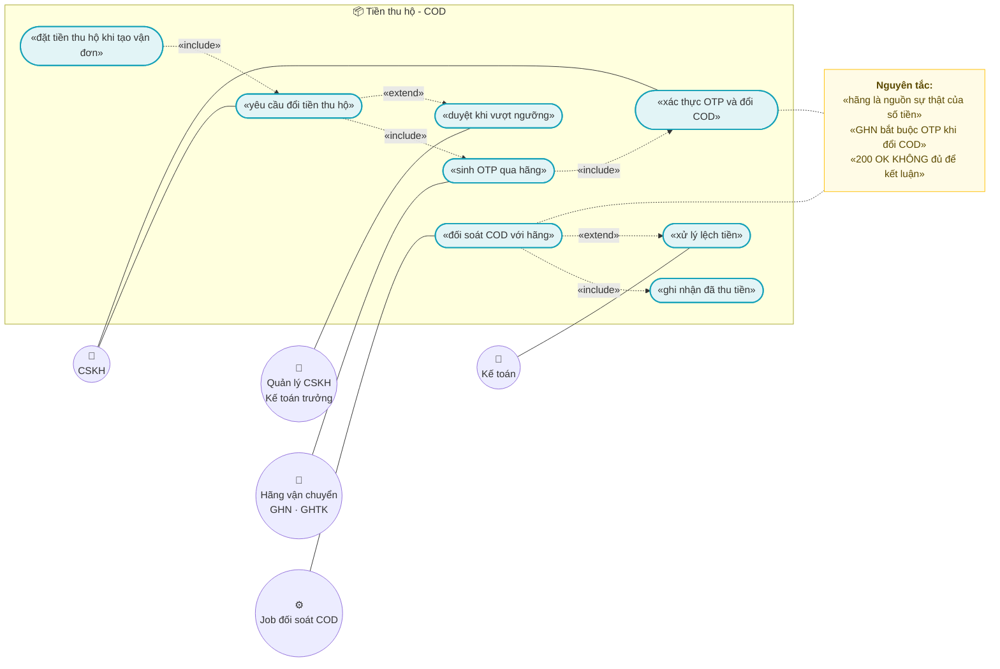
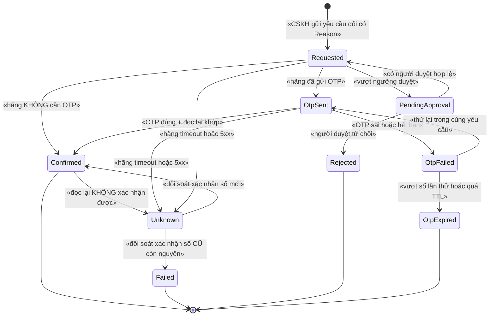
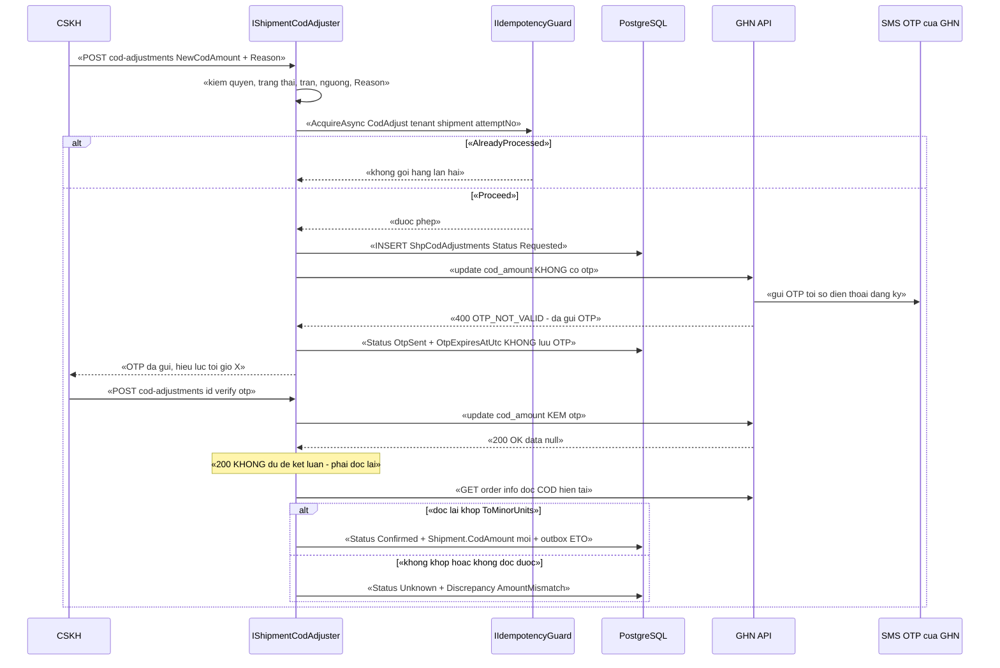

# `SHP-003` — COD: thu hộ, đổi COD (⚠️ GHN cần OTP)

> ⚠️ **CẢNH BÁO ĐỌC TRƯỚC:** việc **đổi tiền thu hộ (COD)** của một vận đơn **đã tạo** là thao tác
> **sửa một con số tiền mà một bên thứ ba sẽ đi thu của khách**. Với **GHN**, đổi `cod_amount` **bắt buộc OTP**
> gửi tới số điện thoại đăng ký của tài khoản — xem §7.3 có **trích dẫn tài liệu chính thức**.
> Nghĩa là: **hệ thống ta KHÔNG tự quyết định được** việc đổi COD. Đây là ràng buộc **bên ngoài**, không phải
> lựa chọn thiết kế ⇒ mọi luồng đổi COD phải mô hình hoá **2 bước** (yêu cầu → xác thực OTP), không được giả định 1 bước.
>
> ⚠️ **CẢNH BÁO LIÊN QUAN (`SHP-004`):** với **GHTK**, rủi ro nằm ở **khâu TRƯỚC** — **xác minh địa chỉ 2 cấp**
> trước khi gửi. Nếu địa chỉ không hợp lệ thì **không tạo được vận đơn** ⇒ **không có COD để đổi**.
> Trạng thái kiểm chứng: **chưa kiểm chứng** (xem §15.2 **F2**) — chi tiết thuộc `SHP-004`.

| Thuộc tính | Nội dung |
|---|---|
| **Mã** | `SHP-003` |
| **Module** | **ShippingHub** — dự kiến `modules/ShippingHub/eCommerce.ShippingHub.{Domain, EntityFrameworkCore, Application.Contracts, Application}`. ⚠️ **CHƯA TỒN TẠI trong code** (kiểm bằng `glob`/`grep` — xem §15.2 **F1**) |
| **Giai đoạn** | **GĐ2 — Vận hành & tuân thủ VN** (cùng đợt với `SHP-001`/`SHP-002`/`SHP-004`; xem `docs/implementation-plan.md` mục GĐ2) |
| **Ưu tiên** | **Must have** — COD là **phần lớn dòng tiền** của thương mại điện tử VN; không có nó thì **không đối soát được tiền thật về tài khoản** |
| **Trạng thái** | 🟡 `Draft` — chờ review |
| **Người viết / người review** | *(điền)* / **Kiến trúc trưởng + Kế toán trưởng + người đã liên hệ GHN/GHTK** |
| **Phiên bản / ngày** | `v0.1 — 13/10/2026` |
| **Tài liệu liên quan** | `SHP-001` (tạo vận đơn — **tiền đề**, cấp `ProviderTrackingCode`) · `SHP-002` (**webhook trạng thái**, `CodAmount` trên `ShpShipments`, `Discrepancy`, khoá lock `shipping`) · `SHP-004` (adapter GHTK — ⚠️ xác minh địa chỉ 2 cấp) · `XC-001` (Money/`decimal`, **cấm `==` trên tiền**) · `XC-002` (outbox/inbox + `IIdempotencyGuard` ở **mọi** biên vào) · `XC-003` (khoá phân tán) · `XC-004` (`[Authorize]` cấp class, permission, tenant) · `XC-005` (log/`CorrelationId`/metric) · `REC-003` (đối soát COD theo phiên) · `SAL-003` (state machine 4 trục của đơn) · `ACC-001` (xuất liệu kế toán) |

---

## 0. Tóm tắt & quyết định thiết kế

**Tóm tắt:** `SHP-003` chốt **vòng đời của số tiền thu hộ (COD)** — từ lúc **đặt** (khi tạo vận đơn) → **đổi** (thao tác
rủi ro nhất, vì **GHN bắt buộc OTP**) → **ghi nhận đã thu** → **đối soát với tiền thật về tài khoản**.

**Vì sao phải có tài liệu riêng (không phải thủ tục):** `SHP-002` đã chốt rằng **webhook trạng thái là GỢI Ý, đối soát
mới là SỰ THẬT**. `SHP-003` là tài liệu **duy nhất** nói về **con số tiền mà hãng sẽ đi thu**. Ba hệ quả thật:

| Nếu làm ẩu | Hệ quả thật |
|---|---|
| Đổi COD **chỉ ở DB của ta** mà không gọi API hãng | **Shipper đi thu số CŨ** ⇒ khách trả ít hơn ⇒ **mất tiền thật**, và không có lỗi biên dịch nào |
| Gọi API đổi COD rồi **coi `200 OK` là "đã đổi xong"** | Trạng thái đổi COD của GHN là **bất đồng bộ** (tài liệu ghi `data: null`) ⇒ DB ta **lệch** trạng thái hãng ⇒ đối soát sai vào cuối ngày |
| Lưu / log **mã OTP** để "tiện gỡ lỗi" | Rò **bí mật dùng một lần** + dữ liệu PII (số điện thoại) ⇒ sự cố bảo mật, vi phạm `XC-005` **BR-005/D6** |

**Phạm vi:**

- ✅ **Vòng đời số tiền COD** nội bộ (`CodRecord`): `Pending → Collected → Remitted → Reconciled`, kèm trạng thái **hoàn/huỷ**.
- ✅ **Vòng đời YÊU CẦU đổi COD** (`CodAdjustment`) — **state machine 2 bước có OTP**, guard **NÉM LỖI**.
- ✅ **Ánh xạ ràng buộc của từng hãng** (GHN cần OTP; GHN có trần `5.000.000`; trạng thái vận đơn nào cho phép đổi) — là **DỮ LIỆU**, không hard-code.
- ✅ **Idempotency ở MỌI biên vào** của feature (yêu cầu đổi, xác thực OTP, webhook COD, job đối soát) theo `XC-002`.
- ✅ **Tiền**: `decimal` + `Money`, **cấm** `==` trên tiền (`XC-001` BR-003/D3).
- ✅ Metric + log + `CorrelationId` theo `XC-005`; **cấm** log OTP.

**Không nằm trong phạm vi:**

- ❌ **Tạo vận đơn / tính phí / gửi hàng** — thuộc `SHP-001` (tài liệu này **giả định** vận đơn đã tồn tại và đã có `CodAmount`).
- ❌ **Nhận webhook trạng thái & đối soát trạng thái** — thuộc `SHP-002` (tài liệu này **chỉ đọc** `Shipment.Status`).
- ❌ **Xác minh địa chỉ 2 cấp của GHTK** — thuộc `SHP-004` (nêu ở đây **chỉ** vì nó chặn khả năng có COD).
- ❌ **Import bảng kê COD theo phiên + đối chiếu tiền về ngân hàng** — thuộc `REC-003`.
- ❌ **Bút toán doanh thu/hoàn tiền** — thuộc `ACC-001`; `SHP-003` **chỉ phát ETO**.
- ❌ **Sửa state machine 4 trục của đơn** — thuộc `SAL-003`.

### 0.1 Quyết định thiết kế (ADR ngắn)

| # | Quyết định | Phương án đã cân nhắc | Lý do chọn | Hệ quả |
|---|---|---|---|---|
| **D1** | **COD là số tiền của HÃNG, không phải của ta**: nguồn sự thật là **API hãng**; DB ta chỉ là **bản sao có dấu vết** | (a) ta là nguồn sự thật, hãng theo ta · (b) **hãng là nguồn sự thật, ta ghi vết** | Hãng mới là bên **đi thu tiền** và có **quyền từ chối** đổi COD (OTP sai, trạng thái không cho sửa). Nếu ta tự cho mình là nguồn sự thật thì sinh ra "số tiền trong DB" ≠ "số tiền shipper thu" | Mọi thay đổi COD **phải** chờ hãng xác nhận; DB ta có trạng thái `AdjustmentPending` (chưa chắc đã đổi được) |
| **D2** | **KHÔNG hard-code "GHN cần OTP" trong code nghiệp vụ** — đó là **thuộc tính cấu hình của từng hãng** (`RequiresOtpToChangeCod`, `MaxCodAmount`, danh sách trạng thái cho phép đổi) | (a) `if (provider == "ghn")` · (b) **thuộc tính cấu hình/dữ liệu** | `SHP-002` BR-009 đã cấm hard-code hãng. Thêm nữa: **cùng một hãng có 2 endpoint khác nhau** và tài liệu **không nói giống nhau** về OTP (xem §7.3) ⇒ nhúng vào code là **khoá cứng một điều chưa kiểm chứng** | Phải có `ShippingHubOptions.Providers.{code}.Cod.*`; hãng mới = thêm cấu hình, **không** sửa code |
| **D3** | **Đổi COD là luồng 2 BƯỚC bắt buộc** — `Yêu cầu` (sinh OTP) rồi `Xác thực OTP` | (a) 1 bước "gọi API kèm OTP do người dùng nhập" · (b) **2 bước có bản ghi trung gian** | Với (a), nếu request đứt giữa đường thì **không biết** OTP đã được sinh hay chưa; và **không** có chỗ để ghi vết "ai yêu cầu đổi, lúc nào, vì sao" — mà đây là thao tác **sửa tiền** | Có bảng `ShpCodAdjustments`; `OTP` **không** lưu (D10); bản ghi là **append-only** |
| **D4** | **KHÔNG tin `200 OK`** — mọi lần đổi COD **phải đọc lại** `COD` từ hãng **trước khi** kết luận "đã đổi" | (a) tin response · (b) **đọc lại để xác nhận** | Tài liệu GHN ghi response thành công có `data: null` ⇒ response **không mang** giá trị COD mới. Nếu tin response thì DB ta ghi "đã đổi" trong khi hãng có thể chưa áp dụng | `CodAdjustment` chỉ sang `Confirmed` khi **có bằng chứng đọc lại** khớp `ToMinorUnits()`; nếu không ⇒ `Unknown` + `Discrepancy` (kế thừa `SHP-002` D1) |
| **D5** | **Giới hạn & duyệt theo giá trị**: đổi COD **vượt ngưỡng** phải có **người duyệt thứ hai** | (a) ai có quyền thì đổi được mọi số · (b) **ngưỡng + duyệt** | Đổi COD là đường **hợp pháp hoá chênh lệch tiền**. Không ngưỡng ⇒ một tài khoản CSKH bị lộ là **mất tiền ở quy mô lớn** | Cần permission `.Approve` khi **trị tuyệt đối của** `mới − cũ` **> ngưỡng**; có audit bắt buộc |
| **D6** | **Idempotency key ổn định cho mỗi YÊU CẦU đổi**: `CodAdjust:{tenantId}:{shipmentId}:{attemptNo}` | (a) sinh `Guid` mới mỗi lần bấm · (b) **khoá ổn định + số lần thử** | `XC-002` BR-007: khoá mới mỗi lần retry ⇒ mỗi retry là một giao dịch mới. Với COD, retry sinh **nhiều OTP** cho cùng một ý định ⇒ **khoá là chìa khoá chống đổi 2 lần** | Bấm lại cùng `attemptNo` ⇒ **không** sinh OTP mới; muốn thử lại ⇒ **tăng `attemptNo`** và bị tính vào **trần số lần** |
| **D7** | **Khoá phân tán cho tài nguyên chia sẻ**: đổi COD của **một vận đơn** + cấu hình COD của **một hãng** | (a) không khoá (tin DB) · (b) **khoá theo vận đơn + theo hãng** | Hai CSKH cùng đổi COD một vận đơn ⇒ 2 luồng gọi API hãng, **OTP cuối** thắng ⇒ kết quả **không xác định**. Ngoài ra, thao tác này **không** chạy ở tần suất cao nên khoá **rẻ** | TTL **30 s**; **cấm** acquire lồng (`XC-003` D6); hàng rào cuối **vẫn** là DB (`XC-003` D2) |
| **D8** | **Thao tác ghi đi qua Unit of Work của ABP** (transaction tự động) — **cấm** gọi API hãng **bên trong** transaction | (a) giữ transaction qua lời gọi HTTP · (b) **gọi hãng NGOÀI transaction** | Giữ transaction qua HTTP call ⇒ transaction dài + giữ khoá DB khi chờ mạng (bài học `SHP-002` **B3**). Ngoài ra `AbpUnitOfWorkDefaultOptions.TransactionBehavior = Auto` đã bật | Mỗi bước: **ghi ý định (UoW ngắn)** → **gọi hãng (ngoài UoW)** → **ghi kết quả (UoW ngắn)** |
| **D9** | **Một đường duy nhất để sửa COD** — `IShipmentCodAdjuster` trong `ShippingHub`; **cấm** module khác (hoặc script vận hành) sửa `CodAmount` | (a) cho phép sửa qua SQL/khác module · (b) **một cửa** | Quy ước bất biến: **module sở hữu entity của mình, module gọi app BỊ CẤM**. Nhiều cửa ⇒ không đối soát được "vì sao số tiền đổi" | Mọi đường khác bị **chặn ở review** + `CodAmount` có setter **private** |
| **D10** | **OTP là bí mật dùng-một-lần**: **KHÔNG** sinh trong hệ thống ta, **KHÔNG** lưu, **KHÔNG** log, **KHÔNG** trả ra DTO; chỉ tồn tại trong **bộ nhớ của request xác thực** | (a) lưu OTP để "thử lại nhanh" · (b) **không lưu gì** | OTP do **hãng** sinh và gửi tới số điện thoại đăng ký của **tài khoản ta**. Lưu lại = mở rộng bề mặt tấn công vô ích; log = vi phạm `XC-005` BR-005 | Có test quét mã nguồn (`TC-05`); DTO `VerifyCodAdjustmentDto` **không** có trường nào bị ghi log |
| **D11** | **Khi trạng thái hãng KHÔNG XÁC ĐỊNH** ⇒ **KHÔNG retry mù** — chuyển sang **đối soát** và ghi `Discrepancy` | (a) retry tới khi `200` · (b) **dừng và đối soát** | Đổi COD **không idempotent ở phía hãng theo nghĩa nội dung**: gửi lại một yêu cầu "đổi sang X" khi yêu cầu trước **đã thành công** là vô hại, **nhưng** gửi lại khi ta **không biết** số nào đang áp dụng thì có thể ghi đè một thay đổi hợp lệ khác của người khác | Có `CodAdjustmentStatus.Unknown`; job đối soát COD (nhịp riêng) là đường thoát; metric đếm |

---

## 1. Use Case Specification

| Thuộc tính | Nội dung |
|---|---|
| **Use Case ID** | `SHP-003` |
| **Use Case Name** | Đặt, đổi và đối soát **tiền thu hộ (COD)** của một vận đơn — có ràng buộc OTP của hãng |
| **Description** | *"Là CSKH/kế toán, tôi muốn sửa số tiền thu hộ của một vận đơn đang trên đường (vì khách đổi ý, đơn bớt 1 món, hoặc nhập sai từ đầu) — nhưng tôi muốn hệ thống **buộc** tôi làm đúng quy trình của hãng (OTP), **ghi lại** ai đổi vì sao, và **không bao giờ** để sổ sách của ta lệch với số tiền shipper thực thu."* |
| **Actor(s)** | **CSKH** (yêu cầu đổi) · **Quản lý CSKH / Kế toán trưởng** (duyệt khi vượt ngưỡng) · **Kế toán** (đối soát, xử lý lệch) · **Hệ thống** (job đối soát COD, job nhặt lại yêu cầu treo) · **Hãng vận chuyển** (GHN/GHTK — sinh OTP, thu tiền, trả trạng thái) |
| **Priority** | **Must have** |
| **Trigger** | (a) CSKH bấm "Đổi tiền thu hộ"; (b) khách xác nhận OTP; (c) webhook/đối soát của hãng báo **số tiền thu thực tế**; (d) job đối soát COD chạy theo nhịp |
| **Pre-Condition(s)** | • **Vận đơn đã tồn tại** trong `ShpShipments` và đã có `ProviderTrackingCode` do hãng cấp (do `SHP-001` tạo). Chưa có ⇒ `eCommerce:Shipping:0004`.<br>• **Trạng thái vận đơn cho phép đổi COD** — với GHN, tập trường được sửa **co lại** theo trạng thái (xem §7.3). Không cho phép ⇒ `eCommerce:Shipping:0016`.<br>• **Hãng đã được cấu hình** `Cod.RequiresOtpToChangeCod` / `Cod.MaxCodAmount` / `Cod.OtpTtlSeconds`. Thiếu cấu hình ⇒ **fail-closed**: `eCommerce:Shipping:0007`.<br>• **Tenant hiện tại** (`ICurrentTenant`) — COD luôn thuộc tenant sở hữu vận đơn.<br>• `CorrelationId` theo `XC-005` (sinh mới nếu không có). |
| **Post-Condition(s)** | • **Mỗi yêu cầu đổi COD** có **đúng 1** dòng `ShpCodAdjustments` (append-only) — kể cả khi OTP sai.<br>• **`CodAmount` chỉ đổi** khi có **bằng chứng xác nhận** từ hãng (D4); mọi lần đổi có `OldCodAmount`/`NewCodAmount` + `Reason` + `ChangedBy`.<br>• **`OTP` không tồn tại** ở bất kỳ bảng/log/DTO nào (D10).<br>• Mọi lần **không** đổi được đều có dấu vết: exception có mã **hoặc** log `Warning` + metric.<br>• Lệch giữa COD ta giữ và COD hãng báo ⇒ **có** `ShpDiscrepancies` với `Kind = AmountMismatch` — **cấm** tự sửa số của hãng.<br>• Sự kiện phát ra nằm trong **outbox cùng transaction** với lần ghi (`XC-002` BR-001). |
| **Basic Flow** | 1. CSKH mở vận đơn, bấm **"Đổi tiền thu hộ"**, nhập `NewCodAmount` + **`Reason` bắt buộc**.<br>2. Hệ thống kiểm **6 điều**: quyền · trạng thái vận đơn cho phép · `NewCodAmount ≥ 0` và `≤ Cod.MaxCodAmount` · **trần số lần đổi/vận đơn/ngày** · **ngưỡng cần duyệt** (D5) · `Reason` đủ dài. Vi phạm ⇒ §12 (E1–E6).<br>3. Giành khoá `ecommerce:shipping:cod-adjust:{tenantId}:{shipmentId}` (TTL 30 s). Không giành được ⇒ `eCommerce:Lock:0001` — **không** im lặng.<br>4. Ghi `ShpCodAdjustments` (`Status = Requested`, `AttemptNo++`) **trong UoW ngắn**; phát `CodAdjustmentRequestedEto` qua **outbox**.<br>5. **Ngoài** transaction (D8): gọi API hãng để **sinh OTP** (GHN: `POST /v2/shipping-order/update` kèm `cod_amount` **thiếu/không** `otp` ⇒ hãng trả `OTP_NOT_VALID` và **gửi OTP** — ⚠️ xem **Q2** §15.1 về cách sinh OTP **tường minh**).<br>6. Ghi `Status = OtpSent` + `OtpSentAtUtc` + `OtpExpiresAtUtc = OtpSentAtUtc + Cod.OtpTtlSeconds` (**không** lưu OTP).<br>7. Trả về UI: "OTP đã gửi tới số điện thoại đăng ký, hiệu lực tới {giờ}".<br>8. CSKH nhập OTP khách đọc → hệ thống gọi API hãng **kèm `otp`** (trong cùng khoá lock).<br>9. `200` ⇒ **bước 10**; lỗi ⇒ §12 (E7–E10).<br>10. **Đọc lại COD từ hãng** (D4). Khớp `ToMinorUnits()` ⇒ `Status = Confirmed`, cập nhật `Shipment.CodAmount`, ghi `CodAdjustmentConfirmedEto`. **Không** khớp hoặc không đọc được ⇒ `Status = Unknown` + `Discrepancy` (D11). |
| **Alternative Flow** | **A1: Hãng KHÔNG cần OTP** (`Cod.RequiresOtpToChangeCod = false`, ví dụ cấu hình cho một hãng cụ thể) ⇒ bước 5–7 **bỏ qua**; `Requested → Confirmed` trong **một** lần gọi API. **Không** tạo OTP giả.<br>**A2: OTP hết hạn** ⇒ `Status = OtpExpired`; muốn tiếp ⇒ **`attemptNo` mới** (D6) và **tính vào trần** — **cấm** "gửi lại OTP miễn phí" không giới hạn.<br>**A3: Vượt ngưỡng duyệt** (D5) ⇒ `Status = PendingApproval`; **không** gọi API hãng cho tới khi có người có quyền `.Approve` phê duyệt.<br>**A4: Webhook/đối soát báo số tiền thu khác** ⇒ **ghi `Discrepancy`**, **giữ nguyên** `CodAmount` của ta, **chờ kế toán**; **cấm** tự ghi đè (`SHP-002` BR-007).<br>**A5: Đổi COD khi đơn đã giao nhưng chưa đối soát** ⇒ **từ chối** (`eCommerce:Shipping:0016`): số tiền đã được shipper thu **trên thực tế**, sửa trong hệ thống **không** sửa được thực tế ⇒ phải đi đường **điều chỉnh/đối soát**, không phải đường "đổi COD". |
| **Exception Flow** | **E1:** `NewCodAmount < 0` ⇒ `eCommerce:Shipping:0022`.<br>**E2:** `NewCodAmount > Cod.MaxCodAmount` (GHN: **5.000.000**) ⇒ `eCommerce:Shipping:0022` — trần **là cấu hình**, không hard-code (D2).<br>**E3:** trạng thái vận đơn **không** cho phép sửa COD ⇒ `eCommerce:Shipping:0016`.<br>**E4:** vượt **trần số lần đổi** (`Cod.MaxAdjustmentsPerShipmentPerDay`) ⇒ `eCommerce:Shipping:0018`.<br>**E5:** thiếu `Reason` / `Reason` < **10 ký tự** ⇒ `eCommerce:Shipping:0024`.<br>**E6:** thiếu quyền duyệt khi vượt ngưỡng ⇒ `eCommerce:Shipping:0019`.<br>**E7:** OTP **sai/hết hạn** (GHN `OTP_NOT_VALID`) ⇒ `eCommerce:Shipping:0017`; `AttemptNo` **không** tăng (cùng một OTP còn hiệu lực), nhưng **đếm số lần thử** `OtpAttemptCount++; vượt `OtpMaxAttempts` ⇒ **chuyển `OtpExpired`** (chống dò OTP).<br>**E8:** tài khoản hãng **không có quyền sửa COD** (GHN `PERMISSION_DENIED_EDIT_COD`) ⇒ `eCommerce:Shipping:0016` — **không** phải lỗi tạm thời ⇒ **cấm retry**.<br>**E9:** hãng báo **không tìm thấy vận đơn / không thuộc tài khoản** ⇒ `eCommerce:Shipping:0004`.<br>**E10:** hãng **timeout / 5xx** ⇒ `Status = Unknown` (D11) + **đối soát**, **cấm** retry mù.<br>**E11:** không giành được khoá ⇒ `eCommerce:Lock:0001` (`XC-003` `eCommerce:Lock:0001`) — **cấm** bỏ qua im lặng.<br>**E12:** cùng `IdempotencyKey` (cùng `attemptNo`) nhưng payload khác ⇒ `eCommerce:Messaging:0002` (`XC-002` BR-006) — **cấm** ghi đè. |
| **Business Rules** | • **BR-SHP-003-001**: **Mọi** thay đổi COD **phải** đi qua API của hãng (nguồn sự thật — D1); **cấm** sửa `CodAmount` cục bộ mà không gọi hãng.<br>• **BR-SHP-003-002**: **Cấm** hard-code "hãng nào cần OTP / trần COD / trạng thái cho phép đổi" trong code nghiệp vụ — **phải** là cấu hình của hãng (D2).<br>• **BR-SHP-003-003**: Đổi COD **phải** theo luồng **2 bước** khi hãng yêu cầu OTP (D3); **cấm** bỏ bước ghi vết yêu cầu.<br>• **BR-SHP-003-004**: 🚨 **OTP**: **cấm** sinh trong hệ thống ta, **cấm** lưu vào DB, **cấm** ghi log, **cấm** trả ra DTO (D10).<br>• **BR-SHP-003-005**: **OTP có TTL** bắt buộc; hết hạn ⇒ `OtpExpired`; **cấm** chấp nhận OTP không kiểm TTL.<br>• **BR-SHP-003-006**: **Giới hạn số lần thử OTP** (`OtpMaxAttempts`) — vượt ⇒ **khoá yêu cầu đó**; **cấm** cho dò vô hạn.<br>• **BR-SHP-003-007**: **Ngưỡng duyệt** theo giá trị tuyệt đối của chênh lệch (D5); vượt ⇒ **bắt buộc** người thứ hai có quyền `.Approve`.<br>• **BR-SHP-003-008**: `Reason` **bắt buộc**, **≥ 10 ký tự**, **không** chứa PII của khách quá mức cần thiết.<br>• **BR-SHP-003-009**: Tiền COD là `decimal` + `Money`; **cấm** so sánh tiền bằng `==` — so bằng `ToMinorUnits()` (`XC-001` BR-003).<br>• **BR-SHP-003-010**: **Cấm** kết luận "đã đổi" chỉ từ `200 OK` — **phải** có bước **đọc lại** (D4).<br>• **BR-SHP-003-011**: Mọi lần **không xác định** trạng thái hãng ⇒ `Unknown` + `Discrepancy`; **cấm** retry mù (D11).<br>• **BR-SHP-003-012**: **Idempotency ở MỌI biên vào** (yêu cầu đổi, xác thực OTP, webhook COD, job đối soát) qua `IIdempotencyGuard` **+** unique index ở DB (`XC-002` BR-004/BR-005); khoá **ổn định** — **cấm** `Guid.NewGuid()` (D6).<br>• **BR-SHP-003-013**: **State machine** (§3) **NÉM LỖI** khi chuyển sai; **cấm** no-op im lặng (quy ước #11).<br>• **BR-SHP-003-014**: **Cấm** tự sửa số tiền của hãng khi lệch — chỉ ghi `Discrepancy` (`SHP-002` BR-007).<br>• **BR-SHP-003-015**: Khoá phân tán **chỉ** sinh từ `ShippingHubLockKeys` của module; **cấm** literal khoá trong nghiệp vụ (`XC-003` BR-001/D3); **cấm** acquire lồng (`XC-003` BR-005).<br>• **BR-SHP-003-016**: **Mọi** app service **phải** `[Authorize]` ở **cấp class**; **cấm** magic string permission (`XC-004` BR-001/BR-003).<br>• **BR-SHP-003-017**: Mã lỗi **phải** thuộc `ShippingHubErrorCodes` của module; **cấm** khai ở `eCommerceConsts.ErrorCodes` (kế thừa `XC-003` F2 / `TaxErrorCodes`).<br>• **BR-SHP-003-018**: Mọi thao tác **ghi** **phải** qua **Unit of Work**; **cấm** giữ transaction qua lời gọi HTTP tới hãng (D8).<br>• **BR-SHP-003-019**: Unique index có `TenantId` **phải** `NULLS NOT DISTINCT` — vì hiện chạy **1 tenant** và `TenantId` **có thể `NULL`** (`XC-004` F1; nếu không, index **mất tác dụng**).<br>• **BR-SHP-003-020**: Metric **không** được dùng để ra quyết định nghiệp vụ (`XC-005`); mọi tên metric **phải** nằm trong `eCommerceMetricNames`. |
| **Non-Functional Requirement** | • **NFR-SHP-003-001**: Bước **sinh OTP** (không tính độ trễ mạng của hãng) p95 **< 300 ms** ở phía ta.<br>• **NFR-SHP-003-002**: Bước **xác thực OTP** end-to-end p95 **< 2 s** (gồm 1 lời gọi hãng + 1 lần đọc lại).<br>• **NFR-SHP-003-003**: **0** lần OTP xuất hiện trong DB/log/DTO — quét mã nguồn + kiểm DB thật.<br>• **NFR-SHP-003-004**: **Idempotent 100 %**: gửi cùng một yêu cầu đổi **100 lần** ⇒ **đúng 1** lời gọi hãng có hiệu lực, **1** dòng `ShpCodAdjustments`.<br>• **NFR-SHP-003-005**: **0** `double`/`float` trong mọi biểu thức/entity/DTO tiền của module.<br>• **NFR-SHP-003-006**: **0** so sánh `==` trên trường tiền (test quét mã nguồn).<br>• **NFR-SHP-003-007**: **0** khoá acquire lồng; **0** acquire thiếu timeout; **1** khoá cho mỗi thao tác đổi COD (`XC-003` BR-004/BR-005).<br>• **NFR-SHP-003-008**: **100 %** log của luồng đổi COD có `CorrelationId` (`XC-005` NFR-002).<br>• **NFR-SHP-003-009**: **0** lần ghi log ở mức `Information` trong vòng lặp job đối soát COD (`XC-005` BR-004).<br>• **NFR-SHP-003-010**: Phát hiện lệch tiền COD trong **≤ 1 nhịp** job đối soát (nhịp đề xuất **15 phút**, thống nhất `SHP-002` NFR-005).<br>• **NFR-SHP-003-011**: **100 %** yêu cầu đổi COD **treo** (`Requested`/`OtpSent` quá `Cod.StaleRequestMinutes`) **phải** được job nhặt lại hoặc đóng bằng `Unknown` + `Discrepancy`.<br>• **NFR-SHP-003-012**: Cách ly tenant: **0** bản ghi COD của tenant khác lọt vào truy vấn (⚠️ **cần PostgreSQL** — xem §14.4).<br>• **NFR-SHP-003-013**: **100 %** lần đổi COD thành công có `Reason` + `ChangedBy` + `ChangedAtUtc` (audit đầy đủ). |
| **Shorthand BR/NFR trong các bảng dưới** | `BR-01`…`BR-20` ≡ `BR-SHP-003-001`…`BR-SHP-003-020`; `NFR-01`…`NFR-13` ≡ `NFR-SHP-003-001`…`NFR-SHP-003-013`. Cách viết này kế thừa đúng thói quen của `XC-003`/`SHP-002`. |

---

## 2. Sơ đồ Use Case



**Chú giải:**

| Ký hiệu | Ý nghĩa |
|---|---|
| ⭕ Xanh lá | Actor (CSKH, quản lý/kế toán trưởng, kế toán, hãng vận chuyển, job) |
| 🟦 Bầu dục xanh dương | Use case |
| 🟨 Khung vàng | Note — nguyên tắc thiết kế |
| `-.«include».->` / `-.«extend».->` | Quan hệ bao hàm / mở rộng |

> 📌 **Ghi rõ:** `UC1` (đặt COD khi tạo vận đơn) thuộc **`SHP-001`**, `UC3` (sinh OTP) do **hãng** thực hiện —
> `SHP-003` **chỉ** gọi và ghi vết. Chúng được vẽ ở đây vì nếu thiếu thì **không hiểu được** vòng đời số tiền.

---

## 3. Sơ đồ trạng thái (state machine)

### 3.1 Vòng đời **yêu cầu đổi COD** (`ShpCodAdjustments.Status`)



### 3.2 Bảng chuyển trạng thái & guard — **mọi chuyển sai PHẢI NÉM LỖI, không im lặng**

| # | Từ | Sang | Guard | Ai được phép | Nếu vi phạm |
|---|---|---|---|---|---|
| 1 | `Requested` | `PendingApproval` | `\|New − Old\| > Cod.ApprovalThresholdAmount` | hệ thống | `eCommerce:Shipping:0019` |
| 2 | `PendingApproval` | `Requested` | Người duyệt có quyền `.Approve` **và** không phải người tạo yêu cầu | quản lý CSKH · kế toán trưởng | `eCommerce:Shipping:0019` · tự duyệt ⇒ `eCommerce:Shipping:0016` |
| 3 | `PendingApproval` | `Rejected` | Người duyệt từ chối + `Reason` | quản lý CSKH · kế toán trưởng | — |
| 4 | `Requested` | `OtpSent` | `Cod.RequiresOtpToChangeCod = true` **và** hãng đã gửi OTP **và** `OtpAttemptCount = 0` | hệ thống | `eCommerce:Shipping:0021` |
| 5 | `Requested` | `Confirmed` | `Cod.RequiresOtpToChangeCod = false` **và** gọi hãng `200` **và** đọc lại khớp | hệ thống | `eCommerce:Shipping:0016` |
| 6 | `OtpSent` | `Confirmed` | OTP hợp lệ **và** `now ≤ OtpExpiresAtUtc` **và** đọc lại khớp `ToMinorUnits()` | CSKH (nhập OTP) | `eCommerce:Shipping:0017` |
| 7 | `OtpSent` | `OtpFailed` | Hãng trả `OTP_NOT_VALID` | hệ thống | — |
| 8 | `OtpFailed` | `OtpSent` | `OtpAttemptCount < Cod.OtpMaxAttempts` **và** `now ≤ OtpExpiresAtUtc` | CSKH | vượt ⇒ `eCommerce:Shipping:0020` |
| 9 | `OtpFailed` | `OtpExpired` | `OtpAttemptCount ≥ Cod.OtpMaxAttempts` **hoặc** `now > OtpExpiresAtUtc` | hệ thống | — |
| 10 | `Requested`/`OtpSent` | `Unknown` | Hãng **timeout**/**5xx**/response không parse được | hệ thống | `eCommerce:Shipping:0023` |
| 11 | `Confirmed` | `Unknown` | 🚨 Đọc lại **không** xác nhận được số mới (hãng chậm) | hệ thống | **Ghi `Discrepancy`** — **cấm** sửa `CodAmount` ngược |
| 12 | `Unknown` | `Confirmed` | Job đối soát xác nhận `CodAmount` hiện tại **khớp** số mới | kế toán · job | — |
| 13 | `Unknown` | `Failed` | Job đối soát xác nhận hãng **vẫn** giữ số cũ | kế toán · job | — |
| 14 | `Confirmed` | **BẤT KỲ** | — | **KHÔNG AI** — trạng thái **hấp thụ** | `eCommerce:Shipping:0016` + log `Error` |
| 15 | `Failed` · `Rejected` · `OtpExpired` | **BẤT KỲ** | — | **KHÔNG AI** — **hấp thụ**; muốn làm lại ⇒ **tạo yêu cầu MỚI** (`AttemptNo++`) | `eCommerce:Shipping:0016` |
| 16 | Bất kỳ → bất kỳ | *(không đổi)* | `UPDATE … WHERE Status = @expected` ảnh hưởng **0 dòng** | — | 🚨 **NÉM LỖI** `eCommerce:Shipping:0023` — **cấm** coi là thành công (`XC-002` BR-008 / E7) |

### 3.3 Vòng đời **số tiền COD** (`ShpCodRecords.Status`)

| Từ | Sang | Guard | Nếu vi phạm |
|---|---|---|---|
| `Pending` | `Collected` | `Shipment.Status = Delivered` **và** `ConfirmedAtUtc ≠ null` (`SHP-002` **BR-004**) | `eCommerce:Shipping:0024` — **cấm** ghi "đã thu" từ webhook đơn thuần |
| `Pending` | `Cancelled` | Vận đơn `Cancelled` hoặc `Returned` | — |
| `Collected` | `Remitted` | Hãng xác nhận **đã chuyển tiền** (đối soát `REC-003`) | `eCommerce:Shipping:0024` |
| `Collected`/`Remitted` | `Reconciled` | Số tiền về tài khoản **khớp** `CodAmount` của ta (`ToMinorUnits()`) | Lệch ⇒ **KHÔNG** sang `Reconciled`; ghi `Discrepancy` (`Kind = AmountMismatch`) |
| `Cancelled`/`Reconciled` | *(bất kỳ)* | — | **Hấp thụ** — `eCommerce:Shipping:0024` |

> ⚠️ **Trạng thái hấp thụ:** `Confirmed` (yêu cầu đổi), `Reconciled`/`Cancelled` (số tiền). Sau khi vào các trạng thái này,
> **mọi** chuyển khác **NÉM LỖI** — kể cả khi hãng báo ngược lại. Lý do: đây là các trạng thái **đã chạm tới tiền**;
> sửa ngược phải là **quy trình nghiệp vụ có người duyệt** (điều chỉnh/đối soát), **không** phải một lần bấm nút.
>
> 📌 **Bài học kế thừa** (`XC-002` §0 bảng bài học eShop, `XC-006` §3): guard **phải ném lỗi**, không được no-op im lặng —
> `SetPaidStatus()` của eShop chỉ hành động khi `StockConfirmed`, còn lại **rơi không dấu vết**. Ở đây, `SHP-003`
> **cố ý** đặt `Unknown` làm trạng thái **có dấu vết** thay vì "thử lại tới cùng".

---

## 4. Sequence Diagram & luồng dữ liệu

### 4.1 Sequence — đổi COD có OTP của GHN, và vì sao **đọc lại** là bắt buộc



### 4.2 Luồng dữ liệu — bốn nguồn có thể **nói khác nhau** về cùng một số tiền COD

**Không áp dụng sơ đồ thứ 3 — lý do:** giới hạn **tối đa 3 sơ đồ** cho tài liệu này (2 sơ đồ đã dùng ở §2 và §3,
sơ đồ thứ 3 là sequence ở §4.1). Thay thế bằng bảng dưới đây — nội dung tương đương và **kiểm chứng được bằng SQL**:

| Nguồn | Ở đâu | Ai ghi | Có phải nguồn sự thật? | Nếu lệch với `Shipments.CodAmount` |
|---|---|---|---|---|
| **API hãng** (đọc lại) | hệ thống của hãng | hãng | ✅ **CÓ** (D1) | Lấy **của hãng**; ghi `Discrepancy` để giải trình chênh lệch |
| **Webhook trạng thái** | `ShpShipmentEvents.RawPayloadMasked` | hãng gửi | ❌ **KHÔNG** (`SHP-002` D1: webhook là **gợi ý**) | Ghi `Discrepancy.Kind = AmountMismatch`; **cấm** tự sửa |
| **DB của ta** | `ShpShipments.CodAmount` | hệ thống, qua `IShipmentCodAdjuster` (D9) | ❌ chỉ là **bản sao có dấu vết** | Là **đầu vào** để so, không phải chân lý |
| **Bảng kê/tiền về tài khoản** | `REC-003` | kế toán (file theo phiên) | ✅ cho **đối soát tiền thật** | Không khớp ⇒ **lệch thật** ⇒ phải điều tra (không thuộc `SHP-003`) |

> 🔴 **Ghi rõ cho tài liệu khác:** `ACC-001` (xuất liệu kế toán) **cấm** ghi nhận doanh thu COD chỉ dựa trên
> `ShpShipments.CodAmount`; **bắt buộc** dựa trên `ShpCodRecords.Status = Remitted/Reconciled` **kèm** dấu vết đối soát.
> Đây là ràng buộc **kế thừa trực tiếp** `SHP-002` **BR-004** và được kế toán trưởng xác nhận (xem §14.3).

**Chiến lược transaction:**

| Bước | Phạm vi | Ghi chú |
|---|---|---|
| **B1 — ghi ý định** | UoW **ngắn riêng**: `INSERT ShpCodAdjustments (Requested)` + outbox ETO | Phải **bền vững trước** khi gọi hãng — nếu không, yêu cầu "biến mất" mà OTP vẫn được gửi |
| **B2 — gọi hãng** | **NGOÀI** transaction/UoW (D8) | **Cấm** giữ transaction qua HTTP call |
| **B3 — ghi kết quả** | UoW **ngắn riêng**: `UPDATE … WHERE Status = @expected` + `UPDATE Shipment.CodAmount` + outbox ETO | `0` dòng ⇒ **NÉM LỖI** (§3.2 #16) |
| **B4 — đối soát** | Mỗi vận đơn 1 UoW (hoặc lô nhỏ); gọi API hãng **ngoài** transaction | Kế thừa `SHP-002` **B3** |

---

## 5. Mô hình dữ liệu

### 5.1 ERD

**Không áp dụng sơ đồ ERD — lý do:** giới hạn **tối đa 3 sơ đồ Mermaid** cho tài liệu này (đã dùng ở §2, §3, §4.1).
Thay thế bằng **Data Dictionary** đầy đủ ở §5.2 (cột + index + ràng buộc) — đúng cách `SHP-002` §5.1 đã làm.

> ⚠️ **CHƯA CÓ BẢNG NÀO TỒN TẠI TRONG CODE.** Đã kiểm bằng `grep`/`glob` toàn repo:
> `grep "cod|shipment|ghn|ghtk|carrier"` trên mọi `*.cs` ⇒ **0 kết quả**; `modules/` chỉ có
> `ChannelHub`, `PaymentHub`, `Tax` ([`eCommerce.slnx:2`–`17`](../../eCommerce.slnx)).
> Thứ **duy nhất** đang tồn tại liên quan tới phí vận chuyển là cột tiền: `Order.ShippingTotal`
> ([`Order.cs:45`](../../src/eCommerce.Domain/Entities/Orders/Order.cs)) + mapping `HasPrecision(18, 4)`
> ([`eCommerceDbContext.cs:176`](../../src/eCommerce.EntityFrameworkCore/eCommerceDbContext.cs)).
> ⇒ **Toàn bộ §5.2 là KẾ HOẠCH GĐ2** (`ShpShipments` do `SHP-001`/`SHP-002` tạo; `ShpCodAdjustments`,
> `ShpCodRecords`, `ShpDiscrepancies` là **mở rộng của `SHP-003`**).

### 5.2 Bảng & cột (Data Dictionary)

**Bảng `ShpShipments`** — *(do `SHP-001` tạo; `SHP-003` **chỉ đọc** `CodAmount`, `CodCurrency`, `OrderId`, `Status`)*

| Cột | Kiểu | Null? | Ý nghĩa | Ghi chú |
|---|---|---|---|---|
| `Id` | `uuid` | ✖ | khoá chính | |
| `TenantId` | `uuid` | ✔ | tenant sở hữu | `IMultiTenant`; ⚠️ `NULL` = 1 tenant (`XC-004` F1) |
| `OrderId` | `uuid` | ✖ | đơn hàng liên quan | tham chiếu **mềm** (id, **không** navigation) |
| `ProviderCode` | `varchar(32)` | ✖ | `ghn`, `ghtk`, … | khớp `Provider` trong log `XC-005` §5.2 |
| `ProviderTrackingCode` | `varchar(64)` | ✖ | mã vận đơn do hãng cấp | unique theo `(TenantId, ProviderCode)` |
| `Status` | `int` | ✖ | trạng thái vận đơn | `SHP-002` §3.1 — **đầu vào** của guard §3.2 #4/#5 |
| `ConfirmedAtUtc` | `timestamptz` | ✔ | thời điểm trạng thái ảnh hưởng tiền được **xác nhận** | `SHP-002` **BR-004**; `null` ⇒ **chưa** được lập chứng từ |
| **`CodAmount`** | `numeric(18,4)` | ✖ | **số tiền thu hộ hiện hành** | ⭐ **chỉ** đổi qua `IShipmentCodAdjuster` (D9); setter **private** |
| **`CodCurrency`** | `char(3)` | ✖ | ISO-4217, mặc định `VND` | `XC-001` §5.2 |
| **`CodLastConfirmedAtUtc`** | `timestamptz` | ✔ | lần **đọc lại** xác nhận COD từ hãng | 🆕 `SHP-003` — căn cứ D4 |
| `ShippingFee` | `numeric(18,4)` | ✖ | phí vận chuyển | do `SHP-001` |
| `RowVersion` | `xmin` → `uint` | ✖ | optimistic concurrency | `IsRowVersion()` — **không** thêm cột thật |

**Bảng `ShpCodAdjustments`** — ⭐ **SỔ YÊU CẦU ĐỔI COD (APPEND-ONLY)** — **mở rộng của `SHP-003`**

| Cột | Kiểu | Null? | Ý nghĩa | Ghi chú |
|---|---|---|---|---|
| `Id` | `uuid` | ✖ | khoá chính | |
| `TenantId` | `uuid` | ✖ | tenant | `IMultiTenant` + query filter |
| `ShipmentId` | `uuid` | ✖ | vận đơn | tham chiếu mềm |
| `AttemptNo` | `int` | ✖ | **số lần thử** cho cùng một ý định | ⭐ **thành phần của khoá idempotency** (D6) |
| `OldCodAmount` | `numeric(18,4)` | ✖ | số tiền **trước** khi đổi | snapshot — **cấm** suy ra từ bảng khác |
| `NewCodAmount` | `numeric(18,4)` | ✖ | số tiền **muốn đổi thành** | |
| `Currency` | `char(3)` | ✖ | ISO-4217 | ⚠️ **cấm** so sánh tiền bằng `==` |
| `Reason` | `varchar(512)` | ✖ | **lý do** — bắt buộc ≥ 10 ký tự | BR-08; **đã che** dữ liệu nhạy cảm |
| `Status` | `int` | ✖ | §3.1 (`Requested=0` · `PendingApproval=1` · `OtpSent=2` · `OtpFailed=3` · `OtpExpired=4` · `Confirmed=5` · `Unknown=6` · `Failed=7` · `Rejected=8`) | **chỉ** đổi qua guard |
| `RequiresOtp` | `bool` | ✖ | hãng có bắt buộc OTP cho lần đổi này không | ⭐ **chụp lại cấu hình tại thời điểm gọi** — vì cấu hình có thể đổi (D2) |
| `OtpSentAtUtc` | `timestamptz` | ✔ | thời điểm hãng gửi OTP | |
| `OtpExpiresAtUtc` | `timestamptz` | ✔ | hạn hiệu lực OTP | = `OtpSentAtUtc + Cod.OtpTtlSeconds`; BR-05 |
| `OtpAttemptCount` | `int` | ✖ | số lần **thử** OTP | trần `Cod.OtpMaxAttempts`; BR-06 |
| 🔒 **`Otp`** | — | — | **KHÔNG TỒN TẠI CỘT NÀY** | 🚨 **BR-04/D10** — ghi rõ ở đây để không ai "tiện tay" thêm vào |
| `IdempotencyKey` | `varchar(160)` | ✖ | `CodAdjust:{tenantId}:{shipmentId}:{attemptNo}` | ⭐ `XC-002` BR-005/BR-007 |
| `PayloadHash` | `char(64)` | ✖ | SHA-256 payload **canonical** | phát hiện **xung đột khoá** (E12) |
| `ProviderRequestRef` | `varchar(128)` | ✔ | tham chiếu request phía hãng (nếu có) | ⚠️ **không** chứa OTP |
| `FailureCode` | `varchar(64)` | ✔ | mã lỗi nghiệp vụ | ví dụ `eCommerce:Shipping:0017` |
| `FailureReason` | `varchar(2048)` | ✔ | thông điệp hãng trả **đã che** | **cấm** log payload thô |
| `ConfirmedAtUtc` | `timestamptz` | ✔ | thời điểm hãng **xác nhận** (đọc lại khớp) | D4 |
| `ApprovedBy` / `ApprovedAtUtc` | `uuid` / `timestamptz` | ✔ | người duyệt khi vượt ngưỡng | D5; **cấm** tự duyệt |
| `RequestedBy` / `RequestedAtUtc` | `uuid` / `timestamptz` | ✖ | ai yêu cầu, lúc nào | audit |
| `CorrelationId` | `varchar(64)` | ✔ | truy vết end-to-end | `XC-005` |
| `RowVersion` | `xmin` | ✖ | optimistic concurrency | chống 2 luồng cùng đổi |

> 🔒 **APPEND-ONLY:** các cột **`OldCodAmount`, `NewCodAmount`, `Reason`, `IdempotencyKey`, `PayloadHash`,
> `RequestedBy`, `RequestedAtUtc`** **cấm** `UPDATE`/`DELETE`. Chỉ **cột xử lý** (`Status`, `OtpAttemptCount`,
> `OtpSentAtUtc`, `OtpExpiresAtUtc`, `ConfirmedAtUtc`, `FailureCode`, `FailureReason`, `ApprovedBy`, `ApprovedAtUtc`)
> được đổi, và **chỉ** khi `Status` **chưa** ở trạng thái hấp thụ ⇒ `UPDATE … WHERE Status = @expected`;
> **`0` dòng** ⇒ **NÉM LỖI**.

**Bảng `ShpCodRecords`** — số tiền COD theo từng vận đơn + trạng thái thu/đối soát

| Cột | Kiểu | Null? | Ý nghĩa | Ghi chú |
|---|---|---|---|---|
| `Id` | `uuid` | ✖ | khoá chính | |
| `TenantId` | `uuid` | ✖ | tenant | |
| `ShipmentId` | `uuid` | ✖ | vận đơn | **unique** `(TenantId, ShipmentId)` |
| `OrderId` | `uuid` | ✖ | đơn | để đối soát ngược về Sales |
| `Amount` | `numeric(18,4)` | ✖ | số tiền **chốt** theo hãng | ⚠️ `decimal`, **không bao giờ** `double` (`XC-001` BR-008) |
| `Currency` | `char(3)` | ✖ | ISO-4217 | |
| `Status` | `int` | ✖ | §3.3 (`Pending=0` · `Collected=1` · `Remitted=2` · `Reconciled=3` · `Cancelled=4`) | |
| `CollectedAtUtc` | `timestamptz` | ✔ | hãng báo đã thu | **bắt buộc** khi `Status = Collected` (CHECK) |
| `RemittedAtUtc` | `timestamptz` | ✔ | hãng chuyển tiền | |
| `ReconciledAtUtc` | `timestamptz` | ✔ | khớp tiền về tài khoản | |
| `ReconciledByRunId` | `varchar(32)` | ✔ | kỳ đối soát (`yyyyMMddHHmm`) | idempotency job |
| `RowVersion` | `xmin` | ✖ | concurrency | |

**Bảng `ShpDiscrepancies`** — *(do `SHP-002` định nghĩa; `SHP-003` **dùng lại**, **thêm 2 `Kind` mới)*

| `Kind` | Giá trị | Nguồn | Ý nghĩa |
|---|---|---|---|
| `AmountMismatch` | `3` | `SHP-002` | Số tiền COD ta giữ ≠ hãng báo (so bằng `ToMinorUnits()`) |
| `CodAdjustNotApplied` | 🆕 `6` | **`SHP-003`** | Yêu cầu đổi COD báo `200` nhưng **đọc lại không** thấy số mới |
| `CodAdjustUnknown` | 🆕 `7` | **`SHP-003`** | Hãng timeout/5xx khi đổi COD ⇒ trạng thái **không xác định** (D11) |

**Index & ràng buộc** *(phần hay bị bỏ sót nhất — theo `docs/templates/feature-design-template.md:214`)*

| Bảng | Loại | Cột | Mục đích |
|---|---|---|---|
| `ShpCodAdjustments` | **UNIQUE** | `(TenantId, ProviderCode, ShipmentId, AttemptNo)` — `NULLS NOT DISTINCT` | ⭐ **idempotency ở DB**: cùng một ý định **không** sinh 2 yêu cầu |
| `ShpCodAdjustments` | **UNIQUE** | `(TenantId, IdempotencyKey)` — `NULLS NOT DISTINCT` | khớp `XC-002` BR-005 (`XC-002` dùng khoá này trên `InboxRecords`) |
| `ShpCodAdjustments` | INDEX | `(TenantId, Status, RequestedAtUtc)` | job nhặt lại yêu cầu **treo** (NFR-011) |
| `ShpCodAdjustments` | INDEX | `(TenantId, ShipmentId, RequestedAtUtc)` | lịch sử đổi COD của một vận đơn (màn hình CSKH) |
| `ShpCodAdjustments` | CHECK | `NewCodAmount >= 0 AND OldCodAmount >= 0` | bất biến tiền ở tầng DB |
| `ShpCodAdjustments` | CHECK | `Currency ~ '^[A-Z]{3}$'` | theo khuyến nghị `XC-001` §5.2 |
| `ShpCodAdjustments` | CHECK | `Status NOT IN (2,3) OR OtpSentAtUtc IS NOT NULL` | 🚨 **BR-03 ở tầng DB**: trạng thái OTP **bắt buộc** có dấu vết gửi |
| `ShpCodAdjustments` | CHECK | `Status NOT IN (2,3) OR RequiresOtp` | 🚨 chặn "có OTP" ở nơi hãng **không** cần OTP |
| `ShpCodAdjustments` | CHECK | `length(btrim(Reason)) >= 10` | BR-08 ở tầng DB |
| `ShpCodAdjustments` | CHECK | `Status <> 5 OR ConfirmedAtUtc IS NOT NULL` | 🚨 **BR-10 ở tầng DB**: `Confirmed` **bắt buộc** có bằng chứng xác nhận |
| `ShpCodRecords` | **UNIQUE** | `(TenantId, ShipmentId)` — `NULLS NOT DISTINCT` | 1 vận đơn ⇒ 1 dòng COD |
| `ShpCodRecords` | CHECK | `Amount >= 0` | |
| `ShpCodRecords` | CHECK | `Status <> 1 OR CollectedAtUtc IS NOT NULL` | chặn "đã thu" không có dấu vết |
| `ShpDiscrepancies` | **UNIQUE** | `(TenantId, ShipmentId, Kind, DetectedAtUtc)` — `NULLS NOT DISTINCT` | chống ghi lệch trùng khi job chạy lại (`SHP-002` BR-013) |

> ⚠️ **`NULLS NOT DISTINCT` (kế thừa `XC-004` F1):** hệ thống đang chạy **1 tenant** ⇒ `TenantId` **có thể là `NULL`**
> và mặc định của PostgreSQL là `NULLS DISTINCT` ⇒ unique index **mất tác dụng**. Ghi chú này **áp cho MỌI** unique index ở trên.
> **Trong lúc chưa sửa**, `IIdempotencyGuard` (`XC-002`) là **hàng rào duy nhất** và **phải** được test kỹ (`TC-04`).
> ⚠️ **`IIdempotencyGuard` hiện CHƯA CÓ trong code** — xem §7.3 và §15.2 **F3**.

---

## 6. Hợp đồng API

### 6.1 Application Service & Domain Service

| Mục | Giá trị |
|---|---|
| Interface (nội bộ) | `IShipmentCodAppService` — đặt tại `eCommerce.ShippingHub.Application.Contracts` |
| Implementation | `ShipmentCodAppService` — đặt tại `eCommerce.ShippingHub.Application` |
| Port (nghiệp vụ) | `IShipmentCodAdjuster` — **một cửa duy nhất** để đổi COD (D9) |
| Port (hãng) | `ICodProviderClient` — **một implementation cho mỗi hãng**; chọn qua factory (khuôn `IChannelConnectorFactory` ở [`IChannelConnector.cs`](../../modules/ChannelHub/eCommerce.ChannelHub.Application.Contracts/Connectors/IChannelConnector.cs)) |
| `[Authorize]` | **cấp CLASS** (bắt buộc — `XC-004` BR-001). **Không** có ngoại lệ `[AllowAnonymous]` trong feature này (khác `SHP-002`) |

```csharp
namespace eCommerce.ShippingHub.Cod;

/// ⭐ MỘT CỬA DUY NHẤT để đổi COD (D9). Cấm module khác / script sửa CodAmount.
public interface IShipmentCodAdjuster
{
    /// Bước 1: ghi ý định + (nếu hãng cần OTP) yêu cầu hãng sinh OTP.
    Task<CodAdjustmentDto> RequestAsync(RequestCodAdjustmentDto input, CancellationToken ct = default);

    /// Bước 2: xác thực OTP bằng cách gọi hãng, rồi ĐỌC LẠI để xác nhận (D4).
    /// 🚨 `otp` KHÔNG được log, KHÔNG được lưu (BR-04).
    Task<CodAdjustmentDto> VerifyAsync(VerifyCodAdjustmentDto input, CancellationToken ct = default);

    /// Duyệt khi vượt ngưỡng (D5). Cấm tự duyệt yêu cầu của chính mình.
    Task<CodAdjustmentDto> ApproveAsync(Guid adjustmentId, CancellationToken ct = default);

    /// Đọc lại COD từ hãng cho một vận đơn (không đổi gì) — dùng cho đối soát.
    Task<CodSnapshotDto> ReadFromProviderAsync(Guid shipmentId, CancellationToken ct = default);
}

/// Hợp đồng với hãng — MỖI HÃNG MỘT IMPLEMENTATION.
/// 🚨 Vì sao là abstraction: GHN bắt buộc OTP, hãng khác có thể không; trần COD và
///    tập trạng thái cho phép đổi KHÁC NHAU. Nhét vào một class chung ⇒ hãng "dễ" nhất
///    quyết định thiết kế của TẤT CẢ.
public interface ICodProviderClient
{
    string ProviderCode { get; }

    /// Hãng có bắt buộc OTP để đổi COD không — ĐỌC TỪ CẤU HÌNH, không hard-code (D2).
    bool RequiresOtpToChangeCod { get; }

    /// Trần COD của hãng (GHN: 5.000.000 VND theo tài liệu §7.3).
    long? MaxCodAmountMinorUnits { get; }

    /// Trạng thái vận đơn nào cho phép sửa COD (GHN: tập co lại theo trạng thái).
    bool CanChangeCodInStatus(int shipmentStatus);

    /// Bước 1 — yêu cầu hãng sinh OTP. Trả về true nếu hãng ĐÃ gửi OTP.
    Task<CodProviderOtpRequestResult> RequestOtpAsync(CodChangeRequest request, CancellationToken ct = default);

    /// Bước 2 — gửi OTP kèm yêu cầu đổi. ⚠️ KHÔNG trả OTP ra ngoài.
    Task<CodProviderChangeResult> ChangeCodWithOtpAsync(CodChangeRequest request, string otp, CancellationToken ct = default);

    /// Đọc lại COD hiện tại của vận đơn — BẮT BUỘC để xác nhận (D4).
    Task<CodProviderSnapshot> ReadCodAsync(string providerTrackingCode, CancellationToken ct = default);
}

/// Kết quả đổi COD — phân biệt RÕ "hãng từ chối" với "KHÔNG BIẾT" (D11).
public enum CodProviderOutcome
{
    Success = 0,            // hãng trả 200 — CHƯA đủ để kết luận (phải đọc lại)
    OtpInvalid = 1,         // OTP_NOT_VALID
    PermissionDenied = 2,   // PERMISSION_DENIED_EDIT_COD — CẤM retry
    StatusNotAllowed = 3,   // trạng thái vận đơn không cho sửa
    AmountInvalid = 4,      // vượt trần / số âm
    NotFound = 5,           // không tìm thấy vận đơn / không thuộc tài khoản
    Unknown = 6             // timeout / 5xx / không parse được ⇒ đi ĐỐI SOÁT
}

public interface IShipmentCodRepository : IRepository<ShipmentCodAdjustment, Guid>
{
    /// ⚠️ `UPDATE … WHERE Status = @expected` — 0 dòng ⇒ tầng trên PHẢI NÉM LỖI (§3.2 #16).
    Task<int> TryApplyTransitionAsync(
        Guid adjustmentId, CodAdjustmentStatus expected, CodAdjustmentStatus next,
        CancellationToken ct = default);
}

public interface IShipmentCodReconciler
{
    Task<CodReconcileResult> ReconcileAsync(Guid shipmentId, CancellationToken ct = default);
    Task<CodReconcileBatchResult> ReconcileDueAsync(int maxCount, CancellationToken ct = default);
}
```

**Method của `IShipmentCodAppService`**

| Method | Input (DTO) | Output (DTO) | Permission | Ghi chú |
|---|---|---|---|---|
| `GetAsync` | `Guid shipmentId` | `ShipmentCodDto` | `eCommerce.Shipping.Cod.View` | đọc COD hiện hành + trạng thái |
| `GetAdjustmentsAsync` | `GetCodAdjustmentsInput` | `PagedResultDto<CodAdjustmentDto>` | `.View` | **chỉ đọc** (append-only ⇒ **không** có API sửa) |
| `RequestAdjustmentAsync` | `RequestCodAdjustmentDto` | `CodAdjustmentDto` | `.Adjust` | bước 1; **bắt buộc** `Reason` |
| `VerifyAdjustmentAsync` | `VerifyCodAdjustmentDto` | `CodAdjustmentDto` | `.Adjust` | bước 2; `Otp` **chỉ đi vào**, **không** ra |
| `ApproveAdjustmentAsync` | `Guid adjustmentId` | `CodAdjustmentDto` | `.Approve` | vượt ngưỡng (D5); **cấm** tự duyệt |
| `TriggerReconcileAsync` | `Guid shipmentId` | `CodReconcileResultDto` | `.Reconcile` | dùng **cùng** code với job ⇒ **không** có đường logic thứ hai |
| `GetDiscrepanciesAsync` | `GetCodDiscrepanciesInput` | `PagedResultDto<DiscrepancyDto>` | `.Discrepancies.View` | màn hình kế toán |
| `ResolveDiscrepancyAsync` | `ResolveDiscrepancyDto` | `DiscrepancyDto` | `.Discrepancies.Resolve` | ghi `ResolutionNote` + audit |

### 6.2 REST endpoint

| Method | Route | Auth | Permission | Mô tả |
|---|---|---|---|---|
| `GET` | `/api/app/shipping/shipments/{id}/cod` | Bearer | `.View` | COD hiện hành của vận đơn |
| `GET` | `/api/app/shipping/shipments/{id}/cod-adjustments` | Bearer | `.View` | lịch sử yêu cầu đổi (append-only) |
| `POST` | `/api/app/shipping/shipments/{id}/cod-adjustments` | Bearer | `.Adjust` | **bước 1** — yêu cầu đổi, sinh OTP nếu hãng cần |
| `POST` | `/api/app/shipping/cod-adjustments/{adjustmentId}/verify` | Bearer | `.Adjust` | **bước 2** — gửi OTP + đọc lại xác nhận |
| `POST` | `/api/app/shipping/cod-adjustments/{adjustmentId}/approve` | Bearer | `.Approve` | duyệt khi vượt ngưỡng |
| `POST` | `/api/app/shipping/shipments/{id}/cod-reconcile` | Bearer | `.Reconcile` | đối soát ngay (chung code với job) |
| `GET` | `/api/app/shipping/cod-discrepancies` | Bearer | `.Discrepancies.View` | danh sách lệch tiền COD |
| `POST` | `/api/app/shipping/cod-discrepancies/{id}/resolve` | Bearer | `.Discrepancies.Resolve` | đánh dấu đã xử lý |

**Request mẫu — bước 1 (đổi COD, GHN cần OTP)**

```http
POST /api/app/shipping/shipments/8f1c.../cod-adjustments HTTP/1.1
Authorization: Bearer <token>
Content-Type: application/json

{ "newCodAmount": 350000, "currency": "VND", "reason": "Khách xác nhận bớt 1 sản phẩm trong đơn" }
```

**Response mẫu — bước 1**

```json
{
  "id": "c0d1...",
  "status": "OtpSent",
  "requiresOtp": true,
  "otpExpiresAtUtc": "2026-10-13T09:22:00Z",
  "message": "OTP đã gửi tới số điện thoại đăng ký của tài khoản hãng."
}
```

**Request mẫu — bước 2**

```http
POST /api/app/shipping/cod-adjustments/c0d1.../verify HTTP/1.1
Authorization: Bearer <token>
Content-Type: application/json

{ "otp": "123456" }
```

> 🚨 **GHI RÕ:** trường `otp` **chỉ tồn tại trong request này**. Nó **không** được ghi vào DB, **không** được
> log, **không** được trả lại trong bất kỳ DTO nào, **không** được ghi vào `CorrelationId` hay `Reason`
> (`XC-005` BR-005/D6). Có **test quét mã nguồn** + kiểm DB thật (`TC-05`).

**Mã lỗi nghiệp vụ** (`ShippingHubErrorCodes` — **module tự sở hữu**, kế thừa `TaxErrorCodes`)

| Mã | HTTP | Khi nào | Thông điệp |
|---|---|---|---|
| `eCommerce:Shipping:0004` | `400` | Không tìm thấy vận đơn / vận đơn không thuộc tài khoản hãng của ta | `Không tìm thấy vận đơn {trackingCode} của hãng {provider}.` |
| `eCommerce:Shipping:0007` | `403` | Hãng **chưa** được cấu hình COD — **fail-closed** | `Hãng vận chuyển {provider} chưa được cấu hình cho nghiệp vụ thu hộ.` |
| 🆕 `eCommerce:Shipping:0016` | `400` | Hãng/trạng thái **không cho** đổi COD · **không có quyền sửa COD ở tài khoản hãng** · tự duyệt yêu cầu của mình · chuyển trạng thái sau **hấp thụ** | `Không thể đổi tiền thu hộ cho vận đơn ở trạng thái hiện tại.` |
| 🆕 `eCommerce:Shipping:0017` | `400` | OTP **sai** hoặc **hết hạn** (GHN `OTP_NOT_VALID`) | `Mã OTP không đúng hoặc đã hết hiệu lực.` |
| 🆕 `eCommerce:Shipping:0018` | `429` | Vượt **trần số lần đổi** COD của vận đơn/ngày | `Vận đơn đã vượt số lần đổi tiền thu hộ cho phép trong ngày.` |
| 🆕 `eCommerce:Shipping:0019` | `403` | Vượt **ngưỡng duyệt** mà chưa có người duyệt hợp lệ | `Thay đổi tiền thu hộ vượt ngưỡng cho phép, cần người có quyền phê duyệt.` |
| 🆕 `eCommerce:Shipping:0020` | `429` | Vượt **số lần thử OTP** ⇒ yêu cầu bị **khoá** | `Đã vượt số lần thử OTP. Vui lòng tạo yêu cầu mới.` |
| 🆕 `eCommerce:Shipping:0021` | `400` | Hãng **yêu cầu OTP** nhưng **không** sinh được OTP | `Không gửi được OTP tới số điện thoại đăng ký của tài khoản hãng.` |
| 🆕 `eCommerce:Shipping:0022` | `400` | Số tiền **âm** hoặc **vượt trần** COD của hãng | `Số tiền thu hộ không hợp lệ hoặc vượt giới hạn của hãng.` |
| 🆕 `eCommerce:Shipping:0023` | *(không lộ ra ngoài — hoặc `409` nội bộ)* | **Trạng thái hãng không xác định** (timeout/5xx) · `UPDATE … WHERE` **0 dòng** | `Không xác định được trạng thái đổi tiền thu hộ; hệ thống sẽ đối soát lại.` |
| 🆕 `eCommerce:Shipping:0024` | `400` | Lệch tiền khi đối soát · ghi "đã thu"/"đã nộp" không đủ điều kiện · thiếu `Reason` | `Số tiền thu hộ không khớp với dữ liệu của hãng.` |
| `eCommerce:Messaging:0002` | `409` | Cùng `IdempotencyKey` + **khác** `PayloadHash` (`XC-002` BR-006) | `Xung đột khoá chống trùng — cần điều tra thủ công.` |
| `eCommerce:Lock:0001` | `409` | Không giành được khoá phân tán (`XC-003` §6.2) | `Tài nguyên đang được xử lý bởi tiến trình khác, vui lòng thử lại.` |

> 🚨 **CẢNH BÁO ĐÁNH SỐ MÃ LỖI:** `SHP-002` §6.2 **đã dùng** `0001`–`0011` (đang là **kế hoạch**, chưa code).
> Vì vậy `SHP-003` **bắt đầu từ `0016`** (dải `0012`–`0015` được **giữ trống** để `SHP-004` và các tài liệu
> Shipping khác dùng, tránh **đúng loại lỗi `XC-003` F2/F4**: hai nơi định nghĩa hai mã khác nhau cho cùng một tình huống).
> 📌 **Việc bắt buộc khi review:** một người **sở hữu dải mã** `eCommerce:Shipping:*` và cập nhật **một** bảng duy nhất.

### 6.3 Cấu hình (đề xuất) — **không hard-code tham số của hãng** (BR-02)

```jsonc
{
  "ShippingHub": {
    // Kế thừa SHP-002
    "ReconcilePeriodSeconds": 900,
    "Providers": {
      "ghn": {
        "Enabled": true,
        "HasSignature": true,                 // SHP-002: GHN có chữ ký
        "Cod": {
          // ⭐ Cấu hình THAY CHO hard-code (D2) — giá trị dưới đây lấy từ TÀI LIỆU GHN (§7.3)
          "Enabled": true,
          "RequiresOtpToChangeCod": true,     // GHN: đổi cod_amount BẮT BUỘC otp
          "MaxCodAmount": 5000000,            // GHN: tối đa 5.000.000 VND
          "MinCodAmount": 0,
          "OtpTtlSeconds": 300,               // ⚠️ CHƯA KIỂM CHỨNG — xem Q3 §15.1
          "OtpMaxAttempts": 5,                // ⚠️ CHƯA KIỂM CHỨNG
          "MaxAdjustmentsPerShipmentPerDay": 3,
          "ApprovalThresholdAmount": 2000000, // vượt ⇒ cần quyền .Approve (D5)
          "StaleRequestMinutes": 15,          // job nhặt lại yêu cầu treo (NFR-011)
          "CodChangeApiPath": "",             // 🔒 CẤM hard-code; điền từ tài liệu hãng
          "CodReadApiPath": ""                // dùng cho bước ĐỌC LẠI (D4)
        }
      },
      "ghtk": {
        "Enabled": true,
        "HasSignature": false,                // 🚨 SHP-002: GHTK KHÔNG có HMAC
        "Cod": {
          "Enabled": true,
          "RequiresOtpToChangeCod": null,     // ⚠️ CHƯA KIỂM CHỨNG (Q1 §15.1) — null ⇒ FAIL-CLOSED, không cho đổi
          "MaxCodAmount": null,               // ⚠️ CHƯA KIỂM CHỨNG
          "OtpTtlSeconds": null,
          "OtpMaxAttempts": null,
          "MaxAdjustmentsPerShipmentPerDay": 3,
          "ApprovalThresholdAmount": 2000000,
          "StaleRequestMinutes": 15,
          "CodChangeApiPath": "",
          "CodReadApiPath": ""
        }
      }
    }
  }
}
```

> ⚠️ **Quy tắc fail-closed (kế thừa `SHP-002` BR-007):** giá trị `null`/rỗng ở `Cod.*` ⇒ **KHÔNG** cho đổi COD
> ⇒ `eCommerce:Shipping:0007`. **Cấm** mặc định "cho phép" khi thiếu cấu hình.

### 6.4 Cấu hình bắt buộc khác (đã có trong code — kiểm chứng)

| Hạng mục | Nội dung | Bằng chứng trong repo |
|---|---|---|
| Tiền tố khoá lock | `AbpDistributedLockOptions.KeyPrefix = "ecommerce:"` — **đã cấu hình** | [`eCommerceHttpApiHostModule.cs:127`](../../src/eCommerce.HttpApi.Host/eCommerceHttpApiHostModule.cs) |
| Provider lock + fail-open | `RedisDistributedSynchronizationProvider` + `AbortOnConnectFail = false` — **đã cấu hình** | [`eCommerceHttpApiHostModule.cs:137`–`145`](../../src/eCommerce.HttpApi.Host/eCommerceHttpApiHostModule.cs) |
| Unit of Work | `TransactionBehavior = Auto` — **đã cấu hình** | [`eCommerceHttpApiHostModule.cs:60`–`64`](../../src/eCommerce.HttpApi.Host/eCommerceHttpApiHostModule.cs) |
| `CorrelationId` | `app.UseCorrelationId()` — **đã cấu hình** | [`eCommerceHttpApiHostModule.cs:202`](../../src/eCommerce.HttpApi.Host/eCommerceHttpApiHostModule.cs) |
| Health check | `/health-status` — **đã cấu hình** | [`eCommerceHttpApiHostModule.cs:220`–`223`](../../src/eCommerce.HttpApi.Host/eCommerceHttpApiHostModule.cs) |
| Metric phát thật | `eCommerceMetrics` (12 instrument) — **đã có** | [`eCommerceMetrics.cs:98`–`166`](../../src/eCommerce.Domain.Shared/Observability/eCommerceMetrics.cs) |
| Outbox/Inbox | ❌ **CHƯA bật** (`IHasEventOutbox`/`ConfigureEventOutbox` không tồn tại trong repo) | `grep IHasEventOutbox` ⇒ **0 kết quả**; `XC-002` §6.3 |
| `IIdempotencyGuard` | ❌ **CHƯA có trong code** | `grep IIdempotencyGuard` toàn `src/` ⇒ **0 kết quả** |

---

## 7. Sự kiện, tích hợp ngoài & idempotency

### 7.1 Sự kiện phát ra (ETO)

| ETO | Phát khi | Trường dữ liệu | Ai tiêu thụ | Idempotent? |
|---|---|---|---|---|
| `CodAdjustmentRequestedEto` | Ghi yêu cầu đổi COD (`Requested`) | `EventId`, `OccurredOn`, `AggregateId = AdjustmentId`, `AggregateVersion = AttemptNo`, `TenantId`, `ChannelCode`, `CorrelationId` + `ShipmentId`, `OrderId`, `ProviderCode`, `OldCodAmount`, `NewCodAmount`, `Currency`, `Reason`, `RequestedBy` | **Sales** (treo đơn nếu COD đang đổi) · **Notifications** (báo CSKH) · **REP-001** | ✅ qua `IIdempotencyGuard`, khoá `CodAdjust:{adjustmentId}` |
| `CodAdjustmentConfirmedEto` | `Status = Confirmed` — **có bằng chứng đọc lại** (D4) | như trên + `ConfirmedAtUtc`, `OtpAttemptCount` (⚠️ **không** có OTP) | **Sales** (`SAL-003`) · **ACC-001** (điều chỉnh số phải thu) · **REC-003** · **REP-001** | ✅ |
| `CodAdjustmentFailedEto` | `Status ∈ (Failed, Rejected, OtpExpired)` | như trên + `FailureCode`, `FailureReason` (**đã che**) | **Notifications** (báo CSKH) · **REP-001** | ✅ |
| `CodCollectedEto` | `ShpCodRecords.Status = Collected` | `ShipmentId`, `OrderId`, `Amount`, `Currency`, `CollectedAtUtc`, `ProviderCode`, `CorrelationId` | **Sales** · **ACC-001** · **REC-003** | ✅ khoá `CodCollected:{tenantId}:{shipmentId}` |
| `CodDiscrepancyFoundEto` | Ghi `Discrepancy` mới | như `SHP-002` §7.1 + `Kind ∈ (AmountMismatch, CodAdjustNotApplied, CodAdjustUnknown)` | **REC-003** · **Notifications** (email kỹ thuật — `XC-005` Q3) | ✅ unique `(TenantId, ShipmentId, Kind, DetectedAtUtc)` |

> 📌 **Cơ chế:** outbox của ABP + relay (`XC-002` §6.3). ⚠️ **`XC-002` §6.3 cho biết outbox/inbox hiện CHƯA bật**
> (đã kiểm chứng lại: `grep IHasEventOutbox` trong `src/` ⇒ **0 kết quả**) ⇒ **nếu `SHP-003` code trước bước đó
> thì sự kiện sẽ phát TRỰC TIẾP (dual-write)** — vi phạm `XC-002` BR-002.
> ⇒ **Điều kiện tiên quyết của `SHP-003`: outbox đã bật.** (Giống hệt `SHP-002`.)

### 7.2 Sự kiện / webhook **nhận vào**

| Nguồn | Loại | Xác thực | Chống trùng bằng | Nếu xử lý lỗi? | Thứ tự đến |
|---|---|---|---|---|---|
| **Webhook trạng thái có kèm số tiền COD** (GHN/GHTK) | `webhook` | **do `SHP-002`** (IP allowlist + `HashToken` + tenant theo path) | `UNIQUE (TenantId, ProviderCode, ProviderEventId)` + `IIdempotencyGuard` — **đã định nghĩa ở `SHP-002`** | Lưu `ShipmentEvents` + `FailureCode`; log `Warning`; metric; **job nhặt lại** | ⚠️ **CÓ THỂ SAI THỨ TỰ** ⇒ `SHP-002` guard #14 |
| **Kết quả đổi COD trả về muộn / bất đồng bộ** | `poll` (job đối soát COD) | nội bộ | `IIdempotencyGuard` khoá `CodReconcile:{providerCode}:{runId}` + unique `(TenantId, ShipmentId, Kind, DetectedAtUtc)` | thử lại nhịp sau; **0** dòng ⇒ ném lỗi | ❌ không cần |
| **Job nhặt lại yêu cầu COD treo** | `schedule` | nội bộ | `UPDATE … WHERE Status = @expected` (không tạo bản ghi mới) | thử lại; `AttemptCount` tăng | ❌ |

> 🚨 **CẢNH BÁO (kế thừa `SHP-002`):** webhook **KHÔNG** đủ để kết luận "đã thu tiền COD".
> Với **GHTK không có HMAC**, một webhook giả có thể khai `Collected` ⇒ làm **sai sổ COD**.
> ⇒ Bắt buộc: `ShpCodRecords` **chỉ** sang `Collected` khi `Shipment.ConfirmedAtUtc ≠ null` (CHECK ở §5.2)
> **và** ưu tiên kết quả **đọc lại từ hãng**.

### 7.3 Gọi API **ra ngoài** — ⭐ **trích dẫn tài liệu chính thức**

| NCC | Endpoint | Auth | Tham số then chốt | Nguồn |
|---|---|---|---|---|
| **GHN — đổi COD (kèm OTP)** | `POST https://online-gateway.ghn.vn/shiip/public-api/v2/shipping-order/update` | header `Token` + `ShopId` | `order_code` · `cod_amount` · 🔑 **`otp`** — *"One-time code, **required only when changing `cod_amount`**. GHN sends it to your account's registered phone. A wrong/missing code fails with `OTP_NOT_VALID`"* | [GHN — Update Order](https://developer.ghn.vn/en/docs/order/update) |
| **GHN — endpoint đổi COD RIÊNG** | `POST https://online-gateway.ghn.vn/shiip/public-api/v2/shipping-order/updateCOD` | header `Token` + `ShopId` | `order_code` · `cod_amount` (**Int**, *"Maximum `5,000,000`"*, *"`0` clears the COD"*) — ⚠️ **tài liệu KHÔNG nêu `otp` cho endpoint này** | [GHN — Update COD of Order](https://developer.ghn.vn/en/docs/order/update-cod) |
| **GHN — trần COD & tập trường theo trạng thái** | (cùng trang Update Order) | — | Bảng *"Which fields you can update, by status"*: `ready_to_pick` cho sửa **mọi** trường; `cod_amount` còn sửa được tới `delivering`/`delivery_fail`/`waiting_to_return`; **`delivered`/`returned`/`cancel` ⇒ KHÔNG sửa được gì** | [GHN — Update Order](https://developer.ghn.vn/en/docs/order/update) |
| **GHN — mã lỗi** | — | — | `OTP_NOT_VALID` (400) · `PERMISSION_DENIED_EDIT_COD` (400) · `CLIENT_NOT_OWNER_OF_SHOP` (400) · `PHONE_INVALID` · `SERVER_ERROR_COMMON` (500) | [GHN — Update Order](https://developer.ghn.vn/en/docs/order/update) |
| **GHN — webhook trạng thái (kèm dòng tiền COD)** | `/en/docs/webhook/callback-order-status` | — | *"GHN pushes order status changes **and COD cash flow** to your system in real time"* | [GHN Developer](https://developer.ghn.vn/en) · [Callback order status](https://api.ghn.vn/home/docs/detail?id=47) |
| **GHTK — đổi COD** | 🔴 **CHƯA KIỂM CHỨNG** | — | Không có nguồn chính thức đọc được trong lần viết này (xem Q1 §15.1) | [GHTK Shipping APIs](https://pro-docs.ghtk.vn/3-shipping_api/) — ⚠️ chưa đọc được toàn văn |
| **GHTK — địa chỉ (liên quan `SHP-004`)** | `GET` danh mục địa chỉ cấp 4 | — | *"API lấy danh sách địa chỉ cấp 4"* — **chưa kiểm chứng** nội dung | [GHTK — API lấy danh sách địa chỉ cấp 4](https://docs.giaohangtietkiem.vn/docs/submit-order/api-get-specific-addresses/) |

**Ba kết luận rút ra (đọc kỹ vì đây là gốc của thiết kế):**

| # | Kết luận | Hệ quả thiết kế |
|---|---|---|
| **1** | ✅ **GHN bắt buộc OTP khi đổi `cod_amount`** qua endpoint `update`; OTP gửi tới **số điện thoại đăng ký của tài khoản** (không phải của khách) | Luồng **2 bước** (D3) là **bắt buộc**; người nhập OTP là **CSKH** (đọc từ điện thoại của shop), **không** phải khách trên web |
| **2** | ⚠️ **MÂU THUẪN TRONG TÀI LIỆU GHN**: endpoint `updateCOD` được mô tả **không** có tham số `otp`, trong khi `update` **bắt buộc** `otp` khi đổi `cod_amount` | 🚨 **KHÔNG** được chọn endpoint "dễ hơn" để **bỏ qua OTP**. Phải **gọi thử trên Staging** để xác định endpoint nào **thật sự** bắt OTP (Q2 §15.1). Thiết kế mặc định: **cần OTP nếu cấu hình nói cần** (D2) |
| **3** | ✅ **Trần COD của GHN = `5.000.000`** và **tập trường sửa được co lại theo trạng thái**; `delivered`/`returned`/`cancel` ⇒ **không sửa được gì** | Trần + tập trạng thái là **cấu hình/dữ liệu** (D2/BR-02), **không** hard-code; guard §3.2 #4/#5 dùng `CanChangeCodInStatus` |

> ⚠️ **BR-02 (một lần nữa):** các base URL và đường dẫn trên **phải** nằm trong cấu hình
> (`ShippingHub:Providers:*:Cod:CodChangeApiPath`). `docs/design-doc-guidelines.md` quy tắc 7:
> *"Không hard-code endpoint NCC — Ghi endpoint vào cấu hình; tài liệu ghi rõ **nguồn** để xác minh."*

**Idempotency key**

| Đối tượng | Cách sinh khoá | ⚠️ Lưu ý |
|---|---|---|
| **Yêu cầu đổi COD** | `CodAdjust:{tenantId}:{shipmentId}:{attemptNo}` | ⭐ **ỔN ĐỊNH**. Bấm lại cùng `attemptNo` ⇒ **không** sinh OTP mới, **không** gọi hãng lần hai (D6) |
| **Xác thực OTP** | `CodAdjustVerify:{adjustmentId}:{otpAttemptNo}` | ⚠️ **`otpAttemptNo`** (không phải giá trị OTP) — **cấm** đưa OTP vào khoá idempotency (khoá có thể bị ghi log!) |
| **Đối soát COD** | `CodReconcile:{providerCode}:{runId}` với `runId = yyyyMMddHHmm` | cùng kỳ chạy lại ⇒ **không** nhân đôi `Discrepancy` (`SHP-002` BR-013) |
| **Job nhặt lại yêu cầu treo** | `CodAdjustRetry:{tenantId}:{adjustmentId}:{scheduledMinute}` | **cấm** `Guid.NewGuid()` (`XC-002` BR-007) |

> 🔴 **`IIdempotencyGuard` CHƯA CÓ TRONG CODE** (`grep IIdempotencyGuard` toàn `src/` + `modules/` ⇒ **0 kết quả**).
> Đây là **phụ thuộc cứng**: `XC-002` §6.4 định nghĩa hợp đồng, nhưng **chưa** triển khai.
> ⇒ Nếu `SHP-003` code trước `XC-002` thì **phải** tạm dùng **unique index** làm hàng rào **duy nhất**
> và **ghi rõ** rủi ro khi `TenantId = NULL` (`NULLS DISTINCT` — `XC-004` F1). Xem §15.1 **Q4**.

---

## 8. Bất biến & xử lý đồng thời

### 8.1 Bất biến

| # | Bất biến | Cơ chế bảo vệ |
|---|---|---|
| 1 | `CodAmount` **chỉ** đổi qua `IShipmentCodAdjuster` (D9) | Setter **private** trên entity + review; **cấm** sửa qua SQL/khác module |
| 2 | **Không** có yêu cầu đổi COD nào ở trạng thái `Confirmed` mà **không** có `ConfirmedAtUtc` | Guard §3.2 #6 + **CHECK ở DB** `Status <> 5 OR ConfirmedAtUtc IS NOT NULL` |
| 3 | **OTP không tồn tại** trong DB/log/DTO | Không có cột (BR-04) + test quét mã nguồn `TC-05` + không có trường trong DTO |
| 4 | Yêu cầu đổi COD **idempotent**: cùng `(TenantId, ShipmentId, AttemptNo)` ⇒ **đúng 1** bản ghi | **UNIQUE** `(TenantId, ProviderCode, ShipmentId, AttemptNo)` + `IIdempotencyGuard` (D6/BR-12) |
| 5 | Trạng thái **hấp thụ** (`Confirmed`/`Failed`/`Rejected`/`OtpExpired`) **không** đổi được | Guard §3.2 #14/#15 ⇒ **NÉM LỖI** `0016` |
| 6 | Chuyển trạng thái đồng thời: **đúng 1** thắng | `UPDATE … WHERE Status = @expected` + `RowVersion`; **0 dòng** ⇒ **NÉM LỖI** `0023` (§3.2 #16) |
| 7 | **Không** ghi "đã thu COD" từ webhook đơn thuần | `ShpCodRecords` CHECK `Status <> 1 OR CollectedAtUtc IS NOT NULL` + guard §3.3 + `Shipment.ConfirmedAtUtc` (`SHP-002` BR-004) |
| 8 | Lệch tiền **luôn** có dấu vết | `Discrepancy.Kind ∈ (AmountMismatch, CodAdjustNotApplied, CodAdjustUnknown)`; so bằng `ToMinorUnits()` (BR-09/BR-11) |
| 9 | **0** `double`/`float` trong biểu thức tiền | `decimal` + `HasPrecision(18, 4)` + test reflection `TC-06` |
| 10 | Cách ly tenant | `IMultiTenant` + query filter + unique index có `TenantId` (⚠️ `NULLS NOT DISTINCT` — §5.2) |
| 11 | Hãng **chưa** cấu hình COD ⇒ **fail-closed** | `eCommerce:Shipping:0007` — **cấm** mặc định cho phép |
| 12 | Mọi thao tác ghi đi qua **Unit of Work**; **không** có transaction bao quanh lời gọi HTTP | `TransactionBehavior = Auto` (đã cấu hình) + chiến lược B1–B4 (§4) |
| 13 | Metric **không** được dùng để ra quyết định nghiệp vụ | BR-20 + review (`XC-005`) |

### 8.2 Xử lý đồng thời

| # | Tình huống | Cơ chế |
|---|---|---|
| 1 | **2 CSKH cùng đổi COD một vận đơn** | Khoá `ecommerce:shipping:cod-adjust:{tenantId}:{shipmentId}` (TTL **30 s**) ⇒ người thứ hai **chờ tới timeout** rồi nhận `eCommerce:Lock:0001` — **không** im lặng (D7, `XC-003` D10) |
| 2 | **2 luồng cùng xác thực OTP** | `UPDATE … WHERE Status = 'OtpSent'` + `RowVersion` ⇒ 1 thắng; luồng kia `0` dòng ⇒ đọc lại trạng thái (không ném 500 ra ngoài nếu đã `Confirmed` cùng số tiền) |
| 3 | **2 admin cùng sửa cấu hình COD của một hãng** | Khoá `ecommerce:shipping:cod-provider-config:{providerCode}` (TTL **30 s**) |
| 4 | **Job đối soát COD chạy trên nhiều instance** | Khoá `ecommerce:shipping:cod-reconcile:{providerCode}:{tenantId}` + **`SkipIfBusy`** + log + metric `lock_skipped_total{module="shipping"}` (`XC-003` A1/BR-010) |
| 5 | **Job nhặt lại yêu cầu treo chạy chồng** | Khoá `ecommerce:shipping:cod-adjust-retry:{tenantId}` + `SkipIfBusy` |
| 6 | **Đổi COD trong khi webhook trạng thái đang xử lý cùng vận đơn** | **Không** dùng khoá chung (kế thừa `SHP-002` D7) ⇒ dựa vào `RowVersion` + `UPDATE WHERE`: 1 thắng; kẻ thua **đọc lại**; nếu trạng thái vận đơn đã sang `delivered` ⇒ guard §3.2 #4 **NÉM** `0016` |
| 7 | **Redis chết** | `AbortOnConnectFail = false` — **đã cấu hình** ([`eCommerceHttpApiHostModule.cs:141`](../../src/eCommerce.HttpApi.Host/eCommerceHttpApiHostModule.cs)) ⇒ app **vẫn chạy**, **mất** tính tuần tự ⇒ 2 CSKH có thể cùng gọi hãng. Hàng rào cuối **vẫn** là DB (unique index + `UPDATE WHERE`) — đúng `XC-003` D2 |

**Khoá phân tán dùng trong feature** *(quy tắc 6 của `docs/design-doc-guidelines.md`)*

| Tên khoá | Hàm sinh khoá | Phạm vi | Vì sao cần | TTL |
|---|---|---|---|---|
| `ecommerce:shipping:cod-adjust:{tenantId}:{shipmentId}` | `ShippingHubLockKeys.CodAdjustment(tenantId, shipmentId)` | theo vận đơn | chống 2 CSKH cùng đổi COD một vận đơn (D7) | **30 s** |
| `ecommerce:shipping:cod-provider-config:{providerCode}` | `ShippingHubLockKeys.CodProviderConfig(providerCode)` | theo hãng | chống 2 admin sửa cấu hình COD cùng lúc | **30 s** |
| `ecommerce:shipping:cod-reconcile:{providerCode}:{tenantId}` | `ShippingHubLockKeys.CodReconcileRun(providerCode, tenantId)` | hãng + tenant | chống job đối soát COD chạy chồng | **300 s** |
| `ecommerce:shipping:cod-adjust-retry:{tenantId}` | `ShippingHubLockKeys.CodAdjustRetry(tenantId)` | theo tenant | chống job nhặt lại yêu cầu treo chạy chồng | **300 s** |
| `ecommerce:shipping:shipment:{tenantId}:{shipmentId}` | `ShippingHubLockKeys.ShipmentOverride(tenantId, shipmentId)` | theo vận đơn | **do `SHP-002` định nghĩa** — `SHP-003` **dùng lại**, **không** định nghĩa bản thứ hai | **30 s** |

> 🚨 **XUNG ĐỘT QUY ƯỚC VỀ TIỀN TỐ KHOÁ — CHƯA GIẢI QUYẾT (kế thừa `SHP-002` F3 / `XC-003` F1·F5):**
> `AbpDistributedLockOptions.KeyPrefix` **đã là** `"ecommerce:"` ([`eCommerceHttpApiHostModule.cs:127`](../../src/eCommerce.HttpApi.Host/eCommerceHttpApiHostModule.cs))
> và ABP ghép `KeyPrefix + name` **không** có dấu phân cách. Trong khi đó:
> • `ChannelHubConsts.LockKeys.ChannelTokenRefresh` sinh `channel:…` (**KHÔNG** có `ecommerce:`)
> ([`ChannelHubConsts.cs:22`–`31`](../../modules/ChannelHub/eCommerce.ChannelHub.Domain/ChannelHubConsts.cs))
> • `TaxLockKeys.Classification` sinh `ecommerce:tax:…` (**CÓ**)
> ([`TaxErrorCodes.cs:45`–`50`](../../modules/Tax/eCommerce.Tax.Domain/TaxErrorCodes.cs))
> • `eCommerceConsts.LockKeys.InventorySku` sinh `ecommerce:inventory:…` (**CÓ**)
> ([`eCommerceConsts.cs:103`–`104`](../../src/eCommerce.Domain.Shared/eCommerceConsts.cs))
> ⇒ **Hai quy ước cùng tồn tại** ⇒ **ít nhất một** trong hai đang tạo khoá **SAI** (tiền tố đôi hoặc thiếu tiền tố).
> **Quyết định cho `SHP-003`:** dùng dạng **CÓ** `ecommerce:` (theo `TaxLockKeys`, `eCommerceConsts` và **BR-002 của `XC-003`**),
> và **coi việc chốt một quy ước duy nhất là ĐIỀU KIỆN TIÊN QUYẾT** (Q5 §15.1). **Chưa kiểm chứng** bằng `redis-cli MONITOR`.

**Idempotency key:** xem §7.3.

---

## 9. Phân quyền

| Permission | Nhóm | Method được gán | Vai trò mặc định | Ghi chú |
|---|---|---|---|---|
| `eCommerce.Shipping.Cod.View` | Shipping | `GetAsync`, `GetAdjustmentsAsync` | CSKH, kế toán, quản trị | **chỉ đọc** |
| `eCommerce.Shipping.Cod.Adjust` | Shipping | `RequestAdjustmentAsync`, `VerifyAdjustmentAsync` | CSKH (có kiểm soát) | ⚠️ **sửa tiền** ⇒ `Reason` bắt buộc + audit |
| `eCommerce.Shipping.Cod.Approve` | Shipping | `ApproveAdjustmentAsync` | **quản lý CSKH · kế toán trưởng** | vượt ngưỡng (D5); **cấm** tự duyệt yêu cầu của mình |
| `eCommerce.Shipping.Cod.Reconcile` | Shipping | `TriggerReconcileAsync` | CSKH trưởng, kế toán | gọi API hãng ⇒ có **quota** ⇒ cần kiểm soát |
| `eCommerce.Shipping.Discrepancies.View` | Shipping | `GetDiscrepanciesAsync` | kế toán, CSKH | |
| `eCommerce.Shipping.Discrepancies.Resolve` | Shipping | `ResolveDiscrepancyAsync` | **kế toán** | ảnh hưởng số liệu đối soát |

📌 **Nguyên tắc ABP (đã kiểm chứng ở Phase 0):** app service **không tự được bảo vệ** ⇒ **bắt buộc `[Authorize]` ở cấp class**
(`XC-004` BR-001/BR-002); permission **phải** được khai trong `eCommercePermissionDefinitionProvider`
([`eCommercePermissionDefinitionProvider.cs:21`–`60`](../../src/eCommerce.Application.Contracts/Permissions/eCommercePermissionDefinitionProvider.cs)).
Thiếu khai báo ⇒ **`403` cho mọi người, kể cả admin** (comment tại file đó dòng 8–11 đã ghi đúng lỗi này).

**Ngoại lệ `[AllowAnonymous]`:** **KHÔNG CÓ** trong `SHP-003`. Khác `SHP-002` (webhook hãng bắt buộc vô danh).
Nếu sau này cần endpoint cho hãng gọi về **riêng cho COD**, nó **thuộc** `SHP-002` **kèm** 3 lớp xác thực — **cấm**
mở endpoint vô danh mới trong tài liệu này.

> 📌 **Phạm vi `[Authorize]`:** theo quy ước bất biến của dự án — **`[Authorize]` ở CẤP CLASS**, không đặt ở từng method.

---

## 10. UI Mockup & mapping dữ liệu

**Không có UI riêng** — màn hình vận đơn/COD thuộc `WEB-001` (khung + menu + phân quyền). Tài liệu này
**chốt dữ liệu** mà UI **phải** hiển thị.

| Vùng UI | Thành phần | Dữ liệu | Nguồn | Quy tắc |
|---|---|---|---|---|
| **Danh sách vận đơn** | cột COD | `CodAmount` + `CodCurrency` | `ShipmentCodDto` | Format `vi-VN`, VND **0 chữ số thập phân** (`XC-001` §10) |
| **Chi tiết vận đơn → khối "Tiền thu hộ"** | thẻ | số tiền hiện hành, **nguồn**, `CodLastConfirmedAtUtc` | `ShipmentCodDto` | ⭐ **phải** phân biệt `Đã xác nhận với hãng` **khác** `Chưa xác nhận` — nếu **không**, CSKH báo khách sai số tiền |
| **Nút "Đổi tiền thu hộ"** | form | `NewCodAmount`, `Reason`, cảnh báo ngưỡng | `RequestAdjustmentAsync` | Ẩn/hiện theo permission `.Adjust`; **bắt buộc** `Reason`; nếu hãng cần OTP ⇒ hiện **bước 2** |
| **Hộp thoại OTP** | form 6 số | mã OTP + **đồng hồ đếm ngược** tới `OtpExpiresAtUtc` | `VerifyAdjustmentAsync` | 🚨 Hiện rõ **"OTP gửi tới số điện thoại đăng ký của tài khoản hãng"** — **KHÔNG** phải điện thoại khách. **Cấm** hiển thị lại OTP; **cấm** cho copy |
| **Timeline yêu cầu đổi COD** | bảng **chỉ đọc** | mọi `CodAdjustmentDto` theo thời gian | `GetAdjustmentsAsync` | **không** có nút Sửa/Xóa (append-only). Hiện `OtpFailed`/`Unknown` **khác màu** để người dùng hiểu **không** phải lỗi hệ thống |
| **Hộp thoại duyệt** | form | chênh lệch tiền, lý do, người yêu cầu | `ApproveAdjustmentAsync` | Hiện **cảnh báo đỏ**: "thao tác này được ghi audit"; **chặn** tự duyệt |
| **Màn hình lệch tiền COD** | bảng + lọc | loại lệch, số tiền ta/hãng (**đã format**), thời điểm | `DiscrepancyDto` | Sắp xếp **mới nhất trước**; badge đỏ cho `AmountMismatch` |
| **Mọi màn hình lỗi** | `CorrelationId` | response header | `XC-005` | Hiển thị mã cho người dùng để tra log |

> 📌 **Ghi rõ chênh lệch (kế thừa thói quen tốt của tài liệu gốc):** số **đếm** "COD đã thu" trên dashboard
> **khác** số **dòng** trong danh sách khi có bộ lọc theo `ShpCodRecords.Status` ⇒ UI **phải** ghi rõ
> **đang đếm theo nguồn nào** (`Pending` = chưa thu · `Collected` = hãng báo đã thu · `Reconciled` = **tiền đã về tài khoản**).
> Đây là loại lệch rất dễ bị coi là bug — và tệ hơn: dễ bị dùng để **báo cáo doanh thu sai**.

**Trạng thái rỗng:** khi hãng **chưa** được cấu hình COD ⇒ hiện **hướng dẫn kiểm tra cấu hình** (`Cod.Enabled`, API path),
**không** hiện form đổi COD — vì "không đổi được" ở đây thường là **lỗi cấu hình**, không phải lỗi nghiệp vụ.

---

## 11. Migration & seed

| Mục | Nội dung |
|---|---|
| Migration | **Có** — `Added_ShippingHub_Cod` (kế hoạch GĐ2; **chưa có trong code**). Khuôn tham chiếu: [`TaxDbContextModelCreatingExtensions.cs`](../../modules/Tax/eCommerce.Tax.EntityFrameworkCore/TaxDbContextModelCreatingExtensions.cs) + migration `20261013012648_Add_Tax_Module` ([`Migrations/`](../../src/eCommerce.EntityFrameworkCore/Migrations/)) |
| Bảng tạo mới | `ShpCodAdjustments`, `ShpCodRecords`. ⚠️ `ShpShipments`/`ShpShipmentEvents`/`ShpDiscrepancies` do **`SHP-002`** tạo ⇒ **`SHP-003` KHÔNG tạo lại**; chỉ **thêm 2 giá trị `Kind`** vào `ShpDiscrepancies` (`CodAdjustNotApplied = 6`, `CodAdjustUnknown = 7`) + **2 cột** trên `ShpShipments` (`CodLastConfirmedAtUtc`, thay đổi `CK` cho `CodAmount`) |
| **Bắt buộc sửa app** | 1. Khai **`DbSet`** cho `ShipmentCodAdjustment` + `ShipmentCodRecord` trong [`eCommerceDbContext.cs`](../../src/eCommerce.EntityFrameworkCore/eCommerceDbContext.cs) — ⚠️ **thiếu `DbSet` ⇒ `IRepository<T, Guid>` KHÔNG được đăng ký** (lỗi **đã gặp thật** ở Phase 0; ghi rõ ở [`eCommerceDbContext.cs:48`–`52`](../../src/eCommerce.EntityFrameworkCore/eCommerceDbContext.cs)).<br/>2. Gọi `builder.ConfigureShippingHubCod()` trong `OnModelCreating` (cùng chỗ `ConfigureChannelHub()`/`ConfigurePaymentHub()`/`ConfigureTax()` — [`eCommerceDbContext.cs:76`–`78`](../../src/eCommerce.EntityFrameworkCore/eCommerceDbContext.cs)).<br/>3. Thêm project ShippingHub vào [`eCommerce.slnx`](../../eCommerce.slnx) (khuôn dòng 14–17 — hiện chỉ có ChannelHub/PaymentHub/Tax).<br/>4. Thêm `typeof(ShippingHub...Module)` vào `[DependsOn]` của host ([`eCommerceHttpApiHostModule.cs:36`–`53`](../../src/eCommerce.HttpApi.Host/eCommerceHttpApiHostModule.cs)).<br/>5. Thêm **6 permission** vào [`eCommercePermissionDefinitionProvider.cs`](../../src/eCommerce.Application.Contracts/Permissions/eCommercePermissionDefinitionProvider.cs).<br/>6. Thêm mã lỗi `0016`–`0024` vào `ShippingHubErrorCodes` (**module sở hữu** — `XC-003` F2).<br/>7. **Metric**: thêm **6 tên mới** vào [`eCommerceMetricNames`](../../src/eCommerce.Domain.Shared/Observability/eCommerceMetrics.cs) (dòng 13–53) + **6 instrument** vào lớp `eCommerceMetrics` (dòng 98–166), **đồng thời** cập nhật `XC-005` §5.1 **và** sửa hằng số `12` trong [`MetricsTests.cs:64`](../../test/eCommerce.Tests/Observability/MetricsTests.cs) ⇒ nếu không, **CI ĐỎ** |
| Seed | **Không seed dữ liệu COD.** ⚠️ **Cấm** seed secret/API path — tất cả đến từ cấu hình/secret ngoài (`XC-004` BR-012). Seed **duy nhất có thể có**: một `ShpCarrierStatusMappings` mẫu khi có tài liệu hãng (thuộc `SHP-002`) |
| Cấu hình seed | **Không.** `ShippingHub:Providers:*:Cod:*` đọc từ `appsettings`/secret |
| Ảnh hưởng dữ liệu cũ | **Không backfill.** Chưa có vận đơn nào tồn tại (module chưa có — §15.2 F1). Nếu `SHP-001`/`SHP-002` đã chạy trước ⇒ backfill `ShpCodRecords` từ `ShpShipments.CodAmount` với `Status = Pending` và **ghi rõ nguồn** (`Source = Backfill`) |
| Rollback | `Down()` xoá 2 bảng mới + 2 cột mới. ⚠️ **An toàn chỉ khi chưa có nghiệp vụ chạy**. Nếu đã có ⇒ **phải** xử lý `Discrepancies` **chưa** `Resolved` **trước khi** rollback (kế thừa `XC-002` §11: *"không được xoá mất dấu vết sự kiện lỗi"*) |
| ⚠️ Giới hạn môi trường | Máy dev **không có Docker/PostgreSQL** ⇒ migration + ràng buộc `CHECK` + `NULLS NOT DISTINCT` **chưa từng chạy thật**. Việc đầu tiên khi có môi trường: `dotnet ef database update` + 1 test chèn **2 yêu cầu đổi COD cùng `AttemptNo`** để chứng minh UNIQUE **chặn được** |

---

## 12. Xử lý lỗi & trường hợp biên

> Phân biệt **(a) không có dữ liệu / đang chờ — KHÔNG phải lỗi** với **(b) lỗi thật**
> (theo `docs/templates/feature-design-template.md`).

| Tình huống | Nguyên nhân | Hành vi hệ thống | Phản hồi tới client |
|---|---|---|---|
| **Hãng chưa cấu hình COD** | thiếu `Cod.Enabled`/API path | **Fail-closed**: **NÉM** `0007`; metric `{reason="not_configured"}` | `403` |
| **Trạng thái vận đơn không cho sửa COD** | đơn đã `delivered`/`returned`/`cancel`; GHN co tập trường theo trạng thái | **NÉM** `0016`; **KHÔNG** gọi hãng | `400` |
| **Tài khoản hãng không có quyền sửa COD** | GHN `PERMISSION_DENIED_EDIT_COD` | **NÉM** `0016`; metric `{reason="permission_denied"}`; **CẤM retry** | `400` |
| **Số tiền âm / vượt trần** | nhập sai | **NÉM** `0022`; **không** gọi hãng | `400` |
| **Vượt trần số lần đổi/ngày** | lạm dụng / lỗi thao tác | **NÉM** `0018`; metric `{reason="rate_limited"}` | `429` |
| **Vượt ngưỡng duyệt** | thao tác lớn | `Status = PendingApproval`; **NÉM** `0019` nếu người gọi **không** có quyền duyệt; thông báo cho người duyệt | `403` hoặc `202` |
| **Tự duyệt yêu cầu của mình** | lạm dụng quyền | **NÉM** `0016`; log `Warning` + audit | `400` |
| **Hãng yêu cầu OTP nhưng không gửi được OTP** | số điện thoại tài khoản sai / lỗi hãng | **NÉM** `0021`; `Status = Unknown` + đối soát | `400` |
| **OTP sai** | nhập sai | **NÉM** `0017`; `OtpAttemptCount++`; `Status = OtpFailed`; metric | `400` |
| **OTP hết hạn (TTL)** | chậm thao tác | `Status = OtpExpired`; muốn tiếp ⇒ **`attemptNo` mới** | `400` |
| **Vượt số lần thử OTP** | dò OTP | `Status = OtpExpired`; **khoá yêu cầu**; **NÉM** `0020`; log `Warning` + metric | `429` |
| **Hãng trả `200` nhưng đọc lại KHÔNG thấy số mới** | hãng áp dụng chậm / bất đồng bộ | `Status = Unknown` + `Discrepancy.CodAdjustNotApplied`; metric; **KHÔNG** đổi `CodAmount` | `200` + `status=Unknown` |
| **Hãng timeout / `5xx` khi đổi COD** | sự cố hãng | `Status = Unknown` + `Discrepancy.CodAdjustUnknown`; **CẤM retry mù** (D11) | `200` + `status=Unknown` |
| **Hãng báo số tiền thu khác số ta giữ** | hãng thu khác / webhook giả | Ghi `Discrepancy.Kind = AmountMismatch` (**so bằng `ToMinorUnits()`**); **cấm** tự sửa số của hãng | — (nội bộ) |
| **Webhook khai `Collected` nhưng chưa đối soát** | 🚨 webhook giả mạo (GHTK không HMAC) **hoặc** hãng cập nhật chớp nhoáng | **KHÔNG** chuyển `ShpCodRecords` sang `Collected`; ghi lệch; **cảnh báo** | — (nội bộ) |
| **Yêu cầu đổi COD treo quá `StaleRequestMinutes`** | tiến trình chết / CSKH bỏ dở | Job nhặt lại; quá **N nhịp** ⇒ `Unknown` + `Discrepancy`; **cấm** xoá bản ghi | — (nội bộ) |
| **`UPDATE … WHERE Status` 0 dòng** | luồng khác vừa đổi | **NÉM LỖI** `0023` — **cấm** coi là thành công (`XC-002` BR-008/E7) | `409` |
| **Cùng khoá chống trùng, khác `PayloadHash`** | dữ liệu bị sửa / lỗi sinh khoá | **NÉM** `eCommerce:Messaging:0002` — **cấm** ghi đè; **cần điều tra** | `409` |
| **Không giành được khoá lock** | instance/luồng khác đang chạy | **NÉM** `eCommerce:Lock:0001`; job thì **bỏ qua nhịp** + log + metric `lock_skipped_total{module="shipping"}` | `409` |
| **Redis chết** | sự cố hạ tầng | App **vẫn chạy** (`AbortOnConnectFail = false`); mất tuần tự; **OTP vẫn gửi được** (không phụ thuộc Redis) | bình thường |
| **Tenant không tồn tại / bị tắt** | token của tenant khác / tenant bị khoá | **NÉM** `0007` (fail-closed); metric `{reason="unknown_tenant"}` | `404` |

**Chiến lược transaction:** xem §4.2 bảng **B1–B4**.
🔒 **Cấm** gọi API hãng **bên trong** transaction; **cấm** giữ khoá DB khi chờ mạng.

---

## 13. Phi chức năng

| Mã | Yêu cầu | Ngưỡng đo được | Cách kiểm chứng |
|---|---|---|---|
| NFR-SHP-003-001 | Độ trễ **sinh OTP** phía ta | p95 **< 300 ms** (không tính mạng hãng) | benchmark |
| NFR-SHP-003-002 | Độ trễ **xác thực OTP** end-to-end | p95 **< 2 s** (1 gọi hãng + 1 đọc lại) | integration test có đồng hồ giả |
| NFR-SHP-003-003 | **OTP không rò rỉ** | **0** lần OTP trong DB/log/DTO | test quét mã nguồn + đọc DB thật (`TC-05`) |
| NFR-SHP-003-004 | Idempotent | gửi **100** lần cùng yêu cầu ⇒ **1** lời gọi hãng hiệu lực, **1** dòng | integration test (`TC-04`) |
| NFR-SHP-003-005 | Không `double`/`float` | **0** xuất hiện trong assembly module | test reflection (`XC-001` NFR-004 khuôn) |
| NFR-SHP-003-006 | Không `==` trên tiền | **0** match khi quét mã nguồn | test quét (`TC-06`) |
| NFR-SHP-003-007 | Khoá phân tán đúng quy ước | **1** khoá/thao tác · **0** acquire lồng · **0** acquire thiếu timeout | test quét mã nguồn (`XC-003` TC-08/TC-13) |
| NFR-SHP-003-008 | `CorrelationId` hiện diện | **100 %** log luồng đổi COD | integration test (`XC-005` NFR-002) |
| NFR-SHP-003-009 | Log không ngập | job đối soát chạy khi **rỗng** ⇒ **< 10** dòng/nhịp | đo (`XC-005` TC-09) |
| NFR-SHP-003-010 | Độ trễ phát hiện lệch tiền | ≤ **1 nhịp** job (đề xuất **15 phút**) | integration test với `TimeProvider` |
| NFR-SHP-003-011 | Không bỏ quên yêu cầu treo | **100 %** yêu cầu treo được nhặt lại/đóng trong **≤ 2 nhịp** | integration test + metric |
| NFR-SHP-003-012 | Cách ly tenant | **0** bản ghi tenant khác lọt | integration test 2 tenant (⚠️ **cần PostgreSQL**) |
| NFR-SHP-003-013 | Audit đầy đủ | **100 %** lần đổi thành công có `Reason` + `ChangedBy` + `ChangedAtUtc` | integration test đọc dữ liệu |

**Metric phát ra** — ⚠️ **DANH SÁCH NÀY CHƯA CÓ TRONG CODE** (kế hoạch GĐ2). Bảng đăng ký hiện có **đúng 12 tên**
([`eCommerceMetricNames.cs:13`–`53`](../../src/eCommerce.Domain.Shared/Observability/eCommerceMetrics.cs)) và test
chốt **cứng** con số `12` ([`MetricsTests.cs:62`–`66`](../../test/eCommerce.Tests/Observability/MetricsTests.cs)).

| Tên metric | Loại | Nhãn (hữu hạn) | Ý nghĩa / ngưỡng | Đã đăng ký? |
|---|---|---|---|---|
| `shipping_cod_adjust_requested_total` | Counter | `provider`, `result` (`otp_sent`/`no_otp`/`pending_approval`) | số yêu cầu đổi COD đã ghi nhận | ❌ **chưa có** — kế hoạch GĐ2 |
| `shipping_cod_adjust_confirmed_total` | Counter | `provider` | số lần đổi COD **đã xác nhận bằng đọc lại** (D4) | ❌ chưa có |
| `shipping_cod_adjust_failed_total` | Counter | `provider`, `reason` (`otp_invalid`/`otp_expired`/`permission_denied`/`status_not_allowed`/`amount_invalid`/`unknown`) | ⭐ phân biệt **hãng từ chối** vs **không xác định** | ❌ chưa có |
| `shipping_cod_amount_mismatch_total` | Counter | `provider` | số lần lệch tiền COD (so bằng `ToMinorUnits()`) | ❌ chưa có |
| `shipping_cod_collected_amount_total` | Counter | `provider` | tổng tiền COD đã thu (đơn vị: **đồng** — ghi rõ đơn vị) | ❌ chưa có |
| `shipping_cod_pending_amount` | Gauge | — | tổng COD **chưa thu** đang tồn; **> ngưỡng liên tục ⇒ cảnh báo** | ❌ chưa có |

> ✅ **Nhãn dùng lại đúng tập cho phép** ở [`eCommerceMetrics.cs:62`–`85`](../../src/eCommerce.Domain.Shared/Observability/eCommerceMetrics.cs)
> (`provider`, `reason`, `result`, `kind`, `status`, `module`…) ⇒ **không** phải sửa `eCommerceMetricTags.Allowed`.
> 🚨 **CẤM** dùng `shipmentId`/`trackingCode`/`orderId`/`adjustmentId`/`otp` làm nhãn (`XC-005` BR-009 —
> mỗi giá trị nhãn tạo **một chuỗi thời gian riêng** ⇒ **nổ** hệ thống metric). `adjustmentId` **chỉ** được ở **log**.
>
> ⚠️ **Hệ quả bắt buộc:** thêm 6 metric ⇒ `eCommerceMetricNames.All` thành **18** và **phải** thêm 6 instrument vào
> `eCommerceMetrics`, **đồng thời** sửa `XC-005` §5.1 và hằng số `12` trong
> [`MetricsTests.cs:64`](../../test/eCommerce.Tests/Observability/MetricsTests.cs). Nếu không ⇒ **CI ĐỎ**.
> 📌 **Việc này thuộc KẾ HOẠCH GĐ2 — chưa có trong code.**

**Log (bắt buộc có `CorrelationId` — `XC-005` §5.2)**

| Sự kiện | Mức log | Trường | Ghi chú |
|---|---|---|---|
| Yêu cầu đổi COD đã ghi nhận | `Information` | `CorrelationId`, `Provider`, `ShipmentId`, `AdjustmentId`, `OldCodAmount`, `NewCodAmount`, `DurationMs` | **cấm** log `Reason` nếu chứa PII khách (phải che) |
| OTP đã gửi | `Information` | `CorrelationId`, `Provider`, `AdjustmentId`, `OtpExpiresAtUtc` | 🚨 **TUYỆT ĐỐI KHÔNG** log giá trị OTP (BR-04) |
| OTP **thất bại** | `Warning` | `CorrelationId`, `AdjustmentId`, `OtpAttemptCount`, `ErrorCode = eCommerce:Shipping:0017` | phải có dấu vết (BR-13) |
| Đổi COD đã xác nhận | `Information` | `CorrelationId`, `Provider`, `ShipmentId`, `AdjustmentId`, `NewCodAmount`, `ConfirmedAtUtc` | |
| Trạng thái **không xác định** | `Error` | `CorrelationId`, `Provider`, `AdjustmentId`, `ErrorCode = eCommerce:Shipping:0023` | kèm lý do **đã che** |
| Lệch tiền | `Warning` | `CorrelationId`, `Provider`, `ShipmentId`, `kind`, `expected`, `actual` (đã format) | ⭐ `ShipmentId` **chỉ ở log** — **cấm** làm nhãn metric |
| Vượt ngưỡng duyệt | `Information` | `CorrelationId`, `AdjustmentId`, `RequestedBy`, `Threshold` | **không** log số điện thoại |
| Job khởi động/dừng/lỗi | `Information`/`Error` | `JobName`, `CorrelationId`, `DurationMs` | ⚠️ **cấm** log mỗi nhịp khi rỗng (`XC-005` BR-004) |

---

## 14. Test cases & Acceptance Criteria

### 14.1 Danh sách test case

| ID | Mục tiêu | Loại | Input chính | Expected | Phủ |
|---|---|---|---|---|---|
| **TC-01** | Đổi COD **có OTP** chạy đúng 2 bước | Unit | hãng `RequiresOtp = true` | `Requested → OtpSent`; **không** lưu OTP; `Verify` ⇒ `Confirmed` | BR-01, BR-03 |
| **TC-02** | Hãng **KHÔNG** cần OTP | Unit | `RequiresOtp = false` | `Requested → Confirmed` **1 bước**; **0** OTP sinh ra | BR-03, **BR-02** |
| **TC-03** | 🚨 **OTP sai ⇒ NÉM `0017`**, không đổi `CodAmount` | Unit | OTP sai | `BusinessException` `eCommerce:Shipping:0017`; `OtpAttemptCount = 1` | **BR-13** |
| **TC-04** | **Idempotent**: gửi 100 lần cùng `attemptNo` | **Integration** | cùng `attemptNo` × 100 | **1** dòng `ShpCodAdjustments`; **1** lời gọi hãng; `200` mỗi lần | **BR-12**, NFR-004 |
| **TC-05** | 🚨 **OTP không rò rỉ** | Unit (quét) + **Integration** | payload có `otp` | **0** cột DB chứa OTP; **0** dòng log chứa OTP; DTO ra **không** có trường `otp` | ⭐ **BR-04**, NFR-003 |
| **TC-06** | Tiền so bằng **minor units** | Unit | `350000.0` vs `350000.00` VND | **bằng nhau**; lệch 1 đồng ⇒ **có** `Discrepancy` | **BR-09**, NFR-006 |
| **TC-07** | **`200 OK` KHÔNG đủ** — đọc lại không khớp | Unit | hãng trả `200`, đọc lại ra số **cũ** | `Status = Unknown` + `Discrepancy.CodAdjustNotApplied`; **`CodAmount` KHÔNG đổi** | ⭐ **BR-10**, BR-11 |
| **TC-08** | **Trần COD của hãng** | Unit (lý thuyết) | `5_000_001` | `BusinessException` `eCommerce:Shipping:0022` | **BR-02** |
| **TC-09** | **Trạng thái vận đơn không cho sửa** | Unit | `delivered` | `eCommerce:Shipping:0016`; **0** lời gọi hãng | **BR-01** |
| **TC-10** | **Hết hạn OTP (TTL)** | Unit (đồng hồ giả) | `now > OtpExpiresAtUtc` | `Status = OtpExpired`; nhập OTP đúng vẫn bị từ chối | **BR-05** |
| **TC-11** | **Vượt số lần thử OTP** | Unit | 6 lần sai (`OtpMaxAttempts = 5`) | lần 6 ⇒ `eCommerce:Shipping:0020`; `Status = OtpExpired` | **BR-06** |
| **TC-12** | **Ngưỡng duyệt** | Unit | chênh lệch > ngưỡng | `Status = PendingApproval`; **0** lời gọi hãng cho tới khi duyệt | **BR-07** |
| **TC-13** | **Cấm tự duyệt** | Unit | người duyệt = người yêu cầu | `eCommerce:Shipping:0016` + log `Warning` | **BR-07** |
| **TC-14** | **`Reason` bắt buộc** | Unit | `Reason = null` / `"abc"` | `eCommerce:Shipping:0024` | **BR-08** |
| **TC-15** | **Trần số lần đổi/ngày** | Unit | lần thứ 4 trong ngày | `eCommerce:Shipping:0018` | **BR-01** |
| **TC-16** | **Hãng chưa cấu hình ⇒ fail-closed** | Unit | `Cod.Enabled = false` / path rỗng | `eCommerce:Shipping:0007`; **không** chấp nhận mặc định | **BR-02** |
| **TC-17** | **`UPDATE … WHERE Status` 0 dòng ⇒ NÉM LỖI** | **Integration** | 2 luồng cùng `Verify` | **đúng 1** thành công; luồng kia **NÉM** `0023` | **BR-13** (`XC-002` E7) |
| **TC-18** | **Trạng thái hấp thụ** | Unit | `Confirmed → OtpSent` | `eCommerce:Shipping:0016` + log `Error` | **BR-13** |
| **TC-19** | **Timeout hãng ⇒ KHÔNG retry mù** | Unit | hãng ném timeout | `Status = Unknown` + `CodAdjustUnknown`; **0** lần gọi lại trong cùng request | ⭐ **BR-11** |
| **TC-20** | **Lệch tiền ⇒ `Discrepancy`, không tự sửa** | **Integration** | hãng báo khác | `CodAmount` **giữ nguyên**; có `Discrepancy`; ETO phát ra | **BR-14** |
| **TC-21** | **Không ghi "đã thu" từ webhook đơn thuần** | **Integration** | webhook `Collected`, chưa đối soát | `ShpCodRecords` **≠** `Collected`; có `Discrepancy` | **BR-14** + `SHP-002` BR-004 |
| **TC-22** | **Job đối soát bỏ qua nhịp có log + metric** | Unit | `SkipIfBusy`, 2 instance | **không** ném; log + `lock_skipped_total{module="shipping"}` | **BR-15** (`XC-003` BR-010) |
| **TC-23** | **Job chạy lại cùng kỳ** | **Integration** | 2 lần cùng `runId` | **0** `Discrepancy` nhân đôi | **BR-12** |
| **TC-24** | **Cách ly tenant** | **Integration** | yêu cầu của tenant A cho vận đơn của B | **không** chạm dữ liệu B | **BR-19**, NFR-012 |
| **TC-25** | **`[Authorize]` cấp class** | Unit (reflection) | quét assembly ShippingHub | **0** vi phạm; **0** `[AllowAnonymous]` trong `SHP-003` | **BR-16** (`XC-004` BR-001) |
| **TC-26** | **Mọi permission dùng trong `[Authorize]` đã định nghĩa** | Unit (quét) | so với `eCommercePermissionDefinitionProvider` | **0** permission "mồ côi" | **BR-16** |
| **TC-27** | **Không hard-code tham số hãng** | Unit (grep) | tìm `ghn`, `5000000`, URL trong `modules/ShippingHub` | **0** literal trong code nghiệp vụ | ⭐ **BR-02** |
| **TC-28** | **Metric nằm trong bảng đăng ký + nhãn hữu hạn** | Unit | so `eCommerceMetricNames.All` | **0** metric ngoài bảng; **0** nhãn cardinality cao | **BR-20** (`XC-005` BR-008/BR-009) |
| **TC-29** | **CHECK constraint ở tầng DB thật** | **Integration** | chèn `Confirmed` với `ConfirmedAtUtc = null`/`OtpSent` với `RequiresOtp = false` bằng SQL thô | **DB CHẶN** | ⭐ **BR-10/B3** — trả lời *"bỏ tầng ứng dụng đi, DB có chặn không?"* (`XC-003` D2) |
| **TC-30** | **`0` `double`/`float` trong module** | Unit (reflection) | duyệt mọi property/field | **0** xuất hiện | NFR-005 |
| **TC-31** | **`0` so sánh `==` trên tiền** | Unit (quét) | quét mã nguồn module | **0** match | NFR-006, **BR-09** |
| **TC-32** | **Yêu cầu treo được nhặt lại** | **Integration** | yêu cầu `OtpSent` quá `StaleRequestMinutes` | job xử lý; **hoặc** `Unknown` + `Discrepancy` | NFR-011 |

### 14.2 Fixture skeleton (xUnit)

```csharp
public class CodAdjustmentTests
{
    // TC-03 / TC-13 — guard trạng thái PHẢI NÉM LỖI (BR-13), KHÔNG được no-op im lặng.
    [Fact]
    public void TC18_trang_thai_hap_thu_thi_nem_0016()
    {
        var yc = TaoYeuCauDoiCod(CodAdjustmentStatus.Confirmed);

        var ex = Assert.Throws<BusinessException>(() =>
            yc.MarkOtpSent(ThoiDiem, otpTtlSeconds: 300));

        Assert.Equal("eCommerce:Shipping:0016", ex.Code);
    }

    // TC-07 — ⭐ 200 OK KHÔNG đủ: phải đọc lại mới được kết luận (D4 / BR-10).
    [Fact]
    public void TC07_doc_lai_khong_khop_thi_status_Unknown()
    {
        var yc = TaoYeuCauDoiCod(CodAdjustmentStatus.OtpSent, oldAmount: 250_000m, newAmount: 350_000m);

        // Hãng trả 200 nhưng đọc lại vẫn ra số CŨ:
        yc.ApplyProviderSuccess();
        yc.ApplyReadBack(soTienDocLai: 250_000m, ThoiDiem);

        Assert.Equal(CodAdjustmentStatus.Unknown, yc.Status);
        Assert.Null(yc.ConfirmedAtUtc);
    }

    // TC-06 — tiền so bằng minor units, CẤM dùng == trên decimal (BR-09).
    [Fact]
    public void TC06_so_tien_cod_theo_minor_units()
    {
        var cuaTa   = Money.Of(350000.00m, Currency.Vnd);
        var cuaHang = Money.Of(350000m,    Currency.Vnd);

        Assert.Equal(cuaTa.ToMinorUnits(), cuaHang.ToMinorUnits());
        Assert.NotEqual(cuaTa.ToMinorUnits(), Money.Of(349999m, Currency.Vnd).ToMinorUnits());
    }

    // TC-05 — 🚨 OTP KHÔNG được xuất hiện trong bất kỳ DTO/log nào (BR-04).
    [Fact]
    public void TC05_dto_khong_bao_gio_lo_otp()
    {
        var tenTruong = typeof(CodAdjustmentDto).GetProperties().Select(p => p.Name).ToList();

        Assert.DoesNotContain(tenTruong, n => n.Contains("Otp", StringComparison.OrdinalIgnoreCase)
                                              && !n.Equals("OtpSentAtUtc", StringComparison.Ordinal)
                                              && !n.Equals("OtpExpiresAtUtc", StringComparison.Ordinal)
                                              && !n.Equals("OtpAttemptCount", StringComparison.Ordinal)
                                              && !n.Equals("RequiresOtp", StringComparison.Ordinal));
    }

    // TC-08 — trần COD là CẤU HÌNH của hãng (BR-02), không hard-code.
    [Fact]
    public void TC08_vuot_tran_cod_cua_hang_thi_nem_0022()
    {
        var sut = TaoCodAdjuster(maxCodAmount: 5_000_000m);

        var ex = Assert.ThrowsAsync<BusinessException>(() =>
            sut.RequestAsync(new RequestCodAdjustmentDto
            {
                ShipmentId = Guid.NewGuid(),
                NewCodAmount = 5_000_001m,
                Currency = "VND",
                Reason = "Khách đổi số lượng sản phẩm trong đơn"
            }));

        Assert.Equal("eCommerce:Shipping:0022", ex.Result.Code);
    }
}
```

> ⚠️ **Giới hạn môi trường (kế thừa `XC-006` §14.5 / `SHP-002` §14.2):** máy dev **không có PostgreSQL/Docker**
> ⇒ các test đánh dấu **Integration** (TC-04, TC-17, TC-20, TC-21, TC-23, TC-24, TC-29, TC-32…)
> **chưa chạy được** ở môi trường hiện tại. **Phải** chạy trên Testcontainers PostgreSQL trước khi `SHP-003`
> được coi là xong. ⚠️ **chưa kiểm chứng**: trong lần viết tài liệu này **không** chạy `dotnet test`.

### 14.3 Acceptance Criteria (Definition of Done)

- [ ] 32 test case pass, phủ **hết 20 BR** và **13 NFR**
- [ ] ⭐ **TC-05 + TC-29 pass**: chứng minh **OTP không rò rỉ** và **CHECK constraint chặn ở tầng DB**
      (trả lời *"bỏ tầng ứng dụng đi, DB có chặn không?"* — `XC-003` D2)
- [ ] ⭐ **TC-07 pass**: chứng minh **`200 OK` không đủ** — có bước **đọc lại** (D4/BR-10)
- [ ] **TC-02 + TC-27 pass**: chứng minh **không hard-code** "GHN cần OTP" (D2/BR-02)
- [ ] **TC-04 pass**: **100** lần gửi cùng yêu cầu ⇒ **1** lời gọi hãng có hiệu lực
- [ ] ⭐ **Gọi thử trên Staging của GHN** để trả lời **Q2** (endpoint nào **thật sự** bắt OTP) — **chặn**, xem §15.1
- [ ] **6 metric mới** thêm vào `eCommerceMetricNames` + `eCommerceMetrics`; **`XC-005` §5.1 đã cập nhật**;
      `MetricsTests` xanh (⚠️ sửa **cả** hằng số `12` ở [`MetricsTests.cs:64`](../../test/eCommerce.Tests/Observability/MetricsTests.cs))
- [ ] **Mã lỗi `0016`–`0024`** đã khai trong `ShippingHubErrorCodes` **và** dải `0012`–`0015` **được giữ trống có chủ ý** (§6.2)
- [ ] **Tên khoá lock** khớp quy ước; xung đột tiền tố **F3 (§8.2)** đã được **quyết định + ghi vào `XC-003`**
- [ ] `SHP-001` đã tồn tại (cần `ProviderTrackingCode`); `SHP-002` có bảng `ShpDiscrepancies`; **outbox đã bật**;
      **`IIdempotencyGuard` đã có** (`XC-002`) — nếu **chưa** ⇒ ghi rõ **hàng rào tạm** là unique index + rủi ro `NULLS DISTINCT`
- [ ] **Có văn bản xác nhận của kế toán trưởng** rằng: (a) `CodCollected` **không** được dùng để ghi nhận doanh thu;
      (b) ngưỡng duyệt (§6.3) là **đúng chính sách nội bộ**; (c) quy trình xử lý lệch tiền COD
- [ ] Tài liệu này cập nhật khớp code (nếu code lệch ⇒ **sửa tài liệu trước** — `docs/design-doc-guidelines.md`)

### 14.4 Definition of Ready

- [x] ✅ Đã kiểm hiện trạng: **không** có module `ShippingHub`, **không** có entity/bảng COD trong code (§15.2 **F1**)
- [x] ✅ Đã kiểm chứng **tài liệu chính thức của GHN**: đổi `cod_amount` qua `update` **bắt buộc `otp`** (§7.3)
- [x] ✅ Đã xác định **điều kiện tiên quyết**: `SHP-001` (có `ProviderTrackingCode`) + `SHP-002` (bảng `Discrepancies`)
      + outbox đã bật + `IIdempotencyGuard` (`XC-002`) đã có
- [ ] 🔴 **Q2** — gọi thử **Staging** GHN: endpoint `updateCOD` có bắt `otp` không? (**chặn**)
- [ ] 🔴 **Q1** — tài liệu **GHTK**: có đổi COD được qua API không? có OTP không? (**chặn `SHP-004`**)
- [ ] 🟠 **Q5** — xung đột tiền tố khoá lock (F3) đã được **quyết định** (**chặn**)
- [ ] 🟠 **Q3** — `OtpTtlSeconds`/`OtpMaxAttempts` thật của hãng (đang là **đề xuất**, **chưa kiểm chứng**)
- [ ] 🟠 **Q6** — ngưỡng duyệt & trần số lần đổi/ngày đã được **kế toán trưởng** chốt
- [ ] Kế toán trưởng **ký** xác nhận: `CodCollected` **không** phải căn cứ ghi doanh thu

---

## 15. Câu hỏi mở, giả định & lịch sử thay đổi

### 15.1 Câu hỏi mở

| # | Câu hỏi | Cần ai | Trạng thái | Ảnh hưởng |
|---|---|---|---|---|
| **Q1** | **GHTK**: có API đổi tiền thu hộ không? Có yêu cầu OTP/xác minh gì không? Trần COD là bao nhiêu? | **Người đã liên hệ NCC** + Dev | 🔴 **`Open`** | 🔴 **CHẶN `SHP-004` + chặn cấu hình `ghtk.Cod.*`.** Không có ⇒ `RequiresOtpToChangeCod = null` ⇒ **fail-closed** ⇒ **không đổi được COD cho đơn GHTK** |
| **Q2** | 🚨 **MÂU THUẪN TÀI LIỆU GHN**: `POST /v2/shipping-order/update` **bắt buộc** `otp` khi đổi `cod_amount`, nhưng `POST /v2/shipping-order/updateCOD` **không** được mô tả có `otp`. **Endpoint nào thật sự bắt OTP?** | **Dev (gọi thử Staging)** + NCC | 🔴 **`Open`** | 🔴 **CHẶN code `ICodProviderClient`.** Nếu chọn `updateCOD` để "né OTP" mà thực tế vẫn bắt ⇒ lỗi runtime; ngược lại nếu **không** bắt ⇒ ta đang **bắt khách chờ OTP vô ích**. ⚠️ **Cấm** kết luận khi chưa gọi thử |
| **Q3** | **OTP có TTL bao lâu?** Cho phép thử **mấy lần**? OTP gửi tới **số điện thoại nào** (chủ tài khoản hay nhân viên)? | NCC + Vận hành | 🟠 **`Open`** | Ảnh hưởng `OtpTtlSeconds`/`OtpMaxAttempts` (đang **đề xuất** 300 s / 5 lần — **chưa kiểm chứng**). Sai ⇒ **khoá OTP sớm** (CSKH không kịp nhập) hoặc **mở quá lâu** (rủi ro dò) |
| **Q4** | Hãng có **giới hạn số lần đổi COD** cho một vận đơn không? Có **quota API** không? Bao nhiêu? | NCC | 🟠 **`Open`** | Quyết định `MaxAdjustmentsPerShipmentPerDay` + nhịp job đối soát. Vượt quota ⇒ **mất khả năng đối soát** ⇒ mất hàng rào thật |
| **Q5** | 🚨 **Xung đột tiền tố khoá lock (F3)**: tên khoá do module sinh **có** chứa `ecommerce:` hay **`KeyPrefix`** lo việc đó? Chọn **một** quy ước cho toàn hệ thống | **Kiến trúc trưởng** | 🟠 **`Open`** | Nếu chọn sai ⇒ khoá thật thành `ecommerce:ecommerce:…` (tiền tố **đôi**) ⇒ **khoá không bảo vệ gì** (đúng lỗi im lặng `XC-003` F1/F5). Ảnh hưởng `SHP-003`, `ChannelHub`, `Tax`, `Inventory` |
| **Q6** | **Ngưỡng duyệt** (`ApprovalThresholdAmount`) và **trần số lần đổi/ngày** là bao nhiêu? Ai được duyệt? | **Kế toán trưởng** | 🟠 **`Open`** | Ảnh hưởng `D5` và số bước thao tác thật của CSKH. Chưa chốt ⇒ đề xuất 2.000.000 VND / 3 lần/ngày — **chưa được duyệt** |
| **Q7** | Trạng thái nào của hãng được coi là **"đã thu tiền COD"** để chuyển `ShpCodRecords → Collected`? | **Kế toán trưởng** + NCC | 🟠 **`Open`** | Kế thừa `SHP-002` **Q6**. Không chốt ⇒ **không** biết khi nào được ghi nhận COD đã thu ⇒ ảnh hưởng `ACC-001`/`REC-003` |
| **Q8** | `SHP-003` có cần **API tra cứu COD** (`ReadCodAsync`) cho **từng hãng** không, hay dùng chung webhook? | NCC + Dev | 🟠 **`Open`** | **D4 (đọc lại)** là **bắt buộc** theo thiết kế. Nếu hãng **không** có API đọc COD ⇒ **D4 sụp đổ** ⇒ phải thay bằng: `Collected` chỉ khi **đối soát bảng kê** (`REC-003`), và **ghi rõ** rủi ro — kế thừa `SHP-002` §15.3 giả định 5 |
| **Q9** | GHN có trả tiền COD về theo **phiên/lô** để đối soát tự động không, hay **chỉ có file Excel tải thủ công**? | NCC + Kế toán | 🟠 **`Open`** | `docs/implementation-plan.md` ghi *"COD không có API — bảng kê là file Excel tải thủ công theo phiên"* ⇒ nếu đúng thì đối soát COD **bán tự động**; ảnh hưởng `REC-003` và NFR-010 |

### 15.2 🚨 Phát hiện khi viết tài liệu này

| # | Vấn đề | Bằng chứng (đã kiểm bằng `read`/`grep`) | Mức độ | Xử lý |
|---|---|---|---|---|
| **F1** | **Module `ShippingHub` CHƯA TỒN TẠI** trong code: không project, không entity, không `DbSet`, không permission `eCommerce.Shipping.*`. `grep` trên **mọi** `*.cs` cho `cod\|shipment\|shipping\|ghn\|ghtk\|carrier` ⇒ **0 kết quả**. Thứ duy nhất liên quan tiền vận chuyển là **cột phí của đơn** | [`eCommerce.slnx:2`–`17`](../../eCommerce.slnx) (chỉ ChannelHub/PaymentHub/Tax) · [`Order.cs:45`](../../src/eCommerce.Domain/Entities/Orders/Order.cs) (`ShippingTotal`) · [`eCommerceDbContext.cs:176`](../../src/eCommerce.EntityFrameworkCore/eCommerceDbContext.cs) (`HasPrecision(18, 4)`) | 🟡 **Thấp** (đúng kế hoạch — `SHP-003` là tài liệu **GĐ2**, viết trước khi code) | ✅ **Không phải lỗi.** Ghi rõ **toàn bộ** §5 là **kế hoạch GĐ2** + 7 việc "bắt buộc sửa app" ở §11 |
| **F2** | **GHTK: xác minh địa chỉ 2 cấp** là **rủi ro ở khâu TRƯỚC** (không tạo được vận đơn ⇒ **không có COD để đổi**). Trạng thái: **CHƯA KIỂM CHỨNG** — không đọc được tài liệu GHTK trong lần viết này (trang `docs.giaohangtietkiem.vn` chuyển hướng sang `api.ghtk.vn`, không lấy được toàn văn) | `SHP-002` §12 (trang `SHP-004`); nỗ lực `web_fetch` `https://docs.giaohangtietkiem.vn/docs/submit-order/api-get-specific-addresses/` ⇒ **redirect, không đọc được** | 🟠 **Trung bình** | ⬜ **Chuyển `SHP-004`.** `SHP-003` chỉ ghi nhận: **thiếu địa chỉ hợp lệ ⇒ `Cod.*` không bao giờ được dùng**. Việc kiểm chứng thuộc `SHP-004` |
| **F3** 🆕 | **Hai quy ước tiền tố khoá lock cùng tồn tại** ⇒ **ít nhất một** đang tạo khoá **SAI** (tiền tố đôi hoặc thiếu tiền tố) | [`ChannelHubConsts.cs:22`–`31`](../../modules/ChannelHub/eCommerce.ChannelHub.Domain/ChannelHubConsts.cs) (`channel:…` — **KHÔNG** có `ecommerce:`) **vs** [`TaxErrorCodes.cs:45`–`50`](../../modules/Tax/eCommerce.Tax.Domain/TaxErrorCodes.cs) (`ecommerce:tax:…`) **vs** [`eCommerceConsts.cs:103`–`104`](../../src/eCommerce.Domain.Shared/eCommerceConsts.cs) (`ecommerce:inventory:…`) **vs** `KeyPrefix = "ecommerce:"` tại [`eCommerceHttpApiHostModule.cs:127`](../../src/eCommerce.HttpApi.Host/eCommerceHttpApiHostModule.cs) | 🔴 **Cao** (lỗi **im lặng** — đúng loại `XC-003` F1: *"khoá không bảo vệ gì cả, và không có lỗi biên dịch nào"*) | ⬜ **CHƯA sửa — CHƯA kiểm chứng** bằng `redis-cli MONITOR`. Kế thừa `SHP-002` **F3**. `SHP-003` **phụ thuộc** quyết định này (Q5) |
| **F4** 🆕 | **`IIdempotencyGuard` và outbox/inbox CHƯA CÓ trong code**, dù `XC-002` đã định nghĩa hợp đồng và `SHP-003` **phụ thuộc cứng** vào nó ("idempotency ở **mọi** biên vào" là quy ước bất biến của dự án) | `grep IIdempotencyGuard` toàn `src/` ⇒ **0 kết quả**; `grep IHasEventOutbox\|ConfigureEventOutbox\|InboxRecords\|DeadLetterEvents` toàn `src/` ⇒ **0 kết quả**; `XC-002` §6.3/§15.1.1 | 🟠 **Trung bình–Cao** | ⬜ **Chưa sửa.** Hệ quả: nếu `SHP-003` code trước `XC-002` thì **hàng rào chống trùng duy nhất** là **unique index**, mà unique index **mất tác dụng khi `TenantId = NULL`** (`XC-004` **F1**) ⇒ rủi ro **trùng yêu cầu đổi COD** ở chế độ 1 tenant. Đã ghi thành **điều kiện tiên quyết** ở §7.3 và §14.3 |
| **F5** 🆕 | **Dải mã lỗi `eCommerce:Shipping:*` chưa có người sở hữu**: `SHP-002` §6.2 dùng `0001`–`0011` (**kế hoạch**), `SHP-003` dùng `0016`–`0024` ⇒ **dải `0012`–`0015` đang bỏ trống** và **chưa ai kiểm tra trùng** giữa các tài liệu Shipping | `docs/features/shp-002-webhook-trang-thai-van-don.md` §6.2 **vs** §6.2 của tài liệu này | 🟡 **Thấp** (chưa có code, chưa gây lỗi) | ⬜ **Cần một người sở hữu** bảng mã lỗi Shipping + ghi vào `coding-conventions.md`. Đây **đúng** loại lỗi `XC-003` **F2** (hai nơi, hai định dạng) đã từng xảy ra với miền kênh — xem [`eCommerceConsts.cs:80`–`84`](../../src/eCommerce.Domain.Shared/eCommerceConsts.cs) |
| **F6** 🆕 | **Bảng đăng ký metric đang ở đúng 12 tên** và có test **chốt cứng** con số `12`: mọi metric mới **bắt buộc** phải sửa **3 chỗ cùng lúc** (`eCommerceMetricNames`, `eCommerceMetrics`, `MetricsTests`) **và** `XC-005` §5.1 | [`eCommerceMetrics.cs:13`–`53`](../../src/eCommerce.Domain.Shared/Observability/eCommerceMetrics.cs) · [`MetricsTests.cs:62`–`66`](../../test/eCommerce.Tests/Observability/MetricsTests.cs) (`Assert.Equal(12, …)`) | 🟡 **Thấp** (là **thiết kế tốt** — CI bắt lỗi) | ✅ **Không phải lỗi** — ghi lại như **việc bắt buộc** của GĐ2 (§11 mục 7). ⚠️ Nếu quên ⇒ **CI ĐỎ** |

### 15.3 Giả định

| # | Giả định | Nếu SAI |
|---|---|---|
| 1 | **GHN là hãng đầu tiên** được triển khai COD (vì **đã có tài liệu chính thức** + bắt buộc OTP) | Nếu GHTK làm trước ⇒ **Q1 chặn**: chưa có tài liệu ⇒ `RequiresOtpToChangeCod = null` ⇒ **fail-closed** ⇒ tính năng **không dùng được** |
| 2 | Hãng có **API đọc lại COD** của một vận đơn (điều kiện của **D4**) | 🚨 Nếu **KHÔNG** ⇒ **D4 sụp đổ** ⇒ không có cách xác nhận đổi COD ngoài "tin response" ⇒ phải chuyển sang: (a) **xác nhận bằng bảng kê** (`REC-003`), hoặc (b) **chấp nhận rủi ro** và ghi rõ. Xem Q8 |
| 3 | **OTP do HÃNG sinh và gửi tới số điện thoại đăng ký của TÀI KHOẢN TA** (không phải điện thoại khách) | Nếu gửi tới **khách** ⇒ luồng phải đổi: khách nhập OTP trên **storefront** ⇒ cần route công khai + xác thực khác ⇒ **thiết kế lại §4.1**. (Tài liệu GHN ghi *"your account's registered phone"* ⇒ giả định này **có bằng chứng**, xem §7.3) |
| 4 | Trạng thái vận đơn (`ShpShipments.Status`) **luôn** cập nhật **trước** khi ai đó đổi COD | Nếu **không** (webhook trễ) ⇒ guard §3.2 #4 dùng trạng thái **cũ** ⇒ có thể gọi hãng và **bị từ chối** ⇒ sinh `0016` **giả**. Giảm thiểu: **luôn** để hãng là người phán quyết cuối (D1) và log rõ `reason` |
| 5 | **Số lần đổi COD rất nhỏ** (vài chục/ngày cho toàn hệ thống) | Nếu **lớn** ⇒ khoá theo vận đơn vẫn ổn, nhưng **quota API** của hãng (Q4) có thể thành **nút cổ chai**; phải thêm hàng đợi + rate limit |
| 6 | **Kế toán chấp nhận** việc `CodCollected` **chưa** đồng nghĩa "tiền đã về" | Nếu kế toán dùng `Collected` để ghi nhận doanh thu/tiền ⇒ **sai sổ** (vì hãng thu rồi nhưng **chưa chuyển**). Đã ghi thành **AC bắt buộc** (§14.3) để chặn |
| 7 | `SHP-002` (bảng `ShpShipments`/`ShpShipmentEvents`/`ShpDiscrepancies`) đã được triển khai **trước** `SHP-003` | Nếu **chưa** ⇒ `SHP-003` phải tự tạo/định nghĩa phần mình dùng ⇒ **nguy cơ hai định nghĩa cho cùng một bảng** (đúng loại lỗi `XC-003` F1). ⇒ **Bắt buộc** thứ tự: `SHP-001` → `SHP-002` → `SHP-003` |
| 8 | **Webhook/đọc lại không mang dữ liệu nhạy cảm** ngoài số điện thoại/địa chỉ người nhận | Nếu hãng gửi thêm **số tài khoản/thông tin thanh toán** ⇒ phải bổ sung mẫu che cho `FailureReason`/`RawPayloadMasked` + test **trước** khi lưu (`SHP-002` BR-006) |

### 15.4 Lịch sử thay đổi

| Phiên bản | Ngày | Người | Thay đổi |
|---|---|---|---|
| v0.1 | 13/10/2026 | *(điền)* | Bản nháp đầu — theo **đúng 16 mục** của `XC-003` (`§0`, `§0.1` ADR, `§1`–`§15`). **Chốt**: hãng là **nguồn sự thật** của số tiền COD (**D1**); **cấm hard-code** "GHN cần OTP" (**D2**); luồng **2 bước có OTP** (**D3**); 🚨 **`200 OK` KHÔNG đủ — phải đọc lại** (**D4**); **OTP không được lưu/log/trả ra** (**D10**). **Bằng chứng chính thức của GHN** (đổi `cod_amount` **bắt buộc `otp`**, trần **5.000.000**, tập trường co theo trạng thái) ghi ở **§7.3**. **11 ADR · 20 BR · 13 NFR · 32 test case · 3 sơ đồ Mermaid**. Phát hiện **F1–F6** (§15.2), trong đó **F3** (xung đột tiền tố khoá) và **F4** (`IIdempotencyGuard`/outbox **chưa có trong code**) là **điều kiện tiên quyết**. ⚠️ **Chưa kiểm chứng**: mâu thuẫn **2 endpoint COD của GHN** (**Q2**) và toàn bộ thông tin **GHTK** (**Q1/F2**) |
