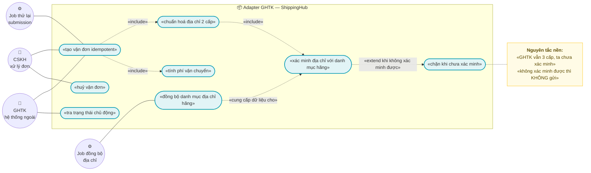
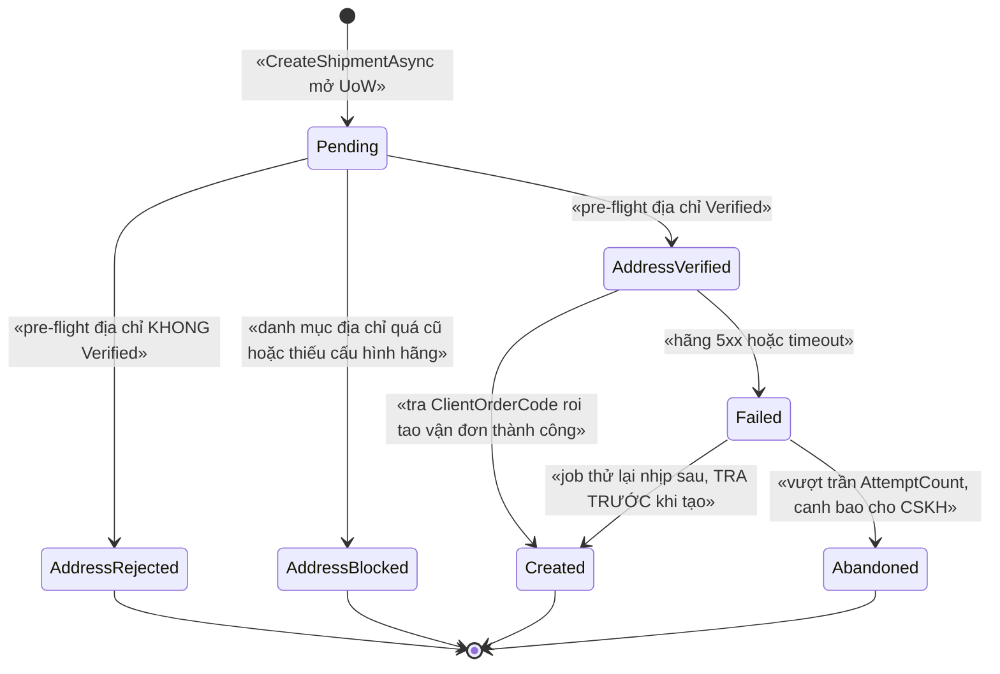
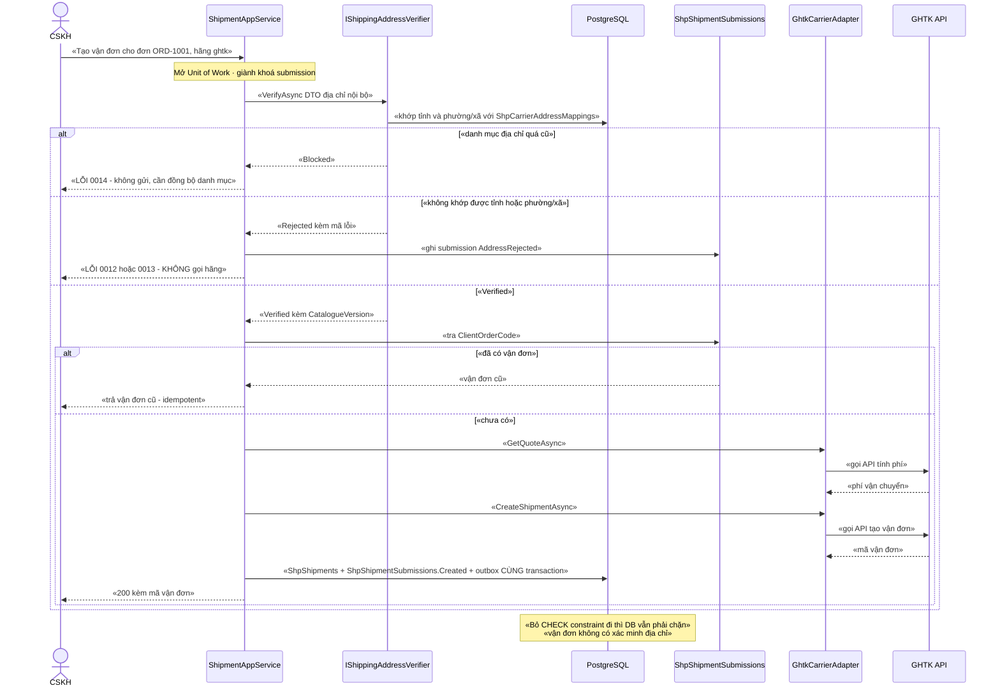

# `SHP-004` — Adapter GHTK (xác minh địa chỉ 2 cấp trước)

> 🔴 **RỦI RO CHẶN — ĐỌC TRƯỚC MỌI MỤC KHÁC: GHTK vẫn dùng payload địa chỉ 3 CẤP và ta CHƯA xác minh được cờ tương đương `is_new_to_address`.**
> Bằng chứng **trong repo** (không suy đoán):
> • `docs/implementation-plan.md:427` — *"| SHP-004 | Adapter **GHTK** (⚠️ xác minh địa chỉ 2 cấp trước) |"*
> • `docs/implementation-plan.md:199` — *"⚠️ **GHTK: xác minh địa chỉ 2 cấp TRƯỚC khi thiết kế**"*
> • `docs/implementation-plan.md:290` — bảng rủi ro, dòng 2, mức **🔴 cao**: *"**GHTK chưa xác nhận địa chỉ 2 cấp** … Hỏi GHTK trước khi chốt mô hình địa chỉ"*
> • `docs/business-modules-proposal.md:546` — *"⚠️ **GHTK vẫn dùng payload 3 cấp** (`province`/`district`/`ward`) và **KHÔNG tìm thấy** cờ tương đương `is_new_to_address` | **Xác minh với GHTK TRƯỚC KHI thiết kế địa chỉ**"*
> • `docs/business-modules-proposal.md:570` — *"**cờ địa chỉ 2 cấp của GHTK**"* nằm trong danh sách **16 mục KHÔNG TÌM THẤY**
> ⇒ Toàn bộ tài liệu này được xây theo **một** nguyên tắc: **xác minh địa chỉ 2 cấp ở BIÊN GỬI, FAIL-CLOSED** — không xác minh được thì **KHÔNG gửi** (`ADR-02`, `BR-SHP-004-002`).
>
> ⚠️ **Phân biệt với `SHP-003` (đổi COD ở GHN cần OTP):** cảnh báo đó **không** thuộc tài liệu này. `SHP-003` **chưa có tài liệu** trong `docs/features/` — xem **§15.2 F2**. `SHP-004` **không** làm nghiệp vụ đổi COD (§0 phạm vi).

| Thuộc tính | Nội dung |
|---|---|
| **Mã** | `SHP-004` |
| **Module** | **ShippingHub** — dự kiến tạo mới `modules/ShippingHub/eCommerce.ShippingHub.{Domain, EntityFrameworkCore, Application.Contracts, Application}` (hiện **chưa tồn tại** — §15.2 F1) |
| **Giai đoạn** | **GĐ2 — Vận hành & tuân thủ VN** (`docs/implementation-plan.md:113`, `docs/implementation-plan.md:427`) |
| **Ưu tiên** | **Must have** — nhưng là **adapter thứ HAI** (`docs/implementation-plan.md:338`: *"**GHN** — REST, có sandbox… GHTK làm sau, cần xác minh địa chỉ 2 cấp trước"*) |
| **Trạng thái** | 🟡 `Draft` — chờ review |
| **Người viết / người review** | *(điền)* / **Kiến trúc trưởng + người đã liên hệ GHTK** (`docs/design-doc-guidelines.md:134`: tích hợp NCC ngoài ⇒ review bởi người **đã liên hệ NCC**) |
| **Phiên bản / ngày** | `v0.1 — 15/10/2026` |
| **Tài liệu liên quan** | `SHP-001` (adapter GHN — *chưa có tài liệu*) · `SHP-002` (webhook trạng thái vận đơn & đối soát) · `SHP-003` (COD — *chưa có tài liệu*) · `XC-001` (Money) · `XC-002` (outbox/inbox, idempotency) · `XC-003` (khoá phân tán) · `XC-004` (phân quyền/tenant) · `XC-005` (log/metric) · `REC-003` (đối soát COD) · `REP-001` (read-model) · `SAL-003` (state machine 4 trục) · `docs/implementation-plan.md` · `docs/business-modules-proposal.md` · `docs/design-doc-guidelines.md` |

**Quy ước mã dùng trong tài liệu:** BR ⇒ `BR-SHP-004-nn` · NFR ⇒ `NFR-SHP-004-nn` (kế thừa khuôn `SHP-002`) · quyết định thiết kế ⇒ `ADR-nn` · test ⇒ `TC-nn`.

---

## 0. Tóm tắt & quyết định thiết kế

**Tóm tắt:** `SHP-004` cài **adapter GHTK** (hãng vận chuyển thứ hai) sau **một** hợp đồng trung lập hãng của `ShippingHub`: tính phí, tạo vận đơn, huỷ vận đơn, tra trạng thái. Ràng buộc **trung tâm** của tài liệu này **không** phải là HTTP mà là **dữ liệu địa chỉ**: sau **01/07/2025** Việt Nam **bỏ cấp huyện** và sáp nhập tỉnh (**63 → 34**) — `docs/business-modules-proposal.md:509` — trong khi **GHTK vẫn mô tả payload 3 cấp** (`province`/`district`/`ward`) và ta **chưa tìm thấy** cờ tương đương `is_new_to_address` của GHN (`docs/business-modules-proposal.md:513` nói **GHN đã thích ứng**; `:546` nói **GHTK thì chưa xác minh**).

**Vì sao phải "xác minh trước khi gửi" chứ không phải "gửi rồi sửa":**

| Nếu gửi vận đơn với địa chỉ CHƯA xác minh | Hệ quả thật |
|---|---|
| Hãng từ chối payload ⇒ ta **retry mù** | Tốn quota, log nhiễu, CSKH tưởng lỗi hệ thống; **mỗi lần thử là một lần gọi API tính vào hạn mức** |
| Hãng **chấp nhận** nhưng `district` là mã **đã bị bỏ** sau 01/07/2025 | Vận đơn đi vào **địa chỉ không còn tồn tại** ⇒ giao thất bại ⇒ **phí 2 chiều** + **COD treo** + khách phàn nàn. Đây là **lỗi im lặng** — API trả thành công |
| Đơn có COD, giao sai địa chỉ | `CodRecord` chờ thu tiền **vô thời hạn** ⇒ `REC-003` đối soát với file Excel của hãng **không khớp** ⇒ **không biết mất ở đâu** (kế thừa cảnh báo `SHP-002` §0) |
| Sản phẩm bị trả về kho | Phải nhập lại kho + hoàn tiền (`SAL-006` **chưa có tài liệu**) ⇒ phát sinh luồng nghiệp vụ **ngoài** phạm vi adapter |

⇒ Vì vậy thiết kế ở đây **chặn ở biên gửi**: một bước **pre-flight** bắt buộc (`ADR-02`) trả về **một trong ba** kết quả — `Verified` · `Rejected` (có mã lỗi) · `Blocked` (thiếu dữ liệu/cấu hình). **Chỉ** `Verified` mới được phép gọi API tạo vận đơn.

**Phạm vi:**
- ✅ Hợp đồng **trung lập hãng** `IShippingCarrier` + factory chọn theo `ProviderCode` (khuôn `IChannelConnectorFactory` — `modules/ChannelHub/eCommerce.ChannelHub.Application.Contracts/Connectors/IChannelConnector.cs:117`).
- ✅ **Adapter GHTK**: tính phí, tạo vận đơn, huỷ, tra trạng thái — **tất cả** sau interface, tầng nghiệp vụ **không** biết GHTK.
- ✅ **Lớp xác minh địa chỉ 2 cấp** (`IShippingAddressNormalizer` + `IShippingAddressVerifier`) chạy **trước** khi gọi hãng, **fail-closed**.
- ✅ **Danh mục địa chỉ của hãng là DỮ LIỆU ĐỒNG BỘ** (không phải master data) — `docs/business-modules-proposal.md:516`–`517`, có job đồng bộ + version + `SyncedAtUtc`.
- ✅ **Idempotency ở MỌI biên vào** của feature: app service tạo vận đơn (HTTP), job thử lại, job đồng bộ địa chỉ — và **parser** webhook mà `SHP-002` gọi.
- ✅ Mã trạng thái GHTK → trạng thái nội bộ (bảng ánh xạ là **dữ liệu**, kế thừa `SHP-002` D6).
- ✅ Tiền (`CodAmount`, `ShippingFee`) theo `XC-001`: `decimal`, **cấm** so bằng `==`.
- ✅ Log + `CorrelationId` + metric theo `XC-005`.

**Không nằm trong phạm vi:**
- ❌ **Nhận & xử lý webhook** trạng thái vận đơn — thuộc `SHP-002` (`docs/features/shp-002-webhook-trang-thai-van-don.md:53`–`56`). `SHP-004` **chỉ** cài `ParseAsync` cho GHTK theo hợp đồng `IShipmentWebhookVerifier` của `SHP-002`.
- ❌ **Nghiệp vụ COD**: thu hộ, **đổi** COD — thuộc `SHP-003`. ⚠️ `SHP-003` **chưa có tài liệu**; cảnh báo *"đổi COD ở GHN cần **OTP**"* **chỉ** tồn tại ở `docs/implementation-plan.md:426` và được tham chiếu ở `docs/features/shp-002-webhook-trang-thai-van-don.md:18,55`, `docs/features/rep-003-bao-cao-ton-kho-hieu-suat-kenh.md:539`, `docs/features/not-002-kenh-gui-email-sms-zalo-oa.md:819` (§15.2 F2).
- ❌ **Adapter GHN** (tính phí, tạo vận đơn) — thuộc `SHP-001`. `SHP-004` **phụ thuộc** `SHP-001` vì interface chung do `SHP-001` chốt lần đầu (`docs/implementation-plan.md:338`).
- ❌ **Import file Excel đối soát COD theo "phiên"** — thuộc `REC-003` (`docs/implementation-plan.md:200`).
- ❌ **Read-model/báo cáo** — thuộc `REP-001`/`REP-003`.
- ❌ **Master data địa chỉ** (tỉnh/phường chuẩn quốc gia) — thuộc `AddressHub` (`docs/business-modules-proposal.md:526`, tiền tố `ADDR` ở `docs/design-doc-guidelines.md:82`). **Chưa có code, chưa có tài liệu** — xem §15.1 Q2.
- ❌ **Sửa state machine 4 trục của đơn** — thuộc `SAL-003`. Ta **phát ETO**, Sales tự quyết định.

### 0.1 Quyết định thiết kế (ADR ngắn)

| # | Quyết định | Phương án đã cân nhắc | Lý do chọn | Hệ quả |
|---|---|---|---|---|
| **ADR-01** | GHTK là **một implementation** sau `IShippingCarrier`; app service **không bao giờ** gọi HTTP trực tiếp | (a) gọi HTTP trong app service · (b) adapter riêng mỗi hãng nhưng chung interface · (c) adapter chung có `if provider == "ghtk"` | (a) vi phạm khuôn đã dùng thật cho 2 miền ngoài: `IChannelConnector` (`.../Connectors/IChannelConnector.cs:95`) và `IPaymentProvider` (`modules/PaymentHub/eCommerce.PaymentHub.Domain/Payments/IPaymentProvider.cs:58`) — cả hai đều ghi rõ *"chi tiết riêng của từng [đối tác] phải nằm SAU interface này"*. (c) dồn mọi hãng vào một class ⇒ sửa GHTK làm hỏng GHN | Thêm hãng mới = thêm class + **một dòng** đăng ký (khuôn `ChannelConnectorFactory` — `.../Connectors/ChannelConnectorFactory.cs:18`–`25`) |
| **ADR-02** | ⭐ **Xác minh địa chỉ 2 cấp ở BIÊN GỬI, FAIL-CLOSED**: không xác minh được ⇒ **NÉM LỖI có mã**, tuyệt đối **không** gọi API tạo vận đơn | (a) gửi rồi xử lý lỗi của hãng · (b) gửi với `district` suy đoán · (c) **pre-flight bắt buộc + fail-closed** | (a)/(b) tạo **lỗi im lặng**: hãng có thể **chấp nhận** payload 3 cấp với mã huyện **đã bị bỏ** (`docs/business-modules-proposal.md:509`) ⇒ vận đơn đi sai địa chỉ mà **không có lỗi nào**. Đây đúng loại lỗi mà `XC-003` §0 gọi là *"lỗi im lặng, chỉ lộ ra khi có tranh chấp thật"* | CSKH **phải** sửa dữ liệu địa chỉ trước khi tạo vận đơn ⇒ cần UI hiển thị rõ lý do (§10) và mã lỗi riêng (`0012`/`0013`) |
| **ADR-03** | Mô hình địa chỉ nội bộ hỗ trợ **CẢ HAI** cấu trúc, **canonical = 2 cấp**; `district` là trường **dẫn xuất / nullable**, **không** là khoá | (a) chỉ 2 cấp · (b) chỉ 3 cấp · (c) **cả hai, canonical 2 cấp** | `docs/business-modules-proposal.md:516` — *"**Mô hình địa chỉ của ta phải hỗ trợ CẢ HAI cấu trúc** (3 cấp cũ và 2 cấp mới)"*; `docs/business-modules-proposal.md:658` — quyết định 8: *"Hỗ trợ CẢ HAI — vì GHTK vẫn dùng 3 cấp và **chưa xác minh được** cờ tương đương `is_new_to_address`"* | Mọi DTO/entity địa chỉ **phải** có `DistrictCode` nullable + ghi rõ nguồn dẫn xuất |
| **ADR-04** | **Danh mục địa chỉ của hãng là DỮ LIỆU ĐỒNG BỘ** (`ShpCarrierAddressMappings`), **không** phải master data và **không** hard-code | (a) hard-code bảng mã · (b) đọc master data quốc gia · (c) **bảng đồng bộ riêng theo hãng** | `docs/business-modules-proposal.md:517` — *"'địa chỉ gửi đối tác' là **DỮ LIỆU ĐỒNG BỘ**, không phải master data — mỗi hãng vận chuyển có bộ mã riêng"*; `docs/design-doc-guidelines.md:118` (quy tắc 8) — **cấm** hard-code dữ liệu NCC | Cần job đồng bộ + version + `SyncedAtUtc`; đổi danh mục = **không** cần release |
| **ADR-05** | **Địa chỉ nội bộ là nguồn duy nhất** — adapter **không** lấy địa chỉ từ payload webhook và **không** nhận địa chỉ tự do từ client GHTK | (a) tin payload · (b) đọc lại từ đơn · (c) **đọc từ đơn/DTO nội bộ, chỉ dùng mã của hãng để đối chiếu** | Payload webhook của GHTK **không xác thực được nguồn** (`docs/business-modules-proposal.md:547`; `SHP-002` §0.1 D1/D2) ⇒ nếu lấy địa chỉ từ payload thì kẻ giả mạo điều khiển được **nơi hàng đi tới** | `VerifyAddressAsync` **chỉ** nhận đầu vào từ tầng nội bộ; có test `TC-16` |
| **ADR-06** | **Idempotency tạo vận đơn bằng khoá ỔN ĐỊNH** `ClientOrderCode` + unique index **ở DB**; cấm `Guid.NewGuid()` mỗi lần gọi | (a) sinh Guid mỗi lần thử · (b) chỉ kiểm tra trong code · (c) **khoá ổn định + unique index** | `XC-002` BR-007 (dẫn qua `docs/features/shp-002-webhook-trang-thai-van-don.md:683`): *"⚠️ thuộc `SHP-001` — **cấm** `Guid.NewGuid()` mỗi lần gọi (`XC-002` BR-007)"*. Ngoài ra hãng **có thể** đã tạo vận đơn nhưng response bị mất ⇒ **phải tra cứu trước khi tạo lại** | Retry **luôn** theo trình tự: *tra theo `ClientOrderCode` → có thì dùng lại → không có mới tạo* (`BR-SHP-004-006`) |
| **ADR-07** | Khoá phân tán **chỉ** quanh thao tác gọi hãng + job đồng bộ địa chỉ; **không** khoá mỗi webhook | (a) khoá mọi thứ · (b) không khoá gì · (c) **khoá đúng chỗ, DB là hàng rào cuối** | Kế thừa `SHP-002` D7 + `XC-003` D2 (*"bỏ lock đi, DB có chặn không?"*). `XC-003` D6 cấm acquire lồng ⇒ job **không** được acquire lại khoá của tầng trên | `SkipIfBusy` cho job + **bắt buộc** log + metric `lock_skipped_total{module="shipping"}` (`XC-003` A1/BR-010) |
| **ADR-08** | Job định kỳ (đồng bộ địa chỉ, thử lại submission) dùng **`SkipIfBusy`**; HTTP thì **ném lỗi** | (a) chờ vô hạn · (b) ném lỗi cho mọi trường hợp · (c) **phân biệt job vs HTTP** | `XC-003` D10 + A1 (bỏ qua nhịp là hợp lý cho job, vì nhịp sau chạy lại) | Phải có `lock_skipped_total` + log `Information` mỗi lần bỏ qua |
| **ADR-09** | Tiền: `decimal`; **so bằng minor units**, **cấm** `==` | (a) `double` · (b) `decimal` + so `==` · (c) **`decimal` + `ToMinorUnits()`** | `XC-001` BR-003/D3 (`docs/features/XC-001-money-currency-lam-tron.md:41`) — bài học eShop so `ActualTotalPrice == OriginalPaymentAmount` ⇒ vỡ với VND/payOS. ⚠️ `Money`/`Currency` **chưa có trong code** (§15.2 F5) | Giai đoạn đầu dùng `decimal` + `string Currency` (khuôn `Order` — `src/eCommerce.Domain/Entities/Orders/Order.cs:36`); **khi** `XC-001` có code thì chuyển sang `Money` |
| **ADR-10** | **Không** gọi lại API GHTK khi `EnableLiveCalls = false` (khuôn PoC) | (a) luôn gọi thật · (b) luôn mô phỏng · (c) **cờ cấu hình** | Khuôn **đã có thật** trong repo: `ShopeeOptions.EnableLiveCalls` (`modules/ChannelHub/eCommerce.ChannelHub.Application/ChannelHubOptions.cs:47`) + `ShopeeConnector` trả kết quả mô phỏng khi tắt (`.../Connectors/ShopeeConnector.cs:80`–`87`) và **ném `NotImplementedException`** khi bật mà chưa cài (`:94`) | Cho phép chạy toàn bộ luồng (lock/worker/event) **trước** khi có credential GHTK; ⚠️ **cấm** bật `EnableLiveCalls` ở production khi chưa có Q1 |
| **ADR-11** | **Không** thêm gói ABP nào; giữ **một** phiên bản ABP duy nhất trong `Directory.Packages.props` | (a) thêm `Volo.Abp.Http.Client` · (b) **`HttpClient` + DI sẵn có** · (c) SDK của hãng | Toàn bộ `Directory.Packages.props` ghim **duy nhất** `10.7.0` cho mọi gói `Volo.Abp.*`; thêm gói ABP khác version ⇒ phá tính nhất quán. Không có gói ABP nào cần cho việc gọi HTTP ra ngoài | ⚠️ **Chưa kiểm chứng**: repo **không** có `Microsoft.Extensions.Http` trong `Directory.Packages.props` và **0** chỗ dùng `AddHttpClient`/`IHttpClientFactory` (grep) ⇒ xem §15.1 Q6 |
| **ADR-12** | **Không** coi webhook GHTK là bằng chứng; adapter **chỉ** đọc trạng thái **chủ động** | (a) tin webhook · (b) đối soát chủ động qua adapter · (c) bỏ webhook | Kế thừa `SHP-002` D1 (`docs/features/shp-002-webhook-trang-thai-van-don.md:66`): *"Webhook là GỢI Ý, không phải SỰ THẬT"* — **bắt buộc** vì GHTK không có HMAC | Adapter **phải** có `GetTrackingAsync` dùng được cho job đối soát; quota trở thành tài nguyên cần quản (`SHP-002` §15.1 Q4) |

> 📌 Ghi lại **phương án bị loại** và lý do — để 6 tháng sau không ai hỏi lại "sao không làm cách kia"
> (`docs/design-doc-guidelines.md:63`).

---

## 1. Use Case Specification

| Thuộc tính | Nội dung |
|---|---|
| **Use Case ID** | `SHP-004` |
| **Use Case Name** | Tạo & quản lý vận đơn **GHTK** với **địa chỉ đã được xác minh 2 cấp** |
| **Description** | *"Là hệ thống bán hàng, tôi muốn đẩy đơn sang GHTK để giao hàng — nhưng tôi KHÔNG muốn vận đơn đi tới một địa chỉ không còn tồn tại, và tôi KHÔNG muốn tạo trùng vận đơn chỉ vì mạng lỗi rồi thử lại."* |
| **Actor(s)** | **Nhân viên xử lý đơn/CSKH** (bấm tạo vận đơn) · **Job đồng bộ địa chỉ** (hệ thống) · **Job thử lại submission** (hệ thống) · **Hãng GHTK** (hệ thống ngoài) · **Quản trị** (cấu hình hãng + chính sách địa chỉ) |
| **Priority** | **Must have** (adapter thứ hai — điều kiện để bán được ở khu vực GHTK phủ tốt hơn GHN) |
| **Trigger** | (a) đơn chuyển sang trạng thái cần giao (`SAL-003`) và người dùng bấm **Tạo vận đơn**; (b) job định kỳ **đồng bộ danh mục địa chỉ** của hãng; (c) job định kỳ **thử lại** submission `Failed`; (d) job đối soát (`SHP-002`) gọi **tra trạng thái** |
| **Pre-Condition(s)** | • **Đơn đã tồn tại** và **đã xác nhận** — `Order.Status` là `OrderStatus` (`src/eCommerce.Domain/Entities/Orders/Order.cs:31`) với giá trị `Confirmed = 1` (`src/eCommerce.Domain.Shared/Enums.cs:53`) — cùng danh sách dòng + người nhận.<br>• **Tenant hiện tại** (`TenantId`) — ⚠️ hiện hệ thống chạy **1 tenant** nên `TenantId` có thể là `NULL` (xem `src/eCommerce.EntityFrameworkCore/Migrations/20261013024226_Fix_NullableTenantId_UniqueIndexes.cs:14`–`17`).<br>• `ChannelCode` **không** bắt buộc: vận đơn có thể phát sinh từ đơn website (`Order.ChannelCode = "web"`) hoặc đơn sàn.<br>• **Hãng `ghtk` đã được cấu hình** (`ShippingHub:Providers:ghtk:*`) — thiếu ⇒ **fail-closed** `eCommerce:Shipping:0007` (kế thừa `SHP-002` §6.2).<br>• **Danh mục địa chỉ của hãng còn "đủ mới"** (`SyncedAtUtc` trong ngưỡng `MaxCatalogueAgeDays`) — quá cũ ⇒ **chặn** (§12).<br>• `CorrelationId` theo `XC-005` (job tự sinh + ghi `JobName`; HTTP lấy từ header). |
| **Post-Condition(s)** | • **Mỗi** lần thử tạo vận đơn có **đúng một** dòng `ShpShipmentSubmissions` (kể cả khi bị chặn ở pre-flight).<br>• `ShpShipments` **chỉ** được tạo/gắn mã vận đơn khi `Submission.Status = Created` **và** `AddressVerification.Status = Verified`.<br>• Mọi lần **không** tạo được đều có **dấu vết**: `BusinessException` có mã **hoặc** `Status`/`FailureCode` trên submission — **cấm** im lặng.<br>• `ShippingFee`/`CodAmount` là `decimal` **đã chuẩn hoá theo `Currency`**; mọi đối chiếu tiền dùng **minor units**.<br>• Mọi thay đổi trạng thái vận đơn **do hãng** đi qua `SHP-002` (append-only + đối soát) — `SHP-004` **không** tự ghi trạng thái vận đơn. |
| **Basic Flow** | 1. Người dùng gọi `CreateShipmentAsync(OrderId, ProviderCode = "ghtk", addressInput)`.<br>2. App service mở **Unit of Work**, giành khoá `ecommerce:shipping:submission:{tenantId}:{orderId}` (ADR-07).<br>3. **Pre-flight địa chỉ** (`BR-SHP-004-002`): (a) chuẩn hoá (trim, chuẩn hoá khoảng trắng, chuẩn hoá mã); (b) khớp **tỉnh** và **phường/xã** với `ShpCarrierAddressMappings` của `ghtk` **theo `CatalogueVersion` hiện hành**; (c) kiểm tra `AddressLevelMode` của hãng (§5.2).<br>4. Nếu **không** `Verified` ⇒ ghi submission `Status = Rejected` + ném lỗi (`0012`/`0013`) — **không** gọi hãng.<br>5. Nếu `Verified` ⇒ tra `ClientOrderCode` (khoá **ổn định**, ADR-06). Đã có trong DB **và** đã có `ProviderTrackingCode` ⇒ **trả lại vận đơn cũ** (idempotent), **không** gọi hãng.<br>6. Tính phí (`GetQuoteAsync`) rồi tạo vận đơn (`CreateShipmentAsync`) — cả hai nằm **sau** `IShippingCarrier`.<br>7. Ghi `ProviderTrackingCode` + `ShippingFee` + lưu `ShpShipments`; `Submission.Status = Created`.<br>8. Phát `ShipmentCreatedEto` **qua outbox, cùng transaction** (`XC-002` BR-001) — ⚠️ outbox **chưa bật trong code** (§15.2 F4) ⇒ đây là **điều kiện tiên quyết**. |
| **Alternative Flow** | **A1: Hãng báo trùng `ClientOrderCode`** (response lỗi "đã tồn tại") ⇒ **tra lại** theo `ClientOrderCode`, dùng vận đơn hãng trả về, `Status = Created`, log `Information` + metric `result="duplicate"`. **Không** phải lỗi.<br>**A2: Mất response / timeout sau khi hãng đã tạo** ⇒ **bắt buộc** tra cứu trước khi tạo lại (`BR-SHP-004-006`); nếu tra cứu cũng lỗi ⇒ `Status = Failed` + thử lại nhịp sau + **cảnh báo** (không đoán).<br>**A3: Danh mục địa chỉ vừa được đồng bộ sang version mới trong lúc đơn đang chờ** ⇒ submission giữ `AddressCatalogueVersion` đã dùng ⇒ **có thể truy vết** vì sao hôm qua `Verified` mà hôm nay `Rejected`.<br>**A4: `EnableLiveCalls = false`** (PoC/dev) ⇒ adapter trả kết quả mô phỏng + log `Information`; **toàn bộ** luồng lock/worker/event vẫn chạy (khuôn `ShopeeConnector` — `.../Connectors/ShopeeConnector.cs:80`–`87`).<br>**A5: Người dùng bấm "Tạo vận đơn" lần hai** ⇒ bước 5 trả vận đơn cũ, `200`, **không** tạo mới. |
| **Exception Flow** | **E1:** thiếu cấp **phường/xã** hoặc không khớp danh mục hãng ⇒ **`eCommerce:Shipping:0012`**, `422`, submission `Rejected` — **không** gọi hãng.<br>**E2:** hãng **bắt buộc** `district` (`AddressLevelMode = ThreeLevel`) trong khi đơn chỉ có 2 cấp **và** không suy ra được ⇒ **`eCommerce:Shipping:0013`**, `409`, `Rejected` + **cảnh báo** (cần bổ sung dữ liệu/ánh xạ — §15 Q1).<br>**E3:** danh mục địa chỉ **quá cũ** (`SyncedAtUtc` > `MaxCatalogueAgeDays`) ⇒ **`eCommerce:Shipping:0014`**, `503`, `Status = Blocked`; metric + cảnh báo. **Cấm** bỏ qua kiểm tra để "chạy được".<br>**E4:** trọng lượng/kích thước ngoài ngưỡng hãng ⇒ **`eCommerce:Shipping:0015`**, `400`.<br>**E5:** hãng lỗi `5xx`/timeout ⇒ **`eCommerce:Shipping:0016`**, `502`, `Status = Failed`, `AttemptCount++`, **thử lại nhịp sau** — **không** rollback dữ liệu đã ghi (kế thừa `SHP-002` §12).<br>**E6:** cùng `ClientOrderCode` nhưng `PayloadHash` **khác** ⇒ **`eCommerce:Shipping:0017`**, `409` — **xung đột khoá**, **cấm** ghi đè (kế thừa `XC-002` BR-006; nếu `XC-002` đã có thì dùng `eCommerce:Messaging:0002` — xem `SHP-002` §6.2 mã `0011`).<br>**E7:** thiếu dữ liệu bắt buộc để dựng payload (SKU chưa map, thiếu cân nặng) ⇒ **`eCommerce:Shipping:0018`**, `400`.<br>**E8:** token/`PartnerCode` của hãng sai/hết hạn ⇒ **`eCommerce:Shipping:0020`**, `502` + **cảnh báo cấu hình**; **cấm** retry mù (retry không làm token đúng).<br>**E9:** huỷ vận đơn ở trạng thái hãng **không cho huỷ** ⇒ **`eCommerce:Shipping:0021`**, `409`.<br>**E10:** job không giành được khoá ⇒ **bỏ qua nhịp** + log + metric `lock_skipped_total{module="shipping"}` (`XC-003` A1) — **không** ném lỗi. |
| **Business Rules** | • **BR-SHP-004-001**: Mọi lời gọi API của GHTK **phải** đi qua `IShippingCarrier`; **cấm** gọi HTTP/SDK của hãng từ app service, job hay domain (khuôn `IChannelConnector`/`IPaymentProvider`).<br>• **BR-SHP-004-002**: ⭐ **Xác minh địa chỉ 2 cấp là BẮT BUỘC và FAIL-CLOSED trước khi tạo vận đơn.** Không xác minh được ⇒ **NÉM LỖI có mã** (`0012`/`0013`/`0014`); **cấm** gọi API tạo vận đơn khi chưa `Verified`.<br>• **BR-SHP-004-003**: `district` **không bao giờ** là khoá định danh địa chỉ của ta; nó chỉ là trường **dẫn xuất/nullable** và **phải** ghi rõ nguồn dẫn xuất khi có giá trị (ADR-03).<br>• **BR-SHP-004-004**: Danh mục địa chỉ hãng **phải** là **dữ liệu** có `CatalogueVersion` + `SyncedAtUtc` + hiệu lực theo thời gian; **cấm** hard-code mã tỉnh/phường/huyện của hãng trong code.<br>• **BR-SHP-004-005**: **Cấm** hard-code base URL/endpoint/mã trạng thái của GHTK — **phải** nằm ở cấu hình (`ShippingHub:Providers:ghtk:*`) hoặc dữ liệu (kế thừa `SHP-002` BR-009; `docs/design-doc-guidelines.md:118`).<br>• **BR-SHP-004-006**: ⭐ **Idempotency tạo vận đơn**: khoá **ổn định** `ClientOrderCode` + unique index **ở DB**; mọi lần thử lại **phải** tra cứu trước khi tạo; **cấm** `Guid.NewGuid()` cho mỗi lần gọi (`XC-002` BR-007).<br>• **BR-SHP-004-007**: Địa chỉ gửi hàng **chỉ** lấy từ **dữ liệu nội bộ** (đơn/DTO nội bộ); **cấm** lấy địa chỉ từ payload của hãng (ADR-05).<br>• **BR-SHP-004-008**: Mọi thao tác ghi **phải** đi qua **Unit of Work**; `ShpShipmentSubmissions` + `ShpShipments` + **outbox** ghi trong **cùng** transaction (`XC-002` BR-001).<br>• **BR-SHP-004-009**: Mọi **chuyển trạng thái của `Submission`** **phải** qua guard ở §3; chuyển sai ⇒ **NÉM LỖI** `eCommerce:Shipping:0019` — **cấm** no-op im lặng (kế thừa `XC-006`/quy ước #11).<br>• **BR-SHP-004-010**: `Status = Created` là **trạng thái hấp thụ** của submission; mọi chuyển dịch khỏi nó ⇒ **NÉM LỖI** `0019`.<br>• **BR-SHP-004-011**: Tiền (`CodAmount`, `ShippingFee`, `DeclaredValue`) là `decimal`; **cấm** `double`/`float`; **cấm** so tiền bằng `==` — so bằng **minor units** (`XC-001` BR-003/BR-008).<br>• **BR-SHP-004-012**: Payload **gửi đi** và **nhận về** lưu vào DB **phải** đi qua hàm **che dữ liệu nhạy cảm** trước khi lưu **và** trước khi log (kế thừa `XC-005` Q6 + `PaymentTransaction.MaskSensitiveData` — `modules/PaymentHub/eCommerce.PaymentHub.Domain/Entities/PaymentTransaction.cs:147`). **Cấm** log token của hãng.<br>• **BR-SHP-004-013**: Mọi **mã trạng thái thô** của GHTK nhận được **phải** có ánh xạ **hoặc** đi vào `Discrepancy` của `SHP-002` — **cấm** im lặng coi là "không đổi" (kế thừa `SHP-002` NFR-010).<br>• **BR-SHP-004-014**: Mã lỗi **phải** theo khuôn `eCommerce:Shipping:NNNN` và **do module `ShippingHub` sở hữu** (`ShippingHubErrorCodes`), **cấm** khai ở `eCommerceConsts.ErrorCodes` (kế thừa `XC-003` F2 + cách làm của `TaxErrorCodes` — `modules/Tax/eCommerce.Tax.Domain/TaxErrorCodes.cs:10`). **Dải `0012`–`0021` được giành riêng cho `SHP-004`** (dải `0001`–`0011` đã dùng ở `SHP-002` §6.2).<br>• **BR-SHP-004-015**: Job định kỳ **phải** dùng khoá phân tán + `SkipIfBusy`, và **bắt buộc** log + metric mỗi lần bỏ qua (`XC-003` BR-010).<br>• **BR-SHP-004-016**: Mọi metric phát ra **phải** nằm trong `eCommerceMetricNames` (`src/eCommerce.Domain.Shared/Observability/eCommerceMetrics.cs:13`) và nhãn **chỉ** từ `eCommerceMetricTags.Allowed` (`:62`); **cấm** `orderId`/`sku`/`userId`/`correlationId` (`:81`). |
| **Non-Functional Requirement** | • **NFR-SHP-004-001**: Pre-flight xác minh địa chỉ (không gọi mạng ngoài, chỉ tra DB/cache) ⇒ p95 **< 50 ms**.<br>• **NFR-SHP-004-002**: **0** vận đơn được tạo khi `AddressVerification.Status ≠ Verified` (test + CHECK constraint, xem §5.2).<br>• **NFR-SHP-004-003**: **Idempotent 100 %**: gọi `CreateShipmentAsync` **100 lần** cho cùng đơn ⇒ **đúng 1** vận đơn, **0** lần gọi API hãng thêm sau lần đầu.<br>• **NFR-SHP-004-004**: **0** `double`/`float` trong DTO/entity/payload của module (test reflection, kế thừa `XC-001` NFR-004).<br>• **NFR-SHP-004-005**: Tiền của hãng và tiền nội bộ khớp theo **minor units**; lệch ⇒ `Discrepancy`, **0** trường hợp tự sửa số của hãng.<br>• **NFR-SHP-004-006**: `CorrelationId` hiện diện trong **100 %** log của luồng tạo vận đơn (kế thừa `XC-005` NFR-002).<br>• **NFR-SHP-004-007**: **0** token/`PartnerCode`/header `Authorization` xuất hiện trong log hoặc trong payload đã lưu (quét tự động).<br>• **NFR-SHP-004-008**: Job đồng bộ địa chỉ chạy khi **rỗng** ⇒ **< 10** dòng log/nhịp (`XC-005` BR-004 — cấm log trong vòng lặp nóng).<br>• **NFR-SHP-004-009**: Cách ly tenant: **0** bản ghi tenant khác lọt vào truy vấn (integration test 2 tenant — ⚠️ **cần PostgreSQL**, xem §14.4).<br>• **NFR-SHP-004-010**: **0** lần acquire khoá thiếu `timeout`; **0** acquire lồng trên cùng tên khoá (`XC-003` BR-004/BR-005).<br>• **NFR-SHP-004-011**: **0** endpoint/mã trạng thái/base URL literal trong code nghiệp vụ (test grep trong CI — `docs/design-doc-guidelines.md:118`).<br>• **NFR-SHP-004-012**: **0** metric phát ra ngoài bảng đăng ký (`MetricsTests` — `test/eCommerce.Tests/Observability/MetricsTests.cs:50`). |

---

## 2. Sơ đồ Use Case



### Chú giải

| Ký hiệu | Ý nghĩa |
|---|---|
| ⭕ Xanh lá | Actor (người dùng + hệ thống + hãng ngoài) |
| 🟦 Bầu dục xanh dương | Use Case |
| 🟨 Khung vàng | Note (nguyên tắc nền) |
| `───` | Liên kết Actor ↔ Use Case |
| `-.«include».->` | Quan hệ bao hàm |
| `-.«extend khi ...».->` | Quan hệ mở rộng (chỉ xảy ra ở nhánh đó) |

---

## 3. Sơ đồ trạng thái (state machine)

> Feature này có **hai** vòng đời. `SHP-004` **sở hữu** vòng đời **submission** (yêu cầu gửi hàng).
> Vòng đời **vận đơn** (`Created → PickedUp → Delivering → Delivered`) thuộc **`SHP-002`** — `SHP-004` **chỉ đọc**, **không** ghi
> (`docs/features/shp-002-webhook-trang-thai-van-don.md:157`).

### 3.1 Vòng đời `ShpShipmentSubmissions` — SHP-004 sở hữu



**Bảng chuyển trạng thái & guard (mọi chuyển sai **phải ném lỗi**, không im lặng):**

| # | Từ → Sang | Guard (điều kiện cho phép) | Hành động kèm theo | Nếu guard sai thì? |
|---|---|---|---|---|
| 1 | `[*]` → `Pending` | Có `UnitOfWork` đang mở; `OrderId` tồn tại và **không** rỗng | Ghi submission với `ClientOrderCode` **ổn định** | Thiếu UoW ⇒ **lỗi lập trình** (`InvalidOperationException`), không phải `BusinessException` |
| 2 | `Pending` → `AddressVerified` | `IShippingAddressVerifier` trả `Verified` **và** `CatalogueVersion` khớp bản đang hiệu lực | Ghi `AddressVerifiedAtUtc` + `AddressCatalogueVersion` + mã tỉnh/phường đã khớp | Sang `AddressRejected` |
| 3 | `Pending` → `AddressRejected` | (đây là **nhánh** của guard 2, không phải guard) | Ném `0012` hoặc `0013`; `FailureCode` = mã lỗi | — |
| 4 | `Pending` → `AddressBlocked` | Danh mục cũ hơn `MaxCatalogueAgeDays` **hoặc** hãng chưa cấu hình | Ném `0014`/`0007`; log `Error` + metric + **cảnh báo** | — |
| 5 | `AddressVerified` → `Created` | (a) tra `ClientOrderCode` **không** thấy vận đơn cũ **hoặc** (b) hãng báo trùng và tra cứu trả về vận đơn | Ghi `ProviderTrackingCode` + `ShippingFee` + `ShpShipments` + **outbox** cùng transaction | **NÉM LỖI** — **cấm** coi `0` dòng là thành công (`XC-002` BR-008) |
| 6 | `AddressVerified` → `Failed` | Hãng trả `5xx`/timeout **hoặc** `ClientOrderCode` đã tồn tại với `PayloadHash` **khác** | `AttemptCount++`; `0006` ⇒ `Failed`; `0017` ⇒ **NÉM** + **không** retry tự động | Vi phạm E6 ⇒ phải **dừng** và cho người xử lý |
| 7 | `Failed` → `Created` | `AttemptCount < MaxSubmissionAttempts` **và** bước **tra cứu trước** đã chạy | `LastAttemptAtUtc`; giữ nguyên `ClientOrderCode` | Vượt trần ⇒ `Abandoned` + cảnh báo |
| 8 | `Failed` → `Abandoned` | `AttemptCount >= MaxSubmissionAttempts` | Log `Error` + metric + **cảnh báo** cho CSKH | — |
| 9 | `Created` → bất kỳ | **KHÔNG** có guard nào cho phép | — | **Trạng thái hấp thụ**: mọi chuyển dịch khỏi `Created` ⇒ **NÉM** `eCommerce:Shipping:0019` (`BR-SHP-004-010`) |
| 10 | `AddressRejected`/`AddressBlocked`/`Abandoned` → `Pending` | **Chỉ** khi người dùng **sửa dữ liệu địa chỉ/cấu hình** rồi bấm tạo lại — sinh submission **MỚI** (`AttemptNo++`) | Submission cũ **giữ nguyên** (append-only theo tinh thần `SHP-002` BR-005) | **Cấm** sửa đè submission cũ ⇒ **NÉM** `0019` |

> ⚠️ **Quy tắc bất di bất dịch #11** (`docs/features/XC-002-outbox-inbox-chong-trung-su-kien.md:27`):
> guard sai **phải NÉM LỖI** (hoặc ghi log có cấu trúc), **không** im lặng. Bài học `SetPaidStatus()` của eShop.
> **Ai được phép chuyển:** `Pending → AddressVerified/AddressRejected/AddressBlocked` do **app service/pre-flight**;
> `Failed → Created/Abandoned` do **job thử lại**; `[*] → Pending` do **người dùng có permission**.

⚠️ **Trạng thái nguy hiểm nhất là `AddressVerified`:** nếu danh mục địa chỉ đổi **sau** khi đã xác minh mà
submission vẫn dùng kết quả cũ, ta có thể gửi **mã đã lỗi thời**. Vì vậy `AddressCatalogueVersion` được ghi
xuống chính bản ghi `ShpShipments` **và** có metric đếm số lần lệch phiên bản (§13 `NFR-SHP-004-005`).

---

## 4. Sequence Diagram & luồng dữ liệu

### 4.1 Tạo vận đơn GHTK — xác minh 2 cấp TRƯỚC khi gọi hãng



---

## 5. Mô hình dữ liệu

### 5.1 ERD

**Không áp dụng** — vượt giới hạn **3 sơ đồ Mermaid** của tài liệu này (đã dùng ở §2, §3, §4).
Thay thế bằng **Data Dictionary** đầy đủ ở §5.2 (cột + index + ràng buộc).

### 5.2 Bảng & cột (Data Dictionary)

> ⚠️ **Chưa có bảng nào tồn tại trong code.** Đã kiểm bằng `read`/`grep`:
> `eCommerce.slnx` chỉ khai **3** module (`ChannelHub`, `PaymentHub`, `Tax`) — **không** có `ShippingHub`;
> `src/eCommerce.EntityFrameworkCore/eCommerceDbContext.cs:36`–`64` chỉ có DbSet của Catalog/Inventory/Orders/ChannelHub/PaymentHub/Tax.
> Thứ duy nhất liên quan tới vận chuyển trong code hiện tại là **cột tiền phí ship của đơn**:
> `Order.ShippingTotal` (`src/eCommerce.Domain/Entities/Orders/Order.cs:45`) với mapping `HasPrecision(18, 4)`
> (`src/eCommerce.EntityFrameworkCore/eCommerceDbContext.cs:176`).
> ⇒ **Toàn bộ 3 bảng dưới đây là kế hoạch GĐ2** — chưa có trong code.

**Bảng `ShpShipmentSubmissions`** — ⭐ nhật ký **mọi lần thử** tạo vận đơn (idempotency + truy vết pre-flight)

| Cột | Kiểu | Null? | Nguồn / ý nghĩa | Ghi chú |
|---|---|---|---|---|
| `Id` | `uuid` | ✖ | khoá chính | |
| `TenantId` | `uuid` | ✔ | tenant sở hữu | `IMultiTenant`; ⚠️ `NULL` = 1 tenant (xem ghi chú §5.2 index) |
| `OrderId` | `uuid` | ✖ | đơn hàng | tham chiếu **mềm** sang Sales — **cấm** module gọi app, đây là **id** không phải navigation |
| `ProviderCode` | `varchar(32)` | ✖ | mã hãng, `ghtk` với tài liệu này | khớp nhãn log `Provider` (`XC-005` §5.2) |
| `AttemptNo` | `int` | ✖ | lần thử thứ mấy của cùng đơn | bắt đầu `1`; tăng khi người dùng sửa dữ liệu rồi tạo lại |
| `ClientOrderCode` | `varchar(64)` | ✖ | ⭐ **mã đơn phía TA gửi sang hãng** — khoá idempotency | ổn định qua mọi lần retry (`BR-SHP-004-006`) |
| `IdempotencyKey` | `varchar(128)` | ✖ | khoá chống trùng nghiệp vụ | dạng `Ghtk:Create:{tenantId}:{orderId}:{attemptNo}` |
| `PayloadHash` | `char(64)` | ✖ | **SHA-256** payload gửi đi (**canonical JSON**) | phát hiện **xung đột khoá** (E6/`0017`) |
| `Status` | `int` | ✖ | `Pending=0` · `AddressVerified=1` · `AddressRejected=2` · `AddressBlocked=3` · `Created=4` · `Failed=5` · `Abandoned=6` | §3.1 |
| `AddressVerificationStatus` | `int` | ✖ | `Verified=0` · `Rejected=1` · `Blocked=2` | ⭐ **căn cứ của `BR-SHP-004-002`** |
| `AddressLevelMode` | `int` | ✖ | `TwoLevel=0` · `ThreeLevel=1` · `Both=2` — chế độ đã dùng khi xác minh | chụp lại cấu hình tại thời điểm xác minh |
| `AddressCatalogueVersion` | `varchar(32)` | ✔ | phiên bản danh mục địa chỉ hãng đã dùng | `null` khi `Blocked` |
| `ProvinceProviderCode` | `varchar(64)` | ✔ | mã **tỉnh** của hãng sau khi khớp | giữ **mã của hãng**, không phải mã nội bộ |
| `WardProviderCode` | `varchar(64)` | ✔ | mã **phường/xã** của hãng sau khi khớp | ⭐ trường **bắt buộc có** với `Verified` |
| `DistrictProviderCodeUsed` | `varchar(64)` | ✔ | mã **huyện** đã dùng **nếu** hãng yêu cầu (`ThreeLevel`) | ⚠️ **dẫn xuất** — `null` với chế độ 2 cấp (`BR-SHP-004-003`) |
| `ProviderTrackingCode` | `varchar(64)` | ✔ | mã vận đơn hãng cấp | khớp `ShpShipments.ProviderTrackingCode` |
| `ShippingFeeAmount` | `numeric(18,4)` | ✔ | phí vận chuyển hãng báo | ⚠️ `decimal`, **không bao giờ** `double` |
| `ShippingFeeCurrency` | `char(3)` | ✔ | ISO-4217, mặc định `VND` | theo `XC-001` §5.2 |
| `CodAmount` | `numeric(18,4)` | ✖ | số tiền thu hộ gửi sang hãng | `0` = không thu hộ |
| `CodCurrency` | `char(3)` | ✖ | ISO-4217 | |
| `RequestPayloadMasked` | `text` | ✔ | payload gửi đi **ĐÃ CHE** | ⚠️ **cấm** lưu token/payload thô (`BR-SHP-004-012`) |
| `ResponsePayloadMasked` | `text` | ✔ | response hãng **ĐÃ CHE** | |
| `FailureCode` | `varchar(64)` | ✔ | mã lỗi nghiệp vụ | `eCommerce:Shipping:00NN` |
| `FailureReason` | `varchar(2048)` | ✔ | mô tả ngắn (**đã che**) | |
| `AttemptCount` | `int` | ✖ | số lần **gọi hãng** đã thực hiện | mặc định `0`; trần `MaxSubmissionAttempts` |
| `CreatedAtUtc` / `LastAttemptAtUtc` | `timestamptz` | ✖ / ✔ | mốc tạo và mốc gọi gần nhất | |
| `CorrelationId` | `varchar(64)` | ✔ | truy vết end-to-end | `XC-005` |
| `RowVersion` | `xmin` (ánh xạ `uint`) | ✖ | optimistic concurrency | `IsRowVersion()` ⇒ dùng cột hệ thống `xmin`, **không** thêm cột thật |

**Bảng `ShpCarrierAddressMappings`** — ⭐ **danh mục địa chỉ ĐỒNG BỘ từ hãng** (DỮ LIỆU, không hard-code — ADR-04)

| Cột | Kiểu | Null? | Ý nghĩa | Ghi chú |
|---|---|---|---|---|
| `Id` | `uuid` | ✖ | khoá chính | |
| `ProviderCode` | `varchar(32)` | ✖ | mã hãng | `ghtk` với tài liệu này |
| `CatalogueVersion` | `varchar(32)` | ✖ | phiên bản danh mục (ví dụ `2026-10-15`) | ⭐ cho phép **truy vết** vì sao hôm qua `Verified` mà hôm nay `Rejected` |
| `Level` | `int` | ✖ | `Province=0` · `District=1` · `Ward=2` | ⚠️ `District` **có thể rỗng** nếu hãng đã bỏ cấp huyện |
| `ProviderCodeValue` | `varchar(64)` | ✖ | mã địa chỉ **do hãng cấp** | khoá đối chiếu |
| `ProviderName` | `varchar(256)` | ✖ | tên địa chỉ theo hãng | |
| `ParentProviderCodeValue` | `varchar(64)` | ✔ | mã cấp cha | `null` với `Province` |
| `NormalizedName` | `varchar(256)` | ✖ | tên **đã chuẩn hoá** để khớp khi hãng không trả mã | ⚠️ chuẩn hoá **không** được bỏ dấu tuỳ tiện — xem §15 Q4 |
| `IsActive` | `bool` | ✖ | còn hiệu lực trong danh mục hay không | |
| `SyncedAtUtc` | `timestamptz` | ✖ | thời điểm đồng bộ | ⭐ dùng cho `MaxCatalogueAgeDays` |

**Bảng `ShpCarrierAddressPolicies`** — chính sách địa chỉ theo hãng (**DỮ LIỆU, có duyệt + audit**)

| Cột | Kiểu | Null? | Ý nghĩa | Ghi chú |
|---|---|---|---|---|
| `Id` | `uuid` | ✖ | khoá chính | |
| `TenantId` | `uuid` | ✔ | `null` = dùng chung | |
| `ProviderCode` | `varchar(32)` | ✖ | mã hãng | |
| `AddressLevelMode` | `int` | ✖ | `TwoLevel=0` · `ThreeLevel=1` · `Both=2` | ⭐ **quyết định** cách xác minh — **chưa kiểm chứng** với GHTK (§15 Q1) |
| `RequiresDistrict` | `bool` | ✖ | hãng có **bắt buộc** `district` không | mặc định **`true`** cho tới khi GHTK xác nhận (**fail-closed**) |
| `IsFailClosed` | `bool` | ✖ | không xác minh được ⇒ **chặn** | mặc định **`true`**; đổi thành `false` cần **kiến trúc trưởng** duyệt |
| `MaxCatalogueAgeDays` | `int` | ✖ | tuổi tối đa của danh mục địa chỉ | mặc định **30** |
| `EffectiveFrom` / `EffectiveTo` | `date` / `date` | ✖ / ✔ | khung hiệu lực | kế thừa khuôn `XC-006` — **cấm** sửa đè bản ghi đang hiệu lực |
| `ApprovedBy` / `ApprovedAtUtc` | `uuid` / `timestamptz` | ✔ | người duyệt | có **audit** |

**Index & ràng buộc** *(phần hay bị bỏ sót nhất — `docs/templates/feature-design-template.md`)*

| Bảng | Loại | Cột | Mục đích |
|---|---|---|---|
| `ShpShipmentSubmissions` | **UNIQUE** `NULLS NOT DISTINCT` | `(TenantId, ProviderCode, ClientOrderCode, AttemptNo)` | ⭐ **idempotency tầng DB** — chặn 2 luồng cùng tạo 1 vận đơn cho 1 đơn (`BR-SHP-004-006`) |
| `ShpShipmentSubmissions` | INDEX | `(TenantId, Status, LastAttemptAtUtc)` | job thử lại: *"submission `Failed` đến hạn"* |
| `ShpShipmentSubmissions` | INDEX | `(TenantId, ProviderCode, ProviderTrackingCode)` | tra ngược từ mã vận đơn (webhook `SHP-002` khớp sang) |
| `ShpShipmentSubmissions` | INDEX | `(PayloadHash)` | điều tra **xung đột khoá** (E6) |
| `ShpShipmentSubmissions` | CHECK | `Status <> 4 OR (AddressVerificationStatus = 0 AND ProviderTrackingCode IS NOT NULL)` | 🚨 **`BR-SHP-004-002` ở TẦNG DB**: **không** thể có submission `Created` mà **chưa** xác minh địa chỉ — trả lời *"bỏ tầng ứng dụng đi, DB có chặn không?"* (`XC-003` D2) |
| `ShpShipmentSubmissions` | CHECK | `CodAmount >= 0 AND (ShippingFeeAmount IS NULL OR ShippingFeeAmount >= 0)` | bất biến tiền ở tầng DB |
| `ShpShipmentSubmissions` | CHECK | `CodCurrency ~ '^[A-Z]{3}$'` | theo khuyến nghị `XC-001` §5.2 |
| `ShpShipmentSubmissions` | CHECK | `PayloadHash ~ '^[0-9a-f]{64}$'` | bắt buộc SHA-256 hex thường |
| `ShpCarrierAddressMappings` | **UNIQUE** | `(ProviderCode, CatalogueVersion, Level, ProviderCodeValue)` | chống nạp trùng danh mục khi job chạy lại |
| `ShpCarrierAddressMappings` | INDEX | `(ProviderCode, Level, ParentProviderCodeValue, IsActive)` | pre-flight tra phường/xã theo tỉnh — ⭐ **đường nóng nhất** |
| `ShpCarrierAddressMappings` | INDEX | `(ProviderCode, Level, NormalizedName)` | khớp theo tên khi hãng không trả mã |
| `ShpCarrierAddressPolicies` | **UNIQUE** `NULLS NOT DISTINCT` | `(TenantId, ProviderCode, EffectiveFrom)` | chống trùng khung hiệu lực |
| `ShpCarrierAddressPolicies` | CHECK | `MaxCatalogueAgeDays > 0` | không cho cấu hình vô hiệu hoá kiểm tra |

> ⚠️ **`NULLS NOT DISTINCT` là BẮT BUỘC, và EF KHÔNG mô hình hoá nó.**
> Bằng chứng **đã kiểm chứng thật** trong repo: `src/eCommerce.EntityFrameworkCore/Migrations/20261013024226_Fix_NullableTenantId_UniqueIndexes.cs:14`–`17`
> ghi lại thí nghiệm — *"chèn 2 dòng `TaxRateSchedules` cùng `Code='DUP_TEST'`, `TenantId = NULL` ⇒ **INSERT 0 2 — THÀNH CÔNG**"*;
> và `:23`–`25` cảnh báo *"vì EF không mô hình hoá `NULLS NOT DISTINCT`, nếu một migration **do EF sinh tự động** sau này tạo lại một trong các index dưới đây, thuộc tính sẽ **mất**"*.
> ⇒ Migration của `SHP-004` **phải** có một bước SQL thô cho **mọi** unique index có `TenantId` (xem §11).

**Ghi chú về `ShpShipments` (SHP-001/002 sở hữu):** `SHP-004` **không** định nghĩa lại bảng này. Nó **cần** 4 cột đã được `SHP-002` liệt kê — `ClientOrderCode`, `ProviderTrackingCode`, `Status`, `CodAmount` (`docs/features/shp-002-webhook-trang-thai-van-don.md:318`–`330`) — và **cần thêm** một cột để trả lời *"địa chỉ này đã được xác minh bằng phiên bản danh mục nào"*:

| Cột | Kiểu | Null? | Ý nghĩa | Ghi chú |
|---|---|---|---|---|
| `AddressCatalogueVersion` | `varchar(32)` | ✔ | phiên bản danh mục địa chỉ dùng khi tạo vận đơn | ⭐ **đề nghị `SHP-001` bổ sung** vào `ShpShipments` — nếu không, không truy vết được sự cố địa chỉ về sau |

---

## 6. Hợp đồng API

### 6.1 Application Service & Domain Service

| Mục | Giá trị |
|---|---|
| Interface hãng (nội bộ) | `IShippingCarrier` — đặt tại `eCommerce.ShippingHub.Application.Contracts` (**trung lập hãng**, chốt lần đầu ở `SHP-001`) |
| Interface xác minh địa chỉ | `IShippingAddressNormalizer` + `IShippingAddressVerifier` |
| Factory | `IShippingCarrierFactory` — khuôn `IChannelConnectorFactory` (`modules/ChannelHub/eCommerce.ChannelHub.Application.Contracts/Connectors/IChannelConnector.cs:117`) |
| Implementation | `GhtkCarrierAdapter` (gọi API GHTK), `ShippingAddressVerifier` (tra danh mục), `GhtkAddressCatalogueSyncer` (job đồng bộ) |
| `[Authorize]` | **cấp CLASS** (bắt buộc — khuôn thật: `src/eCommerce.Application/Channels/ChannelAppService.cs:27` với comment *"đặt `[Authorize]` ở cấp CLASS để mặc định mọi method đều yêu cầu đăng nhập"*). **Ngoại lệ duy nhất:** webhook (thuộc `SHP-002`) |

```csharp
namespace eCommerce.ShippingHub.Carriers;

/// ⭐ Hợp đồng TRUNG LẬP HÃNG. Chi tiết của GHTK/GHN nằm SAU interface này —
/// khuôn đã dùng thật: IChannelConnector và IPaymentProvider.
/// 🚨 VÌ SAO PHẢI TRUNG LẬP: GHN ĐÃ thích ứng địa chỉ 2 cấp (có is_new_to_address),
///    GHTK thì CHƯA XÁC MINH được (docs/business-modules-proposal.md:513 vs :546).
///    Nếu nhét giả định "mọi hãng đều 3 cấp" vào app service thì SHP-004 sẽ chặn oan GHN
///    (và ngược lại, sẽ gửi sai cho GHTK).
public interface IShippingCarrier
{
    string ProviderCode { get; }

    /// BƯỚC BẮT BUỘC TRƯỚC KHI TẠO VẬN ĐƠN (BR-SHP-004-002).
    /// KHÔNG gọi mạng ngoài — chỉ tra danh mục địa chỉ của hãng trong DB.
    Task<AddressVerificationResult> VerifyAddressAsync(ShippingAddressInput address, CancellationToken ct = default);

    Task<ShippingQuoteResult> GetQuoteAsync(ShippingQuoteRequest request, CancellationToken ct = default);

    /// PHẢI idempotent theo ClientOrderCode: tra trước, chỉ tạo khi chưa có.
    Task<CreateShipmentResult> CreateShipmentAsync(CreateShipmentRequest request, CancellationToken ct = default);

    Task<bool> CancelShipmentAsync(string providerTrackingCode, string reason, CancellationToken ct = default);

    /// ⭐ Dùng cho job đối soát của SHP-002 (vì webhook GHTK KHÔNG có HMAC — ADR-12).
    Task<CarrierTrackingSnapshot> GetTrackingAsync(string providerTrackingCode, CancellationToken ct = default);
}

/// Đầu vào địa chỉ — canonical là 2 CẤP, district là dẫn xuất (ADR-03/BR-SHP-004-003).
public sealed record ShippingAddressInput(
    string ProvinceNameOrCode,
    string WardNameOrCode,
    string? DistrictNameOrCode,      // ⚠️ DẪN XUẤT — không phải khoá định danh
    string AddressLine,
    string RecipientName,
    string RecipientPhone);

public enum AddressVerificationStatus { Verified = 0, Rejected = 1, Blocked = 2 }

public sealed record AddressVerificationResult(
    AddressVerificationStatus Status,
    string? FailureCode,             // eCommerce:Shipping:0012 / 0013 / 0014
    string? FailureReason,           // nhãn HỮU HẠN cho metric: "ward_not_found" · "district_required" · "catalogue_stale"
    string? CatalogueVersion,
    string? ProvinceProviderCode,
    string? WardProviderCode,
    string? DistrictProviderCodeUsed);

public sealed record CreateShipmentRequest(
    Guid OrderId,
    string ClientOrderCode,
    ShippingAddressInput Address,
    decimal CodAmount,
    string Currency,
    decimal DeclaredValue,
    int WeightInGrams,
    int? LengthCm, int? WidthCm, int? HeightCm,
    IReadOnlyList<ShipmentLineInput> Lines);

public sealed record CreateShipmentResult(
    bool Success,
    bool WasDuplicate,               // ⭐ hãng báo đã tồn tại ⇒ dùng lại, KHÔNG phải lỗi (A1)
    string? ProviderTrackingCode,
    decimal? ShippingFeeAmount,
    string? ShippingFeeCurrency,
    string? FailureCode,
    string? FailureReason);

/// Job đồng bộ danh mục địa chỉ — DỮ LIỆU, không hard-code (ADR-04).
public interface IAddressCatalogueSyncer
{
    /// Trả về phiên bản danh mục mới. Idempotent theo (ProviderCode, CatalogVersion).
    Task<AddressCatalogueSyncResult> SyncAsync(string providerCode, CancellationToken ct = default);
}

public interface IShipmentSubmissionRepository : IRepository<ShipmentSubmission, Guid>
{
    Task<ShipmentSubmission?> FindLatestAsync(
        string providerCode, string clientOrderCode, CancellationToken ct = default);

    /// ⚠️ `UPDATE … WHERE Status = @expected` — trả về 0 ⇒ tầng trên PHẢI NÉM LỖI (BR-SHP-004-009).
    Task<int> TryTransitionAsync(
        Guid submissionId, ShipmentSubmissionStatus expected, ShipmentSubmissionStatus next,
        string? failureCode, CancellationToken ct = default);
}
```

**Method của `IShipmentAppService` (phần thuộc `SHP-004`)**

| Method | Input (DTO) | Output (DTO) | Permission | Ghi chú |
|---|---|---|---|---|
| `CreateShipmentAsync` | `CreateShipmentInput` | `ShipmentDto` | `eCommerce.Shipping.Shipments.Create` | ⭐ chạy **pre-flight** bắt buộc; idempotent theo `ClientOrderCode` |
| `VerifyAddressAsync` | `VerifyShippingAddressInput` | `AddressVerificationDto` | `eCommerce.Shipping.Shipments.Create` | cho UI kiểm tra **trước** khi bấm gửi (giảm lỗi cho CSKH) |
| `GetQuoteAsync` | `GetShippingQuoteInput` | `ShippingQuoteDto` | `eCommerce.Shipping.Shipments.Create` | ⚠️ **tính vào quota** ⇒ có kiểm soát tần suất |
| `CancelShipmentAsync` | `CancelShipmentInput` | `ShipmentDto` | `eCommerce.Shipping.Shipments.Cancel` | **bắt buộc** `Reason` + audit |
| `SyncAddressCatalogueAsync` | `SyncAddressCatalogueInput` | `AddressCatalogueSyncResultDto` | `eCommerce.Shipping.AddressCatalogue.Sync` | dùng **cùng** code với job (không có đường logic thứ hai) |
| `GetSubmissionsAsync` | `GetSubmissionsInput` | `PagedResultDto<ShipmentSubmissionDto>` | `eCommerce.Shipping.Shipments.View` | ⭐ màn hình điều tra "vì sao không tạo được vận đơn" |
| `GetAddressPoliciesAsync` / `UpsertAddressPolicyAsync` | … | `CarrierAddressPolicyDto` | `.AddressPolicies.View` / `.Manage` | `IsFailClosed = false` cần **thêm** quyền `.Approve` |

### 6.2 REST endpoint

| Method | Route | Auth | Permission | Mô tả |
|---|---|---|---|---|
| `POST` | `/api/app/shipping/shipments` | Bearer (OpenIddict) | `.Shipments.Create` | tạo vận đơn (chạy pre-flight) |
| `POST` | `/api/app/shipping/shipments/verify-address` | Bearer | `.Shipments.Create` | kiểm tra địa chỉ **không** tạo vận đơn |
| `POST` | `/api/app/shipping/shipments/quote` | Bearer | `.Shipments.Create` | tính phí |
| `POST` | `/api/app/shipping/shipments/{id}/cancel` | Bearer | `.Shipments.Cancel` | huỷ (bắt buộc `Reason`) |
| `GET` | `/api/app/shipping/shipments/{id}/submissions` | Bearer | `.Shipments.View` | nhật ký thử tạo vận đơn |
| `POST` | `/api/app/shipping/address-catalogue/sync` | Bearer | `.AddressCatalogue.Sync` | đồng bộ danh mục địa chỉ hãng |
| `GET` `PUT` | `/api/app/shipping/address-policies…` | Bearer | `.AddressPolicies.View/Manage` | chính sách địa chỉ theo hãng |
| `POST` | `/api/shipping/webhooks/ghtk/{tenantCode}` | **`[AllowAnonymous]` CÓ CHỦ Ý** | — | ⚠️ **thuộc `SHP-002`** (`docs/features/shp-002-webhook-trang-thai-van-don.md:522`). `SHP-004` **chỉ** cài `ParseAsync` cho GHTK |

**Request mẫu — tạo vận đơn (chỉ minh hoạ cấu trúc DTO của TA, KHÔNG phải payload GHTK)**

```http
POST /api/app/shipping/shipments HTTP/1.1
Authorization: Bearer <token>
X-Correlation-Id: (tùy chọn)

{
  "orderId": "…",
  "clientOrderCode": "TENANT-A-ORD-1001",
  "providerCode": "ghtk",
  "address": {
    "provinceNameOrCode": "…",
    "wardNameOrCode": "…",
    "districtNameOrCode": null,
    "addressLine": "…",
    "recipientName": "…",
    "recipientPhone": "…"
  },
  "codAmount": 250000,
  "currency": "VND",
  "weightInGrams": 800
}
```

> 🚨 **Cấu trúc payload GỬI SANG GHTK (tên trường `province`/`district`/`ward`, kiểu mã, endpoint) CHƯA ĐƯỢC KIỂM CHỨNG.**
> Nguồn duy nhất trong repo là **mô tả gián tiếp** ở `docs/business-modules-proposal.md:546` — *"GHTK vẫn dùng payload 3 cấp (`province`/`district`/`ward`)"* — **không** có tài liệu API chính thức.
> ⇒ **Chặn code**: xem **§15.1 Q1**. Không được viết `GhtkCarrierAdapter` dựa trên suy đoán.

**Response mẫu (mọi nhánh)**

| Nhánh | HTTP | Body |
|---|---|---|
| Tạo thành công | `200` | `{ "trackingCode": "…", "shippingFee": 22000, "wasDuplicate": false, "correlationId": "…" }` |
| Đã tồn tại (A1/A5) | `200` | `{ "trackingCode": "…", "wasDuplicate": true, "correlationId": "…" }` |
| Không xác minh được địa chỉ | `422` | `{ "error": { "code": "eCommerce:Shipping:0012", "message": "…" }, "correlationId": "…" }` |
| Hãng bắt buộc `district` | `409` | `{ "error": { "code": "eCommerce:Shipping:0013" }, "correlationId": "…" }` |
| Danh mục địa chỉ quá cũ | `503` | `{ "error": { "code": "eCommerce:Shipping:0014" }, "correlationId": "…" }` |

**Mã lỗi nghiệp vụ** (`ShippingHubErrorCodes` — **module tự sở hữu**, kế thừa cách làm của `TaxErrorCodes` ở `modules/Tax/eCommerce.Tax.Domain/TaxErrorCodes.cs:10`).
⚠️ **Dải `0001`–`0011` ĐÃ DÙNG ở `SHP-002`** (`docs/features/shp-002-webhook-trang-thai-van-don.md:565`–`575`) ⇒ `SHP-004` dùng **`0012`–`0021`**:

| Mã | HTTP | Khi nào | Thông điệp |
|---|---|---|---|
| `eCommerce:Shipping:0012` | `422` | ⭐ Thiếu/không khớp **phường/xã** (hoặc tỉnh) với danh mục địa chỉ hãng | `Địa chỉ giao hàng chưa xác minh được với hãng {provider}: {chiTiet}.` |
| `eCommerce:Shipping:0013` | `409` | Hãng **yêu cầu cấp huyện** nhưng đơn chỉ có 2 cấp và không dẫn xuất được | `Hãng {provider} yêu cầu cấp quận/huyện; đơn chưa có dữ liệu này.` |
| `eCommerce:Shipping:0014` | `503` | Danh mục địa chỉ hãng **quá cũ** (`> MaxCatalogueAgeDays`) ⇒ chặn (fail-closed) | `Danh mục địa chỉ của hãng {provider} đã cũ; cần đồng bộ trước khi gửi.` |
| `eCommerce:Shipping:0015` | `400` | Trọng lượng/kích thước ngoài ngưỡng hãng | `Khối lượng hoặc kích thước vượt giới hạn của hãng {provider}.` |
| `eCommerce:Shipping:0016` | `502` | Hãng trả `5xx`/timeout khi tính phí hoặc tạo vận đơn | `Hãng {provider} tạm thời không phản hồi; sẽ thử lại.` |
| `eCommerce:Shipping:0017` | `409` | Cùng `ClientOrderCode` nhưng `PayloadHash` **khác** (xung đột khoá) | `Mã đơn gửi hãng đã tồn tại với nội dung khác — cần điều tra thủ công.` |
| `eCommerce:Shipping:0018` | `400` | Thiếu dữ liệu bắt buộc để dựng payload (SKU chưa map, thiếu cân nặng) | `Đơn chưa đủ dữ liệu để tạo vận đơn: {chiTiet}.` |
| `eCommerce:Shipping:0019` | `409` | Chuyển trạng thái `Submission` không hợp lệ · `UPDATE` **0 dòng** | `Không thể chuyển yêu cầu gửi hàng từ {from} sang {to}.` |
| `eCommerce:Shipping:0020` | `502` | Token/`PartnerCode` của hãng sai/hết hạn | `Xác thực với hãng {provider} thất bại — kiểm tra cấu hình.` |
| `eCommerce:Shipping:0021` | `409` | Huỷ vận đơn ở trạng thái hãng không cho huỷ | `Hãng {provider} không cho huỷ vận đơn ở trạng thái hiện tại.` |
| `eCommerce:Shipping:0007` | `400` | *(kế thừa `SHP-002`)* hãng chưa được cấu hình — **fail-closed** | `Hãng vận chuyển {provider} chưa được cấu hình.` |

> 📌 Ghi rõ: mã `0017` **trùng tình huống** với `eCommerce:Messaging:0002` của `XC-002`. Cách xử lý đã chốt ở `SHP-002` §6.2 (mã `0011`): **khi `XC-002` đã được triển khai thì dùng mã của `XC-002`** để không có hai định nghĩa cho một tình huống (bài học `XC-003` F2). ⚠️ `XC-002` **chưa có trong code** (§15.2 F4).

### 6.3 Cấu hình (đề xuất) — **không hard-code endpoint hãng** (`BR-SHP-004-005`)

```jsonc
{
  "ShippingHub": {
    "DefaultLockTimeoutSeconds": 10,
    "Providers": {
      "ghtk": {
        // ⚠️ CHƯA KIỂM CHỨNG — §15 Q1. KHÔNG commit giá trị thật.
        "ApiBaseUrl": "",
        "ApiToken": "",
        "PartnerCode": "",
        "EnableLiveCalls": false,          // ADR-10: khuôn ShopeeOptions.EnableLiveCalls
        "TimeoutSeconds": 10,
        "MaxRetries": 3,
        "MaxSubmissionAttempts": 5,        // trần AttemptCount của submission
        "AddressCatalogueSyncPeriodSeconds": 86400,   // 1 ngày
        "MaxCatalogueAgeDays": 30,         // quá ngưỡng ⇒ CHẶN (0014)
        "AddressLevelMode": "Both",        // TwoLevel | ThreeLevel | Both
        "RequiresDistrict": true,          // ⚠️ mặc định TRUE cho tới khi GHTK xác nhận (fail-closed)
        "MaxCodAmount": 50000000,
        "MaxWeightInGrams": 50000
      }
    }
  }
}
```

---

## 7. Sự kiện, tích hợp ngoài & idempotency

### 7.1 Sự kiện phát ra (ETO)

| ETO | Khi nào | Trường bắt buộc | Ghi chú |
|---|---|---|---|
| `ShipmentCreatedEto` | Submission `→ Created` | `TenantId`, `OrderId`, `ShipmentId`, `ProviderCode`, `ProviderTrackingCode`, `ShippingFeeAmount`, `Currency`, `AddressCatalogueVersion`, `CorrelationId` | ⚠️ **`OrderId` là id, không navigation** — module **cấm** tham chiếu app |
| `ShipmentCreationFailedEto` | Submission `→ Failed`/`Abandoned` | `TenantId`, `OrderId`, `ProviderCode`, `FailureCode`, `AttemptCount`, `CorrelationId` | để `NOT-002` cảnh báo CSKH |
| `CarrierAddressCatalogueSyncedEto` | Job đồng bộ xong | `ProviderCode`, `CatalogueVersion`, `RowCount`, `SyncedAtUtc` | cho vận hành biết danh mục đã cập nhật |

> 🚨 **ĐIỀU KIỆN TIÊN QUYẾT:** mọi ETO **phải** phát qua **outbox** với `useOutbox: true` trong UoW
> (`XC-002` BR-001; `docs/features/shp-002-webhook-trang-thai-van-don.md:638`–`639` ghi cùng cảnh báo cho `SHP-002`).
> ⚠️ **Outbox CHƯA được bật trong code hiện tại** — đã kiểm: **0** chỗ có `IHasEventOutbox`/`IHasEventInbox`/`ConfigureEventOutbox`,
> **0** chỗ cấu hình `AbpDistributedEventBusOptions` (grep toàn repo). Xem **§15.2 F4**.

### 7.2 Sự kiện / webhook **nhận vào**

| Nguồn | Loại | **Xác thực** | Chống trùng bằng | Nếu xử lý lỗi? | Thuộc |
|---|---|---|---|---|---|
| **GHTK** (trạng thái vận đơn) | `webhook` | 🚨 **KHÔNG có HMAC** — chỉ `hash` trên URL + IP allowlist + tenant theo path (`docs/business-modules-proposal.md:547`) | `UNIQUE (TenantId, ProviderCode, ProviderEventId)` + `IIdempotencyGuard` | lưu `ShipmentEvents` + `FailureCode`, log `Warning`, metric, **job nhặt lại** | ⚠️ **`SHP-002`** — `SHP-004` chỉ cài `ParseAsync` |
| **Job đồng bộ danh mục địa chỉ** | `schedule` | nội bộ | `UNIQUE (ProviderCode, CatalogueVersion, Level, ProviderCodeValue)` | thử lại nhịp sau; **0** dòng ⇒ ném lỗi | ✅ `SHP-004` |
| **Job thử lại submission** | `schedule` | nội bộ | `UPDATE … WHERE Status = Failed` + tra `ClientOrderCode` **trước** | `AttemptCount++`; vượt trần ⇒ `Abandoned` + cảnh báo | ✅ `SHP-004` |
| **Người dùng bấm tạo vận đơn** | `http` | Bearer + permission | `UNIQUE (TenantId, ProviderCode, ClientOrderCode, AttemptNo)` | ném lỗi có mã; **không** nuốt | ✅ `SHP-004` |

### 7.3 Gọi API **ra ngoài**

| NCC | Endpoint (base URL) | Auth | Timeout | Retry | Nếu thất bại |
|---|---|---|---|---|---|
| **GHTK** | `ShippingHub:Providers:ghtk:ApiBaseUrl` (**cấu hình**, **cấm** hard-code — `BR-SHP-004-005`) | token/`PartnerCode` theo tài liệu GHTK — 🔴 **CHƯA KIỂM CHỨNG** | **10 s** (cấu hình) | **3** lần + backoff cho **GET**; ⚠️ **KHÔNG** retry mù `POST` tạo vận đơn (xem dưới) | ghi `FailureCode`/`FailureReason`; `AttemptCount++`; **thử lại nhịp sau**; **KHÔNG** rollback dữ liệu đã ghi; metric `carrier_submission_failed_total` |

> 🚨 **Khác biệt sống còn giữa `GET` và `POST`:** `GET` (tính phí, tra trạng thái, tra theo `ClientOrderCode`) **an toàn** để retry.
> `POST` tạo vận đơn **không** an toàn để retry mù — nếu hãng đã tạo nhưng response mất, retry mù có thể sinh **vận đơn thứ hai**.
> ⇒ `SHP-004` **bắt buộc** dùng trình tự **"tra trước – tạo sau"** (`BR-SHP-004-006`) và **coi** `ClientOrderCode` là **hợp đồng** với hãng.
> ⚠️ **Chưa kiểm chứng**: GHTK có hỗ trợ `ClientOrderCode` như một khoá chống trùng ở phía hãng hay không (§15 Q3).

**Idempotency key**

| Đối tượng | Cách sinh khoá | ⚠️ Lưu ý |
|---|---|---|
| Tạo vận đơn | `ClientOrderCode = "{tenantCode}-{orderNumber}"` + `IdempotencyKey = "Ghtk:Create:{tenantId}:{orderId}:{attemptNo}"` | ⭐ **ỔN ĐỊNH** qua retry; **cấm** `Guid.NewGuid()` (`XC-002` BR-007) |
| Đồng bộ danh mục địa chỉ | `"Ghtk:AddressSync:{providerCode}:{catalogueVersion}"` | chạy lại **cùng** version ⇒ **không** nhân bản dòng |
| Job thử lại submission | `"Ghtk:Retry:{tenantId}:{runId}"` với `runId = yyyyMMddHHmm` | cùng kỳ chạy lại ⇒ không xử lý 2 lần |
| Webhook trạng thái (thuộc `SHP-002`) | `"Webhook:ghtk:{ProviderEventId}"` | ⚠️ GHTK có cấp `ProviderEventId` **ổn định** không — **chưa kiểm chứng** (`SHP-002` §15 Q1/Q6) |

---

## 8. Bất biến & xử lý đồng thời

### 8.1 Bất biến

| # | Bất biến | Cơ chế bảo vệ |
|---|---|---|
| 1 | ⭐ **Không** vận đơn nào được tạo khi địa chỉ **chưa** xác minh | Pre-flight **fail-closed** (`BR-SHP-004-002`) **+ CHECK constraint** ở DB (`Status <> Created OR AddressVerificationStatus = Verified`) + `TC-03`/`TC-21` |
| 2 | **Đúng một** vận đơn cho một `ClientOrderCode` trong một tenant+hãng | **UNIQUE `NULLS NOT DISTINCT`** `(TenantId, ProviderCode, ClientOrderCode, AttemptNo)` + tra trước khi tạo |
| 3 | `district` **không** là khoá định danh | Review + `BR-SHP-004-003` + test `TC-08` |
| 4 | Danh mục địa chỉ hãng **luôn** có version + `SyncedAtUtc`; **không** hard-code | `BR-SHP-004-004` + test grep `TC-19` |
| 5 | **Không** có chuyển trạng thái submission ngầm | Setter **private**; mọi đổi qua guard §3; `Created` là **hấp thụ** |
| 6 | Chuyển trạng thái đồng thời: **đúng 1** thắng; `0` dòng ⇒ **NÉM LỖI** | `TryTransitionAsync` (`UPDATE … WHERE Status = @expected`) + `RowVersion` |
| 7 | **0** token/payload thô nhạy cảm trong DB/log | `MaskSensitiveData` trước khi lưu **và** trước khi log + test quét `TC-11` |
| 8 | Tiền **luôn** `decimal`, **so bằng minor units** | `BR-SHP-004-011` + test `TC-09` |
| 9 | Cách ly tenant | `IMultiTenant` + query filter + `ICurrentTenant` + unique index có `TenantId` (**`NULLS NOT DISTINCT`**) |
| 10 | Hãng **chưa** cấu hình **hoặc** danh mục quá cũ ⇒ **fail-closed** | `0007`/`0014` — **cấm** mặc định chấp nhận |
| 11 | Metric **không** dùng để ra quyết định nghiệp vụ | Review (kế thừa `XC-005` §7) |

### 8.2 Xử lý đồng thời

| # | Tình huống | Cơ chế |
|---|---|---|
| 1 | **2 người cùng bấm "Tạo vận đơn"** cho cùng đơn | Khoá `ecommerce:shipping:submission:{tenantId}:{orderId}` (30 s) ⇒ 1 thắng; người thua **chờ** rồi đọc lại submission ⇒ trả vận đơn đã có (A5) |
| 2 | **Job thử lại chạy trên nhiều instance** | Khoá `ecommerce:shipping:submission-retry:ghtk:{tenantId}` + `SkipIfBusy` + log + metric `lock_skipped_total{module="shipping"}` |
| 3 | **2 instance đồng bộ danh mục địa chỉ cùng lúc** | Khoá `ecommerce:shipping:address-sync:ghtk` + `SkipIfBusy`; chốt cuối là **unique index** `(ProviderCode, CatalogueVersion, Level, ProviderCodeValue)` |
| 4 | **Danh mục địa chỉ đổi version trong lúc đang xác minh** | Submission **chụp lại** `AddressCatalogueVersion` đã dùng (A3) ⇒ truy vết được; pre-flight đọc **một** version trong suốt request |
| 5 | **Người dùng xác minh địa chỉ trong khi job vừa đổi danh mục** | Pre-flight đọc `CatalogueVersion` hiện hành **một lần** vào đầu request (snapshot) — kế thừa cách xử lý setting của `XC-001` §8.2 |
| 6 | **Hãng đã tạo vận đơn nhưng response mất** | ⭐ **"Tra trước – tạo sau"** (`BR-SHP-004-006`); nếu cả tra cũng lỗi ⇒ `Failed` + cảnh báo, **không** đoán |
| 7 | **Redis chết** | `AbortOnConnectFail = false` **đã sửa** (`src/eCommerce.HttpApi.Host/eCommerceHttpApiHostModule.cs:141`) ⇒ app **vẫn chạy**, **mất** tính tuần tự của job. Chốt cuối vẫn là **unique index + CHECK constraint** ở DB (`XC-003` D2) |
| 8 | **2 đơn khác nhau, cùng `orderNumber` ở 2 tenant** | `ClientOrderCode` có `tenantCode`; unique index có `TenantId` ⇒ hợp lệ |

**Khoá phân tán dùng trong feature** *(liệt kê chính xác tên khoá — quy tắc 6 của `docs/design-doc-guidelines.md:116`)*

| Tên khoá | Hàm sinh khoá | Phạm vi | Vì sao cần | TTL đề xuất |
|---|---|---|---|---|
| `ecommerce:shipping:submission:{tenantId}:{orderId}` | `ShippingHubLockKeys.CarrierSubmission(providerCode, tenantId, orderId)` | theo đơn + hãng | chống 2 luồng cùng gọi API tạo vận đơn cho 1 đơn | **30 s** |
| `ecommerce:shipping:submission-retry:ghtk:{tenantId}` | `ShippingHubLockKeys.SubmissionRetry(providerCode, tenantId)` | theo hãng + tenant | chống job thử lại chạy chồng | **120 s** |
| `ecommerce:shipping:address-sync:ghtk` | `ShippingHubLockKeys.AddressCatalogueSync(providerCode)` | theo hãng (hạ tầng) | chống 2 instance cùng đồng bộ danh mục | **600 s** |
| `ecommerce:shipping:carrier-config:ghtk` | `ShippingHubLockKeys.CarrierConfig(providerCode)` | theo hãng (hạ tầng) | chống 2 admin sửa chính sách địa chỉ cùng lúc | **30 s** |

> 📌 **Đoạn `<module>` = `shipping`** — khớp bảng ánh xạ module → đoạn khoá của `XC-003` §5.
> Hàm sinh khoá nằm ở **`ShippingHubLockKeys`** (module sở hữu) — **cấm** viết literal trong code nghiệp vụ (`XC-003` BR-001).
>
> 🚨 **XUNG ĐỘT TIỀN TỐ KHOÁ VẪN CHƯA ĐƯỢC GIẢI QUYẾT (kế thừa `SHP-002` §15.2 F3):**
> `AbpDistributedLockOptions.KeyPrefix` **đã** là `"ecommerce:"` (`src/eCommerce.HttpApi.Host/eCommerceHttpApiHostModule.cs:127`)
> và ABP ghép `KeyPrefix + name` **KHÔNG** có dấu phân cách (comment tại `:119` nói rõ).
> Trong khi đó code hiện tại **mâu thuẫn**: `ChannelHubConsts.LockKeys.ChannelTokenRefresh` sinh **không** có tiền tố
> (`modules/ChannelHub/eCommerce.ChannelHub.Domain/ChannelHubConsts.cs:23`) còn `TaxLockKeys.Classification`
> và `eCommerceConsts.LockKeys.InventorySku` sinh **có** (`modules/Tax/eCommerce.Tax.Domain/TaxErrorCodes.cs:46`;
> `src/eCommerce.Domain.Shared/eCommerceConsts.cs:104`).
> ⇒ **Ít nhất một** quy ước đang tạo khoá **SAI** (hoặc tiền tố đôi `ecommerce:ecommerce:…`, hoặc khoá thiếu tiền tố).
> **Quyết định cho `SHP-004`:** theo **`SHP-002`** — dùng dạng **CÓ** `ecommerce:` (đúng `BR-002` văn bản của `XC-003`), và
> **coi việc chốt quy ước là điều kiện tiên quyết** (§15.1 Q5, §15.2 F3). **Chưa** chạy `redis-cli MONITOR` để xác minh.

**Idempotency key:** xem §7.3.

---

## 9. Phân quyền

| Permission | Nhóm | Method được gán | Vai trò mặc định | Ghi chú |
|---|---|---|---|---|
| `eCommerce.Shipping.Shipments.View` | Shipping | `GetSubmissionsAsync`, tra cứu vận đơn | CSKH, kế toán, quản trị | **chỉ đọc** |
| `eCommerce.Shipping.Shipments.Create` | Shipping | `CreateShipmentAsync`, `VerifyAddressAsync`, `GetQuoteAsync` | CSKH | ⚠️ gọi API hãng ⇒ **tốn quota** ⇒ cần kiểm soát |
| `eCommerce.Shipping.Shipments.Cancel` | Shipping | `CancelShipmentAsync` | CSKH trưởng | **bắt buộc** `Reason` + audit |
| `eCommerce.Shipping.AddressCatalogue.Sync` | Shipping | `SyncAddressCatalogueAsync` | quản trị/vận hành | tốn quota + ảnh hưởng **mọi** lần xác minh địa chỉ |
| `eCommerce.Shipping.AddressPolicies.View` | Shipping | `GetAddressPoliciesAsync` | quản trị, kiến trúc | |
| `eCommerce.Shipping.AddressPolicies.Manage` | Shipping | `UpsertAddressPolicyAsync` | **kiến trúc trưởng** | ⚠️ đổi `AddressLevelMode`/`RequiresDistrict` ⇒ ảnh hưởng **mọi** vận đơn ⇒ audit |
| `eCommerce.Shipping.AddressPolicies.Approve` | Shipping | duyệt `IsFailClosed = false` | **kiến trúc trưởng** | ⭐ nới fail-closed là **quyết định rủi ro** ⇒ phải có người duyệt riêng |

📌 **Bắt buộc làm theo ABP (đã kiểm chứng ở Phase 0):** app service **không** tự được bảo vệ ⇒ **`[Authorize]` ở cấp CLASS**
(`src/eCommerce.Application/Channels/ChannelAppService.cs:27`), và **mọi** permission **phải** được khai trong
`eCommercePermissionDefinitionProvider` (`src/eCommerce.Application.Contracts/Permissions/eCommercePermissionDefinitionProvider.cs:23`)
— nếu không ⇒ **`403` cho mọi người, kể cả admin**.

> ⚠️ **Hiện trạng đã kiểm:** `eCommercePermissionDefinitionProvider` **chưa** có permission nào của Shipping
> (chỉ có Products, Inventory, Channels, Orders, Payments, Tax — đọc `:28`–`:59`). ⇒ `SHP-004` **phải** thêm nhóm Shipping.

**Cấu hình hãng** (`ShippingHub:Providers:ghtk:*`) nằm ở `appsettings` — **không** phải DB ⇒ đổi là **thay đổi hạ tầng**,
có audit ở tầng deploy (giống lập luận của `SHP-002` §9). **Chính sách địa chỉ** thì **là dữ liệu** ⇒ có permission + duyệt + audit.

**Ngoại lệ allowlist:** endpoint webhook **thuộc `SHP-002`**, không phải `SHP-004` (`docs/features/shp-002-webhook-trang-thai-van-don.md:769`–`777`).

---

## 10. UI Mockup & mapping dữ liệu

**Không có UI riêng** — màn hình xử lý đơn/vận đơn thuộc `WEB-001` (khung + menu + phân quyền). Tài liệu này
**chốt dữ liệu** mà UI **phải** hiển thị để CSKH không bị "lỗi im lặng".

| Vùng UI | Thành phần | Dữ liệu | Nguồn | Quy tắc |
|---|---|---|---|---|
| **Nút "Tạo vận đơn"** | nút + trạng thái | `AddressVerification.Status` | `VerifyAddressAsync` | ⭐ **phải** hiển thị trạng thái xác minh **trước** khi cho bấm; nút **bị chặn** khi `Rejected`/`Blocked` — **không** để người dùng bấm rồi nhận lỗi |
| **Khối địa chỉ** | form | `ProvinceNameOrCode`, `WardNameOrCode`, `DistrictNameOrCode?`, `AddressLine` | DTO nội bộ | ⭐ **phải** hiển thị nhãn *"2 cấp (không có quận/huyện)"* khi `DistrictNameOrCode` rỗng, **không** để trống gây hiểu nhầm là thiếu dữ liệu |
| **Cảnh báo danh mục địa chỉ** | banner vàng | `MaxCatalogueAgeDays` vs `SyncedAtUtc` | `AddressPolicies` | hiển thị *"danh mục địa chỉ hãng đồng bộ lúc {thoiDiem}"*; khi gần quá ngưỡng ⇒ **cảnh báo trước** |
| **Chi tiết submission** | timeline **chỉ đọc** | mọi `ShpShipmentSubmissions` của đơn | `SubmissionDto` | **không** có nút Sửa/Xóa; hiện **rõ** `AddressRejected`/`AddressBlocked` khác màu để người dùng hiểu **không phải** lỗi hệ thống |
| **Phí vận chuyển** | số tiền | `ShippingFeeAmount` + `ShippingFeeCurrency` | `GetQuoteAsync` | format theo locale (`vi-VN`), VND **0 chữ số thập phân** (`XC-001` §10); **so** với phí dự kiến của đơn bằng **minor units** |
| **Màn hình chính sách địa chỉ** | bảng + form | `ShpCarrierAddressPolicies` | API | chỉ **kiến trúc trưởng** thấy; nút nới `IsFailClosed` **phải** có cảnh báo đỏ *"nới fail-closed nghĩa là chấp nhận gửi vận đơn tới địa chỉ chưa xác minh"* |

> 📌 **Ghi rõ điểm dễ bị coi là bug:** với đơn chỉ có **2 cấp**, `district` **rỗng là ĐÚNG** — UI **không** được đánh dấu
> trường này là "thiếu". Đây là hệ quả trực tiếp của việc bỏ cấp huyện từ **01/07/2025** (`docs/business-modules-proposal.md:509`).

---

## 11. Migration & seed

| Mục | Nội dung |
|---|---|
| **Module mới** | ⚠️ **Chưa có trong code.** Phải tạo `modules/ShippingHub/eCommerce.ShippingHub.{Domain, EntityFrameworkCore, Application.Contracts, Application}` + thêm vào `eCommerce.slnx` (hiện chỉ có ChannelHub/PaymentHub/Tax — `eCommerce.slnx:1`–`17`) |
| **DbSet bắt buộc** | ⭐ `ShpShipmentSubmissions`, `ShpCarrierAddressMappings`, `ShpCarrierAddressPolicies` **phải** được khai trên **DbContext hợp nhất** `src/eCommerce.EntityFrameworkCore/eCommerceDbContext.cs`, **nếu không** `IRepository<T, Guid>` **không** được đăng ký. Đây là **bài học đã ghi trong chính file đó**: *"`AddDefaultRepositories(includeAllEntities: true)` chỉ tạo `IRepository<T>` cho entity **CÓ DbSet** trên DbContext… runtime báo: `The requested service 'IRepository<ChannelShop, Guid>' has not been registered`"* (`src/eCommerce.EntityFrameworkCore/eCommerceDbContext.cs:48`–`55`) |
| **Hàm mapping** | Thêm `builder.ConfigureShippingHub()` trong `OnModelCreating` — khuôn `builder.ConfigureChannelHub()` (`src/eCommerce.EntityFrameworkCore/eCommerceDbContext.cs:76`) |
| **Migration 1 (EF sinh)** | `Add_ShippingHub_Ghtk_Adapter` — tạo 3 bảng + index + **CHECK constraint** ở §5.2. ⚠️ **Bắt buộc**: migration do EF sinh cần `.Designer.cs` cung cấp `TargetModel` — *"thiếu nó EF sẽ không nhận diện migration; đã thử viết tay và bị bỏ qua hoàn toàn"* (`src/eCommerce.EntityFrameworkCore/Migrations/20261013024226_Fix_NullableTenantId_UniqueIndexes.cs:31`–`32`) |
| **Migration 2 (SQL thô)** | 🚨 `Fix_NullsNotDistinct_ShpTables` — tạo lại **mọi** unique index có `TenantId` với **`NULLS NOT DISTINCT`** (`ShpShipmentSubmissions`, `ShpCarrierAddressPolicies`). Khuôn **đã có thật**: `src/eCommerce.EntityFrameworkCore/Migrations/20261013024226_Fix_NullableTenantId_UniqueIndexes.cs:39`–`59` + cảnh báo ở `:23`–`25` |
| **Migration 3 (SQL thô)** | Nếu chọn ràng buộc **`EXCLUDE`/CHECK** không biểu diễn được bằng EF ⇒ dùng SQL thô (khuôn `Add_Tax_Module` dùng `EXCLUDE` — được nhắc ở `20261013024226_...cs:21`) |
| **Seed — `ShpCarriers`** | Thêm dòng `code = "ghtk"`, `isActive = true`. ⚠️ **Bảng này thuộc `SHP-001`** — `SHP-004` chỉ **đề nghị**, không tự tạo |
| **Seed — `ShpCarrierAddressPolicies`** | ⭐ Nạp **1** bản ghi cho `ghtk` với **`IsFailClosed = true`**, **`RequiresDistrict = true`**, `AddressLevelMode = Both`, `MaxCatalogueAgeDays = 30`. **Lý do:** mặc định **phải** là phía an toàn — GHTK **chưa xác nhận** địa chỉ 2 cấp (`docs/implementation-plan.md:290`). Đổi sang `false` cần **`AddressPolicies.Approve`** + audit |
| **Seed — danh mục địa chỉ** | ❌ **KHÔNG seed.** Danh mục địa chỉ là **DỮ LIỆU ĐỒNG BỘ** từ hãng (`docs/business-modules-proposal.md:517`), không phải master data ⇒ chỉ nạp bằng **job/API đồng bộ**. Seed tay ⇒ sai ngay khi hãng đổi danh mục |
| **Seed idempotent** | Bắt buộc theo khuôn **đã có thật**: `if (await _repository.GetCountAsync() > 0) return;` (`src/eCommerce.DbMigrator/TaxRateScheduleDataSeedContributor.cs:52`). Chạy `DbMigrator` nhiều lần **không** được nhân bản |
| **Ảnh hưởng dữ liệu cũ** | **Không backfill.** Chưa có vận đơn nào tồn tại (module chưa có — §15.2 F1). ⚠️ Nếu `SHP-001` đã chạy trước ⇒ mọi vận đơn cũ có `AddressCatalogueVersion = NULL` ⇒ ghi rõ là *"chưa xác minh theo danh mục"*, **không** suy diễn là đã xác minh |
| **Gói NuGet** | ⚠️ **Quyết định chưa chốt** (§15.1 Q6): repo **không** có `Microsoft.Extensions.Http` trong `Directory.Packages.props` và **0** chỗ dùng `AddHttpClient`/`IHttpClientFactory`. **Cấm** thêm bất kỳ gói `Volo.Abp.*` nào — phải giữ **một** phiên bản ABP duy nhất trong `Directory.Packages.props` (hiện **mọi** gói ABP đều `10.7.0`) |
| **Rollback** | Xoá 3 bảng + xoá dòng seed. ⚠️ **Không** rollback được dữ liệu **đã gửi sang hãng** — đó là **hệ quả vật lý** ngoài DB |

---

## 12. Xử lý lỗi & trường hợp biên

| Tình huống | Nguyên nhân | Hành vi hệ thống | Phản hồi |
|---|---|---|---|
| ⭐ **Không khớp được phường/xã** với danh mục hãng | dữ liệu địa chỉ sai / danh mục hãng khác | Ghi submission `AddressRejected`; **NÉM** `0012`; **KHÔNG** gọi hãng | `422` |
| ⭐ **Hãng bắt buộc `district`** nhưng đơn chỉ 2 cấp | GHTK chưa thích ứng 2 cấp (`docs/business-modules-proposal.md:546`) | Ghi `AddressRejected`; **NÉM** `0013`; **cảnh báo** cho vận hành | `409` |
| **Danh mục địa chỉ quá cũ** | job đồng bộ chết/trễ | Ghi `AddressBlocked`; **NÉM** `0014`; metric + cảnh báo. **Cấm** tắt kiểm tra để chạy | `503` |
| **Hãng chưa cấu hình** | thiếu `ShippingHub:Providers:ghtk:*` | **NÉM** `0007` (fail-closed, kế thừa `SHP-002` §6.2) | `400` |
| **Hãng trả trùng `ClientOrderCode`** | lần thử trước đã tạo thành công | Tra cứu, dùng lại vận đơn, `Status = Created`, `WasDuplicate = true`; log `Information` + metric | `200` (**không** phải lỗi) |
| **Timeout sau khi hãng đã tạo** | mạng/response mất | `Status = Failed`; nhịp sau **tra trước** rồi mới tạo; nếu tra cũng lỗi ⇒ cảnh báo | `502` |
| **Cùng `ClientOrderCode`, `PayloadHash` khác** | lập trình sai / dữ liệu đổi | **NÉM** `0017`; **cấm** ghi đè; **cấm** retry tự động | `409` |
| **Token hãng sai/hết hạn** | cấu hình sai | **NÉM** `0020` + **cảnh báo cấu hình**; **cấm** retry mù | `502` |
| **Chuyển trạng thái submission sai** (ví dụ `Created → Pending`) | lập trình sai | **NÉM** `0019` — **cấm** no-op im lặng | `409` |
| **`UPDATE … WHERE Status = @expected` ảnh hưởng 0 dòng** | luồng khác vừa đổi | **NÉM** `0019`; **cấm** coi là thành công (`XC-002` BR-008) | `409` |
| **Huỷ vận đơn ở trạng thái hãng không cho huỷ** | hãng đã lấy hàng | **NÉM** `0021`; ghi `FailureCode`; **cấm** tự đánh dấu "đã huỷ" | `409` |
| **Job không giành được khoá** | instance khác đang chạy | **Bỏ qua nhịp** + log + metric `lock_skipped_total{module="shipping"}` | — |
| **Redis chết** | sự cố hạ tầng | App **vẫn chạy** (`AbortOnConnectFail = false`); job mất tính tuần tự; **unique index + CHECK** ở DB là hàng rào cuối (`XC-003` D2) | bình thường |
| **`TenantId = NULL`** (chế độ 1 tenant) | chưa bật multi-tenant | Unique index **vẫn chặn** **nhờ** `NULLS NOT DISTINCT` (đã có tiền lệ sửa: `20261013024226_Fix_NullableTenantId_UniqueIndexes.cs`) | — |
| **Mã trạng thái thô của GHTK chưa có ánh xạ** | hãng thêm mã mới | ⇒ `Discrepancy` của `SHP-002` (`Kind = UnmappedStatusCode`) — **cấm** im lặng coi là "không đổi" (`BR-SHP-004-013`) | — |

**Chiến lược transaction:** **B1** — pre-flight + tra `ClientOrderCode` + ghi submission **trong** UoW có transaction
(để "đã thử" và "kết quả" **không** lệch nhau). **B2** — gọi API hãng **ngoài** transaction DB (không giữ transaction
trong lúc chờ mạng), sau đó mở UoW **mới** để ghi kết quả + outbox **cùng transaction** (`XC-002` BR-001).
**Phạm vi khoá phân tán bao ngoài** UoW (`XC-003` §12) ⇒ khoá được nhả **sau** khi transaction kết thúc.

---

## 13. Phi chức năng

| Mã | Yêu cầu | Ngưỡng đo được | Cách kiểm chứng |
|---|---|---|---|
| NFR-SHP-004-001 | Độ trễ pre-flight xác minh địa chỉ | p95 **< 50 ms** (không gọi mạng ngoài) | benchmark trên DB có ≥ 10.000 dòng danh mục |
| NFR-SHP-004-002 | Không tạo vận đơn khi chưa xác minh | **0** vi phạm | unit + **CHECK constraint** ở DB (`TC-03`, `TC-21`) |
| NFR-SHP-004-003 | Idempotent tạo vận đơn | gọi **100** lần ⇒ **1** vận đơn, **1** lần gọi API hãng | integration test với HTTP giả (`TC-02`) |
| NFR-SHP-004-004 | Không `double`/`float` | **0** xuất hiện trong assembly module | test reflection (khuôn `XC-001` TC-11) |
| NFR-SHP-004-005 | Tiền khớp theo minor units | **100 %**; lệch ⇒ `Discrepancy` | unit test `TC-09` |
| NFR-SHP-004-006 | `CorrelationId` hiện diện | **100 %** log luồng tạo vận đơn | integration test (`XC-005` NFR-002) |
| NFR-SHP-004-007 | Không rò bí mật | **0** token/`Authorization` trong log + payload đã lưu | quét tự động `TC-11` |
| NFR-SHP-004-008 | Log không ngập khi job rỗng | **< 10** dòng log/nhịp | đo trên job đồng bộ địa chỉ (`XC-005` TC-09) |
| NFR-SHP-004-009 | Cách ly tenant | **0** bản ghi tenant khác lọt | integration test 2 tenant (⚠️ **cần PostgreSQL** — §14.4) |
| NFR-SHP-004-010 | Khoá phân tán đúng quy ước | **0** acquire thiếu `timeout`; **0** acquire lồng | test quét mã nguồn (`XC-003` TC-08/TC-13) |
| NFR-SHP-004-011 | Không hard-code endpoint/mã hãng | **0** literal URL/mã địa chỉ/mã trạng thái trong code nghiệp vụ | test grep trong CI (`docs/design-doc-guidelines.md:118`) |
| NFR-SHP-004-012 | Metric nằm trong bảng đăng ký | **0** metric phát ra ngoài `eCommerceMetricNames` | `MetricsTests` (`test/eCommerce.Tests/Observability/MetricsTests.cs:50`) |

**Metric cần bổ sung** (⚠️ **bắt buộc** cập nhật `src/eCommerce.Domain.Shared/Observability/eCommerceMetrics.cs`
**và** `XC-005` §5.1 **và** hằng số `12` trong `MetricsTests` — `test/eCommerce.Tests/Observability/MetricsTests.cs:64` — **trong cùng PR**):

| Metric | Loại | Nhãn (hữu hạn) | Ý nghĩa / ngưỡng |
|---|---|---|---|
| `carrier_address_verification_total` | Counter | `provider`, `result` (`verified`/`rejected`/`blocked`) | ⭐ tỉ lệ địa chỉ **không xác minh được**; **> 5 %** ⇒ cảnh báo dữ liệu địa chỉ |
| `carrier_address_catalogue_age_days` | Gauge | `provider` | ⭐ tuổi danh mục địa chỉ; **≥ `MaxCatalogueAgeDays`** ⇒ cảnh báo **trước** khi chặn |
| `carrier_submission_total` | Counter | `provider`, `result` (`created`/`duplicate`/`failed`/`abandoned`) | tỉ lệ tạo được vận đơn |
| `carrier_api_failed_total` | Counter | `provider`, `operation` (`quote`/`create`/`cancel`/`track`) | lỗi phía hãng |
| `carrier_address_version_mismatch_total` | Counter | `provider` | 🚨 số lần danh mục địa chỉ đổi giữa lúc xác minh và lúc gửi — **kỳ vọng 0** |

> 🚨 **Quy tắc nhãn (`XC-005` BR-009):** nhãn **chỉ** lấy từ `eCommerceMetricTags.Allowed`
> (`src/eCommerce.Domain.Shared/Observability/eCommerceMetrics.cs:62`). **Cấm** `orderId`, `sku`, `userId`,
> `correlationId`, `lockKey` (danh sách cấm ở `:81`). Cần truy vết theo các giá trị đó ⇒ dùng **log**.

---

## 14. Test cases & Acceptance Criteria

### 14.1 Danh sách test case

| ID | Mục tiêu | Loại | Input chính | Expected | Phủ |
|---|---|---|---|---|---|
| **TC-01** | ⭐ Pre-flight **chặn** khi thiếu phường/xã | Unit | địa chỉ 2 cấp nhưng phường không có trong danh mục | `Rejected` + `eCommerce:Shipping:0012`; **0** lời gọi HTTP | **BR-002** |
| **TC-02** | ⭐ Idempotent tạo vận đơn | **Integration** | gọi `CreateShipmentAsync` **100** lần cùng đơn | **1** vận đơn; **1** lời gọi HTTP; `WasDuplicate = true` cho các lần sau | **BR-006**, NFR-003 |
| **TC-03** | ⭐ CHECK constraint DB chặn `Created` khi chưa xác minh | **Integration** (cần PostgreSQL) | `INSERT` thẳng `Status = Created`, `AddressVerificationStatus = Rejected` | **DB từ chối** (`CHECK` violation) | **BR-002**, NFR-002 |
| **TC-04** | Hãng **bắt buộc** `district` ⇒ từ chối, không gửi | Unit | `RequiresDistrict = true`, đơn 2 cấp | `eCommerce:Shipping:0013`; **0** HTTP | **BR-002/003** |
| **TC-05** | Danh mục **quá cũ** ⇒ chặn | Unit | `SyncedAtUtc` = hôm nay − 40 ngày, `MaxCatalogueAgeDays = 30` | `eCommerce:Shipping:0014`, `Blocked` | **BR-002**, ADR-02 |
| **TC-06** | **Không** hard-code endpoint/mã hãng | Unit (quét mã nguồn) | grep `http`/mã tỉnh/mã trạng thái trong code nghiệp vụ | **0** match | **BR-004/005**, NFR-011 |
| **TC-07** | `district` **rỗng** là **hợp lệ** với chế độ 2 cấp | Unit | `AddressLevelMode = TwoLevel`, `DistrictNameOrCode = null` | `Verified`; `DistrictProviderCodeUsed = null` | **BR-003** |
| **TC-08** | Guard trạng thái submission **NÉM LỖI** | Unit | `Created → Pending` | `BusinessException` `eCommerce:Shipping:0019` | **BR-009/010** |
| **TC-09** | Tiền so bằng **minor units**, cấm `==` | Unit | phí hãng `250000.00` vs nội bộ `250000` | **khớp**; lệch 1 đồng ⇒ `Discrepancy` | **BR-011**, NFR-005 |
| **TC-10** | Tra **trước** khi tạo (mất response) | **Integration** | hãng đã có vận đơn cho `ClientOrderCode`, ta tưởng chưa | **không** gọi `POST`; dùng vận đơn tra được | **BR-006**, ADR-06 |
| **TC-11** | **Không** rò bí mật vào log/payload | Unit (quét) | tìm `apiToken`/`Authorization` trong lời gọi log + payload đã lưu | **0** match | **BR-012**, NFR-007 |
| **TC-12** | Xung đột `ClientOrderCode` + `PayloadHash` khác | Unit | cùng khoá, payload khác | **NÉM** `eCommerce:Shipping:0017`; **không** ghi đè | **BR-006** |
| **TC-13** | `UPDATE … WHERE Status` **0 dòng** ⇒ ném lỗi | **Integration** | 2 luồng cùng chuyển trạng thái | 1 thắng; luồng kia `eCommerce:Shipping:0019` | **BR-009** |
| **TC-14** | Job dùng `SkipIfBusy` + log + metric | Unit | không giành được khoá | **không** ném; **có** log **và** metric `lock_skipped_total` | **BR-015** |
| **TC-15** | Không acquire khoá thiếu `timeout` / không lồng | Unit (reflection/quét) | danh sách lời gọi acquire | **0** vi phạm | **BR-015**, NFR-010 |
| **TC-16** | ⭐ Adapter **không** nhận địa chỉ từ payload hãng | Unit (API surface) | kiểm `VerifyAddressAsync` **không** có tham số payload | chỉ nhận `ShippingAddressInput` **nội bộ** | **BR-007**, ADR-05 |
| **TC-17** | Đồng bộ danh mục **idempotent** | **Integration** | chạy job 2 lần cùng `CatalogueVersion` | **0** dòng thêm | **BR-004** |
| **TC-18** | Phiên bản danh mục **được chụp lại** | Unit | danh mục đổi giữa 2 lần xác minh | submission ghi đúng `AddressCatalogueVersion` của **lần dùng** | **BR-004**, A3 |
| **TC-19** | ⭐ Phủ **hết** metric/nhãn đăng ký | Unit | `MeterListener` | đúng số tên trong `eCommerceMetricNames`; nhãn ∈ `Allowed` | **BR-016**, NFR-012 |
| **TC-20** | Cách ly tenant | **Integration** (cần PostgreSQL) | 2 tenant cùng `orderNumber` | **0** bản ghi tenant khác lọt; unique index **vẫn** hiệu lực khi `TenantId = NULL` | NFR-009 |
| **TC-21** | ⭐ Fail-closed khi hãng **chưa** cấu hình | Unit | thiếu `ShippingHub:Providers:ghtk` | `eCommerce:Shipping:0007`; **0** HTTP | ADR-02, **BR-002** |
| **TC-22** | Timeout hãng ⇒ `Failed` + thử lại nhịp sau | **Integration** | HTTP giả trả timeout | `Status = Failed`; `AttemptCount = 1`; **không** rollback | E5 |
| **TC-23** | Vượt trần `AttemptCount` ⇒ `Abandoned` + cảnh báo | Unit | `AttemptCount = MaxSubmissionAttempts` | `Abandoned`; log `Error`; metric | §3.1 guard 8 |
| **TC-24** | Tiền âm / quá `MaxCodAmount` bị chặn | Unit | `CodAmount = -1`; `CodAmount > MaxCodAmount` | **NÉM** lỗi tham số / `0018`; **0** HTTP | **BR-011** |
| **TC-25** | Huỷ vận đơn ở trạng thái hãng không cho huỷ | **Integration** | hãng trả lỗi không cho huỷ | `eCommerce:Shipping:0021`; **không** tự đánh dấu "đã huỷ" | E9 |
| **TC-26** | **Đơn vị tiền tệ** sai bị chặn | Unit | `CodCurrency = "vnd"` (chữ thường) / `"XXX"` | chuẩn hoá HOA hoặc **NÉM** (kế thừa `XC-001` `0002`) | **BR-011** |

### 14.2 Fixture skeleton (xUnit)

```csharp
public class GhtkAdapterTests
{
    // TC-01 — ⭐ mục tiêu trung tâm: địa chỉ CHƯA xác minh thì KHÔNG được gọi hãng (BR-002).
    [Fact]
    public async Task TC01_dia_chi_khong_xac_minh_duoc_thi_nem_0012_va_khong_goi_hang()
    {
        var http = TaoHttpGia();                      // đếm số lời gọi
        var sut  = TaoAppService(danhMuc: DanhMucThieuPhuong("P-01"));

        var ex = await Assert.ThrowsAsync<BusinessException>(() =>
            sut.CreateShipmentAsync(TaoInput(ward: "P-99")));

        Assert.Equal("eCommerce:Shipping:0012", ex.Code);
        Assert.Equal(0, http.SoLanGoi);               // ⭐ KHÔNG gọi hãng
    }

    // TC-02 — idempotent: 100 lần gọi ⇒ 1 vận đơn, 1 lời gọi POST (BR-006).
    [Fact]
    public async Task TC02_goi_100_lan_chi_tao_mot_van_don()
    {
        var http = TaoHttpGia();
        var sut  = TaoAppService(danhMuc: DanhMucDayDu());
        var input = TaoInput(ward: "P-01");

        for (var i = 0; i < 100; i++)
        {
            await sut.CreateShipmentAsync(input);
        }

        Assert.Equal(1, await sut.DemVanDonAsync(input.OrderId));
        Assert.Equal(1, http.SoLanGoiPost);           // ⭐ tra trước – tạo sau
    }

    // TC-08 — guard trạng thái PHẢI NÉM LỖI (BR-009), KHÔNG được im lặng.
    [Fact]
    public async Task TC08_chuyen_trang_thai_sai_thi_nem_0019()
    {
        var submission = TaoSubmission(ShipmentSubmissionStatus.Created);

        var ex = await Assert.ThrowsAsync<BusinessException>(() =>
            submission.TransitionTo(ShipmentSubmissionStatus.Pending, failureCode: null));

        Assert.Equal("eCommerce:Shipping:0019", ex.Code);
    }

    // TC-07 — đơn 2 cấp: district RỖNG là ĐÚNG, không phải lỗi (BR-003).
    [Fact]
    public async Task TC07_thieu_huyen_la_hop_le_voi_che_do_hai_cap()
    {
        var sut = TaoVerifier(cheDo: AddressLevelMode.TwoLevel, danhMuc: DanhMucDayDu());

        var kq = await sut.VerifyAddressAsync(TaoDiaChi(district: null));

        Assert.Equal(AddressVerificationStatus.Verified, kq.Status);
        Assert.Null(kq.DistrictProviderCodeUsed);     // ⭐ dẫn xuất, không phải khoá
    }

    // TC-09 — tiền so bằng minor units, CẤM dùng == trên decimal (BR-011).
    [Fact]
    public void TC09_so_tien_phi_van_chuyen_theo_minor_units()
    {
        var cuaTa   = 250000.00m;
        var cuaHang = 250000m;

        Assert.Equal(ToMinorUnits(cuaTa), ToMinorUnits(cuaHang));
        // Lệch 1 đồng ⇒ PHẢI sinh Discrepancy, không được coi là khớp.
        Assert.NotEqual(ToMinorUnits(cuaTa), ToMinorUnits(249999m));
    }
}
```

> ⚠️ **Giới hạn môi trường (kế thừa `SHP-002` §14.2 và `XC-006` §14.5):** máy dev **không có PostgreSQL/Docker**
> ⇒ các test đánh dấu **Integration** (`TC-02`, `TC-03`, `TC-10`, `TC-13`, `TC-17`, `TC-20`, `TC-22`, `TC-25`)
> **chưa chạy được** ở môi trường hiện tại. **Phải** chạy trên **Testcontainers PostgreSQL** trước khi `SHP-004` được coi là xong.
> 🔴 **`TC-01` và `TC-02` là 2 test sống còn:** chúng chứng minh điều duy nhất mà tài liệu này bảo vệ —
> **không gửi hàng tới địa chỉ chưa xác minh**, và **không tạo vận đơn trùng**.

### 14.3 Acceptance Criteria (Definition of Done)

- [ ] 26 test case pass, phủ **hết 16 BR** và **12 NFR**
- [ ] ⭐ **`TC-01` pass**: địa chỉ chưa xác minh ⇒ **0** lời gọi HTTP tới hãng
- [ ] ⭐ **`TC-03` pass**: **CHECK constraint** ở DB chặn `Created` khi chưa xác minh — trả lời câu hỏi *"bỏ tầng ứng dụng đi, DB có chặn không?"* (`XC-003` D2)
- [ ] ⭐ **`TC-02`/`TC-10` pass**: idempotent + **tra trước – tạo sau** (không có vận đơn trùng khi mất response)
- [ ] **`TC-08`/`TC-13` pass**: guard trạng thái **NÉM LỖI**, `0` dòng ⇒ **NÉM LỖI** (không no-op im lặng)
- [ ] **`TC-06`/`TC-19` pass**: **0** hard-code endpoint/mã hãng; metric nằm trong bảng đăng ký
- [ ] **5 metric mới** đã thêm vào `eCommerceMetricNames` + `eCommerceMetrics`; **`XC-005` §5.1 đã cập nhật**; hằng số `12` trong `MetricsTests` đã sửa; `MetricsTests` xanh
- [ ] **Mọi unique index có `TenantId`** dùng **`NULLS NOT DISTINCT`** (migration SQL thô) + **có test** chứng minh chặn trùng khi `TenantId = NULL`
- [ ] **Permission Shipping** đã khai trong `eCommercePermissionDefinitionProvider`; **`TC-23`** (allowlist `[AllowAnonymous]`) của `XC-004` **không** bị ảnh hưởng
- [ ] **Tên khoá lock** khớp quy ước; **xung đột tiền tố (§15.2 F3) đã được quyết định + ghi vào `XC-003` §5.4**
- [ ] ⚠️ **Điều kiện tiên quyết đã xong:** `SHP-001` (interface `IShippingCarrier` + bảng `ShpShipments`) · **outbox đã bật** (`XC-002` §6.3) · `XC-001/003/004/005` đã **Approved**
- [ ] 🔴 **Q1 (payload/endpoint/địa chỉ 2 cấp của GHTK) đã có câu trả lời bằng văn bản từ GHTK** — **chưa có** ⇒ `SHP-004` **không** được coi là xong
- [ ] 🔴 **`EnableLiveCalls = false`** trên **mọi** môi trường chưa có Q1 (ADR-10) — có test cấu hình chặn
- [ ] Có **văn bản xác nhận của kiến trúc trưởng** cho: (a) `AddressLevelMode`/`RequiresDistrict` của GHTK; (b) nếu nới `IsFailClosed = false` thì **kèm lý do + rủi ro đã chấp nhận**
- [ ] Tài liệu này cập nhật khớp code (nếu code lệch ⇒ **sửa tài liệu trước** — `docs/design-doc-guidelines.md:102`)

### 14.4 Definition of Ready

- [x] ✅ Đã kiểm hiện trạng: **không** có module `ShippingHub`, **không** có entity/bảng vận đơn, **không** có permission Shipping (§15.2 F1)
- [x] ✅ Đã xác định **điều kiện tiên quyết**: `SHP-001` (interface + bảng vận đơn) + outbox đã bật (`XC-002`) + `XC-001/003/004/005` Approved
- [x] ✅ Đã chốt **nguyên tắc nền**: **xác minh địa chỉ 2 cấp ở biên gửi, FAIL-CLOSED** (ADR-02) — **bắt buộc** vì GHTK chưa xác nhận địa chỉ 2 cấp (`docs/implementation-plan.md:290`)
- [x] ✅ Đã ghi rõ **giới hạn môi trường**: test Integration **chưa chạy được** (thiếu PostgreSQL/Testcontainers)
- [ ] 🔴 **Q1** — payload/endpoint/quy tắc địa chỉ **thật** của GHTK đã được đọc từ tài liệu chính thức (**CHẶN code**)
- [ ] 🔴 **Q2** — chốt `AddressHub` có được làm trước `SHP-004` hay không (**ảnh hưởng §6.1**)
- [ ] 🔴 **Q3** — GHTK có hỗ trợ `ClientOrderCode` như khoá chống trùng phía hãng (**ảnh hưởng `BR-SHP-004-006`**)
- [ ] **Q4** — quy tắc **chuẩn hoá tên địa chỉ** (có bỏ dấu không) đã chốt
- [ ] **Q5** — xung đột tiền tố khoá phân tán (F3) đã được quyết định
- [ ] **Q6** — chốt có thêm `Microsoft.Extensions.Http` hay tự quản `HttpClient`
- [ ] **Q7** — quota API của GHTK (số lần gọi/ngày) đã biết ⇒ đặt được nhịp job + trần thử lại
- [ ] **Q8** — quyết định về nghiệp vụ **đổi COD** (`SHP-003`) có ảnh hưởng thiết kế submission không (⚠️ GHN cần **OTP** — `docs/implementation-plan.md:426`)

---

## 15. Câu hỏi mở, giả định & lịch sử thay đổi

### 15.1 Câu hỏi mở

| # | Câu hỏi | Cần ai | Trạng thái | Ảnh hưởng |
|---|---|---|---|---|
| **Q1** | 🔴 **GHTK có hỗ trợ địa chỉ 2 CẤP không?** Payload tạo vận đơn thật gồm trường nào (`province`/`district`/`ward` là **tên** hay **mã**)? Có cờ tương đương `is_new_to_address` của GHN không? Base URL + endpoint thật là gì? | **Người đã liên hệ GHTK** (`docs/implementation-plan.md:321` còn treo việc gửi email) | 🔴 **`Open`** | 🔴 **CHẶN code.** Không có ⇒ **không** viết được `GhtkCarrierAdapter`; giá trị `AddressLevelMode`/`RequiresDistrict` là **suy đoán** (đang để phía an toàn: `Both` + `true`) |
| **Q2** | `AddressHub` (master data địa chỉ 2 cấp) có được làm **trước** `SHP-004` không? Nếu không, ai sở hữu lớp chuẩn hoá địa chỉ tạm thời? | Kiến trúc trưởng | 🟠 **`Open`** | ⚠️ `AddressHub` **chưa có code và chưa có tài liệu** (`docs/business-modules-proposal.md:526`; tiền tố `ADDR` ở `docs/design-doc-guidelines.md:82`). Nếu làm tạm trong `ShippingHub` ⇒ **nợ kỹ thuật** phải ghi rõ và có kế hoạch chuyển |
| **Q3** | GHTK có **khoá chống trùng** phía hãng cho `ClientOrderCode` không? Nếu **không**, retry vẫn có thể sinh **vận đơn trùng** ⇒ phải dựa vào "tra trước – tạo sau" và chấp nhận cửa sổ rủi ro | NCC | 🔴 **`Open`** | Ảnh hưởng trực tiếp `BR-SHP-004-006`. Nếu **không** có khoá ⇒ phải bổ sung **tra cứu theo `ClientOrderCode`** trước mọi lần thử và **ghi rõ** cửa sổ rủi ro |
| **Q4** | Chuẩn hoá tên địa chỉ để khớp danh mục: có **bỏ dấu** không, có chuẩn hoá `TP.`/`Thành phố`/`Tỉnh` không? | Kiến trúc trưởng + người liên hệ NCC | 🟡 **`Open`** | Bỏ dấu quá tay ⇒ **khớp sai** (`Hà Nam` vs `Hà Nội` vẫn khác, nhưng `Phú Thọ` vs `Phù Thọ` sẽ **dính**) ⇒ đây là loại lỗi im lặng **nguy hiểm nhất** của feature này. **Đề xuất:** khớp theo **mã** trước, chỉ dùng tên khi hãng **không** trả mã, và **không** bỏ dấu |
| **Q5** | 🚨 **Xung đột tiền tố khoá lock** (kế thừa `SHP-002` §15.1 Q5): khoá module sinh có chứa `ecommerce:` hay `KeyPrefix` lo việc đó? | **Kiến trúc trưởng** | 🟠 **`Open`** | Nếu chọn sai ⇒ khoá thật thành `ecommerce:ecommerce:…` (tiền tố đôi) ⇒ **khoá không bảo vệ gì** (đúng lỗi im lặng `XC-003` F1/F5). Ảnh hưởng `SHP-004` **và** `ChannelHub`/`Tax`/`Inventory` |
| **Q6** | Có thêm gói **`Microsoft.Extensions.Http`** để dùng `IHttpClientFactory` không, hay tự quản `HttpClient` tĩnh? | Kiến trúc trưởng | 🟡 **`Open`** | ⚠️ `Directory.Packages.props` **không** có gói này và code **0** chỗ dùng `AddHttpClient` (grep). Ảnh hưởng §11. **Cấm** thêm gói `Volo.Abp.*` khác version |
| **Q7** | **Quota** API của GHTK (số lần gọi/ngày/theo tài khoản) là bao nhiêu? | NCC | 🟡 **`Open`** | Quyết định nhịp job đồng bộ địa chỉ + `MaxSubmissionAttempts` + tần suất job đối soát (`SHP-002` §15.1 Q4). Vượt quota ⇒ **mất khả năng đối soát** (ADR-12) |
| **Q8** | Việc **đổi COD** (`SHP-003`) có ảnh hưởng thiết kế `Submission` không? (`SHP-003` **chưa có tài liệu** — §15.2 F2) | Kiến trúc trưởng + kế toán | 🟡 **`Open`** | ⚠️ Cảnh báo đã biết: **đổi COD ở GHN cần OTP** (`docs/implementation-plan.md:426`) ⇒ **không** tự động hoá 100 %. Nếu `SHP-003` cần **sửa** `CodAmount` **sau khi** đã tạo vận đơn ⇒ `SHP-004` phải thêm luồng cập nhật (hiện **ngoài** phạm vi) |

### 15.2 🚨 Phát hiện khi viết tài liệu này

| # | Vấn đề | Bằng chứng | Mức độ | Xử lý |
|---|---|---|---|---|
| **F1** | **Module `ShippingHub` CHƯA TỒN TẠI** trong code: không project, không entity, không `DbSet`, không permission `eCommerce.Shipping.*` | `eCommerce.slnx:1`–`17` (chỉ có ChannelHub/PaymentHub/Tax) · `src/eCommerce.EntityFrameworkCore/eCommerceDbContext.cs:36`–`64` (không có DbSet vận đơn) · `src/eCommerce.Application.Contracts/Permissions/eCommercePermissionDefinitionProvider.cs:28`–`59` (không có nhóm Shipping) · `src/eCommerce.Domain/Entities/Orders/Order.cs:45` (`ShippingTotal` là thứ duy nhất liên quan) | 🟡 **Thấp** (đúng kế hoạch — `SHP-004` là tài liệu **GĐ2**, viết trước khi code) | ✅ **Không phải lỗi.** Ghi rõ **toàn bộ** §5/§6/§11 là **kế hoạch GĐ2** — chưa có trong code |
| **F2** | 🚨 **Tài liệu `SHP-003` KHÔNG TỒN TẠI** trong `docs/features/` ⇒ cảnh báo *"đổi COD ở GHN cần **OTP**"* **không** có văn bản nào của `SHP-003` để đọc. Nó **chỉ** nằm ở kế hoạch và được **tham chiếu** ở nơi khác. ⚠️ Nhiệm vụ "`SHP-003` ghi rõ cảnh báo…" **chưa được thực hiện** | Liệt kê `docs/features/`: **không** có file `shp-003-*`; cảnh báo gốc ở `docs/implementation-plan.md:426` — *"SHP-003 | **COD**: thu hộ, đổi COD (⚠️ GHN cần OTP)"*; các tham chiếu: `docs/features/shp-002-webhook-trang-thai-van-don.md:18,55` · `docs/features/rep-003-bao-cao-ton-kho-hieu-suat-kenh.md:539` · `docs/features/not-002-kenh-gui-email-sms-zalo-oa.md:819` · `docs/features/sal-003-state-machine-4-truc.md:12` · `docs/features/rep-001-read-model-job-tong-hop.md:737` | 🟠 **Trung bình** (tài liệu được viện dẫn nhưng không tồn tại ⇒ người đọc sau không kiểm được) | ⬜ **Chưa sửa.** Ghi nhận: `SHP-003` **cần được viết**; và **cảnh báo OTP thuộc `SHP-003`**, **không** thuộc `SHP-004` (xem cảnh báo đầu tài liệu + §0 phạm vi) |
| **F3** 🆕 | 🚨 **Hai quy ước tiền tố khoá lock cùng tồn tại** ⇒ **ít nhất một** đang tạo khoá **SAI**. Kế thừa `SHP-002` §15.2 F3, **chưa** được sửa | `modules/ChannelHub/eCommerce.ChannelHub.Domain/ChannelHubConsts.cs:23` (KHÔNG có `ecommerce:`) vs `modules/Tax/eCommerce.Tax.Domain/TaxErrorCodes.cs:46` (CÓ) vs `src/eCommerce.Domain.Shared/eCommerceConsts.cs:104` (CÓ) vs `src/eCommerce.HttpApi.Host/eCommerceHttpApiHostModule.cs:127` (`KeyPrefix = "ecommerce:"`) và comment `:119` | 🔴 **Cao** (lỗi **im lặng**: *"khoá không bảo vệ gì cả"* — `XC-003` §0) | ⬜ **CHƯA sửa — CHƯA kiểm chứng bằng `redis-cli MONITOR`.** `SHP-004` **phụ thuộc** quyết định này (§8.2). Cần: (a) chốt **một** quy ước; (b) ghi vào `XC-003` §5.4 + `coding-conventions.md` |
| **F4** 🆕 | **`XC-002` CHƯA được triển khai trong code**: **0** chỗ có `IIdempotencyGuard`, `IHasEventOutbox`, `IHasEventInbox`, `InboxRecords`, `DeadLetterEvents`; **0** cấu hình `AbpDistributedEventBusOptions` ⇒ **outbox CHƯA bật** | grep toàn repo: **0** match cho `IIdempotencyGuard`/`IHasEventOutbox`/`IHasEventInbox`/`InboxRecords`/`DeadLetterEvents`; grep `Outbox|Inbox` trong `src/` chỉ ra **hằng số metric** ở `src/eCommerce.Domain.Shared/Observability/eCommerceMetrics.cs:16`–`17` (không có hạ tầng); `src/eCommerce.EntityFrameworkCore/eCommerceDbContext.cs:71`–`91` **không** gọi `ConfigureEventOutbox()`/`ConfigureEventInbox()` | 🟠 **Trung bình–Cao** (`SHP-004` **cần** outbox để phát ETO **cùng transaction**) | ⬜ **Chưa sửa.** `SHP-004` **phải** coi *"outbox đã bật"* là **điều kiện tiên quyết** (§7.1, §11, §14.3) — đúng như `SHP-002` đã ghi ở `docs/features/shp-002-webhook-trang-thai-van-don.md:638`–`639` |
| **F5** 🆕 | **`Money`/`Currency` (`XC-001`) CHƯA có trong code** ⇒ mọi tham chiếu `Money.Of(...)`/`ToMinorUnits()` trong tài liệu này là **kế hoạch**, không phải API đang tồn tại | grep toàn repo `Money` ⇒ **0** match; trong khi `XC-001` §6.1 đã đặc tả `Money` (`docs/features/XC-001-money-currency-lam-tron.md:202`) và `SHP-002` §14.2 **dùng** `Money.Of(...)` trong fixture (`docs/features/shp-002-webhook-trang-thai-van-don.md:999`) | 🟡 **Thấp** (đúng kế hoạch — `XC-001` là tài liệu nền, code ở GĐ1) | ✅ Ghi rõ: **ADR-09** dùng `decimal` + `string Currency` (khuôn `Order` — `src/eCommerce.Domain/Entities/Orders/Order.cs:36`) cho tới khi `XC-001` có code |
| **F6** 🆕 | **Chưa có hạ tầng HTTP client** trong repo để gọi NCC ngoài: **0** chỗ dùng `IHttpClientFactory`/`AddHttpClient`; `Directory.Packages.props` **không** có `Microsoft.Extensions.Http`; toàn bộ adapter hiện tại (Shopee, VNPay) **chỉ ký/xác thực**, phần gọi HTTP thật vẫn là `NotImplementedException` | grep `IHttpClientFactory|AddHttpClient` ⇒ **0** match; `modules/ChannelHub/eCommerce.ChannelHub.Application/Connectors/ShopeeConnector.cs:94` — `throw new NotImplementedException(...)`; `modules/PaymentHub/eCommerce.PaymentHub.Application/Providers/VnPayPaymentProvider.cs:162` — `NotImplementedException("Hoàn tiền VNPay chưa được cài đặt…")` | 🟠 **Trung bình** (là **hạ tầng dùng chung** chưa ai làm ⇒ `SHP-001` **và** `SHP-004` đều cần) | ⬜ **Chưa sửa.** Cần chốt ở **Q6**; **đề xuất**: làm **một** lớp `ICarrierHttpClient` dùng chung trong `ShippingHub` để `SHP-001`/`SHP-004` không mỗi bên tự quản `HttpClient` |
| **F7** | **`Orders.Order.SetStatus` không có guard** — mầm lỗi im lặng; `SHP-004` **phải** tránh | `src/eCommerce.Domain/Entities/Orders/Order.cs:111` — `public void SetStatus(OrderStatus status) => Status = status;` (kế thừa `SHP-002` §15.2 F5) | 🟡 **Thấp–Trung bình** | ⬜ **Ngoài phạm vi `SHP-004`** (thuộc `SAL-003`). `SHP-004` **chỉ** phát ETO, **không** gọi `SetStatus` |
| **F8** | **`NULLS NOT DISTINCT` đã được vá cho các index HIỆN CÓ, nhưng index MỚI sẽ mất thuộc tính này** nếu để EF tự sinh | `src/eCommerce.EntityFrameworkCore/Migrations/20261013024226_Fix_NullableTenantId_UniqueIndexes.cs:23`–`25` cảnh báo: *"nếu một migration do EF sinh tự động sau này tạo lại một trong các index dưới đây, thuộc tính sẽ **mất**"* | 🟠 **Trung bình** (lỗi **im lặng**: idempotency mất tác dụng khi `TenantId = NULL`) | ✅ **Đã xử lý trong thiết kế**: §5.2 yêu cầu `NULLS NOT DISTINCT` cho **mọi** unique index có `TenantId`; §11 có **migration 2** SQL thô; `TC-20` kiểm chứng |

### 15.3 Giả định

| # | Giả định | Nếu **SAI** |
|---|---|---|
| 1 | GHTK **bắt buộc** `district` trong payload (nên mặc định `RequiresDistrict = true`) | Nếu GHTK **đã** hỗ trợ 2 cấp ⇒ nới `RequiresDistrict = false` + `AddressLevelMode = TwoLevel` ⇒ bỏ được **cả một lớp** chặn oan. Đổi qua `ShpCarrierAddressPolicies` (**không** cần release) |
| 2 | GHTK **không** hỗ trợ khoá chống trùng phía hãng | ⇒ **"tra trước – tạo sau"** trở thành **hàng rào duy nhất** ⇒ phải tăng tần suất tra cứu + `TC-10` là test **sống còn**; và phải **ghi rõ cửa sổ rủi ro** trong tài liệu vận hành |
| 3 | Danh mục địa chỉ hãng **đổi chậm** (vài lần/năm) ⇒ nhịp đồng bộ **1 ngày** là đủ | Nếu hãng đổi **thường xuyên** ⇒ phải tăng nhịp + đặt `MaxCatalogueAgeDays` nhỏ hơn; nếu đổi **quá nhanh** ⇒ `carrier_address_version_mismatch_total` sẽ tăng ⇒ cần khoá version chặt hơn |
| 4 | `Database` **có** hỗ trợ `NULLS NOT DISTINCT` (PostgreSQL **15+**; dự án dùng **17**) | Nếu hạ cấp PostgreSQL < 15 ⇒ **mất** hàng rào chống trùng khi `TenantId = NULL` ⇒ phải thay bằng cột `TenantId` **không** nullable hoặc unique index trên biểu thức `COALESCE` |
| 5 | Hãng **có** API tra trạng thái + tra theo `ClientOrderCode` (cần cho ADR-12 + `BR-SHP-004-006`) | 🚨 Nếu **KHÔNG** ⇒ mất khả năng đối soát chủ động (đối với GHTK điều này **đặc biệt** nghiêm trọng vì webhook **không có HMAC**) ⇒ phải chuyển sang **upload file bảng kê** thủ công như `REC-003` (`docs/implementation-plan.md:200`) |
| 6 | Số hãng vận chuyển **nhỏ (2–5)** ⇒ `provider` là **nhãn hữu hạn** | Vẫn ổn — nhãn theo **số hãng**, không theo số vận đơn (`SHP-002` §15.3 giả định 4) |
| 7 | `orderNumber` của đơn là **duy nhất theo tenant** ⇒ `ClientOrderCode` ổn định | Nếu **không** ⇒ unique index `(TenantId, ProviderCode, ClientOrderCode, AttemptNo)` chặn **oan** ⇒ phải chuyển sang `{orderId}` (nhưng mất tính dễ đọc khi tra với hãng). ⚠️ Hiện đã có unique `(TenantId, Number)` trên `OrdOrders` — `src/eCommerce.EntityFrameworkCore/eCommerceDbContext.cs:180` |
| 8 | `XC-002` (`InboxRecords` + `IIdempotencyGuard`) **sẽ** được triển khai trước `SHP-004` | Nếu **chưa** ⇒ `SHP-004` vẫn **đủ** an toàn nhờ **unique index ở DB** (§5.2) nhưng **mất** tính nhất quán tra cứu vận hành (đúng như `SHP-002` §15.3 giả định 7 đã ghi) |
| 9 | Payload gửi/nhận của hãng **có** chứa dữ liệu nhạy cảm (token, số điện thoại người nhận, địa chỉ) | Nếu **nhiều hơn** (số tài khoản, CCCD) ⇒ **phải** bổ sung mẫu che trước khi lưu + test `TC-11` |

### 15.4 Lịch sử thay đổi

| Phiên bản | Ngày | Người | Thay đổi |
|---|---|---|---|
| v0.1 | 15/10/2026 | *(điền)* | Bản nháp đầu — theo đúng **16 mục** của `XC-003` và khuôn `SHP-002`. **Chốt nguyên tắc nền:** *xác minh địa chỉ 2 cấp ở **biên gửi**, **fail-closed*** (ADR-02, `BR-SHP-004-002`), vì GHTK **chưa xác nhận** địa chỉ 2 cấp (`docs/implementation-plan.md:290`, `docs/business-modules-proposal.md:546`). Lập **Data Dictionary** 3 bảng (**chưa có trong code** — F1) + bảng index có **CHECK constraint** làm hàng rào DB cho `BR-SHP-004-002`. Ghi dải mã lỗi `0012`–`0021` (dải `0001`–`0011` đã dùng ở `SHP-002`). Phát hiện **F2** (`SHP-003` **không tồn tại** ⇒ cảnh báo OTP chưa có văn bản), **F3** (xung đột tiền tố khoá lock — kế thừa), **F4** (outbox/`XC-002` **chưa được bật**), **F5** (`Money`/`XC-001` chưa có trong code), **F6** (chưa có hạ tầng HTTP client), **F8** (`NULLS NOT DISTINCT` dễ mất nếu để EF sinh index). **12 ADR · 16 BR · 12 NFR · 26 test case · 5 metric mới · 3 sơ đồ Mermaid** (giới hạn 3 — §5.1 ghi rõ lý do không có ERD) |
