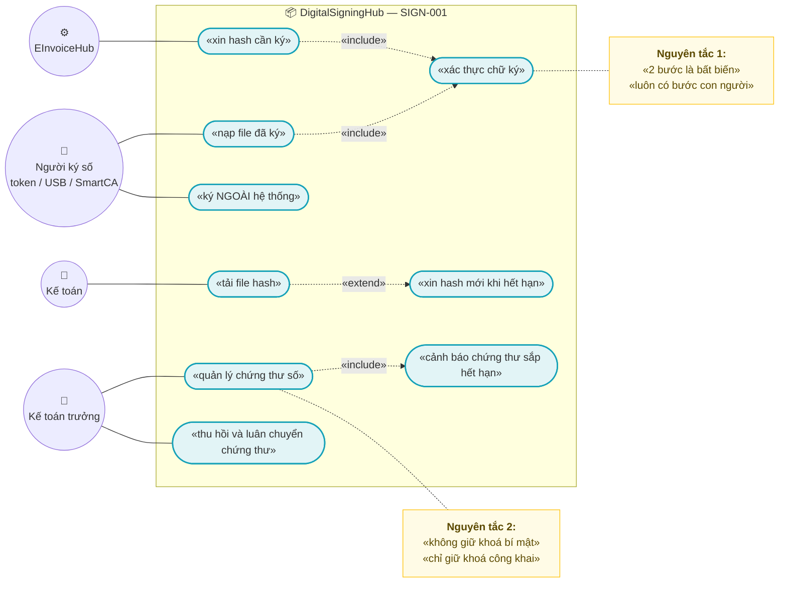
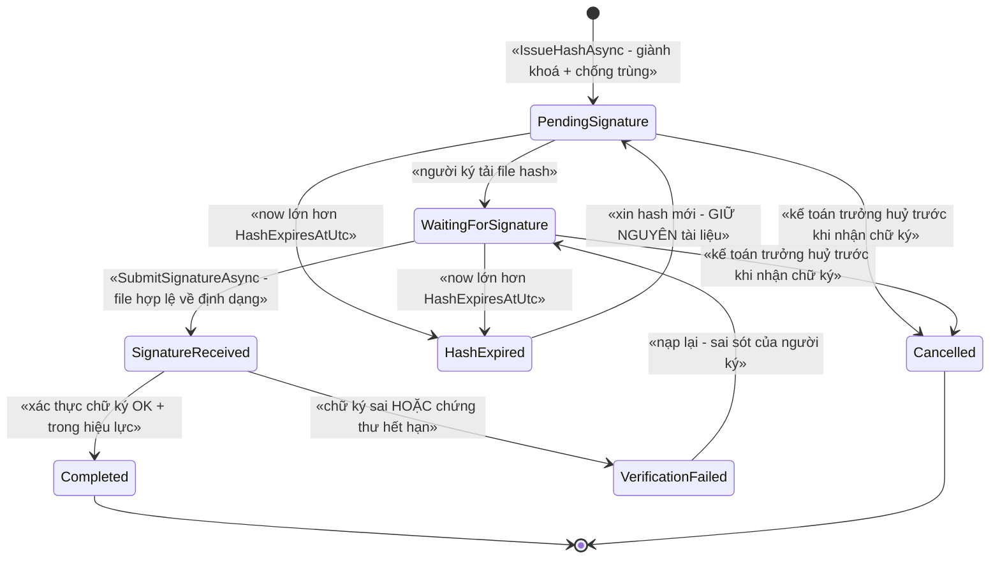
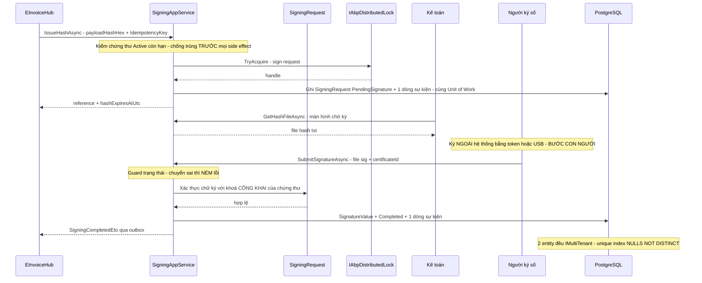
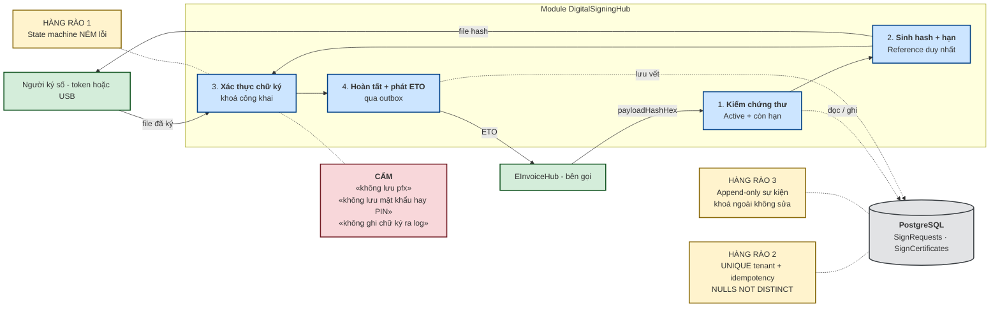
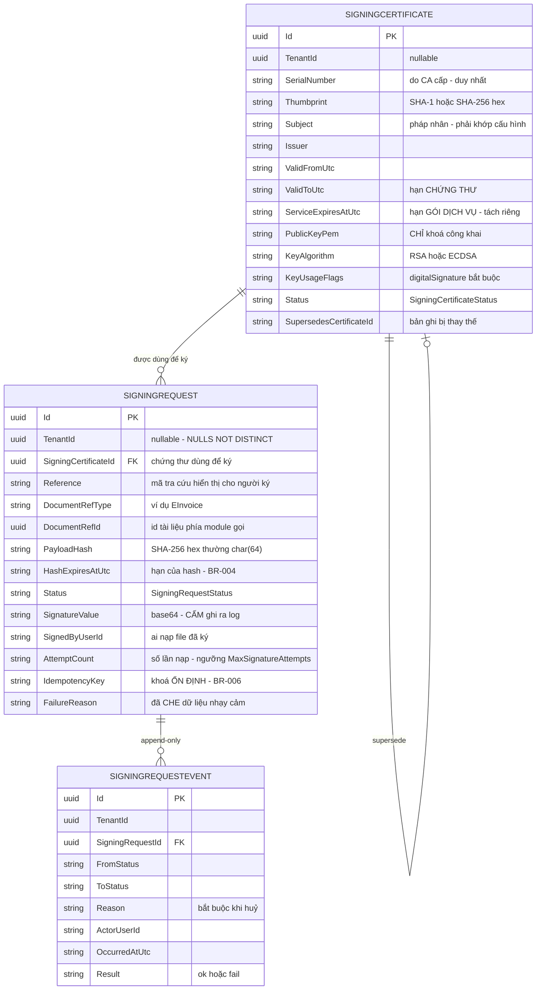

# `SIGN-001` — Quy trình ký 2 bước thủ công & quản lý chứng thư số

| Thuộc tính | Nội dung |
|---|---|
| **Mã** | `SIGN-001` |
| **Module** | **DigitalSigningHub** — ⚠️ **chưa có trong code**: `modules/` hiện chỉ có `ChannelHub`, `PaymentHub`, `Tax`; **kế hoạch GĐ0** tạo `modules/DigitalSigningHub/…` theo đúng khuôn của `modules/ChannelHub/` |
| **Giai đoạn** | **GĐ0 — Pháp lý** (`docs/implementation-plan.md` §5 bảng giai đoạn + **Phụ lục A.3** dòng `SIGN-001`) |
| **Ưu tiên** | **Must have** — là **tiền đề** của `EINV-001`/`EINV-002`: gửi hoá đơn chưa ký là **vi phạm pháp lý** |
| **Trạng thái** | 🟡 `Draft` — chờ review |
| **Người viết / người review** | *(điền)* / **Kiến trúc trưởng + Kế toán trưởng + Security review** |
| **Phiên bản / ngày** | `v0.1 — 13/10/2026` |
| **Tài liệu liên quan** | `EINV-001` (hợp đồng `IDigitalSigner` + 2 trục trạng thái) · `EINV-002` (gửi CQT — pre-condition là `SigningRequest` đã `Completed`) · `XC-001` · `XC-002` · `XC-003` · `XC-004` · `XC-005` · `docs/implementation-plan.md` §6.2 + **Phụ lục A.3** · `docs/business-modules-proposal.md` §6.7 · `docs/structure-and-techstack.md` (quyết định 2: *"Ký số: thủ công"*) |

---

## 0. Tóm tắt & quyết định thiết kế

**Tóm tắt:** `SIGN-001` chốt **hợp đồng `IDigitalSigner`** và **state machine ký 2 bước thủ công** (xin hash → người ký nạp kết quả đã ký → xác thực chữ ký), cộng với **quản lý chứng thư số** (metadata, hiệu lực, luân chuyển, thu hồi). Tài liệu này tồn tại vì `business-modules-proposal.md` §6.7 đã cảnh báo đúng chỗ dễ sai nhất của dự án: *"`DigitalSigningHub` — **là STATE MACHINE, không phải hàm sync**"*, và `implementation-plan.md` §6.2 chốt **quyết định 2: ký thủ công, có màn hình "chờ ký" + nút nạp file hash đã ký** — **không** tự động hoá 100%.

**Vì sao phải viết trước khi code:** hai lỗi loại này **không có lỗi biên dịch** —
(1) coi ký số là **hàm sync** trả về chữ ký ⇒ mô hình sai, phải viết lại toàn bộ luồng khi gặp token/USB;
(2) coi **bước 2 (nạp file đã ký) là bắt buộc "cho đủ"** mà không xác thực chữ ký với chứng thư ⇒ **ký sai vẫn phát hành hoá đơn**, và **không ai biết** cho tới khi cơ quan thuế từ chối. Tài liệu này biến cả hai thành **test tự động** (§14).

**Phạm vi:**
- ✅ Hợp đồng **`IDigitalSigner`** (2 bước) + `DigitalSignerOptions` (cấu hình, **không hard-code**).
- ✅ **State machine `SigningRequest`** + bảng guard + **lịch sử chuyển trạng thái append-only**.
- ✅ **Quản lý chứng thư số**: metadata, hiệu lực, khoá công khai, luân chuyển (supersede), thu hồi, check hạn.
- ✅ **Xác thực chữ ký** bằng khoá công khai của chứng thư (cổng chặn bắt buộc trước khi `Completed`).
- ✅ Phân quyền (`eCommerce.Signing.*`), audit, metric, mã lỗi, idempotency ở **mọi** biên vào.
- ✅ 2 giao diện: **màn hình "chờ ký"** và **màn hình quản lý chứng thư**.

**Không nằm trong phạm vi:**
- ❌ **HSM / remote signing / ký tự động 100%** — `structure-and-techstack.md` (quyết định 2) và `implementation-plan.md` §1 loại trừ **có chủ ý**; đổi quyết định này = **chi phí khác hẳn**.
- ❌ **Sinh XML nghiệp vụ hoá đơn + cấp số hoá đơn** — thuộc **`EINV-001`**; `SIGN-001` **nhận** khoá công khai/đối tượng cần ký, **không** sở hữu nghiệp vụ hoá đơn.
- ❌ **Gửi cơ quan thuế, parse `OK:`/`ERR:`** — thuộc **`EINV-002`**.
- ❌ **Điều chỉnh/thay thế/huỷ hoá đơn** — thuộc **`EINV-003`** (chưa viết).
- ❌ **Kiểm tra thu hồi chứng thư theo CRL/OCSP** — xem §15.1 **Q3** (đề xuất **hoãn**, ghi rõ lý do).
- ❌ **Bảo vệ khoá bí mật bằng KMS/HSM**, ký PDF, xử lý ảnh chữ ký hiển thị.
- ❌ **Vận hành token/USB** (cài driver, đổi mã PIN) — đây là **quy trình của kế toán**, tài liệu chỉ mô tả **điểm giao**.

### 0.1 Quyết định thiết kế (ADR ngắn)

| # | Quyết định | Phương án đã cân nhắc | Lý do chọn | Hệ quả |
|---|---|---|---|---|
| **D1** | **Ký 2 bước là bất biến của hợp đồng**: `IssueHashAsync` (bước 1) → `SubmitSignatureAsync` (bước 2) | (a) một hàm `SignAsync` trả chữ ký (sync) · (b) 2 bước tường minh | ⚠️ Nguồn: `business-modules-proposal.md` §6.7 — *"VNPT dùng **quy trình ký 2 BƯỚC** (xin Hash → gửi hash đã ký) cho cả Token và SmartCA ⇒ **với token/USB, KHÔNG THỂ phát hành hoá đơn hoàn toàn tự động — luôn có bước con người**"*. Hàm sync **không mô hình hoá được** bước con người | Mọi API/UI phải có trạng thái "chờ ký"; **cấm** thêm overload `SignAsync` trả chữ ký trực tiếp (BR-003) |
| **D2** | **`SIGN-001` KHÔNG giữ khoá bí mật** trong luồng thủ công | (a) nhận file `.pfx` + mật khẩu · (b) chỉ giữ **khoá công khai** + bản ghi chứng thư | Ký 2 bước xảy ra **trên máy người ký** (token/USB/SmartCA). Nếu ta giữ `.pfx` thì (1) **phá vỡ** ý nghĩa pháp lý của chữ ký (`EINV-001` BR-012 cấm lộ chữ ký/khoá), (2) biến `SIGN-001` thành **HSM giả** — trái quyết định "ký thủ công" | `SigningCertificate` **chỉ** lưu: metadata + hiệu lực + **khoá công khai** + vân tay. **Cấm** lưu `.pfx`/mật khẩu/PIN ở mọi dạng (BR-008) |
| **D3** | **`SigningRequest` ở CẤP MODULE**; trạng thái hoá đơn **vẫn** thuộc `EINV-001` | (a) nhét `SigningStatus` vào `EInvoice` · (b) tách `SigningRequest` riêng | `implementation-plan.md` §6.2 liệt kê entity `SigningRequest` (**state machine**) **và** `EInvoice.IssueStatus` là **hai** thứ khác nhau: hoá đơn **có thể** xin hash lại nhiều lần (hash hết hạn) mà **giữ nguyên số** | **Hai trục riêng** (`EInvoiceIssueStatus` ở `EINV-001`, `SigningRequestStatus` ở đây) — **cấm** gộp; liên kết qua `(TenantId, DocumentRefType, DocumentRefId)` |
| **D4** | **Xác thực chữ ký là GUARD BẮT BUỘC** trước `Completed` | (a) tin file `.sig` người dùng nạp · (b) xác thực bằng khoá công khai | Không xác thực ⇒ **ký sai vẫn hoá đơn `Signed`** ⇒ `EINV-002` gửi cơ quan thuế một chứng từ **không hợp lệ** (`EINV-001` §3.3 guard #4 yêu cầu `SignatureValue` khác rỗng trước khi gửi — **BR-017**). Đây là **hàng rào mềm duy nhất** giữa người dùng và pháp lý, nên phải là **cổng** | Guard sai ⇒ **`VerificationFailed`** + **NÉM** `eCommerce:Sign:0006`; `EINV-001` **không** được chuyển `Signed` |
| **D5** | Xác thực bằng **`System.Security.Cryptography` (BCL)**; XMLDSig dùng **`System.Security.Cryptography.Xml`** | (a) thêm gói NuGet của NCC · (b) dùng BCL + gói bắc cầu **đã có sẵn** trong repo | `Directory.Packages.props:98` **đã ghim** `System.Security.Cryptography.Xml` **10.0.12** (kèm ghi chú *"VÁ LỖ HỔNG BẮC CẦU"* — build còn 0 warning) ⇒ **không thêm dependency mới**. ⚠️ **Tiền lệ đã có code thật**: mọi phần ký hiện tại (`VnPayPaymentProvider.cs:178`, `ShopeeConnector.cs:52`) đều dùng BCL | Không phụ thuộc SDK NCC nào; **cấm** tự viết lại thuật toán xác thực (BR-007) |
| **D6** | **Chứng thư số là APPEND-ONLY có phiên bản**: đổi thông tin ⇒ **bản ghi mới**, bản cũ chuyển `Superseded` | (a) UPDATE tại chỗ · (b) bản ghi mới + trạng thái | Tiền lệ **đã có code thật**: `TaxClassification` (`modules/Tax/eCommerce.Tax.Domain/Classifications/TaxClassification.cs:98-119`) — `UpdateDraft` chỉ cho `Draft`, và `Supersede()` (`:149`) tạo quan hệ thay thế. Chứng thư là **bằng chứng pháp lý** ⇒ không được "sửa lịch sử" | Không có màn hình "sửa chứng thư"; có nút **"Thay thế"**; `Revoked`/`Superseded`/`Expired` là **hấp thụ** |
| **D7** | **Một khoá phân tán cho mỗi yêu cầu ký**: `ecommerce:sign:request:{tenantId}:{signingRequestId}` | (a) không khoá · (b) khoá theo `requestId` | Hai người ký cùng bấm "nạp file" cho **cùng một** yêu cầu ⇒ hai lần ghi `SignatureValue` khác nhau. Khoá **không phải** hàng rào cuối (theo `XC-003` **D2**) — hàng rào cuối là **unique index + guard trạng thái ở DB** | Chỉ khoá **đúng** tài nguyên tranh chấp; **không** khoá theo tenant (chặn tenant khác vô cớ — `XC-003` **D7**) |
| **D8** | **Hash hết hạn ⇒ SINH HASH MỚI, GIỮ nguyên số/tài liệu** | (a) coi hết hạn là lỗi · (b) tự sinh lại, ghi metric | Tiền lệ **đã chốt**: `EINV-001` §3.2 — `HashExpired --> PendingHash : «sinh hash mới — GIỮ số cũ»`, và §3.3 ghi rõ ngoại lệ **(a)**: *"chờ người ký lâu là **chuyện bình thường** của ký 2 bước (D12), không phải lỗi"* | **Không** ném lỗi khi hết hạn; **phải** có metric `sign_hash_expired_total` để phát hiện quy trình bị kẹt |
| **D9** | **Idempotency key ổn định, sinh từ dữ liệu nghiệp vụ** | (a) `Guid.NewGuid()` mỗi lần gọi · (b) khoá ổn định theo yêu cầu/nội dung | Tiền lệ **đã có code thật**: `PaymentTransaction.IdempotencyKey` (`modules/PaymentHub/eCommerce.PaymentHub.Domain/Entities/PaymentTransaction.cs:76`) + unique index `(TenantId, ProviderCode, IdempotencyKey)` với `NULLS NOT DISTINCT` (`src/eCommerce.EntityFrameworkCore/Migrations/20261013024226_Fix_NullableTenantId_UniqueIndexes.cs:65-68`). `XC-002` **BR-007** cấm `Guid.NewGuid()` | Retry cùng nội dung ⇒ **một** bản ghi duy nhất; khoá **lưu trong DB**, retry **đọc lại** |
| **D10** | **Bảo mật**: **không bao giờ** ghi `SignatureValue`/khoá bí mật ra log; **che** payload trước khi lưu vết | (a) log nguyên payload · (b) che theo tiền lệ | Tiền lệ **đã có code thật**: `PaymentTransaction.MaskSensitiveData` (`PaymentTransaction.cs:147`) che `token`/`secret`/`otp`/số thẻ, và `EINV-001` **D9**/**BR-012** kế thừa đúng cách này; `XC-005` **BR-005** | Có hàm che **dùng chung**; test quét log (§14 `TC-08`); `RawHashNotice`/`ProviderError` **giới hạn độ dài** |
| **D11** | **Không hard-code nhà cung cấp / endpoint** | (a) hard-code VNPT · (b) abstraction `IDigitalSigner` + cấu hình | `implementation-plan.md` §14 rủi ro 1: *"**Phụ thuộc nhà cung cấp VN** — không có SDK .NET chính thức nào… **không hard-code endpoint**"*; §6.2 DoD (4): *"không hard-code endpoint của NCC nào"* | Triển khai đầu tiên là `ManualTokenDigitalSigner` (**không gọi mạng**); adapter NCC đọc endpoint từ `DigitalSignerOptions` |
| **D12** | **`CertificateExpiresAtUtc` và "hạn dịch vụ" là HAI trường riêng** | (a) một trường · (b) hai trường | Với HĐĐT VN, **hạn chứng thư** và **hạn gói dịch vụ** (số lượng/kỳ hạn hợp đồng T-VAN) hết hạn **độc lập**; gộp một trường ⇒ cảnh báo sai và **chặn phát hành sai** | Có **2** ngưỡng cảnh báo + 2 metric; xem §15.1 **Q5** |
| **D13** | **`TenantId` nullable trên cả 2 entity; mọi unique index dùng `NULLS NOT DISTINCT`** | (a) `TenantId` NOT NULL · (b) nullable + `NULLS NOT DISTINCT` | Hiện hệ thống chạy **1 tenant** ⇒ `TenantId` **có thể `NULL`** (`XC-004` §5.2 **F1**); PostgreSQL mặc định `NULLS DISTINCT` ⇒ unique index **mất tác dụng**. Migration `20261013024226_Fix_NullableTenantId_UniqueIndexes.cs` đã sửa **11 index** theo cách này | Migration của `SIGN-001` **phải** viết SQL thô `NULLS NOT DISTINCT` (EF Core **không** khai báo được) |

---

## 1. Use Case Specification

| Thuộc tính | Nội dung |
|---|---|
| **Use Case ID** | `SIGN-001` |
| **Use Case Name** | Ký số 2 bước thủ công và quản lý vòng đời chứng thư số |
| **Description** | *"Là kế toán/kế toán trưởng, tôi muốn hệ thống đưa ra **hash cần ký** để tôi ký bằng token/USB của mình, rồi nạp lại kết quả để hệ thống **kiểm tra chữ ký** — và tôi muốn biết chứng thư nào còn hiệu lực, sắp hết hạn — để hoá đơn phát hành ra **luôn hợp lệ về mặt chữ ký**."* |
| **Actor(s)** | **Kế toán** (xin hash, tải file hash) · **Người ký số** (ký ngoài hệ thống bằng token/USB/SmartCA, nạp file kết quả) · **Kế toán trưởng** (thu hồi/đổi chứng thư) · **Hệ thống** (`EInvoiceHub` gọi `IDigitalSigner`, job kiểm hạn chứng thư) · **Nhà cung cấp CA/T-VAN** (cấp chứng thư — **ngoài hệ thống** trong luồng thủ công) |
| **Priority** | **Must have** (GĐ0) |
| **Trigger** | (a) `EInvoiceHub` (theo `EINV-001`) đã cấp số + sinh XML và cần chữ ký ⇒ gọi `IDigitalSigner.IssueHashAsync`; (b) người ký nạp file kết quả; (c) job hằng ngày kiểm hạn chứng thư; (d) kế toán trưởng thu hồi/đổi chứng thư |
| **Pre-Condition(s)** | • **Tenant hiện tại** (`ICurrentTenant`) — cả 2 entity đều `IMultiTenant`; ⚠️ hiện chạy **1 tenant** nên `TenantId` **có thể là `NULL`** (`XC-004` §5.2 **F1**) ⇒ unique index **phải** `NULLS NOT DISTINCT` (**D13**).<br>• **Có chứng thư `Active`** trong `SigningCertificates` **và** `CertificateExpiresAtUtc > now` — thiếu/hết hạn ⇒ **NÉM** `eCommerce:Sign:0002` (**chặn trước khi xin hash**, không đợi NCC từ chối — kế thừa `EINV-001` E7).<br>• **Tài liệu nguồn đủ điều kiện ký**: `DocumentRefId` tồn tại và `PayloadHash` (SHA-256 hex thường) do **bên gọi** truyền vào — `SIGN-001` **không** tự đọc `EInvoice` (module sở hữu entity của mình; **module gọi app BỊ CẤM**).<br>• `ChannelCode` **không** tham gia quyết định ký — chữ ký theo **chứng từ**, không theo kênh bán (nhất quán `EINV-001` §1). Nếu bên gọi truyền `ChannelCode` thì **chỉ để đối soát/log**.<br>• `XC-001`…`XC-005` đã **Approved/đã có code**; `EINV-001` đã chốt **hợp đồng** `IDigitalSigner` (2 bước).<br>• ⚠️ **Máy dev hiện KHÔNG có chứng thư sandbox thật** (xem §14.4) ⇒ phần đối chiếu NCC **chưa kiểm chứng**. |
| **Post-Condition(s)** | • Mỗi `SigningRequest` ở **đúng một** trạng thái; mọi chuyển trạng thái **có 1 dòng** trong `SigningRequestEvents` (**BR-010**).<br>• `Completed` **chỉ** đạt được khi chữ ký **đã xác thực** bằng khoá công khai của chứng thư (**D4**, **BR-007**).<br>• Cùng `IdempotencyKey` + cùng `PayloadHash` ⇒ **không** tạo bản ghi/không ghi chữ ký lần hai (**BR-006**); cùng khoá + **khác** hash ⇒ **NÉM** `eCommerce:Sign:0010`.<br>• **Không** có `.pfx`, mật khẩu, PIN, hay khoá bí mật nào trong DB/log (**BR-008**, **D2**).<br>• `EInvoiceHub` nhận được `SigningCompletedEto` ⇒ có thể chuyển hoá đơn sang `Signed` (`EINV-001` §3.2). |
| **Basic Flow** | 1. `EInvoiceHub` gọi `IDigitalSigner.IssueHashAsync(payloadHashHex, subject)` với `IdempotencyKey` **ổn định** (**D9**).<br>2. Hệ thống **kiểm chứng thư Active + còn hạn** (thiếu ⇒ `eCommerce:Sign:0002`), rồi **chống trùng** trước mọi side effect (**BR-006**).<br>3. Hệ thống ghi `SigningRequest` (`PendingSignature`), sinh `Reference` + `HashExpiresAtUtc`, ghi **1 dòng** `SigningRequestEvents` — **cùng Unit of Work**.<br>4. Kế toán mở **màn hình "chờ ký"**, tải **file hash** (`GetHashFileAsync` ⇒ `hashes/{Reference}.txt`).<br>5. **Người ký** ký file hash **ngoài hệ thống** bằng token/USB/SmartCA (bước **có con người** — **D1**).<br>6. Người ký nạp **file kết quả đã ký** (+ chọn chứng thư nếu có nhiều) ⇒ `SubmitSignatureAsync`; giành khoá `ecommerce:sign:request:{tenantId}:{signingRequestId}` (**D7**).<br>7. Hệ thống kiểm guard trạng thái: phải là `PendingSignature` hoặc `VerificationFailed` ⇒ nếu không, **NÉM** `eCommerce:Sign:0001`.<br>8. Hệ thống **xác thực chữ ký** với khoá công khai của chứng thư (**D4**) ⇒ hợp lệ: lưu `SignatureValue` + `Completed`; không hợp lệ: `VerificationFailed` + **NÉM** `eCommerce:Sign:0006`.<br>9. Hệ thống phát `SigningCompletedEto` (qua **outbox**, `XC-002`) ⇒ `EInvoiceHub` chuyển hoá đơn `Signed`.<br>10. Hệ thống trả DTO; màn hình "chờ ký" loại bản ghi đó ra khỏi danh sách. |
| **Alternative Flow** | **A1: Hash hết hạn** — `now > HashExpiresAtUtc` ⇒ hệ thống **KHÔNG ném lỗi**; trạng thái `HashExpired`, metric `sign_hash_expired_total`; kế toán bấm **"Xin hash mới"** ⇒ `HashExpired → PendingSignature` **GIỮ nguyên** `DocumentRefId`/số hoá đơn (**D8**, **BR-005**).<br>**A2: Nạp lại sau khi chữ ký sai** — `VerificationFailed` **cho phép** nạp lại (người ký có thể đã chọn nhầm file/ký nhầm chứng thư) ⇒ quay về `WaitingForSignature`; **mọi** lần thử đều có dòng trong `SigningRequestEvents`.<br>**A3: Có nhiều chứng thư Active** — người ký **phải** chọn `SigningCertificateId`; hệ thống **cấm** tự đoán (chọn sai chứng thư ⇒ chữ ký vẫn hợp lệ về toán học nhưng **sai pháp nhân**).<br>**A4: Hai người cùng bấm nạp** — khoá phân tán (**D7**) cho một người vào; người thứ hai **NÉM** `eCommerce:Lock:0001` (`XC-003` §6.2) ⇒ UI hiển thị *"đang xử lý, vui lòng thử lại"*, **không** hiển thị lỗi hệ thống.<br>**A5: Job kiểm hạn chứng thư** — dùng chế độ `SkipIfBusy` của `XC-003` **D10**: không giành được khoá ⇒ **bỏ qua nhịp** + log + metric (job chạy lại nhịp sau).<br>**A6: Chứng thư sắp hết hạn** — `CertificateExpiresAtUtc - now <= SigningOptions.CertificateExpiryWarningDays` ⇒ chứng thư **giữ `Active`** nhưng **hiện cảnh báo** trên màn hình + metric `sign_certificate_expiring_total`; **không chặn** phát hành. |
| **Exception Flow** | **E1:** chuyển trạng thái sai (ví dụ `Completed → *`, hoặc nạp file khi đang `Flagged`) ⇒ **NÉM** `eCommerce:Sign:0001` kèm `currentStatus`/`expectedStatus` — **cấm** im lặng bỏ qua.<br>**E2:** **không có** chứng thư `Active` còn hiệu lực ⇒ **NÉM** `eCommerce:Sign:0002`; **chặn** trước khi xin hash.<br>**E3:** file rỗng/quá lớn/base64 không hợp lệ ⇒ **NÉM** `eCommerce:Sign:0004`; **không** lưu bản ghi nào.<br>**E4:** `SigningRequest` không tồn tại **hoặc thuộc tenant khác** ⇒ **`404`** (`XC-004` **BR-008** — **không** tiết lộ sự tồn tại của tài nguyên tenant khác).<br>**E5:** chữ ký **không khớp** khoá công khai / `PayloadHash` / chứng thư ⇒ `VerificationFailed` + **NÉM** `eCommerce:Sign:0006`; **tuyệt đối không** `Completed`.<br>**E6:** chứng thư **hết hạn tại thời điểm ký** (`SignedAtUtc` ngoài khoảng hiệu lực) ⇒ **NÉM** `eCommerce:Sign:0007`; **không** `Completed`.<br>**E7:** chứng thư ở trạng thái `Revoked`/`Superseded` được dùng để nạp ⇒ **NÉM** `eCommerce:Sign:0003`; `Superseded` **chỉ** áp cho yêu cầu **mới**.<br>**E8:** `Subject` của chứng thư **không khớp** thông tin pháp nhân ghi trong `DigitalSignerOptions` ⇒ **NÉM** `eCommerce:Sign:0005` — bảo vệ khỏi **ký nhầm pháp nhân**.<br>**E9:** không giành được khoá phân tán ⇒ `eCommerce:Lock:0001` (`409`) theo `XC-003` §6.2.<br>**E10:** cùng `IdempotencyKey` nhưng **khác** `PayloadHash` ⇒ **NÉM** `eCommerce:Sign:0010` (xung đột khoá, cần điều tra — kế thừa `XC-002` **E1**/**BR-006**). |
| **Business Rules** | • **BR-SIGN-001**: Mọi chuyển trạng thái **phải** qua guard của state machine (§3); chuyển sai ⇒ **NÉM** `eCommerce:Sign:0001`. **Cấm** no-op im lặng.<br>• **BR-SIGN-002**: Mọi chuyển trạng thái **phải** ghi **một dòng** vào `SigningRequestEvents` (ai/khi nào/từ đâu tới đâu/kết quả) — bảng **append-only**.<br>• **BR-SIGN-003**: **Cấm** công bố API/overload nào trả chữ ký ngay trong một lời gọi (**D1**) — hợp đồng **luôn** 2 bước; `IDigitalSigner` **cấm** thêm `SignAsync` trả `SignatureValue`.<br>• **BR-SIGN-004**: Hash **bắt buộc** có hạn (`HashExpiresAtUtc`) và **bắt buộc** có TTL hữu hạn; **cấm** hash vô hạn.<br>• **BR-SIGN-005**: Hết hạn hash ⇒ **sinh hash mới, GIỮ nguyên** tài liệu/số đã cấp (**D8**); **cấm** đổi `DocumentRefId` trong luồng này.<br>• **BR-SIGN-006**: **Mọi** biên vào (xin hash, nạp chữ ký, thu hồi chứng thư, tạo chứng thư) **phải** qua idempotency guard **trước mọi side effect**, với khoá **ổn định** — **cấm** `Guid.NewGuid()` mỗi lần thử (**D9**).<br>• **BR-SIGN-007**: `Completed` **chỉ** khi chữ ký **xác thực thành công** bằng khoá công khai của chứng thư, **và** `PayloadHash` khớp, **và** `SignedAtUtc` nằm trong khoảng hiệu lực (**D4**, E5, E6).<br>• **BR-SIGN-008**: **CẤM** lưu/lưu vết `.pfx`, mật khẩu, PIN, khoá bí mật **dưới mọi dạng**; `SigningCertificate` **chỉ** chứa khoá **công khai** + metadata (**D2**).<br>• **BR-SIGN-009**: **CẤM** ghi `SignatureValue` (base64), khoá bí mật, hoặc nội dung file `.sig` ra **log/metric/trace**; mọi payload lưu vết **phải** đi qua hàm che dùng chung (**D10**).<br>• **BR-SIGN-010**: `SigningCertificate` là **append-only có phiên bản**: `Active` **không** sửa/xoá; đổi ⇒ tạo **bản ghi mới** + `SupersedesCertificateId`, bản cũ chuyển `Superseded` (**D6**).<br>• **BR-SIGN-011**: **CẤM** thu hồi (`Revoked`) chứng thư khi còn `SigningRequest` chưa ở trạng thái hấp thụ **nếu** yêu cầu đó tham chiếu chứng thư này **và** chưa `VerificationFailed`+ — thu hồi lúc đó sẽ để lại chứng từ **không thể ký tiếp**; thay vào đó phải **kết thúc** (`Cancelled`) các yêu cầu đó trước, **một cách tường minh**.<br>• **BR-SIGN-012**: Mọi thao tác ghi **phải** qua **Unit of Work**; **cấm** `IRepository` với `autoSave: true` lẻ tẻ khi còn bước phải cùng transaction (kế thừa bài học `ChannelTokenManager` gọi `UpdateAsync(…, autoSave: true)` — `modules/ChannelHub/eCommerce.ChannelHub.Application/Sync/ChannelTokenManager.cs:100,114`).<br>• **BR-SIGN-013**: **Cấm hard-code** endpoint/tài khoản/thuật toán của nhà cung cấp — đọc từ `DigitalSignerOptions` theo tenant (**D11**).<br>• **BR-SIGN-014**: Phân quyền **bắt buộc** theo 4 permission `eCommerce.Signing.*` (§9); thu hồi/đổi chứng thư **chỉ** kế toán trưởng; mọi thay đổi **có audit** (`XC-004` **BR-011**).<br>• **BR-SIGN-015**: `TenantId` **bắt buộc** trong mọi khoá phân tán/idempotency key của feature; **cấm** khoá toàn cục cho tài nguyên tenant (`XC-003` **BR-003**); `TenantId = NULL` **được phép** ở chế độ 1 tenant (**D13**).<br>• **BR-SIGN-016**: Kích thước file đầu vào **phải** bị giới hạn (`SigningOptions.MaxSignatureFileBytes` / `MaxCertificateFileBytes`) và **kiểm TRƯỚC** khi đọc vào bộ nhớ; vượt ⇒ **NÉM** `eCommerce:Sign:0009`. |
| **Non-Functional Requirement** | • **NFR-SIGN-001**: `IssueHashAsync` (thuần, không I/O mạng) p95 **< 200 ms**.<br>• **NFR-SIGN-002**: `SubmitSignatureAsync` (xác thực cục bộ) p95 **< 500 ms** với file `.sig` ≤ 4 KB.<br>• **NFR-SIGN-003**: **0** lần `Completed` khi chữ ký không hợp lệ — bộ test âm **≥ 10** ca (sai hash, sai chứng thư, chứng thư hết hạn, chữ ký cắt cụt, base64 sai).<br>• **NFR-SIGN-004**: **0** chữ ký/khoá bí mật/mật khẩu xuất hiện trong log/message exception (test quét + review).<br>• **NFR-SIGN-005**: **100 %** chuyển trạng thái có dòng `SigningRequestEvents`.<br>• **NFR-SIGN-006**: Cảnh báo chứng thư **trước** hạn ≥ `CertificateExpiryWarningDays` (mặc định **30** ngày) cho **100 %** chứng thư `Active`.<br>• **NFR-SIGN-007**: Cách ly tenant: **0** rò rỉ dữ liệu ký/chứng thư giữa 2 tenant (integration test — ⚠️ **cần PostgreSQL**, xem §14.4).<br>• **NFR-SIGN-008**: Chống trùng: gửi cùng `IdempotencyKey` **10** lần ⇒ **1** bản ghi, **1** dòng sự kiện `Completed`. |

---

## 2. Sơ đồ Use Case



---

## 3. Vòng đời một yêu cầu ký (state machine)

> ⚠️ Đây **chỉ** là **trục ký** (`SigningRequestStatus`). Trục **hoá đơn** (`EInvoiceStatus`, `EInvoiceIssueStatus`)
> thuộc **`EINV-001`** và **không** được gộp vào đây (**D3**). Trạng thái `HashExpired` của tài liệu này **ánh xạ 1-1**
> với `EInvoiceIssueStatus.HashExpired` của `EINV-001`.



**Bảng chuyển trạng thái & guard. Mọi chuyển sai **phải ném lỗi**, không im lặng (trừ 2 ngoại lệ có chủ ý ghi ở dưới):**

| # | Từ → Sang | Ai / cái gì chuyển | Guard (điều kiện cho phép) | Hành động kèm theo | Nếu guard sai thì? |
|---|---|---|---|---|---|
| 1 | `[*]` → `PendingSignature` | `IssueHashAsync` (gọi từ `EInvoiceHub`) | Có chứng thư `Active` + `CertificateExpiresAtUtc > now` + `PayloadHash` là SHA-256 hex thường + idempotency key **ổn định** | Sinh `Reference` + `HashExpiresAtUtc`; ghi 1 dòng `SigningRequestEvents` | **NÉM** `eCommerce:Sign:0002` (chứng thư) / `0004` (đầu vào) |
| 2 | `PendingSignature` → `WaitingForSignature` | Hệ thống (khi kế toán tải file hash) | Trạng thái `PendingSignature` **và** `now <= HashExpiresAtUtc` | Ghi `HashDownloadedAtUtc` + 1 dòng sự kiện | Quá hạn ⇒ sang `HashExpired` (**không** lỗi — **D8**); trạng thái khác ⇒ **NÉM** `eCommerce:Sign:0001` |
| 3 | `WaitingForSignature` → `SignatureReceived` | Người ký (`SubmitSignatureAsync`) | File `.sig` đọc được + giới hạn kích thước (**BR-016**) + base64 hợp lệ + **có** chứng thư (A3) | Lưu tạm `SignatureValue` + `SignedByUserId` + `SignedAtUtc`; 1 dòng sự kiện | **NÉM** `eCommerce:Sign:0004` / `0003` (chứng thư không dùng được) |
| 4 | `SignatureReceived` → `Completed` | Hệ thống (ngay trong cùng UoW của #3, sau khi xác thực) | **Xác thực chữ ký OK** với khoá công khai **và** `PayloadHash` khớp **và** `SignedAtUtc` trong hiệu lực chứng thư (**D4**) | `CompletedAtUtc`; phát `SigningCompletedEto` (**outbox**); 1 dòng sự kiện | **NÉM** `eCommerce:Sign:0006` (E5) / `0007` (E6) |
| 5 | `SignatureReceived` → `VerificationFailed` | Hệ thống (cùng #4, khi xác thực hỏng) | Như trên nhưng thất bại | Ghi `FailureReason` (**đã che**) + `AttemptCount++`; metric; 1 dòng sự kiện | — |
| 6 | `VerificationFailed` → `WaitingForSignature` | Người ký (A2) | `AttemptCount < SigningOptions.MaxSignatureAttempts` (mặc định **5**) | Cho nạp lại; 1 dòng sự kiện | Vượt ngưỡng ⇒ **NÉM** `eCommerce:Sign:0008` — phải **huỷ** yêu cầu và tạo yêu cầu mới |
| 7 | `PendingSignature` / `WaitingForSignature` → `HashExpired` | Job hoặc lần đọc kế tiếp (A1) | `now > HashExpiresAtUtc` | Metric `sign_hash_expired_total`; **KHÔNG** ném lỗi (**D8**) | — |
| 8 | `HashExpired` → `PendingSignature` | Kế toán (A1) | Quyền `eCommerce.Signing.Sign` + chứng thư **vẫn** còn hiệu lực | Sinh **hash mới** + hạn mới; **GIỮ** `DocumentRefId`/`PayloadHash`; 1 dòng sự kiện | **NÉM** `eCommerce:Sign:0002` nếu chứng thư nay đã hết hạn |
| 9 | `PendingSignature` / `WaitingForSignature` → `Cancelled` | Kế toán trưởng | Quyền `eCommerce.Signing.ManageCertificates` **và** chưa có chữ ký nào được chấp nhận | `CancelledAtUtc` + lý do (**bắt buộc**) + 1 dòng sự kiện | **NÉM** `eCommerce:Sign:0001` — có chữ ký rồi thì **cấm** huỷ (phải đi đường hoá đơn `EINV-003`) |
| 10 | `Completed`/`Cancelled` → `[*]` | — | **Hấp thụ (absorbing)** | — | Mọi chuyển **ra khỏi** 2 trạng thái này ⇒ **NÉM** `eCommerce:Sign:0001` |

> ⚠️ **Hai ngoại lệ CÓ CHỦ Ý (không ném lỗi) — ghi rõ lý do:**
> **(a)** hết hạn hash (#7): chờ người ký lâu là **chuyện bình thường** của ký 2 bước (kế thừa `EINV-001` §3.3 ngoại lệ (a)); **(b)** job kiểm hạn chứng thư không giành được khoá ⇒ **bỏ qua nhịp** + log + metric (`XC-003` **D10**, `SkipIfBusy`).
> **Trạng thái hấp thụ:** `Completed` · `Cancelled` — **không** có đường ra.

---

## 4. Sequence Diagram & luồng dữ liệu

### 4.1 Sequence — trọn vẹn một vòng ký 2 bước (có bước con người ở giữa)



### 4.2 DFD — ba hàng rào bảo vệ và vì sao **không** giữ khoá bí mật



> 📌 **Ba hàng rào là ba lớp độc lập** — theo `XC-003` **D2**: *"bỏ lớp mềm đi, lớp cứng còn chặn không?"*.
> Kể cả khi state machine trong code bị vô hiệu (script SQL sửa tay), **unique index** vẫn chặn bản ghi trùng
> và **bảng sự kiện append-only** vẫn còn dấu vết để điều tra.

---

## 5. Mô hình dữ liệu

### 5.1 Vị trí module & trạng thái code

⚠️ **Toàn bộ entity dưới đây CHƯA có trong code** — **chưa kiểm chứng** được bằng `read`/`grep` vì chưa tồn tại:

| Bằng chứng đã kiểm | Kết quả |
|---|---|
| `modules/` (liệt kê thư mục) | **chỉ** có `ChannelHub`, `PaymentHub`, `Tax` ⇒ **chưa có** `modules/DigitalSigningHub/` |
| `src/eCommerce.EntityFrameworkCore/eCommerceDbContext.cs` (đọc toàn bộ 211 dòng) | **không** có `DbSet` nào của ký số/chứng thư |
| `grep "SigningRequest|SigningCertificate|IDigitalSigner"` toàn repo | **0** kết quả trong `*.cs`; chỉ xuất hiện trong **tài liệu** (`einv-001`, `einv-002`, `implementation-plan`, `business-modules-proposal`) |
| `EINV-002` §5.1 (đã ghi sẵn) | *"Entity `SigningRequest`, `SigningCertificate` ❌ **chưa có trong code** — thuộc `SIGN-001`"* |

**Kế hoạch GĐ0** — tạo module theo đúng khuôn `modules/ChannelHub/`:

| Project (mới) | Nội dung | Khuôn mẫu đã có |
|---|---|---|
| `modules/DigitalSigningHub/eCommerce.DigitalSigningHub.Domain` | `DigitalSigningHubConsts` (**error codes + lock keys**), entity, enum, luật domain (state machine) | `modules/ChannelHub/eCommerce.ChannelHub.Domain/ChannelHubConsts.cs` |
| `…DigitalSigningHub.Application.Contracts` | `ISigningAppService`, DTO, **`IDigitalSigner`** + `SignatureResult`/`SignatureVerification`, `SigningCompletedEto` | `modules/ChannelHub/eCommerce.ChannelHub.Application.Contracts/Connectors/IChannelConnector.cs` |
| `…DigitalSigningHub.Application` | `SigningAppService`, `ManualTokenDigitalSigner`, job kiểm hạn | `modules/ChannelHub/eCommerce.ChannelHub.Application/…` |
| `…DigitalSigningHub.EntityFrameworkCore` | `DigitalSigningHubDbContextModelCreatingExtensions.ConfigureDigitalSigning()` + `…EntityFrameworkCoreModule` | `modules/ChannelHub/eCommerce.ChannelHub.EntityFrameworkCore/ChannelHubDbContextModelCreatingExtensions.cs` |

### 5.2 ERD



### 5.3 Bảng & cột (Data Dictionary)

**Bảng `SignRequests`** — *`DigitalSigningHubConsts.DbTablePrefix = "Sign"` (3 ký tự, theo khuôn `ChannelHubConsts.DbTablePrefix = "Chn"`)*

| Cột | Kiểu | Null? | Ý nghĩa | Ghi chú |
|---|---|---|---|---|
| `Id` | `uuid` | ✖ | khoá chính | |
| `TenantId` | `uuid` | ✔ | tenant | ⚠️ **được phép `NULL`** (**D13**); mọi unique index **phải** `NULLS NOT DISTINCT` |
| `SigningCertificateId` | `uuid` | ✖ | chứng thư dùng để ký | FK nội bộ module (**không** FK sang module khác) |
| `Reference` | `varchar(64)` | ✖ | mã tra cứu cho người ký | **unique** `(TenantId, Reference)` |
| `DocumentRefType` | `varchar(32)` | ✖ | loại tài liệu nguồn | ví dụ `EInvoice` — **tham chiếu mềm**, **không** FK (module sở hữu entity của mình) |
| `DocumentRefId` | `uuid` | ✖ | id tài liệu nguồn | **không** FK xuyên module |
| `PayloadHash` | `char(64)` | ✖ | SHA-256 của dữ liệu cần ký | CHECK `~ '^[0-9a-f]{64}$'` (kế thừa `XC-002` §5.2) |
| `HashExpiresAtUtc` | `timestamptz` | ✖ | hạn của hash | **BR-004**: **cấm** NULL/vô hạn; TTL đọc từ `SigningOptions.HashTtlMinutes` |
| `Status` | `int` | ✖ | `SigningRequestStatus` | lưu **int** + enum trong code (nhất quán `EINV-001` §5.2) |
| `AttemptCount` | `int` | ✖ | số lần nạp chữ ký | mặc định `0`; ngưỡng `MaxSignatureAttempts` |
| `SignatureValue` | `text` | ✔ | chữ ký (base64) | 🚨 **CẤM** ghi ra log (**BR-009**); **giới hạn độ dài** khi ghi |
| `SignedAtUtc` | `timestamptz` | ✔ | thời điểm ký (do người ký khai hoặc lấy giờ hệ thống) | dùng cho guard `SignedAtUtc` trong hiệu lực (E6) |
| `SignedByUserId` | `uuid` | ✔ | ai nạp file `.sig` | khớp `EINV-001` §5.2 `SignedByUserId` |
| `CompletedAtUtc` | `timestamptz` | ✔ | thời điểm `Completed` | |
| `CancelledAtUtc` / `CancelReason` | `timestamptz` / `varchar(512)` | ✔ | huỷ | `CancelReason` **bắt buộc** khi huỷ (§3 #9) |
| `FailureReason` | `varchar(2048)` | ✔ | lý do thất bại | **đã che** bằng hàm dùng chung (**BR-009**) |
| `IdempotencyKey` | `varchar(256)` | ✖ | khoá chống trùng **ổn định** | ví dụ `Sign:{tenantId}:{documentRefType}:{documentRefId}:{payloadHash}` — **cấm** `Guid.NewGuid()` (**D9**) |
| `PayloadHashVersion` | `int` | ✖ | phiên bản thuật toán hash | mặc định `1` — kế thừa `XC-002` **Q9** (tránh "xung đột khoá GIẢ" khi đổi thuật toán) |

**Bảng `SignRequestEvents`** — *sổ vết **APPEND-ONLY**; **cấm** UPDATE/DELETE*

| Cột | Kiểu | Null? | Ý nghĩa |
|---|---|---|---|
| `Id` | `uuid` | ✖ | khoá chính |
| `TenantId` | `uuid` | ✔ | tenant |
| `SigningRequestId` | `uuid` | ✖ | FK nội bộ module (**cascade** khi xoá bản ghi **chưa** từng có chữ ký) |
| `FromStatus` / `ToStatus` | `int` | ✖ | cặp chuyển trạng thái |
| `Reason` | `varchar(512)` | ✔ | **bắt buộc** khi huỷ |
| `ActorUserId` | `uuid` | ✔ | ai (null khi do hệ thống/job) |
| `OccurredAtUtc` | `timestamptz` | ✖ | **UTC** (quy ước `eCommerceDomainModule.cs:58`) |
| `Result` | `varchar(16)` | ✖ | `ok` / `fail` |

**Bảng `SignCertificates`**

| Cột | Kiểu | Null? | Ý nghĩa | Ghi chú |
|---|---|---|---|---|
| `Id` | `uuid` | ✖ | khoá chính | |
| `TenantId` | `uuid` | ✔ | tenant | chứng thư **cấp host** ⇒ `TenantId = NULL` (hợp lệ, `XC-004` D8) |
| `SerialNumber` | `varchar(64)` | ✖ | serial do CA cấp | **unique** `(TenantId, SerialNumber)` |
| `Thumbprint` | `char(64)` | ✖ | vân tay | **unique** `(TenantId, Thumbprint)`; chuẩn hoá **HOA** |
| `Subject` | `varchar(512)` | ✖ | pháp nhân trên chứng thư | **phải** khớp `SigningOptions.ExpectedSubjectPattern` ⇒ lệch ⇒ **NÉM** `0005` (E8) |
| `Issuer` | `varchar(512)` | ✖ | nhà cung cấp CA | |
| `ValidFromUtc` / `ValidToUtc` | `timestamptz` | ✖ | hiệu lực **chứng thư** | |
| `ServiceExpiresAtUtc` | `timestamptz` | ✔ | hạn **gói dịch vụ** (T-VAN) | **tách riêng** khỏi hạn chứng thư (**D12**) |
| `PublicKeyPem` | `text` | ✖ | **khoá CÔNG KHAI** | ⚠️ **CHỈ** công khai — **cấm** khoá bí mật (**BR-008**) |
| `KeyAlgorithm` | `varchar(16)` | ✖ | `RSA` / `ECDSA` | lấy từ chứng thư, **không** đoán |
| `KeyUsageFlags` | `int` | ✖ | cờ `KeyUsage` | **phải** chứa `DigitalSignature` ⇒ thiếu ⇒ **NÉM** `0002` |
| `Status` | `int` | ✖ | `SigningCertificateStatus` | `Active` · `Expired` · `Revoked` · `Superseded` |
| `RevokedAtUtc` / `RevokeReason` | `timestamptz` / `varchar(512)` | ✔ | thu hồi | **bắt buộc** khi thu hồi (**BR-014**) |
| `SupersedesCertificateId` | `uuid` | ✔ | bản ghi bị thay thế | **D6** — quan hệ 1 chiều, **không** sửa bản cũ |
| `StorageKind` | `varchar(16)` | ✖ | nguồn khoá công khai | `UploadedFile` (đề xuất **duy nhất** ở GĐ0 — **D2**) |

**Index & ràng buộc**

| Loại | Cột | Mục đích |
|---|---|---|
| **UNIQUE** *(SQL thô `NULLS NOT DISTINCT` — **D13**)* | `SignRequests (TenantId, IdempotencyKey)` | ⭐ **hàng rào chống trùng chính** (**BR-006**); đúng cách đã làm ở `20261013024226_Fix_NullableTenantId_UniqueIndexes.cs:41-42` |
| **UNIQUE** *(cùng cách)* | `SignRequests (TenantId, Reference)` | mã tra cứu không trùng |
| **UNIQUE có filter** | `SignRequests (TenantId, DocumentRefType, DocumentRefId, PayloadHash)` `WHERE Status IN (0,1,2,3)` | **một** yêu cầu "đang sống" cho một tài liệu+hash; tránh ký 2 lần cùng nội dung. Dùng **filter** theo tiền lệ `OrdOrders` (`eCommerceDbContext.cs:184-186`) |
| **UNIQUE** *(cùng cách)* | `SignCertificates (TenantId, Thumbprint)` | không nạp trùng chứng thư |
| **UNIQUE** *(cùng cách)* | `SignCertificates (TenantId, SerialNumber)` | không nạp trùng theo serial |
| INDEX | `SignCertificates (TenantId, Status, ValidToUtc)` | job kiểm hạn + màn hình quản lý |
| INDEX | `SignRequests (TenantId, Status, HashExpiresAtUtc)` | màn hình **"chờ ký"** + quét hết hạn hash |
| INDEX | `SignRequestEvents (SigningRequestId, OccurredAtUtc)` | dòng thời gian của một yêu cầu |
| CHECK | `PayloadHash ~ '^[0-9a-f]{64}$'` | bắt buộc SHA-256 hex thường |
| CHECK | `HashExpiresAtUtc > CreationTime` | **BR-004** — hash **luôn** có hạn |
| CHECK | `Status <> Cancelled OR CancelReason IS NOT NULL` | **BR-001/002** — huỷ **phải** có lý do |
| CHECK | `Status <> Completed OR SignatureValue IS NOT NULL` | **BR-007** — `Completed` **phải** có chữ ký đã xác thực |
| **CẤM có** | bất kỳ cột `Pfx*`/`Password*`/`Pin*`/`PrivateKey*` | **BR-008** — có test quét schema (§14 `TC-09`) |

**Quy ước tiền tệ & làm tròn (`XC-001`) — mục này áp dụng thế nào?**

| Hạng mục của `XC-001` | Áp dụng ở `SIGN-001`? | Lý do / ghi chú |
|---|---|---|
| `Money` + `Currency` + `decimal` cho số tiền | ❌ **Không áp dụng** | `SIGN-001` **không có trường tiền nào**: hash, chữ ký, vân tay, mã chứng thư đều là **chuỗi/hash**. Ký số **không** làm thay đổi số tiền của chứng từ ⇒ không có phép tính tiền, không có chỗ nào cần `Money` |
| **Cấm so sánh tiền bằng `==`** | ❌ **Không áp dụng** | không có biểu thức tiền (không có `decimal` nào trong 3 bảng §5.3) |
| Làm tròn theo `Currency.Decimals` | ❌ **Không áp dụng** | không có giá trị cần làm tròn |
| ⚠️ **Ràng buộc suy ra (BẮT BUỘC)** | ✅ **Áp dụng** | Vì `SIGN-001` **không** được phép chạm tiền, **cấm** đưa bất kỳ trường tiền/tổng tiền vào `SigningRequest`/`SigningCertificate`/DTO của feature này. Nếu cần hiển thị tiền trên màn hình **"chờ ký"**, **phải** đọc từ `EInvoice` qua `EInvoiceHub` (**module sở hữu entity của mình**) — **cấm** sao chép sang bảng ký (tránh **hai nguồn sự thật** cho tiền, đúng tinh thần `XC-001` **D5**) |

---

## 6. Hợp đồng API

### 6.1 Application Service

| Mục | Giá trị |
|---|---|
| Interface | `ISigningAppService` — `eCommerce.DigitalSigningHub.Application.Contracts` |
| Implementation | `SigningAppService` — `eCommerce.DigitalSigningHub.Application` |
| `[Authorize]` | **cấp CLASS bắt buộc** (`XC-004` **BR-001**/D3) — tiền lệ **đã có code thật**: `src/eCommerce.Application/Channels/ChannelAppService.cs:27` |
| Unit of Work | Mọi method ghi **qua** Unit of Work — `src/eCommerce.HttpApi.Host/eCommerceHttpApiHostModule.cs:60-64` đã đặt `TransactionBehavior = Auto` |
| Đăng ký auto API | **phải thêm dòng thứ 3** `options.ConventionalControllers.Create(typeof(DigitalSigningHubApplicationModule).Assembly);` — hiện chỉ có **2** dòng (`eCommerceHttpApiHostModule.cs:154-155`) |
| `DbSet` **(bắt buộc)** | **phải** thêm `DbSet<SigningRequest>`, `DbSet<SigningRequestEvent>`, `DbSet<SigningCertificate>` vào `src/eCommerce.EntityFrameworkCore/eCommerceDbContext.cs` **và** gọi `builder.ConfigureDigitalSigning()`. Thiếu `DbSet` ⇒ `IRepository<T>` **không được đăng ký** ⇒ runtime ném *"The requested service 'IRepository<…>' has not been registered"* — **bài học Phase 0 đã ghi bằng chứng** tại `eCommerceDbContext.cs:48-52` |

| Method | Input (DTO) | Output (DTO) | Permission | Ghi chú |
|---|---|---|---|---|
| `IssueSignatureRequestAsync` | `IssueSignatureRequestDto` (`DocumentRefType`, `DocumentRefId`, `PayloadHash`, `IdempotencyKey`, `SigningCertificateId?`) | `SigningRequestDto` | `eCommerce.Signing.Sign` | bước 1; **cấm** nhận chữ ký ở đây (**BR-003**) |
| `GetHashFileAsync` | `Guid id` | `RemoteStreamContent` | `eCommerce.Signing.Sign` | file `hashes/{Reference}.txt`; chuyển `PendingSignature → WaitingForSignature` |
| `SubmitSignatureAsync` | `SubmitSignatureDto` (`SigningRequestId`, `SignatureBase64`, `SigningCertificateId`, `SignedAtUtc?`, `IdempotencyKey`) | `SigningRequestDto` | `eCommerce.Signing.Sign` | bước 2 — **người ký**; **có** giành khoá phân tán (**D7**) |
| `GetPendingSignaturesAsync` | `GetPendingSignaturesDto` (`Status?`, `FromDate?`, `ToDate?`) + paging | `PagedResultDto<SigningRequestDto>` | `eCommerce.Signing.View` | **màn hình "chờ ký"** |
| `GetAsync` | `Guid id` | `SigningRequestDto` | `eCommerce.Signing.View` | tenant khác ⇒ **`404`** (`XC-004` **BR-008**) |
| `RenewHashAsync` | `Guid id` | `SigningRequestDto` | `eCommerce.Signing.Sign` | A1/#8 — **GIỮ NGUYÊN** tài liệu (**BR-005**) |
| `CancelAsync` | `Guid id`, `string reason` | `SigningRequestDto` | `eCommerce.Signing.ManageCertificates` | #9 — `reason` **bắt buộc** |
| `CreateCertificateAsync` | `CreateSigningCertificateDto` (`CertificateBase64`, `ServiceExpiresAtUtc?`, `IdempotencyKey`) | `SigningCertificateDto` | `eCommerce.Signing.ManageCertificates` | ⚠️ **chỉ** chứng thư **công khai** (`.cer`/`.crt`/base64) — **cấm** `.pfx` (**BR-008**, **D2**) |
| `GetCertificatesAsync` / `GetCertificateAsync` | filter + `Guid id` | `PagedResultDto<SigningCertificateDto>` / `SigningCertificateDto` | `eCommerce.Signing.ManageCertificates` | **cấm** trả `PublicKeyPem` trong DTO danh sách (chỉ trả `Thumbprint`, hiệu lực, trạng thái) |
| `RevokeCertificateAsync` | `Guid id`, `string reason` | `SigningCertificateDto` | `eCommerce.Signing.ManageCertificates` | **BR-011** — chặn khi còn yêu cầu chưa kết thúc |
| `SupersedeCertificateAsync` | `SupersedeCertificateDto` (`OldId`, `NewCertificateBase64`, `EffectiveFromUtc`, `IdempotencyKey`) | `SigningCertificateDto` | `eCommerce.Signing.ManageCertificates` | **D6** — tạo bản ghi mới + `SupersedesCertificateId` |

### 6.2 Hợp đồng `IDigitalSigner` (2 bước — **D1**)

> ⚠️ Đây là **hợp đồng mà `EINV-001` đã chốt** và `SIGN-001` **cài đặt**. `EINV-001` §6.1 gọi 2 method
> `RequestHashAsync` (bước 1) và `SubmitSignatureAsync` (bước 2); tại đây **định nghĩa kiểu dữ liệu** để
> `EInvoiceHub` và `DigitalSigningHub` **không** phải biết nhau (module gọi **hợp đồng**, không gọi app).

```csharp
namespace eCommerce.DigitalSigningHub.Signing;

/// Kết quả bước 1 — KHÔNG chứa chữ ký (BR-003).
public sealed record SignatureRequestResult(
    Guid SigningRequestId,
    string Reference,
    string PayloadHashHex,
    DateTime HashExpiresAtUtc);

/// Kết quả xác thực — hàm THUẦN, không chạm DB.
public sealed record SignatureVerification(
    bool IsValid,
    string? FailureReason,          // đã CHE, an toàn để lưu/log
    string? CertificateThumbprint,
    DateTime? SignedAtUtc,
    bool CertificateWasValidAtSigningTime);

/// ⚠️ HỢP ĐỒNG 2 BƯỚC — CẤM thêm overload trả chữ ký trực tiếp (BR-003).
public interface IDigitalSigner
{
    /// BƯỚC 1: tạo yêu cầu ký + trả hash cần ký. KHÔNG sinh chữ ký.
    Task<SignatureRequestResult> IssueHashAsync(
        string payloadHashHex,
        string documentRefType,
        Guid documentRefId,
        string idempotencyKey,
        Guid? signingCertificateId = null,
        CancellationToken cancellationToken = default);

    /// BƯỚC 2: nhận kết quả người ký nạp, XÁC THỰC, rồi hoàn tất (D4).
    Task<SignatureVerification> SubmitSignatureAsync(
        Guid signingRequestId,
        string signatureBase64,
        Guid signingCertificateId,
        string idempotencyKey,
        CancellationToken cancellationToken = default);

    /// Kiểm tra một chứng thư có dùng được để ký tại thời điểm này hay không.
    Task<bool> CanUseCertificateAsync(Guid signingCertificateId, CancellationToken cancellationToken = default);
}
```

| Triển khai | Có gọi mạng? | Dùng ở | Ghi chú |
|---|---|---|---|
| `ManualTokenDigitalSigner` *(GĐ0 — **đề xuất duy nhất**)* | ❌ **không** | Token/USB/SmartCA thủ công | Áp dụng **D2**: chỉ kiểm chứng thư + xác thực chữ ký cục bộ. **Đây là** triển khai phù hợp `implementation-plan.md` §6.2 "quyết định 2" |
| `ProviderApiDigitalSigner` *(**chưa thiết kế** — §15.1 **Q1**)* | ✅ có (SOAP/ASMX theo NCC) | Chỉ khi NCC cho ký qua API | **Cấm** làm ở GĐ0: cần tài liệu + sandbox NCC (**D11**) |
| `NoopDigitalSigner` *(**chỉ** cho test)* | ❌ | Unit test | **Cấm** đăng ký ở mọi môi trường không phải `Testing/Development` — có test §14 `TC-10` |

### 6.3 REST endpoint (do ABP auto API controller sinh)

| Method / Route | Application method |
|---|---|
| `POST /api/app/signing/request` | `IssueSignatureRequestAsync` |
| `GET /api/app/signing/{id}/hash-file` | `GetHashFileAsync` |
| `POST /api/app/signing/{id}/submit-signature` | `SubmitSignatureAsync` |
| `POST /api/app/signing/{id}/renew-hash` | `RenewHashAsync` |
| `POST /api/app/signing/{id}/cancel` | `CancelAsync` |
| `GET /api/app/signing/pending` | `GetPendingSignaturesAsync` |
| `GET /api/app/signing/{id}` | `GetAsync` |
| `POST /api/app/signing/certificate` | `CreateCertificateAsync` |
| `GET /api/app/signing/certificate` | `GetCertificatesAsync` |
| `POST /api/app/signing/certificate/{id}/revoke` | `RevokeCertificateAsync` |
| `POST /api/app/signing/certificate/supersede` | `SupersedeCertificateAsync` |

`Content-Type: application/json` (trừ `GET …/hash-file` trả `text/plain`), `Authentication: Bearer` (OpenIddict).

### 6.4 Mã lỗi

| Mã | HTTP | Khi nào | Thông điệp |
|---|---|---|---|
| `eCommerce:Sign:0001` | `409` | Chuyển trạng thái sai guard | `Chuyển trạng thái không hợp lệ: {currentStatus} → {targetStatus}.` |
| `eCommerce:Sign:0002` | `400` | Không có chứng thư `Active` còn hiệu lực (hoặc `KeyUsage` thiếu `DigitalSignature`) | `Chưa có chứng thư số đang hiệu lực; không thể ký.` |
| `eCommerce:Sign:0003` | `400` | Chứng thư đã `Revoked`/`Superseded`/`Expired` | `Chứng thư số không còn dùng được (trạng thái: {status}).` |
| `eCommerce:Sign:0004` | `400` | File chữ ký rỗng/không đọc được/base64 không hợp lệ | `File chữ ký không hợp lệ.` |
| `eCommerce:Sign:0005` | `400` | `Subject` chứng thư **không khớp** pháp nhân cấu hình | `Chứng thư không thuộc pháp nhân đã cấu hình; kiểm tra lại trước khi ký.` |
| `eCommerce:Sign:0006` | `409` | **Chữ ký không khớp** khoá công khai / `PayloadHash` | `Chữ ký số không hợp lệ so với chứng thư đã chọn.` |
| `eCommerce:Sign:0007` | `409` | Chứng thư **hết hiệu lực tại thời điểm ký** | `Chứng thư đã hết hiệu lực tại thời điểm ký.` |
| `eCommerce:Sign:0008` | `409` | Vượt `MaxSignatureAttempts` | `Đã vượt số lần nạp chữ ký cho phép; hãy huỷ và tạo yêu cầu ký mới.` |
| `eCommerce:Sign:0009` | `413` | File vượt giới hạn kích thước (**BR-016**) | `File vượt kích thước cho phép.` |
| `eCommerce:Sign:0010` | `409` | Cùng `IdempotencyKey` nhưng **khác** `PayloadHash` | `Khoá chống trùng {key} đã tồn tại với nội dung khác; cần điều tra thủ công.` |
| `eCommerce:Lock:0001` | `409` | Không giành được khoá phân tán | *(kế thừa `XC-003` §6.2 — **không** định nghĩa lại)* |

> 📌 **Tiền tố `eCommerce:Sign:*`** nhất quán với tiền lệ **đã có code thật**: `eCommerce:Inventory:0001` và `eCommerce:Payment:0001` (`src/eCommerce.Domain.Shared/eCommerceConsts.cs:79,85`). Hằng số **phải** nằm ở **module sở hữu** (`DigitalSigningHubConsts.SigningErrorCodes`), **không** khai lại ở app — theo `XC-003` **D3**/**F1**.

---

## 7. Sự kiện, tích hợp ngoài & idempotency

### 7.1 Sự kiện phát ra (ETO)

| ETO | Khi nào | Ai tiêu thụ | Ghi chú |
|---|---|---|---|
| `SigningCompletedEto` *(đề xuất)* | `SignatureReceived → Completed` | **`EInvoiceHub`** (`EINV-001` chuyển hoá đơn `Signed`) | **BẮT BUỘC** qua **outbox** (`XC-002` **BR-001**) — sự kiện chạm **pháp lý**, **cấm** dual-write (`XC-002` **BR-002**) |
| `SigningFailedEto` *(đề xuất)* | `SignatureReceived → VerificationFailed`, `→ Cancelled` | `EInvoiceHub` + màn hình vận hành | mang `FailureReason` **đã che** (**BR-009**) |
| `SigningCertificateExpiringEto` *(đề xuất)* | job kiểm hạn | `Notifications` (GĐ3) + màn hình vận hành | theo **NFR-006** |
| `SigningCertificateRevokedEto` *(đề xuất)* | thu hồi | xoá cache "chứng thư đang dùng" mọi instance | nếu chỉ xoá cache cục bộ ⇒ instance khác vẫn dùng chứng thư đã thu hồi (bài học `XC-004` §7.1) |

> 🔒 **Bắt buộc:** mọi ETO **phải** mang `CorrelationId` (`XC-005` D11/**BR-003**) **và** `TenantId`.

### 7.2 Sự kiện / webhook nhận vào

**Không áp dụng — lý do:** `SIGN-001` **không** có webhook. Trong luồng ký thủ công, kết quả ký đến từ **file người dùng nạp**, không từ NCC. Nếu sau này dùng `ProviderApiDigitalSigner` thì phần nhận callback/kết quả **thuộc adapter của NCC** và **phải** đi qua idempotency của `XC-002` (§7.3 của tài liệu đó) — chưa thiết kế (§15.1 **Q1**).

### 7.3 Gọi API ra ngoài

**Không áp dụng ở GĐ0 — lý do:** triển khai duy nhất là `ManualTokenDigitalSigner`, **không gọi mạng** (**D2**/**D11**).
⚠️ Khi (và chỉ khi) thêm `ProviderApiDigitalSigner`:

| NCC | Endpoint | Xác thực | Timeout | Retry | Ghi chú |
|---|---|---|---|---|---|
| NCC ký số/T-VAN | ⚠️ **CHƯA XÁC MINH — không hard-code**; đọc từ `DigitalSignerOptions.ServiceUrl` | tài khoản/mật khẩu do NCC cấp (**đã mã hoá** bằng `IStringEncryptionService`) | ⚠️ **chưa kiểm chứng** | ⚠️ **chưa kiểm chứng** | ⚠️ Đặc thù tiền lệ: NCC HĐĐT VN trả **chuỗi** `"OK:…"`/`ERR:n`, **không có HTTP status semantic** (`business-modules-proposal.md` §6.7, `implementation-plan.md` §6.2) |

### 7.4 Idempotency

| Biên vào | `IdempotencyKey` **ổn định** (ví dụ đúng) | Hàng rào DB | Ghi chú |
|---|---|---|---|
| Xin hash | `Sign:{tenantId}:{documentRefType}:{documentRefId}:{payloadHash}` | UNIQUE `(TenantId, IdempotencyKey)` `NULLS NOT DISTINCT` | **cấm** `Guid.NewGuid()` (**D9**) — tiền lệ `PaymentTransaction.IdempotencyKey` |
| Nạp chữ ký | `SignSubmit:{signingRequestId}:{payloadHash}` | UNIQUE trên `SignRequestEvents` **(đề xuất)**: `(TenantId, SigningRequestId, ToStatus, OccurredAtUtc)` **không** cần — chống trùng bằng **guard trạng thái** + `AttemptCount` | nạp lại **có chủ ý** (A2) nên **không** chặn theo khoá; chặn theo **trạng thái** |
| Tạo chứng thư | `SignCert:{tenantId}:{thumbprint}` | UNIQUE `(TenantId, Thumbprint)` | nạp lại **cùng** chứng thư ⇒ trả bản ghi cũ, **không** tạo trùng |
| Thu hồi / thay thế chứng thư | `SignRevoke:{tenantId}:{certificateId}` / `SignSupersede:{tenantId}:{oldId}:{newThumbprint}` | UNIQUE | — |
| Job kiểm hạn chứng thư | **Không cần** — job **đọc** rồi ghi cờ; chạy lại nhịp sau là vô hại (idempotent tự nhiên) | — | `XC-002` **A5** |

**Cơ chế dùng chung:** `IIdempotencyGuard` của `XC-002` (**BR-004**: *"**Mọi** biên vào… **phải** idempotent: gọi `IIdempotencyGuard` **trước** mọi side effect"*).
Cùng khoá + **khác** `PayloadHash` ⇒ **NÉM** `eCommerce:Sign:0010` — **cấm** coi là bản ghi trùng (`XC-002` **BR-006**).

---

## 8. Bất biến & xử lý đồng thời

### 8.1 Bất biến

| # | Bất biến | Cơ chế bảo vệ |
|---|---|---|
| 1 | Mỗi `SigningRequest` ở **đúng một** trạng thái; chuyển sai ⇒ **lỗi** | Guard trong entity (NÉM `eCommerce:Sign:0001`) + CHECK `Status <> Completed OR SignatureValue IS NOT NULL` |
| 2 | **Không** `Completed` khi chữ ký chưa xác thực | **Guard D4** + `TC-03`/`TC-04` (§14) + CHECK #1 |
| 3 | **Không** có khoá bí mật/mật khẩu/PIN trong DB | **Không có cột** (§5.3 dòng "**CẤM có**") + test quét schema `TC-09` (**BR-008**) |
| 4 | **Không** chữ ký/khoá bí mật trong log | Hàm che dùng chung + test quét log `TC-08` (**BR-009**) |
| 5 | Mọi chuyển trạng thái **có** dòng sự kiện (append-only) | `SigningRequestEvents` + `TC-05` (**NFR-005**) |
| 6 | Cùng `IdempotencyKey` + cùng hash ⇒ **không** side effect thứ hai | UNIQUE `(TenantId, IdempotencyKey)` `NULLS NOT DISTINCT` + `TC-06` |
| 7 | Cùng `IdempotencyKey` + **khác** hash ⇒ **không** im lặng | **NÉM** `eCommerce:Sign:0010` (`TC-07`) |
| 8 | Hash **luôn** có hạn hữu hạn | CHECK `HashExpiresAtUtc > CreationTime` + **BR-004** |
| 9 | Chứng thư `Active` **không** sửa/xoá được | Domain: **không** có setter công khai cho trường định danh; đổi ⇒ bản ghi mới (**D6**) + `TC-11` |
| 10 | Tenant A **không** đọc/ghi dữ liệu ký của tenant B | Query filter `IMultiTenant` của ABP + `TC-12` (⚠️ **cần PostgreSQL**) |

### 8.2 Xử lý đồng thời

| # | Tình huống | Cơ chế |
|---|---|---|
| 1 | **Hai người ký** nạp file cho **cùng một** yêu cầu | Khoá phân tán `ecommerce:sign:request:{tenantId}:{signingRequestId}` (**D7**) + guard trạng thái + `AttemptCount`. Người thứ hai **NÉM** `eCommerce:Lock:0001` ⇒ UI hiển thị *"đang xử lý, vui lòng thử lại"* (`XC-003` §10) |
| 2 | **Hai instance** cùng xin hash cho một tài liệu | UNIQUE có filter `(TenantId, DocumentRefType, DocumentRefId, PayloadHash) WHERE Status IN (0,1,2,3)` ⇒ luồng thua bắt `DbUpdateException` ⇒ **đọc lại** bản ghi đã có, **không** tạo mới |
| 3 | Job kiểm hạn chứng thư chạy trên nhiều instance | Khoá `ecommerce:sign:cert-expiry-scan:{tenantId}` + chế độ `SkipIfBusy` (`XC-003` **D10**) — bỏ qua nhịp + log + metric |
| 4 | **Thu hồi chứng thư** trong khi đang có người ký | **BR-011**: chặn thu hồi khi còn yêu cầu chưa kết thúc; nếu buộc phải thu hồi ⇒ phải `Cancelled` các yêu cầu đó **tường minh** trước |
| 5 | **Hash hết hạn** đúng lúc người ký đang ký | `SubmitSignatureAsync` kiểm `now > HashExpiresAtUtc` ⇒ `HashExpired` + **NÉM** `eCommerce:Sign:0001` (hướng dẫn người dùng xin hash mới); **không** nhận chữ ký của hash cũ |
| 6 | **`TenantId = NULL`** làm unique index mất tác dụng | `NULLS NOT DISTINCT` (**D13**) — **bắt buộc**, đúng cách đã sửa **11 index** ở migration `20261013024226` |

> ⚠️ **Khoá phân tán KHÔNG phải hàng rào duy nhất** — theo `XC-003` **D2**/**BR-007**: *"bỏ lock đi, DB có chặn không?"*.
> Cho **bất biến #6** câu trả lời là **CÓ** (UNIQUE index) ⇒ thiết kế đúng. Cho **bất biến #2** (`Completed` chỉ khi chữ ký hợp lệ)
> câu trả lời **một phần** (CHECK chỉ kiểm **có** chữ ký, không kiểm **hợp lệ**) ⇒ nên thừa nhận rõ:
> **hàng rào cuối của tính hợp lệ chữ ký nằm ở CODE (guard D4), không ở DB**; đây là **khoản nợ có ý thức** vì
> việc xác thực chữ ký **không thể** biểu diễn bằng ràng buộc SQL. Bù lại: `SigningRequestEvents` append-only
> để lại **dấu vết đầy đủ** và metric đếm số lần `VerificationFailed`.

---

## 9. Phân quyền

| Permission | Nhóm | Ai | Dùng cho |
|---|---|---|---|
| `eCommerce.Signing` (`Default`) | nhóm cha | — | gom nhóm; đặt ở `[Authorize]` cấp class của `SigningAppService` |
| `eCommerce.Signing.Sign` | con | **Kế toán / người ký số** | `IssueSignatureRequestAsync`, `GetHashFileAsync`, `SubmitSignatureAsync`, `RenewHashAsync` |
| `eCommerce.Signing.View` | con | **Kế toán** | `GetPendingSignaturesAsync`, `GetAsync` |
| `eCommerce.Signing.ManageCertificates` | con | **Kế toán trưởng** | `CreateCertificateAsync`, `RevokeCertificateAsync`, `SupersedeCertificateAsync`, `CancelAsync` |

**Bắt buộc khi code:**
1. Thêm 4 hằng số vào `eCommerceConsts.Permissions` (`src/eCommerce.Domain.Shared/eCommerceConsts.cs`) theo khuôn `TaxClassification` **đã có** (`:58-66`).
2. Thêm 4 lời gọi `AddPermission`/`AddChild` vào `eCommercePermissionDefinitionProvider.Define` (`src/eCommerce.Application.Contracts/Permissions/eCommercePermissionDefinitionProvider.cs:50-59`) — **thiếu định nghĩa ⇒ `403` cho MỌI người kể cả admin** (`XC-004` **D2**, lỗi Phase 0 đã xảy ra thật).
3. **Cấm** magic string trong `[Authorize]` (`XC-004` **BR-003**) — dùng `eCommerceConsts.Permissions.Signing.*`.
4. **Cấm** kiểm quyền **chỉ** ở UI (`XC-004` **BR-005**).
5. Khoá công khai (`PublicKeyPem`) **không** trả trong DTO danh sách; mọi thay đổi chứng thư **phải** có **audit** (`XC-004` **BR-011**).

---

## 10. UI Mockup & mapping dữ liệu

**Có UI** (khác `XC-003`/`XC-004`) — vì `implementation-plan.md` §6.2 **quyết định 2** yêu cầu tường minh
*"UI có màn hình **"chờ ký"** + nút nạp file hash đã ký"*. Không có ảnh mockup trong repo; mô tả dạng vùng:

| Màn hình | Vùng UI | Dữ liệu | Nguồn | Quy tắc |
|---|---|---|---|---|
| **"Chờ ký"** | bảng danh sách | `Reference`, `DocumentRefType`, `CreatedAt`, `HashExpiresAtUtc`, `Status`, số giờ còn lại | `GetPendingSignaturesAsync` | **Đếm ngược hạn hash**; quá hạn ⇒ badge `HashExpired` + nút **"Xin hash mới"` (**A1**) |
| **"Chờ ký"** | nút tải | file hash (`text/plain`) | `GetHashFileAsync` | Tên file **phải** chứa `Reference` để người ký không lẫn |
| **"Chờ ký"** | form nạp | chọn chứng thư + file `.sig` | `SubmitSignatureAsync` | ⚠️ **Bắt buộc chọn chứng thư** khi có ≥ 2 chứng thư `Active` (**A3**); hiển thị `Subject` + hạn **ngay trên form** để tránh ký nhầm pháp nhân (E8) |
| **"Chờ ký"** | cảnh báo | chứng thư sắp hết hạn | `GetCertificatesAsync` | Banner vàng khi `ValidToUtc - now <= CertificateExpiryWarningDays` (**NFR-006**) |
| **"Chứng thư số"** | bảng | `Subject`, `SerialNumber`, `Thumbprint` (rút gọn), `ValidFromUtc`/`ValidToUtc`, `ServiceExpiresAtUtc`, `Status` | `GetCertificatesAsync` | **Tách 2 cột hạn** (**D12**) — không gộp; trạng thái bằng badge |
| **"Chứng thư số"** | nút | Nạp chứng thư · Thay thế · Thu hồi | `Create…`, `Supersede…`, `Revoke…` | Ẩn nút nếu thiếu `eCommerce.Signing.ManageCertificates` — **nhưng** server **vẫn** kiểm (`XC-004` **BR-005**) |
| Mọi nơi | lỗi | mã lỗi §6.4 | response | `409` khi bận ⇒ *"đang xử lý, vui lòng thử lại"* (**không** hiển thị lỗi hệ thống — `XC-003` §10); `0006`/`0007` ⇒ thông điệp nghiệp vụ rõ ràng, **kèm chứng thư nào** |

> 🚨 **Quy tắc bắt buộc của UI:** **không bao giờ** hiển thị `SignatureValue` trên màn hình, không có nút "xem chữ ký",
> và **không** log nó ra console trình duyệt (**BR-009**).
> ⚠️ **Chưa kiểm chứng:** chưa có wireframe/ảnh trong repo; màn hình "chờ ký" của NCC (nếu chèn iframe) **chưa** khảo sát.

---

## 11. Migration & seed

| Mục | Nội dung |
|---|---|
| Migration **bắt buộc** | `Add_DigitalSigningHub`: tạo `SignRequests`, `SignRequestEvents`, `SignCertificates` + toàn bộ index/CHECK ở §5.3 |
| ⚠️ **SQL thô bắt buộc** | **Mọi** unique index bắt đầu bằng `TenantId` **phải** viết `CREATE UNIQUE INDEX … NULLS NOT DISTINCT` — EF Core **không** khai báo được (`XC-004` §5.2 chọn phương án **A**; tiền lệ `20261013024226_Fix_NullableTenantId_UniqueIndexes.cs:41-42`) |
| `DbSet` **(bắt buộc)** | Thêm 3 `DbSet` vào `src/eCommerce.EntityFrameworkCore/eCommerceDbContext.cs` + gọi `builder.ConfigureDigitalSigning()` — thiếu ⇒ `IRepository<T>` **không được đăng ký** (`eCommerceDbContext.cs:48-52`) |
| **Cấm có** | Cột chứa `.pfx`/mật khẩu/PIN/khoá bí mật (**BR-008**) — thêm **test quét schema** `TC-09` để chặn ở CI |
| Seed | **1** dòng `SigningCertificates` **rỗng** (`Status = Revoked`, `RevokeReason = "placeholder"`) **hoặc** **không** seed gì. 🚫 **CẤM** seed chứng thư thật/khoá thật/`.pfx`; 🚫 **cấm** seed `SerialNumber`/`Thumbprint` giả làm kế toán tưởng đã cấu hình. Nếu seed placeholder thì **phải** `IsUsable = false` để `IssueHashAsync` **NÉM** `0002` (fail-closed) |
| Cấu hình | `DigitalSignerOptions` trong `appsettings.json` (`Signing:…`): `HashTtlMinutes`, `CertificateExpiryWarningDays`, `MaxSignatureFileBytes`, `MaxCertificateFileBytes`, `MaxSignatureAttempts`, `ExpectedSubjectPattern` — **kế thừa khuôn** `Configure<ChannelHub.ChannelHubOptions>(configuration.GetSection("ChannelHub"))` (`eCommerceHttpApiHostModule.cs:148`) |
| Backfill | **Không** — bảng mới, chưa có dữ liệu |
| Rollback | `Down()` xoá 3 bảng. ⚠️ **Mất dấu vết ký** — chỉ dùng khi chưa phát hành hoá đơn thật |
| ⚠️ **Chưa kiểm chứng** | Không thể chạy migration trong môi trường soạn tài liệu: chỉ có `test/eCommerce.IntegrationTests/PostgreSqlSchemaFixture.cs` dùng Testcontainers khi **chạy test**, không có PostgreSQL/Docker cố định ở đây |

---

## 12. Xử lý lỗi & trường hợp biên

| Tình huống | Nguyên nhân | Hành vi | Phản hồi |
|---|---|---|---|
| Chuyển trạng thái sai | lập trình/người dùng | **NÉM** `eCommerce:Sign:0001` kèm `currentStatus`/`expectedStatus` | `409` |
| **Không có chứng thư** còn hiệu lực | kế toán chưa nạp/chứng thư hết hạn | **NÉM** `eCommerce:Sign:0002` **trước** khi xin hash | `400` |
| Chứng thư `Revoked`/`Superseded` | đã thu hồi/đã thay thế | **NÉM** `eCommerce:Sign:0003` | `400` |
| File `.sig` rỗng/không base64/cắt cụt | người ký nạp sai file | **NÉM** `eCommerce:Sign:0004`; **không** lưu bản ghi | `400` |
| `Subject` **khác pháp nhân** cấu hình | nạp nhầm chứng thư của đơn vị khác | **NÉM** `eCommerce:Sign:0005` — **đây là chốt chặn chống ký nhầm pháp nhân** | `400` |
| **Chữ ký không khớp** | ký sai hash/ký nhầm chứng thư/file hỏng | `VerificationFailed` + **NÉM** `eCommerce:Sign:0006`; `AttemptCount++` | `409` |
| **Chứng thư hết hạn tại thời điểm ký** | ký muộn sau khi chứng thư hết hạn | **NÉM** `eCommerce:Sign:0007`; **không** `Completed` | `409` |
| Vượt `MaxSignatureAttempts` | người ký loay hoay | **NÉM** `eCommerce:Sign:0008`; phải huỷ + tạo yêu cầu mới | `409` |
| File vượt kích thước | nạp nhầm file lớn/DoS | **NÉM** `eCommerce:Sign:0009` — kiểm **trước** khi đọc vào bộ nhớ | `413` |
| Cùng khoá, **khác** hash | sửa tài liệu, hoặc lỗi sinh khoá | **NÉM** `eCommerce:Sign:0010`; **không** ghi đè | `409` |
| **Hash hết hạn** | chờ người ký lâu | `HashExpired` + metric — **KHÔNG** ném lỗi (**D8**); nút "Xin hash mới" | bình thường |
| **Chứng thư sắp hết hạn** | gần `ValidToUtc` | Giữ `Active` + cảnh báo + metric (**NFR-006**) | bình thường |
| Yêu cầu **thuộc tenant khác** | cố truy cập | **`404`** — **không** tiết lộ sự tồn tại (`XC-004` **BR-008**) | `404` |
| **Không giành được khoá** | người khác đang nạp | `eCommerce:Lock:0001` (`XC-003` §6.2) | `409` |
| Chứng thư **hết hạn nhưng vẫn `Active`** trong DB | job chưa chạy | `IssueHashAsync` **kiểm hạn tại thời điểm gọi** (không tin cờ `Status`) ⇒ **NÉM** `0002` | `400` |
| DB chặn chèn trùng | 2 luồng đồng thời | Bắt `DbUpdateException` ⇒ **đọc lại** bản ghi đã có ⇒ trả kết quả cũ (idempotent) | `200` |
| **Redis chết** | sự cố hạ tầng | Mất khoá phân tán; **UNIQUE index** vẫn chặn trùng; guard trạng thái vẫn ném lỗi (`XC-003` **D2** — *"nếu bỏ lock đi, DB có chặn không?"*) | bình thường/`409` |

**Chiến lược transaction:**
- Phạm vi **khoá phân tán bao ngoài** Unit of Work, **không** nằm trong transaction ⇒ khoá được **nhả sau** khi transaction kết thúc (`XC-003` §12).
- Ghi `SigningRequest` **và** `SigningRequestEvents` **và** bản ghi **outbox** trong **cùng** Unit of Work (`XC-002` **BR-001**) — **cấm** `autoSave: true` lẻ tẻ (**BR-012**).
- Việc **xác thực chữ ký** là **hàm thuần**, chạy **trước** khi ghi ⇒ không có I/O trong transaction.

---

## 13. Phi chức năng

| Mã | Yêu cầu | Ngưỡng đo được | Cách kiểm chứng |
|---|---|---|---|
| NFR-SIGN-001 | Độ trễ bước 1 (`IssueHashAsync`) | p95 **< 200 ms** | benchmark (unit + DB test) |
| NFR-SIGN-002 | Độ trễ bước 2 (`SubmitSignatureAsync`) | p95 **< 500 ms** với `.sig` ≤ 4 KB | benchmark |
| NFR-SIGN-003 | Không `Completed` khi chữ ký sai | **0** ca dương tính giả trên **≥ 10** ca âm | test âm §14 `TC-03`/`TC-04` |
| NFR-SIGN-004 | Không rò chữ ký/khoá bí mật | **0** xuất hiện trong log/message | test quét + review |
| NFR-SIGN-005 | Đầy đủ vết chuyển trạng thái | **100 %** | `TC-05` (đếm dòng sự kiện = số chuyển) |
| NFR-SIGN-006 | Cảnh báo trước hạn chứng thư | **100 %** chứng thư `Active`, trước hạn ≥ **30** ngày (cấu hình) | `TC-13` |
| NFR-SIGN-007 | Cách ly tenant | **0** rò rỉ giữa 2 tenant | integration 2 tenant `TC-12` (⚠️ **cần PostgreSQL**) |
| NFR-SIGN-008 | Chống trùng | 10 lần cùng `IdempotencyKey` ⇒ **1** bản ghi, **1** sự kiện `Completed` | `TC-06` (**cần Redis hoặc mock khoá**) |

---

## 14. Test cases & Acceptance Criteria

### 14.1 Danh sách test case

| ID | Mục tiêu | Loại | Input | Expected | Phủ |
|---|---|---|---|---|---|
| TC-01 | Bước 1 tạo yêu cầu `PendingSignature` + 1 dòng sự kiện | Unit | chứng thư `Active`, hash hợp lệ | trạng thái + `HashExpiresAtUtc > now` | **BR-002**, BR-004 |
| TC-02 | Bước 2 với chữ ký **hợp lệ** ⇒ `Completed` | Unit | cặp khoá test, hash khớp | `Completed` + `SignatureValue` khác rỗng | **BR-007** |
| TC-03 | Bước 2 với chữ ký **sai** ⇒ **không** `Completed` + **NÉM** `0006` | Unit | hash khác | `VerificationFailed` + `BusinessException` `eCommerce:Sign:0006` | **BR-007**, NFR-003 |
| TC-04 | Bộ ca âm (≥ 10): base64 sai, chữ ký cắt cụt, khoá khác, chứng thư hết hạn | Unit (`Theory`) | 10 bộ | **0** ca `Completed`; mã lỗi lần lượt `0004`/`0006`/`0007` | **BR-007**, NFR-003 |
| TC-05 | Mọi chuyển trạng thái có **đúng 1** dòng sự kiện | Unit + **Integration** | đi hết 10 chuyển ở §3 | số dòng = số chuyển | **BR-002**, NFR-005 |
| TC-06 | Cùng `IdempotencyKey` 10 lần ⇒ **1** bản ghi | Unit | gọi 10 lần | 1 bản ghi; không ném | **BR-006**, NFR-008 |
| TC-07 | Cùng khoá **khác** `PayloadHash` ⇒ **NÉM** `0010` | Unit | 2 hash khác nhau | `BusinessException` `eCommerce:Sign:0010` | **BR-006** |
| TC-08 | **Không** chữ ký/khoá bí mật trong log | Unit (quét) | chạy trọn luồng với logger ghi ra bộ đệm | bộ đệm **0** chứa base64 chữ ký / `"pfx"` / mật khẩu | **BR-009**, NFR-004 |
| TC-09 | **Không** cột khoá bí mật trong schema | Unit (reflection **qua EF model**) | duyệt `IEntityType` của 3 entity | **0** cột khớp `Pfx\|Password\|Pin\|PrivateKey` | **BR-008** |
| TC-10 | `NoopDigitalSigner` **không** được đăng ký ngoài môi trường test | Unit (kiểm DI) | build host non-test | **0** đăng ký `NoopDigitalSigner` | **D4**, **D11** |
| TC-11 | Chứng thư `Active` **không** sửa/xoá; thay thế tạo bản ghi mới | Unit | gọi `SupersedeCertificateAsync` | bản cũ `Superseded`, bản mới `Active`, liên kết 2 chiều đúng 1 chiều | **BR-010** |
| TC-12 | Cách ly tenant | **Integration** (PostgreSQL) | 2 tenant | tenant A **không** đọc được yêu cầu/chứng thư của B | **BR-015**, NFR-007 |
| TC-13 | Cảnh báo chứng thư sắp hết hạn | Unit | `ValidToUtc = now + 20 ngày`, ngưỡng 30 | có cảnh báo + metric; **không** chặn ký | **NFR-006** |
| TC-14 | **Chặn thu hồi** khi còn yêu cầu chưa kết thúc | Unit | 1 yêu cầu `WaitingForSignature` | **NÉM** `0001`/lỗi nghiệp vụ; không đổi trạng thái chứng thư | **BR-011** |
| TC-15 | Hết hạn hash ⇒ sinh hash mới **GIỮ** `DocumentRefId` | Unit | `HashExpiresAtUtc` quá khứ | `HashExpired → PendingSignature`, tài liệu **không đổi**, metric tăng | **BR-005** |
| TC-16 | Vượt `MaxSignatureAttempts` | Unit | nạp sai 5 lần | **NÉM** `0008` | §3 #6, **BR-001** |
| TC-17 | File vượt kích thước bị chặn **trước** khi đọc | Unit | 10 MB | **NÉM** `0009`; **0** bản ghi mới | **BR-016** |
| TC-18 | Unique index chặn trùng khi `TenantId = NULL` | **Integration** (PostgreSQL) | chèn 2 `SignRequests` cùng `IdempotencyKey`, `TenantId = NULL` | **DB từ chối** (`NULLS NOT DISTINCT`) | **D13**, `XC-004` **BR-009** |
| TC-19 | Mọi permission dùng trong `[Authorize]` **đã định nghĩa** | Unit (reflection) | quét `SigningAppService` | **0** mồ côi; `[Authorize]` **có ở cấp class** | **BR-014**, `XC-004` **TC-01/TC-02** |
| TC-20 | Mọi khoá phân tán dùng đúng quy ước `ecommerce:sign:*` + **có** `tenantId` | Unit (quét) | quét mã nguồn module | **0** literal ngoài consts; 100 % có `tenantId` | **BR-015**, `XC-003` **BR-001/BR-002** |
| TC-21 | **Hàng rào DB**: bỏ khoá phân tán vẫn chặn được trùng | **Integration** | 2 luồng đồng thời, không lock | luồng thứ hai **không** tạo bản ghi thứ hai | `XC-003` **BR-007** |
| TC-22 | Đối chiếu **NCC/sandbox thật** (ký rồi gửi thử) | **Thủ công có kịch bản** | chứng thư sandbox của NCC | chữ ký được NCC chấp nhận | DoD GĐ0 (`implementation-plan.md` §6.2) — ⚠️ **chưa thể chạy** (§14.4) |

### 14.2 Fixture skeleton (xUnit)

```csharp
public class DigitalSigningTests
{
    /// TC-03 — bất biến quan trọng nhất: chữ ký SAI thì KHÔNG bao giờ Completed.
    [Fact]
    public async Task TC03_chu_ky_sai_thi_khong_bao_gio_completed()
    {
        using var cert = TestCertificates.TaoChungThuTuKy();          // cặp khoá test
        var sut = TaoSigningAppService(cert);

        var req = await sut.IssueSignatureRequestAsync(new IssueSignatureRequestDto
        {
            DocumentRefType = "EInvoice",
            DocumentRefId = Guid.NewGuid(),
            PayloadHash = TestCertificates.Sha256Hex("noi-dung-hoa-don"),
            IdempotencyKey = "Sign:t1:EInvoice:abc"
        });

        var chuKySai = Convert.ToBase64String(new byte[256]);         // rác

        var ex = await Assert.ThrowsAsync<BusinessException>(() =>
            sut.SubmitSignatureAsync(new SubmitSignatureDto
            {
                SigningRequestId = req.Id,
                SignatureBase64 = chuKySai,
                SigningCertificateId = cert.Id,
                IdempotencyKey = "SignSubmit:" + req.Id
            }));

        Assert.Equal("eCommerce:Sign:0006", ex.Code);

        var sau = await sut.GetAsync(req.Id);
        Assert.NotEqual(SigningRequestStatus.Completed, sau.Status);   // KHÔNG được Completed
        Assert.Equal(SigningRequestStatus.VerificationFailed, sau.Status);
    }

    /// TC-06 — idempotency: 10 lần cùng khoá ⇒ 1 bản ghi.
    [Fact]
    public async Task TC06_cung_idempotency_key_thi_chi_mot_ban_ghi()
    {
        var sut = TaoSigningAppService(TestCertificates.TaoChungThuTuKy());
        var khoa = "Sign:t1:EInvoice:" + Guid.NewGuid();

        for (var i = 0; i < 10; i++)
        {
            await sut.IssueSignatureRequestAsync(new IssueSignatureRequestDto
            {
                DocumentRefType = "EInvoice",
                DocumentRefId = Guid.NewGuid(),   // ⚠️ hash + tài liệu PHẢI ổn định trong ca thật
                PayloadHash = TestCertificates.Sha256Hex("x"),
                IdempotencyKey = khoa
            });
        }

        Assert.Equal(1, await DemSoYeuCauTheoKhoaAsync(khoa));
    }

    /// TC-08 — không chữ ký / khoá bí mật trong log.
    [Fact]
    public async Task TC08_khong_ro_bi_mat_ra_log()
    {
        var log = new ThuLogRaBoDem();
        await ChayTronLuongKyVoiLogger(log);

        Assert.DoesNotContain("-----BEGIN", log.NoiDung);   // PEM/khoá
        Assert.DoesNotContain(".pfx", log.NoiDung, StringComparison.OrdinalIgnoreCase);
        Assert.DoesNotContain(log.ChuKyDaNopBase64, log.NoiDung);
    }
}
```

### 14.3 Acceptance Criteria (Definition of Done)

- [ ] 22 test case pass, phủ **hết 16 BR** và **8 NFR**
- [ ] **`TC-03` + `TC-04` chạy trong CI** — đây là **điều kiện quan trọng nhất**: chứng minh *"chữ ký sai ⇒ không bao giờ `Completed`"* (**BR-007**, **D4**)
- [ ] **`TC-08` + `TC-09` chạy trong CI** — **0** khoá bí mật trong log **và** trong schema (**BR-008**/**BR-009**)
- [ ] `TC-19` khẳng định `SigningAppService` có `[Authorize]` **cấp class** và **0** permission mồ côi (`XC-004` **TC-01/TC-02**)
- [ ] `TC-18` chứng minh unique index **chặn trùng khi `TenantId = NULL`** (`NULLS NOT DISTINCT`) — ⚠️ **cần PostgreSQL**
- [ ] `TC-21` chứng minh *"bỏ khoá phân tán, DB vẫn chặn"* (`XC-003` **BR-007**)
- [ ] `TC-22` đối chiếu **sandbox NCC thật** — ⚠️ **chưa thể làm** cho tới khi có chứng thư sandbox (§14.4)
- [ ] **3 `DbSet`** đã khai trên `eCommerceDbContext` + `builder.ConfigureDigitalSigning()` (bài học Phase 0)
- [ ] `SigningCertificates` **không** có cột khoá bí mật; DTO **không** trả `PublicKeyPem` ở danh sách
- [ ] ⚠️ **Ghi rõ khoản nợ có ý thức** (§8.2): tính **hợp lệ** của chữ ký do **code** bảo vệ, **không** phải DB — đã ghi vào tài liệu + review checklist
- [ ] Tài liệu này cập nhật khớp code

### 14.4 Definition of Ready (trước khi bắt đầu code)

- [x] ✅ Đã kiểm bằng `read`/`grep`: **chưa** có `modules/DigitalSigningHub/`; **0** entity/hằng số ký số trong `*.cs`; `DbSet` **không** có trong `eCommerceDbContext.cs`
- [x] ✅ Đã kiểm: gói xác thực chữ ký **đã có sẵn** (`Directory.Packages.props:98` — `System.Security.Cryptography.Xml` **10.0.12**) ⇒ **0** NuGet mới
- [x] ✅ Đã kiểm: quy ước khoá phân tán + `KeyPrefix` đúng (`eCommerceHttpApiHostModule.cs:115-128`)
- [x] ✅ Đã kiểm: tiền lệ `IdempotencyKey` + unique index `NULLS NOT DISTINCT` **đã chạy thật** (11 index)
- [ ] 🔴 **CẦN CHỐT**: NCC ký số/T-VAN đầu tiên — **danh mục T-VAN đầy đủ + API của FPT.eInvoice/M-Invoice/SmartSign/TS24… đều KHÔNG TÌM THẤY** (`business-modules-proposal.md` "16 mục KHÔNG TÌM THẤY")
- [ ] 🔴 **CẦN CHỐT**: **chứng thư sandbox** để chạy `TC-22` — hiện **chưa có** ⇒ **không** thể coi tài liệu này "đã kiểm chứng"
- [ ] Cần chốt: thuật toán ký cho phép (`RSA-2048`/`RSA-4096`/`ECDSA P-256`?) + định dạng chữ ký kỳ vọng (PKCS#1 v1.5 / PSS / raw) — §15.1 **Q2**
- [ ] Cần chốt: có làm **CRL/OCSP** ở GĐ0 không — §15.1 **Q3**
- [ ] Cần chốt: TTL hash (đề xuất **1440 phút = 24 giờ** — vì người ký có thể ký hôm sau) + ngưỡng `MaxSignatureAttempts` (đề xuất **5**) — §15.1 **Q4**
- [ ] Cần chốt: xử lý "hạn **gói dịch vụ**" có **chặn** phát hành không hay **chỉ cảnh báo** — §15.1 **Q5**
- [ ] Cần chốt: có cần **tải file `.sig` lên theo khuôn mẫu riêng của từng NCC** không (một số NCC yêu cầu **XML đã ký** thay vì **file hash đã ký**) — §15.1 **Q6**; ảnh hưởng trực tiếp hợp đồng `IDigitalSigner`

---

## 15. Câu hỏi mở, giả định & lịch sử thay đổi

### 15.1 Câu hỏi mở

| # | Câu hỏi | Cần ai | Trạng thái | Ảnh hưởng nếu chưa trả lời |
|---|---|---|---|---|
| **Q1** | NCC ký số/T-VAN đầu tiên là ai, và họ có **API ký** không (hay **chỉ** hỗ trợ thủ công qua token/USB)? | Kiến trúc trưởng + **kế toán** | ⬜ `Open` — ⚠️ **cơ sở để hỏi**: `business-modules-proposal.md` §6.7 — *"VNPT dùng quy trình ký 2 BƯỚC… cho cả Token và SmartCA"*, nhưng **danh mục T-VAN đầy đủ KHÔNG TÌM THẤY** | Nếu NCC có API ký ⇒ có `ProviderApiDigitalSigner` (thêm §7.3 + D11 + timeout/retry); nếu **không** ⇒ `ManualTokenDigitalSigner` là **duy nhất** và `SIGN-001` **đúng** như thiết kế |
| **Q2** | Thuật toán ký cho phép (`RSA-2048`/`RSA-4096`/`ECDSA P-256`) và **định dạng chữ ký** (PKCS#1 v1.5 / PSS / raw)? | Kiến trúc trưởng + Security + NCC | ⬜ `Open` | Xác thực chữ ký **phải biết** định dạng; đoán sai ⇒ **mọi** chữ ký hợp lệ bị báo `0006` (**false negative**) ⇒ quy trình ký **tê liệt** |
| **Q3** | Có kiểm tra **thu hồi chứng thư** theo CRL/OCSP ở GĐ0 không? | Security + Kiến trúc trưởng | ⬜ `Open` (đề xuất **HOÃN**) — lý do đề xuất: CRL/OCSP cần **gọi mạng** ⇒ trái **D2** (luồng thủ công không gọi mạng), và phụ thuộc dịch vụ CA **chưa xác minh** | Nếu **không** làm: chứng thư bị thu hồi **vẫn** dùng được tới khi có người thu hồi **thủ công** trong hệ thống ⇒ đã có **BR-011** + thu hồi thủ công làm lưới an toàn |
| **Q4** | `HashTtlMinutes` = **1440** (24 giờ) và `MaxSignatureAttempts` = **5** có hợp lý? | Kiến trúc trưởng + kế toán | ⬜ `Open` | Quá ngắn ⇒ `HashExpired` liên tục (kế toán phải xin lại); quá dài ⇒ hash nằm chờ lâu, tăng bề mặt rủi ro |
| **Q5** | `ServiceExpiresAtUtc` (hạn **gói dịch vụ**) — **chặn** phát hành khi hết hạn hay **chỉ cảnh báo**? | Kế toán trưởng | ⬜ `Open` (đề xuất: **chỉ cảnh báo** ở GĐ0) | Nếu chặn ⇒ rủi ro **dừng phát hành** vì dữ liệu hạn dịch vụ nhập sai; nếu chỉ cảnh báo ⇒ rủi ro phát hành khi dịch vụ đã hết hạn |
| **Q6** 🚨 | NCC yêu cầu người ký trả về **file hash đã ký**, hay **XML đã ký** (XMLDSig nhúng)? | NCC + Kế toán + Kiến trúc trưởng | ⬜ `Open` — **câu hỏi có rủi ro thiết kế cao nhất của tài liệu này** | Hai mô hình **khác nhau về bản chất**: (a) *file hash đã ký* ⇒ `SIGN-001` xác thực **chữ ký thô**; (b) *XML đã ký* ⇒ `SIGN-001` xác thực **XMLDSig** (`SignedXml`, dùng `System.Security.Cryptography.Xml` — **D5**) và **phải** kiểm cả **canonicalization**. ⚠️ `XC-001` §15.1.3 trích **TT 91/2026 Điều 3 K2**: XML hoá đơn gồm **3 phần** — dữ liệu nghiệp vụ + **chữ ký số** + (nếu có) **mã cơ quan thuế** ⇒ **nghiêng về (b)**. Nếu là (b) thì **§5/§6 phải sửa**: `PayloadHash` phải là hash của **XML chuẩn hoá (C14N)** và bước xác thực phải là `SignedXml.CheckSignature` |
| **Q7** | Một chứng thư dùng cho **nhiều tenant** (chứng thư cấp host) có được phép không? | Kiến trúc trưởng | ⬜ `Open` (đề xuất: **có**, `TenantId = NULL`) | Nếu **cấm** ⇒ phải `TenantId` NOT NULL ⇒ mọi tenant phải mua chứng thư riêng; nếu **cho phép** ⇒ phải ghi rõ quy tắc hiển thị (tenant nào thấy chứng thư host) — hiện `XC-004` **D8** cho `TenantId` nullable |

### 15.2 Giả định

| # | Giả định | Nếu SAI thì sao |
|---|---|---|
| 1 | Chữ ký được tạo **ngoài** hệ thống bằng token/USB/SmartCA; ta **chỉ** xác thực | Nếu NCC cho ký qua API ⇒ thêm `ProviderApiDigitalSigner`, **không** đổi state machine (D1 vẫn đúng) |
| 2 | Khoá công khai lấy được từ file `.cer`/`.crt` người dùng nạp, và `KeyUsage` có `DigitalSignature` | Nếu chứng thư không có cờ này ⇒ phải nới guard hoặc yêu cầu NCC cấp lại (**hiện đang là chặn cứng** ⇒ có thể chặn nhầm) |
| 3 | `PayloadHash` do **bên gọi** (`EInvoiceHub`) tính và truyền vào | Nếu `SIGN-001` phải tự sinh canonical XML ⇒ **phạm vi tăng**, trái "module sở hữu entity của mình" |
| 4 | `EINV-001` giữ **số hoá đơn** khi hash hết hạn (đã chốt ở §3.2 tài liệu đó) | Nếu số bị cấp lại ⇒ phải xoá bản ghi ký cũ ⇒ **phá vỡ** tính append-only của `SigningRequestEvents` |
| 5 | Chỉ có **1** chứng thư `Active` cho một pháp nhân tại một thời điểm | Nếu nhiều ⇒ UI **bắt buộc** cho chọn (đã có **A3**), nhưng cần thêm quy tắc "chứng thư mặc định" nếu người dùng hay quên |
| 6 | Chứng thư có **`Subject` khớp** thông tin pháp nhân cấu hình | Nếu `Subject` ghi khác (viết tắt, dấu tiếng Việt khác mã hoá) ⇒ guard E8 **chặn nhầm** ⇒ phải nới thành **cảnh báo** hoặc dùng so khớp mềm |
| 7 | **Không** cần lưu `.pfx` vì ký xảy ra ngoài | Nếu NCC yêu cầu ta **tự** ký (HSM/`pfx`) ⇒ **đổi quyết định D2** ⇒ phải thiết kế lại **toàn bộ** §0.1/§6 và **thêm** yêu cầu bảo mật (KMS/HSM) — **chi phí khác hẳn** (`implementation-plan.md` §1 loại trừ) |

### 15.3 🚨 Sai lệch / phát hiện khi lập tài liệu (từ code thật)

| # | Phát hiện | Bằng chứng | Mức độ | Xử lý |
|---|---|---|---|---|
| **F1** | **`SIGN-001` chưa có dòng code nào**: không module, không entity, không `DbSet`, không hằng số lỗi/khoá | `modules/` chỉ có `ChannelHub`/`PaymentHub`/`Tax`; `grep "SigningRequest\|SigningCertificate\|IDigitalSigner"` trên `*.cs` = **0**; `eCommerceDbContext.cs` (211 dòng) không có `DbSet` ký số | 🟡 **Thấp** (đúng kế hoạch GĐ0 — `implementation-plan.md` **Phụ lục A.3**) | ✅ **Đã ghi rõ** xuyên suốt tài liệu: *"chưa có trong code — kế hoạch GĐ0"*. **Không** coi là sai lệch |
| **F2** | **Chưa có chứng thư sandbox** ⇒ `TC-22` (đối chiếu NCC thật) **không thể chạy**; toàn bộ phần xác thực chữ ký **chưa kiểm chứng** với NCC thật | `implementation-plan.md` §14 rủi ro 1 (*"không có SDK .NET chính thức nào; tài liệu thiếu"*) + §6.2 DoD yêu cầu *"phát hành 1 hoá đơn thành công trên môi trường sandbox của NCC"* | 🔴 **Cao** — ảnh hưởng **giá trị chứng minh** của tài liệu | ⬜ **Chưa xử lý được** — **CẦN** kế toán/NCC cấp chứng thư sandbox (§14.4). Đã ghi vào **Q6**/**Q2** |
| **F3** | `Directory.Packages.props:93-98` ghim `System.Security.Cryptography.Xml` vì **lỗ hổng bắc cầu** (8 advisory high severity) | Ghi chú **ngay trong file** `Directory.Packages.props` | 🟡 **Thấp** — nhưng **liên quan trực tiếp** `SIGN-001` vì đây là gói xác thực XMLDSig | ✅ Ghi nhận: **D5** dựa trên gói **đã** ghim; **cấm** hạ version. Nếu sau này dùng `SignedXml` nhiều ⇒ **phải** theo dõi advisory của gói này |
| **F4** | ⚠️ **Nợ có ý thức**: tính **hợp lệ** của chữ ký **không** biểu diễn được bằng ràng buộc DB ⇒ hàng rào cuối nằm ở **code** (trái tinh thần `XC-003` **BR-007**) | `XC-003` **BR-007** yêu cầu *"mọi bất biến được bảo vệ bằng khoá **phải** đồng thời có ràng buộc DB"*; check SQL chỉ kiểm được `SignatureValue IS NOT NULL` | 🟠 **Trung bình** | ✅ **Đã ghi rõ** ở §8.2 + §14.3: bù bằng **append-only** sự kiện + metric `sign_verification_failed_total` + test âm `TC-03`/`TC-04` |
| **F5** | **Hai trục trạng thái** dễ bị gộp sai: `EInvoiceIssueStatus` (`EINV-001`) và `SigningRequestStatus` (đây) có tên trạng thái **gần giống** (`WaitingForSignature`, `SignatureReceived`, `HashExpired`) | `docs/features/einv-001-phat-hanh-hoa-don-dien-tu.md:176-194` (trục 2) vs §3 tài liệu này | 🟠 **Trung bình** — gộp nhầm ⇒ **một** state machine với **hai** nguồn sự thật | ✅ Ghi thành **D3** + **§3** nêu rõ ánh xạ; **cấm** gộp |

### 15.4 Lịch sử thay đổi

| Phiên bản | Ngày | Người | Thay đổi |
|---|---|---|---|
| v0.1 | 13/10/2026 | *(điền)* | Bản nháp đầu — chốt **13 ADR** (D1–D13); hợp đồng `IDigitalSigner` 2 bước (**D1**), **KHÔNG** giữ khoá bí mật (**D2**), xác thực chữ ký là **guard bắt buộc** (**D4**), append-only chứng thư (**D6**), `NULLS NOT DISTINCT` (**D13**); 16 BR · 8 NFR · 22 TC. **Số liệu lấy từ code thật**: chưa có dòng code nào của `SIGN-001` (**F1**), gói `System.Security.Cryptography.Xml` đã có sẵn (**F3**); ghi nhận **F2** (chưa có chứng thư sandbox ⇒ chưa kiểm chứng được) và **F4** (nợ có ý thức: tính hợp lệ chữ ký không biểu diễn được ở tầng DB) |

---

## 18. TRẠNG THÁI TRIỂN KHAI (13/10/2026) — mục (g): **lõi Domain đã xong**

Module **`eCommerce.Signing.Domain`** đã tạo, mô hình hoá đúng **quy trình ký 2 bước thủ công**:

| Bước | Hàm | Nội dung |
|---|---|---|
| **1 — chuẩn bị** | `SigningRequest.TaoYeuCau(maTaiLieu, hashTaiLieu, thuatToanBam)` | Ghi lại **hash** tài liệu; kiểm hash đúng định dạng (`SHA256` hex = **64** ký tự); trạng thái `ChoKy` |
| **2 — nhận kết quả ký** | `SigningRequest.HoanTatKy(hashDaKy, chungThu, chuKy, nguoiKy, thoiDiemKy)` | **① hash phải KHỚP** · **② chứng thư phải còn hiệu lực TẠI THỜI ĐIỂM KÝ** · chữ ký + người ký bắt buộc |

**Kết quả:** unit **195/195** (thêm **17** test) · integration **20/20** · build **0 lỗi / 0 cảnh báo**.

### 🚨 Hai lỗi IM LẶNG đã bị khoá bằng test

**1. Ký nhầm tài liệu** (`eCommerce:Sign:0002`). Nếu không kiểm hash, hệ thống sẽ **nhận chữ ký của tài liệu A và gắn vào tài liệu B** (tệp bị thay giữa hai bước, hoặc người ký ký nhầm tệp). Chữ ký **vẫn hợp lệ về kỹ thuật** nhưng **vô hiệu về pháp lý**, và **không có cảnh báo nào**.
Test khẳng định: hash lệch ⇒ **ném lỗi** và trạng thái **KHÔNG đổi**, `ChuKyDaKy`/`ChungThuSoId` **vẫn null** (không "nhận tạm").

**2. Chứng thư hết hiệu lực tại thời điểm ký** (`eCommerce:Sign:0003`). Yêu cầu ký có thể nằm chờ người ký **nhiều ngày** ⇒ phải kiểm hiệu lực **tại lúc ký**, không phải lúc tạo yêu cầu.
Test dựng đúng ca này: chứng thư **còn hạn khi tạo yêu cầu** nhưng **hết hạn khi ký** ⇒ bị từ chối. Bao gồm cả ca **đã thu hồi** dù ngày vẫn trong hiệu lực, và **chưa hiệu lực**.

### ⚠️ CÒN LẠI của `SIGN-001`

| # | Việc | Ghi chú |
|---|---|---|
| 1 | **Bảng DB + migration** cho `SigningRequest` / `SigningCertificate` | Chưa nối EF Core. Cần unique `(TenantId, MaTaiLieu)` **`NULLS NOT DISTINCT`** cho yêu cầu ký |
| 2 | **Xác thực chữ ký bằng khoá công khai của chứng thư** | 🚧 Hàm hiện tại **KHÔNG** tự kiểm chữ ký — cần **chứng thư thật**; đây đúng **Q6** (bước 2 là **tệp hash đã ký** hay **XML đã ký**). Đã ghi rõ trong XML doc của `SigningRequest` để **không ai hiểu nhầm là đã xác thực đầy đủ** |
| 3 | **Lưu tệp chứng thư / khoá công khai** | Cần `IBlobContainer` (chưa có hạ tầng lưu tệp) + bảo vệ khoá riêng |
| 4 | **OTP/PIN cho USB token** | Ngoài phạm vi phần mềm (do driver token) |
| 5 | **Job nhắc yêu cầu ký quá hạn** | Chưa làm — phụ thuộc `NOT-*` |