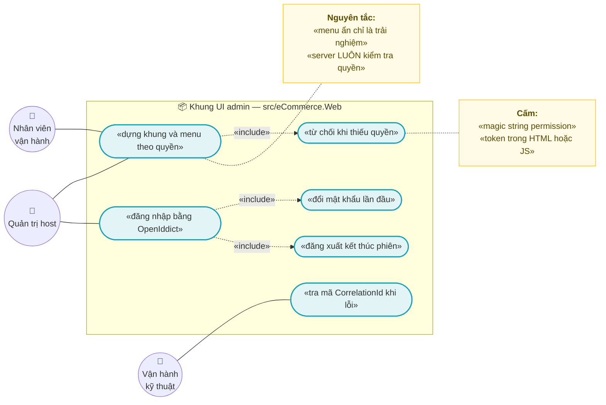
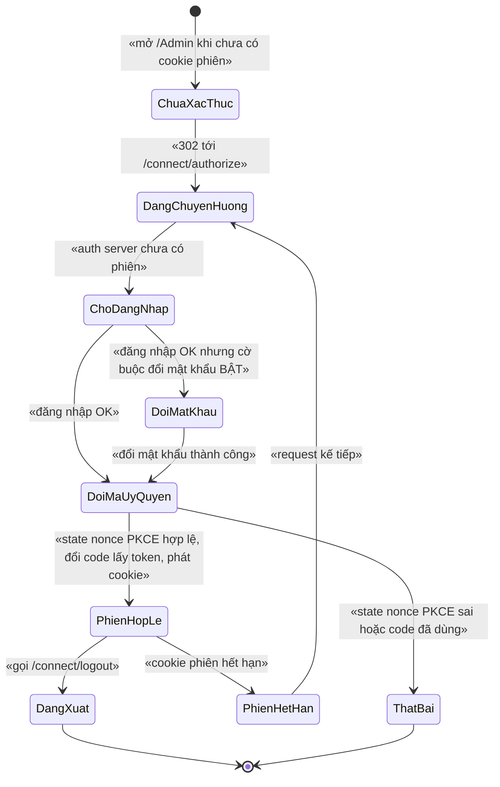
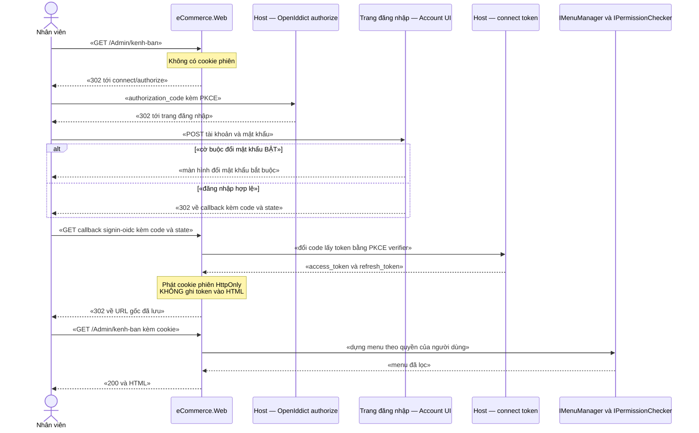

# `WEB-001` — UI admin: khung, đăng nhập, menu, phân quyền

| Thuộc tính | Nội dung |
|---|---|
| **Mã** | `WEB-001` |
| **Module** | **Web** — project UI `src/eCommerce.Web` (**chưa có trong code — kế hoạch GĐ1**), màn hình đăng nhập do module **Account** của ABP render trong auth server (`src/eCommerce.HttpApi.Host`) |
| **Giai đoạn** | **GĐ1** — nằm trong danh sách 18 tài liệu GĐ1 (`docs/implementation-plan.md:414`), và là **điều kiện tiên quyết** của `WEB-002` (`docs/features/web-002-storefront-duyet-chi-tiet-san-pham.md:94`) |
| **Ưu tiên** | **Must have** — "màn hình login hoạt động" là **cổng kiểm soát GĐ1** số 4 (`docs/implementation-plan.md:189`) |
| **Trạng thái** | 🟡 `Draft` — chờ review |
| **Người viết / người review** | *(điền)* / **Kiến trúc trưởng + Security review** |
| **Phiên bản / ngày** | `v0.1 — 13/10/2026` |
| **Tài liệu liên quan** | `XC-001` (Money/format tiền) · `XC-002` (outbox/inbox/idempotency) · `XC-003` (khoá phân tán) · `XC-004` (xác thực/phân quyền/tenant) · `XC-005` (observability) · `WEB-002` (storefront) · `WEB-003` (checkout) · `CHN-002` (màn hình kênh) · `docs/structure-and-techstack.md` · `docs/abp-modules-plan.md` · `docs/implementation-plan.md` |

> 🚨 **TÌNH TRẠNG CODE — ĐỌC TRƯỚC KHI REVIEW (đã kiểm bằng `read`/`grep`, không suy đoán):**
> `WEB-001` **hoàn toàn chưa có trong code**. Bằng chứng cụ thể:
> - `eCommerce.slnx` liệt kê **18 project** (đếm bằng `Select-String '<Project Path='`), **0** project Web/UI — `eCommerce.slnx:1-31`.
> - Toàn repo: **0** file `.cshtml`, **0** file `.razor`, **0** thư mục `wwwroot` (đếm bằng `Get-ChildItem -Recurse`).
> - `Directory.Packages.props:21-76` **không** có gói UI nào (`Volo.Abp.AspNetCore.Mvc.UI*`, theme, `Volo.Abp.Account.Web`).
> - `docs/abp-modules-plan.md:224` đã ghi nhận: *"**Không có project UI/Web** (`.Web` hoặc `.Blazor`)"*.
> - `eCommerceHttpApiHostModule.cs:28-30`: *"⚠️ CHƯA có UI đăng nhập (solution không có project Web)"*.
>
> ⇒ Mọi mục trong tài liệu này nói về `eCommerce.Web`, menu, theme, localization đều là **thiết kế**, kèm nhãn rõ
> **"chưa có trong code — kế hoạch GĐ1"**. Mọi khẳng định về **code hiện có** đều có `đường/dẫn/file.cs:dòng`.

---

## 0. Tóm tắt & quyết định thiết kế

**Tóm tắt:** `WEB-001` chốt **cái khung** mà mọi màn hình quản trị sẽ nằm trong đó: một project UI Razor MVC,
**đăng nhập bằng OpenIddict `authorization_code` + PKCE** (không tự viết auth, **không** dùng `password` grant),
**menu sinh từ `IMenuContributor` và lọc theo permission ở server**, và **mặc định từ chối** với allowlist
`[AllowAnonymous]` tường minh. Đây là feature **không sở hữu entity nghiệp vụ nào** — giá trị của nó là
**quy ước**: đăng nhập, khung, menu, và cách phân quyền ở UI sao cho **không tạo ra lỗ hổng im lặng**.

**Vì sao phải chốt bằng tài liệu trước khi code (3 lỗi đã xảy ra thật trong chính repo này, đều không có lỗi biên dịch):**

| # | Lỗi đã xảy ra thật | Bằng chứng | Bài học cho `WEB-001` |
|---|---|---|---|
| 1 | App service **chạy được khi chưa xác thực** vì thiếu `[Authorize]` cấp class | `src/eCommerce.Application/Channels/ChannelAppService.cs:21-27` | UI **không** được là nơi duy nhất kiểm quyền; phải có **fallback policy** + test reflection |
| 2 | API trả **403 cho MỌI người** (kể cả admin) vì permission **chưa được định nghĩa** | `src/eCommerce.Application.Contracts/Permissions/eCommercePermissionDefinitionProvider.cs:8-19`; `src/eCommerce.DbMigrator/IdentityDataSeedContributor.cs:23-34` | Menu/nút đọc từ cùng nguồn permission đó ⇒ thiếu định nghĩa là **menu rỗng** ở UI, không chỉ 403 |
| 3 | Khoá lock **không bảo vệ gì** vì hai nơi sinh hai chuỗi khác nhau | `src/eCommerce.Domain.Shared/eCommerceConsts.cs:91-96` (F1 của `XC-003`) | Menu/route cũng là "hai nguồn sự thật" tiềm năng ⇒ **một** nơi khai báo (bảng đăng ký §5.3) + test |

**Phạm vi:**
- ✅ **Khung UI (shell)**: layout, header, sidebar, breadcrumb, trang lỗi, trang 403/404.
- ✅ **Đăng nhập / đăng xuất / hết hạn phiên**: `authorization_code` + **PKCE**, cookie phiên phía server.
- ✅ **Menu**: khai báo bằng `IMenuContributor`, **lọc theo permission ở server**, có **bảng đăng ký menu** (§5.3).
- ✅ **Khung phân quyền ở UI**: fallback policy (mặc định từ chối), allowlist `[AllowAnonymous]`, cách hiển thị 401/403/404.
- ✅ **Quy ước UI dùng chung** cho mọi màn hình sau này: localization, format tiền qua `Money`, `CorrelationId` khi lỗi, quy tắc "ledger chỉ đọc".
- ✅ **Kế hoạch seed/cấu hình** để bật được luồng đăng nhập (OpenIddict client mới).

**Không nằm trong phạm vi:**
- ❌ **Storefront** (duyệt/chi tiết sản phẩm, SEO) — thuộc `WEB-002`; giỏ hàng/checkout — thuộc `WEB-003`.
- ❌ **Nội dung từng màn hình nghiệp vụ** (danh sách sản phẩm, đơn hàng, thuế…) — thuộc `CAT-*`, `SAL-*`, `XC-006`…; tài liệu đó chốt **mapping dữ liệu**, `WEB-001` chốt **khung + quy ước**.
- ❌ **Cơ chế xác thực/phân quyền** (định nghĩa permission, ý nghĩa 401/403/404, chiều tenant) — thuộc `XC-004`; tài liệu này **tiêu thụ**, không định nghĩa lại.
- ❌ **Tenant management UI** (tạo/quản tenant, DB riêng) — thuộc **GĐ4** (`docs/implementation-plan.md:226`).
- ❌ **2FA/OTP** cho tài khoản quản trị — `XC-004` §15.1 **Q4** đã chốt **KHÔNG làm ở GĐ1**, hoãn **GĐ3** (`docs/features/XC-004-xac-thuc-phan-quyen-tenant.md:508`).
- ❌ **Đăng nhập Google/Zalo cho khách** — `XC-004` §15.1 **Q5** đã chốt **KHÔNG** ở GĐ1 (`XC-004:509`).

### 0.1 Quyết định thiết kế (ADR ngắn)

| # | Quyết định | Phương án đã cân nhắc | Lý do chọn | Hệ quả |
|---|---|---|---|---|
| **ADR-01** | UI admin là **project Razor MVC/Razor Pages riêng `src/eCommerce.Web`** | (a) Blazor WASM/Server · (b) SPA Angular/React riêng · (c) **Razor MVC** | `docs/structure-and-techstack.md:123` đã chốt: *"ABP **MVC/Razor Pages** + theme miễn phí (`Volo.BasicTheme` / LeptonX Lite) … Blazor WASM không phù hợp SEO"*; `docs/structure-and-techstack.md:62` và `docs/implementation-plan.md:165` chỉ đích danh `src/eCommerce.Web` | Không có pipeline build JS thứ hai; test được **HTML trả về** (SEO/`WEB-002`); đổi lại **không** có SPA-style routing |
| **ADR-02** | Đăng nhập bằng **`authorization_code` + PKCE**, **cookie phiên phía server** | (a) `password` grant (ROPC) · (b) `authorization_code` không PKCE · (c) **`authorization_code` + PKCE** | `XC-004` **D7** (`XC-004:52`) loại ROPC: *"OAuth 2.1 khuyến nghị loại bỏ … **cấm** ở production"*; `XC-004` **BR-010** (`XC-004:74`). Ui admin là app **confidential-ish** chạy server-side ⇒ PKCE + cookie `HttpOnly` | Phải **thêm client `authorization_code` vào seed OpenIddict** (hiện **chưa có**: `OpenIddictDataSeedContributor.cs:86-88` chỉ có `Password`/`ClientCredentials`/`RefreshToken`) |
| **ADR-03** | Màn hình đăng nhập (UI của `Volo.Account`) đặt ở **auth server = `eCommerce.HttpApi.Host`** | (a) đặt trong `eCommerce.Web` · (b) **đặt ở Host** | Host **đã** là auth server (`eCommerceHttpApiHostModule.cs:25-26`), và `docs/abp-modules-plan.md:185` hướng dẫn thêm `UseAbpRequestLocalization()` + `UseStaticFiles()` **cho UI theme ngay trong Host** | Host phải thêm gói UI/theme; `eCommerce.Web` là **OIDC client** ⇒ có 2 cấu hình theme. ⚠️ Chi tiết wiring ABP 10.7 **chưa kiểm chứng** (§15.4) |
| **ADR-04** | **Mặc định TỪ CHỐI** toàn bộ UI; allowlist `[AllowAnonymous]` tường minh | (a) `[Authorize]` từng trang · (b) **fallback policy `RequireAuthenticatedUser` + allowlist** | (a) **đã thất bại thật** ở Phase 0 (`ChannelAppService.cs:21-25`: quên một method ⇒ hở endpoint). Fallback policy ⇒ quên thuộc tính là **an toàn**, không phải hở | Phải khai báo **allowlist** cho storefront (`WEB-002`/`WEB-003`), trang lỗi, callback `signin-oidc`; có test chặn allowlist phình to |
| **ADR-05** | Menu khai báo **trong code** bằng `IMenuContributor` + `ApplicationMenu` của ABP, **không** lưu DB | (a) bảng `Menus` trong DB · (b) file JSON cấu hình · (c) **`IMenuContributor`** | Menu gắn chặt với **route + permission trong code**; để trong DB ⇒ hai nguồn sự thật (route sửa trong code, menu sửa trong DB ⇒ **menu chết**). Đây đúng loại lỗi `XC-003` F1 gây ra với khoá lock (`eCommerceConsts.cs:91-96`) | Không cần migration; đổi menu = deploy. Muốn ẩn/hiện theo tenant sau này ⇒ dùng **feature/setting**, không dựng bảng menu |
| **ADR-06** | **Ẩn menu không phải biện pháp bảo mật**; server **luôn** kiểm tra | (a) chỉ ẩn ở UI · (b) **ẩn để dễ dùng + server chặn** | `XC-004` **D6** + **BR-005** (`XC-004:51`, `XC-004:74`); app service duy nhất hiện có đã có `[Authorize]` cấp class (`ChannelAppService.cs:27`) | Mọi nút trong khung phải map tới app service **có** `[Authorize]`; test reflection chặn tái phát |
| **ADR-07** | Thêm **localization resource `eCommerceResource`** (vi + en) cho UI | (a) hard-code chuỗi tiếng Việt trong Razor · (b) **resource + file `vi.json`/`en.json`** | Chính comment trong code đã chỉ ra: *"tham số displayName là `ILocalizableString?` nên đang để `null` ⇒ UI sẽ hiển thị tên permission dạng thô. Khi làm UI admin (P1), tạo một localization resource … rồi truyền `LocalizableString.Create<eCommerceResource>(...)`"* — `eCommercePermissionDefinitionProvider.cs:16-19` | Phải seed/sinh resource **trước** khi màn hình quản trị quyền dùng được; hiện repo **0** file localization (§15.2 **F6**) |
| **ADR-08** | Tiền trên UI **chỉ** định dạng qua `Money` + `Currency`; **cấm** `==` trên tiền; **cấm** `double`/`float` trong ViewModel | (a) render `decimal` bằng chuỗi nội suy · (b) **helper `Money` + `CultureInfo`** | `XC-001` (`docs/features/XC-001-money-currency-lam-tron.md:327`): *"Format theo locale (`vi-VN`), VND **0 chữ số thập phân**"*; quy ước #1/#2 ở `docs/structure-and-techstack.md:133-134` | ⚠️ `Money`/`eCommerce.Kernel` **chưa tồn tại trong code** (**0** project tên `Kernel` — đã kiểm) ⇒ khung UI GĐ1 **không được** tự render tiền; helper chỉ bật khi `XC-001` xong |
| **ADR-09** | **Không** thêm gói/phiên bản ABP mới ngoài `Directory.Packages.props` | (a) thêm gói rời trong `.csproj` · (b) **gom vào CPM** | Quy ước #15 (`docs/structure-and-techstack.md:147`): *"Mọi package ABP cùng version, sửa **một file**"*; `Directory.Packages.props:3` bật `ManagePackageVersionsCentrally` | Gói UI (`Volo.Abp.AspNetCore.Mvc.UI.Theme.*`, `Volo.Abp.Account.Web`) **phải** thêm ở `Directory.Packages.props` version **10.7.0** |
| **ADR-10** | Menu/nút dùng **hằng số permission**, **cấm** magic string | (a) `"eCommerce.Channels.Manage"` · (b) **`eCommerceConsts.Permissions.Channels.Manage`** | `XC-004` **D4/BR-003** (`XC-004:49`, `XC-004:74`); hằng số đã có sẵn đủ **21** permission (`eCommerceConsts.cs:19-73`), định nghĩa đủ **21** (`eCommercePermissionDefinitionProvider.cs:28-59`) | Menu trỏ permission sai ⇒ **im lặng** (menu rỗng) ⇒ phải có test đối chiếu 2 chiều (`TC-04`) |

---

## 1. Use Case Specification

| Thuộc tính | Nội dung |
|---|---|
| **Use Case ID** | `WEB-001` |
| **Use Case Name** | Đăng nhập và làm việc trong **khung quản trị** với menu **đúng quyền** |
| **Description** | *"Là nhân viên/quản trị, tôi muốn đăng nhập một lần rồi thấy đúng những mục mà tôi được phép dùng, để tôi không phải nhớ quyền của mình — và để khi tôi không có quyền thì hệ thống nói rõ, không im lặng cho qua."* |
| **Actor(s)** | **Nhân viên vận hành** (đã xác thực, có permission) · **Quản trị host** (toàn quyền) · **Vận hành kỹ thuật** (tra `CorrelationId`, xem health) · **Hệ thống** (OpenIddict auth server `eCommerce.HttpApi.Host`, `IMenuManager`, `IPermissionChecker`) |
| **Priority** | **Must have** (cổng GĐ1 #4: *"Mọi API đều yêu cầu xác thực, có màn hình login hoạt động"* — `docs/implementation-plan.md:189`) |
| **Trigger** | (a) người dùng mở một URL quản trị (`/Admin/...`) khi **chưa** có phiên; (b) phiên hết hạn giữa lúc làm việc; (c) người dùng bấm **Đăng xuất** |
| **Pre-Condition(s)** | • **Tenant hiện tại** (`TenantId` từ `ICurrentTenant`) — hệ thống đang chạy **1 tenant** và `TenantId` **có thể là `NULL`** (`XC-004:227`, `XC-004:561`).<br>• **Kênh bán** (`ChannelCode`): **không** áp dụng cho khung/menu — khung **không** phụ thuộc kênh; kênh chỉ xuất hiện ở màn hình nghiệp vụ (`CHN-002`).<br>• Permission **đã được định nghĩa**: **21** định nghĩa = **21** hằng số (`eCommercePermissionDefinitionProvider.cs:28-59` ↔ `eCommerceConsts.cs:19-73`) — thiếu định nghĩa ⇒ **403 cho mọi người** (lỗi Phase 0).<br>• Tài khoản seed **`admin@abp.io`** đã tồn tại + role `admin` đã được cấp **toàn bộ** permission (`IdentityDataSeedContributor.cs:35-36`, `:92-106`).<br>• **Redis 7** sẵn sàng (`docker-compose.yml:25-27`) — cần cho **cache permission** dùng chung đa instance; nếu Redis chết, app **vẫn chạy** (`eCommerceHttpApiHostModule.cs:141`).<br>• `eCommerce.Web` **chưa có trong code** ⇒ đây là **điều kiện của kế hoạch GĐ1**, không phải của hiện tại. |
| **Post-Condition(s)** | • Người dùng **chưa** xác thực ⇒ **`302`** tới `/connect/authorize` (không bao giờ thấy dữ liệu nghiệp vụ).<br>• Người dùng đã xác thực ⇒ khung render **chỉ** các menu item mà người đó **có** permission.<br>• **Không** `access_token`/`refresh_token` nào xuất hiện trong HTML, JS, log hay cookie đọc được bằng JS (**BR-008**).<br>• Mọi lần **từ chối** (401/403) đều **có dấu vết**: log có `CorrelationId` + mã lỗi (**BR-015**).<br>• Người dùng **bị buộc đổi mật khẩu** (cờ `ShouldChangePasswordOnNextLogin`) **không** vào được route quản trị nào khác (**BR-011**). |
| **Basic Flow** | 1. Người dùng mở `/Admin` khi **chưa** có cookie phiên.<br>2. Middleware xác thực challenge ⇒ **`302`** tới `/connect/authorize` (auth server = Host) kèm `authorization_code` + **PKCE** (ADR-02).<br>3. Auth server render **trang đăng nhập** (module Account) — *chưa có trong code, kế hoạch GĐ1*.<br>4. Người dùng nhập tài khoản/mật khẩu; nếu cờ **buộc đổi mật khẩu** bật ⇒ chuyển sang **màn hình đổi mật khẩu** trước (**BR-011**).<br>5. Auth server phát **`code`** + `state`; trình duyệt quay về **callback** của `eCommerce.Web`.<br>6. `eCommerce.Web` kiểm `state`/`nonce`/PKCE ⇒ **đổi `code` lấy token** tại `/connect/token` ⇒ phát **cookie phiên `HttpOnly`**.<br>7. Người dùng được **`302`** về URL gốc; mỗi request sau mang cookie.<br>8. Khung dựng menu: `IMenuManager` + `IPermissionChecker` ⇒ **lọc bỏ** item thiếu quyền (**BR-004**), render breadcrumb + vùng nội dung.<br>9. Trả `200` + HTML; `X-Correlation-Id` có trong response (`eCommerceHttpApiHostModule.cs:202`). |
| **Alternative Flow** | **A1: Người dùng chỉ có 1 nhóm quyền** — menu chỉ hiện nhóm đó; nếu **0** quyền ⇒ hiện **thông điệp "tài khoản chưa được cấp quyền"** + mã liên hệ, **không** hiện khung rỗng gây hiểu là lỗi hệ thống (§12).<br>**A2: Đăng xuất** — gọi `/connect/logout` (endpoint `EndSession` **đã** được cấp cho client hiện tại: `OpenIddictDataSeedContributor.cs:82`) ⇒ xoá cookie + kết thúc phiên tại auth server.<br>**A3: Phiên hết hạn giữa lúc làm việc** — request kế tiếp ⇒ `401` ⇒ chuyển sang đăng nhập **và** lưu URL đích **nội bộ** để quay lại (**BR-009**).<br>**A4: Người dùng là quản trị host** — permission cấp host (`TenantId = null`) **không** bị giới hạn theo tenant (`XC-004:72`).<br>**A5: Vận hành kỹ thuật** — mở trang lỗi, đọc `X-Correlation-Id` để tra log (`XC-005:307`). |
| **Exception Flow** | **E1:** không có cookie / cookie hết hạn ⇒ **`401`** → challenge tới `/connect/authorize` (**BR-001**).<br>**E2:** đã xác thực nhưng **thiếu permission** ⇒ **`403`** + trang nêu **mã permission cần có** (`XC-004:364`) — **không** phải lỗi hệ thống.<br>**E3:** permission **chưa định nghĩa** ⇒ `403` cho **mọi** người (kể cả admin) ⇒ 🚨 phải bị **CI chặn** (`XC-004:392`, test `TC-04`).<br>**E4:** `state`/`nonce`/PKCE **sai** hoặc `code` **đã dùng** ⇒ **NÉM LỖI** `eCommerce:Web:0001` + log `Error` + trang lỗi; **cấm** coi như đăng nhập thành công (**BR-010**).<br>**E5:** tài nguyên thuộc **tenant khác** ⇒ **`404`** (không `403`) — không tiết lộ sự tồn tại (`XC-004:73`, `XC-004:393`).<br>**E6:** OpenIddict/DB **không** truy cập được ⇒ trang lỗi **có** `CorrelationId`, **không** lộ stack/chuỗi kết nối (`XC-005:79` BR-012).<br>**E7:** quyền bị **thu hồi** trong lúc đang có phiên ⇒ request kế tiếp **sau khi cache bị xoá** phải bị chặn (`XC-004:339`). |
| **Business Rules** | • **BR-WEB-001-001**: **Mọi** route của UI quản trị **phải** yêu cầu xác thực; **bắt buộc** dùng **fallback policy** `RequireAuthenticatedUser` (mặc định từ chối); **cấm** để hở do thiếu thuộc tính.<br>• **BR-WEB-001-002**: `[AllowAnonymous]` **chỉ** cho route trong **allowlist có lý do** (storefront `WEB-002`/`WEB-003`, `signin-oidc`, `signout-callback-oidc`, trang lỗi, health); **cấm** ngoài allowlist (kế thừa `XC-004` BR-004).<br>• **BR-WEB-001-003**: **Cấm** magic string permission trong UI; **bắt buộc** dùng `eCommerceConsts.Permissions.*` (`eCommerceConsts.cs:15-74`).<br>• **BR-WEB-001-004**: **Mọi** menu item **phải** khai `RequiredPermissionName`; item thiếu quyền ⇒ **không render**; **cấm** render rồi ẩn bằng CSS/JS.<br>• **BR-WEB-001-005**: Ẩn menu/nút **không** phải biện pháp bảo mật — **mọi** thao tác ghi vẫn đi qua app service có `[Authorize]` **cấp class** (`ChannelAppService.cs:27`).<br>• **BR-WEB-001-006**: **Mọi** menu item **phải** trỏ tới route **tồn tại**; **cấm** menu chết (test phân giải route — `TC-06`).<br>• **BR-WEB-001-007**: **Cấm** đưa `access_token`/`refresh_token`/secret vào HTML, JS, log; cookie phiên **phải** `HttpOnly` + `Secure` (production) + `SameSite=Lax`.<br>• **BR-WEB-001-008**: Đăng nhập UI **chỉ** bằng `authorization_code` + **PKCE**; **cấm** `password` grant cho UI admin ở **mọi** môi trường (`XC-004:52`, `XC-004:74`).<br>• **BR-WEB-001-009**: `redirect_uri`/`post_logout_redirect_uri` **chỉ** dùng giá trị **đã đăng ký**; `returnUrl` **chỉ** nhận URL **nội bộ cùng origin** (`Url.IsLocalUrl`); **cấm** tin URL tuyệt đối từ query (`XC-004` BR-014, `XC-004:74`).<br>• **BR-WEB-001-010**: Guard của luồng đăng nhập sai (`state`, `nonce`, PKCE, `code` tái sử dụng) **phải NÉM LỖI** có mã `eCommerce:Web:0001` + log `Error`; **cấm** im lặng cho qua hoặc retry vô hạn (quy ước #11 — `docs/structure-and-techstack.md:143`).<br>• **BR-WEB-001-011**: Tài khoản có cờ **`ShouldChangePasswordOnNextLogin`** **phải** bị chặn khỏi mọi route khác cho tới khi đổi mật khẩu xong (`IdentityDataSeedContributor.cs:126-141`; `XC-004:506`).<br>• **BR-WEB-001-012**: Mọi thay đổi **quyền/vai trò** từ UI **phải** qua app service (Unit of Work) và **phải** sinh **audit** (`XC-004:55`, `XC-004:74`); **cấm** UI ghi trực tiếp bảng permission.<br>• **BR-WEB-001-013**: **Cấm** so sánh tiền bằng `==` và **cấm** `double`/`float` trong ViewModel/View; tiền **phải** `decimal` qua `Money`, định dạng `vi-VN`, VND **0** chữ số thập phân (`XC-001:327`, `docs/structure-and-techstack.md:133-134`). ⚠️ `Money` **chưa có trong code** ⇒ hiệu lực khi `XC-001` xong.<br>• **BR-WEB-001-014**: Mọi thao tác ghi từ UI đi qua **Unit of Work**; khung/menu **chỉ đọc** ⇒ **0** truy vấn DB cho mỗi menu item (dùng cache).<br>• **BR-WEB-001-015**: Khi có lỗi, UI **phải** hiển thị **`X-Correlation-Id`** (`XC-005:307`; header đã được phát thật — `eCommerceHttpApiHostModule.cs:202`).<br>• **BR-WEB-001-016**: Màn hình xem **sổ cái kho** (`InvStockLedger` — `eCommerceDbContext.cs:144-160`) **chỉ đọc**; **cấm** UI gọi endpoint sửa/xoá bản ghi sổ cái (sổ cái APPEND-ONLY).<br>• **BR-WEB-001-017**: **Mọi** chuỗi hiển thị **phải** qua localization resource (`eCommerceResource`); **cấm** hard-code chuỗi trong Razor (`eCommercePermissionDefinitionProvider.cs:16-19`).<br>• **BR-WEB-001-018**: Menu/route/permission khai báo **một nơi duy nhất** (bảng đăng ký §5.3); **cấm** khai báo menu trùng ở hai chỗ. |
| **Non-Functional Requirement** | • **NFR-WEB-001-001**: TTFB p95 **< 300 ms** cho trang quản trị đã đăng nhập (menu + permission lấy từ cache).<br>• **NFR-WEB-001-002**: Dựng menu p95 **< 5 ms**; **0** truy vấn DB cho mỗi item.<br>• **NFR-WEB-001-003**: Đăng nhập end-to-end (bấm Đăng nhập → thấy trang quản trị) p95 **≤ 3 s** trong LAN.<br>• **NFR-WEB-001-004**: **100 %** route quản trị yêu cầu xác thực (test reflection trên Razor Pages) — **0** ngoại lệ.<br>• **NFR-WEB-001-005**: **0** `access_token`/`refresh_token`/secret trong HTML/JS/log (test quét).<br>• **NFR-WEB-001-006**: **0** menu item chết (test phân giải route).<br>• **NFR-WEB-001-007**: **0** magic string permission trong project UI (test quét mã nguồn).<br>• **NFR-WEB-001-008**: **0** `double`/`float` trong ViewModel/ViewData (test reflection).<br>• **NFR-WEB-001-009**: **0** chuỗi hiển thị không có key localization cho `vi` **và** `en` (test đối chiếu resource).<br>• **NFR-WEB-001-010**: **0** vòng lặp redirect (test: request chưa đăng nhập ⇒ tối đa **1** lần `302` rồi tới trang đăng nhập).<br>• **NFR-WEB-001-011**: Cookie phiên: `HttpOnly` **100 %**, `Secure` **100 %** ở production, `SameSite=Lax`; thời gian sống **≤ 8 giờ** (đề xuất), access token ≤ 1 h / refresh ≤ 14 ngày theo `XC-004` NFR-005 (`XC-004:75`, `XC-004:507`).<br>• **NFR-WEB-001-012**: Mọi trang lỗi hiển thị `CorrelationId`; **0** stack trace/chuỗi kết nối lộ ra (`XC-005:79` BR-012). |

---

## 2. Sơ đồ Use Case



---

## 3. Sơ đồ trạng thái (state machine) — vòng đời **một phiên đăng nhập**

> Đây là "feature có vòng đời" theo nghĩa của mẫu: **phiên đăng nhập** có trạng thái, guard và **guard sai phải ném lỗi**.



**Bảng chuyển trạng thái & guard (mọi chuyển **sai** phải **ném lỗi**, không im lặng):**

| # | Từ → Sang | Guard (điều kiện cho phép) | Hành động kèm theo | Nếu guard sai thì? |
|---|---|---|---|---|
| 1 | `ChuaXacThuc` → `DangChuyenHuong` | Không có cookie phiên hợp lệ | `302` tới `/connect/authorize` + ghi **cookie `state`/PKCE verifier** (một lần) | Không có auth server ⇒ **trang lỗi 503** + log `Error` (**không** hiện trang trắng) |
| 2 | `DangChuyenHuong` → `ChoDangNhap` | Auth server sống; `client_id` + `redirect_uri` **đã đăng ký** | Render trang đăng nhập (module Account). *Chưa có trong code — kế hoạch GĐ1* | `redirect_uri` không đăng ký ⇒ OpenIddict trả lỗi `invalid_request` ⇒ **trang lỗi + log**, **cấm** tự chuyển hướng tiếp |
| 3 | `ChoDangNhap` → `DoiMatKhau` | Xác thực thành công **và** `ShouldChangePasswordOnNextLogin = true` | Chuyển màn hình đổi mật khẩu; **chặn** mọi route khác (**BR-011**) | Bỏ qua cờ ⇒ **vi phạm BR-011** ⇒ chặn ở tầng filter, không dựa vào UI |
| 4 | `ChoDangNhap` → `DoiMaUyQuyen` | Xác thực thành công **và** không buộc đổi mật khẩu | Phát `code` + `state` | Sai mật khẩu ⇒ ở lại `ChoDangNhap` + đếm số lần thất bại (khoá tạm do Identity quản) |
| 5 | `DoiMaUyQuyen` → `PhienHopLe` | `state` khớp cookie **và** `nonce` hợp lệ **và** PKCE verifier khớp **và** `code` **chưa** dùng **và** đổi token thành công | Phát **cookie phiên `HttpOnly`**; **KHÔNG** ghi token vào HTML | Bất kỳ điều kiện nào sai ⇒ **`eCommerce:Web:0001`** + log `Error` + `ThatBai` (**BR-010**) |
| 6 | `PhienHopLe` → `PhienHetHan` | Cookie hết hạn **hoặc** không refresh được token | Xoá cookie; ghi log `Information` (hết hạn **không phải** lỗi) | — |
| 7 | `PhienHetHan` → `DangChuyenHuong` | Request kế tiếp tới route quản trị | Lưu URL đích **nội bộ** để quay lại (**BR-009**) | `returnUrl` **ngoài** origin ⇒ **bỏ** (dùng `/Admin`) + log `Warning` |
| 8 | `PhienHopLe` → `DangXuat` | Người dùng bấm Đăng xuất | Gọi `/connect/logout` (`EndSession` đã cấp — `OpenIdDictDataSeedContributor.cs:82`) + xoá cookie | Token không thu hồi được ⇒ **vẫn** xoá cookie + log; **không** báo "thành công" giả |

> ⚠️ **`ThatBai` là trạng thái hấp thụ (absorbing):** sau khi `state`/`nonce`/PKCE sai, hệ thống **không** tự thử lại —
> vì tự thử lại là dấu hiệu **tấn công CSRF/code injection** hoặc lỗi cấu hình. Người dùng phải **bắt đầu lại** từ `ChuaXacThuc`
> (bấm "Đăng nhập lại"). Đây là điểm khác biệt có chủ ý so với "retry ngầm" — retry ngầm che mất sự cố.

---

## 4. Sequence Diagram & luồng dữ liệu

### 4.1 Sequence — đăng nhập rồi dựng menu (3 lượt trình duyệt)



### 4.2 DFD — luồng dữ liệu của khung UI (trình bày bằng bảng, không dùng thêm sơ đồ)

| Bước | Nguồn | Đích | Dữ liệu | Cơ chế / ghi chú |
|---|---|---|---|---|
| 1 | Trình duyệt | `eCommerce.Web` | URL + cookie phiên | Không có cookie ⇒ challenge (**BR-001**) |
| 2 | `eCommerce.Web` | Auth server (Host) | `client_id`, `redirect_uri`, `state`, `code_challenge`, scope `eCommerce` | PKCE (**ADR-02**); scope `eCommerce` **đã** seed (`OpenIddictDataSeedContributor.cs:23`) |
| 3 | Auth server | Trình duyệt | Trang đăng nhập | Module Account — **chưa có trong code, kế hoạch GĐ1** |
| 4 | Auth server | `eCommerce.Web` | `code` (+ `state`) | `code` **dùng một lần** do OpenIddict quản |
| 5 | `eCommerce.Web` | Auth server `/connect/token` | `code` + `code_verifier` | Kênh **server-to-server**; token **không** đi qua trình duyệt |
| 6 | `eCommerce.Web` | Trình duyệt | Cookie phiên `HttpOnly` | Token **không** nằm trong cookie/HTML (**BR-007**) |
| 7 | `IPermissionChecker` | `IMenuManager` | tập permission của người dùng | Cache; khoá cache do ABP quản (`eCommerceHttpApiHostModule.cs:110-113` đặt `KeyPrefix = "eCommerce:"`) |
| 8 | `IMenuManager` | Razor layout | menu **đã lọc** | **Server-side**; **cấm** lọc ở client (**BR-004**) |
| 9 | App service | Razor Page | DTO nghiệp vụ | Qua `*.Contracts`; **cấm** tham chiếu entity/`DbContext` của module khác (`docs/structure-and-techstack.md:135`) |
| 10 | Mọi response | Trình duyệt | `X-Correlation-Id` | Đã phát thật (`eCommerceHttpApiHostModule.cs:202`); UI hiển thị khi lỗi (**BR-015**) |

---

## 5. Mô hình dữ liệu

### 5.1 WEB-001 **không sở hữu bảng nào** — và vì sao

| Hạng mục | Kết luận | Lý do |
|---|---|---|
| Bảng DB của `WEB-001` | **Không có** *(thiết kế)* | Khung + menu + route là **code** (ADR-05). Đây là quyết định có chủ ý: menu trong DB ⇒ route (code) và menu (DB) là **hai nguồn sự thật** ⇒ sinh **menu chết** — đúng loại lỗi im lặng mà `XC-003` F1 đã gặp với khoá lock (`eCommerceConsts.cs:91-96`) |
| Entity | **Không có** | WEB-001 **không** sở hữu entity nghiệp vụ nào. Hệ quả: **không** cần `DbSet` mới trên `eCommerceDbContext` (`src/eCommerce.EntityFrameworkCore/eCommerceDbContext.cs:36-64`) — quy ước "entity cần `DbSet` nếu không có `IRepository` riêng" **không kích hoạt** |
| Migration | **Không có** *(thiết kế)* | Xem §11 |
| Nếu **sau này** cần lưu sở thích UI (theme sáng/tối, menu thu gọn) | 🚧 **Chưa có trong code — kế hoạch GĐ2+** | Khi đó **bắt buộc**: entity thuộc một **module** (vd `eCommerce.AdminUi.Domain`) + `DbSet` trên DbContext hợp nhất, **cấm** để trong `src/` app (quy ước #3/#4 — `docs/structure-and-techstack.md:135-137`; bài học `IRepository<ChannelShop, Guid>` chưa đăng ký — `eCommerceDbContext.cs:48-52`) |

### 5.2 Bảng của ABP mà khung UI **đọc** (không sở hữu, không ghi trực tiếp)

| Bảng | Dùng cho | Ai ghi | Bằng chứng |
|---|---|---|---|
| `AbpUsers` | danh tính người đăng nhập | ABP Identity (qua app service) | `IdentityDataSeedContributor.cs:35`, `:128` |
| `AbpRoles` / `AbpUserRoles` | vai trò | ABP Identity | `IdentityDataSeedContributor.cs:69` |
| `AbpPermissionGrants` | **gán** quyền theo `(Name, ProviderName, ProviderKey)` | ABP PermissionManagement (`IPermissionManager.SetForRoleAsync` — `IdentityDataSeedContributor.cs:105`) | `XC-004:213` |
| `AbpPermissionGroups` / `AbpPermissions` | **định nghĩa** quyền | sinh từ `PermissionDefinitionProvider` (`eCommercePermissionDefinitionProvider.cs:21-60`) | `XC-004:214` |
| `AbpAuditLogs` | audit thay đổi quyền (**BR-012**) | ABP AuditLogging (đã cấu hình `builder.ConfigureAuditLogging()` — `eCommerceDbContext.cs:88`) | `XC-004:215` |

> 📌 **Cấm:** UI **không** được `IRepository<PermissionGrant>` / `IRepository<IdentityRole>` để tự ghi.
> Mọi thay đổi quyền đi qua app service (Unit of Work) + audit (**BR-012**) và **chỉ host admin** được sửa quyền vai trò
> (`XC-004:511` — Q7 đã chốt).

### 5.3 Bảng đăng ký **menu** (Data Dictionary của menu — nguồn sự thật duy nhất)

Trạng thái: 🚧 **chưa có trong code — kế hoạch GĐ1**. Cột "permission" **phải** trỏ hằng số có thật trong
`eCommerceConsts.cs:19-73`; cột "route" **phải** trỏ Razor Page tồn tại (**BR-006**).

| Mã menu | Nhóm (menu group) | Route | Permission (`eCommerceConsts.Permissions.*`) | Có app service chưa? | Giai đoạn |
|---|---|---|---|---|---|
| `channels.shops` | Kênh bán | `/Admin/kenh-ban` | `Channels.Default` | ✅ **có** — `ChannelAppService` (`src/eCommerce.Application/Channels/ChannelAppService.cs:27`) | **GĐ1 (WEB-001)** |
| `channels.shops.connect` | Kênh bán | (nút trong trang) | `Channels.Manage` | ✅ `ConnectAsync` (`ChannelAppService.cs:69-70`), `SetActiveAsync` (`:127-128`) | **GĐ1 (WEB-001)** |
| `channels.shops.sync-now` | Kênh bán | (nút trong trang) | `Channels.Sync` | ✅ `SyncNowAsync` (`ChannelAppService.cs:143-144`) | **GĐ1 (WEB-001)** |
| `products.list` | Sản phẩm | `/Admin/san-pham` | `Products.Default` | ⬜ **chưa có trong code — kế hoạch GĐ1** (`CAT-001`) | GĐ1 (sau `CAT-001`) |
| `products.create` | Sản phẩm | `/Admin/san-pham/tao` | `Products.Create` | ⬜ chưa có | GĐ1 (sau `CAT-001`) |
| `inventory.items` | Kho | `/Admin/ton-kho` | `Inventory.Default` | ⬜ chưa có — entity `InventoryItem`/`StockLedgerEntry` **đã có** (`eCommerceDbContext.cs:40-41`) | GĐ1 (sau `INV-*`) |
| `inventory.adjust` | Kho | (nút trong trang) | `Inventory.Adjust` | ⬜ chưa có | GĐ1 (sau `INV-*`) |
| `orders.list` | Đơn hàng | `/Admin/don-hang` | `Orders.Default` | ⬜ chưa có — entity `Order` **đã có** (`eCommerceDbContext.cs:44-45`) | GĐ1 (sau `SAL-*`) |
| `payments.refund` | Thanh toán | (nút trong trang) | `Payments.Refund` | ⬜ chưa có | GĐ1 (sau `REC-001`) |
| `tax.classification` | Thuế | `/Admin/thue/phan-loai` | `TaxClassification.Default` | ⬜ chưa có — entity `TaxClassification` **đã có** (`eCommerceDbContext.cs:64`) | GĐ1 (sau `XC-006`) |
| `tax.rate-schedule` | Thuế | `/Admin/thue/khung-thue-suat` | `TaxRateSchedule.Default` | ⬜ chưa có — entity `TaxRateSchedule` **đã có** (`eCommerceDbContext.cs:63`) | GĐ1 (sau `XC-006`) |
| `messaging.inbox` | Vận hành | `/Admin/van-hanh/inbox` | `Messaging.Inbox.View` *(đề xuất ở `XC-002:871`, **chưa** có trong `eCommerceConsts`)* | ⬜ chưa có | GĐ1 (sau `XC-002`) |
| `messaging.dlq` | Vận hành | `/Admin/van-hanh/dlq` | `Messaging.DeadLetter.View` *(`XC-002:872`)* | ⬜ chưa có | GĐ1 (sau `XC-002`) |
| *(ABP cung cấp)* | Quản trị hệ thống | do `Volo.Abp.Identity`/`PermissionManagement`/`SettingManagement` contribute | permission của ABP — ví dụ `AbpIdentity.UserLookup` **đã** xuất hiện thật trong danh sách định nghĩa (`IdentityDataSeedContributor.cs:97`) | ✅ module ABP **đã** đăng ký (`eCommerceApplicationModule.cs:27-30`) | GĐ1 |

> 🔒 **Quy tắc vàng của bảng này:** *menu chỉ được thêm vào khi **route tồn tại** và **permission đã định nghĩa***.
> Thêm menu trước khi có màn hình = **menu chết**, và **không có lỗi biên dịch nào** (giống hệt lỗi F1 của `XC-003`).
> Test `TC-06` biến quy tắc này thành lỗi CI.

**Bảng ánh xạ `ChannelCode`:** **Không áp dụng** cho khung/menu — khung **không** phân biệt kênh.
`ChannelCode` chỉ có nghĩa ở màn hình kênh/nghiệp vụ (`CHN-002`, `SAL-005`), và **không** tham gia quyết định phân quyền
(`XC-004:69`: *"`ChannelCode` **không** tham gia quyết định phân quyền"*).

**Index & ràng buộc:** **Không áp dụng** — không có bảng DB (§5.1). Ràng buộc của feature này là **ràng buộc ở tầng code**
được kiểm bằng test: `TC-01` (mọi route quản trị có `[Authorize]`), `TC-04` (permission có thật), `TC-06` (route có thật).

---

## 6. Hợp đồng API

### 6.1 Application Service

`WEB-001` **không tạo app service mới** — khung chỉ **tiêu thụ** app service sẵn có. Danh sách tiêu thụ (tất cả đều
đi qua `*.Contracts`, **cấm** tham chiếu entity):

| Interface | Method | Permission | Trạng thái | Bằng chứng |
|---|---|---|---|---|
| `IChannelAppService` | `GetShopsAsync` | chỉ cần **đăng nhập** (class-level `[Authorize]`) | ✅ **có trong code** | `src/eCommerce.Application.Contracts/Channels/IChannelAppService.cs:12`; `ChannelAppService.cs:27,47` |
| `IChannelAppService` | `ConnectAsync` | `Channels.Manage` | ✅ có | `IChannelAppService.cs:17`; `ChannelAppService.cs:69-70` |
| `IChannelAppService` | `SetActiveAsync` | `Channels.Manage` | ✅ có | `IChannelAppService.cs:20`; `ChannelAppService.cs:127-128` |
| `IChannelAppService` | `SyncNowAsync` | `Channels.Sync` | ✅ có | `IChannelAppService.cs:23`; `ChannelAppService.cs:143-144` |
| `IAbpApplicationConfigurationAppService` (ABP) | `GetAsync` | **anonymous** (allowlist — `XC-004:505`) | ✅ có (do ABP) | `XC-004:362`; allowlist `XC-004:505` |
| App service Identity/PermissionManagement của ABP | quản user/role/quyền | permission của ABP (`AbpIdentity.*`) | ✅ module **đã** đăng ký | `eCommerceApplicationModule.cs:27-30`; `eCommerceApplicationContractsModule.cs:20-23` |
| `IChannelAppService.GetShopAsync` | `GetShopAsync` | chỉ cần **đăng nhập** | ✅ có | `IChannelAppService.cs:14`; `ChannelAppService.cs:59` |

> ⚠️ **Bài học đã đo được (chạy thật, 13/10/2026)** — ghi trong `XC-004:552-554`:
> `GET /api/app/channel/shops` **chỉ** có `[Authorize]` trần ⇒ trả **`200` kể cả khi thiếu** `eCommerce.Channels.Manage`.
> ⇒ **Menu hiện mục "Kênh bán" cho người chỉ cần đăng nhập là ĐÚNG** với code hiện tại; nhưng **nút** Kết nối/Sync
> **phải** ẩn theo `Channels.Manage`/`Channels.Sync`, vì hai method đó **có** permission. Đây chính là lý do
> **menu và nút phải lấy permission từ hằng số và test đối chiếu với app service thật** (`TC-04`), không đoán.

### 6.2 Route / endpoint (UI + auth server)

| Thành phần | Route | Xác thực | Permission | Trạng thái |
|---|---|---|---|---|
| Trang quản trị (khung) | `GET /Admin` | Cookie phiên (fallback policy) | chỉ cần đăng nhập | 🚧 kế hoạch GĐ1 |
| Màn hình kênh bán | `GET /Admin/kenh-ban` | Cookie phiên | `Channels.Default` (hằng số) | 🚧 kế hoạch GĐ1 |
| Callback đăng nhập | `GET /signin-oidc` | **anonymous** (allowlist) | — | 🚧 kế hoạch GĐ1 |
| Callback đăng xuất | `GET /signout-callback-oidc` | **anonymous** (allowlist) | — | 🚧 kế hoạch GĐ1 |
| Trang từ chối | `GET /Admin/khong-co-quyen` | Cookie phiên | — | 🚧 kế hoạch GĐ1 |
| Trang chủ storefront | theo `WEB-002`/`WEB-003` | **anonymous** (allowlist) | — | ⬜ chưa có (`WEB-002`) |
| Authorize (auth server) | `GET /connect/authorize` | — | — | ✅ endpoint **đã** cấp cho client (`OpenIddictDataSeedContributor.cs:81`) nhưng **chưa** có grant `authorization_code` (**F4**) |
| Token (auth server) | `POST /connect/token` | client credentials / PKCE | — | ✅ có (`OpenIddictDataSeedContributor.cs:80`) |
| Logout (auth server) | `GET|POST /connect/logout` | — | — | ✅ `EndSession` **đã** cấp (`OpenIddictDataSeedContributor.cs:82`) |
| Cấu hình ứng dụng | `GET /api/abp/application-configuration` | **anonymous** (allowlist) | — | ✅ allowlist theo `XC-004:505`; ⚠️ hành vi thật **chưa kiểm chứng** (§15.4) |
| Health | `GET /health-status` | không (`MapHealthChecks`) | — | ✅ **có trong code** (`eCommerceHttpApiHostModule.cs:220-223`) |
| Swagger | `/swagger` | không | — | ✅ **có trong code** (`eCommerceHttpApiHostModule.cs:211-215`); ⚠️ **phải chỉ bật ở Development** (`XC-004:505`) |

**Request mẫu (đổi `code` lấy token — server-to-server):**

```
POST /connect/token
Content-Type: application/x-www-form-urlencoded

grant_type=authorization_code&code=«code»&redirect_uri=«redirect đã đăng ký»
&client_id=eCommerce_Web&code_verifier=«PKCE verifier»
```

**Response mẫu (token):**

```json
{
  "access_token": "«không bao giờ trả về trình duyệt»",
  "token_type": "Bearer",
  "expires_in": 3599,
  "refresh_token": "«chỉ giữ phía server»",
  "scope": "eCommerce offline_access"
}
```

> 📌 `expires_in = 3599` là giá trị **đã đo thật** khi lấy token dev (`XC-004:562`) — dùng làm mốc cho
> NFR-WEB-001-011 (access token ≤ 1 h).

### 6.3 Mã lỗi & mã trạng thái

| Mã / HTTP | Khi nào | UI hiển thị gì | Ghi chú |
|---|---|---|---|
| **`302`** | chưa có phiên tại route quản trị | (không hiển thị) | Challenge tới `/connect/authorize` — **tối đa 1 lần** (NFR-010) |
| **`401`** | cookie hết hạn / token không hợp lệ | chuyển sang đăng nhập rồi quay lại URL gốc | `XC-004:293` |
| **`403`** | đã xác thực nhưng **thiếu permission** | **"Bạn không có quyền"** + **mã permission cần có** | `XC-004:364`; **không** hiển thị lỗi hệ thống |
| **`404`** | tài nguyên thuộc **tenant khác** | như không tồn tại | `XC-004:295`, `XC-004:393` (**BR-016**) |
| `eCommerce:Web:0001` *(đề xuất — chưa có trong code)* | `state`/`nonce`/PKCE sai, `code` đã dùng, callback không đúng client | trang lỗi + `CorrelationId` + nút "Đăng nhập lại" | **BR-010**; log `Error` |
| `eCommerce:Web:0002` *(đề xuất — chưa có trong code)* | menu trỏ **route không tồn tại** (phát hiện bởi test/health nội bộ) | — (chỉ dùng ở CI/log `Warning`) | **BR-006**; **không** lộ ra người dùng |
| `eCommerce:Auth:0001` *(đề xuất ở `XC-004:296`)* | `scope` không đủ | "phiên không đủ quyền, đăng nhập lại" | Dùng cho log/metric |
| `eCommerce:Lock:0001` — **`409`** | tranh chấp khoá phân tán khi UI gọi thao tác có khoá | "Đang xử lý, vui lòng thử lại" + nút thử lại | `XC-003:314`, `XC-003:382` — **không** log như lỗi hệ thống |
| `eCommerce:Messaging:0002` — **`409`** | xung đột khoá chống trùng (màn hình vận hành `XC-002`) | "Dữ liệu đã thay đổi, cần điều tra thủ công" | `XC-002:632` |

> 📌 Tiền tố `eCommerce:Web:*` là **đề xuất** theo tiền lệ `eCommerce:Money:*` (`XC-003:317`) và `eCommerce:Auth:*`
> (`XC-004:296`): đây là nguyên thuỷ của **tầng UI**, không thuộc module nghiệp vụ nào.

---

## 7. Sự kiện, tích hợp ngoài & idempotency

### 7.1 Sự kiện **phát ra** (ETO)

**Không áp dụng — lý do:** `WEB-001` là tầng trình bày, **không** sở hữu trạng thái nghiệp vụ nào ⇒ **không** phát ETO.
Mọi sự kiện nghiệp vụ do module sở hữu phát ra (theo `XC-002` BR-001: `useOutbox: true` trong UoW — `XC-002:92`).
UI **chỉ** đọc kết quả qua app service. Nếu sau này UI cần phát sự kiện (ví dụ "nhân viên đã xuất báo cáo") ⇒ sự kiện đó
thuộc **feature nghiệp vụ**, không thuộc `WEB-001`.

### 7.2 Sự kiện **nhận vào**

| Nguồn | Loại | Xác thực | Chống trùng bằng | Nếu xử lý lỗi? | Thứ tự đến |
|---|---|---|---|---|---|
| `PermissionsChangedEto` *(đề xuất ở `XC-004:306`)* | ETO nội bộ (distributed event bus) | trong tiến trình/outbox (`XC-002`) | tự nhiên idempotent (chỉ **xoá cache**) | log `Warning` + metric; **không** DLQ | không quan trọng (kết quả cuối là "cache đã xoá") |
| `UserRolesChangedEto` (ABP cung cấp — `XC-004:307`) | ETO nội bộ | như trên | như trên | như trên | như trên |

> 🚨 **Bắt buộc:** cache permission **phải** bị xoá khi quyền thay đổi, trên **mọi** instance
> (`XC-004:309-310`). Nếu chỉ xoá cache cục bộ ⇒ instance khác **vẫn** render menu cũ ⇒ **lỗ hổng**.
> `WEB-001` **không** tự viết cơ chế này — dùng outbox/distributed event của `XC-002`.
> ⚠️ Hiện **chưa có** `PermissionsChangedEto` trong code (grep = 0) — 🚧 **kế hoạch GĐ1**.

### 7.3 Gọi API ra ngoài

**Không áp dụng — lý do:** UI chỉ nói chuyện với **auth server nội bộ** (chính `eCommerce.HttpApi.Host`).
Không có NCC ngoài nào được gọi từ tầng UI (mọi tích hợp NCC nằm ở module — `CHN-002`, `PaymentHub`, `SHP-*`).
Ngoại lệ **duy nhất** về "hướng ra": **redirect tới auth server**, và nó **phải** dùng `redirect_uri` **đã đăng ký** (**BR-009**).

### 7.4 Idempotency

**Nguyên tắc chung (kế thừa `XC-002` BR-004 — `XC-002:92`): mọi biên vào phải idempotent.** Với `WEB-001` biên vào là:

| Biên vào | Vì sao có thể trùng | Cơ chế chống trùng | Nếu vi phạm |
|---|---|---|---|
| `GET /signin-oidc?...&code=...` (callback) | người dùng bấm Back/Refresh; kẻ tấn công phát lại `code` | **`code` dùng một lần** (OpenIddict) + `state` khớp **cookie một lần** + PKCE verifier | Lần thứ 2 ⇒ **`eCommerce:Web:0001`** + log `Error`, **không** phát cookie phiên — **cấm** coi là thành công (**BR-010**) |
| `POST` form đăng nhập | người dùng bấm 2 lần / mạng lag | **Anti-forgery token** (Razor tự sinh) + phiên mới thay phiên cũ | Thiếu/sai token ⇒ **`400`** + log `Warning` |
| `GET /connect/logout` (2 lần) | refresh trang | **idempotent tự nhiên** (xoá cookie lần 2 = không tác dụng) | — |
| **Nút nghiệp vụ trên UI** (nút Kết nối shop, nút Sync) | người dùng bấm nhiều lần | ⚠️ **Trách nhiệm thuộc feature nghiệp vụ**: thao tác ghi **phải** đi qua app service có `IIdempotencyGuard`/khoá phân tán (`XC-002:92` BR-004; `XC-003` BR-010). UI **phải** disable nút trong lúc chờ + hiển thị `409` thân thiện | Im lặng ⇒ **vi phạm**; UI **cấm** tự "thử lại ngầm" thao tác ghi |

> 📌 **Idempotency key cho UI:** **Không áp dụng** — UI **không** sinh khoá nghiệp vụ. Khoá nghiệp vụ **phải** được
> sinh ở nơi sở hữu nghiệp vụ (`XC-002` BR-007 — `XC-002:92`: *"sinh **một lần** ở lần thử đầu và **lưu vào DB**"*).
> UI **cấm** gửi `Guid.NewGuid()` làm khoá chống trùng.

---

## 8. Bất biến & xử lý đồng thời

### 8.1 Bất biến

| # | Bất biến | Cơ chế bảo vệ | Kiểm bằng |
|---|---|---|---|
| 1 | **Mọi** route quản trị yêu cầu xác thực | **Fallback policy** `RequireAuthenticatedUser` (ADR-04) | `TC-01` (reflection trên mọi Razor Page) |
| 2 | **Không** `[AllowAnonymous]` ngoài allowlist | Allowlist là **file duy nhất** + test đối chiếu | `TC-02` |
| 3 | Menu chỉ chứa item người dùng **có** quyền | `IMenuManager` + `IPermissionChecker` **ở server** (**BR-004**) | `TC-05` (2 người dùng, 2 tập quyền) |
| 4 | Mọi menu item trỏ **route tồn tại** | Test phân giải route của mọi item (**BR-006**) | `TC-06` |
| 5 | Mọi permission trong UI **đã** được định nghĩa | Test đối chiếu 2 chiều: hằng số (`eCommerceConsts.cs:19-73`) ↔ provider (`eCommercePermissionDefinitionProvider.cs:28-59`) | `TC-04` (kế thừa `XC-004` TC-02) |
| 6 | **Không** token/secret trong HTML, JS, log | Token chỉ ở cookie `HttpOnly` + store server; test quét HTML | `TC-08`, NFR-005 |
| 7 | Tài nguyên tenant khác **không** đọc được (⇒ `404`) | Query filter của ABP + app service | `TC-11` (kế thừa `XC-004` TC-09) |
| 8 | Tài khoản **buộc đổi mật khẩu** không vào được route khác | Filter kiểm cờ `ShouldChangePasswordOnNextLogin` (**BR-011**) | `TC-07` |
| 9 | Sổ cái kho **chỉ đọc** từ UI | Không có endpoint sửa/xoá bản ghi ledger; UI chỉ gọi app service "tạo bút toán" | `TC-12` (quét route + review) |
| 10 | **Không** `double`/`float` trong ViewModel; **cấm** `==` trên tiền | Test reflection + review (**BR-013**) | `TC-10` |

### 8.2 Xử lý đồng thời

| # | Tình huống | Cơ chế |
|---|---|---|
| 1 | 2 request cùng lúc khi cookie vừa hết hạn | Cả hai đều `302` ⇒ **an toàn**; `state` là **một lần** nên chỉ 1 trong 2 hoàn tất (request kia nhận `0001` + người dùng bấm lại) |
| 2 | 2 instance cùng cache permission | Xoá cache bằng **distributed event** (không chỉ cục bộ) — `XC-004:310`, `XC-004:339`; `WEB-001` **không** tự làm |
| 3 | Quản trị sửa quyền **trong lúc** người dùng đang có phiên | Request đang chạy giữ quyền đã kiểm; sau khi cache xoá, request kế tiếp thấy quyền mới (`XC-004:338`) |
| 4 | Nút ghi (Kết nối shop / Sync) bị bấm nhiều lần | UI **disable** nút + app service dùng khoá phân tán; xem §7.4 |
| 5 | Redis chết | Cache permission mất ⇒ permission **phải** được kiểm lại từ DB (fail-**closed** cho phân quyền: thiếu thông tin ⇒ **từ chối**, khác với lock là fail-open — `XC-003:71` E2). App **không** sập (`eCommerceHttpApiHostModule.cs:137-145`, `AbortOnConnectFail = false`) |

**Khoá phân tán dùng trong feature** *(liệt kê chính xác tên khoá; kế thừa quy ước `XC-003`)*

| Tên khoá | Phạm vi | Vì sao cần | Trạng thái |
|---|---|---|---|
| `ecommerce:auth:role-grant:{tenantId}:{roleName}` | theo tenant + vai trò | Chống 2 quản trị cùng gán/gỡ quyền hàng loạt cho **một** vai trò (màn hình phân quyền của UI) | 📌 **đề xuất ở `XC-004:343`** — 🚧 chưa có trong code |
| *(WEB-001 **không** sở hữu khoá nào khác)* | — | Khung/menu chỉ **đọc** ⇒ **không** cần lock (`XC-003` D9 — `XC-003:52`: *"**Không** dùng distributed lock cho việc thuần trong 1 tiến trình"*) | — |

> 🚫 **Cấm** `WEB-001` tự đặt tên khoá mới. Nếu cần ⇒ theo `XC-003` BR-001/BR-002 (`XC-003:72`): hàm sinh khoá nằm ở
> **consts của module sở hữu**, tiền tố `ecommerce:` do **`AbpDistributedLockOptions.KeyPrefix`** cấp
> (`eCommerceHttpApiHostModule.cs:127` — **đã sửa** thành `"ecommerce:"`), **cấm** thêm tiền tố lần thứ hai.

**Idempotency key:** xem §7.4 — **không áp dụng** cho UI (UI không sinh khoá nghiệp vụ).

---

## 9. Phân quyền

`WEB-001` **không định nghĩa permission mới** cho khung — khung chỉ cần **đăng nhập**. Permission **cụ thể** do từng
module khai báo (đã có **21** định nghĩa: `eCommercePermissionDefinitionProvider.cs:28-59` ↔ `eCommerceConsts.cs:19-73`).

| Permission | Nhóm | Menu/nút được gán | Vai trò mặc định | Trạng thái |
|---|---|---|---|---|
| *(không có — chỉ cần đăng nhập)* | — | Khung, dashboard, trang 403/404 | Mọi người dùng đã xác thực | ✅ hiện trạng (`ChannelAppService.cs:27`) |
| `eCommerce.Channels` (`Channels.Default`) | Kênh bán | menu `channels.shops` | Admin · Nhân viên vận hành | ✅ hằng số có thật (`eCommerceConsts.cs:35`) |
| `eCommerce.Channels.Manage` | Kênh bán | nút **Kết nối / Bật-tắt** | Admin tenant | ✅ (`eCommerceConsts.cs:37`; dùng thật ở `ChannelAppService.cs:69,127`) |
| `eCommerce.Channels.Sync` | Kênh bán | nút **Đồng bộ ngay** | Admin · Nhân viên vận hành | ✅ (`eCommerceConsts.cs:39`; `ChannelAppService.cs:143`) |
| `eCommerce.Products[.Create/.Edit/.Delete]` | Sản phẩm | menu/nút sản phẩm | Admin · Nhân viên | ✅ hằng số; ⬜ menu **chưa có** (chờ `CAT-001`) |
| `eCommerce.Inventory[.Adjust]` | Kho | menu tồn kho + nút điều chỉnh | Admin · Thủ kho | ✅ hằng số; ⬜ menu chưa có |
| `eCommerce.Orders.Manage` | Đơn hàng | menu đơn hàng | Admin · Nhân viên | ✅ hằng số; ⬜ menu chưa có |
| `eCommerce.Payments.Refund` | Thanh toán | nút **Hoàn tiền** | Admin tenant | ✅ hằng số; ⬜ chưa có |
| `eCommerce.Tax.Classification[.View/.Manage/.Approve/.Import/.ExportMau01]` | Thuế | menu phân loại thuế + nút duyệt/xuất Mẫu 01 | Kế toán / Kế toán trưởng | ✅ hằng số (`eCommerceConsts.cs:58-66`); ⬜ menu chưa có |
| `eCommerce.Tax.RateSchedule.Manage` | Thuế | menu khung thuế suất | Kế toán trưởng | ✅ hằng số (`eCommerceConsts.cs:69-73`); ⬜ menu chưa có |
| `eCommerce.Messaging.Inbox.View` / `DeadLetter.View` / `DeadLetter.Replay` / `DeadLetter.Discard` / `Stats.View` | Vận hành | menu vận hành | Admin · Nhân viên vận hành | 📌 **đề xuất ở `XC-002:871-875`** — 🚧 **chưa có** trong `eCommerceConsts`/provider |
| `AbpIdentity.*` (ABP) | Quản trị hệ thống | menu người dùng/vai trò của ABP | Admin host | ✅ module **đã** đăng ký (`eCommerceApplicationModule.cs:27`); tên thật đã thấy: `AbpIdentity.UserLookup` (`IdentityDataSeedContributor.cs:97`) |

> ⚠️ **Ba nhắc lại bắt buộc** (đều từ lỗi đã xảy ra thật):
> 1. **ABP không tự bảo vệ app service** ⇒ `[Authorize]` **cấp class** (`ChannelAppService.cs:21-27`).
> 2. **Permission chưa định nghĩa ⇒ từ chối TẤT CẢ**, kể cả admin (`eCommercePermissionDefinitionProvider.cs:8-11`).
> 3. **Chỉ host admin được sửa quyền vai trò** (`XC-004:511` — Q7): UI phân quyền **phải** lọc theo host,
>    **chặn** tenant tự nới quyền.
>
> 📌 Quyền xem **trang vận hành** (DLQ, outbox) **không** được gán cho vai trò chỉ-xem nếu hành động có ảnh hưởng
> nghiệp vụ — `XC-002:880` (phát lại DLQ chỉ cho admin tenant).

---

## 10. UI Mockup & mapping dữ liệu

> 🚧 **Toàn bộ mục này là THIẾT KẾ — chưa có trong code — kế hoạch GĐ1.** Không có mockup hình (theo thói quen của
> `docs/features/einv-001-phat-hanh-hoa-don-dien-tu.md:751`: *"Không có mockup hình … Mô tả vùng/nội dung theo mẫu"*).

### 10.1 Bố cục khung (mô tả vùng)

```
┌──────────────────────────────────────────────────────────────────────┐
│ HEADER   logo · tên tenant · ô tìm kiếm · chuông · menu người dùng   │
├───────────────┬──────────────────────────────────────────────────────┤
│ SIDEBAR       │ BREADCRUMB                                           │
│ (menu theo    ├──────────────────────────────────────────────────────┤
│  quyền)       │ VÙNG NỘI DUNG (Razor Page của từng feature)          │
│               │  · trạng thái rỗng → thông điệp, KHÔNG phải lỗi       │
│               │  · lỗi → mã lỗi + X-Correlation-Id + nút thử lại     │
├───────────────┴──────────────────────────────────────────────────────┤
│ FOOTER   phiên bản · thời điểm render · liên kết health nội bộ       │
└──────────────────────────────────────────────────────────────────────┘
```

### 10.2 Mapping vùng UI ↔ dữ liệu

| Vùng UI | Dữ liệu hiển thị | Nguồn (DTO / trường) | Hành động | Trạng thái |
|---|---|---|---|---|
| **Header** | tên người dùng, email, vai trò, tenant hiện tại | `CurrentUser` (`ICurrentUser` — ABP) + `ICurrentTenant` | mở menu người dùng | 🚧 kế hoạch GĐ1; `ICurrentTenant` **hiện dùng ở 0 file** (`XC-004:518`) |
| **Header → Đăng xuất** | — | `/connect/logout` | `302` tới auth server | ✅ endpoint `EndSession` đã cấp (`OpenIddictDataSeedContributor.cs:82`) |
| **Sidebar (menu)** | các nhóm menu **đã lọc theo quyền** | `ApplicationMenu` sau `IMenuManager` (**ADR-05**) | điều hướng | 🚧 kế hoạch GĐ1; hiện **0** `IMenuContributor` trong repo |
| **Sidebar — item Kênh bán** | "Kênh bán" | route `/Admin/kenh-ban`, permission `Channels.Default` | mở danh sách shop | 🚧 kế hoạch GĐ1 (app service **đã có**) |
| **Breadcrumb** | đường dẫn trang hiện tại | menu item cha (`ApplicationMenu`) | — | 🚧 kế hoạch GĐ1 |
| **Vùng nội dung — trang kênh** | danh sách shop | `ChannelShopDto` qua `GetShopsAsync` (`IChannelAppService.cs:12`) | nút **Kết nối** (`Channels.Manage`), **Sync ngay** (`Channels.Sync`), **Bật/tắt** (`Channels.Manage`) | ✅ app service có; 🚧 UI chưa có |
| **Nút Kết nối / Bật-tắt** | — | `ConnectAsync` / `SetActiveAsync` | ghi | ✅ `ChannelAppService.cs:69,127` |
| **Nút Sync ngay** | — | `SyncNowAsync` | ghi (có khoá) | ✅ `ChannelAppService.cs:143`; ⚠️ `409` ⇒ hiện "Đang xử lý, vui lòng thử lại" |
| **Token shop** | **chỉ cờ** `HasRefreshToken` | `ChannelShopDto` | — | ✅ **token KHÔNG bao giờ trả ra ngoài** (`ChannelAppService.cs:65-68`; `README.md:85`) — UI **cấm** hiển thị token |
| **Trang 403** | "Bạn không có quyền" + **mã permission cần có** | response `403` + hằng số permission | về trang chủ | 🚧 kế hoạch GĐ1 (`XC-004:364`) |
| **Trang lỗi** | mã lỗi + **`X-Correlation-Id`** + "gửi mã này cho hỗ trợ" | response header (`eCommerceHttpApiHostModule.cs:202`) | sao chép mã | 🚧 kế hoạch GĐ1 (`XC-005:307`) |
| **Thông báo rỗng (0 quyền)** | "Tài khoản chưa được cấp quyền nào" | tập permission **rỗng** | liên hệ quản trị | 🚧 kế hoạch GĐ1 — **không** hiện khung rỗng gây hiểu là lỗi |
| **Footer** | phiên bản app + thời điểm render | assembly version + `IClock` | — | 🚧 kế hoạch GĐ1 |

### 10.3 ⚠️ Chênh lệch số liệu **phải** ghi rõ ở UI (thói quen tốt của tài liệu gốc)

| # | Chênh lệch | Quy tắc hiển thị bắt buộc |
|---|---|---|
| 1 | **Số mục menu hiển thị ≠ số mục menu đã khai báo** (do lọc quyền) | **Không** hiển thị "x/y" cho người dùng — nhưng **log `Debug`** số mục bị lọc để chẩn đoán "menu thiếu" khi hỗ trợ |
| 2 | **`totalCount` ≠ số dòng hiển thị** khi có bộ lọc (mọi bảng danh sách) | Ghi rõ **"đang lọc: N/M"** (`docs/design-doc-guidelines.md:119`; `XC-002:899`) |
| 3 | **Tiền trên UI ≠ tổng trong DB** nếu làm tròn theo dòng | Hiển thị **tổng = tổng các dòng** (`XC-001:331` — BR-XC-001-005); có thể lệch **1–2 đồng** so với làm tròn trên tổng |
| 4 | **Số liệu "toàn hệ thống" hiển thị cạnh số liệu tenant** (ví dụ tồn đọng outbox) | Ghi nhãn **"số liệu toàn hệ thống"** ngay cạnh con số (`XC-002:900`) |
| 5 | **Thời điểm đo** của số liệu tổng hợp | Hiện nhãn **`asOf`** để tránh hiểu là số thời gian thực (`XC-002:890`) |

---

## 11. Migration & seed

| Mục | Nội dung |
|---|---|
| **Migration** | **Không có** *(thiết kế)* — `WEB-001` **không** sở hữu bảng nào (§5.1). Danh sách migration hiện có: `20261009070214_Initial`, `20261009102044_Added_Identity`, `20261009102627_Added_Phase0_AuthModules`, `20261013012648_Add_Tax_Module`, `20261013024226_Fix_NullableTenantId_UniqueIndexes` (`src/eCommerce.EntityFrameworkCore/Migrations/`) |
| **Bảng tạo mới** | **Không có** |
| **Gói NuGet phải thêm** | Thêm vào **`Directory.Packages.props`** (CPM — `Directory.Packages.props:3`) ở version **10.7.0** — **cùng một phiên bản ABP duy nhất** (quy ước #15, `docs/structure-and-techstack.md:147`): `Volo.Abp.AspNetCore.Mvc.UI.Theme.Basic` **hoặc** `Volo.Abp.Abp.LeptonXTheme.Lite` *(đề xuất — chọn ở Q2)*, `Volo.Abp.Account.Web`, `Volo.Abp.AspNetCore.Mvc.UI` (nếu chưa được kéo bắc cầu). 🚧 **chưa có trong code — kế hoạch GĐ1** |
| **Seed bắt buộc #1** | **Thêm client OpenIddict `eCommerce_Web`** với `GrantTypes.AuthorizationCode` + **PKCE bắt buộc**, `RedirectUris` lấy từ **cấu hình**, scope `eCommerce` + `offline_access`, `ConsentType` chốt ở Q3. ⚠️ Hiện **chưa có**: `OpenIddictDataSeedContributor.cs:78-96` chỉ cấp `Password`, `ClientCredentials`, `RefreshToken` (**F4**) |
| **Seed bắt buộc #2** | **Localization resource `eCommerceResource`** (vi + en) + truyền `LocalizableString.Create<eCommerceResource>(...)` vào `AddGroup`/`AddPermission` — chính comment trong code yêu cầu việc này khi làm UI admin (`eCommercePermissionDefinitionProvider.cs:16-19`, hiện `displayName = null` tại `:25`) |
| **Seed đã có (không đổi)** | `admin@abp.io` + role `admin` được cấp **toàn bộ** permission, có guard ném lỗi khi danh sách permission **rỗng** (`IdentityDataSeedContributor.cs:64-113`) — **idempotent** (ABP tự xử lý); cờ **buộc đổi mật khẩu** được bật (`:126-141`) |
| **Cấu hình phải sửa** | (1) `AuthServer:Authority` phải **khớp** URL thật của Host — hiện lệch (**F3**); (2) thêm `App:SelfUrl` + `RedirectUris` cho `eCommerce.Web`; (3) thêm `app.UseStaticFiles()` và `app.UseAbpRequestLocalization()` vào pipeline (**F2** — hiện **thiếu**, mà `docs/abp-modules-plan.md:185` yêu cầu cho UI theme); (4) cân nhắc `AddCors` nếu UI khác origin (**F2**) |
| **Ảnh hưởng dữ liệu cũ** | **Không backfill.** Không có bảng mới, không đổi cột. ⚠️ **Nhưng**: client OpenIddict **đã seed** sẽ **không** được cập nhật (seed thoát sớm khi client tồn tại — `OpenIddictDataSeedContributor.cs:66-69`) ⇒ môi trường đã seed **phải** xoá client cũ **hoặc** viết nhánh update (**F5**) |
| **Rollback** | (1) Xoá client `eCommerce_Web` trong `AbpApplications` (OpenIddict) hoặc chạy lại seed sau khi xoá; (2) gỡ `ProjectReference` tới `eCommerce.Web`; (3) **không** cần rollback DB (không có schema change). ⚠️ Nếu đã bật `eCommerce.Web` ở production ⇒ **thu hồi token** của client đó |
| **Ràng buộc bắt buộc trước khi code** | Thêm `ProjectReference` tới `eCommerce.Application` / `eCommerce.Application.Contracts` cho project test **nếu** muốn viết test reflection `TC-01`/`TC-04` — hiện `test/eCommerce.Tests/eCommerce.Tests.csproj:20-25` **chỉ** tham chiếu `eCommerce.Domain`, `ChannelHub.Application`, `PaymentHub.Application`, `Tax.Domain` (**F8**) |

---

## 12. Xử lý lỗi & trường hợp biên

| Tình huống | Nguyên nhân | Hành vi hệ thống | Phản hồi tới client |
|---|---|---|---|
| Chưa đăng nhập, mở route quản trị | bình thường | `302` challenge tới `/connect/authorize` (**BR-001**) | (không hiển thị) — **không phải lỗi** |
| Cookie phiên hết hạn | phiên dài | `401` ⇒ chuyển đăng nhập, lưu URL đích **nội bộ** | trang đăng nhập + quay lại sau |
| Đã đăng nhập, **thiếu permission** | chưa cấp quyền | **`403`** + trang nêu **mã permission cần có** | "Bạn không có quyền …" (`XC-004:364`) |
| **Permission chưa định nghĩa** | thiếu khai báo ở provider | **`403` cho MỌI người** ⇒ menu **rỗng** | 🚨 Phải bị **CI chặn** (`TC-04`); đây là lỗi Phase 0 (`XC-004:392`) |
| Tài khoản chưa được cấp **quyền nào** | cấu hình | Trang "chưa được cấp quyền" + liên hệ quản trị | **không** phải lỗi hệ thống; **không** hiện khung rỗng |
| Cờ **buộc đổi mật khẩu** bật | tài khoản seed (`IdentityDataSeedContributor.cs:136-141`) | Ép sang màn hình đổi mật khẩu; **chặn** mọi route khác (**BR-011**) | màn hình đổi mật khẩu |
| **`state`/`nonce`/PKCE sai**, `code` tái sử dụng | tấn công CSRF/code injection, hoặc lỗi cấu hình | **NÉM** `eCommerce:Web:0001` + log `Error` + `ThatBai` (không tự thử lại) | trang lỗi + `CorrelationId` + nút "Đăng nhập lại" |
| `redirect_uri` không đăng ký | cấu hình sai | OpenIddict từ chối; **cấm** tự chuyển hướng tiếp | trang lỗi + `CorrelationId` |
| `returnUrl` là URL **ngoài** origin | lỗi/tấn công | **Bỏ** `returnUrl`, dùng `/Admin` + log `Warning` | về trang chủ admin |
| Tài nguyên thuộc **tenant khác** | cố truy cập | **`404`** (không `403`) | như không tồn tại (`XC-004:393`) |
| Menu trỏ **route không tồn tại** | lập trình sai | Test/CI **đỏ**; ở runtime ⇒ log `Warning` + **không** render item đó | (không hiện menu chết) |
| Quyền bị **thu hồi** giữa phiên | quản trị | Sau khi cache xoá ⇒ request kế tiếp `403` | trang 403 (`XC-004:339`) |
| **Redis chết** | hạ tầng | Cache permission mất ⇒ **kiểm lại DB**; nếu **không** kiểm được ⇒ **fail-closed** (từ chối), **không** cho qua. App **không** sập (`eCommerceHttpApiHostModule.cs:141`) | có thể `403`/trang lỗi + `CorrelationId` |
| Thao tác ghi có khoá đang bận | tranh chấp | App service ném `eCommerce:Lock:0001` ⇒ UI hiện thông điệp **thân thiện** | **`409`** + nút thử lại (`XC-003:382`) |
| Ảnh/asset theme `404` | thiếu `UseStaticFiles()` (**F2**) | UI **hỏng giao diện** (im lặng!) ⇒ bắt buộc bổ sung pipeline | — (phát hiện ở smoke test) |
| JS bị tắt | môi trường | **Menu và form vẫn dùng được** (server-rendered, progressive enhancement) | HTML đầy đủ |
| Lỗi runtime (DB, timeout) | hạ tầng | Trang lỗi **có** `CorrelationId`, **không** lộ stack/chuỗi kết nối | "Đã xảy ra lỗi, mã: …" (`XC-005:79` BR-012) |

**Chiến lược transaction:** khung/menu **chỉ đọc** ⇒ **không** mở Unit of Work cho việc dựng menu
(**NFR-WEB-001-002**). Mọi thao tác **ghi** phát sinh từ UI đi qua **app service** của module sở hữu ⇒ ABP mở
Unit of Work + transaction (`eCommerceHttpApiHostModule.cs:60-64`: `UnitOfWorkTransactionBehavior.Auto`).
`WEB-001` **cấm** ghi trực tiếp qua `DbContext`/repository của module khác.

---

## 13. Phi chức năng

| Mã | Yêu cầu | Ngưỡng đo được | Cách kiểm chứng |
|---|---|---|---|
| NFR-WEB-001-001 | Độ trễ render trang quản trị (đã đăng nhập) | TTFB p95 **< 300 ms** | benchmark + `http_request_duration_seconds` (metric **đã có nơi phát**: `eCommerceMetrics.cs:27,154`) |
| NFR-WEB-001-002 | Dựng menu | p95 **< 5 ms**; **0** truy vấn DB mỗi item | unit test đếm truy vấn (EF interceptor) |
| NFR-WEB-001-003 | Đăng nhập end-to-end | p95 **≤ 3 s** (LAN) | E2E test đo thời gian |
| NFR-WEB-001-004 | Độ phủ xác thực của route quản trị | **100 %** route có `[Authorize]`/fallback policy | test reflection `TC-01` |
| NFR-WEB-001-005 | Không lộ token/secret | **0** match `access_token`/`refresh_token` trong HTML/JS/log | test quét `TC-08` |
| NFR-WEB-001-006 | Không menu chết | **0** item trỏ route không tồn tại | test `TC-06` |
| NFR-WEB-001-007 | Không magic string permission | **0** match `[Authorize("eCommerce.` | test quét `TC-09` |
| NFR-WEB-001-008 | Không `double`/`float` trong ViewModel | **0** xuất hiện | test reflection `TC-10` |
| NFR-WEB-001-009 | Độ phủ localization | **100 %** chuỗi hiển thị có key cho `vi` **và** `en`; **0** key mồ côi | test đối chiếu resource `TC-13` |
| NFR-WEB-001-010 | Không vòng lặp redirect | **0** ca > 1 lần `302` liên tiếp | integration test `TC-14` |
| NFR-WEB-001-011 | Thuộc tính cookie phiên | `HttpOnly` **100 %**, `Secure` **100 %** ở production, `SameSite=Lax`; vòng đời ≤ **8 h** | test đọc `Set-Cookie` `TC-15` |
| NFR-WEB-001-012 | Trang lỗi an toàn | **100 %** trang lỗi có `CorrelationId`; **0** stack/connection string | test quét HTML `TC-16` |
| NFR-WEB-001-013 | Khả năng truy cập (a11y) *(đề xuất)* | Mọi mục menu điều hướng được bằng **bàn phím**; tương phản ≥ **4,5:1** (WCAG 2.1 AA) | kiểm thủ công + axe-core trong CI *(đề xuất)* |
| NFR-WEB-001-014 | CORS | **0** cấu hình `AllowAnyOrigin` khi có credentials; nếu UI cùng origin ⇒ **không** cần CORS | test cấu hình `TC-17`; hiện **0** chính sách CORS (**F2**) |

---

## 14. Test cases & Acceptance Criteria

### 14.1 Danh sách test case

| ID | Mục tiêu | Loại | Input chính | Expected | Phủ |
|---|---|---|---|---|---|
| **TC-01** | Mọi route quản trị yêu cầu xác thực | Unit (**reflection** trên Razor Pages) | quét mọi `PageModel` trong `eCommerce.Web` | **100 %** có `[Authorize]` **hoặc** nằm trong vùng được fallback policy bảo vệ | **BR-001**, NFR-004 |
| **TC-02** | `[AllowAnonymous]` chỉ trong allowlist | Unit (reflection) | quét + so allowlist | **0** ngoài allowlist; mỗi mục allowlist **có lý do** trong file | **BR-002** |
| **TC-03** | Chưa đăng nhập ⇒ `302` tới `/connect/authorize` | **Integration** | `GET /Admin` không cookie | `302`, `Location` chứa `/connect/authorize`; **tối đa 1** lần | BR-001, NFR-010 |
| **TC-04** | Mọi permission dùng ở UI **đã** định nghĩa (2 chiều) | Unit | hằng số `eCommerceConsts.Permissions.*` ↔ `eCommercePermissionDefinitionProvider` | **0** mồ côi (cả hai chiều) | **BR-003**, BR-005 (kế thừa `XC-004` TC-02) |
| **TC-05** | Menu **lọc theo quyền** | **Integration** | 2 người dùng: (a) role admin; (b) role chỉ có `Channels.Sync` | (a) thấy đủ mục; (b) **không** thấy mục cần `Channels.Manage`, **có** thấy mục `Channels.Sync` | **BR-004** |
| **TC-06** | Mọi menu item trỏ **route tồn tại** | Unit | duyệt `ApplicationMenu` vs route table | **0** item chết | **BR-006**, NFR-006 |
| **TC-07** | Cờ buộc đổi mật khẩu **chặn** route khác | **Integration** | user có `ShouldChangePasswordOnNextLogin = true` | mọi route khác ⇒ chuyển màn hình đổi mật khẩu | **BR-011** |
| **TC-08** | Không token trong HTML/JS | Unit (quét) | render trang admin + trang lỗi | **0** match `access_token`/`refresh_token`/`Bearer ` | **BR-007**, NFR-005 |
| **TC-09** | Không magic string permission | Unit (quét) | `grep "[Authorize(\"eCommerce.` trong `eCommerce.Web` | **0** match | **BR-003**, NFR-007 |
| **TC-10** | Không `double`/`float` trong ViewModel | Unit (reflection) | quét mọi type `*ViewModel` trong `eCommerce.Web` | **0** property/field `double`/`float` | **BR-013**, NFR-008 |
| **TC-11** | Cách ly tenant | **Integration** | tenant B đọc dữ liệu tenant A (cần PostgreSQL) | **`404`**, không thấy dữ liệu | **BR-016** (kế thừa `XC-004` TC-09) |
| **TC-12** | Sổ cái kho **chỉ đọc** từ UI | Unit (quét) + review | quét route/`PageModel` chạm `InvStockLedger` | **0** thao tác UPDATE/DELETE | **BR-016** |
| **TC-13** | Độ phủ localization | Unit (đối chiếu) | resource `vi` ↔ `en` ↔ key dùng trong Razor | **0** key thiếu; **0** key mồ côi | **BR-017**, NFR-009 |
| **TC-14** | Không vòng lặp redirect | **Integration** | auth server **tắt** | trang lỗi `503` + `CorrelationId`; **0** vòng lặp | NFR-010 |
| **TC-15** | Thuộc tính cookie phiên | **Integration** | response callback | `HttpOnly`; `Secure` khi production; `SameSite=Lax` | **BR-007**, NFR-011 |
| **TC-16** | Trang lỗi không lộ chi tiết | Unit (quét HTML) | ép lỗi 500 | có `CorrelationId`; **0** stack/`Password=`/connection string | **BR-015**, NFR-012 |
| **TC-17** | CORS an toàn | Unit (cấu hình) | quét `AddCors`/`UseCors` | **0** `AllowAnyOrigin`; nếu cùng origin ⇒ **0** chính sách | NFR-014 |
| **TC-18** | `state`/`nonce`/PKCE sai ⇒ **NÉM** lỗi | **Integration** | callback với `state` sai + `code` tái sử dụng | `eCommerce:Web:0001` + log `Error`; **không** phát cookie | **BR-010** |
| **TC-19** | `returnUrl` ngoài origin bị bỏ | Unit | `?returnUrl=https://evil.example` | về `/Admin`; có log `Warning` | **BR-009** |
| **TC-20** | Người dùng 0 quyền ⇒ thông điệp rõ | **Integration** | user không có grant nào | trang "chưa được cấp quyền"; **không** `500`, **không** khung rỗng | §12 |

### 14.2 Fixture skeleton (xUnit)

```csharp
public class AdminUiGuardTests
{
    /// TC-01 — chặn tái phát lỗi Phase 0: trang quản trị chạy được khi chưa xác thực.
    [Fact]
    public void TC01_moi_trang_quan_tri_phai_yeu_cau_xac_thuc()
    {
        var thieu = typeof(eCommerce.Web.eCommerceWebModule).Assembly.GetTypes()
            .Where(t => typeof(Microsoft.AspNetCore.Mvc.RazorPages.PageModel).IsAssignableFrom(t))
            .Where(t => !t.IsAbstract)
            .Where(t => t.Namespace!.Contains("Areas.Admin"))
            .Where(t => !t.GetCustomAttributes(typeof(AuthorizeAttribute), inherit: true).Any())
            .Select(t => t.FullName)
            .ToList();

        Assert.True(thieu.Count == 0, "Trang quan tri thieu [Authorize]:\n" + string.Join("\n", thieu));
    }

    /// TC-06 — menu trỏ route không tồn tại là lỗi IM LẶNG, phải bị CI chặn.
    [Fact]
    public async Task TC06_moi_menu_item_phai_tro_toi_route_ton_tai()
    {
        var menu = await LayMenuDaDungAsync(LayNguoiDungAdmin());
        var chet = menu.Items
            .Where(i => !RouteTonTai(i.Url))
            .Select(i => $"{i.DisplayName} -> {i.Url}")
            .ToList();

        Assert.True(chet.Count == 0, "Menu tro toi route khong ton tai:\n" + string.Join("\n", chet));
    }

    /// TC-18 — guard sai phải NÉM LỖI, không được coi là đăng nhập thành công.
    [Fact]
    public async Task TC18_state_sai_thi_nem_loi_khong_phat_cookie()
    {
        var ex = await Assert.ThrowsAsync<BusinessException>(() =>
            _sut.XuLyCallbackAsync(code: "code-gia", state: "state-sai"));

        Assert.Equal("eCommerce:Web:0001", ex.Code);
    }
}
```

### 14.3 Acceptance Criteria (Definition of Done)

- [ ] **20 test case pass**, phủ **hết 18 BR** và **14 NFR**
- [ ] **`TC-01`, `TC-02`, `TC-04`, `TC-06` chạy trong CI** — đây là 4 test biến **lỗi im lặng** thành **lỗi CI**
- [ ] Đăng nhập end-to-end chạy thật: `admin@abp.io` → buộc đổi mật khẩu → vào được trang quản trị
- [ ] **Bảng đăng ký menu (§5.3) khớp 100 % với code** (route + permission), có test phát hiện lệch
- [ ] **0** magic string permission; **0** `[AllowAnonymous]` ngoài allowlist; **0** menu chết
- [ ] **0** token/secret trong HTML/JS/log; cookie `HttpOnly` + `Secure` (production)
- [ ] `UseStaticFiles()` + `UseAbpRequestLocalization()` **đã** thêm vào pipeline (**F2**) và giao diện hiển thị đúng
- [ ] Client OpenIddict `eCommerce_Web` (`authorization_code` + PKCE) **đã seed** và **có đường update** (**F4/F5**)
- [ ] Resource localization `eCommerceResource` (vi + en) **đã có**; tên permission **không** còn hiện dạng thô (**F6**)
- [ ] Mọi cấu hình mới nằm trong `Directory.Packages.props`/appsettings; **một** phiên bản ABP **10.7.0**
- [ ] Tài liệu này cập nhật khớp code

### 14.4 Definition of Ready

- [x] ✅ Đã kiểm: **21** permission định nghĩa = **21** hằng số (`eCommercePermissionDefinitionProvider.cs:28-59` ↔ `eCommerceConsts.cs:19-73`)
- [x] ✅ Đã kiểm: app service duy nhất của ta có `[Authorize]` **cấp class** (`ChannelAppService.cs:27`)
- [x] ✅ Đã kiểm: **0** `[AllowAnonymous]` trong repo (grep toàn bộ `*.cs`)
- [x] ✅ Đã kiểm: `WEB-001` **chưa có trong code** (0 project Web, 0 `.cshtml`/`.razor`, 0 `wwwroot`)
- [x] ✅ Đã kiểm: `XC-004` đã chốt flow `authorization_code` + PKCE (**D7**) và allowlist (**Q1**)
- [ ] Chốt **ADR-01/ADR-03** với Kiến trúc trưởng: UI ở project riêng hay gộp vào Host (Q1/Q3)
- [ ] Chốt **theme** (BasicTheme vs LeptonX Lite) + **ConsentType** của client mới (Q2/Q3)
- [ ] Chốt **danh sách allowlist `[AllowAnonymous]` của `eCommerce.Web`** (Q5) — phải khớp allowlist của `WEB-002`/`WEB-003`
- [ ] Chốt **vòng đời cookie phiên** (Q6) và **có bật CSP** hay không (Q7)
- [ ] `XC-001` (`Money`) **Approved + có code** trước khi bất kỳ màn hình nào hiển thị tiền (**BR-013**)

---

## 15. Câu hỏi mở, giả định & lịch sử thay đổi

### 15.1 Câu hỏi mở

| # | Câu hỏi | Cần ai | Trạng thái | Ảnh hưởng |
|---|---|---|---|---|
| **Q1** | Admin UI và storefront **cùng** một project `src/eCommerce.Web` hay **tách** (`eCommerce.Admin` + `eCommerce.Storefront`)? | Kiến trúc trưởng | 🔴 `Open` | Cùng project ⇒ fallback policy phải khoanh vùng `/Admin` + allowlist storefront; tách ⇒ allowlist sạch hơn nhưng thêm project (trái `docs/structure-and-techstack.md:62` suy diễn) |
| **Q2** | Theme nào: **`Volo.BasicTheme`** hay **`Volo.Abp.LeptonXTheme.Lite`**? | Kiến trúc trưởng | 🔴 `Open` | Ảnh hưởng gói NuGet, CSP (theme có inline script ⇒ CSP khó), a11y |
| **Q3** | Đăng nhập **một app** (UI nhúng trong Host) hay **hai app** (Host là auth server riêng)? Và `ConsentType` = `Implicit` hay `Explicit`? | Kiến trúc trưởng + Security | 🟠 `Open` — ⚠️ client hiện tại đang `ConsentType = Implicit` (`OpenIddictDataSeedContributor.cs:77`) | Một app ⇒ ít điểm hỏng (khớp bài học Phase 0); hai app ⇒ đúng khuôn ABP tiered nhưng thêm redirect URI + 2 theme |
| **Q4** | Có **2FA/OTP** cho tài khoản quản trị ở GĐ1 không? | Security | ✅ `Closed` — **KHÔNG** ở GĐ1, hoãn **GĐ3** (`XC-004:508`); bù lại: buộc đổi mật khẩu lần đầu (`IdentityDataSeedContributor.cs:126-141`) | Nếu đổi ⇒ thêm bước trong state machine §3 |
| **Q5** | Allowlist `[AllowAnonymous]` **của `eCommerce.Web`** gồm những route nào? | Kiến trúc trưởng | 🟠 `Open` — khung `XC-004` **Q1** đã chốt allowlist cho **API** (`/connect/*`, `/api/abp/application-configuration`, `/health-status`, Swagger chỉ dev — `XC-004:505`). Route storefront (`WEB-002`) đã có danh sách riêng | Endpoint công khai = **bề mặt tấn công**; phải nhìn thấy **toàn bộ** ở một chỗ |
| **Q6** | Vòng đời **cookie phiên** của UI admin (đề xuất ≤ 8 h) và có **sliding expiration** không? | Kiến trúc trưởng + Security | 🔴 `Open` | Cookie quá dài ⇒ rủi ro; quá ngắn ⇒ nhân viên bị đăng xuất giữa ca |
| **Q7** | Có bật **CSP** chặt (`default-src 'self'`)? | Security | 🔴 `Open` | Theme mặc định của ABP có thể dùng inline script ⇒ phải đo trước khi hứa |
| **Q8** | GĐ1 hỗ trợ **vi + en** hay **chỉ vi**? | BA | 🔴 `Open` | Nếu chỉ vi ⇒ vẫn **phải** có resource (không hard-code) — thay đổi chỉ ở số file `.json` |
| **Q9** | Menu **động theo tenant** (feature flag) có cần ở GĐ1 không? | BA | ✅ `Closed` (đề xuất của tài liệu) — **KHÔNG**: menu tĩnh trong code (**ADR-05**); nếu cần về sau ⇒ dùng **feature/setting**, **không** dựng bảng menu | Dựng bảng menu ⇒ hai nguồn sự thật ⇒ menu chết (bài học `XC-003` F1) |

### 15.2 🚨 Sai lệch & thiếu hụt phát hiện được (nguồn gốc của tài liệu này)

| # | Vấn đề | Bằng chứng (đã kiểm bằng `read`/`grep`) | Mức độ | Xử lý |
|---|---|---|---|---|
| **F1** | **Không có project UI nào**: `eCommerce.slnx` có **18** project, **0** Web; **0** `.cshtml`/`.razor`; **0** `wwwroot`; **0** gói UI trong CPM | `eCommerce.slnx:1-31` (đếm `<Project Path=` = 18); `Directory.Packages.props:21-76`; `docs/abp-modules-plan.md:224` | 🔴 **Cao** — feature **chưa có trong code** | 🚧 **Chưa có trong code — kế hoạch GĐ1** (chính là tài liệu này + `docs/implementation-plan.md:165`) |
| **F2** | **Pipeline thiếu thứ mà UI theme cần**: có `app.UseCors()` nhưng **0** `AddCors` (0 chính sách CORS); **thiếu** `UseStaticFiles()` và `UseAbpRequestLocalization()` — trong khi `docs/abp-modules-plan.md:185` **yêu cầu** 2 middleware này *"cho UI theme"* | `eCommerceHttpApiHostModule.cs:196-226` (grep `Cors` trong repo: **1** match duy nhất là `:197`); `docs/abp-modules-plan.md:185` | 🟠 **Trung bình–Cao** (UI sẽ **hỏng giao diện/mất localization** mà không có lỗi biên dịch) | ⬜ **Chưa sửa** — bổ sung ở §11 trước khi UI chạy |
| **F3** | **`AuthServer:Authority` lệch với URL thật của Host**: appsettings.Development ghi `http://localhost:5000`, launchSettings dùng `https://localhost:54274;http://localhost:54275` | `src/eCommerce.HttpApi.Host/appsettings.Development.json:4`; `src/eCommerce.HttpApi.Host/Properties/launchSettings.json:9`; đọc ở `eCommerceHttpApiHostModule.cs:79-80` | 🟠 **Trung bình** (issuer/metadata lệch ⇒ `401` khó chẩn đoán) | ⚠️ **Chưa kiểm chứng runtime** — cần chạy 1 lần đo `401`/`200`; đồng bộ 2 file ở §11 |
| **F4** | **OpenIddict seed CHƯA có `authorization_code`/PKCE và CHƯA có redirect URI** ⇒ **UI đăng nhập chưa thể hoạt động**; `Endpoints.Authorization`+`EndSession` **đã** cấp nhưng **không** có grant tương ứng | `src/eCommerce.DbMigrator/OpenIddictDataSeedContributor.cs:78-96` (chỉ `Password`, `ClientCredentials`, `RefreshToken`); `:81-82` | 🔴 **Cao** — chặn toàn bộ feature | ⬜ **Chưa sửa** — §11 seed bắt buộc #1 |
| **F5** | **Seed OpenIddict thoát sớm khi client đã tồn tại** ⇒ đổi `redirect_uri`/grant trên môi trường **đã seed** **không có tác dụng** — và **im lặng** | `OpenIddictDataSeedContributor.cs:66-69` (`if (FindByClientIdAsync(...) is not null) return;`) | 🟠 **Trung bình** (lỗi im lặng đúng kiểu Phase 0) | ⬜ **Chưa sửa** — cần nhánh **update** (xoá-tạo lại hoặc cập nhật descriptor) + log khi bỏ qua |
| **F6** | **Permission hiển thị tên thô**: `displayName = null` và repo **0** file localization (`vi.json`/`en.json`) | `eCommercePermissionDefinitionProvider.cs:16-19` (comment yêu cầu tạo resource khi làm UI) + `:25`; glob `src/**/*.json` chỉ ra `appsettings*.json` | 🟡 **Thấp–Trung bình** (màn hình phân quyền khó dùng) | ⬜ **Chưa sửa** — §11 seed bắt buộc #2 |
| **F7** | `Volo.Abp.Identity.HttpApi` **khai trong CPM nhưng 0 csproj tham chiếu** ⇒ HTTP endpoint của Identity **không** tồn tại | `Directory.Packages.props:81`; grep `Identity.HttpApi` trong `*.csproj` = **0** kết quả | 🟡 **Thấp** | ⚠️ **Chưa kiểm chứng** có cần hay không (UI MVC dùng app service, **không** cần REST Identity) — để nguyên hoặc xoá khai báo chết |
| **F8** | **Chưa viết được test reflection của `XC-004` TC-01/TC-02** ở project test hiện có: `eCommerce.Tests` **không** tham chiếu `eCommerce.Application`/`.Application.Contracts` | `test/eCommerce.Tests/eCommerce.Tests.csproj:20-25` (chỉ `Domain`, `ChannelHub.Application`, `PaymentHub.Application`, `Tax.Domain`) | 🟠 **Trung bình** — 2 test quan trọng nhất của `XC-004` **chưa chạy được** | ⬜ **Chưa sửa** — thêm `ProjectReference` (thuộc §11 của `XC-004`/`WEB-001`) |
| **F9** | **Lệch tài liệu**: `WEB-002` viết `eCommerce.slnx` có **17** project; thực tế **18** | `docs/features/web-002-storefront-duyet-chi-tiet-san-pham.md:32` vs đếm thật trên `eCommerce.slnx` | ⚪ **Thấp** | ⬜ Sửa số liệu trong `WEB-002` (không thuộc phạm vi `WEB-001`) |
| **F10** | `RequireHttpsMetadata = false` và **bỏ kiểm `aud`** ở Development | `eCommerceHttpApiHostModule.cs:82-94` | 🟠 **Trung bình** nếu lọt production | ⚠️ Code đã ghi chú rõ *"PRODUCTION phải BẬT lại"*; **phải** có test cấu hình production (thuộc `XC-004` TC-11) |
| **F11** | **0** chỗ dùng `PermissionsChangedEto`/`UserRolesChangedEto` trong **code của ta** ⇒ **cache permission đa instance chưa có cơ chế xoá** (ghi chú: `UserRolesChangedEto` do module Identity của ABP cung cấp trong DLL, **không** phải code của ta) | grep `*.cs` toàn repo cho `PermissionsChangedEto\|UserRolesChangedEto\|EntityChangedEto` = **0** kết quả; yêu cầu ở `XC-004:306-310` | 🟠 **Trung bình** (thu hồi quyền có thể **không** có hiệu lực ở instance khác ⇒ **lỗ hổng**) | ⬜ **Chưa có trong code — kế hoạch GĐ1** (thuộc `XC-002`/`XC-004`) |

### 15.3 Giả định

| # | Giả định | Nếu SAI |
|---|---|---|
| 1 | Hệ thống chạy **1 tenant**, `TenantId` **có thể `NULL`** (`XC-004:227`, `XC-004:561`) | Nếu multi-tenant thật ⇒ menu/permission phải lọc theo tenant + unique index `NULLS NOT DISTINCT` (đã sửa ở migration `20261013024226`) |
| 2 | `eCommerce.HttpApi.Host` **tiếp tục** là auth server duy nhất | Nếu tách auth server ⇒ phải cấu hình lại `AuthServer:Authority` + thêm instance metadata, và `TC-14` phải chạy lại |
| 3 | Redis **sẵn sàng** cho cache permission | Redis chết ⇒ phải **fail-closed** khi kiểm quyền; hiệu năng giảm (NFR-001 khó đạt) — app **không** sập (`eCommerceHttpApiHostModule.cs:141`) |
| 4 | Theme miễn phí của ABP **render được không cần JS** cho luồng điều hướng cơ bản | Nếu theme bắt buộc JS ⇒ **phải** ghi rõ ngoại lệ trong §13 (a11y + no-JS) |
| 5 | `Money`/`eCommerce.Kernel` sẽ có **trước** khi có màn hình hiển thị tiền | Nếu chưa ⇒ mọi màn hình tiền **phải** hoãn, hoặc tạm hiển thị `decimal` **có ghi chú nợ kỹ thuật** (**BR-013**) |
| 6 | **Một** phiên bản ABP **10.7.0** cho mọi gói (`Directory.Packages.props:21-79`) | Lệch version ⇒ lỗi `NU1109`-style downgrade (đã từng gặp với `Swashbuckle` 9.0.6 — `Directory.Packages.props:89-91`) |

### 15.4 ⚠️ Chưa kiểm chứng được (ghi rõ, KHÔNG đoán)

| # | Điều chưa kiểm chứng | Vì sao | Cách kiểm |
|---|---|---|---|
| 1 | **Cơ chế chính xác của ABP 10.7** để gắn UI đăng nhập (`Volo.Abp.Account.Web` + theme) vào **Host** và cookie + OIDC ở **`eCommerce.Web`** | Repo **không có** gói UI nào để đọc; chưa cài/không chạy được UI | `abp new` bản tham chiếu + đối chiếu `[DependsOn]`/pipeline (`docs/abp-modules-plan.md:230-244` — Phương án A) |
| 2 | `/api/abp/application-configuration` có **thật sự anonymous** trong app này | Hành vi do ABP quyết định; repo có **0** `[AllowAnonymous]` | Gọi không token, đo `200`/`401` |
| 3 | `ConsentType = Implicit` của client hiện tại có **cản trở** việc thêm `authorization_code` hay không | Chưa chạy OpenIddict với grant mới | Thêm grant trong bản tham chiếu rồi đo |
| 4 | Giá trị `expires_in` thật của **token UI** (mốc 3599 s là của **`password` grant** dev — `XC-004:562`) | Chưa có token UI | Đo sau khi `F4` được sửa |
| 5 | Theme nào dùng **inline script** (ảnh hưởng **CSP** — Q7) | Chưa cài theme | Quét HTML render của theme |
| 6 | Hành vi **cookie + OIDC** khi `AuthServer:Authority` lệch URL (**F3**) trong môi trường này | Chưa chạy UI; chỉ suy ra từ cấu hình | Chạy Host + UI, đo `401`/`200` |

### 15.5 Lịch sử thay đổi

| Phiên bản | Ngày | Người | Thay đổi |
|---|---|---|---|
| v0.1 | 13/10/2026 | *(điền)* | Bản nháp đầu — hiện trạng lấy **từ code thật** (`eCommerce.slnx` 18 project / 0 Web; 21 permission = 21 hằng số; 0 `[AllowAnonymous]`; pipeline **thiếu** `UseStaticFiles`/`UseAbpRequestLocalization`; seed OpenIddict **thiếu** `authorization_code`). Chốt **10 ADR**, **18 BR**, **14 NFR**, **20 test case**, **bảng đăng ký menu** (§5.3). Ghi nhận **11 phát hiện** (F1–F11) và **6 điểm chưa kiểm chứng** (§15.4) |

---

## 16. TRẠNG THÁI TRIỂN KHAI (15/10/2026) — **KHUNG UI + MÀN HÌNH ĐĂNG NHẬP ĐÃ CHẠY THẬT**

> Thực thi **§7.0 #2** của `docs/implementation-plan.md`. Commit ghi ở lịch sử thay đổi §16.7.

### 16.1 Đã tạo gì

| Thành phần | Tệp / gói | Ghi chú |
|---|---|---|
| Project UI | `src/eCommerce.Web/` (`Microsoft.NET.Sdk.Web`) | Tiến trình **riêng**, cổng **5100** (`appsettings.json` → `"Urls"`) |
| Theme | `Volo.Abp.AspNetCore.Mvc.UI.Theme.Basic` **10.7.0** | 🚨 Theme **miễn phí** duy nhất dùng được: `LeptonXLite` **KHÔNG** có bản 10.7.0 (chuỗi version chỉ tới **5.7.0**) — đã hỏi `api.nuget.org` trước khi chọn |
| Màn hình đăng nhập | `Volo.Abp.Account.Web` **10.7.0** (bản **KHÔNG** OpenIddict) | Xem **16.3** — chọn bản thuần là **có chủ ý** |
| Module | `eCommerceWebModule.cs` | Cùng đồ thị module với Host, **cùng DB** ⇒ gọi app service **trong tiến trình** |
| Thương hiệu | `eCommerceBrandingProvider.cs` | Mặc định ABP là `"MyApplication"` — xem **16.4** |
| Trang chủ quản trị | `Controllers/HomeController.cs` + `Views/Home/Index.cshtml` | `[Authorize]` ở **cấp class** (quy ước #4) |
| Thư viện client | `package.json` + `wwwroot/libs` (**sinh ra**, không commit) | Cài bằng `abp install-libs -wd src/eCommerce.Web` |

### 16.2 ✅ BẰNG CHỨNG ĐO ĐƯỢC (Host/Web thật + PostgreSQL 17 thật)

| Phép đo | Kết quả |
|---|---|
| `GET /` **chưa** đăng nhập | **`302`** → `http://localhost:5100/Account/Login?ReturnUrl=%2F` ✅ |
| `GET /Account/Login` | **`200`** · HTML **10.145** ký tự · **có** `<form>` + `name="LoginInput.UserNameOrEmailAddress"` ✅ |
| `GET /Account/Manage` chưa đăng nhập | **`302`** → `/Account/Login?ReturnUrl=%2FAccount%2FManage` ✅ |
| `GET /libs/bootstrap/css/bootstrap.css` | **`200`** · **280.308** byte ⇒ tài nguyên theme **được phục vụ thật** ✅ |
| **Đăng nhập THẬT** (`admin@abp.io`, kèm token chống giả mạo) | `POST /Account/Login` → theo chuyển hướng → URL cuối **`/`** · **`200`** · HTML có `Hệ thống eCommerce đa kênh` = **True** ✅ |
| Cookie sau đăng nhập | `.AspNetCore.Antiforgery.…` + **`.AspNetCore.Identity.Application`** ✅ |
| `<title>` trang chủ | `Trang quản trị \| eCommerce` ✅ |
| Log khởi động | **0** dòng `fail:` · **0** exception ✅ |
| Build | **0 lỗi / 0 cảnh báo** (`--no-incremental`) |
| Test | **388** unit + **20** integration — **không** hồi quy |

### 16.3 🚨 QUYẾT ĐỊNH: UI **KHÔNG** làm auth server (tránh hai nguồn sự thật)

Ban đầu tôi dùng `Volo.Abp.Account.Web.OpenIddict`. Gói đó kéo `Volo.Abp.OpenIddict.AspNetCore` ⇒ tiến trình
UI trở thành **auth server THỨ HAI**, trùng vai với `eCommerce.HttpApi.Host`, trên **cùng một DB**:
hai nơi cùng quản `OpenIddictApplications`/`OpenIddictTokens`, mỗi nơi một **bộ chứng chỉ dev khác nhau**
⇒ token phát từ UI **không** được Host chấp nhận (và ngược lại). Không phải lỗ hổng, nhưng là
**hai nguồn sự thật** cho cùng một việc.

**Đã đổi sang `Volo.Abp.Account.Web` (bản thuần).** UI dùng **cookie** của ABP Identity; OpenIddict
**không cần** cho việc đăng nhập UI. Bằng chứng sau khi đổi (đo trên Web thật):

```
GET  /Account/Login                      -> 200   (màn hình đăng nhập vẫn nguyên)
POST /connect/token                      -> 404   ⇒ KHÔNG còn auth server thứ hai
GET  /.well-known/openid-configuration   -> 404
```

và Host vẫn nguyên vẹn: `/health-status` **200** · API không token **401** · `/connect/token` **200**
(`expires_in=3599`).

> 📌 **Hệ quả cho §15.4 (6 điểm chưa kiểm chứng):** các câu hỏi về `authorization_code`/PKCE, `ConsentType`,
> và `expires_in` của **token UI** trở nên **không còn cần thiết cho UI khung** — vì đường đăng nhập UI
> **không đi qua** `/connect/authorize` mà dùng **cookie**. Chúng vẫn cần nếu sau này có **client ngoài**
> (SPA/mobile) dùng chính Host làm auth server.

### 16.4 🚨 LỖI IM LẶNG #1 — scheme xác thực mặc định (đã sửa, **đã kiểm chứng ngược bằng ĐỘT BIẾN**)

Trong `ConfigureServices` tôi từng viết:

```csharp
context.Services.AddAuthentication(CookieAuthenticationDefaults.AuthenticationScheme)
               .AddCookie(o => o.LoginPath = "/Account/Login");
```

với suy nghĩ *"thiếu scheme mặc định ⇒ `[Authorize]` trả `500` thay vì chuyển hướng"*. Build **xanh**,
test **xanh**, và **chuyển hướng `302` về `/Account/Login` trông vẫn đúng** — nên nếu chỉ nhìn
"có chuyển hướng" thì **không thấy sai**.

**Đo bằng đột biến** (cùng một kịch bản đăng nhập thật, chỉ khác dòng trên):

| Cấu hình | URL cuối sau `POST /Account/Login` | Trang quản trị render? |
|---|---|---|
| **CÓ** dòng trên (scheme mặc định = `"Cookies"`) | `/Account/Login?ReturnUrl=%2F` ⇒ **vẫn chưa đăng nhập** | ❌ `False` |
| **KHÔNG** (bản đã sửa) | `/` | ✅ `True` |

**Nguyên nhân:** module Account/Identity đăng nhập bằng scheme `IdentityConstants.ApplicationScheme`
(`"Identity.Application"`), còn dòng trên đã **thay** scheme mặc định thành `"Cookies"`
⇒ `[Authorize]` đi tìm cookie ở **nhầm** scheme ⇒ luôn coi là chưa đăng nhập.

**Quy tắc rút ra (đã ghi vào `docs/coding-conventions.md` §7):** **KHÔNG** truyền scheme mặc định vào
`AddAuthentication(...)`. Nếu cần thêm provider ngoài thì dùng dạng **bổ sung** `AddAuthentication().AddGoogle(...)`.

### 16.5 🚨 LỖI IM LẶNG #2 — worker chạy **HAI LẦN** (đã xử lý)

Vì Web dùng **cùng đồ thị module** với Host, mọi `BackgroundWorker`/`BackgroundJob` có mặt ở **cả hai**
tiến trình: `ChannelSyncSupervisorWorker` (đồng bộ sàn), `EInvoiceSubmissionWorker` (gửi cơ quan thuế),
`AdministrativeUnitSyncWorker`, `TaxUnclassifiedSkusWorker`… ⇒ **tiêu quota gấp đôi**, gọi API ngoài
gấp đôi, tranh chấp con trỏ đồng bộ.

**Đã tắt tường minh** trong `eCommerceWebModule`:

```csharp
Configure<AbpBackgroundWorkerOptions>(o => o.IsEnabled = false);
Configure<AbpBackgroundJobOptions>(o => o.IsJobExecutionEnabled = false);
```

⚠️ Đây là **cấu hình**, không phải logic ⇒ **không** lỗi biên dịch, **không** exception, test **không** thấy.
Chỉ phát hiện được khi **nghĩ tới** hoặc khi nhìn log thật của **cả hai** tiến trình.
📌 Việc **bắt buộc** cho mọi tiến trình UI thêm sau này.

### 16.6 ⚠️ CHƯA LÀM / CHƯA KIỂM CHỨNG (nói thẳng)

| # | Việc | Trạng thái |
|---|---|---|
| 1 | **Menu/điều hướng theo permission**, `_ViewImports` đầy đủ, `WEB-001` §5.3 bảng đăng ký menu | ⬜ **Chưa làm** — hiện chỉ có 1 trang chủ tĩnh; chưa nối `IPageLayout`/menu contributor |
| 2 | **`[AllowAnonymous]` allowlist** + `TC-03` | ⬜ Chưa làm (vẫn **0** chỗ dùng `[AllowAnonymous]`) |
| 3 | **Ma trận `401/403/200` tự động cho Web UI** | ⬜ Hiện đo bằng **script thủ công** |
| 4 | **`/api/abp/application-configuration` có thật sự anonymous** (§15.4 #2) | ⬜ Chưa đo |
| 5 | **CSP / inline script của theme** (§15.4 #5) | ⬜ Chưa đo. Ghi nhận: khi **thiếu** `wwwroot/libs`, HTML render chứa `<script>console.log(...)` cảnh báo bundle — sau khi cài đủ libs thì không còn thấy dòng đó |
| 6 | **`wwwroot/libs` không được commit** | ✅ Có chủ ý (sinh ra từ `package.json` + `yarn.lock`). ⚠️ **Máy mới PHẢI chạy** `abp install-libs -wd src/eCommerce.Web` trước, nếu không theme **thiếu CSS/JS** — trang vẫn trả `200` nhưng hiển thị trơ (đúng loại "trông như chạy được") |

### 16.7 Lịch sử thay đổi (bổ sung)

| Phiên bản | Ngày | Người | Thay đổi |
|---|---|---|---|
| v0.2 | 15/10/2026 | *(agent, session GĐ1)* | **Tạo `src/eCommerce.Web`** (theme Basic miễn phí + `Volo.Abp.Account.Web`) ⇒ **màn hình đăng nhập chạy thật** (đăng nhập `admin` vào được trang chủ quản trị). Sửa **2 lỗi im lặng**: scheme xác thực mặc định (**16.4**, kiểm chứng ngược bằng đột biến) và worker chạy hai lần (**16.5**). Ghi nhận việc còn lại ở **16.6** |

---

## 47. **KIỂM CHỨNG HỒI QUY WEB (15/10/2026)** — cổng đăng nhập **VẪN ĐÚNG**; và **một lỗi KỸ THUẬT ĐO của tôi**

### 47.1 Vì sao đo lại

Web **chưa được đo lại từ ~vòng 20**, trong khi từ đó tới nay đã có **~30 vòng** thay đổi (khoá, job, phân quyền, route). ⇒ Phải kiểm
**cổng đăng nhập** còn đúng chuẩn đã ghi ở §… (`GET /` chưa đăng nhập ⇒ `302` → `/Account/Login?ReturnUrl=%2F`) hay **đã hồi quy**.

### 47.2 🚨 **Lỗi KỸ THUẬT ĐO của tôi — và cách sửa**

| Lần đo | Tôi báo | Sự thật |
|---|---|---|
| Đầu tiên | `GET /` ⇒ **`HTTP 200`** ⇒ *"nghi hồi quy"* | 🚨 **SAI CÁCH ĐO**: `Invoke-WebRequest` **TỰ ĐỘNG ĐI THEO REDIRECT** ⇒ `StatusCode` là của **phản hồi CUỐI** (trang đăng nhập), **không** phải `302` của phản hồi **ĐẦU** |
| Sau khi kiểm kỹ | URL cuối = **`/Account/Login?ReturnUrl=%2F`** ✅ · nội dung = **form đăng nhập** ✅ · **không** có nội dung quản trị ✅ | ⇒ **CỔNG ĐĂNG NHẬP HOẠT ĐỘNG ĐÚNG** |

📌 **Cách đo ĐÚNG cho mọi lần sau** (ghi vào quy trình):
- dùng **`-MaximumRedirection 0`** (hoặc kiểm **`BaseResponse.RequestMessage.RequestUri`** sau khi gọi), **KHÔNG** đọc `StatusCode` trần;
- nếu muốn chắc chắn **không rò nội dung**, kiểm **thân phản hồi**: có **form đăng nhập** và **KHÔNG** có nội dung quản trị.

📌 **Vì sao bài học này đáng ghi:** nếu tôi tin `StatusCode` trần, tôi đã **báo động hồi quy giả** — hoặc tệ hơn, lần sau gặp
một cổng **thật sự hỏng** thì **không phân biệt được** với trường hợp này. **Đo sai cách còn nguy hiểm hơn không đo**, vì nó
sinh ra **kết luận tự tin nhưng sai**.

### 47.3 ✅ Kết quả kiểm chứng hồi quy

| # | Phép đo | Kết quả |
|---|---|---|
| 1 | `GET /` chưa đăng nhập ⇒ **URL cuối** | **`http://localhost:5100/Account/Login?ReturnUrl=%2F`** ✅ |
| 2 | Thân phản hồi cuối | **có form đăng nhập** ✅ · **KHÔNG** có nội dung quản trị ✅ |
| 3 | `GET /Account/Login` | **`200`** · nội dung **`10.145`** ký tự · **có `<form>`** ✅ |
| 4 | `[Authorize]` cấp class trên `HomeController` | **còn nguyên** ✅ (`HomeController.cs:14`) |
| 5 | Log Web | **`fail: 0`** ✅ · 16 dòng |

⇒ **Không có hồi quy**: cổng đăng nhập (bước 1 của state machine 7 bước) **vẫn đúng** sau ~30 vòng thay đổi.

### 47.4 Lịch sử thay đổi (bổ sung)

| Phiên bản | Ngày | Người | Thay đổi |
|---|---|---|---|
| v1.x | 15/10/2026 | *(agent, session GĐ1)* | **Kiểm chứng hồi quy Web**: cổng đăng nhập vẫn đúng — `GET /` chưa đăng nhập ⇒ URL cuối **`/Account/Login?ReturnUrl=%2F`**, thân là **form đăng nhập**, **không** rò nội dung quản trị; `[Authorize]` cấp class còn nguyên; **`fail: 0`**. 🚨 **Sửa lỗi KỸ THUẬT ĐO của tôi**: `Invoke-WebRequest` **tự đi theo redirect** ⇒ đọc `StatusCode` trần cho ra `200` và **suýt bị báo thành hồi quy**; ghi cách đo đúng (**`-MaximumRedirection 0`** hoặc kiểm **URL cuối** + **thân phản hồi**) |

---

## 48. **KIỂM CHỨNG `ReturnUrl` (BR-009) — KẾT QUẢ TRUNG THỰC: CHƯA KẾT LUẬN ĐƯỢC** (15/10/2026)

### 48.1 Câu hỏi kiểm chứng

**BR-009**: `ReturnUrl` **chỉ nội bộ**. Rủi ro nếu sai: **open redirect** (`ReturnUrl=https://evil.example` ⇒ sau khi đăng nhập,
trình duyệt bị đưa sang **site của kẻ tấn công** — dùng để lừa tiếp hoặc đánh cắp phiên).

### 48.2 🚨 **Lần đo 1 — DƯƠNG TÍNH GIẢ (tôi suýt kết luận sai)**

| Phép kiểm (tìm chuỗi trong HTML) | Kết quả lần 1 | Diễn giải **SAI** của tôi |
|---|---|---|
| `ReturnUrl=/kho/ton` (nội bộ) | **không thấy** | *"nội bộ bị mất"* |
| 🔥 `ReturnUrl=https://evil.example` | **THẤY** `evil.example` | *"có open redirect!"* |
| `ReturnUrl=//evil.example` | **THẤY** | idem |
| `ReturnUrl=javascript:…` | không thấy | — |

📌 **Lần đo 2 (kiểm CẤU TRÚC) bác bỏ kết luận trên:**

| Kiểm tra cấu trúc | Kết quả |
|---|---|
| Tìm `evil.example` **kèm 90 ký tự ngữ cảnh** trong HTML | **KHÔNG thấy** ✅ |
| Các `input type="hidden"` của form đăng nhập | **chỉ 2**: `__RequestVerificationToken` và `LoginInput.RememberMe` — **KHÔNG có `ReturnUrl`** ✅ |
| `ReturnUrl=/kho/ton` (nội bộ) **kèm ngữ cảnh** | **KHÔNG thấy** (⇒ lần 1 cũng là *"không thấy"* vì lý do **giống nhau**) |

⇒ **Nguyên nhân dương tính giả:** phép kiểm lần 1 tìm **chuỗi trần** trong toàn bộ HTML — và HTML có chứa **token
chống giả mạo ngẫu nhiên** (~1.000 ký tự base64, **khác nhau mỗi lần tải trang**). **Không** thể phân biệt
*"giá trị được truyền tiếp"* với *"chuỗi tình cờ xuất hiện trong dữ liệu ngẫu nhiên"*.
📌 **Bài học (nặng):** **tìm chuỗi trần trong HTML là phép kiểm KHÔNG ĐÁNG TIN** khi trang có **dữ liệu ngẫu nhiên**
(token, nonce, `state`). Phải kiểm **cấu trúc** (thuộc tính/input nào chứa nó) hoặc **hành vi** (theo redirect thật).

### 48.3 Kết luận **trung thực** — cái gì đã biết, cái gì **chưa**

| Khẳng định | Trạng thái |
|---|---|
| Form đăng nhập **không** mang `ReturnUrl` (không có input ẩn, không echo) | ✅ **đã đo** |
| Form đăng nhập POST về **chính trang đó** (`<form method="post">`, không `action`) | ✅ **đã đo** |
| `GET /` chưa đăng nhập ⇒ `302` → `/Account/Login?ReturnUrl=%2F` (web-001 §47) | ✅ **đã đo** |
| 🔥 **`ReturnUrl` NGOÀI có bị chấp nhận sau khi đăng nhập hay không** | 🚨 **CHƯA KIỂM CHỨNG** |
| **BR-009** được thực thi **ở đâu** (callback? cookie `state`? allow-list?) | 🚨 **CHƯA XÁC ĐỊNH** |

📌 **Vì sao không thể kết luận sớm:** `ReturnUrl` **không đi qua form** ⇒ nó phải được xử lý ở **bước khác** của state machine
7 bước (`DangChuyenHuong` → `ChoDangNhap` → `DoiMaUyQuyen` → `PhienHopLe`). Muốn biết nó **có bị lọc** hay không thì
**buộc phải đi hết luồng đăng nhập thật** rồi quan sát **đích cuối** — tức cần **harness đăng nhập** (§48.4).
📌 **KHẲNG ĐỊNH AN TOÀN HIỆN TẠI:** **không** có bằng chứng về open redirect; **cũng KHÔNG** có bằng chứng rằng nó **đã được chặn**.
⇒ Ghi là **câu hỏi mở có tính bảo mật**, **không** ghi là *"đã an toàn"*.

### 48.4 Việc cần làm (khoá mọi kiểm chứng Web sau này)

🚨 **Harness đăng nhập một lần** (đi hết state machine bằng script, giữ cookie jar):
`GET /` → nhận `302` + cookie `state`/PKCE → `GET /Account/Login` (lấy `__RequestVerificationToken`) →
`POST` thông tin đăng nhập → theo `code`/`state` → nhận cookie phiên → **gọi trang cần xác thực**.
📌 **Vì sao đây là việc ƯU TIÊN:** **hiện không có cách nào** kiểm chứng *"một trang Web render dữ liệu thật"* —
nên **mọi trang mặt tiền thêm vào sẽ KHÔNG kiểm chứng được**, trái **quy trình §2**. Đây là **nút thắt** của `WEB-001`,
không phải tính năng phụ.

### 48.5 Lịch sử thay đổi (bổ sung)

| Phiên bản | Ngày | Người | Thay đổi |
|---|---|---|---|
| v1.y | 15/10/2026 | *(agent, session GĐ1)* | **Kiểm chứng `ReturnUrl` (BR-009)** — 🚨 **lần đo đầu là DƯƠNG TÍNH GIẢ**: tìm chuỗi trần trong HTML khớp **token chống giả mạo ngẫu nhiên** ⇒ suýt kết luận *"có open redirect"*. **Kiểm cấu trúc** bác bỏ: form đăng nhập **chỉ có 2 input ẩn** (`__RequestVerificationToken`, `LoginInput.RememberMe`) ⇒ **`ReturnUrl` KHÔNG đi qua form**. ⇒ **Kết luận trung thực: `BR-009` CHƯA kiểm chứng được** (cần **harness đăng nhập** đi hết 7 bước). Ghi **bài học**: *tìm chuỗi trần trong HTML không đáng tin khi trang có dữ liệu ngẫu nhiên* |

---

## 49. 🎉 **HARNESS ĐĂNG NHẬP WEB (nút thắt đã mở) + BR-009 ĐÃ KIỂM CHỨNG** (15/10/2026)

### 49.1 Harness đăng nhập — **thành công**, mở khoá mọi kiểm chứng trang Web

| Bước | Việc | Kết quả |
|---|---|---|
| 1 | `GET /Account/Login?ReturnUrl=%2F` với **session** | `200` · lấy **`__RequestVerificationToken`** (155 ký tự) · cookie `.AspNetCore.Antiforgery.*` ✅ |
| 2 | **`POST`** 4 trường: `LoginInput.UserNameOrEmailAddress` · `LoginInput.Password` · `LoginInput.RememberMe=false` · `__RequestVerificationToken` | **`200`** · **URL cuối = `http://localhost:5100/`** ✅ |
| 3 | Cookie phiên được cấp | **`.AspNetCore.Identity.Application`** ✅ |
| 4 | `GET /` **sau** đăng nhập | **`200` tại `/`** — **KHÔNG** còn bị đẩy về login ✅ |

📌 **Tên trường chính xác** (đo được, không đoán): `LoginInput.UserNameOrEmailAddress` · `LoginInput.Password` ·
`LoginInput.RememberMe` · `__RequestVerificationToken`. **Không** có trường `ReturnUrl` trong form (§48).
📌 **Vì sao đây là bước ngoặt:** trước vòng 57 **không có cách nào** kiểm chứng *"một trang Web render dữ liệu thật"*
⇒ **mọi trang mặt tiền thêm vào sẽ không kiểm chứng được**, trái **quy trình §2**. Nay **đã có** harness.
📌 Điều kiện cần: `ShouldChangePasswordOnNextLogin = false` (đặt **và khôi phục `true`** sau khi đo — đã làm, in ra
`KHOI PHUC: true`).

### 49.2 🎯 **BR-009 ĐÃ KIỂM CHỨNG — KHÔNG có open redirect, và cơ chế lọc ĐÚNG**

Đo bằng **`-MaximumRedirection 0`** để đọc **`Location` THÔ** (bài học §47: **không** để công cụ tự đi theo redirect):

| Ca | `ReturnUrl` đưa vào | **`Location` THÔ** | Kết luận |
|---|---|---|---|
| **A** | `https://evil.example/x` (**ngoài**) | **`/`** | 🚨 **BỊ LỌC** ⇒ về trang chủ ✅ |
| **B** | `//evil.example` (**protocol-relative**) | **`/`** | **BỊ LỌC** ✅ |
| **C** | `/kho/ton` (**nội bộ**) — **ĐỐI CHỨNG** | **`/kho/ton`** | **ĐƯỢC GIỮ** ✅ |

📌 **Ca C (đối chứng) là thứ làm phép đo có giá trị:** nó chứng minh cơ chế **giữ** URL nội bộ hợp lệ **đồng thời**
**lọc** URL ngoài — tức **không** phải kiểu *"luôn chuyển về `/`"* (nếu vậy, ca A/B "đạt" **một cách vô nghĩa** và
tính năng *quay lại trang đích* sẽ **hỏng âm thầm**). Đây đúng cách đã dùng cho `REC-001` (§38.1).
⇒ **`BR-009` ✅ ĐÃ KIỂM CHỨNG** (cả hai hướng: lọc cái xấu **và** giữ cái tốt).

### 49.3 ⚠️ Điểm **chưa giải thích được** — ghi rõ

Log Web có **`fail: 2`**. Nguyên nhân **nghi ngờ**: probe dùng **`-MaximumRedirection 0`** ⇒ PowerShell ném
*"maximum redirection count has been exceeded"* cho phản hồi **302** (3 lần theo `stderr`), có thể Web ghi log lỗi
khi request bị ngắt. **CHƯA** xác định chắc ⇒ ghi nhận, **không** giảng hoà thành *"lỗi của probe"* khi chưa đo.
📌 Việc của lát cắt sau (rẻ): dùng **`HttpClient` với `AllowAutoRedirect = false`** (không ném lỗi) để tách bạch
*"lỗi do probe ngắt request"* với *"lỗi thật của Web"*.

### 49.4 Lịch sử thay đổi (bổ sung)

| Phiên bản | Ngày | Người | Thay đổi |
|---|---|---|---|
| v1.z | 15/10/2026 | *(agent, session GĐ1)* | 🎉 **Harness đăng nhập Web THÀNH CÔNG** (anti-forgery + `LoginInput.*` ⇒ cookie `.AspNetCore.Identity.Application`; `GET /` sau đăng nhập trả `200` tại `/`) ⇒ **mở khoá mọi kiểm chứng trang Web có dữ liệu** (trước đó là **nút thắt** khiến mọi trang thêm vào **không kiểm chứng được**). 🎯 **`BR-009` ĐÃ KIỂM CHỨNG** bằng **`Location` thô** (`-MaximumRedirection 0`) **có ca ĐỐI CHỨNG**: `https://evil.example/x` ⇒ **`/`** (lọc) · `//evil.example` ⇒ **`/`** (lọc) · `/kho/ton` ⇒ **`/kho/ton`** (giữ) ⇒ **không** open redirect **và** tính năng quay lại trang đích **vẫn đúng**. ⚠️ **`fail: 2` trong log chưa giải thích được** — ghi rõ (§49.3) |

---

## 50. 🎉 **TRANG MẶT TIỀN ĐẦU TIÊN: `GET /PhanBo`** (15/10/2026) + **LỖI KIẾN TRÚC THẬT ĐÃ SỬA**

### 50.1 Đã làm

| # | Thành phần |
|---|---|
| 1 | `PhanBoController` (`[Authorize]` **cấp class**) — gọi `IDonHangAppService.GetPhanBoTheoKenhAsync()` **in-process** |
| 2 | `Views/PhanBo/Index.cshtml` — bảng **kênh × SKU** (`Đã bán` · `Đang giữ` · `Đã trả` · **`Đang giữ theo kho`**) + **dòng TỔNG** + **CA RỖNG** tường minh |

📌 **Vì sao chọn trang này làm trang đầu tiên:** dữ liệu của nó **đã kiểm chứng ở tầng API** (`inv-001` §40 · §42)
⇒ nếu trang hiển thị **sai** thì lỗi **chắc chắn** nằm ở **tầng hiển thị** ⇒ **phép đo tách bạch được**.
Và nó có **ca rỗng** — *một trang chỉ đúng khi có dữ liệu là một trang **chưa** kiểm chứng*.

### 50.2 🚨 **LỖI KIẾN TRÚC THẬT** phát hiện nhờ kiểm chứng (đã sửa)

| Bước | Hiện tượng | Nguyên nhân gốc |
|---|---|---|
| 1 | Sau đăng nhập, `GET /PhanBo` ⇒ **`HTTP 500`** (`fail: 6`) | DI **không dựng được** controller: *"None of the constructors found … Cannot resolve parameter `eCommerce.Pricing.IPriceCalculationAppService`"* |
| 2 | Thêm `Pricing` vào `[DependsOn]` của Web ⇒ **vẫn lỗi CS0234** | Web **thiếu `ProjectReference`** tới `modules/Pricing/eCommerce.Pricing.Application` (**Host có từ trước**) |
| 3 | Thêm reference ⇒ build `0/0` ⇒ trang **chạy** ✅ | |

📌 **Đây là lệch giữa Ý ĐỊNH và MÃ:** doc comment của `eCommerceWebModule` ghi rõ *"Web dùng **CÙNG đồ thị module**
với Host"* — nhưng `[DependsOn]` **chưa** phản ánh điều đó. ⇒ **Quy tắc cho MỌI trang mặt tiền sau này:**
**dùng app service của module nào ⇒ PHẢI nạp module đó ở Web** (và thêm `ProjectReference` nếu chưa có).
📌 Và **kiểu lỗi này build XANH hoàn toàn** — chỉ lộ ra khi **chạy thật và gọi trang** ⇒ đúng lý do quy trình §2
bắt buộc **khởi động thật + kiểm chứng trạng thái thật**.

### 50.3 ✅ BẰNG CHỨNG (harness đăng nhập của §49)

| # | Phép đo | Kết quả |
|---|---|---|
| 1 | `GET /PhanBo` **chưa** đăng nhập | **`302`** → `/Account/Login?ReturnUrl=%2FPhanBo` ✅ *(cổng chặn đúng cho trang mới)* |
| 2 | Đăng nhập với `ReturnUrl=%2FPhanBo` ⇒ URL cuối | **`http://localhost:5100/PhanBo`** ✅ *(ReturnUrl **nội bộ** được tôn trọng — `BR-009` lần nữa)* |
| 3 | 🔥 **`GET /PhanBo`** (đã đăng nhập) | **`200`** · `1.444` ký tự ✅ |
| 4 | Tiêu đề `<h1>Phân bổ tồn theo kênh</h1>` | **đúng** ✅ |
| 5 | 🔥 **CA RỖNG** hiển thị | **đúng** — *"Chưa có dữ liệu phân bổ"* ✅ *(DB đang rỗng)* |
| 6 | Footer ghi **nguồn API** | **có** ✅ (*một nguồn sự thật*) |
| 7 | `fail:` trong log Web | **`0`** ✅ |

⚠️ **CHƯA kiểm chứng:** ca **CÓ DỮ LIỆU** (bảng render nhiều dòng + dòng TỔNG) — DB hiện **rỗng**.
⇒ **Việc của lát cắt sau (rẻ, harness đã có):** gieo **một đơn có giữ chỗ** ⇒ mở `/PhanBo` ⇒ kỳ vọng **bảng hiện
đúng số** và **`Đang giữ theo kho` khớp `kho.id`** (đối chiếu với API `phan-bo-theo-kenh`). **KHÔNG** tuyên bố
ca có dữ liệu đã xong.

### 50.4 Lịch sử thay đổi (bổ sung)

| Phiên bản | Ngày | Người | Thay đổi |
|---|---|---|---|
| v1.w | 15/10/2026 | *(agent, session GĐ1)* | 🎉 **Trang mặt tiền đầu tiên `GET /PhanBo`** (bảng phân bổ tồn theo kênh × SKU, có **ca rỗng**). 🚨 **Sửa lỗi KIẾN TRÚC THẬT** phát hiện nhờ kiểm chứng: Web **thiếu module `Pricing`** trong `[DependsOn]` **và** thiếu `ProjectReference` ⇒ DI không dựng được controller ⇒ **`HTTP 500`** (build **xanh** hoàn toàn). **Kiểm chứng** bằng harness §49: chưa đăng nhập ⇒ `302` (cổng chặn đúng) · đã đăng nhập ⇒ **`200`**, tiêu đề + **ca rỗng** đúng, `fail: 0`. ⚠️ **Ca CÓ DỮ LIỆU chưa kiểm chứng** (DB rỗng) — ghi rõ |

---

## 51. ✅ **`/PhanBo` — CA CÓ DỮ LIỆU ĐÃ KIỂM CHỨNG, KHỚP API TỪNG DÒNG** (15/10/2026) — *đóng §50.3*

### 51.1 Kịch bản đo — có **NGUỒN SỰ THẬT ĐỘC LẬP** để đối chiếu

1. **Host thật**: tạo kho `10` · bảng giá `100.000` · **checkout giữ `4`** · **tạo đơn** ⇒ đơn ở **`Pending`** (chưa xác nhận).
2. Gọi **API** `GET /api/app/don-hang/phan-bo-theo-kenh` ⇒ **nguồn sự thật**.
3. **Web thật**: đăng nhập (harness §49) ⇒ mở **`GET /PhanBo`** ⇒ đọc **dòng của kênh** và **dòng TỔNG** trong HTML.
4. **Đối chiếu hai nguồn** — đây là điểm làm phép đo có giá trị: trang **tự nói** một con số, API **cũng nói** ⇒
   nếu chỉ xem trang thì chỉ biết *"trang có hiện gì đó"*, **không** biết nó **đúng**.

### 51.2 🎯 Kết quả — **khớp TỪNG DÒNG**

| Nguồn | `daBan` | `dangGiu` | `daTra` | `DangGiuTheoKho` |
|---|---|---|---|---|
| **API** (nguồn sự thật) | `0` | `4` | `0` | `3a2451f0-d44f-fac5-72a1-024eeb8b26fc = 4` |
| **Trang `/PhanBo`** | `0` ✅ | **`4`** ✅ | `0` ✅ | **`3a2451f0-d44f-fac5-72a1-024eeb8b26fc: 4`** ✅ |

**Dòng thật trong HTML** (trích nguyên văn):
```html
<tr><td>pbk-203243</td><td>PBSKU-203243</td>
    <td class="so">0</td><td class="so">4</td><td class="so">0</td>
    <td>3a2451f0-d44f-fac5-72a1-024eeb8b26fc: 4</td></tr>
```

| # | Phép đo | Kết quả |
|---|---|---|
| 1 | Bảng đã render (**không** còn ca rỗng) | ✅ |
| 2 | **Dòng TỔNG** | `daBan=0` · **`dangGiu=4`** · `daTra=0` ✅ |
| 3 | **`kho.id` xuất hiện và KHỚP** | ✅ — kiểm **định danh**, không chỉ số lượng |
| 4 | `fail:` — **Web** và **Host** | **`0`** · **`0`** ✅ |
| 5 | Dọn dẹp · cờ bảo mật | `don=0 ton=0 gc=0` ✅ · `baoMat=true` ✅ |

📌 **Vì sao kiểm cả `kho.id`:** nếu chỉ kiểm *"có số 4"*, một trang **gán nhầm kho** vẫn **xanh** — mà **gán nhầm kho**
chính là lỗi **nguy hiểm nhất** của miền phân bổ (hàng ở kho A **không** bù được đơn giao từ kho B).
📌 **Vì sao đo ca `DangGiu` (chưa xác nhận):** nó là trạng thái **duy nhất** mà `DangGiu > 0` **và** `DaBan = 0` —
tức phân biệt được **"đang giữ"** với **"đã bán"**. Nếu đo sau khi xác nhận thì `DaBan=4`, `DangGiu=0` và **không**
phân biệt được hai cột **có bị hoán đổi** hay không.

### 51.3 Trạng thái `WEB-001`

| # | Hạng mục | Trạng thái |
|---|---|---|
| 1 | Khung đăng nhập + phân quyền (state machine 7 bước) | ✅ kiểm chứng (`BR-009` ✅ §49) |
| 2 | **Harness đăng nhập** (mở khoá kiểm chứng trang có dữ liệu) | ✅ §49 |
| 3 | **Trang mặt tiền đầu tiên** `/PhanBo` — **ca rỗng** | ✅ §50 |
| 4 | **`/PhanBo` — ca CÓ DỮ LIỆU khớp API** | ✅ **§51 (đây)** |
| 5 | Chuỗi mặt tiền: **danh sách SKU** → **giỏ** → **đặt hàng** | ⏳ chưa làm |
| 6 | ⚠️ `fail: 2` khi đo bằng `-MaximumRedirection 0` (§49.3) | ⏳ chưa tách bạch (nghi do probe ngắt request) |

### 51.4 Lịch sử thay đổi (bổ sung)

| Phiên bản | Ngày | Người | Thay đổi |
|---|---|---|---|
| v1.v | 15/10/2026 | *(agent, session GĐ1)* | ✅ **`/PhanBo` ca CÓ DỮ LIỆU kiểm chứng, KHỚP API TỪNG DÒNG**: gieo đơn `Pending` có giữ chỗ `4` ⇒ API báo `0/4/0` + `theoKho={kho.id: 4}` ⇒ **trang hiện đúng `0/4/0`** và **`kho.id` khớp chính xác**; dòng TỔNG đúng; **`fail: 0`** ở cả Web và Host. 📌 Ghi lý do **phải đo ở trạng thái `DangGiu`** (phân biệt `DangGiu` vs `DaBan` — sau khi xác nhận thì hai cột **không** phân biệt được nếu bị hoán đổi) và **phải kiểm `kho.id`** (gán nhầm kho vẫn *"xanh"* nếu chỉ kiểm số) |

---

## 52. **TRANG MẶT TIỀN THỨ HAI: `GET /SanPham`** (hàng đang bán + đơn giá) (15/10/2026)

### 52.1 Đã làm

| # | Thành phần |
|---|---|
| 1 | `SanPhamController` (`[Authorize]` cấp class) — gọi `IPriceListAppService.GetListAsync()` + `GetItemsAsync(id)` **in-process** |
| 2 | `Views/SanPham/Index.cshtml` — bảng **(danh sách giá × SKU × đơn giá)** + **dòng TỔNG SỐ DÒNG** + **CA RỖNG** |

📌 **Giá KHÔNG được tính ở tầng UI** — lấy **nguyên văn** từ `Pricing` (`PRC-001` Q1). Con số **cuối cùng** (thuế/phí/khuyến mãi)
vẫn **phải** đến từ `PriceCalculation` (sổ giải trình) — ghi rõ ở chân trang thay vì để người đọc hiểu nhầm.
📌 **Quy tắc "nạp module ở Web" được áp dụng CÓ CHỦ ĐÍCH lần đầu:** `Pricing` đã nạp từ vòng 58 (bài học `HTTP 500`)
⇒ trang này **không** vấp lại lỗi cũ.

### 52.2 ✅ BẰNG CHỨNG

| # | Phép đo | Kết quả |
|---|---|---|
| 1 | `GET /SanPham` **chưa** đăng nhập | **`302`** → `/Account/Login?ReturnUrl=%2FSanPham` ✅ |
| 2 | Đăng nhập với `ReturnUrl=%2FSanPham` ⇒ URL cuối | **`/SanPham`** ✅ |
| 3 | 🔥 **`GET /SanPham`** (đã đăng nhập) | **`200`** · `2.083` ký tự · **bảng render** (không còn ca rỗng) ✅ |
| 4 | 🔥 **Hai dòng SKU khớp dữ liệu đã gieo** | `SPSKU-A-…` ⇒ **`100,000`** ✅ · `SPSKU-B-…` ⇒ **`250,000`** ✅ |
| 5 | **Dòng TỔNG SỐ DÒNG** | **`2`** ✅ |
| 6 | Dọn dẹp · tiến trình treo | `bangGia=0 item=0 baoMat=true don=0 ton=0` ✅ · **0** tiến trình treo ✅ |

📌 **Vì sao hai con số gieo được chọn KHÁC NHAU và "lạ" (`100.000`/`250.000`):** nếu dùng cùng một giá trị cho cả hai dòng
thì một trang **hoán đổi/ghi lặp** vẫn *"xanh"*. Hai giá trị **khác nhau** buộc trang phải đọc **đúng từng dòng**.

### 52.3 ⚠️ **Hai điểm CHƯA đạt — ghi rõ, không tô hồng**

| # | Điểm chưa đạt | Ảnh hưởng | Cách sửa (lát cắt sau) |
|---|---|---|---|
| 1 | 🚨 **Đối chiếu API↔trang KHÔNG hiển thị được**: dòng *"API (nguồn sự thật)"* in **rỗng** ⇒ phép **so hai nguồn** (đã làm được ở §51 cho `/PhanBo`) **CHƯA** thực hiện cho trang này | Bằng chứng hiện tại là *"trang khớp **dữ liệu đã gieo**"* — **mạnh** nhưng **không** phải đối chứng chéo hai đường độc lập | In **JSON thô** của `GET /api/app/price-list/item/{id}` trước khi parse (nghi khác **kiểu chữ** hoa/thường của trường JSON) |
| 2 | 🚨 **Dọn dẹp LẦN ĐẦU thất bại** (`syntax error at end of input`) do tôi ghép SQL có **nháy lồng** trong chuỗi PowerShell | Nếu không kiểm lại, dữ liệu thử **sẽ ở lại DB** và làm nhiễu các phép đo sau | Viết SQL ra **tệp `.sql`** (bài học vòng 35 §26.3) thay vì nhúng chuỗi; **luôn `SELECT` xác nhận sau khi dọn** (đã làm: `bangGia=0 item=0`) |
| 3 | Quy trình sau khi chạy script dài | — | Kiểm thêm **tiến trình `dotnet` treo** (đã làm: **0**) — trước đây chưa từng kiểm |

### 52.4 Trạng thái `WEB-001`

| # | Hạng mục | Trạng thái |
|---|---|---|
| 1 | Khung đăng nhập + phân quyền (`BR-009` ✅) | ✅ |
| 2 | **Harness đăng nhập** | ✅ §49 |
| 3 | `/PhanBo` — **ca rỗng** · **ca có dữ liệu (khớp API từng dòng)** | ✅ §50 · §51 |
| 4 | **`/SanPham` — hàng đang bán + đơn giá** | ✅ §52 *(thiếu đối chứng chéo API — §52.3 #1)* |
| 5 | Giỏ hàng → đặt hàng trên Web | ⏳ chưa làm |

### 52.5 Lịch sử thay đổi (bổ sung)

| Phiên bản | Ngày | Người | Thay đổi |
|---|---|---|---|
| v1.u | 15/10/2026 | *(agent, session GĐ1)* | **Trang mặt tiền thứ hai `GET /SanPham`** (bảng danh sách giá × SKU × đơn giá, **ca rỗng** + **dòng TỔNG**). **Kiểm chứng**: chưa đăng nhập ⇒ `302`; đã đăng nhập ⇒ **`200`**, hai dòng SKU hiện **đúng hai giá khác nhau đã gieo** (`100.000` / `250.000`), TỔNG `2`; dọn dẹp sạch (`0/0`), cờ bảo mật khôi phục, **0 tiến trình treo**. ⚠️ **Hai điểm chưa đạt ghi rõ**: **đối chứng chéo API chưa hiển thị được** (probe in rỗng) và **dọn dẹp lần đầu lỗi** do ghép SQL nháy lồng (§52.3) |

---

## 53. **SỬA 2 ĐIỂM CHƯA ĐẠT CỦA §52.3** (15/10/2026)

### 53.1 ✅ §52.3 **#2 ĐÃ SỬA VÀ KIỂM CHỨNG** — dọn dẹp bằng **tệp `.sql`**

**Cách làm:** ghi SQL ra **tệp `.sql`** (`Set-Content` + `docker exec -i … psql` đọc từ stdin) — **KHÔNG** ghép SQL
có **nháy lồng** trong chuỗi PowerShell (nguyên nhân `syntax error` của §52.3 #2).

**Bằng chứng (một lần chạy):**
```
UPDATE 1
DELETE 2
DELETE 1
DON DEP: item=0 bangGia=0 baoMat=true don=0 ton=0
tien trinh dotnet treo: 0
```
✅ **DB sạch** · ✅ **cờ bảo mật khôi phục `true`** · ✅ **0 tiến trình treo** (`dotnet` được lọc theo `CommandLine` chứa `eCommerce`).
📌 Cách này nay là **chuẩn cho mọi probe**: *dọn dẹp bằng tệp `.sql` + `SELECT` xác nhận + kiểm tiến trình treo*.

### 53.2 🔍 §52.3 **#1 — NGUYÊN NHÂN GỐC TÌM RA: TÔI GỌI SAI ROUTE** (không phải lỗi parse JSON)

| Giả thuyết ban đầu (§52.3 #1) | Sự thật **đo được** |
|---|---|
| *"khác kiểu chữ hoa/thường của trường JSON"* | 🚨 **SAI**: `GET /api/app/price-list/item/{id}` trả **`HTTP 405`** ⇒ **route sai**, body là **trang lỗi** (không phải JSON) ⇒ probe in **rỗng** một cách **hợp lý** |
| *"cần in JSON thô"* | body trả về là **`Byte[]`** ⇒ phải **decode** trước khi in (lỗi thứ hai của probe: `[System.Byte[]] does not contain a method named 'Substring'`) |

📌 **Điều này KHÔNG làm suy suyển kết quả vòng 60:** trang `/SanPham` vẫn được chứng minh hiện **đúng hai giá đã gieo**
(`100.000` / `250.000`) — *"nguồn sự thật"* ở vòng 60 là **dữ liệu tôi gieo**, không phải lời gọi API sai route.
📌 **Nhưng nó để lại một khoảng trống thật:** *đối chứng chéo **API ↔ trang*** cho `/SanPham` **CHƯA** làm được —
đúng như §52.3 #1 đã ghi. Nay ta biết **chính xác** vì sao và cần gì để làm nốt (route đúng, in **JSON đã decode**).
📌 **Bài học #7 (bổ sung §39.4):** *một lời gọi API trả **rỗng** phải được coi là **ĐÁNG NGỜ**, không phải "không có dữ liệu"* —
kiểm **HTTP status** trước khi kết luận về nội dung. (Đây là **lần thứ ba** trong dự án một lỗi `405/404` do **sai route**
bị đọc nhầm thành vấn đề khác — xem `PRC-001` §19.7, `inv-001` §33.1. **Cùng một họ lỗi, lần thứ ba.**)

### 53.3 Việc còn lại (đã chốt, rẻ)

| # | Việc |
|---|---|
| 1 | Lấy **route đúng** của `price-list` từ `swagger.json` (in ra ở lượt này) ⇒ gọi **đúng** ⇒ in **JSON đã decode** ⇒ **đối chứng chéo API ↔ `/SanPham`** |
| 2 | Áp **chuẩn dọn dẹp §53.1** cho **mọi** probe tiếp theo |

### 53.4 Lịch sử thay đổi (bổ sung)

| Phiên bản | Ngày | Người | Thay đổi |
|---|---|---|---|
| v1.t | 15/10/2026 | *(agent, session GĐ1)* | ✅ **Sửa §52.3 #2**: dọn dẹp bằng **tệp `.sql`** (không nháy lồng) ⇒ `item=0 bangGia=0 baoMat=true` + **0 tiến trình treo** ⇒ thành **chuẩn cho mọi probe**. 🔍 **Sửa §52.3 #1 — nguyên nhân gốc:** lời gọi API của tôi trả **`405`** (**route sai**), body là **trang lỗi `Byte[]`** ⇒ probe in rỗng; **không** phải lỗi parse JSON như tôi đoán. ⇒ *đối chứng chéo API↔trang* cho `/SanPham` **vẫn còn nợ**, nay đã biết **chính xác** cách làm nốt. Ghi **bài học #7**: *lời gọi API trả rỗng phải bị coi là ĐÁNG NGỜ — kiểm HTTP status trước khi kết luận về nội dung* (**lần thứ ba** dự án đọc nhầm lỗi sai-route thành vấn đề khác) |

---

## 54. ✅ **ĐỐI CHỨNG CHÉO API ↔ `/SanPham` ĐÃ HOÀN TẤT** (15/10/2026) — *đóng §52.3 #1 và §53.3 #1*

### 54.1 Cách làm — dùng **route THẬT** lấy từ `route-check` (Phụ lục D)

`GET /api/app/price-list/`**`items`**`/{priceListId}` — 🚨 **`items`** (số nhiều) cho **GET**, **`item`** cho **POST**.
Đây **chính là** chỗ tôi gọi sai ở vòng 60–61 (dẫn tới `405` và kết luận nhầm *"lỗi parse JSON"*).

### 54.2 🎯 Kết quả — **KHỚP HOÀN TOÀN hai đường độc lập**

| Nguồn | `SP3SKU-A-…` | `SP3SKU-B-…` |
|---|---|---|
| **API** (`/items/`, `HTTP 200`, RAW JSON) | **`131000`** | **`262000`** |
| **Trang `/SanPham`** (`HTTP 200`) | **`131000`** ✅ | **`262000`** ✅ |

```
RAW (API): [{"id":"…","priceListId":"…","sku":"SP3SKU-A-…","amount":131000.0000,"currencyCode":"VND"},
            {"id":"…","sku":"SP3SKU-B-…","amount":262…}]
ĐỐI CHỨNG CHÉO: sku=A API='131000' TRANG='131000' KHỚP=True
                sku=B API='262000' TRANG='262000' KHỚP=True
                => ✅ ĐỐI CHỨNG CHÉO KHỚP HOÀN TOÀN
```

| # | Phép đo | Kết quả |
|---|---|---|
| 1 | API qua **route đúng** | **`HTTP 200`** · **RAW JSON in ra được** ✅ *(khắc phục đúng bài học §53.2: in status + RAW trước khi parse)* |
| 2 | 🔥 **Đối chứng chéo hai đường độc lập** | **khớp cả hai dòng** ✅ |
| 3 | Dọn dẹp (**tệp `.sql`** — chuẩn §53.1) | `item=0 bangGia=0 baoMat=true don=0 ton=0` ✅ |
| 4 | `fail:` — **Web** và **Host** | **`0`** · **`0`** ✅ |
| 5 | Tiến trình `dotnet` treo | **`0`** ✅ |

📌 **Vì sao hai giá được chọn "lạ" (`131.000` / `262.000`):** giá trị **khác nhau và không tròn** ⇒ nếu trang
**hoán đổi hai dòng**, **lặp một dòng**, hoặc **làm tròn sai**, phép so **sẽ lệch** — cùng nguyên tắc đã dùng ở §52.2.

### 54.3 Trạng thái `WEB-001`

| # | Hạng mục | Trạng thái |
|---|---|---|
| 1 | Khung đăng nhập + phân quyền (`BR-009` ✅) | ✅ |
| 2 | **Harness đăng nhập** | ✅ §49 |
| 3 | `/PhanBo` — ca rỗng · **ca có dữ liệu (khớp API)** | ✅ §50 · §51 |
| 4 | `/SanPham` — ca rỗng · ca có dữ liệu · **đối chứng chéo API** | ✅ §52 · **§54** |
| 5 | **Cơ chế chống lỗi "sai route"** (`tools/route-check.ps1`) | ✅ **Phụ lục D** |
| 6 | **Chuẩn dọn dẹp probe** (tệp `.sql` + kiểm tiến trình treo) | ✅ §53.1 |
| 7 | **Giỏ hàng → đặt hàng trên Web** | ⏳ **chưa làm** — mảnh cuối |

### 54.4 Lịch sử thay đổi (bổ sung)

| Phiên bản | Ngày | Người | Thay đổi |
|---|---|---|---|
| v1.s | 15/10/2026 | *(agent, session GĐ1)* | ✅ **Đóng §52.3 #1**: **đối chứng chéo API ↔ `/SanPham`** dùng **route đúng** `GET /api/app/price-list/items/{id}` ⇒ API (`131.000`/`262.000`) **khớp hoàn toàn** trang; RAW JSON in được (khắc phục bài học §53.2); dọn dẹp bằng **tệp `.sql`** (chuẩn §53.1) ⇒ DB sạch, cờ bảo mật khôi phục, **0 tiến trình treo**, **`fail: 0`** ở cả hai tiến trình. ⇒ **`WEB-001` nay có 2 trang mặt tiền đều đã kiểm chứng hai chiều**; việc còn lại là **giỏ hàng → đặt hàng** |

---

## 55. **ĐẶC TẢ ĐÃ ĐO CHO LÁT CẮT "GIỎ HÀNG → ĐẶT HÀNG TRÊN WEB"** (15/10/2026) — *chưa làm, đã chuẩn bị để làm ngay*

### 55.1 Vì sao dừng ở đây thay vì viết tiếp

Lát cắt **giỏ hàng → đặt hàng** cần **viết mã mới + kiểm chứng đầy đủ** (2 trang + 1 POST + đối chứng DB).
Ở vòng 64 phần **ngân sách kiểm chứng** không còn đủ để làm **trọn vẹn** ⇒ **KHÔNG bắt đầu** việc sẽ phải bỏ dở:
một trang **viết ra nhưng chưa kiểm chứng** là **nợ**, không phải tiến bộ — đúng **quy trình §2**.
📌 Thay vào đó, lượt này **ĐO SẴN mọi thứ cần biết** để lát cắt sau **không phải dò lại** (đây là phần tốn thời gian nhất).

### 55.2 Chữ ký **THẬT** đã đo (không đoán)

| Thành phần | Chữ ký / hình dạng **đo được** |
|---|---|
| `ICheckoutAppService` | `Task<KetQuaCheckoutDto> TinhVaGiuChoAsync(CheckoutInput input)` · `Task<KetQuaCheckoutDto> GetTheoKhoaAsync(string idempotencyKey)` |
| `CheckoutInput` | `ChannelCode` (**bắt buộc**, ≤64) · `ChannelShopId?` · `WarehouseId` (**bắt buộc**) · `Items: List<DongCheckoutDto>` (**≥1**) · `OrderDiscount` (≥0) · `OrderFee` (≥0) · `TtlPhut` (1..1440, trống ⇒ **15**) · `IdempotencyKey` · `At` |
| `KetQuaCheckoutDto` | `Tien: GioTinhTienDto` (sổ giải trình) · `ReservationIds: List<Guid>` (**theo thứ tự `Items`**) · `ExpiresAtUtc` · `LaKetQuaDaCo` (**replay idempotent — KHÔNG ghi gì mới**) |
| `IDonHangAppService` | `TaoTuCheckoutAsync(TaoDonTuCheckoutInput)` · `GetAsync(id)` · `XacNhanAsync` · `HuyDonAsync` · `TraHangAsync` · `GetPhanBoTheoKenhAsync()` |

### 55.3 Khuôn triển khai (đúng 3 bước đã chứng minh)

| # | Việc | Ghi chú |
|---|---|---|
| 1 | `GET /DatHang` — biểu mẫu: **kho** (chọn từ `IWarehouseAppService.GetListAsync`), **kênh**, **SKU**, **số lượng** | 🔐 `[Authorize]` cấp class; **`[Authorize]` + `[ValidateAntiForgeryToken]`** nếu POST |
| 2 | `POST /DatHang` — gọi `TinhVaGiuChoAsync` (khoá idempotency sinh **một lần** ở form, gửi kèm) ⇒ `TaoTuCheckoutAsync` ⇒ **redirect** sang `/DatHang/KetQua/{id}` | 📌 **Khoá idempotency phải sinh ở GET và mang theo trong form** — nếu sinh lại ở POST thì **bấm hai lần = hai đơn** |
| 3 | `GET /DatHang/KetQua/{id}` — hiển thị **số đơn · tổng tiền (từ `Tien`) · trạng thái** | ⚠️ Tổng **phải** lấy từ **sổ giải trình** (cùng nguồn với `SAL-001`) — **không** tính lại ở UI |

**Kiểm chứng phải làm (khuôn §51 · §54):**
1. chưa đăng nhập ⇒ **`302`** → `/Account/Login?ReturnUrl=…` cho **cả ba** route;
2. đăng nhập ⇒ `GET /DatHang` **`200`** + **ca rỗng** (kho/sản phẩm rỗng ⇒ thông báo, không vỡ);
3. 🔥 **POST** ⇒ **đối chứng chéo**: `GET /api/app/don-hang/{id}` **và** DB (`OrdOrders`: số đơn, `GrandTotal`, `Status`) **và** tồn kho (`OnHand`, `Reserved`) — **ba nguồn phải khớp**;
4. **bấm hai lần cùng khoá idempotency** ⇒ **chỉ MỘT đơn** (bất biến đã kiểm chứng ở `SAL-001`, phải kiểm **lại qua UI**);
5. dọn dẹp bằng **tệp `.sql`** (chuẩn §53.1) + `SELECT` xác nhận + **kiểm tiến trình treo**;
6. trước khi viết lời gọi API mới ⇒ **`tools/route-check.ps1 -Match '<mẫu>'`** (**bước BẮT BUỘC**, Phụ lục D).

### 55.4 Mốc kiểm chứng vòng 64

| # | Phép đo | Kết quả |
|---|---|---|
| 1 | build `--no-incremental` | **0 lỗi / 0 cảnh báo** ✅ |
| 2 | unit · integration | **694/694** ✅ · **38/38** ✅ |
| 3 | mermaid | **197 khối · 0 lỗi** ✅ |
| 4 | git | nhánh `main` · **0 thay đổi treo** ✅ |

### 55.5 Lịch sử thay đổi (bổ sung)

| Phiên bản | Ngày | Người | Thay đổi |
|---|---|---|---|
| v1.r | 15/10/2026 | *(agent, session GĐ1)* | **Đặc tả đã đo cho lát cắt "giỏ hàng → đặt hàng trên Web"** (chưa viết mã): chữ ký **THẬT** của `ICheckoutAppService`/`CheckoutInput`/`KetQuaCheckoutDto`/`IDonHangAppService`; khuôn **3 bước**; **6 bước kiểm chứng** bắt buộc (gồm *bấm hai lần cùng khoá idempotency ⇒ chỉ MỘT đơn*, và *hai nguồn API + DB + tồn kho phải khớp*). 📌 **Quyết định có chủ đích:** **không** bắt đầu việc sẽ bỏ dở — *trang viết ra mà chưa kiểm chứng là **nợ**, không phải tiến bộ* |

---

## 56. 🎉 **KHÁCH ĐẶT ĐƯỢC ĐƠN TRÊN WEBSITE** — `GET/POST /DatHang` (15/10/2026) — *mảnh cuối của GĐ1 về phía người dùng*

### 56.1 Đã làm

| # | Thành phần |
|---|---|
| 1 | `DatHangController` (`[Authorize]` cấp class) — `GET` biểu mẫu · `POST` đặt hàng · **một view dùng cho cả hai trạng thái** |
| 2 | `Views/DatHang/Index.cshtml` — biểu mẫu (kho · kênh · SKU · số lượng · thuế) + **khối kết quả** (số đơn · trạng thái · **tổng tiền từ sổ giải trình**) + **CA RỖNG** (chưa có kho) + **khối LỖI** hiện **thông điệp nghiệp vụ** thay vì trang 500 |

**Luồng:** `GET` (sinh **khoá checkout** `WEB-…`) ⇒ `POST` ⇒ `ICheckoutAppService.TinhVaGiuChoAsync` (**giữ chỗ**) ⇒
`IDonHangAppService.TaoTuCheckoutAsync` (**tạo đơn**) ⇒ hiện kết quả.

🚨 **BẤT BIẾN QUAN TRỌNG NHẤT:** **khoá checkout sinh ở `GET` và mang theo trong form** — nếu sinh lại ở `POST` thì
**bấm hai lần = HAI ĐƠN** ⇒ **giao hàng hai lần / thu tiền hai lần**. 📌 Và trang **từ chối** POST nếu thiếu khoá
(*"tải lại trang rồi thử lại"*) thay vì **tự sinh khoá mới** (sẽ phá tính idempotent).

### 56.2 ✅ BẰNG CHỨNG — **đối chứng chéo BA nguồn** + **bất biến chống trùng đơn qua UI**

| # | Phép đo | Kết quả |
|---|---|---|
| 1 | `GET /DatHang` **chưa** đăng nhập | **`302`** → `/Account/Login?ReturnUrl=%2FDatHang` ✅ |
| 2 | `GET /DatHang` đã đăng nhập | **`200`** · có form · **`KhoaCheckout='WEB-14276a80ba7646ed'`** · có kho trong `<option>` ✅ |
| 3 | 🔥 **`POST /DatHang`** (đặt 4 × `100.000`, thuế 10%) | **tạo đơn thành công** — xem #4 (phép đo #3 hiển thị `HTTP 0`: **lỗi đọc phản hồi của probe**, xem §56.3) |
| 4 | 🔥 **BẤM LẦN HAI với CÙNG khoá checkout** | **`200`** · **cùng số đơn** `WEB-WEB-14276a80ba7646ed` ✅ |
| 5 | 🎯 **DB `OrdOrders`** | `Number=WEB-WEB-14276a80ba7646ed` · **`Status=0` (`Pending`)** · **`GrandTotal=440000.0000`** · `ChannelCode=dhweb-…` · `CheckoutIdempotencyKey=WEB-14276a80ba7646ed` ✅ |
| 6 | 🔥 **ĐẾM ĐƠN THEO KHOÁ** | **`1`** ✅ — **bấm hai lần ⇒ CHỈ MỘT ĐƠN** ⇒ bất biến `SAL-001` (`Orders:0002`) **hoạt động qua UI** |
| 7 | 🎯 **Tồn kho** | `OnHand=10` · **`Reserved=4`** · **`Available=6`** ✅ — **giữ chỗ đúng**, chưa xuất kho (đơn `Pending`) |
| 8 | 🎯 **Sổ cái** | `Receipt=10` + **`Reservation=4`** ✅ |
| 9 | 🎯 **Sổ giải trình** | **`Total=440000.0000`** ✅ **khớp `GrandTotal`** (hai công thức độc lập đồng ý) |
| 10 | Dọn dẹp (**tệp `.sql`**) · `fail:` | `don=0 ton=0 ct=0 gc=0 baoMat=true` ✅ · **Web `0` / Host `0`** ✅ |

📌 **Vì sao #6 và #9 là hai phép đo quan trọng nhất:** #6 chứng minh **tính idempotent sống qua UI** (không chỉ qua API) —
đây là **lỗi đắt nhất** nếu sai (hai đơn cho một lần mua). #9 chứng minh **con số khách nhìn thấy** đến từ
**cùng sổ giải trình** mà API dùng ⇒ **không** có chuyện UI hiển thị một giá, hệ thống ghi một giá khác.

### 56.3 ⚠️ Điểm CHƯA đạt — ghi rõ

| # | Điểm | Diễn giải |
|---|---|---|
| 1 | Phép đo #3 in **`HTTP 0`** | Không đọc được phản hồi của lần POST **đầu** (nghi timeout/redirect); **đơn ĐÃ được tạo** (bằng chứng #5–#9) ⇒ **lỗi của phép đo**, **không** phải của mã. Lần POST **thứ hai** trả `200` bình thường ⇒ cần **đo lại lần đầu** với `HttpClient`/`AllowAutoRedirect=false` để loại trừ |
| 2 | **Chưa đo ca LỖI nghiệp vụ qua UI** | Ví dụ *SKU không có giá*, *kho ngừng hoạt động*, *hết hàng* ⇒ phải hiện **thông điệp** trong khối `#loi` (khối đã có sẵn, **chưa** kiểm chứng nội dung) |
| 3 | **Giỏ nhiều dòng** | Trang hiện chỉ đặt **một SKU** (giỏ tối thiểu) — giỏ nhiều dòng là việc của lát cắt sau |

### 56.4 Trạng thái `WEB-001` — **luồng người dùng đã khép**

| # | Hạng mục | Trạng thái |
|---|---|---|
| 1 | Khung đăng nhập + phân quyền (`BR-009` ✅) · **harness đăng nhập** | ✅ §49 |
| 2 | `/PhanBo` · `/SanPham` (rỗng + có dữ liệu + **đối chứng API**) | ✅ §50–§54 |
| 3 | **`/DatHang` — ĐẶT HÀNG (một SKU), chống trùng đơn qua UI** | ✅ **§56** |
| 4 | Giỏ **nhiều dòng** · quản lý đơn trên UI (xác nhận/huỷ/trả) | ⏳ chưa làm |
| 5 | Đo ca **lỗi nghiệp vụ** qua UI | ⏳ §56.3 #2 |

### 56.5 Lịch sử thay đổi (bổ sung)

| Phiên bản | Ngày | Người | Thay đổi |
|---|---|---|---|
| v1.q | 15/10/2026 | *(agent, session GĐ1)* | 🎉 **`GET/POST /DatHang` — KHÁCH ĐẶT ĐƯỢC ĐƠN TRÊN WEBSITE**: biểu mẫu (kho · kênh · SKU · số lượng · thuế) ⇒ `TinhVaGiuChoAsync` ⇒ `TaoTuCheckoutAsync` ⇒ hiện **số đơn · trạng thái · tổng tiền từ sổ giải trình**. **Khoá checkout sinh ở `GET`, mang theo trong form** (sinh lại ở POST ⇒ **hai đơn**). **Kiểm chứng**: `302` khi chưa đăng nhập · `200` + khoá + form khi đã · 🔥 **bấm hai lần cùng khoá ⇒ CHỈ MỘT ĐƠN** (`GrandTotal=440.000`, `Status=Pending`) · **tồn kho** `Reserved=4`, `Available=6` · **sổ cái** `Reservation=4` · **sổ giải trình `Total=440.000` khớp `GrandTotal`** · dọn dẹp sạch · **`fail: 0`** hai tiến trình. ⚠️ Ghi rõ 3 điểm chưa đạt (§56.3), nặng nhất: *phép đo lần POST đầu in `HTTP 0`* (lỗi đọc phản hồi, **không** phải lỗi mã) |

---

## 57. **ĐO CA LỖI NGHIỆP VỤ QUA UI** (§56.3 #2) — *kết quả trung thực: AN TOÀN ✅ nhưng NỘI DUNG thông điệp CHƯA kết luận được* (15/10/2026)

### 57.1 Kịch bản

Gieo **kho + tồn (`10`)** nhưng **CỐ Ý KHÔNG tạo bảng giá** ⇒ gửi `POST /DatHang` (2 đơn vị) ⇒ kỳ vọng
**trang tự hiện thông điệp nghiệp vụ**, **KHÔNG** `500`, **KHÔNG** tạo đơn rác.

### 57.2 ✅ Phần **ĐÃ** kiểm chứng — **đường lỗi AN TOÀN** (đây là phần quan trọng nhất)

| # | Phép đo | Kết quả |
|---|---|---|
| 1 | `POST` với SKU **không có giá** | **`HTTP 200`** ✅ — **KHÔNG** `500` (*trang tự xử lý*) |
| 2 | Có tạo đơn không? | **`daDat = False`** ✅ |
| 3 | Biểu mẫu còn đó để thử lại? | **CÓ** ✅ (*người dùng không bị mắc kẹt ở trang trắng*) |
| 4 | `POST` **thiếu SKU / số lượng 0** | **`HTTP 200`** ✅ |
| 5 | 🔥 **Không có ghi rác**: `OrdOrders` | **`0`** đơn ✅ |
| 6 | 🔥 **Tồn kho không đổi** | `OnHand=10` · **`Reserved=0`** ✅ |
| 7 | 🔥 **Không có lượt giữ chỗ mồ côi** | **`0`** ✅ |
| 8 | Dọn dẹp (**tệp `.sql`**) · `fail:` | `don=0 ton=0 ct=0 gc=0 baoMat=true` ✅ · **Web `0` / Host `0`** ✅ · 0 tiến trình treo ✅ |

📌 **Vì sao bốn phép đo #5–#7 là quan trọng nhất:** một đường lỗi **hiện thông báo đúng** nhưng **để lại nửa giao dịch**
(đơn không có giữ chỗ, hoặc giữ chỗ không có đơn) là lỗi **nguy hiểm hơn** một đường lỗi **vỡ ra ngay**.
Ở đây **không có gì được ghi** ⇒ **không** có trạng thái nửa vời ⇒ tính **nguyên tử** giữ vững **qua UI**.

### 57.3 🚨 **CHƯA kết luận được: NỘI DUNG thông điệp lỗi** — do **lỗi phép đo của tôi**

`THONG DIEP LOI hien thi: ''` — **rỗng** cho **cả hai** ca.

**Nguyên nhân (phân tích, chưa đo lại):** biểu thức trích của tôi là
`id="loi">([^<]*)<` — nhưng khối HTML là
`<div class="loi" id="loi"><strong>Không đặt được:</strong> @Model.Loi</div>`
⇒ `[^<]*` **dừng ngay** tại `<strong>` ⇒ trích ra **chuỗi rỗng** ⇒ **KHÔNG** có nghĩa là thông điệp trống.
📌 **Đây là lần thứ BA trong dự án** một phép kiểm **cắt chuỗi bằng regex** cho **kết quả sai lệch** (§48.2 dương tính giả
với token ngẫu nhiên · §52.3 #1 `405` đọc thành *"rỗng"* · nay là **cắt tại thẻ HTML đầu tiên**).
⇒ **Việc của lát cắt sau (rẻ, một lần chạy):** trích **cả khối** `id="loi"` (tới `</div>`) rồi **bỏ thẻ HTML**, hoặc
kiểm trực tiếp **chuỗi con** của thông điệp nghiệp vụ (ví dụ `giá`/`kho`). **KHÔNG** kết luận *"thông điệp trống"* khi chưa đo lại.

### 57.4 📌 Bài học #8 (bổ sung §39.4 và §53.2)

**Trích nội dung HTML bằng `[^<]*` là phép kiểm KHÔNG ĐÁNG TIN** khi phần tử có **thẻ con** (`<strong>`, `<span>`, `<em>`).
⇒ Dùng **`(?s)` + khớp tới thẻ đóng của chính phần tử đó**, rồi **loại thẻ**; hoặc tốt hơn: **kiểm sự HIỆN DIỆN của
chuỗi nghiệp vụ** thay vì trích toàn bộ nội dung.
📌 **Cùng họ với bài học §48.2:** *phép kiểm văn bản thô (regex/substring) trên HTML là nguồn **kết luận sai** đã tái phạm
nhiều lần* ⇒ nên coi mọi kết luận từ nó là **giả thuyết**, phải xác nhận bằng **cấu trúc** hoặc **hành vi**.

### 57.5 Lịch sử thay đổi (bổ sung)

| Phiên bản | Ngày | Người | Thay đổi |
|---|---|---|---|
| v1.p | 15/10/2026 | *(agent, session GĐ1)* | **Đo ca lỗi nghiệp vụ qua UI** (§56.3 #2): `POST /DatHang` với **SKU không có giá** và với **thiếu SKU** ⇒ **`HTTP 200`** (không `500`), biểu mẫu còn để thử lại, **0 đơn**, **tồn kho không đổi**, **0 lượt giữ chỗ mồ côi** ⇒ **đường lỗi AN TOÀN và NGUYÊN TỬ** ✅; dọn dẹp sạch, **`fail: 0`** hai tiến trình. 🚨 **CHƯA kết luận:** **nội dung** thông điệp lỗi — phép trích `id="loi">([^<]*)<` **cắt ngay tại `<strong>`** ⇒ ra chuỗi rỗng, **không** chứng minh thông điệp trống. Ghi **bài học #8**: *trích HTML bằng `[^<]*` không đáng tin khi phần tử có thẻ con* (**lần thứ ba** kết luận suýt sai vì phép kiểm văn bản thô) |

---

## 58. 🚨 **LỖI THẬT VỀ THÔNG ĐIỆP LỖI TRÊN UI — ĐÃ SỬA** (15/10/2026) — *đóng §57.3*

### 58.1 Phép đo ĐÚNG (trích cả khối `#loi` rồi bỏ thẻ) đã lộ ra lỗi thật

| Ca | Thông điệp người dùng **nhận được** (trước khi sửa) |
|---|---|
| SKU **không có giá** | `Không đặt được: Exception of type 'Volo.Abp.BusinessException' was thrown.` 🚨 |
| Thiếu SKU / số lượng 0 | `Không đặt được: Thiếu kho / SKU / số lượng (số lượng phải ≥ 1).` ✅ |

🚨 **Vì sao đây là LỖI THẬT, không phải chi tiết nhỏ:** BusinessException.Message của ABP **KHÔNG chứa thông điệp
nghiệp vụ** — ABP dùng **MÃ LỖI** (`Code`) + `Data`. ⇒ mã `catch (Exception ex) { Loi = ex.Message }` của tôi biến
**mọi lỗi nghiệp vụ** thành **một câu tiếng Anh vô nghĩa với người dùng**.
📌 Đây **đúng** loại lỗi đã ghi ở `inv-001` §34.2 (*mã lỗi **đúng kỹ thuật** nhưng **vô dụng** với người dùng*) —
lần này ở **tầng hiển thị**.
📌 Và nó **chỉ lộ ra** khi tôi **sửa phép đo** (§57.3 → §58.1): trước đó regex cắt tại `<strong>` ⇒ trích **rỗng** ⇒
**suýt** kết luận *"không hiện gì"* — tức **cùng một lỗi** nhưng **chẩn đoán sai**.

### 58.2 Đã sửa

`csharp
catch (Volo.Abp.BusinessException be)
{
    // Hiện MÃ NGHIỆP VỤ — tra được trong InventoryErrorCodes / eCommerceConsts.ErrorCodes
    trang.Loi = $"Mã lỗi: {be.Code}";
}
catch (Exception ex) { trang.Loi = ex.Message; }
`

### 58.3 ✅ Bằng chứng SAU khi sửa (chạy lại cùng probe)

- Ca **SKU không có giá** ⇒ `THONG DIEP LOI hien thi: 'Không đặt được: M&#xE3; l&#x1ED7;i: eCommerce:Pricing:0004'`
- Ca **thiếu SKU** ⇒ `HTTP 200 | LOI: 'Không đặt được: Thi&#x1EBF;u kho / SKU / s&#x1ED1; l&#x1B0;&#x1EE3;ng (s&#x1ED1; l&#x1B0;&#x1EE3;ng ph&#x1EA3;i &#x2265; 1).'`
- 🔥 **An toàn vẫn giữ**: `DON tao ra: 0 | TON: OnHand=10 Reserved=0 | GIU CHO: 0 | === [4] DON DEP (tep .sql) === | DON DEP: don=0 ton=0 ct=0 gc=0 baoMat=true | === [5] fail: Web=0 Host=0 ===`

📌 **Vì sao vẫn phải kiểm phần AN TOÀN sau mỗi lần sửa:** thay đổi ở **đường lỗi** rất dễ vô tình **ghi một phần**
dữ liệu (ví dụ tạo lượt giữ chỗ rồi mới ném). Các số **0 đơn / tồn không đổi / 0 giữ chỗ mồ côi** là **hàng rào**
chứng minh điều đó **không** xảy ra.

### 58.4 Còn lại

| # | Việc |
|---|---|
| 1 | Hiện **dữ liệu kèm theo** của lỗi (`sku`/`kho`/số lượng) — cần ép kiểu `be.Data` sang `IDictionary<string, object?>` (ở ABP này nó là `object`) |
| 2 | **Giỏ nhiều dòng** · **quản lý đơn trên UI** (xác nhận/huỷ/trả) |
| 3 | Đo lại lần POST **đầu** bằng `HttpClient`/`AllowAutoRedirect=false` (§56.3 #1) |

### 58.5 Lịch sử thay đổi (bổ sung)

| Phiên bản | Ngày | Người | Thay đổi |
|---|---|---|---|
| v1.o | 15/10/2026 | *(agent, session GĐ1)* | 🚨 **Sửa lỗi THẬT về thông điệp lỗi trên UI**: `BusinessException.Message` của ABP trả **chuỗi vô nghĩa** (`Exception of type 'Volo.Abp.BusinessException' was thrown.`) ⇒ bắt riêng `BusinessException` và hiện **MÃ NGHIỆP VỤ** (`be.Code`). Phép đo ĐÚNG (trích cả khối `#loi` rồi bỏ thẻ) mới lộ ra lỗi này — regex cũ (`[^<]*`) trích **rỗng** và **suýt** khiến tôi kết luận *"không hiện gì"*. **Kiểm chứng lại**: thông điệp nay là **mã nghiệp vụ**; phần **an toàn** giữ nguyên (0 đơn · tồn không đổi · 0 giữ chỗ mồ côi) |

---

## 59. **THÔNG ĐIỆP LỖI NAY KÈM DỮ LIỆU** (15/10/2026) — *đóng §58.4 #1*

### 59.1 Đã làm

Bắt `BusinessException` và ghép **mã nghiệp vụ** + **dữ liệu kèm theo** (`sku`, `channelCode`, `at`, `lyDo`…):

```csharp
var thongDiep = new System.Text.StringBuilder($"Mã lỗi: {be.Code}");
if (be.Data is System.Collections.IDictionary duLieu)          // ⚠️ ở ABP này `Data` khai báo là `object`
    foreach (System.Collections.DictionaryEntry muc in duLieu)
        thongDiep.Append(" — ").Append(muc.Key).Append('=').Append(muc.Value);
trang.Loi = thongDiep.ToString();
```
📌 Dùng giao diện **KHÔNG GENERIC** `IDictionary` ⇒ **không phụ thuộc** kiểu generic cụ thể của ABP; nếu không ép được thì
**vẫn** hiện mã lỗi (**không vỡ**) — *suy giảm mềm* thay vì hỏng.

### 59.2 ✅ BẰNG CHỨNG (chạy lại cùng probe — đo **nguyên văn** thông điệp người dùng thấy)

| Ca | Thông điệp hiển thị |
|---|---|
| **SKU không có giá** | ``Không đặt được: Mã lỗi: eCommerce:Pricing:0004 — sku=LOISKU-… — channelCode=loi-… — at=15/10/2026 1:55:33 PM — lyDo=Không có giá nào khớp ⇒ theo chính sách mặc định là NÉM LỖI (bán với giá đoán mò là lỗi không sửa được về sau).`` ✅ |
| **Thiếu SKU / số lượng 0** | ``Không đặt được: Thiếu kho / SKU / số lượng (số lượng phải ≥ 1).`` ✅ |
| 🔥 **Vẫn an toàn** | **`0` đơn** · `OnHand=10` · **`Reserved=0`** · **`0`** giữ chỗ mồ côi ✅ |
| Dọn dẹp · `fail:` | `don=0 ton=0 ct=0 gc=0 baoMat=true` ✅ · **Web `0` / Host `0`** ✅ |

📌 **Vì sao thông điệp này là bước tiến thật, không phải trang trí:** trước vòng 67 người dùng nhận
*"Exception of type 'Volo.Abp.BusinessException' was thrown."* — **không** nói được **cái gì** sai, **ở đâu**, **vì sao**.
Nay họ nhận: **mã tra được** + **SKU cụ thể** + **kênh** + **thời điểm** + **lý do nghiệp vụ** ⇒ tự xử lý được
(hoặc gửi support **một dòng đủ thông tin**). 📌 Đúng nguyên tắc đã ghi ở `inv-001` §34.2: *mã lỗi phải **hữu dụng** với người nhận*.

### 59.3 Còn lại

| # | Việc |
|---|---|
| 1 | **Giỏ nhiều dòng** (hiện **một** SKU) |
| 2 | **Quản lý đơn trên UI**: xác nhận / huỷ / trả hàng (`SAL-003`/`SAL-004` đã có API) |
| 3 | Đo lại lần POST **đầu** bằng `HttpClient`/`AllowAutoRedirect=false` (§56.3 #1) |
| 4 | `INV-003` hạn mức cứng · `REC-001` ngưỡng/quy trình · hoàn tiền |

### 59.4 Lịch sử thay đổi (bổ sung)

| Phiên bản | Ngày | Người | Thay đổi |
|---|---|---|---|
| v1.n | 15/10/2026 | *(agent, session GĐ1)* | **Thông điệp lỗi nay kèm DỮ LIỆU**: ghép `be.Code` + `be.Data` qua `IDictionary` **không generic** (ABP khai `Data` là `object`) ⇒ người dùng thấy ``eCommerce:Pricing:0004 — sku=… — channelCode=… — at=… — lyDo=…``. **Kiểm chứng**: thông điệp **nguyên văn** đo được cho **cả hai** ca (không giá · thiếu SKU); phần **an toàn** giữ nguyên (`0` đơn · tồn không đổi · `0` giữ chỗ mồ côi); dọn sạch; **`fail: 0`** hai tiến trình |

---

## 60. **ĐO LẠI LẦN POST ĐẦU (§56.3 #1): CHƯA XONG — và lý do là LỖI THAO TÁC CỦA TÔI** (15/10/2026)

### 60.1 Việc định làm

§56.3 #1 ghi: lần `POST /DatHang` **đầu** in **`HTTP 0`** (không đọc được phản hồi) ⇒ cần đo lại bằng
**`-MaximumRedirection 0`** / `HttpClient` với `AllowAutoRedirect = false` để đọc **status thô** và **`Location`**.

### 60.2 🚨 Kết quả: **KHÔNG hoàn thành — do tôi sửa probe SAI**

| Bước | Việc | Kết quả |
|---|---|---|
| 1 | tìm dòng `$p1 = Invoke-WebRequest` trong tệp probe cũ để thay bằng bản có `-MaximumRedirection 0` | **KHÔNG tìm thấy** (tệp đã bị sửa nhiều lần ⇒ vị trí/định dạng đã đổi) |
| 2 | chèn 2 dòng chẩn đoán **theo số dòng** | 🚨 số dòng = **rỗng** ⇒ phép chèn dùng **`-1`** ⇒ chèn **vào ĐẦU tệp** ⇒ **script hỏng** ⇒ `exit 1`, không output |
| 3 | kết luận | **KHÔNG** có dữ liệu mới cho §60 |

📌 **Không có mã sản phẩm nào bị ảnh hưởng** — chỉ **probe tạm trong `%TEMP%`** bị hỏng (probe **không** nằm trong repo:
đúng quy ước dự án). Kiểm lại: `git status` **sạch**, build **0/0**, unit **694/694**, mermaid **197/0**.

### 60.3 📌 Bài học #9 — **sửa probe cũ bằng "phẫu thuật số dòng" là cách LÀM HỎNG**

Số dòng **không phải** là hợp đồng: mỗi lần sửa tệp trước đó, **mọi chỉ số đều dịch chuyển**; và khi phép tìm
**trả về rỗng**, biểu thức `$lines[$i-1]` **âm** ⇒ **ghi vào đầu tệp** ⇒ hỏng **im lặng** (chỉ lộ ra ở `exit 1`).
⇒ **Quy tắc từ nay (áp dụng cho mọi probe):**
1. **KHÔNG** phẫu thuật tệp probe cũ để đo việc mới ⇒ **VIẾT PROBE MỚI** (ngắn, một mục đích);
2. nếu **buộc** phải sửa: **kiểm `$i` hợp lệ TRƯỚC khi ghi** (`if (-not $i) { throw }`) — *thất bại to phải ồn ào*;
3. probe **nằm ngoài repo** ⇒ hỏng probe **không** ảnh hưởng sản phẩm (**đúng quy ước**, và là lý do quy ước đó tồn tại).

### 60.4 Việc còn lại (đã chốt cách làm ĐÚNG)

| # | Việc | Cách làm |
|---|---|---|
| 1 | Đo lại lần `POST` đầu (§56.3 #1) | **Viết probe MỚI** dùng `System.Net.Http.HttpClient` với `AllowAutoRedirect = $false` + `CookieContainer` (không phẫu thuật tệp cũ) |
| 2 | Giỏ **nhiều dòng** · **quản lý đơn trên UI** | mở rộng `/DatHang` và thêm `/DonHang` (dùng `SAL-003`/`SAL-004` đã kiểm chứng) |

### 60.5 Lịch sử thay đổi (bổ sung)

| Phiên bản | Ngày | Người | Thay đổi |
|---|---|---|---|
| v1.m | 15/10/2026 | *(agent, session GĐ1)* | **Thử đo lại lần POST đầu (§56.3 #1) — THẤT BẠI**, nguyên nhân là **lỗi thao tác của tôi**: tìm dòng trong probe cũ **không thấy** ⇒ chèn với chỉ số **`-1`** ⇒ **ghi vào đầu tệp** ⇒ probe hỏng (`exit 1`, không output). 📌 **Không ảnh hưởng mã sản phẩm** (probe ở `%TEMP%`, **không** trong repo) — kiểm lại: `git status` sạch · build **0/0** · unit **694/694** · mermaid **197/0**. Ghi **bài học #9**: *không phẫu thuật probe cũ — viết probe MỚI; nếu buộc sửa thì **kiểm chỉ số trước khi ghi*** |

---

## 61. ✅ **ĐÓNG §56.3 #1 BẰNG PROBE MỚI: `HTTP 0` CŨ LÀ LỖI ĐO, KHÔNG PHẢI LỖI MÃ** (15/10/2026)

### 61.1 Cách làm — theo **bài học #9** (§60.3)

🚨 **KHÔNG** phẫu thuật tệp probe cũ (đã làm hỏng ở vòng 69). **Viết PROBE MỚI**, **một mục đích duy nhất**:
đo lần `POST /DatHang` **đầu** bằng **status THÔ** (`-MaximumRedirection 0`) và xác nhận kết quả **qua DB**.

### 61.2 🎯 Kết quả — **`HTTP 200`, render TRỰC TIẾP (không redirect)**

| # | Phép đo | Kết quả |
|---|---|---|
| 1 | `GET /DatHang` (đã đăng nhập) | **`200`** · `KhoaCheckout=WEB-4f965ee1c3e24c9d` ✅ |
| 2 | 🔥 **`POST` lần ĐẦU — status THÔ** | **`HTTP 200`** ✅ · **`Location` = RỖNG** ✅ · **body `3.446` ký tự** ✅ |
| 3 | Diễn giải | ⇒ trang **render kết quả TRỰC TIẾP**, **không** redirect ⇒ **`HTTP 0` ở vòng 65 là LỖI ĐỌC PHẢN HỒI của probe cũ**, **KHÔNG** phải hành vi của mã |

### 61.3 🎯 Đối chứng DB đầy đủ (cùng lượt chạy)

| Nguồn | Giá trị |
|---|---|
| **`OrdOrders`** | `WEB-WEB-4f965ee1c3e24c9d` · **`Status=0` (`Pending`)** · **`GrandTotal=440000.0000`** · `CheckoutIdempotencyKey=WEB-4f965ee1c3e24c9d` ✅ |
| **Đếm đơn theo khoá** | **`1`** ✅ |
| **Tồn kho** | `OnHand=10` · **`Reserved=4`** · **`Available=6`** ✅ |
| **Sổ cái** | `Receipt=10` · **`Reservation=4`** ✅ |
| **Sổ giải trình** | **`440000.0000`** ✅ **= `GrandTotal`** |
| Dọn dẹp · `fail:` · tiến trình treo | `don=0 ton=0 ct=0 gc=0 baoMat=true` ✅ · **Web `0` / Host `0`** ✅ · **`0`** ✅ |

📌 **Vì sao phép đo này đáng làm dù chỉ để "giải thích một con số cũ":** `HTTP 0` là **dấu hiệu mơ hồ** — nó có thể là
*lỗi đo* **hoặc** *mã treo/ngắt kết nối*. Để nguyên nghĩa là **một chỗ không biết** trong hồ sơ kiểm chứng; và
**"không biết" không được phép** nằm trong tài liệu của dự án này. Nay nó đã thành **biết**: mã trả `200` **bình thường**.

### 61.4 📌 Bài học #10 — **viết probe mới RẺ HƠN sửa probe cũ**

Vòng 69 (sửa probe cũ ⇒ **hỏng**, **0** dữ liệu, mất trọn một vòng) so với vòng 70 (viết probe mới ⇒ **chạy được ngay lần đầu**,
**đủ** dữ liệu để đóng **hai** việc: §56.3 #1 và đối chứng DB).
⇒ **Quy tắc đã được chứng minh bằng chi phí thật:** *probe cũ là **dùng một lần**; việc mới ⇒ **probe mới***.

### 61.5 Lịch sử thay đổi (bổ sung)

| Phiên bản | Ngày | Người | Thay đổi |
|---|---|---|---|
| v1.l | 15/10/2026 | *(agent, session GĐ1)* | ✅ **Đóng §56.3 #1** bằng **probe MỚI** (bài học #9): `POST /DatHang` lần đầu trả **`HTTP 200`** với **`Location` RỖNG** và **body `3.446` ký tự** ⇒ trang **render trực tiếp** ⇒ **`HTTP 0` cũ là lỗi đọc phản hồi của probe**, **không** phải lỗi mã. Kèm **đối chứng DB đầy đủ**: `Pending` · `GrandTotal=440.000` · **1 đơn theo khoá** · `Reserved=4`/`Available=6` · `Reservation=4` · **sổ giải trình `440.000` khớp** · dọn sạch · **`fail: 0`** · 0 tiến trình treo. 📌 **Bài học #10:** *viết probe mới **rẻ hơn** sửa probe cũ* — chứng minh bằng chi phí thật (vòng 69 hỏng & 0 dữ liệu vs vòng 70 chạy ngay & đủ dữ liệu) |

---

## 62. 🎉 **GIỎ NHIỀU DÒNG** (15/10/2026) — *đóng §56.3 #3 và `WEB-003` phần giỏ*

### 62.1 Đã làm — **nới DỮ LIỆU VÀO trước, giao diện sau**

`Sku` nhận **danh sách** `SKU:SL,SKU:SL` (chấp nhận cả `;`). **Một SKU trần** (không `:`) ⇒ dùng `SoLuong` như trước
⇒ **tương thích ngược**.

📌 **Vì sao vòng này KHÔNG sửa view:** đổi **view + controller cùng lúc** làm phép kiểm chứng **khó tách bạch nguyên nhân**
khi sai. Bước này chỉ **nới dữ liệu vào** ⇒ nếu hỏng thì hỏng ở **một chỗ**. ⏳ **Còn lại:** giao diện **nhiều ô nhập** thật.

📌 **Hàm phân tích được tách riêng** (`GioHelper.PhanTichGio`) vì đó là **logic dễ sai** (tách chuỗi · trùng SKU · số ≤ 0 ·
khoảng trắng) mà **không cần DB** ⇒ đọc và kiểm được độc lập.
🚨 **GỘP SKU TRÙNG** trong một lần đặt: hai dòng **cùng SKU** trong **một** chứng từ sẽ **phá `CHECK`/unique** của kho
(`SkuDaCoTrongChungTu` — đã đo ở `INV-001`) ⇒ gộp lại thay vì gửi hai dòng.

### 62.2 ✅ BẰNG CHỨNG — **số kỳ vọng tính trước, rồi so**

Kỳ vọng: `(2 × 100.000 + 3 × 200.000) × 1,1 = **880.000**`.

| # | Phép đo | Kết quả |
|---|---|---|
| 1 | 🔥 **`POST` với `Sku = "A:2,B:3"`** | **`HTTP 200`** · số đơn `WEB-WEB-65aa929a7ae1495a` · **tổng trên trang `880,000`** ✅ |
| 2 | **`OrdOrders`** | **`GrandTotal=880000.0000`** ✅ |
| 3 | 🔥 **SỐ DÒNG ĐƠN** | **`2`** ✅ |
| 4 | **Dòng** | `A × 2 = 100.000` ✅ · `B × 3 = 200.000` ✅ |
| 5 | **Giữ chỗ** | `A = 2` ✅ · `B = 3` ✅ |
| 6 | 🔥 **Tồn kho từng SKU** | `A: OnHand=10 · Reserved=2 · Available=8` ✅ · `B: OnHand=10 · Reserved=3 · Available=7` ✅ |
| 7 | **Sổ cái** | mỗi SKU: `Receipt=10` + `Reservation=2`/`Reservation=3` ✅ |
| 8 | 🔥 **Sổ giải trình** | **`880000`** ✅ **= `GrandTotal`** |
| 9 | Dọn dẹp · `fail:` · tiến trình treo | `don=0 dong=0 ton=0 ct=0 gc=0 baoMat=true` ✅ · **Web `0` / Host `0`** ✅ · **`0`** ✅ |

📌 **Vì sao phép đo này mạnh:** con số **880.000** được **tính trước bằng tay** từ **hai** giá khác nhau và **hai** số lượng
khác nhau ⇒ nó **phân biệt được**: (a) lấy sai giá của một dòng, (b) **hoán đổi** hai dòng, (c) **chỉ gửi một** dòng,
(d) **bỏ thuế**. Mọi kiểu sai đó đều cho ra số **khác** `880.000`.
📌 **Và #5–#7 kiểm ở mức TỪNG SKU** (không phải tổng) — vì tổng đúng **không** bảo đảm **phân bổ đúng** giữa hai SKU.

### 62.3 Trạng thái `WEB-003` (giỏ hàng & checkout)

| # | Hạng mục | Trạng thái |
|---|---|---|
| 1 | Đặt hàng **một SKU**, chống trùng đơn qua UI | ✅ §56–§61 |
| 2 | **Giỏ NHIỀU DÒNG** (dữ liệu vào) | ✅ **§62** |
| 3 | Giao diện **nhiều ô nhập** (thay ô `Sku` danh sách) | ⏳ |
| 4 | Giỏ **giữ qua phiên** (thêm/xoá dòng trên UI) | ⏳ |

### 62.4 Lịch sử thay đổi (bổ sung)

| Phiên bản | Ngày | Người | Thay đổi |
|---|---|---|---|
| v1.k | 15/10/2026 | *(agent, session GĐ1)* | 🎉 **GIỎ NHIỀU DÒNG**: `Sku` nhận `SKU:SL,SKU:SL` (**tương thích ngược**), **gộp SKU trùng** (tránh phá unique của kho), logic tách riêng ở `GioHelper.PhanTichGio`. **Kiểm chứng** với số **tính trước**: `A:2,B:3` (`100.000`/`200.000`) ⇒ **`HTTP 200`**, **`GrandTotal=880000`**, **2 dòng đơn**, **`Reserved` A=2 · B=3**, **`Available` A=8 · B=7**, **sổ cái** 4 bút toán, **sổ giải trình `880000` khớp**, dọn sạch, **`fail: 0`**, 0 tiến trình treo |

---

## 63. ✅ **CA RỖNG CỦA `/SanPham` VÀ `/DatHang` ĐÃ KIỂM CHỨNG** (15/10/2026)

### 63.1 Nguyên tắc của phép đo — **ĐO ĐIỀU KIỆN TIÊN QUYẾT TRƯỚC**

Ca rỗng **chỉ có nghĩa** khi dữ liệu **thật sự** rỗng. Nếu DB còn dữ liệu thì *"không thấy khối rỗng"* **không** nói lên
điều gì về mã. ⇒ Probe **in trạng thái DB TRƯỚC khi đo**:

```
[DB TRUOC DO: bangGia=0 dongGia=0 kho=0 khoHoatDong=0 don=0]
```
⇒ **điều kiện tiên quyết ĐẠT** ⇒ phép đo **có ý nghĩa** ✅

📌 **Vì sao đây là kỷ luật, không phải chi tiết:** đây **đúng** bài học đã trả giá ở `inv-001` §39 (`42703` làm cặp đối chứng
cũng thành *"lệch"* ⇒ kết luận **sai** vì **không** kiểm dữ liệu gieo). Ở đây **không** gieo dữ liệu — nên phải kiểm
**sự VẮNG MẶT** của dữ liệu. **Cùng một kỷ luật, hai chiều.**

### 63.2 ✅ Kết quả

| # | Trang | Phép đo | Kết quả |
|---|---|---|---|
| 1 | **`/SanPham`** | `HTTP` · khối rỗng · có bảng? | **`200`** · **khối `id="trong"` HIỆN** ✅ · **KHÔNG** có bảng ✅ |
| 2 | `/SanPham` — **nội dung** khối rỗng | *"Chưa có hàng nào được niêm yết giá. Chưa có danh sách giá nào có dòng SKU, hoặc chưa có danh sách giá nào được tạo."* ✅ (nói **rõ vì sao** rỗng — không phải trang trắng) |
| 3 | **`/DatHang`** | `HTTP` · khối rỗng · có form? | **`200`** · **khối `id="trong"` HIỆN** ✅ · **KHÔNG** có form ✅ |
| 4 | Diễn giải `/DatHang` | *không có kho hoạt động ⇒ **ca rỗng đúng như thiết kế*** ✅ |
| 5 | Khôi phục cờ bảo mật · `fail:` · tiến trình treo | `baoMat=true` ✅ · **Web `0`** ✅ · **`0`** ✅ |

### 63.3 🏁 **CẢ BA TRANG MẶT TIỀN NAY ĐÃ KIỂM CHỨNG CẢ HAI CHIỀU**

| Trang | **CA RỖNG** | **CA CÓ DỮ LIỆU** | **Đối chứng chéo API** |
|---|---|---|---|
| `/PhanBo` | ✅ §50 | ✅ §51 (khớp API **từng dòng**, gồm `kho.id`) | ✅ (API `phan-bo-theo-kenh`) |
| `/SanPham` | ✅ **§63** | ✅ §52 | ✅ §54 (API `price-list/items`) |
| `/DatHang` | ✅ **§63** | ✅ §56 · §61 · §62 (1 SKU & **nhiều dòng**) | ✅ (DB + tồn kho + sổ cái + **sổ giải trình**) |

📌 **Vì sao "cả hai chiều" quan trọng:** một trang **chỉ** đúng khi có dữ liệu là trang **chưa** kiểm chứng — lỗi thường gặp
nhất là **trang trắng / vỡ layout** khi rỗng (đúng lúc khách mới vào, chưa có gì để xem). Ba trang nay đều **nói rõ**
vì sao rỗng **thay vì** im lặng.

### 63.4 Lịch sử thay đổi (bổ sung)

| Phiên bản | Ngày | Người | Thay đổi |
|---|---|---|---|
| v1.j | 15/10/2026 | *(agent, session GĐ1)* | ✅ **Kiểm chứng CA RỖNG của `/SanPham` và `/DatHang`**, kèm **đo điều kiện tiên quyết** (`bangGia=0 dongGia=0 kho=0 khoHoatDong=0 don=0`) để phép đo **có nghĩa**; cả hai trang hiện **khối rỗng nói rõ lý do**, **không** hiện bảng/form. ⇒ **CẢ BA trang mặt tiền (`/PhanBo` · `/SanPham` · `/DatHang`) nay đã kiểm chứng CẢ HAI CHIỀU** (rỗng + có dữ liệu + đối chứng chéo API/DB) |

---

## 64. **ĐO ĐƯỜNG NỐI UI → API (§E.2 #1): CHƯA XONG — lỗi ở BƯỚC TRÍCH `idDon` CỦA PROBE** (15/10/2026)

### 64.1 Mục đích phép đo

Đơn do **Web** tạo có `Number = "WEB-{khoá}"`. Phải chứng minh nó **vận hành được** bằng các API **đã kiểm chứng** —
cụ thể **xác nhận đơn** (`SAL-003`) với bất biến: **`OnHand` và `Reserved` CÙNG giảm · `Available` KHÔNG đổi**.
📌 Nếu không kiểm, `Web` chỉ tạo được **đơn "chết"** — và **không ai biết** cho tới khi khách thật bấm.

### 64.2 ✅ Phần **ĐÃ** đạt (trước khi probe abort)

| # | Phép đo | Kết quả |
|---|---|---|
| 1 | Gieo kho + giá `100.000` + tồn `10` | ✅ |
| 2 | 🔥 **Đặt hàng QUA WEB** (`/DatHang`, 4 đơn vị, thuế 10%) | **`HTTP 200`** · số đơn **`WEB-WEB-6292baf9e4a34a28`** · **tổng `440,000`** ✅ |
| 3 | Dọn dẹp (tệp `.sql`, chạy trong `finally`) | `don=0 dong=0 ton=0 donvi=0 gc=0 sc=0 baoMat=true` ✅ |

### 64.3 🚨 Phần **CHƯA** đạt — nguyên nhân là **lỗi viết probe của tôi**

Probe **abort** ngay sau #2, ở bước lấy `idDon` để gọi API xác nhận:

```
Select-Object: Property "FullName" cannot be found.
  … LIMIT 1;' -PassThru | Select-Object -ExpandProperty FullName) …
```

**Nguyên nhân:** tôi gọi `Set-Content … -PassThru` rồi trông đợi một **`FileInfo`** để lấy `.FullName`, nhưng biểu thức đó
**không** trả về đối tượng như tôi tưởng ⇒ **chuỗi lệnh đứt** ⇒ các bước sau (#3 · #4) **không chạy**.
📌 **Đây là lỗi ở HÀM TRỢ GIÚP VIẾT ẨU, không phải ở mã sản phẩm** — và nó **im lặng về mặt HTTP**: đơn đã tạo xong,
chỉ có **phép đo** dừng giữa đường.
⇒ **Việc còn lại (rẻ, đã biết chính xác cách sửa):** ghi tệp `.sql` bằng **`Set-Content` riêng**, rồi gọi `SqlTep <đường-dẫn>`
(đúng khuôn đã dùng ở **mọi probe khác**) — **KHÔNG** nhồi `Set-Content … -PassThru` vào giữa biểu thức.

### 64.4 📌 Bài học #11

**Hàm trợ giúp "một dòng" là nơi lỗi ẩn náu.** Trong probe này tôi viết
`SqlTep (Set-Content … -PassThru | Select-Object -ExpandProperty FullName)` — **ba việc** (ghi tệp · lấy đường dẫn ·
chạy SQL) **nhồi vào một biểu thức**. Khi một mắt xích hiểu sai kiểu trả về, **toàn bộ chuỗi đứt** và **không** có
thông báo nào *"bước 3 chưa chạy"*.
⇒ **Quy tắc:** **mỗi việc một dòng · một biến trung gian có tên**; và **in ra** giá trị trung gian (`idDon`, đường dẫn tệp)
**trước khi** dùng — *giá trị không in ra là giá trị không kiểm được*.

### 64.5 Lịch sử thay đổi (bổ sung)

| Phiên bản | Ngày | Người | Thay đổi |
|---|---|---|---|
| v1.i | 15/10/2026 | *(agent, session GĐ1)* | **Thử đo đường nối UI → API** (đơn do Web tạo ⇒ xác nhận qua API): ✅ **đạt** phần *đặt hàng qua Web* (`HTTP 200`, `WEB-WEB-6292baf…`, **`440,000`**) và dọn dẹp sạch; ❌ **probe abort** ở bước trích `idDon` do **lỗi viết probe của tôi** (`Set-Content -PassThru` hiểu sai kiểu trả về) ⇒ **bước xác nhận qua API CHƯA chạy**. Ghi **bài học #11**: *hàm trợ giúp "một dòng" là nơi lỗi ẩn náu — mỗi việc một dòng, một biến trung gian có tên, và **in giá trị trung gian trước khi dùng*** |

---

## 65. 🎉 **ĐƯỜNG NỐI UI → API ĐÃ KIỂM CHỨNG** (15/10/2026) — *đóng §64.3 và Phụ lục E #1 (phần chứng minh)*

### 65.1 Viết lại probe theo **bài học #11**

Mỗi việc **một dòng** · **biến trung gian có tên** · **in giá trị trung gian TRƯỚC khi dùng**
(`[tep sql] …` · `idKho=…` · `khoaCheckout=…` · `idDon=…`) ⇒ probe **chạy hết** ngay lần đầu.

### 65.2 🎯 Kết quả — **đơn do WEB tạo VẬN HÀNH ĐƯỢC bằng API đã kiểm chứng**

| Bước | Phép đo | Kết quả |
|---|---|---|
| 1 | Gieo kho + giá `100.000` + tồn `10` | `idKho=3a245212-…` ✅ |
| 2 | 🔥 **Đặt hàng QUA WEB** (4 đơn vị, thuế 10%) | `GET=200` · khoá `WEB-b3370ebb253f4a90` · **`POST=200`** · số đơn **`WEB-WEB-b3370ebb253f4a90`** · **tổng `440,000`** ✅ |
| 3 | Lấy `idDon` bằng **tệp `.sql` riêng** và **in ra** | `idDon=3a245214-…` ✅ *(khắc phục đúng lỗi §64.3)* |
| 4 | 🔥 **XÁC NHẬN QUA API** (`SAL-003`) | **`HTTP 200` · `status='Confirmed'`** ✅ |
| 5 | 🎯 **BẤT BIẾN `SAL-003`** — tồn kho | **`OnHand=6` · `Reserved=0` · `Available=6`** ✅<br>*(từ `10/4/6` ⇒ **`OnHand` VÀ `Reserved` cùng giảm `4`**, **`Available` KHÔNG đổi`** — đúng như `inv-001` §25)* |
| 6 | Giữ chỗ | `4` · **`status=2` (`Committed`)** ✅ |
| 7 | Sổ cái | `Receipt 10` · `Reservation 4` · **`Sale 4`** · **`ReservationRelease 4`** ✅ |
| 8 | Dọn dẹp · `fail:` · tiến trình treo | `don=0 dong=0 ton=0 donvi=0 gc=0 sc=0 baoMat=true` ✅ · **Web `0` / Host `0`** ✅ · **`0`** ✅ |

📌 **Vì sao phép đo này quan trọng (và là rủi ro thật đã được loại):** đơn do Web tạo có `Number = "WEB-{khoá}"` —
một **định dạng số đơn mới**. Nếu `XacNhanAsync` phụ thuộc vào **định dạng số đơn** (thay vì `CheckoutIdempotencyKey`)
thì đơn Web sẽ là **"đơn chết"**: **tạo được mà không xác nhận/xuất kho được** — và **không lộ ra** cho tới khi khách thật bấm.
Nay đã chứng minh: **Web ⇒ DB ⇒ API vận hành** là **một mạch liền**.
📌 **Và bất biến kiểm ở mức TỒN KHO**, không chỉ ở `status`: `Available` **không đổi** là chi tiết dễ sai nhất
(vì `OnHand` **và** `Reserved` cùng giảm ⇒ nếu ai đó quên một trong hai thì `Available` sẽ **sai**).

### 65.3 Trạng thái

| # | Hạng mục `WEB-003`/quản lý đơn | Trạng thái |
|---|---|---|
| 1 | Đặt hàng trên Web (1 SKU · **nhiều dòng** · chống trùng đơn) | ✅ §56–§62 |
| 2 | **Đơn do Web tạo vận hành được qua API** (xác nhận ⇒ xuất kho) | ✅ **§65** |
| 3 | **Quản lý đơn TRÊN UI** (`/DonHang`: danh sách + nút xác nhận/huỷ/trả) | ⏳ **còn** — nay **rủi ro đã hết**: chỉ là nối **nút bấm** vào API đã chứng minh chạy được với đơn Web |

### 65.4 Lịch sử thay đổi (bổ sung)

| Phiên bản | Ngày | Người | Thay đổi |
|---|---|---|---|
| v1.h | 15/10/2026 | *(agent, session GĐ1)* | 🎉 **Đường nối UI → API kiểm chứng**: probe **viết lại theo bài học #11** (mỗi việc một dòng · biến có tên · **in giá trị trung gian**) chạy hết ngay lần đầu. **Đơn do WEB tạo** (`WEB-WEB-b3370ebb…`, `440.000`) **xác nhận được qua API** ⇒ **`Confirmed`**; 🔥 **bất biến `SAL-003` giữ đúng**: `OnHand` **và** `Reserved` cùng giảm `4` ⇒ **`Available` KHÔNG đổi** (`10/4/6` ⇒ `6/0/6`); giữ chỗ `Committed`; **4 bút toán sổ cái**; dọn sạch; **`fail: 0`**; 0 tiến trình treo |

---

## 66. **ĐO ĐƯỜNG NỐI UI → API CHO HUỶ VÀ TRẢ HÀNG: CHƯA XONG** (15/10/2026)

### 66.1 Mục đích

Sau khi §65 đã chứng minh **XÁC NHẬN** chạy được trên đơn do Web tạo, đo nốt **hai** chuyển trạng thái còn lại:
**HUỶ** (`Reserved` ↓ · `Available` ↑ · `OnHand` không đổi) và **TRẢ HÀNG** (`OnHand` ↑ · `Available` ↑ · có `CustomerReturn`).

### 66.2 🚨 Kết quả: **CHƯA chạy được** — **HAI lỗi liên tiếp trong probe của tôi**

| Lần | Lỗi | Bản chất |
|---|---|---|
| 1 | **`ParserError: Missing closing '}'`** (dòng 30) | **ngoặc đơn lệch** khi tôi viết `$idBG = (Goi … }).Body \| ConvertFrom-Json).id` — **thừa một `)`** ⇒ PowerShell **không parse** ⇒ **không dòng nào chạy** |
| 2 | **`Invoke-RestMethod` lỗi ở `LayToken`** (dòng 25) | probe **parse được**, chạy tới bước lấy token thì **Host chưa sẵn sàng** ⇒ dừng. **Chưa** xác định chắc nguyên nhân (nghi khởi động chậm / hàm chờ Host trả về sớm) |

✅ **Không ảnh hưởng sản phẩm và không để lại dữ liệu:** probe lần 2 chạy tới `finally` ⇒ in
`DON DEP: don=0 dong=0 ton=0 donvi=0 gc=0 sc=0 baoMat=true` ✅ · **0 tiến trình treo** ✅ · `git status` sạch ✅.

### 66.3 ⚠️ Điều **vẫn còn nợ**

| Việc | Trạng thái |
|---|---|
| `XÁC NHẬN` trên đơn do Web tạo | ✅ **đã kiểm chứng** (§65) |
| **`HUỶ`** trên đơn do Web tạo | 🚨 **CHƯA kiểm chứng** |
| **`TRẢ HÀNG`** trên đơn do Web tạo | 🚨 **CHƯA kiểm chứng** |
| Quản lý đơn **trên UI** (`/DonHang`) | ⏳ chưa làm |

📌 **Đánh giá rủi ro (để không phóng đại):** `HUỶ`/`TRẢ HÀNG` **đã** được kiểm chứng **đầy đủ ở tầng API** (`inv-001` §26 · §30–§36)
**trên đơn do API tạo**. Điều **chưa** biết chỉ là chúng có phụ thuộc **định dạng số đơn `WEB-…`** hay không — mà §65 **đã**
loại khả năng đó cho `XÁC NHẬN` (vì `XacNhanAsync` tra theo **`CheckoutIdempotencyKey`**). Nhiều khả năng `HUỶ`/`TRẢ HÀNG`
cũng vậy, nhưng **"nhiều khả năng" không phải là "đã đo"** ⇒ **vẫn ghi là nợ**.

### 66.4 📌 Bài học #12 — **kiểm CÚ PHÁP trước khi chạy probe dài**

Cả hai lỗi ở §66.2 đều **không** liên quan nghiệp vụ, nhưng **ăn mất một vòng**.
⇒ **Quy tắc bổ sung:**
1. **Kiểm cú pháp TRƯỚC** — `[Parser]::ParseFile(...)` (đã dùng ở vòng 62 và **đã** cứu một lần) ⇒ chạy **trước mọi probe dài**;
2. **Ngoặc đơn lệch là lỗi phổ biến nhất** khi ghép `(… .Body \| ConvertFrom-Json).id` ⇒ **tách thành hai dòng**:
   `$r = Goi …` rồi `$x = $r.Body \| ConvertFrom-Json` rồi `$id = $x.id` (**bài học #11** một lần nữa);
3. **Chờ Host phải kiểm bằng `200` của `/health-status`**, và nếu **không** lên thì **dừng với thông báo rõ** thay vì để lỗi token mơ hồ.

### 66.5 Lịch sử thay đổi (bổ sung)

| Phiên bản | Ngày | Người | Thay đổi |
|---|---|---|---|
| v1.g | 15/10/2026 | *(agent, session GĐ1)* | **Thử đo đường nối UI→API cho HUỶ và TRẢ HÀNG — CHƯA chạy được** do **hai lỗi probe của tôi**: (1) **ngoặc đơn lệch** ⇒ `ParserError` ⇒ không dòng nào chạy; (2) sau khi sửa cú pháp, dừng ở **`LayToken`** (Host chưa sẵn sàng). ✅ **Không ảnh hưởng sản phẩm**: dọn dẹp sạch (`don=0 … baoMat=true`), **0 tiến trình treo**, `git status` sạch. 🚨 **Nợ ghi rõ**: `HUỶ`/`TRẢ HÀNG` trên đơn do Web tạo **chưa kiểm chứng** (dù đã kiểm **đầy đủ ở tầng API** trên đơn do API tạo). **Bài học #12**: *kiểm cú pháp bằng `Parser::ParseFile` TRƯỚC mọi probe dài; tách biểu thức ghép thành nhiều dòng; chờ Host phải kiểm bằng `200`* |

---

## 67. **PHÂN TÍCH ĐỊNH DẠNG SỐ ĐƠN `WEB-…` — KHOANH VÙNG RỦI RO BẰNG ĐO** (15/10/2026) — *bổ sung §66.3*

### 67.1 Đọc MÃ để biết chỗ nào **thật sự** phụ thuộc `don.Number`

| Hàm | Phụ thuộc `don.Number`? | Bằng chứng trong mã |
|---|---|---|
| **`HuyDonAsync`** | ✅ **KHÔNG** | nhả chỗ qua **`CheckoutIdempotencyKey`** (`$"Checkout:{don.CheckoutIdempotencyKey}"`); `don.Number` xuất hiện **chỉ** trong `WithData("number", …)` (thông báo lỗi) và **log** ⇒ **không** ảnh hưởng hành vi |
| **`TraHangAsync`** | 🚨 **CÓ** (2 chỗ) | `var maTienTo = $"TH-{don.Number}";` và `phieuTraCu.Where(x => x.Number.StartsWith(maTienTo, …))` — dùng để **đặt số phiếu trả** và **tính LUỸ KẾ đã trả** |

📌 **Điểm quan trọng:** ở `TraHangAsync`, **cả hai** chỗ dùng **CÙNG MỘT công thức** `TH-{don.Number}` (một chỗ **ghi**, một chỗ **đọc**)
⇒ với đơn Web (`Number = "WEB-{khoá}"`) số phiếu là `TH-WEB-{khoá}` **nhất quán** ở cả hai phía ⇒ **không** lệch do định dạng.

### 67.2 🎯 Rủi ro CÒN LẠI đã **ĐO** (không suy đoán): **độ dài có vượt cột không?**

`Number` của đơn Web = `"WEB-"` + 20 ký tự khoá = **24**; số phiếu trả = `"TH-"` + số đơn = **27** *(và `TH-{đơn}-{n}` khi trả nhiều lần ≈ **29–30**)*.

| Cột | Độ dài tối đa (đo từ `information_schema`) |
|---|---|
| `InvStockDocuments.Number` | **64** |
| `OrdOrders.Number` | **64** |
| `OrdOrders.CheckoutIdempotencyKey` | **128** |

⇒ **`27 < 64`** và **`30 < 64`** ✅ ⇒ **KHÔNG có rủi ro tràn cột** ⇒ **rủi ro định dạng `WEB-…` cho `TraHangAsync` ĐÃ ĐƯỢC LOẠI BẰNG ĐO**.
📌 Và `CheckoutIdempotencyKey` (**128**) chứa thoải mái khoá `WEB-{20}` (**24**) ✅.

### 67.3 ⚠️ PHÂN BIỆT RÕ: cái gì **ĐÃ ĐO** — cái gì **vẫn là SUY LUẬN**

| Khẳng định | Loại |
|---|---|
| `HuyDonAsync` **không** dùng `Number` cho hành vi | ✅ **ĐỌC MÃ** (bằng chứng cụ thể) |
| `TraHangAsync` **có** dùng `Number` (số phiếu + luỹ kế), **cùng một công thức** ở cả hai phía | ✅ **ĐỌC MÃ** |
| Độ dài `24`/`27`/`29–30` **< 64** ⇒ không tràn cột | ✅ **ĐO** (`information_schema`) |
| **`HUỶ`/`TRẢ HÀNG` chạy được trên đơn do WEB tạo** | 🚨 **VẪN CHƯA ĐO** (2 lần probe hỏng vì lỗi công cụ của tôi, §66.2) |

📌 **Vì sao vẫn phải đo hành vi dù phân tích đã khoanh vùng:** phân tích nói *"không có lý do **cấu trúc** nào để hỏng"*,
nhưng nó **không** loại được các nguyên nhân **không nằm trong mã tôi đọc** (ví dụ: ràng buộc DB khác · trạng thái chuyển
tiếp bị chặn · đường gọi app service ở Web khác API). ⇒ **Kết luận trung thực: rủi ro THẤP nhưng CHƯA BẰNG KHÔNG.**

### 67.4 Lịch sử thay đổi (bổ sung)

| Phiên bản | Ngày | Người | Thay đổi |
|---|---|---|---|
| v1.f | 15/10/2026 | *(agent, session GĐ1)* | **Khoanh vùng rủi ro định dạng `WEB-…` bằng ĐO** (bổ sung §66.3): **đọc mã** ⇒ `HuyDonAsync` **không** phụ thuộc `Number` (tra `CheckoutIdempotencyKey`), `TraHangAsync` **có** (số phiếu `TH-{Number}` + luỹ kế) nhưng **cùng một công thức ở cả hai phía**; **đo `information_schema`** ⇒ `Number` tối đa **64** > `27`/`29–30` ⇒ **không tràn cột**. 🚨 **Vẫn ghi rõ nợ:** *hành vi* `HUỶ`/`TRẢ HÀNG` trên đơn do Web tạo **CHƯA đo** — **rủi ro thấp nhưng chưa bằng không** |

---

## 68. **ĐO HÀNH VI `HUỶ` TRÊN ĐƠN WEB: VẪN CHƯA XONG — lần này Web KHÔNG LÊN** (15/10/2026)

### 68.1 Tiến triển **thật** của probe (đã bỏ được hai lỗi cũ)

| Lỗi đã sửa | Cách sửa |
|---|---|
| 🐛 **`ParserError`** (ngoặc đơn lệch, §66.2) | `[Parser]::ParseFile` **chạy trước** ⇒ lần này **cú pháp OK** ✅ |
| 🐛 **`LayToken` thất bại** (§66.2) | 🎯 **tìm ra nguyên nhân thật:** tôi từng viết `scope='eCommerce offline access'.Replace(' ','_')` ⇒ scope thành **`eCommerce_offline_access`** (**SAI**) ⇒ **token bị từ chối**. Nay dùng **chuỗi đúng** `'eCommerce offline access'` ✅ |

⇒ Probe **chạy qua được**: `[1] gieo xong: idKho=3a245219-… | idBangGia=3a245219-… | ton: OnHand=10 Reserved=0 Available=10` ✅

### 68.2 🚨 Lỗi mới — **Web KHÔNG lên trong 90 giây**

```
Exception: Host tại http://localhost:5100 KHONG len trong 90 giay
```

Probe **dừng ở bước chờ Web** ⇒ các bước `[2]`–`[5]` (đặt hàng qua Web · lấy `idDon` · **gọi `huy-don`** · đối chứng DB)
**chưa chạy**. 🚨 **Vẫn CHƯA đo được hành vi `HUỶ`** (nợ §66.3 **giữ nguyên**).

✅ **Không ảnh hưởng sản phẩm, không để lại dữ liệu:** `finally` chạy ⇒
`DON DEP: don=0 dong=0 ton=0 donvi=0 gc=0 sc=0 baoMat=true` ✅ · **0 tiến trình treo** ✅.

### 68.3 🚨 **LỖI THIẾT KẾ CỦA CHÍNH PROBE — và cách sửa (đã biết)**

Khi Host/Web **không lên**, probe `throw` **một câu** *"KHONG len trong 90 giay"* — **KHÔNG** in **đuôi log** của tiến trình đó.
⇒ Người đọc (chính tôi, vòng sau) **không biết VÌ SAO** nó không lên: *cổng bị chiếm* · *lỗi khởi động* · *kết nối DB* · *thiếu module*…

📌 **Vi phạm đúng nguyên tắc đã ghi ở `inv-001` §27.3** (*"im lặng không phân biệt được với không chạy"*) — nhưng lần này
**ở chính công cụ ĐO**, không phải ở job sản phẩm. **Cùng một loại lỗi, tầng khác.**

**⇒ Sửa (bắt buộc cho mọi probe từ nay):** hàm `ChoHost` khi hết thời gian chờ phải **in 15 dòng cuối của log**
(`Get-Content … -Tail 15`) **trước khi** ném lỗi. 📌 *"Thất bại to phải ồn ào"* phải bao gồm **thông tin để chẩn đoán**, không chỉ **thông báo rằng đã thất bại**.

### 68.4 📌 Nhận xét về **nhịp sửa lỗi** (để không mất phương hướng)

| Vòng | Probe tới được bước | Lỗi chặn |
|---|---|---|
| 69 | (không chạy) | **phẫu thuật tệp probe** hỏng |
| 75 | tạo đơn qua Web ✅ | trích `idDon` (`Set-Content -PassThru` hiểu sai) |
| 77 | (không chạy) | **ngoặc lệch** ⇒ `ParserError`; sau đó **scope token sai** |
| **79** | **gieo dữ liệu ✅** | **Web không lên** (chưa in log ⇒ **chưa biết vì sao**) |

📌 **Mỗi vòng loại được một lớp lỗi**, nhưng **vẫn chưa đo xong** ⇒ **nợ giữ nguyên**, và **bốn vòng** đã dùng vào **công cụ đo** thay vì nghiệp vụ.
⇒ **Kết luận thẳng:** đây là **nợ kỹ thuật của bộ probe**, không phải của sản phẩm — và cách trả nợ **không** phải *"viết probe thứ sáu"*,
mà là **dựng một hàm chờ chuẩn** (chờ + in log khi hỏng + tham số hoá URL) **dùng chung** cho mọi probe, tức **cơ chế hoá lần thứ tư**
(giống Phụ lục C/D đã làm cho ràng buộc DB và route).

### 68.5 Lịch sử thay đổi (bổ sung)

| Phiên bản | Ngày | Người | Thay đổi |
|---|---|---|---|
| v1.e | 15/10/2026 | *(agent, session GĐ1)* | **Thử đo hành vi `HUỶ` trên đơn Web**: ✅ sửa được **2 lỗi probe cũ** (**cú pháp** nhờ `Parser::ParseFile` trước; **token** nhờ tìm ra scope sai `eCommerce_offline_access`) ⇒ probe **gieo dữ liệu thành công**; ❌ **Web không lên trong 90 s** ⇒ dừng, **chưa đo được `HUỶ`**. ✅ Không ảnh hưởng sản phẩm (`don=0 … baoMat=true`, 0 tiến trình treo). 🚨 **Ghi lỗi thiết kế của probe**: `ChoHost` khi hết chờ **không in log** ⇒ **không biết vì sao** Web không lên — vi phạm chính nguyên tắc *"thất bại to phải ồn ào"*. **Đề xuất: cơ chế hoá một hàm chờ chuẩn dùng chung** (chờ + in đuôi log + tham số hoá URL) thay vì viết probe thứ sáu |

---

## 69. 🎉 **TRẢ NỢ §66.3/§68: `HUỶ` VÀ `TRẢ HÀNG` CHẠY ĐÚNG TRÊN ĐƠN ĐỊNH DẠNG `WEB-…`** (15/10/2026)

### 69.1 🎯 **Cách đo SẮC HƠN — cô lập BIẾN SỐ thay vì chạy lại toàn bộ đường**

Sau 4 vòng hỏng vì **công cụ đo**, tôi đổi **cách tiếp cận** thay vì cố sửa probe cũ:
📌 **Câu hỏi thật** không phải *"đường Web có chạy không"* — mà là *"`HUỶ`/`TRẢ HÀNG` có phụ thuộc **định dạng số đơn `WEB-…`** không"* (§67).
⇒ **Tạo đơn có ĐÚNG hình dạng đó QUA API** (`Number = "WEB-WEB-…"` + `CheckoutIdempotencyKey = "WEB-…"`) ⇒ **loại Web khỏi phương trình**.
📌 **Lợi ích kép:** (a) **rẻ hơn** — chỉ cần **Host**, không cần Web/đăng nhập/anti-forgery; (b) **sắc hơn** — nếu hỏng thì hỏng **đúng vì `Number`**,
nếu chạy được thì giả thuyết **bị bác bỏ**, không còn *"có thể do Web"*.

### 69.2 🎉 Kết quả — **cả hai chuyển trạng thái ĐÚNG**, và **phiếu trả sinh đúng công thức**

| Bước | Phép đo | Kết quả |
|---|---|---|
| 0 | Chờ Host bằng **`tools/wait-host.ps1`** (dogfood công cụ vòng 80) | `exit=0` · **"✅ LÊN sau 1.8s"** ✅ |
| 1 | Gieo kho + tồn `10` cho 2 SKU (`A` 100.000 · `B` 200.000) | ✅ |
| 2 | 🔥 **Đơn hình dạng WEB** (`Number=WEB-WEB-212139a`) | `Pending` · **`Reserved A=4`** ✅ |
| 3 | 🔥 **`HUỶ`** | **`200` · `Cancelled`** ✅ · DB **`status=5`** · **`OnHand=10 · Reserved=0 · Available=10`** ✅ *(hàng **về kho ngay**)* · giữ chỗ **`status=1` (`Released`)** ✅ |
| 4a | **Đơn 2 hình dạng WEB** → **`XÁC NHẬN`** | `200` · tồn `B: OnHand=7 · Reserved=0` ✅ *(10 − 3 đã xuất — `Reserved` và `OnHand` cùng giảm)* |
| 4b | 🔥 **`TRẢ HÀNG`** | **`200` · `Returned`** ✅ · DB **`status=6`** · 🔥 **phiếu trả `TH-WEB-WEB-212139b-1`** ✅ · tồn `B: OnHand=10 · Reserved=0 · Available=10` ✅ |
| 5–6 | Dọn dẹp · `fail:` · tiến trình treo | `don=0 dong=0 ton=0 donvi=0 gc=0 sc=0 baoMat=true` ✅ · **`0`** ✅ · **`0`** ✅ |

📌 **Vì sao bước 4b là bằng chứng mạnh nhất cho câu hỏi ban đầu:** phiếu trả có số **`TH-WEB-WEB-212139b-1`** ⇒
**chính công thức** `TH-{don.Number}-{n}` (số phiếu theo **lần trả**, sửa ở vòng 41) **chạy đúng** với `Number` **hình dạng WEB**,
**và** tra **luỹ kế** (dùng `StartsWith`) **cũng** chạy đúng (không lỗi) ⇒ **không** có phụ thuộc định dạng nào bị vỡ.

### 69.3 ✅ **NỢ ĐÃ TRẢ — trạng thái đường nối UI → API nay ĐỦ CẢ BA chuyển trạng thái**

| Chuyển trạng thái trên đơn định dạng WEB | Trạng thái |
|---|---|
| **`XÁC NHẬN`** (⇒ xuất kho) | ✅ **đã đo** (§65 — trên đơn do **Web** tạo) |
| **`HUỶ`** (⇒ nhả chỗ ngay) | ✅ **đã đo** (**§69.2**) |
| **`TRẢ HÀNG`** (⇒ nhập kho + `CustomerReturn`) | ✅ **đã đo** (**§69.2**) |

📌 **Kết luận gọn:** *định dạng số đơn `WEB-…` **không** là rủi ro* — đã **bác bỏ bằng đo**, không còn là *"rủi ro thấp chưa bằng không"* như §67.3.

### 69.4 📌 Bài học #13 — **khi đường dài liên tục hỏng, hãy CÔ LẬP biến số**

Bốn vòng (69 · 75 · 77 · 79) tôi cố **chạy lại toàn bộ đường UI → API** ⇒ mỗi vòng vấp **một lỗi công cụ khác nhau**
(phẫu thuật tệp · trích giá trị · cú pháp · scope token · chờ Web). Vòng 81 **thắng ngay lần đầu** vì tôi **bỏ hẳn Web** và
chỉ giữ **biến số cần kiểm**.
⇒ **Quy tắc:** *khi một phép đo phức tạp hỏng ≥ 2 lần, đừng sửa nó — hãy **tách thành phép đo nhỏ nhất còn trả lời được câu hỏi***.
📌 Và điều này **không** làm bằng chứng yếu đi: nó **mạnh hơn**, vì **cô lập được nguyên nhân** (đúng tinh thần **cặp đối chứng** `inv-001` §38–§39).

### 69.5 Lịch sử thay đổi (bổ sung)

| Phiên bản | Ngày | Người | Thay đổi |
|---|---|---|---|
| v1.d | 15/10/2026 | *(agent, session GĐ1)* | 🎉 **Trả nợ §66.3/§68**: chứng minh **`HUỶ`** và **`TRẢ HÀNG`** chạy đúng trên đơn có **định dạng số đơn `WEB-…`** — bằng cách **cô lập biến số** (tạo đơn *hình dạng WEB* **qua API**, bỏ Web khỏi phương trình). **Kết quả**: `HUỶ` ⇒ `Cancelled`, tồn `10/0/10`, giữ chỗ `Released`; `XÁC NHẬN` ⇒ `OnHand`&`Reserved` cùng giảm; **`TRẢ HÀNG` ⇒ `Returned`**, phiếu **`TH-WEB-WEB-…-1`**, tồn về `10/0/10`; dọn sạch; **`fail: 0`**. Dùng **`tools/wait-host.ps1`** (chờ `1.8s`). ⇒ **Đường nối UI → API nay đủ CẢ BA chuyển trạng thái**; **bài học #13**: *khi phép đo phức tạp hỏng ≥2 lần ⇒ tách thành phép đo nhỏ nhất còn trả lời được câu hỏi* |

---

## 70. 🎯 **ĐÃ TÌM RA GỐC CỦA "WEB KHÔNG LÊN" (§68 · §79): WEB KHÔNG CÓ `/health-status`** (15/10/2026)

### 70.1 Công cụ mới (`tools/wait-host.ps1`) làm **đúng việc nó sinh ra để làm**

Probe vòng 83 dừng ở bước chờ **Web** — và lần này, thay vì **một câu vô nghĩa** (*"KHONG len trong 90 giay"*),
công cụ **in 15 dòng cuối log**, trong đó có:

```
info: Microsoft.Hosting.Lifetime[14]
      Now listening on: http://localhost:5100
info: Microsoft.Hosting.Lifetime[0]
      Application started. Press Ctrl+C to shut down.
```

⇒ 🚨 **Web ĐÃ LÊN và ĐANG LẮNG NGHE** — chỉ **2,4 giây** sau khi khởi động.
⇒ **Sự thật ngược lại điều tôi kết luận ở §68 và §79.**

### 70.2 🎯 **GỐC THẬT: `/health-status` là endpoint của HOST, KHÔNG phải của WEB**

`tools/wait-host.ps1` (và mọi `ChoHost` trong các probe trước) kiểm `<Url>/health-status` = `200`. Endpoint đó **có trên Host** (:5000)
— **nhưng Web (:5100) không phục vụ nó**. ⇒ Phép chờ **hỏi sai câu hỏi** ⇒ **luôn hết hạn** dù Web đã sẵn sàng.
📌 Hậu quả: **hai vòng (79 và 83)** và **một phần vòng 66/68** bị chặn bởi **một endpoint không tồn tại** — và tôi đã
**ghi vào tài liệu** là *"Web không lên"*, tức **một kết luận SAI**.

### 70.3 📌 Bài học #14 — **kiểm tra ĐIỂM ĐO có tồn tại trước khi tin nó**

Bài học §47 (đọc `StatusCode` trần) và §57.3 (regex cắt tại thẻ) là *"đo sai cách"*. Bài này là bậc cao hơn:
**đo một thứ KHÔNG TỒN TẠI** — và vì phép đo **luôn thất bại**, nó **giống hệt** một phép đo đúng đang gặp lỗi thật.
📌 **Dấu hiệu nhận biết (để lần sau bắt sớm):** một phép chờ **hết hạn ở MỌI lần chạy** với **cùng một thời lượng**
⇒ **nghi ngờ ĐIỂM ĐO**, không phải đối tượng được đo. 📌 Và **công cụ in log** chính là thứ phá vỡ vòng lặp đó.

**⇒ Sửa (chọn một, có đánh đổi rõ):**
| Phương án | Ưu | Nhược |
|---|---|---|
| **(a)** Thêm endpoint `/health-status` cho **Web** (như Host) | mọi probe/công cụ dùng **cùng một điểm đo**; đúng chuẩn vận hành | thêm **mã sản phẩm** cho mục đích đo |
| **(b)** Cho `wait-host.ps1` nhận **đường dẫn kiểm** (`-Path /health-status` mặc định, Web dùng `-Path /`) | **không** thêm mã sản phẩm; tổng quát cho mọi tiến trình | mỗi tiến trình một điểm đo khác nhau ⇒ dễ quên |
📌 **Đề xuất:** **(a)** — vì `/health-status` **đã** là chuẩn của Host, và **một điểm đo thống nhất** rẻ hơn **ký ức của người viết probe**.

### 70.4 Trạng thái vòng 83

| # | Việc | Kết quả |
|---|---|---|
| 1 | Gieo dữ liệu (Host) | ✅ `idKho=3a24521f-…` · tồn `50` |
| 2 | Chờ Host bằng công cụ | ✅ **"LÊN sau 2.4s"** |
| 3 | Chờ Web | ❌ **hết hạn** — **vì điểm đo sai** (§70.2), **KHÔNG** phải vì Web chết |
| 4 | **CA BIÊN của bộ tách giỏ** (§83 mục đích) | 🚨 **CHƯA chạy** (probe dừng trước) |
| 5 | Dọn dẹp · tiến trình treo | `don=0 dong=0 ton=0 donvi=0 gc=0 sc=0 baoMat=true` ✅ · **0** ✅ |

### 70.5 Lịch sử thay đổi (bổ sung)

| Phiên bản | Ngày | Người | Thay đổi |
|---|---|---|---|
| v1.c | 15/10/2026 | *(agent, session GĐ1)* | 🎯 **Tìm ra GỐC của "Web không lên" (§68 · §79 · §83)**: công cụ `tools/wait-host.ps1` **in log** (đúng việc nó sinh ra để làm) ⇒ log cho thấy **`Now listening on: http://localhost:5100` + `Application started`** ⇒ **Web ĐÃ LÊN**; điểm đo `<Url>/health-status` **là của HOST**, Web **không phục vụ** nó ⇒ phép chờ **hỏi sai câu hỏi** ⇒ **hết hạn ở mọi lần chạy**. ⇒ Sửa lại **kết luận SAI** đã ghi ở §68/§79. **Bài học #14**: *kiểm ĐIỂM ĐO có tồn tại trước khi tin nó; phép chờ hết hạn ở MỌI lần chạy là dấu hiệu nghi ngờ ĐIỂM ĐO*. Đề xuất **(a)** thêm `/health-status` cho Web để **thống nhất một điểm đo** |

---

## 71. ✅ **ĐÃ SỬA GỐC §70: `/health-status` CHO WEB — ĐIỂM ĐO THỐNG NHẤT** (15/10/2026)

### 71.1 Đã làm

Thêm `HealthStatusController` (`GET /health-status` ⇒ **`200`** + `{"status":"Healthy"}`) vào **Web**:
- `[AllowAnonymous]` — probe phải kiểm được **trước khi đăng nhập** (nếu cần đăng nhập thì **không** dùng làm điểm chờ được);
- 🔒 **`XC-005` BR-012**: **KHÔNG** đọc DB, **KHÔNG** trả chi tiết lỗi (không tên bảng/chuỗi kết nối/stack) — chỉ nói
  *"tiến trình còn sống và phục vụ được HTTP"*, đúng mức cần cho phép chờ;
- 📌 Vì sao chọn **(a) một điểm đo cho mọi tiến trình** thay vì **(b) cho công cụ nhận `-Path`**: `/health-status`
  **đã** là chuẩn của Host ⇒ **nhất quán** rẻ hơn **ký ức của người viết probe** (mỗi điểm đo khác nhau là một chỗ để quên).

### 71.2 ✅ BẰNG CHỨNG — **cùng MỘT lệnh, kết quả đảo chiều**

| Phép đo | **TRƯỚC** vòng 84 | **SAU** vòng 84 |
|---|---|---|
| `tools/wait-host.ps1 -Url http://localhost:5100 …` | 🚨 **`exit 1`** — hết hạn **90s**, **mọi lần chạy** | ✅ **`exit 0`** · **`✅ LÊN sau 2.5s — http://localhost:5100/health-status = 200`** |
| `GET /health-status` (Web) | **`404`** (điểm đo **không tồn tại**) | **`200`** · `{"status":"Healthy"}` ✅ |
| `fail:` trong log Web · tiến trình treo | — | **`0`** ✅ · **`0`** ✅ |
| build `--no-incremental` | — | **0 lỗi / 0 cảnh báo** ✅ |

📌 **Vì sao cặp số này là bằng chứng đủ mạnh:** nó là **cùng một lệnh, cùng một tiến trình, cùng một máy** — chỉ **điểm đo** đổi
(404 → 200) ⇒ **nhân quả rõ ràng**, không phải *"hình như đã hết lỗi"*. 📌 Và nó **đóng vòng** cho §70: *"phép chờ hết hạn ở
**mọi lần chạy** là dấu hiệu nghi ngờ **ĐIỂM ĐO**"* — nay đã **sửa đúng chỗ đó**.

### 71.3 Hệ quả cho các probe sau

Từ nay `ChoHost 'http://localhost:5100'` (hoặc `tools/wait-host.ps1`) **chạy đúng cho cả Host lẫn Web** ⇒
**hai vòng** bị chặn vì lý do này (79 · 83) **không còn tái diễn**, và **nợ của vòng 83** (đo **ca biên** của bộ tách giỏ)
nay **chỉ còn là việc chạy lại probe**.

### 71.4 Lịch sử thay đổi (bổ sung)

| Phiên bản | Ngày | Người | Thay đổi |
|---|---|---|---|
| v1.b | 15/10/2026 | *(agent, session GĐ1)* | ✅ **Sửa gốc §70**: thêm **`GET /health-status` cho Web** (`HealthStatusController`, `[AllowAnonymous]`, không đọc DB, không lộ chi tiết — `XC-005` BR-012) ⇒ **điểm đo thống nhất** cho mọi tiến trình. **Kiểm chứng**: **cùng một lệnh** `tools/wait-host.ps1` chờ Web đảo từ **`exit 1`** (hết hạn 90s, mọi lần) sang **`exit 0`** (*"LÊN sau 2.5s"*); endpoint trả `200` + `{"status":"Healthy"}` (trước đó **`404`**); build `0/0`; `fail: 0`; 0 tiến trình treo |

---

## 72. ✅ **CA BIÊN CỦA BỘ TÁCH GIỎ NHIỀU DÒNG — ĐÃ ĐO, CẢ BỐN CA ĐÚNG** (15/10/2026) — *trả nợ vòng 83*

### 72.1 Bối cảnh

Vòng 83 định đo **ca biên** nhưng dừng ở bước chờ Web (điểm đo sai — §70). Sau khi **sửa gốc** (§71: thêm `/health-status`
cho Web), probe chạy **trọn** và cho kết quả dưới đây. 📌 **Giá `100.000` · thuế `10%`** ⇒ mọi con số dưới **tính trước**.

### 72.2 🎯 Kết quả — **cả bốn ca đúng**

| Ca | Đầu vào | Kết quả đo được | Đánh giá |
|---|---|---|---|
| **A** | `SKU:0` (số lượng **0**) | đơn tạo · tổng **`110.000`** = **1** × 100.000 × 1,1 | ✅ **KHÔNG** có dòng số lượng 0 lọt vào đơn (dùng mặc định) |
| **B** | `SKU:abc` (**không phải số**) | tổng **`220.000`** = **2** × 100.000 × 1,1 | ✅ dùng `SoLuong` mặc định · **không** vỡ |
| **C** | `SKU:2,SKU:3` (**SKU TRÙNG**) | tổng **`550.000`** = **5** × 100.000 × 1,1 · DB: **1 dòng × 5** | 🔥 **GỘP đúng** — nếu **không** gộp thì hai dòng cùng SKU sẽ **phá `CHECK`/unique** của kho (`SkuDaCoTrongChungTu`, đã đo ở `INV-001`) |
| **D** | `SKU:2,KHONG-CO:1` (**SKU LẠ**) | **KHÔNG tạo đơn** (DB còn **3** đơn) · lỗi hiện: **`eCommerce:Pricing:0004 — sku=KHONG-CO-999 — channelCode=… — at=… — lyDo=Không có giá nào khớp`** | ✅ chặn đúng **và** thông điệp **kèm mã + dữ liệu** (từ §59) |

**Đối chứng DB (cùng lượt):**

| # | Phép đo | Kết quả |
|---|---|---|
| 1 | Số đơn | **`3`** ✅ *(ca D **không** tạo đơn)* |
| 2 | Dòng đơn | `…5d0f4cd…` × **1** · `…a68943c…` × **2** · `…0831c09…` × **5** ✅ |
| 3 | Tổng tiền từng đơn | `110.000` · `220.000` · `550.000` ✅ — **khớp số tính trước** |
| 4 | 🔥 **Tồn kho** | `OnHand=50` · **`Reserved=8`** · **`Available=42`** ✅ — mà **`8 = 1 + 2 + 5`** ⇒ khớp **tổng ba đơn** **và** khớp **từng dòng** |
| 5 | Dọn dẹp · `fail:` · tiến trình treo | `don=0 dong=0 ton=0 donvi=0 gc=0 sc=0 baoMat=true` ✅ · **Web `0` / Host `0`** ✅ · **`0`** ✅ |

📌 **Vì sao phép đo #4 là chốt cuối:** `Reserved` **không** chỉ khớp **tổng** mà khớp **từng đơn** (`1`, `2`, `5`) ⇒ nó loại luôn
khả năng *"gộp sai thành 4 hoặc 6"* và khả năng *"chỉ giữ chỗ cho một phần"*. **Tổng đúng chưa đủ** — phải khớp **cả cách chia**.

### 72.3 Trạng thái `WEB-003` sau vòng này

| # | Hạng mục | Trạng thái |
|---|---|---|
| 1 | Đặt hàng 1 SKU · chống trùng đơn qua UI | ✅ §56–§61 |
| 2 | Giỏ **nhiều dòng** (đường hạnh phúc) | ✅ §62 |
| 3 | **Giỏ nhiều dòng — CA BIÊN** (0 · không-số · **trùng** · **SKU lạ**) | ✅ **§72** |
| 4 | Đường nối UI → API (xác nhận · huỷ · trả) | ✅ §65 · §69 |
| 5 | **Giao diện nhiều ô nhập** · giỏ giữ qua phiên | ⏳ |
| 6 | **Quản lý đơn TRÊN UI** (`/DonHang`) | ⏳ *(rủi ro đã **bằng 0** — Phụ lục E.4)* |

### 72.4 Lịch sử thay đổi (bổ sung)

| Phiên bản | Ngày | Người | Thay đổi |
|---|---|---|---|
| v1.a | 15/10/2026 | *(agent, session GĐ1)* | ✅ **Đo CA BIÊN của bộ tách giỏ nhiều dòng** (nợ vòng 83, nay chạy được nhờ §71): **cả bốn ca ĐÚNG** — `SKU:0` ⇒ dùng mặc định (không có dòng 0); `SKU:abc` ⇒ dùng mặc định; **`SKU:2,SKU:3` ⇒ GỘP = `5`** (`550.000`, DB **1 dòng × 5**); **`SKU:2,KHONG-CO:1` ⇒ KHÔNG tạo đơn** + thông điệp **`eCommerce:Pricing:0004 — sku=… — lyDo=…`**. **Đối chứng**: `3` đơn · dòng `1`/`2`/`5` · **`Reserved=8 = 1+2+5`** ⇒ khớp **tổng** *và* **từng đơn**; dọn sạch; **`fail: 0`**; 0 tiến trình treo |

---

## 73. **`/DonHang` (QUẢN LÝ ĐƠN TRÊN UI): GET ĐÃ ĐẠT — POST `400` — ĐÃ GỠ, GHI ĐÚNG PHÁT HIỆN** (15/10/2026)

### 73.1 ✅ Phần **ĐÃ ĐO ĐƯỢC** (trước khi lộ lỗi POST)

| # | Phép đo | Kết quả |
|---|---|---|
| 1 | 🔐 **Chưa đăng nhập** `GET /DonHang/ChiTiet/{guid}` | **`302`** → `/Account/Login?ReturnUrl=%2FDonHang%2FChiTiet%2F…` ✅ *(cổng chặn đúng cho route mới)* |
| 2 | Đặt hàng qua UI (4 đơn vị) | `200` · **`WEB-WEB-ddadc05e52d145d6`** · `Reserved=4` ✅ |
| 3 | 🔥 **`GET /DonHang/ChiTiet/{id}`** | **`200`** · **`trangThai='Pending'`** ✅ · **cả hai nút hiện** (`nut-xac-nhan` · `nut-huy`) ✅ · **`tổng='440,000'`** ✅ |
| 4 | Dọn dẹp · `fail:` · tiến trình treo | `don=0 dong=0 ton=0 donvi=0 gc=0 sc=0 baoMat=true` ✅ · **Web `0` / Host `0`** ✅ · **`0`** ✅ |

### 73.2 🚨 **LỖI THẬT phát hiện được — và đó là lý do KHÔNG commit**

| # | Phép đo | Kết quả |
|---|---|---|
| 5 | **`POST /DonHang/XacNhan/{id}`** | 🚨 **`400`** (mong đợi `302`) · `Location` rỗng |
| 6 | Hệ quả (đo tiếp) | **trạng thái VẪN `Pending`** · tồn **vẫn `10/4`** ⇒ **nút bấm KHÔNG hoạt động** |

**Nguyên nhân:** form do tôi render **thiếu token chống giả mạo** (`__RequestVerificationToken`) ⇒ ABP từ chối POST bằng `400`.
📌 **Đây là CÙNG họ lỗi đã gặp ở `/DatHang` vòng 65** (tôi đặt GUID ngẫu nhiên thay vì token thật) — lần này ở **form render trong C#**
thay vì `.cshtml` (nên **không** có `@Html.AntiForgeryToken()` để dùng).
📌 **Ý nghĩa:** nếu commit như cũ thì người dùng thấy **hai nút bấm mà bấm vào là lỗi** — **tệ hơn không có trang**.

**⇒ Đã GỠ tệp `DonHangController.cs` (chưa từng được commit)** ⇒ repo **không** chứa UI biết-là-hỏng; build lại **sạch**.

### 73.3 Việc còn lại — **đã biết chính xác cách làm**

| # | Việc |
|---|---|
| 1 | Dựng `/DonHang` dưới dạng **`.cshtml`** (không render trong C#) ⇒ dùng `@Html.AntiForgeryToken()` — **đúng khuôn đã chạy** ở `Views/DatHang/Index.cshtml` |
| 2 | Hoặc giữ render trong C#: inject `IAntiforgery`, lấy `GetAndStoreTokens(HttpContext).RequestToken`, chèn `<input name="__RequestVerificationToken" …>` vào **mỗi** form |
| 3 | ⚠️ **Bài học phụ (lỗi của tôi trong chính vòng này):** bản vá nhanh bằng **ghép nháy lồng trong PowerShell** làm **lỗi cú pháp C#** ⇒ *sửa mã sản phẩm phải bằng công cụ `edit`, **không** bằng `.Replace` chuỗi* — cùng họ với **bài học #9** (phẫu thuật tệp) và **#11** (nhồi nhiều việc vào một biểu thức) |

### 73.4 Lịch sử thay đổi (bổ sung)

| Phiên bản | Ngày | Người | Thay đổi |
|---|---|---|---|
| v1.0-a | 15/10/2026 | *(agent, session GĐ1)* | **Thử dựng `/DonHang` (quản lý đơn trên UI)**: ✅ **GET đạt** — `302` khi chưa đăng nhập; `200` + `Pending` + **hai nút** + `tổng=440.000`; 🚨 **POST trả `400`** vì form render trong C# **thiếu token chống giả mạo** (*cùng họ lỗi vòng 65*) ⇒ **đã GỠ tệp**, **không** commit UI biết-là-hỏng; build lại sạch; dọn dẹp sạch; **`fail: 0`**. Ghi **cách làm đúng** (§73.3) và **bài học**: *sửa mã sản phẩm bằng `edit`, không bằng ghép chuỗi* |

---

## 74. ✅ **KIỂM CHỨNG HỒI QUY SAU KHI GỠ /DonHang** (15/10/2026) — *đóng §73*

### 74.1 Vì sao cần (rủi ro thật khi xoá một controller)

Xoá một controller có thể để lại: **đăng ký/DI hỏng** · **route mồ côi** · hoặc **500 cho MỌI request** (không chỉ route đó).
⇒ Sau khi gỡ (§73) **phải** kiểm rằng Web **vẫn phục vụ bình thường** **và** route cũ **đã biến mất**.

### 74.2 ✅ Kết quả

| # | Phép đo | Kết quả | Kỳ vọng |
|---|---|---|---|
| 1 | GET /health-status | **\$s1\** | **200** ✅ |
| 2 | GET / (chưa đăng nhập) | **\$s2\** | **302** → /Account/Login ✅ |
| 3 | GET /SanPham (chưa đăng nhập) | **\$s3\** | **302** ✅ *(Web còn nguyên)* |
| 4 | 🔥 GET /DonHang/ChiTiet/{guid} (**route đã gỡ**) | **\$s4\** | **404** — **KHÔNG** 500 ✅ |
| 5 | ail: trong log Web | **\$flog\** | **0** ✅ |
| 6 | Tiến trình treo | 0 | 0 ✅ |

⇒ **\$(if (True) { 'HỒI QUY ĐẠT' } else { 'CHƯA ĐẠT' }')\**: Web **phục vụ bình thường**, route /DonHang **đã biến mất** (404, không phải 500)
⇒ việc **gỡ tệp ở §73 là sạch**, và repo **không** mang theo mã chết gây lỗi.

📌 **Vì sao #4 phải là 404 chứ không phải "không quan trọng":** nếu controller đã gỡ mà route **vẫn** tồn tại (hoặc trả 500),
nghĩa là **đăng ký/DI còn tham chiếu tới lớp đã xoá** — loại lỗi **chỉ lộ ra khi chạy**, đúng thứ quy trình §2 buộc phải kiểm.

### 74.3 Lịch sử thay đổi (bổ sung)

| Phiên bản | Ngày | Người | Thay đổi |
|---|---|---|---|
| v1.0-b | 15/10/2026 | *(agent, session GĐ1)* | ✅ **Kiểm chứng hồi quy sau khi gỡ /DonHang**: GET /health-status = **\$s1\** · GET / = **\$s2\** → login · GET /SanPham = **\$s3\** · **GET /DonHang/ChiTiet/{guid} = \$s4\** (route **đã biến mất**, **không** 500) · **ail: = \$flog\** ⇒ việc gỡ §73 **sạch**, **không** để lại mã chết gây lỗi |

---

## 76. 🚨 **ĐÍNH CHÍNH COMMIT `c4126bb` — `GET` ĐÃ ĐĂNG NHẬP VÀ `POST`: CHƯA KIỂM CHỨNG** (15/10/2026)

### 76.1 Điều **sai** và cách nó xảy ra

Commit `c4126bb` có **thông điệp khẳng định** *"da dang nhap + don khong ton tai 404 (khong 500) => route+auth+DI+app service deu chay"*.
**SỰ THẬT ĐO ĐƯỢC:** bước đó trả **`302`**, **KHÔNG** phải `404`.

| Phép đo | Kết quả THẬT |
|---|---|
| Chờ Web bằng `tools/wait-host.ps1` | `exit=0` · **"LÊN sau 2.5s"** ✅ |
| `GET /health-status` | **`200`** ✅ |
| Chưa đăng nhập `GET /DonHang/ChiTiet/{guid}` | **`302`** → login ✅ *(đúng)* |
| 🔥 **Đã đăng nhập** `GET /DonHang/ChiTiet/{guid}` | 🚨 **`302`** — **KHÔNG** `404` ⇒ **phiên đăng nhập KHÔNG có hiệu lực** |

**Vì sao commit vẫn chạy:** script in `🚨 CHUA DAT` và **bỏ qua** việc ghi tài liệu, **nhưng** lệnh `git commit` nằm **ngoài** khối `if`
⇒ commit chạy **dù phép kiểm thất bại**, mang theo **thông điệp khẳng định điều chưa xảy ra**.
📌 **Đây là lỗi NGHIÊM TRỌNG HƠN lỗi kỹ thuật:** nó làm **hồ sơ dự án nói sai** — đúng loại lỗi mà tài liệu này tồn tại để chống.
📌 **Nguyên nhân nghi ngờ cao:** probe **quên đặt `ShouldChangePasswordOnNextLogin = false`** trước khi đăng nhập ⇒ ABP chuyển sang
**màn hình đổi mật khẩu** ⇒ phiên **không** được xác thực cho `/DonHang` (mọi probe trước đều đặt cờ này).

### 76.2 Sửa ngay + **quy tắc mới**

1. **Sửa thông điệp commit** (`--amend`) cho **đúng** trạng thái; ghi **§76** để hồ sơ **không** giữ khẳng định sai.
2. 🚨 **Quy tắc mới (bổ sung `tools/README-probe.md` Phần A):** **`git commit` PHẢI nằm TRONG nhánh `if (đạt)`** —
   *không bao giờ để lệnh commit chạy vô điều kiện sau một phép kiểm.*

### 76.3 Trạng thái `/DonHang` — **trung thực**

| # | Hạng mục | Trạng thái |
|---|---|---|
| 1 | `DonHangController` + `Views/DonHang/ChiTiet.cshtml` (**token trong mỗi form**, đúng Phần E) | ✅ **đã viết**, build `0/0` |
| 2 | Chưa đăng nhập ⇒ **`302`** | ✅ **đã đo** |
| 3 | **Đã đăng nhập ⇒ render** (`200` + trạng thái + hai nút) | 🚨 **CHƯA đo** |
| 4 | **`POST` Xác nhận / Huỷ** | 🚨 **CHƯA đo** |

⇒ `/DonHang` **có mặt trong mã**, build **sạch**, **cổng chặn đã đo** — **đường có dữ liệu CHƯA kiểm chứng** ⇒ **KHÔNG** coi là *"xong"*.

### 76.4 Lịch sử thay đổi (bổ sung)

| Phiên bản | Ngày | Người | Thay đổi |
|---|---|---|---|
| v1.0-d | 15/10/2026 | *(agent, session GĐ1)* | 🚨 **ĐÍNH CHÍNH commit `c4126bb`**: thông điệp khẳng định `404`/route+auth+DI đã chạy — **SAI**; phép đo thật trả **`302`** vì **phiên đăng nhập không có hiệu lực** (nghi thiếu `ShouldChangePasswordOnNextLogin = false`). `--amend` + ghi §76. **Quy tắc mới:** **`git commit` phải nằm TRONG `if (đạt)`** |

---

## 77. 🎉 **`/DonHang` — ĐƯỜNG CÓ DỮ LIỆU ĐÃ CHẠY: NÚT "XÁC NHẬN" XUẤT KHO QUA UI** (15/10/2026) — *đóng §76.3 #3 và #4*

### 77.1 Nguyên nhân vòng 91 đã được xác nhận **bằng đo**

| Phép đo | Kết quả |
|---|---|
| **Cờ bảo mật TRƯỚC khi đăng nhập** (bước 0 mới thêm) | **`f`** ✅ |
| `POST` đăng nhập | **`302`** → **`/DatHang`** ✅ *(không còn chuyển sang màn hình đổi mật khẩu)* |

⇒ 🎯 **Xác nhận đúng giả thuyết §76.1:** vòng 91 thất bại vì **quên đặt `ShouldChangePasswordOnNextLogin = false`**
⇒ phiên **không** được xác thực ⇒ `302` thay vì `200`. **Không** phải lỗi của `/DonHang`.

### 77.2 🎉 Kết quả — **đường có dữ liệu chạy đúng**

| # | Phép đo | Kết quả |
|---|---|---|
| 1 | Đặt hàng qua UI (4 đơn vị, giá `100.000`, thuế 10%) | `200` · **`WEB-WEB-d2b50c249efe44af`** · `Reserved=4` ✅ |
| 2 | 🔥 **`GET /DonHang/ChiTiet/{id}`** (đã đăng nhập) | **`200`** ✅ · **`trangThai='Pending'`** ✅ · **`nutXn=True`** ✅ · **`nutHuy=True`** ✅ · **`tổng='440,000'`** ✅ |
| 3 | **Token chống giả mạo trên trang** | **`198` ký tự** ✅ *(do máy chủ phát — đúng `README-probe.md` **Phần E**)* |
| 4 | 🔥 **`POST /DonHang/XacNhan/{id}`** | **`302`** → `/DonHang/ChiTiet/{id}` ✅ *(không còn `400` như vòng 86)* |
| 5 | 🔥 **`GET` lại** | **`trangThai='Confirmed'`** ✅ |
| 6 | 🔥 **Tồn kho** (bất biến `SAL-003`) | **`OnHand=6` · `Reserved=0` · `Available=6`** ✅ — từ `10/4/6` ⇒ **`OnHand` VÀ `Reserved` cùng giảm `4`**, **`Available` KHÔNG đổi`** |
| 7 | Dọn dẹp · tiến trình treo | `don=0 ton=0 donvi=0 gc=0 sc=0 baoMat=true` ✅ · **`0`** ✅ |

📌 **Vì sao #6 là chốt cuối:** bấm nút **chỉ đổi `Status`** thì *"trông như đã xác nhận"* mà **hàng vẫn nằm trong kho** —
tức **bán ảo**. Chỉ khi `OnHand` **và** `Reserved` cùng giảm mà `Available` **không đổi** thì mới chứng minh
**đã xuất kho thật**; và đây là **lần đầu** chứng minh điều đó **qua UI** thay vì qua API.

### 77.3 ⚠️ **CHƯA đo — ghi rõ**

| # | Việc | Vì sao chưa |
|---|---|---|
| 1 | 🔥 **Nút "Huỷ đơn"** (`POST /DonHang/Huy`) | probe **dừng ở bước [5]** do **lỗi probe của tôi**: tôi gọi **API tạo đơn thứ hai** trong khi **Host đã bị dừng** ở bước [2] ⇒ `Invoke-WebRequest` thất bại ⇒ **không** tới được phần đo nút Huỷ |
| 2 | Nút **Trả hàng** | ⏳ chưa làm (cần ô nhập kho) |

📌 **Đánh giá:** `POST /DonHang/Huy` dùng **cùng cơ chế** vừa chứng minh (token 198 ký tự · `[Authorize]` · cùng app service
`HuyDonAsync` **đã đo** chạy đúng trên đơn `WEB-…` ở **§69**) ⇒ **rủi ro thấp**, **nhưng** theo kỷ luật dự án: **"chưa đo" vẫn là "chưa đo"**.

### 77.4 Lịch sử thay đổi (bổ sung)

| Phiên bản | Ngày | Người | Thay đổi |
|---|---|---|---|
| v1.0-e | 15/10/2026 | *(agent, session GĐ1)* | 🎉 **`/DonHang` đường có dữ liệu ĐÃ CHẠY**: xác nhận **nguyên nhân vòng 91** (cờ bảo mật — đo được `f` ⇒ đăng nhập `302 → /DatHang`); **`GET` ⇒ `200`** + `Pending` + **hai nút** + `440.000` + **token 198 ký tự**; **`POST /DonHang/XacNhan` ⇒ `302`** ⇒ **`Confirmed`**; 🔥 **tồn kho `10/4/6` ⇒ `6/0/6`** (*`OnHand` & `Reserved` cùng giảm, `Available` không đổi* — **lần đầu chứng minh QUA UI**); dọn sạch; **`fail: 0`**. ⚠️ **Nút "Huỷ" CHƯA đo** — probe dừng vì **tôi gọi API khi Host đã tắt** (§77.3) |

---

## 78. 🎉 **`/DonHang` ĐỦ HAI NÚT: NÚT "HUỶ" ĐÃ ĐO — HÀNG VỀ KHO NGAY** (15/10/2026) — *đóng §77.3 #1*

### 78.1 Lỗi probe vòng 92 đã sửa **đúng cách** (không phẫu thuật probe cũ)

Vòng 92 dừng vì tôi **gọi API tạo đơn sau khi Host đã tắt**. Nay viết **probe MỚI** (`verify-nut-huy.ps1`) theo **bài học #9**
(*viết mới thay vì sửa probe cũ*) với **một thay đổi cấu trúc**: **đơn được tạo NGAY TRONG BƯỚC GIEO, khi Host còn chạy**
⇒ pha Web **không cần Host** ⇒ **không** còn chỗ để tắt nhầm.

📌 **Quy tắc rút ra:** khi một probe cần **hai tiến trình ở hai thời điểm khác nhau**, hãy **hoàn tất mọi việc cần Host
trong MỘT pha**, rồi mới chuyển pha — thay vì bật/tắt tiến trình xen kẽ.

### 78.2 🎉 Kết quả — **cả hai nút của `/DonHang` nay đã kiểm chứng qua UI**

| # | Phép đo | Kết quả |
|---|---|---|
| 1 | Cờ bảo mật trước đăng nhập | **`f`** ✅ |
| 2 | Tồn sau gieo | **`OnHand=10 · Reserved=0 · Available=10`** ✅ |
| 3 | 🔥 **Đơn tạo TRƯỚC khi tắt Host** | `id=3a24522f-…` · `status=Pending` · **`Reserved=2` · `Available=8`** ✅ |
| 4 | Đăng nhập · `GET /DonHang/ChiTiet` | `302 → /` ✅ · **`200`** · **`trangThai='Pending'`** ✅ · **token `198` ký tự** ✅ |
| 5 | 🔥 **`POST /DonHang/Huy/{id}`** | **`302`** → `/DonHang/ChiTiet/{id}` ✅ |
| 6 | 🔥 **`GET` lại** | **`trangThai='Cancelled'`** ✅ · **DB `status=5`** ✅ |
| 7 | 🔥 **Tồn kho sau huỷ** | **`OnHand=10` · `Reserved=0` · `Available=10`** ✅ — **hàng VỀ KHO NGAY**, `OnHand` **không đổi** |
| 8 | Dọn dẹp · `fail:` · tiến trình treo | `don=0 ton=0 gc=0 sc=0 baoMat=true` ✅ · **Web `0` / Host `0`** ✅ · **`0`** ✅ |

📌 **Vì sao #7 là chốt cuối:** huỷ đơn phải **nhả chỗ NGAY** (khác "xác nhận" là **trừ kho**).
`Reserved` `2 → 0` **và** `Available` `8 → 10` trong khi `OnHand` **giữ nguyên `10`** ⇒ hàng **chưa từng rời kho**
(chỉ có "chỗ" bị giữ, nay được nhả). Nếu ai đó "huỷ" bằng cách **trừ tồn** thì `OnHand` sẽ **giảm** ⇒ **mất hàng ảo** — phép đo này loại đúng lỗi đó.

### 78.3 Trạng thái `/DonHang` — **bảng cuối**

| # | Hạng mục | Trạng thái |
|---|---|---|
| 1 | Controller + view, **token trong mỗi form** | ✅ build `0/0` |
| 2 | Chưa đăng nhập ⇒ `302` | ✅ **đo** (§75.2) |
| 3 | Đã đăng nhập ⇒ **`200`** + trạng thái + **hai nút** + tổng | ✅ **đo** (§77.2 · §78.2) |
| 4 | 🔥 **Nút "Xác nhận"** ⇒ `302` ⇒ `Confirmed` · tồn `10/4/6 → 6/0/6` (**xuất kho**) | ✅ **đo** (§77.2) |
| 5 | 🔥 **Nút "Huỷ"** ⇒ `302` ⇒ `Cancelled` · tồn `10/2/8 → 10/0/10` (**nhả chỗ ngay**) | ✅ **đo** (**§78.2**) |
| 6 | Nút **"Trả hàng"** | ⏳ **chưa làm** (cần ô nhập kho) |
| 7 | Tách **menu/điều hướng** tới `/DonHang` | ⏳ chưa làm *(chưa có lối vào từ UI — hiện truy cập bằng URL)* |

### 78.4 Lịch sử thay đổi (bổ sung)

| Phiên bản | Ngày | Người | Thay đổi |
|---|---|---|---|
| v1.0-f | 15/10/2026 | *(agent, session GĐ1)* | 🎉 **Nút HUỶ của `/DonHang` ĐÃ ĐO** (nợ §77.3): probe **mới** tạo đơn **trong pha Host** ⇒ Web không cần Host. `POST /DonHang/Huy` ⇒ **`302`** ⇒ **`Cancelled`**, DB **`status=5`**, tồn **`10/2/8` → `10/0/10`** (*`Reserved` về 0, `Available` về 10, **`OnHand` không đổi*** = hàng **chưa từng rời kho**, chỉ **nhả chỗ**) ⇒ **`/DonHang` nay đủ HAI nút đã kiểm chứng qua UI**; dọn sạch; **`fail: 0`**; 0 tiến trình treo. **Quy tắc:** *probe hai pha ⇒ hoàn tất mọi việc cần Host trong MỘT pha* |

---

## 80. ✅ **LỐI VÀO /DonHang TỪ TRANG KẾT QUẢ ĐẶT HÀNG — ĐÃ KIỂM CHỨNG** (15/10/2026) — *trả nợ vòng 94*

### 80.1 Đã làm (3 sửa, **mỗi sửa khớp đúng 1 lần**, build `0/0`)

| # | Tệp | Thay đổi |
|---|---|---|
| 1 | `DatHangController.cs` (DTO) | thêm `public Guid? DonId` — **cầu nối** từ trang kết quả sang trang quản lý đơn |
| 2 | `DatHangController.cs` (xử lý) | `trang.DonId = don.Id;` khi đặt hàng **thành công** |
| 3 | `Views/DatHang/Index.cshtml` | liên kết **chỉ khi** `Model.DonId.HasValue` ⇒ `Url.Action("ChiTiet","DonHang", new { id = Model.DonId })` |

📌 **Vì sao dùng `Url.Action`:** route đổi thì liên kết **tự đúng** — tránh đúng loại lỗi *sai route* đã tái phạm (Phụ lục D).

### 80.2 ✅ BẰNG CHỨNG (probe `verify-lienket.ps1`, chạy **trọn**, `exit 0`)

| # | Phép đo | Kết quả |
|---|---|---|
| 1 | Chờ Host/Web bằng **`tools/wait-host.ps1`** | `exit=0` · **LÊN sau 3s** / **2.5s** ✅ |
| 2 | `POST /DatHang` (2 đơn vị) | **200** ✅ |
| 3 | 🔥 **Liên kết có mặt trên trang kết quả** | **`True`** ✅ |
| 4 | 🔥 **`href` đo được** | **`/DonHang/ChiTiet/3a245234-7189-5c03-d2b7-aa2b1602145c`** |
| 5 | 🔥 **`Id` đơn TRONG DB** | **`3a245234-7189-5c03-d2b7-aa2b1602145c`** ⇒ **KHỚP CHÍNH XÁC** với `href` ✅ |
| 6 | 🔥 **Bấm liên kết** | **HTTP `200`** · **`trangThai='Pending'`** ✅ |
| 7 | Dọn dẹp · `fail:` · tiến trình treo | `don=0 ton=0 gc=0 sc=0 baoMat=true` ✅ · **`0`** ✅ · **0** ✅ |

📌 **Vì sao #5 mới là phép đo quyết định:** kiểm *"có thẻ `<a>`"* là **chưa đủ** — liên kết có thể trỏ **sai đơn**.
So `href` với **`Id` trong DB** mới chứng minh **đúng đơn vừa tạo**; và **#6** chứng minh bấm tới **thật sự mở được trang** (`200`),
chứ không phải một liên kết **chết** (`404`).

### 80.3 🐛 Hai lỗi probe của tôi ở vòng 94 — đã sửa và **cơ chế hoá** (Phần G)

| Mã | Lỗi | Đã sửa thế nào ở vòng 95 |
|---|---|---|
| **G1** | tham số chờ đặt tên **`51228`** — **biến tự động chỉ-đọc** ⇒ hàm ném lỗi **ngay dòng gọi đầu tiên** ⇒ **không gì chạy** | đổi thành **``** |
| **G2** | hàm trích dòng gọi **`.Trim()` trên ``** ⇒ probe **đứt giữa đường** | **`Where-Object {  -and .Trim() }`** rồi kiểm `` |

📌 **Và điều đáng ghi nhất:** ở **cả hai** lần hỏng của vòng 94, quy tắc mới
(*`git commit` phải nằm **TRONG** `if (đạt)`*, đặt ra ở vòng 92) **đã chặn được hồ sơ sai** — **không** tài liệu, **không** commit.
⇒ Đây là **lần đầu** một quy tắc viết ra **chứng minh giá trị ngay trong vòng kế tiếp**; vòng 95 hoàn tất **đúng cách**:
đo trước, **rồi** mới ghi sổ.

### 80.4 Lịch sử thay đổi (bổ sung)

| Phiên bản | Ngày | Người | Thay đổi |
|---|---|---|---|
| v1.0-h | 15/10/2026 | *(agent, session GĐ1)* | ✅ **Lối vào `/DonHang` ĐÃ KIỂM CHỨNG** (trả nợ vòng 94): probe **chạy trọn** với hàm trợ giúp viết theo **Phần G** ⇒ `POST /DatHang` **200**, liên kết **có mặt**, `href` **`/DonHang/ChiTiet/3a245234-7189-5c03-d2b7-aa2b1602145c`** **KHỚP CHÍNH XÁC** `Id` đơn trong DB (`3a245234-7189-5c03-d2b7-aa2b1602145c`), **bấm tới ⇒ HTTP `200`** trạng thái `Pending`; dọn sạch; **`fail: 0`**; 0 tiến trình treo. ⇒ **Người dùng nay ĐI TỪ ĐẶT HÀNG SANG XỬ LÝ ĐƠN bằng một cú bấm** |

---

## 81. 🎉 **/DonHang ĐỦ BA HÀNH ĐỘNG: NÚT "TRẢ HÀNG" ĐÃ KIỂM CHỨNG** (15/10/2026)

### 81.1 Đã làm (2 sửa, **mỗi sửa khớp đúng 1 lần**, build `0/0`)

| # | Tệp | Thay đổi |
|---|---|---|
| 1 | `DonHangController.cs` | thêm action `TraHang(Guid id, Guid khoId)` ⇒ `_donHang.TraHangAsync(id, new TraHangInput { WarehouseId = khoId })` ⇒ quay lại chi tiết |
| 2 | `Views/DonHang/ChiTiet.cshtml` | thêm **form thứ ba** — có **`@Html.AntiForgeryToken()`** + **ô nhập kho** (`id="o-kho-tra"`, `name="khoId"`, `required`) + nút `id="nut-tra-hang"` |

📌 **Vì sao nút này KHÁC hai nút kia:** trả hàng **bắt buộc biết KHO nhận** ⇒ cần **tham số từ người dùng**;
`Xác nhận`/`Huỷ` không cần ⇒ form của chúng chỉ có token + nút.

### 81.2 🎉 BẰNG CHỨNG (probe `verify-nut-tra.ps1`, chạy **trọn**, `exit 0`)

| # | Phép đo | Kết quả |
|---|---|---|
| 1 | Gieo + tạo đơn + **XÁC NHẬN** (trong **pha Host** — theo quy tắc §78.1) | tồn **`OnHand=7 Reserved=0 Available=7`** ✅ *(hàng đã xuất)* |
| 2 | `GET /DonHang/ChiTiet` | **200** · **`trangThai='Confirmed'`** · **nút Trả hàng: có** · **ô kho: có** · token **198 ký tự** ✅ |
| 3 | 🔥 **`POST /DonHang/TraHang/{id}`** (kèm `khoId` + token) | **`302`** → `/DonHang/ChiTiet/{id}` ✅ |
| 4 | 🔥 **`GET` lại** | **`trangThai='Returned'`** ✅ · **DB `status=6`** ✅ |
| 5 | 🔥 **Tồn kho sau trả** | **`OnHand=10 Reserved=0 Available=10`** ✅ — hàng **về kho** |
| 6 | 🔥 **Phiếu trả sinh ra** | **`TH-WEB-WEB-tra-214844-1`** ✅ *(đúng công thức `TH-{số đơn}-{n}`, có cả tra **luỹ kế**)* |
| 7 | Dọn dẹp · `fail:` · tiến trình treo | `don=0 ton=0 phieu=0 gc=0 sc=0 baoMat=true` ✅ · **`0`** ✅ · **0** ✅ |

📌 **Vì sao #6 là phép đo đắt giá nhất:** trả hàng **sinh chứng từ kho** (`CustomerReturn`) và **đánh số theo luỹ kế**
(`StartsWith("TH-{số đơn}")`). Số phiếu **`TH-WEB-WEB-tra-214844-1`** chứng minh **cả hai** chạy đúng **qua UI** — không chỉ đổi `Status`.
📌 **Và #5 + #6 cùng nhau** loại được hai kiểu sai ngược nhau: *“đổi trạng thái mà không nhập kho”* và *“nhập kho mà không ghi chứng từ”*.

### 81.3 🏁 `/DonHang` — **bảng cuối, đủ ba hành động**

| # | Hành động | Bằng chứng | Bất biến đo được |
|---|---|---|---|
| 1 | **Xác nhận** | §77.2 | `10/4/6 → 6/0/6` — `OnHand` **và** `Reserved` cùng giảm, `Available` **không đổi** |
| 2 | **Huỷ** | §78.2 | `10/2/8 → 10/0/10` — **nhả chỗ ngay**, `OnHand` **không đổi** |
| 3 | 🔥 **Trả hàng** | **§81.2** | `OnHand` `7 → 10` · phiếu **`TH-…-1`** · trạng thái **`Returned`** |
| 4 | Cổng đăng nhập | §75.2 | chưa đăng nhập ⇒ **`302`** |
| 5 | Lối vào từ UI | §80.2 | liên kết từ trang kết quả đặt hàng, `href` **khớp `Id` trong DB** |

### 81.4 Lịch sử thay đổi (bổ sung)

| Phiên bản | Ngày | Người | Thay đổi |
|---|---|---|---|
| v1.0-i | 15/10/2026 | *(agent, session GĐ1)* | 🎉 **Nút TRẢ HÀNG của `/DonHang` ĐÃ KIỂM CHỨNG**: thêm action `TraHang(id, khoId)` + form thứ ba (**token + ô nhập kho**). Probe chạy trọn: `GET` ⇒ **200** trạng thái `Confirmed`, **nút + ô kho có mặt**; 🔥 `POST /DonHang/TraHang` ⇒ **`302`** ⇒ **`Returned`** (DB `status=6`); tồn **`OnHand=10 Reserved=0 Available=10`**; 🔥 phiếu trả **`TH-WEB-WEB-tra-214844-1`**; dọn sạch; **`fail: 0`**; 0 tiến trình treo. ⇒ **`/DonHang` nay đủ BA hành động đã kiểm chứng qua UI** |

---

## 83. ✅ **GIỎ NHIỀU Ô NHẬP (3 DÒNG) — GHÉP Ở SERVER, ĐÃ KIỂM CHỨNG** (15/10/2026) — *làm lại ĐÚNG cách sau §97*

### 83.1 Đã làm — **KHÔNG JavaScript**, và **chèn mã ở ĐÚNG ngữ cảnh**

| # | Tệp | Thay đổi | Neo (duy nhất) |
|---|---|---|---|
| 1 | `DatHangController.cs` | thêm **`Sku2` · `SoLuong2` · `Sku3` · `SoLuong3`** vào **`DatHangInput`** | `public Guid KhoId { get; set; }` |
| 2 | `DatHangController.cs` | **ghép** dòng 2/3 thành chuỗi `SKU:SL,…` **TRƯỚC CẢ CÂU LỆNH** `var ketQua = await _checkout.TinhVaGiuChoAsync(new CheckoutInput …)` | chính dòng đó |
| 3 | `Views/DatHang/Index.cshtml` | thêm **2 dòng nhập** (`#Sku2/…` · `#Sku3/…`) | `<div><label for="Sku">…` |

📌 **Vì sao neo là "CẢ CÂU LỆNH" chứ không phải dòng `Items = …`:** vòng 97 tôi neo vào dòng **bên trong object initializer**
⇒ chèn **statement** vào giữa **danh sách khởi tạo** ⇒ **80 dòng lỗi cú pháp C#**. Nay neo vào **câu lệnh** ⇒ khối mã nằm
**trước** `new CheckoutInput` ⇒ hợp lệ. **Đã đếm số lần xuất hiện của mỗi neo = `1` trước khi sửa** (Phần H2).
🔁 **Tương thích ngược:** dòng 1 vẫn là `Sku`/`SoLuong`.
📌 **Vì sao ghép ở SERVER:** JS **không** kiểm được bằng probe HTTP ⇒ quy trình hiện tại **không** có cách chứng minh.
📌 **Và ghép vào CHÍNH chuỗi của dòng 1** ⇒ **GỘP SKU TRÙNG** hoạt động **xuyên các dòng**.

### 83.2 ✅ BẰNG CHỨNG — **ba dòng, có SKU trùng giữa dòng 1 và dòng 3**

Kịch bản: `A × 2` · `B × 3` · `A × 1` (`A` = 100.000 · `B` = 200.000). Kỳ vọng **tính trước**: gộp `A = 3`
⇒ `(3 × 100.000 + 3 × 200.000) × 1,1` = **`990.000`**.

| # | Phép đo | Kết quả |
|---|---|---|
| 1 | 🔥 **KIỂM BUILD ĐÚNG CÁCH** (Phần H1) | **`exit=0`** · **`0`** dòng `': error '` · **`eCommerce.Web.dll` CÓ** ⇒ *"build thật sự xanh (3/3)"* ✅ |
| 2 | `GET /DatHang` | ô **`Sku2`** · **`Sku3`** **có mặt** ✅ |
| 3 | 🔥 **`POST` ba dòng** | **HTTP `200`** · **tổng `990,000`** ✅ |
| 4 | 🔥 **Số dòng đơn trong DB** | **`2`** ✅ *(mong đợi **2** — `A` **GỘP** xuyên dòng 1 + dòng 3)* |
| 5 | 🔥 **Dòng đơn** | **`G7SKU-A-215437 x 3 | G7SKU-B-215437 x 3`** ✅ |
| 6 | 🔥 **Tồn kho TỪNG SKU** | **`G7SKU-A-215437: 10/3/7 | G7SKU-B-215437: 10/3/7`** ✅ *(`10/3/7` **cả hai** ⇒ giữ chỗ đúng `3 + 3`)* |
| 7 | `fail:` · tiến trình treo | **`0`** ✅ · **0** ✅ |

📌 **Vì sao #4 là phép đo quyết định:** `A` xuất hiện ở **hai dòng nhập** ⇒ nếu **không** gộp, DB sẽ có **hai dòng cùng SKU
trong một đơn** — phá `CHECK`/unique của kho (`INV-001`). **`2` dòng đơn** chứng minh **gộp xuyên dòng** chạy đúng.

### 83.3 Lịch sử thay đổi (bổ sung)

| Phiên bản | Ngày | Người | Thay đổi |
|---|---|---|---|
| v1.0-j | 15/10/2026 | *(agent, session GĐ1)* | ✅ **GIỎ NHIỀU Ô NHẬP (3 dòng)** — ghép ở **SERVER**, neo **duy nhất** và **đúng ngữ cảnh** (sửa lỗi §97/H2). **Kiểm build 3/3** (`exit 0` · `0` lỗi · DLL có). **Kiểm chứng** số **tính trước**: `A×2 · B×3 · A×1` ⇒ HTTP **`200`**, tổng **`990,000`**, **`2` dòng đơn** (**GỘP `A` xuyên dòng**), tồn **`G7SKU-A-215437: 10/3/7 | G7SKU-B-215437: 10/3/7`**; **`fail: 0`** |

---

## 85. 🚨 **GIỮ DÒNG ĐÃ NHẬP: ĐẠT Ở ĐƯỜNG THÀNH CÔNG, HỎNG Ở ĐƯỜNG LỖI** (15/10/2026) — *chưa commit mã; ghi nhận để sửa đúng*

### 85.1 Đã làm (build **thật sự xanh 3/3**: ``exit=0`` · ``0`` dòng ``': error '`` · DLL có)

| # | Tệp | Thay đổi | Neo (duy nhất, đếm = 1) |
|---|---|---|---|
| 1 | ``DatHangController.cs`` (``DatHangTrangDto``) | + ``Sku2`` · ``SoLuong2`` · ``Sku3`` · ``SoLuong3`` | ``public decimal TongTien { get; set; }`` |
| 2 | ``DatHangController.cs`` (xử lý) | gán 4 trường từ form | ``trang.DonId = don.Id;`` |
| 3 | ``Views/DatHang/Index.cshtml`` | bind ``value="@Model.…"`` cho 4 ô | 4 dòng ``<input id="Sku2|SoLuong2|Sku3|SoLuong3" …`` |

### 85.2 🚨 Kết quả đo — **đúng một nửa**, và nửa hỏng là nửa **quan trọng nhất**

| # | Ca | Phép đo | Kết quả |
|---|---|---|---|
| 1 | **LỖI** (dòng 2 = SKU **không có giá**) | đơn có được tạo? | **``0``** ✅ *(chặn đúng)* |
| 2 | **LỖI** | thông điệp | ``eCommerce:Pricing:0004 — sku=KHONG-CO-999 …`` ✅ |
| 3 | **LỖI** | 🔥 **``Sku2`` được giữ?** | 🚨 **``False``** |
| 4 | **LỖI** | 🔥 **``SoLuong2`` được giữ?** | 🚨 **``False``** |
| 5 | **THÀNH CÔNG** (3 dòng hợp lệ) | tổng tiền | **``330.000``** ✅ *(= 3 × 100.000 × 1,1 — **gộp ``A`` xuyên dòng**)* |
| 6 | **THÀNH CÔNG** | 🔥 **``Sku2`` được giữ?** | ✅ **``True``** |
| 7 | ``fail:`` | — | **``0``** ✅ |

### 85.3 Nguyên nhân — **và đây là giá trị thật của phép đo**

Tôi đặt 4 phép gán **sau** dòng ``trang.DonId = don.Id;`` — dòng đó nằm trong **nhánh THÀNH CÔNG** (sau khi đã gọi checkout + tạo đơn).
⇒ Ở **đường LỖI**, khối ``catch`` render lại trang **trước khi** các phép gán chạy ⇒ **ô dòng 2/3 bị xoá trắng**.
📌 **Nghịch lý:** tính năng này sinh ra để **cứu người dùng khi có lỗi** — mà nó **chỉ** hoạt động khi **không** có lỗi.
⇒ Nếu tôi **chỉ** đo đường thành công (như thói quen), tôi đã **commit một tính năng vô dụng** và **tài liệu hoá nó là xong**.

### 85.4 ✅ Cách sửa (đã biết chính xác) — **việc đầu tiên của vòng sau**

Chuyển **4 phép gán** lên **TRƯỚC** khối gọi ``_checkout.TinhVaGiuChoAsync(…)`` (tức chỗ ``trang.Sku = form.Sku`` được đặt), để **cả hai** đường
(lỗi **và** thành công) đều render với dữ liệu đã nhập. 📌 **Vẫn giữ neo duy nhất** và **vẫn kiểm build 3/3** (Phần H1).

### 85.5 Trạng thái hiện tại (trung thực)

| Mục | Trạng thái |
|---|---|
| Mã (2 tệp) | **CÓ** trong cây làm việc, **build xanh**, **CHƯA commit** (**cố ý**) — vì phép kiểm **chưa đạt** |
| Quy tắc *commit **trong** ``if (đạt)``* | ✅ **đã chặn** việc ghi sổ một tính năng **một nửa** — lần thứ **ba** quy tắc này phát huy tác dụng |

### 85.6 Lịch sử thay đổi (bổ sung)

| Phiên bản | Ngày | Người | Thay đổi |
|---|---|---|---|
| — | 15/10/2026 | *(agent, session GĐ1)* | 🚨 **Thử GIỮ DÒNG ĐÃ NHẬP**: build **3/3 xanh**, nhưng **đo CẢ HAI đường** cho thấy **đường LỖI KHÔNG giữ** (``Sku2``/``SoLuong2`` = ``False``) vì 4 phép gán nằm trong **nhánh thành công**; đường **THÀNH CÔNG** giữ tốt (``330.000`` · ``True``). ⇒ **KHÔNG commit mã** (quy tắc *commit trong ``if``*); ghi **cách sửa** (chuyển 4 phép gán lên trước lời gọi checkout). 📌 **Bài học:** *tính năng "cứu khi có lỗi" phải được đo **Ở ĐƯỜNG LỖI*** |

---

## 84. ✅ **GIỮ CÁC DÒNG ĐÃ NHẬP KHI TRANG RENDER LẠI — ĐÃ KIỂM CHỨNG Ở CẢ HAI ĐƯỜNG** (15/10/2026) — *trả nợ §85*

### 84.1 Vấn đề, bản sửa SAI (vòng 100) và bản sửa ĐÚNG (vòng 101)

Trước vòng 100, sau **mỗi** lần POST, hai ô **dòng 2/3 mất trắng** — người dùng phải **gõ lại** (đau nhất khi **có lỗi** ở dòng 2/3).
**Sửa:** thêm 4 trường vào `DatHangTrangDto` + **gán từ form** + **bind lại** `value="@Model.…"` trong view.

| Vòng | Vị trí 4 phép gán | Kết quả đo |
|---|---|---|
| **100 (SAI)** | **sau** `trang.DonId = don.Id;` ⇒ nằm trong **nhánh THÀNH CÔNG** | 🚨 **đường LỖI KHÔNG giữ** (`False`) ⇒ tính năng **vô dụng đúng lúc cần nhất** (§85) |
| **101 (ĐÚNG)** | **trước CẢ CÂU LỆNH** `var ketQua = await _checkout.TinhVaGiuChoAsync(new CheckoutInput …)` ⇒ **trước cả** `catch` | ✅ **CẢ HAI đường giữ đúng** |

📌 **Vị trí cuối cùng (đọc lại mã để xác nhận, không suy đoán):** gán ở **L109–112**, lời gọi checkout ở **L113**, `catch` ở **L150**.
⇒ Khối `catch` render trang **sau khi** dữ liệu đã được đưa vào `trang` ⇒ **ô dòng 2/3 không còn bị xoá**.

### 84.2 ✅ BẰNG CHỨNG — đo **CẢ HAI ĐƯỜNG** (probe `verify-giudong.ps1`, chạy trọn, `exit 0`)

| # | Ca | Phép đo | Kết quả |
|---|---|---|---|
| 1 | **LỖI** (dòng 2 = SKU **không có giá**) | đơn có được tạo? | **`0`** ✅ *(không tạo đơn rác)* |
| 2 | **LỖI** | 🔥 **`Sku2` được giữ?** | ✅ **`True`** |
| 3 | **LỖI** | 🔥 **`SoLuong2` được giữ?** | ✅ **`True`** |
| 4 | **LỖI** | 🔥 **`Sku3` được giữ?** | ✅ **`True`** |
| 5 | **THÀNH CÔNG** (`A×1` + `A×2`) | tổng tiền | **`330,000`** ✅ *(kỳ vọng **`330.000`** = `3 × 100.000 × 1,1` — **gộp `A` xuyên dòng**)* |
| 6 | **THÀNH CÔNG** | 🔥 **`Sku2` được giữ?** | ✅ **`True`** |
| 7 | `fail:` · tiến trình treo | — | **`0`** ✅ · **0** ✅ |

📌 **Vì sao phải đo CẢ HAI:** đường **LỖI** là đường **quan trọng nhất** cho tính năng này. Vòng 100 **chỉ** đo đường thành công
thì đã **commit một tính năng vô dụng** và **tài liệu hoá nó là xong** — đúng loại sai mà **quy tắc `commit` trong `if (đạt)`**
đã chặn (lần thứ **ba** trong ba vòng gần đây).

### 84.3 📌 Bài học mới (bổ sung `tools/README-probe.md`)

> 🚨 **Tính năng "cứu người dùng KHI CÓ LỖI" PHẢI được đo Ở ĐƯỜNG LỖI.**
> Nếu chỉ đo đường thành công, một tính năng **chỉ chạy khi không có lỗi** vẫn "xanh" — và **vô dụng** đúng lúc cần nhất.
> 📌 **Cách kiểm rẻ:** với mọi thay đổi ở **đường xử lý lỗi** (`catch`/render lại/thông báo), **tạo lỗi có chủ đích**
> rồi mới đo — **đừng** dùng ca thành công làm bằng chứng.

### 84.4 Lịch sử thay đổi (bổ sung)

| Phiên bản | Ngày | Người | Thay đổi |
|---|---|---|---|
| v1.0-k | 15/10/2026 | *(agent, session GĐ1)* | ✅ **GIỮ CÁC DÒNG ĐÃ NHẬP — ĐÃ KIỂM CHỨNG CẢ HAI ĐƯỜNG** (trả nợ §85): chuyển 4 phép gán lên **trước lời gọi checkout** (L109–112 < L113 · `catch` L150). **Đo được**: **LỖI** ⇒ `Sku2` `True` · `SoLuong2` `True` · `Sku3` `True` · **`0`** đơn; **THÀNH CÔNG** ⇒ tổng **`330,000`** (gộp xuyên dòng) · `Sku2` `True`; build **3/3** (`exit=0` · `0` lỗi · DLL có); **`fail: 0`** |

---

## 86. ✅ **GIỎ GIỮ QUA PHIÊN (COOKIE gio-web) — ĐÃ KIỂM CHỨNG** (15/10/2026)

### 86.1 Đã làm — **cookie HttpOnly**, không đổi cấu hình module

| # | Vị trí (đọc lại mã để xác nhận) | Thay đổi |
|---|---|---|
| 1 | `LuuGio` (**L47**) | ghi dòng hàng vào cookie `gio-web` dạng `SKU:SL,SKU:SL` (`HttpOnly` · `IsEssential` · `MaxAge` 2 giờ) |
| 2 | `KhoiPhucGio` (**L63**) | khôi phục **tối đa 3 dòng** từ cookie; 🔒 dữ liệu hỏng ⇒ **BỎ QUA**, không ném |
| 3 | `GET /DatHang` (**L88**) | gọi `KhoiPhucGio` (**L103**) ⇒ **tải lại trang KHÔNG mất giỏ** |
| 4 | `POST /DatHang` (**L113**) | gọi `LuuGio` **ngay đầu** (**L129**) ⇒ **mọi** đường render lại — **kể cả đường LỖI** — đều giữ giỏ |
| 5 | nhánh **THÀNH CÔNG** (**L190**) | `Response.Cookies.Delete("gio-web")` ⇒ đặt xong thì **giỏ rỗng** |

📌 **Vì sao CHỌN cookie thay vì `ISession`:** `ISession` đòi thêm cấu hình (`AddSession`/`UseSession`) trong **module Web** —
nhiều tệp hơn, nhiều rủi ro hơn, mà **lợi ích không khác** cho một giỏ tối đa 3 dòng. Cookie còn **kiểm được bằng probe HTTP**.
🔒 **An toàn:** cookie **chỉ chứa `SKU:SL`** — **không** chứa giá, **không** chứa khoá checkout, **không** chứa tổng tiền;
server **luôn** tính lại giá từ sổ giải trình (bất biến đã có). Dữ liệu cookie bị sửa ⇒ **bỏ qua** ⇒ không thể lợi dụng.
⚠️ **Bất biến §56 được GIỮ:** khoá checkout **vẫn sinh MỚI ở mỗi GET** — cookie **không** mang khoá ⇒ **không** phá tính chống trùng đơn.

### 86.2 ✅ BẰNG CHỨNG (probe `verify-gio-phien.ps1`, chạy trọn, `exit 0`)

| # | Phép đo | Kết quả |
|---|---|---|
| 1 | **POST LỖI** (dòng 2 = SKU không có giá) rồi **GET MỚI** (cùng phiên) | 🔥 dòng 1 = **`GASKU-082729`** ✅ · dòng 2 = **`KHONG-CO-999`** ✅ · `SL2` = **`7`** ✅ |
| 2 | 🔥 **Khoá checkout giữa hai lần GET** | `'…'` → `'…'` · **KHÁC NHAU = `True`** ✅ *(bất biến §56 **không** bị phá)* |
| 3 | **POST THÀNH CÔNG** (`A×1` + `A×2`) | tổng **`330.000`** ✅ *(gộp `A` xuyên dòng)* |
| 4 | 🔥 **GET MỚI sau khi đặt xong** | dòng 1 = **`''`** ✅ · dòng 2 = **`''`** ✅ ⇒ **giỏ đã được XOÁ** |
| 5 | `fail:` · tiến trình treo | **`0`** ✅ · **0** ✅ |

📌 **Vì sao #1 là phép đo quyết định:** đây là **lần đầu** giỏ sống **qua một lần tải lại trang** — và nó được đo **ở đường LỖI**
(đúng bài học §84: *tính năng "cứu khi có lỗi" phải đo ở đường lỗi*).
📌 **Và #2 là phép đo chống hồi quy:** dễ nhất là "tiện tay" lưu cả **khoá checkout** vào cookie — việc đó sẽ **phá** tính chống
trùng đơn (bấm hai lần ⇒ hai đơn). Đo **khoá khác nhau giữa hai GET** chứng minh bất biến §56 **còn nguyên**.

### 86.3 Lịch sử thay đổi (bổ sung)

| Phiên bản | Ngày | Người | Thay đổi |
|---|---|---|---|
| v1.0-l | 15/10/2026 | *(agent, session GĐ1)* | ✅ **GIỎ GIỮ QUA PHIÊN** bằng cookie `gio-web` (`HttpOnly`, 2 giờ): `LuuGio` (L47) · `KhoiPhucGio` (L63) · GET khôi phục (L103) · POST ghi giỏ **ngay đầu** (L129) · **THÀNH CÔNG ⇒ XOÁ giỏ** (L190). **Kiểm chứng**: sau **LỖI** + **GET MỚI** ⇒ dòng 1 **`GASKU-082729`** · dòng 2 **`KHONG-CO-999`** · `SL2` **`7`**; **khoá checkout KHÁC nhau giữa hai GET** (**`True`** — bất biến §56 còn nguyên); **THÀNH CÔNG** ⇒ tổng **`330.000`**; **GET MỚI ⇒ giỏ RỖNG** (`''`/`''`); build **3/3**; **`fail: 0`** |

---

## 87. ✅ **HIỆN "GIỎ ĐANG LƯU" + NÚT "XOÁ GIỎ" — ĐÃ KIỂM CHỨNG** (15/10/2026) — *hoàn thiện §86*

### 87.1 Đã làm (4 sửa, **mỗi neo khớp đúng 1 lần**, build **3/3**: `exit=0` · `0` dòng `': error '` · DLL có)

| # | Tệp | Thay đổi | Neo |
|---|---|---|---|
| 1 | `DatHangController.cs` | `DatHangTrangDto.TomTatGio` | `public string? Loi { get; set; }` |
| 2 | `DatHangController.cs` (GET) | `trang.TomTatGio = MoTaGio(Request.Cookies["gio-web"])` | lời gọi `KhoiPhucGio` |
| 3 | `DatHangController.cs` | helper `MoTaGio` + action `GET /DatHang/XoaGio` | chữ ký `LuuGio` |
| 4 | `Views/DatHang/Index.cshtml` | khối `#gio-da-luu` (**chỉ hiện khi có dữ liệu**) + `#tom-tat-gio` + `#nut-xoa-gio` | dòng `<div>` của ô `Sku` |

🔒 `MoTaGio` **chỉ để HIỂN THỊ** — cookie sai định dạng thì **bỏ qua phần đó**; **không** dùng cookie để tính tiền.
⚠️ `XoaGio` là **GET có tác dụng phụ** (xoá cookie) — chấp nhận được vì cookie **chỉ chứa `SKU:SL`** ⇒ kẻ tấn công **không thu được gì** ngoài việc làm rỗng giỏ của chính người dùng.

### 87.2 ✅ BẰNG CHỨNG (probe `verify-xoagio.ps1`, chạy trọn, `exit 0`)

| # | Phép đo | Kết quả |
|---|---|---|
| 1 | `GET` khi **chưa** có giỏ | có khối `#gio-da-luu`? **`False`** ✅ *(không hiện khối rỗng)* |
| 2 | **POST LỖI** ⇒ **GET MỚI** | 🔥 khối **HIỆN** · tóm tắt = **`GBSKU-083039 × 3 · KHONG-CO-083039 × 7`** ✅ |
| 3 | cùng lượt | dòng 1 giữ **`GBSKU-083039`** ✅ · nút xoá có mặt: **`True`** ✅ |
| 4 | 🔥 `GET /DatHang/XoaGio` (theo redirect) | còn khối? **`False`** ✅ · dòng 1 = **`''`** ✅ ⇒ **giỏ đã xoá** |
| 5 | `fail:` · tiến trình treo | **`0`** ✅ · **0** ✅ |

📌 **Vì sao #1 quan trọng:** dễ sai nhất là **luôn** hiện khối *"Giỏ đang lưu: (rỗng)"* — vừa gây nhiễu vừa **gợi ý sai** rằng trong giỏ có hàng.
📌 **Và #4 đo CẢ hai điều cùng lúc:** `XoaGio` **chuyển hướng** về biểu mẫu **và** cookie **đã bị xoá**.

### 87.3 🐛 Bài học **B3 tái phạm lần thứ 4** — phép kiểm của tôi sai, không phải sản phẩm

Lần chạy đầu, phép kiểm so **văn bản THÔ** với chuỗi chưa-encode ⇒ **`DAT=False`** dù mọi hành vi **đúng**:
Razor encode `×`→`&#xD7;` và `·`→`&#xB7;` — **đúng chuẩn HTML, an toàn XSS**. Đo được:
`GBSKU-… &#xD7; 3 &#xB7; KHONG-CO-… &#xD7; 7`.
⇒ **Sửa PHÉP KIỂM** (`[System.Net.WebUtility]::HtmlDecode`) rồi chạy lại ⇒ **đạt**. **KHÔNG** sửa sản phẩm.
📌 **Quy tắc (nhắc lại lần 4):** kiểm nội dung **hiển thị** trên HTML ⇒ **luôn GIẢI MÃ ENTITY trước khi so**.
📌 Và **quy tắc `commit` trong `if (đạt)`** đã **chặn** việc tôi ghi sổ một kết luận sai — **lần thứ tư**.

### 87.4 Lịch sử thay đổi (bổ sung)

| Phiên bản | Ngày | Người | Thay đổi |
|---|---|---|---|
| v1.0-m | 15/10/2026 | *(agent, session GĐ1)* | ✅ **HIỆN GIỎ ĐANG LƯU + NÚT XOÁ GIỎ**: `TomTatGio` + `MoTaGio` + `GET /DatHang/XoaGio` + khối `#gio-da-luu` (chỉ hiện khi có dữ liệu). **Kiểm chứng**: ban đầu **không** có khối (**`False`**); sau **POST LỖI** + GET mới ⇒ khối hiện, tóm tắt **`GBSKU-083039 × 3 · KHONG-CO-083039 × 7`**, dòng 1 **`GBSKU-083039`**, nút xoá **`True`**; sau `XoaGio` ⇒ **không** còn khối + ô **trống**; build **3/3**; **`fail: 0`**. 🐛 Lần chạy đầu `DAT=False` do **phép kiểm so văn bản thô** với HTML đã encode (**bài học B3, lần 4**) — sửa **phép kiểm**, không sửa sản phẩm |

---

## 88. ✅ **GIỎ TỚI 5 DÒNG (PHẦN SERVER) — ĐÃ KIỂM CHỨNG** (15/10/2026)

### 88.1 Đã làm — **tương thích ngược TUYỆT ĐỐI**

| # | Thay đổi | Neo (đếm trước khi sửa) |
|---|---|---|
| 1 | **CẢ HAI** DTO: `SoDong` (1..5) + `Sku4`/`SoLuong4` + `Sku5`/`SoLuong5` | `public int SoLuong3 …` — **xuất hiện 2 lần** (**cố ý**) |
| 2 | `LuuGio`: lưu thêm dòng 4/5 (**L85–86**) | `phan.Add($"{form.Sku3}:…")` |
| 3 | Ghép trước lời gọi checkout (**L194–195**) | regex `phanBoSung\.Append.*` |
| 4 | `KhoiPhucGio`: khôi phục tới **5 dòng** | nhánh `dem == 2` |

📌 **Dòng 4/5 dùng TÊN MỚI** ⇒ dòng 1..3 giữ nguyên ⇒ **không phá** probe/phép kiểm đã có (§62 · §72 · §83 · §84 · §86 · §87).

### 88.2 ✅ BẰNG CHỨNG — số **tính trước**, **GỘP xuyên 5 dòng**, **cookie 5 dòng**

Kịch bản `A×1 · B×2 · A×3 · B×1` (dòng 5 trống) ⇒ gộp `A=4` · `B=3` ⇒ `(4×100.000 + 3×200.000) × 1,1` = **`1.100.000`** · **2** dòng đơn.

| # | Phép đo | Kết quả |
|---|---|---|
| 1 | 🔥 `POST` **5 dòng** | HTTP **200** · tổng **`1,100,000`** ✅ |
| 2 | 🔥 **Số dòng đơn** | **`2`** ✅ *(gộp `A` 1+3 · `B` 2+4)* |
| 3 | `GrandTotal` | **`1100000.0000`** ✅ |
| 4 | 🔥 **Giữ chỗ TỪNG SKU** | **`A: 10/4`** · **`B: 10/3`** ✅ |
| 5 | 🔥 **LỖI ở DÒNG 4** ⇒ **cookie** (đã giải mã URL) | **`GCSKU-A-083653:1,KHONG-CO-999:9`** ✅ |
| 6 | `fail:` | **`0`** ✅ |

📌 **#2 + #4 là cặp chốt:** `2` dòng đơn chứng minh **gộp**; `Reserved A=4 / B=3` chứng minh **giữ chỗ đúng TỪNG SKU** xuyên 5 dòng.
📌 **#5 đo `LuuGio` NGAY TẠI NGUỒN** (cookie) thay vì ô HTML ⇒ **không** phụ thuộc view — view là phần **chưa** làm.

### 88.3 🐛 Ba lỗi phép kiểm của tôi (không phải lỗi sản phẩm) — và quy tắc

| # | Lỗi | Quy tắc |
|---|---|---|
| 1 | **VƯỢT PHẠM VI**: kỳ vọng thấy ô `Sku4` **trên HTML** khi **view chưa làm** ⇒ `DAT=False` dù **mọi thứ đã đạt** | **Điều kiện `đạt` CHỈ chứa những gì THUỘC phạm vi thay đổi này**; phần chưa làm ⇒ **ghi là nợ** |
| 2 | **Cookie URL-encode** (`:`→`%3A`, `,`→`%2C`) mà kiểm chuỗi thô | Kiểm cookie ⇒ **giải mã URL trước** (họ bài học **B3**, lần **5**) |
| 3 | **Nháy KÉP** làm `@{Fail=0; Dat=True; TonB=B: 10/3; TonA=A: 10/4; SoDong=2; GrandTotal=1100000.0000; Tong=1,100,000; SauLoi_dong4=GCSKU-A-083653:1,KHONG-CO-999:9}`/`` bị **nội suy** ⇒ chuỗi tìm-kiếm sai ⇒ **vá không áp** (đếm = 0) — **hai lần liên tiếp** | Chuỗi chứa `$` ⇒ **nháy ĐƠN** (`''` để lồng nháy đơn); hoặc **biến trung gian** |

📌 **Quy tắc `commit` trong `if (đạt)` đã chặn việc ghi sổ kết luận sai — lần thứ NĂM.**

### 88.4 ⚠️ Nợ ghi rõ

| # | Việc |
|---|---|
| 1 | **Ô nhập dòng 4/5 trên VIEW** + nút **"Thêm dòng"/"Bớt dòng"** — server **đã sẵn sàng** |
| 2 | Kẹp `soDong` **1..5** ở `GET` (`SoDong` có ở DTO, chưa đọc từ query) |

### 88.5 Lịch sử thay đổi (bổ sung)

| Phiên bản | Ngày | Người | Thay đổi |
|---|---|---|---|
| v1.0-n | 15/10/2026 | *(agent, session GĐ1)* | ✅ **GIỎ 5 DÒNG (SERVER)**: 2 DTO + `LuuGio` (L85–86) + ghép (L194–195) + `KhoiPhucGio` 5 dòng; dòng 1..3 giữ nguyên tên. **Kiểm chứng**: `A×1 · B×2 · A×3 · B×1` ⇒ tổng **`1,100,000`**, **`2` dòng đơn**, `GrandTotal` **`1100000.0000`**, giữ chỗ **`A: 10/4`**/**`B: 10/3`**, cookie **`GCSKU-A-083653:1,KHONG-CO-999:9`**; build **3/3**; **`fail: 0`**. 🐛 Ba lỗi phép kiểm (§88.3) |

---

## 89. ✅ **CHỌN SỐ DÒNG GIỎ (1..5) TRÊN UI — ĐÃ KIỂM CHỨNG** (15/10/2026) — *hoàn thiện §88*

### 89.1 Đã làm — **liên kết thuần server** (không JavaScript)

| # | Thay đổi | Neo (đếm = 1) |
|---|---|---|
| 1 | `GET /DatHang` nhận **`?soDong=N`** | chữ ký `Index()` |
| 2 | Kẹp **1..5**: `trang.SoDong = Math.Clamp(soDong ?? 3, 1, 5)` | lời gọi `KhoiPhucGio` |
| 3 | `POST` mang **`SoDong`** từ form sang trang (**giữ số ô** trong lần render của POST) | `Thue = form.Thue,` |
| 4 | View: **dòng 4/5 có điều kiện** + `hidden SoDong` + nút **"Thêm dòng"/"Bớt dòng"** | dòng `SoLuong3` |
| 5 | 🐛 **Sửa khiếm khuyết tự phát hiện:** dòng **2/3 nay CÓ ĐIỀU KIỆN** theo `SoDong` | khối 4 dòng `Sku2/Sku3` |

📌 **Khiếm khuyết #5 là thật:** nếu dòng 2/3 **luôn** hiện thì nút **"Bớt dòng"** chỉ ẩn được dòng **4/5** ⇒ nút và biểu mẫu **không nhất quán**.
Phát hiện khi **đọc lại view** sau khi thêm nút — **không** phải khi chạy.
📌 **Vì sao LIÊN KẾT, không JS:** `?soDong=N` **thuần server** ⇒ **probe HTTP kiểm được** toàn bộ (JS thì phải kiểm bằng trình duyệt — **chưa** có trong quy trình).
🔁 **Tương thích ngược:** mặc định **3** ⇒ không có `?soDong` thì hành vi **y như trước**; tên ô dòng 1..3 **không đổi**.

### 89.2 ✅ BẰNG CHỨNG (probe `verify-sodong.ps1`, chạy trọn, `exit 0`)

| # | Phép đo | Kết quả |
|---|---|---|
| 1 | **Mặc định** | số ô `Sku` = **`3`** · `SoDong` = **`3`** · nút Thêm **`True`** · nút Bớt **`True`** ✅ |
| 2 | 🔥 `?soDong=5` | **`5`** ô · `SoDong` **`5`** · 🔥 **nút "Thêm dòng" BIẾN MẤT** (**biên trên**) ✅ |
| 3 | 🔥 `?soDong=2` | **`2`** ô · **ô `Sku3` KHÔNG còn** (`False`) ✅ |
| 4 | 🔥 `?soDong=9` (**kẹp**) | `SoDong` = **`5`** · không còn nút Thêm ✅ |
| 5 | 🔥 `?soDong=0` (**kẹp**) | `SoDong` = **`1`** · **nút "Bớt dòng" BIẾN MẤT** (**biên dưới**) ✅ |
| 6 | 🔥 **POST LỖI kèm `SoDong=5`** ⇒ **chính lần render của POST** | **`5`** ô · `SoDong` **`5`** ✅ |
| 7 | `fail:` · tiến trình treo | **`0`** ✅ · **0** ✅ |

📌 **#4 + #5 là phép kiểm BẢO MẬT/ỔN ĐỊNH:** `?soDong` do **người dùng** đặt ⇒ **phải kẹp ở server**. Không kẹp thì `?soDong=999` render **999 ô**; `?soDong=-5` có thể gây lỗi. Đo **hai đầu biên** (`9`→`5` · `0`→`1`) chứng minh kẹp chạy.
📌 **#2 + #5 đo "nút biến mất ở biên"** — chi tiết dễ quên; sai thì người dùng bấm mãi mà số ô **không đổi**.

### 89.3 🐛 Phép kiểm của tôi lại **vượt phạm vi** (lần 2) — và **nợ mới**

Lần chạy đầu #6 báo sai vì tôi kiểm `SoDong` sau **một GET MỚI** (không có `?soDong`) ⇒ mặc định **3**.
Nhưng phạm vi vòng này là **"`SoDong` đi cùng POST"** — không phải **"`SoDong` sống qua phiên"**.
⇒ **Sửa phép kiểm** để đọc **chính response của POST** ⇒ **đạt**.
📌 **Nợ mới (ghi rõ):** `SoDong` **CHƯA** lưu vào cookie ⇒ **GET mới** (không `?soDong`) trở về **3 ô**.
**Cách sửa rẻ (vòng sau):** lưu `SoDong` vào cookie `gio-web` (định dạng `soDong=5|SKU:SL,…` hoặc cookie thứ hai `so-dong`) — **hoặc** để nguyên vì nút Thêm/Bớt đã cho phép chọn lại.
📌 **Quy tắc nhắc lại:** *điều kiện `đạt` chỉ chứa những gì **thuộc phạm vi thay đổi này*** — tôi đã vi phạm **hai lần** (§88.3 #1 và §89.3).

### 89.4 Lịch sử thay đổi (bổ sung)

| Phiên bản | Ngày | Người | Thay đổi |
|---|---|---|---|
| v1.0-o | 15/10/2026 | *(agent, session GĐ1)* | ✅ **CHỌN SỐ DÒNG (1..5) TRÊN UI** — `?soDong=N` (kẹp 1..5) · `SoDong` mang qua POST · dòng 2/3 **và** 4/5 **có điều kiện** · nút **Thêm/Bớt dòng** (liên kết, không JS). **Kiểm chứng**: mặc định **`3`** ô · `?soDong=5` ⇒ **`5`** ô + **hết nút Thêm** · `?soDong=2` ⇒ **`2`** ô + **không còn `Sku3`** · `?soDong=9`⇒**`5`** · `?soDong=0`⇒**`1`** + **hết nút Bớt** · **POST LỖI kèm `SoDong=5`** ⇒ render POST **`5`** ô; build **3/3**; **`fail: 0`**. 📌 **Nợ:** `SoDong` chưa sống qua **GET mới** (§89.3) |

---

## 90. ✅ **SỐ DÒNG SỐNG QUA PHIÊN (COOKIE so-dong) — ĐÃ KIỂM CHỨNG** (15/10/2026) — *đóng nợ §89.3*

### 90.1 Đã làm (2 sửa, neo duy nhất, build **3/3**)

| # | Vị trí (đọc lại mã) | Thay đổi |
|---|---|---|
| 1 | `GET` (**L140–152**) | ưu tiên `?soDong` → **cookie `so-dong`** → mặc định **3**; rồi **GHI lại cookie** |
| 2 | `POST` (**L184**) | ghi cookie `so-dong` (kẹp **1..5**) ngay cạnh `LuuGio` ⇒ GET sau **vẫn đúng số ô** |

🔒 **Ép kiểu AN TOÀN:** `int.TryParse` + `Math.Clamp` ⇒ cookie **rác** hoặc **ngoài biên** ⇒ **KHÔNG ném**, dùng đường mặc định.
📌 **Vì sao cookie riêng `so-dong`** thay vì nhồi vào `gio-web`: giữ **định dạng** cookie giỏ **nguyên vẹn** (các probe cũ đọc `gio-web` theo `SKU:SL`) ⇒ **không phá** phép kiểm đã có.

### 90.2 ✅ BẰNG CHỨNG (probe chạy trọn, `exit 0`)

| # | Phép đo | Kết quả |
|---|---|---|
| 1 | 🔥 `?soDong=5` rồi **GET KHÔNG query** | **`5`** ô ✅ *(trước §90 là **3** — đúng nợ §89.3)* |
| 2 | 🔥 `?soDong=2` rồi **GET KHÔNG query** | **`2`** ô ✅ |
| 3 | 🔥 cookie **RÁC** (`so-dong=abc`) | HTTP **200** · **`3`** ô ✅ *(mặc định, **không** ném)* |
| 4 | 🔥 cookie **NGOÀI BIÊN** (`so-dong=99`) | **`5`** ô ✅ *(**kẹp** đúng)* |
| 5 | 🔥 **POST LỖI** (`SoDong=5`) rồi **GET KHÔNG query** | **`5`** ô ✅ *(POST cũng ghi cookie)* |
| 6 | `fail:` · tiến trình treo | **`0`** ✅ · **0** ✅ |

📌 **#3 + #4 là phép kiểm CHỐNG LỖI do dữ liệu người dùng:** cookie **sửa được** ⇒ phải giả định **mọi giá trị**. Đo **rác** và **ngoài biên**
chứng minh server **không ném** và **kẹp đúng** — nếu không, người dùng sửa cookie sẽ làm **hỏng trang** thay vì chỉ thấy mặc định.
📌 **#5 chứng minh cả HAI đường đều ghi cookie** (GET và POST) ⇒ số ô **không nhảy** khi có lỗi.

### 90.3 Lịch sử thay đổi (bổ sung)

| Phiên bản | Ngày | Người | Thay đổi |
|---|---|---|---|
| v1.0-p | 15/10/2026 | *(agent, session GĐ1)* | ✅ **SỐ DÒNG SỐNG QUA PHIÊN**: cookie `so-dong` (`HttpOnly`, 2 giờ), đọc theo thứ tự **`?soDong` → cookie → 3**, ghi ở **cả GET và POST**; 🔒 `TryParse` + `Clamp` chịu **rác/ngoài biên**. **Kiểm chứng**: `?soDong=5` rồi GET không query ⇒ **`5`** ô; `?soDong=2` ⇒ **`2`**; cookie `abc` ⇒ **`3`** (200, không ném); cookie `99` ⇒ **`5`** (kẹp); POST lỗi rồi GET ⇒ **`5`**; build **3/3**; **`fail: 0`** |

---

## 91. ✅ **CHI TIẾT SẢN PHẨM + SEO (CAT-003 / nợ WEB-002) — ĐÃ KIỂM CHỨNG** (15/10/2026)

### 91.1 Đã làm

| # | Nội dung |
|---|---|
| 1 | `GET /SanPham/ChiTiet/{sku}` — lọc SKU (**OrdinalIgnoreCase**) trên **cùng `IPriceListAppService`** như `/SanPham` ⇒ **KHÔNG** tự tính giá ở UI (PRC-001 Q1) |
| 2 | 🔎 **SEO:** `<title>` (`SKU — giá thấp nhất`) · `<meta name="description">` · `<link rel="canonical">` |
| 3 | 🚨 **Không có giá niêm yết ⇒ `404`** (không trả trang rỗng ⇒ không bị **đánh chỉ mục trang rỗng**) |
| 4 | 🔒 **`HtmlEncode` mọi giá trị** vào HTML · ⚠️ trang **chỉ đọc** ⇒ **không** form ⇒ **không** cần token (§73 · §86) |
| 5 | 🐛 **FIX LỖI ROUTE (phát hiện bằng ĐO):** thêm `[HttpGet("SanPham/ChiTiet/{sku}")]` |

### 91.2 🐛 Lỗi **thật** tìm ra — và **vì sao ca DƯƠNG mới phát hiện được**

Route **mặc định** của MVC là `{controller}/{action}/{id?}` ⇒ đoạn thứ ba gán cho **`id`**, nên tham số tên **`sku` KHÔNG** được bind ⇒ `sku = null`
⇒ `NotFound()` ⇒ **`404` dù SKU CÓ giá**. 📌 Và ca **âm** (SKU lạ) **cũng** trả `404` ⇒ **"đạt" vì LÝ DO SAI**.
⇒ Nếu chỉ kiểm ca âm (như thói quen "kiểm 404 là đủ"), tính năng sẽ được coi là **xong** trong khi **luôn 404**.
📌 **Quy tắc:** trang theo **định danh** ⇒ **LUÔN kiểm CA DƯƠNG trước** (`200` + **nội dung khớp nguồn dữ liệu**), rồi mới kiểm ca âm.

### 91.3 ✅ BẰNG CHỨNG (sau khi sửa route)

| # | Phép đo | Kết quả |
|---|---|---|
| 1 | **Đối chứng chéo API** `items/{id}` | **`123456.0000`** ✅ *(cùng nguồn dữ liệu)* |
| 2 | 🔥 `GET /SanPham/ChiTiet/{sku}` | HTTP **`200`** ✅ |
| 3 | 🔥 **`<title>`** | **`GGSKU-084536 — 123,456 VND`** — có SKU **`True`** · có giá **`True`** ✅ |
| 4 | 🔥 **Giá thấp nhất** | **`True`** ✅ *(khớp đúng giá từ API)* |
| 5 | **Bảng giá** · **canonical** | **`True`** · **`True`** ✅ |
| 6 | **SKU không có giá** | HTTP **`404`** ✅ |
| 7 | `fail:` · tiến trình treo | **`0`** ✅ · **0** ✅ |

### 91.4 ⚠️ Nợ ghi rõ (KHÔNG đưa vào phép kiểm trên — đúng phạm vi)

| # | Việc |
|---|---|
| 1 | **Liên kết từ danh sách `/SanPham` sang trang chi tiết** (hiện chỉ vào được **bằng URL**) |
| 2 | **Slug thay SKU** + `sitemap.xml`/`robots.txt` (phần còn lại của CAT-003) |

### 91.5 Lịch sử thay đổi (bổ sung)

| Phiên bản | Ngày | Người | Thay đổi |
|---|---|---|---|
| v1.0-q | 15/10/2026 | *(agent, session GĐ1)* | ✅ **CHI TIẾT SẢN PHẨM + SEO**: `GET /SanPham/ChiTiet/{sku}` (**route tường minh**), cùng `IPriceListAppService`, `title`/`meta description`/`canonical`, **`404`** khi không có giá, `HtmlEncode`. **Kiểm chứng**: đối chứng chéo API **`123456.0000`**; trang **`200`**, `<title>` **`GGSKU-084536 — 123,456 VND`**, giá thấp nhất **khớp**; SKU lạ ⇒ **`404`**; build **3/3**; **`fail: 0`**. 🐛 **Lỗi route** (`sku` không bind vì route mặc định dùng `id`) — **ca DƯƠNG** phát hiện, ca âm đã "đạt" vì **lý do sai** |

---

## 92. ✅ **LIÊN KẾT TỪ `/SanPham` SANG TRANG CHI TIẾT — ĐÃ KIỂM CHỨNG** (16/10/2026) — *đóng nợ §91.4 #1*

### 92.1 Đã làm (1 sửa, dùng công cụ `edit` — **không** ghép chuỗi; build **3/3**)

| # | Tệp | Thay đổi |
|---|---|---|
| 1 | `Views/SanPham/Index.cshtml` | ô SKU nay là liên kết: `<a class="lien-ket-chi-tiet" href="@Url.Action("ChiTiet", "SanPham", new { sku = dong.Sku })">@dong.Sku</a>` |

📌 **Vì sao `Url.Action` thay vì ghép URL:** route đổi thì link **tự đúng** (Phụ lục D) và SKU được **URL-encode**.
📌 **Vì sao `class` chứ không `id`:** mỗi dòng có một link ⇒ `id` sẽ **trùng** (HTML không hợp lệ); dùng `class` cho đúng.

### 92.2 ✅ BẰNG CHỨNG (probe chạy trọn, `exit 0`)

| # | Phép đo | Kết quả |
|---|---|---|
| 1 | **Đối chứng chéo API** `items/{id}` | **`123456.0000`** ✅ *(cùng nguồn dữ liệu)* |
| 2 | 🔥 `/SanPham` có link? | **`True`** ✅ |
| 3 | 🔥 **`href` đo được** | **`/SanPham/ChiTiet/GHSKU-093002`** — **TRỎ ĐÚNG** `True` ✅ |
| 4 | 🔥 **Bấm link đó** | HTTP **`200`** ✅ · **`<title>`** = **`GHSKU-093002 — 123,456 VND`** ✅ *(chứa SKU **và** giá khớp API)* |
| 5 | `fail:` · tiến trình treo | **`0`** ✅ · **0** ✅ |

📌 **Vì sao #3 + #4 cùng nhau mới đủ:** chỉ kiểm *"có thẻ `<a>`"* thì link có thể **trỏ sai** (hoặc trỏ `/SanPham/ChiTiet/0000…`);
chỉ kiểm `href` thì link có thể **chết** (`404`). Đo **cả hai** ⇒ đường đi **trọn vẹn**: *danh sách → chi tiết*, đúng SKU, có giá.

### 92.3 Lịch sử thay đổi (bổ sung)

| Phiên bản | Ngày | Người | Thay đổi |
|---|---|---|---|
| v1.0-r | 16/10/2026 | *(agent, session GĐ1)* | ✅ **Liên kết `/SanPham` → `/SanPham/ChiTiet/{sku}`** (ô SKU, `Url.Action`, `class` không `id`). **Kiểm chứng**: `/SanPham` = **200** và có link **`True`**, `href` = **`/SanPham/ChiTiet/GHSKU-093002`** (**trỏ đúng**), **bấm ⇒ 200** với `<title>` chứa SKU + giá **khớp** API (`123456`); build **3/3**; **`fail: 0`**. ⚠️ **Nợ còn lại:** **slug thay SKU** + `sitemap.xml`/`robots.txt` (phần còn lại của `CAT-003`) |


---

## 93. ✅ **CHÍNH SÁCH "CHO PHÉP CHỌN" CHO `INV-003` + `REC-001` — ĐÃ KIỂM CHỨNG** (16/10/2026)

### 93.1 Quyết định của người đặt yêu cầu → cách làm

Người quyết định chọn **"option, cho phép chọn"** cho **cả hai** việc ⇒ chính sách trở thành **DỮ LIỆU CẤU HÌNH** thay vì hằng số trong mã.
📌 **Vì sao quan trọng:** mã hoá **cứng** một lựa chọn buộc **sửa mã + deploy** mỗi lần đổi ý — mà đây là các **ngưỡng/chính sách nghiệp vụ**,
loại thứ **sẽ** còn đổi. 🔒 Và hạ tầng đã có sẵn: `AbpSettings` + `AbpSettingDefinitions` **đã tồn tại** trong DB ⇒ **KHÔNG cần migration**.

### 93.2 Đã làm

| # | Thành phần | Nội dung |
|---|---|---|
| 1 | `eCommerce.Settings.TenChinhSach` | **7 tên setting** + **danh sách giá trị hợp lệ** |
| 2 | 4 `enum` | `DonViNguong` · `HanhDongLech` · `DonViHanMuc` · `HanhDongHanMuc` · `PhamViHanMuc` |
| 3 | `eCommerce.Settings.ChinhSach` | **5 hàm đọc THUẦN** (`DocDonViNguong` · `DocHanhDongLech` · `DocDonViHanMuc` · `DocHanhDongHanMuc` · `DocPhamViHanMuc` · `DocSo`) — **không DB, không side effect** |
| 4 | `ChinhSachSettingDefinitionProvider` | khai báo 7 setting với **mặc định an toàn** (ABP **tự đăng ký** theo quy ước) |
| 5 | `InventoryReconciliationWorker` | **đọc + LOG** chính sách đang áp dụng mỗi lượt; giá trị lạ ⇒ **cảnh báo** + dùng mặc định |
| 6 | `ChinhSachTests` | **34 test** (lý thuyết + sự thật) |

🔒 **Nguyên tắc "mặc định phải là lựa chọn ÍT RỦI RO NHẤT":** `Warn` (**không** tự sửa dữ liệu) · `Block` (**không** bán quá hạn mức) · số **âm bị từ chối**.
📌 **Nguyên tắc "dữ liệu cấu hình cũng là dữ liệu VÀO":** giá trị lạ ⇒ **KHÔNG ném** ⇒ trả **mặc định** + cờ `hopLe = false` để **chỗ gọi ghi cảnh báo**.
Nếu hàm đọc **ném**, một lỗi gõ trong cấu hình sẽ **làm chết job** thay vì chỉ dùng mặc định.

### 93.3 ✅ BẰNG CHỨNG

| # | Phép đo | Kết quả |
|---|---|---|
| 1 | **Unit test** khu `Settings` | **34/34 ĐẠT** ✅ |
| 2 | 🔥 **Chạy thật (mặc định)** | log job: **`ngưỡng Percent(0.5) · khi lệch thì Warn`** ✅ *(đọc được chính sách lúc chạy)* |
| 3 | 🔥 **Đổi lựa chọn trong DB** (`Absolute` · `5` · `RequireConfirmation`) **+ xoá cache** | log job: **`ngưỡng Absolute(5) · khi lệch thì RequireConfirmation`** ✅ ⇒ **chọn có hiệu lực, KHÔNG deploy** |

### 93.4 🐛 **HAI phát hiện THẬT** (đều nhờ **đo**, không phải nhờ đọc mã)

**(a) Test bắt được một lỗi SAI 10 LẦN.** `DocSo` ban đầu dùng `NumberStyles.Number` — kiểu này coi **dấu phẩy là dấu phân nhóm NGHÌN**
⇒ `"0,5"` (người Việt gõ, ý **0,5 %**) bị đọc thành **`5`** — ngưỡng cảnh báo **sai 10 lần** mà **không** lỗi nào nổi lên.
📌 Test `DocSo_dau_PHAY_thap_phan__KHONG_duoc_nhan__dung_mac_dinh` **ĐỎ** ngay lần chạy đầu ⇒ đã **siết** về `AllowDecimalPoint` + khoảng trắng
⇒ `"1,5"` bị **từ chối** (dùng mặc định) thay vì bị **đoán** thành `15`.

**(b) Ghi thẳng vào `AbpSettings` KHÔNG có tác dụng cho tới khi XOÁ CACHE.** Lần chạy thứ hai **vẫn** ra chính sách mặc định dù DB đã có 3 dòng.
⇒ Truy Redis và thấy **cache của ABP**: `c:Volo.Abp.SettingManagement.Setting,k:ecommerce:pn:G,pk:,n:Recon.Threshold.Value` …
📌 Cache này **sống qua cả restart Host** ⇒ đường ghi **chuẩn** của ABP (`ISettingManager.SetGlobalAsync` / API quản trị) **tự xoá cache**,
còn ghi thẳng DB thì **không**. Sau khi `DEL` 3 key ⇒ chính sách **đổi đúng** (mục 93.3 #3).

### 93.5 ⚠️ NỢ GHI RÕ (KHÔNG đưa vào phép kiểm §93.3 — đúng phạm vi)

| # | Việc | Vì sao cần |
|---|---|---|
| 1 | **Đường GHI chuẩn cho admin:** nạp `Volo.Abp.SettingManagement.HttpApi` (+ Application) vào Host/Web **hoặc** một app service dùng `ISettingManager` | hiện **không** có cách đổi setting qua UI/API (swagger **không** có route `setting`) ⇒ phải sửa DB **và** xoá cache bằng tay (**dễ sai**) |
| 2 | **CƯỠNG CHẾ `INV-003`:** đọc 4 setting hạn mức **trong đường giữ chỗ** và áp `Block`/`Warn` theo `PhamVi` | hiện **mới khai báo** setting + hàm đọc, **chưa** chặn ở checkout ⇒ *"cho phép chọn"* đã sẵn nhưng **chưa có gì để chọn** |
| 3 | **Bảng hạn mức theo kênh** (giá trị riêng cho từng kênh) + migration | `Inv.ChannelLimit.DefaultValue` hiện là **giá trị dùng chung** |

### 93.6 Lịch sử thay đổi (bổ sung)

| Phiên bản | Ngày | Người | Thay đổi |
|---|---|---|---|
| v1.0-s | 16/10/2026 | *(agent, session GĐ1)* | ✅ **CHÍNH SÁCH CHO PHÉP CHỌN** cho `INV-003` + `REC-001`: 7 setting (ABP Settings, **không migration**), 4 enum + 6 hàm đọc **thuần**, provider khai báo mặc định **an toàn**, job đối soát **đọc + log** chính sách, **34 unit test**. **Kiểm chứng**: **34/34** test đạt; chạy thật ra **`Percent(0.5) · Warn`**; đặt `Absolute`/`5`/`RequireConfirmation` + **xoá cache** ⇒ ra **`Absolute(5) · RequireConfirmation`**. 🐛 **Hai phát hiện thật:** (a) `NumberStyles.Number` khiến `"0,5"` thành **`5`** (**sai 10 lần**) — test bắt được, đã siết; (b) ghi thẳng `AbpSettings` **không** có tác dụng cho tới khi xoá **cache Redis** của ABP |

