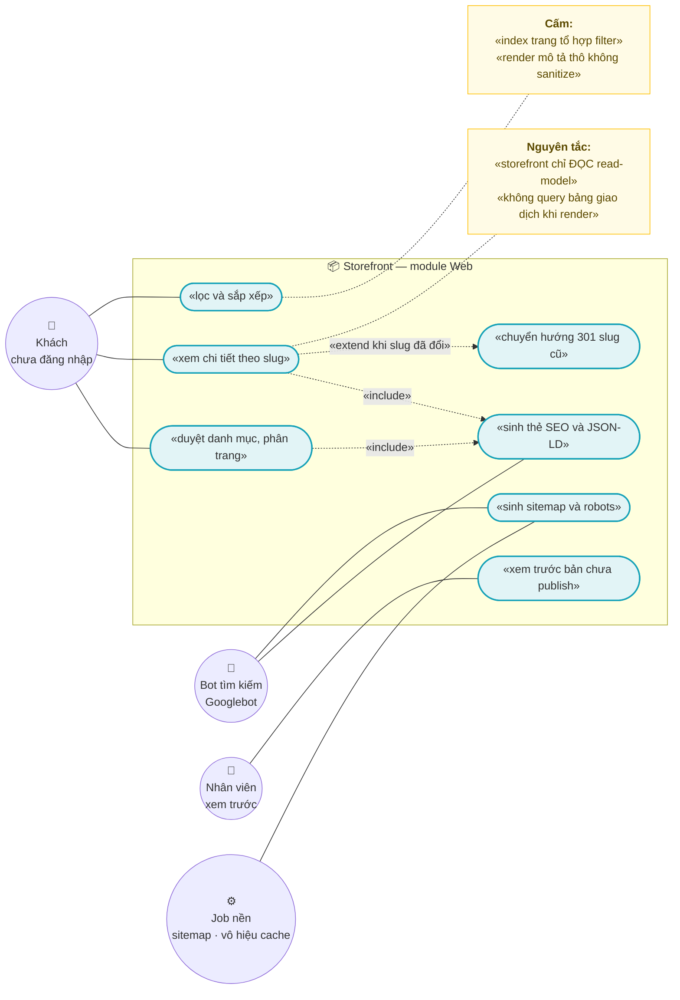
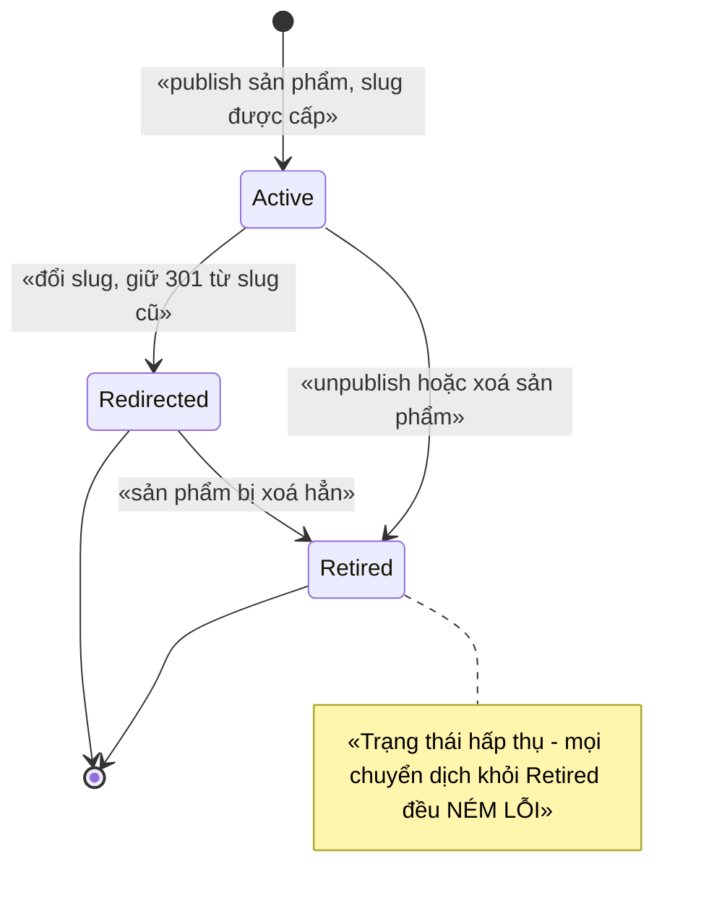
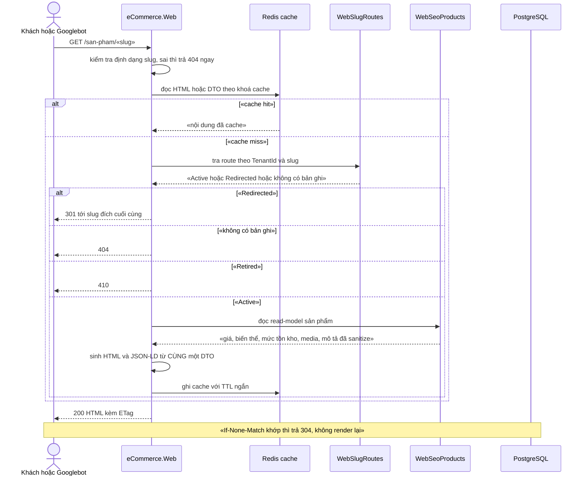

# `WEB-002` — Storefront: duyệt và chi tiết sản phẩm (SEO)

| Thuộc tính | Nội dung |
|---|---|
| **Mã** | `WEB-002` |
| **Module** | **Web** — đề xuất module mới `modules/Web` (`eCommerce.Web.Domain` / `.Application` / `.Contracts`) + project render `src/eCommerce.Web` (Razor). ⚠️ **Cả hai đều CHƯA có trong code** — xem §15.2 **F1** |
| **Giai đoạn** | **GĐ1 — Bán được trên website** (`docs/implementation-plan.md:415`) |
| **Ưu tiên** | **Must have** — không có trang này thì GĐ1 **không bán được** |
| **Trạng thái** | 🟡 `Draft` — chờ review · ⚠️ **GĐ1 đã làm MỘT PHẦN** (`S8`, 18/10/2026): trang **công khai** + chi tiết + sitemap theo slug đã có; **chưa** có read-model/cache/301/JSON-LD/OG — xem **§16** |
| **Người viết / người review** | *(điền)* / **Kiến trúc trưởng + BA** (theo `docs/design-doc-guidelines.md` §6: feature có state machine ⇒ Kiến trúc trưởng review) |
| **Phiên bản / ngày** | `v0.1 — 13/10/2026` |
| **Tài liệu liên quan** | `XC-001` (Money/làm tròn/format) · `XC-002` (outbox/inbox/idempotency) · `XC-003` (khoá phân tán) · `XC-004` (auth/permission/allowlist/tenant) · `XC-005` (observability) · `XC-006` (thuế — ảnh hưởng hiển thị giá) · `CAT-001`…`003` · `PRC-001`…`002` · `INV-003` · `WEB-001` · `WEB-003` · `docs/structure-and-techstack.md` · `docs/implementation-plan.md` |

> 📌 **Cách đọc tài liệu này:** mọi khẳng định về code đều kèm **đường dẫn file thật** đã kiểm bằng `read`/`grep` trong repo
> tại thời điểm viết. Chỗ nào **chưa có trong code** thì ghi rõ **"chưa có trong code — kế hoạch GĐx"**;
> chỗ nào **chưa kiểm chứng được** thì ghi rõ **"chưa kiểm chứng"**. Không có suy đoán nào được trình bày như sự thật.

---

## 📌 QUYẾT ĐỊNH CHỦ DỰ ÁN — 17/10/2026 (`Q6` = **A**)

> **Storefront ĐƯỢC MỞ CÔNG KHAI** — khách **chưa đăng nhập** xem được danh sách + chi tiết sản phẩm.

| Mục | Nội dung |
|---|---|
| **Chốt** | `/SanPham` và `/SanPham/ChiTiet/{slugOrSku}` **bỏ khỏi yêu cầu đăng nhập** (thêm vào **allowlist** `[AllowAnonymous]` của `XC-004`), cùng `/sitemap.xml` + `/robots.txt` (đã công khai) |
| **🚨 Hiện trạng** | **CẢ 9** controller của Web đều `[Authorize]` **cấp class**, gồm `src/eCommerce.Web/Controllers/SanPhamController.cs:21` ⇒ khách chưa đăng nhập bị `302` tới `/Account/Login` ⇒ **SEO không phát huy** dù slug + sitemap đã xong (`CAT-003`) |
| **Ràng buộc BẮT BUỘC khi mở (không được hở dữ liệu)** | ① chỉ hiện sản phẩm **đang bán** · ② **cấm** lộ **giá vốn** (`CostPrice`) và **tồn chi tiết theo kho** · ③ nếu hiện tồn thì chỉ dạng **bậc** (còn/hết) · ④ allowlist **phải có test** (`AllowlistCongKhaiTests` đã có từ `CAT-003`) |
| **Việc của `S8`** | thêm 2 route vào allowlist + ca E2E **"khách CHƯA đăng nhập xem được chi tiết"** và ca **"không lộ `CostPrice`"** |
| **Phụ thuộc** | `CAT-003`: slug là URL chuẩn; `sitemap.xml` phải dùng **slug** thay vì SKU (nợ đã ghi ở `CAT-003` §16) |

---

## 0. Tóm tắt & quyết định thiết kế

**Tóm tắt:** `WEB-002` là **tầng đọc công khai (public read layer)** của website bán hàng: trang **duyệt sản phẩm
theo danh mục** và trang **chi tiết sản phẩm theo slug**, phục vụ **hai loại khách**: người mua (đọc để quyết định mua)
và **bot tìm kiếm** (đọc để lập chỉ mục). Vì vậy feature này **không chỉ là UI**: nó là **hợp đồng SEO** —
URL ổn định (301 khi đổi slug), structured data khớp đúng dữ liệu hiển thị, và **không** để bot index các tổ hợp filter
sinh ra vô số trang trùng nội dung.

**Vì sao phải viết tài liệu này trước khi code (3 lý do đã kiểm chứng bằng code thật):**

| # | Sự thật kiểm chứng được trong repo | Hệ quả bắt buộc |
|---|---|---|
| 1 | **Chưa có project Web nào.** `eCommerce.slnx` liệt kê **17 project** — **0** project Web; `src/` có 7 project, `modules/` có 9, `test/` có 1. Toàn repo có **0** file `.cshtml`/`.razor` và **không** có `wwwroot` | `WEB-002` **chưa có trong code** — kế hoạch GĐ1. **WEB-001** (khung UI + đăng nhập) phải xong **trước** |
| 2 | **`Product.Slug` tồn tại nhưng KHÔNG có unique index.** Cột `Slug` chỉ được cấu hình `HasMaxLength(512)` (`src/eCommerce.EntityFrameworkCore/eCommerceDbContext.cs:106`); migration sửa index (`src/eCommerce.EntityFrameworkCore/Migrations/20261013024226_Fix_NullableTenantId_UniqueIndexes.cs:39-86`) **không** bao gồm `Slug` | Hai sản phẩm có thể **trùng slug** ⇒ SEO trùng lặp + chuyển hướng 301 không xác định. Phải có unique index (§5.2, BR-WEB-002-004) |
| 3 | **Catalog chưa tách module**: entity `Product`/`ProductVariant` nằm ở **app** — `src/eCommerce.Domain/Entities/Catalog/Product.cs` | Module Web **không được** tham chiếu `src/` (bất biến #3: *module → app là CẤM*). Đây là **chặn kiến trúc** phải giải trước khi code (§0.1 ADR-02, §15.2 **F3**) |

**Phạm vi:**

- ✅ Trang **danh mục sản phẩm** (duyệt theo danh mục, phân trang, sắp xếp, lọc cơ bản) — **server-rendered**.
- ✅ Trang **chi tiết sản phẩm theo slug**: giá, biến thể, mức tồn kho, thuộc tính, mô tả, media.
- ✅ **SEO kỹ thuật**: `<title>`, meta description, `rel=canonical`, Open Graph, **JSON-LD** (`Product`/`Offer`/`BreadcrumbList`),
  `sitemap.xml` + `robots.txt`, **301** khi slug đổi, **404/410** phân biệt rõ.
- ✅ **Read-model công khai** (`WebSeoProducts`, `WebSlugRoutes`) cập nhật **bằng ETO qua outbox/inbox** (`XC-002`).
- ✅ **Cache tầng đọc** (Redis, đã có trong `docker-compose.yml:25`) + `ETag`/`304`.
- ✅ **Vòng đời route slug** (state machine) — nơi **chuyển trạng thái sai phải NÉM LỖI**.
- ✅ **Trang công khai** ⇒ phải mở rộng allowlist `[AllowAnonymous]` của `XC-004` **có lý do và có kiểm soát**.

**Không nằm trong phạm vi:**

- ❌ **Giỏ hàng & checkout** — thuộc `WEB-003` (Sales).
- ❌ **UI quản trị** — thuộc `WEB-001`.
- ❌ **Sở hữu dữ liệu sản phẩm** — thuộc `CAT-001`…`003`. `WEB-002` **chỉ đọc**, **cấm** ghi vào bảng Catalog.
- ❌ **Engine tính giá** — thuộc `PRC-001`/`PRC-002`; `WEB-002` chỉ hiển thị giá đã tính.
- ❌ **Tra tồn kho khả dụng** — thuộc `INV-003` (đa kho/đa kênh); `WEB-002` chỉ hiển thị **mức** tồn kho từ read-model.
- ❌ **Tìm kiếm full-text nâng cao / Elasticsearch** — hoãn GĐ3+.
- ❌ **Đa ngôn ngữ (i18n) và đa tiền tệ hoạt động thật** — GĐ1 chỉ **tiếng Việt** + **VND** (`XC-001` BR-XC-001-009).
- ❌ **Đánh giá sản phẩm, wishlist, loyalty** — `REV-001`/`LOY-001` (GĐ4).
- ❌ **Xử lý/ resize ảnh, CDN** — GĐ2+ (hiện **chưa có** entity media, xem §15.2 **F5**).

### 0.1 Quyết định thiết kế (ADR ngắn)

| # | Quyết định | Phương án đã cân nhắc | Lý do chọn | Hệ quả |
|---|---|---|---|---|
| **ADR-01** | Storefront render **server-side bằng Razor MVC** (project `src/eCommerce.Web`) | (a) Blazor WASM/SPA · (b) Razor MVC · (c) Next.js riêng | `docs/structure-and-techstack.md:123` đã chốt: *"ABP **MVC/Razor Pages** + theme miễn phí … **Server-rendered ⇒ tốt cho SEO**; Blazor WASM không phù hợp SEO"*; `docs/implementation-plan.md:84` cũng ghi *"UI MVC/Razor (SEO)"* | Mọi trang phải render được **không cần JS**; test SEO chạy trên HTML trả về (**chưa có gì trong code**, xem F1) |
| **ADR-02** | Storefront đọc qua **read-model riêng của module Web**, cập nhật bằng **ETO** — **không** query bảng Catalog/Inventory khi render | (a) Web tham chiếu entity Catalog · (b) Web gọi `IProductAppService` của app · (c) **read-model + ETO** | (a)/(b) **vi phạm** bất biến #3 (*module → app là CẤM*) vì Catalog hiện ở `src/eCommerce.Domain`; (c) giữ đúng chiều phụ thuộc và tách read/write | Dữ liệu **trễ** theo outbox (p95 ≤ 2 s — khớp NFR-XC-002-001); phải ghi rõ chênh lệch ở §10 |
| **ADR-03** | URL công khai dùng **slug**, **không** lộ `Guid`; đổi slug ⇒ **giữ bản ghi chuyển hướng 301** | (a) URL theo `Guid` · (b) `slug-{id}` · (c) **slug thuần + bảng lịch sử route** | `Guid` trong URL **không** có giá trị SEO; `slug-id` làm URL cứng nhắc khi đổi tên; (c) cho phép **đổi slug mà không mất SEO** | Cần bảng `WebSlugRoutes` + state machine (§3); slug là **khoá định danh công khai** |
| **ADR-04** | Slug **duy nhất theo tenant** bằng unique index **`NULLS NOT DISTINCT`** + filter `Slug IS NOT NULL` | (a) unique thường · (b) kiểm tra ở tầng ứng dụng · (c) **`NULLS NOT DISTINCT`** | **F1 của `XC-004`** đã chứng minh bằng PostgreSQL thật: unique index trên cột `TenantId` **mất tác dụng khi `TenantId IS NULL`** (`20261013024226_Fix_NullableTenantId_UniqueIndexes.cs:8-21`). Hệ thống hiện chạy **1 tenant** ⇒ `TenantId` **rất có thể là `NULL`** | Phải dùng **SQL thô** trong migration (EF Core không mô hình hoá thuộc tính này) — cùng cách đã làm cho `CatProducts`/`CatProductVariants` |
| **ADR-05** | Giá hiển thị **bắt buộc** đi qua `Money` + `Currency` (`XC-001`); **cấm** `==` trên tiền, **cấm** `double`/`float` | (a) render `decimal` trực tiếp · (b) `Money` | `XC-001` D3: so tiền bằng `==` **đã gây lỗi thật ở eShop**; format hiển thị là việc của tầng UI (`XC-001` §10) | ⚠️ **`Money` CHƯA tồn tại trong code** (`shared/eCommerce.Kernel` không có; **0** project tham chiếu `Kernel`) ⇒ BR-WEB-002-007 **chưa thực thi được** cho tới khi `XC-001` xong (§15.2 **F4**) |
| **ADR-06** | Tổ hợp **filter/sort không được index**: `canonical` về URL danh mục gốc + `noindex, follow` | (a) để mặc định · (b) chặn bằng `robots.txt` · (c) **canonical + noindex** | `robots.txt` **chỉ** chặn crawl, **không** chặn index — URL vẫn có thể vào index qua liên kết ngoài. Tổ hợp `?sort=&page=&brand=` sinh **vô hạn** trang trùng nội dung | Phải sinh thẻ đúng ở **mọi** biến thể URL; có test `TC-12` |
| **ADR-07** | Cache tầng đọc bằng **Redis** với **vô hiệu hoá theo sự kiện**, TTL chỉ là lưới an toàn | (a) chỉ TTL · (b) chỉ in-process cache · (c) **Redis + invalidation qua distributed event** | Redis 7 **đã có** (`docker-compose.yml:25`); cache chỉ-TTL ⇒ khách thấy **giá cũ** sau khi đổi giá (sai tiền — điều `XC-001` cấm về nguyên tắc) | Phải xoá cache trên **mọi instance** (`XC-002` §7.1: *"Nếu không xoá cache ⇒ instance khác vẫn cho qua"*). ⚠️ Tiền tố cache **đã có** trong code: `AbpDistributedCacheOptions.KeyPrefix = "eCommerce:"` (`src/eCommerce.HttpApi.Host/eCommerceHttpApiHostModule.cs:112`) — **khác** tiền tố khoá lock `"ecommerce:"` (cùng file, dòng 127); cách ABP ghép chuỗi cho **cache** **chưa kiểm chứng** (§15.4) |
| **ADR-08** | Ảnh GĐ1: **URL ảnh + `width`/`height` + `loading=lazy` + `alt`**; **không** tự resize/CDN | (a) tự xử lý ảnh · (b) CDN · (c) chỉ thẻ `img` đúng chuẩn | Entity media **chưa có trong code** (F5) và chưa có `wwwroot` ⇒ tự xử lý ảnh là **khối lượng mới**, không thuộc GĐ1 | CLS cần `width`/`height`; resize/CDN ghi nợ ở §15.1 Q5 |
| **ADR-09** | `sitemap.xml` do **job nền** sinh, chia lô và có **sitemap index** | (a) sinh đồng bộ mỗi request · (b) job nền + lưu snapshot | Sinh đồng bộ ⇒ request sitemap quét toàn bộ bảng ⇒ **sập** khi có 50.000 SKU. Ngưỡng lô theo chuẩn **sitemaps.org** (*nguồn ngoài — chưa kiểm chứng trong repo*) | Cần `WebSitemapSnapshots`? — **chưa chốt**, xem §15.1 Q4 |
| **ADR-10** | **Idempotency ở mọi biên vào**: consumer projection, job sitemap, job warm cache | (a) tin vào at-least-once là "hiếm" · (b) idempotency guard | `XC-002` BR-XC-002-004: **mọi** biên vào phải idempotent; eShop **đã trả giá** (redelivery ⇒ trừ kho 2 lần) | Consumer **bắt buộc** gọi `IIdempotencyGuard`; ⚠️ khoá hiện dùng `EventId` nhưng **ETO hiện chưa có `EventId`** (§15.2 **F9**) |
| **ADR-11** | **Không** dùng distributed lock cho **đường ĐỌC**; chỉ dùng cho **job dùng chung** (sitemap) | (a) lock mọi nơi cho "an toàn" · (b) **chỉ job** | `XC-003` D9: lock cho việc trong 1 tiến trình là **chậm hơn + tạo ảo giác an toàn**; D2: *"lock không phải hàng rào duy nhất — DB mới bảo đảm đúng"*. Đường đọc không có bất biến ghi nào cần lock | Khoá duy nhất của feature: `ecommerce:web:sitemap:{tenantId}` (đăng ký ở §8.2) |
| **ADR-12** | Trang công khai **chỉ ĐỌC**: không có route ghi; **cấm** render mô tả thô (phải sanitize) | (a) render `Description` trực tiếp bằng `Html.Raw` · (b) sanitize + encode | `Description` là cột **`text`** (`src/eCommerce.EntityFrameworkCore/eCommerceDbContext.cs:107`) do admin nhập tự do ⇒ render thô là **stored XSS** | Cần whitelist HTML (thư viện sanitizer) — **chưa chọn thư viện**, xem §15.1 Q6 |

> **Phương án BỊ LOẠI (ghi lại để 6 tháng sau không hỏi lại):**
> (1) **SPA/Blazor WASM** — loại vì SEO là mục tiêu số 1 của feature, xem ADR-01.
> (2) **Storefront query thẳng `CatProducts`/`CatProductVariants`** — loại vì vi phạm *module → app là CẤM*, xem ADR-02.
> (3) **URL theo `Guid`** — loại vì không có giá trị SEO và không đọc được, xem ADR-03.
> (4) **Chặn tổ hợp filter bằng `robots.txt`** — loại vì `robots.txt` không ngăn index, xem ADR-06.

---

## 1. Use Case Specification

| Thuộc tính | Nội dung |
|---|---|
| **Use Case ID** | `WEB-002` |
| **Use Case Name** | Duyệt và xem chi tiết sản phẩm trên storefront, **tối ưu cho tìm kiếm** |
| **Description** | *"Là **người mua** (hoặc **bot tìm kiếm** thay mặt người mua), tôi muốn duyệt danh mục và đọc trang chi tiết sản phẩm với URL ổn định, giá đúng và dữ liệu có cấu trúc, để tôi quyết định mua và để máy tìm kiếm lập chỉ mục đúng sản phẩm."* |
| **Actor(s)** | **Khách (chưa đăng nhập)** · **Bot tìm kiếm** (Googlebot/Bingbot) · **Nhân viên** (xem trước bản chưa publish — có quyền) · **Job nền** (sinh sitemap, vô hiệu cache) · **Hệ thống** (Razor render, read-model, cache Redis) |
| **Priority** | **Must have** |
| **Trigger** | (a) khách mở URL danh mục/chi tiết; (b) bot crawl `sitemap.xml` hoặc theo liên kết; (c) `ProductPublishedEto` / `VariantPriceChangedEto` / `StockChangedEto` đến; (d) job định kỳ sinh sitemap |
| **Pre-Condition(s)** | • **Tenant hiện tại** (`TenantId`) — hệ thống đang chạy **1 tenant** và `TenantId` **có thể là `NULL`** (`XC-004` §15.2 F2) ⇒ **mọi** unique index của feature phải dùng `NULLS NOT DISTINCT`.<br>• **Kênh bán** = `web` (storefront là kênh sở hữu) — hằng số kênh, **không** lấy từ input người dùng.<br>• Sản phẩm đã `IsPublished = true` (`src/eCommerce.Domain/Entities/Catalog/Product.cs:25`) **và** đã được projection vào `WebSeoProducts`.<br>• **WEB-001** (khung UI, đăng nhập, theme) đã có — **chưa có trong code** (F1).<br>• Redis sẵn sàng — nếu **không**, trang **vẫn phải render** từ PostgreSQL (`AbortOnConnectFail = false`, `src/eCommerce.HttpApi.Host/eCommerceHttpApiHostModule.cs:141`). |
| **Post-Condition(s)** | • Trả **HTML server-rendered** có `<title>`, meta description, `canonical`, JSON-LD **khớp dữ liệu đã render**.<br>• Slug **cũ** (nếu có) trả **301** tới slug hiện tại — **không** 404.<br>• Slug **chưa từng tồn tại** ⇒ **404**; slug đã **`Retired`** ⇒ **410**.<br>• Mọi trang **có `ETag`**; `If-None-Match` khớp ⇒ **304**.<br>• Trang công khai **không** chứa PII, giá vốn, hay số tồn chính xác. |
| **Basic Flow** | 1. Khách/bot gọi `GET /san-pham/{slug}`.<br>2. Middleware xác thực **không** chặn route này (route nằm trong **allowlist** — §9).<br>3. Hệ thống tra `WebSlugRoutes` theo `(TenantId, Slug)` ⇒ trạng thái `Active`.<br>4. Hệ thống đọc `WebSeoProducts` (cache Redis trước, DB sau) ⇒ DTO đọc.<br>5. Razor render HTML **và** JSON-LD **từ cùng một DTO** (BR-WEB-002-011).<br>6. Trả `200` kèm `ETag`; ghi cache với TTL ngắn. |
| **Alternative Flow** | **A1: Duyệt danh mục** — `GET /danh-muc/{slug}?page=2&sort=price-asc`: trả 200, `canonical` về URL danh mục **không** tham số, `noindex, follow` (BR-WEB-002-010).<br>**A2: Slug đổi** — khách vào slug **cũ** ⇒ hệ thống trả **301** tới slug mới (BR-WEB-002-005); nếu slug cũ trỏ tới một slug cũ hơn ⇒ **301 nối chuỗi tối đa 1 bước** (đích cuối) — **cấm** chuỗi 301 vòng (BR-WEB-002-006).<br>**A3: Nhân viên xem trước bản chưa publish** — route `GET /xem-truoc/san-pham/{id}` yêu cầu permission `eCommerce.Products.Default` (`src/eCommerce.Domain.Shared/eCommerceConsts.cs:21`), thêm `noindex, nofollow`, **không** ghi cache công khai.<br>**A4: Cache trắng (cold start)** — render từ DB read-model; nếu read-model **chưa** có bản ghi (projection trễ) ⇒ trả **404** (không phải 500) + log `Warning` (BR-WEB-002-012). |
| **Exception Flow** | **E1:** slug **sai định dạng** (`^[a-z0-9]+(-[a-z0-9]+)*$` không khớp) ⇒ **404** ngay, **không** truy vấn DB (chống quét).<br>**E2:** chuyển trạng thái route **sai** (ví dụ `Redirected → Active`) ⇒ **NÉM** `BusinessException` **`eCommerce:Web:0003`** (bất biến #11).<br>**E3:** hai sản phẩm cùng slug trong cùng tenant ⇒ DB **chặn** (unique index); tầng ứng dụng bọc thành **`eCommerce:Web:0002`** khi tạo/sửa sản phẩm.<br>**E4:** `WebSeoProducts` **thiếu** bản ghi cho sản phẩm **đã** publish (projection lỗi) ⇒ **404** + metric `storefront_projection_missing_total` (**metric chưa có trong đăng ký** — §15.2 **F8**).<br>**E5:** mô tả chứa HTML nguy hiểm (`<script>`) ⇒ sanitize; **cấm** render thô (ADR-12).<br>**E6:** Redis **chết** ⇒ **fail-open**: render từ DB read-model, log `Error` + metric; **không** trả 5xx (khớp `XC-003` E2). |
| **Business Rules** | • **BR-WEB-002-001**: Trang storefront **công khai** (không Bearer) **nhưng** mọi route public **phải** nằm trong **allowlist `[AllowAnonymous]`** của `XC-004` **kèm lý do**; **cấm** `[AllowAnonymous]` ngoài allowlist.<br>• **BR-WEB-002-002**: Trang danh mục/chi tiết **chỉ** hiển thị sản phẩm `IsPublished = true` **và** thuộc **tenant hiện tại**; **cấm** lọc ở client.<br>• **BR-WEB-002-003**: URL chi tiết dùng **slug**, **cấm** lộ `Guid`; slug khớp `^[a-z0-9]+(?:-[a-z0-9]+)*$`, dài ≤ **512** ký tự (khớp cột hiện có).<br>• **BR-WEB-002-004**: Slug **duy nhất theo tenant** khi `Slug IS NOT NULL` ⇒ unique index **`NULLS NOT DISTINCT`** + filter; **cấm** chỉ kiểm tra ở tầng ứng dụng.<br>• **BR-WEB-002-005**: Đổi slug ⇒ **301** từ slug cũ; **cấm** để URL cũ trả 404 nếu slug đó **đã từng** công khai.<br>• **BR-WEB-002-006**: **Cấm** chuỗi 301 vòng; đích chuyển hướng **phải** là slug `Active` **cuối cùng**.<br>• **BR-WEB-002-007**: Giá hiển thị **phải** đi qua `Money`/`Currency` (`XC-001`); **cấm** so tiền bằng `==`; **cấm** `double`/`float` trong **mọi** DTO/ViewModel storefront.<br>• **BR-WEB-002-008**: Trang chỉ hiển thị **một** nguồn giá: giá đã tính cho kênh `web` (`PRC-002`); nếu pipeline Pricing **chưa có** ⇒ hiển thị giá niêm yết `ProductVariant.Price` **kèm nhãn nguồn**; **cấm** trộn hai nguồn trong cùng trang. ⚠️ **Chưa kiểm chứng được** vì `PriceList`/`ChannelPrice` **chưa có trong code** (F5).<br>• **BR-WEB-002-009**: Mức tồn kho hiển thị **chỉ 3 mức** `ConHang` / `SapHet` / `HetHang`; **cấm** hiển thị số tồn chính xác.<br>• **BR-WEB-002-010**: Mọi biến thể URL có **filter/sort/phân trang** **phải** có `rel=canonical` về URL danh mục gốc **và** `noindex, follow`.<br>• **BR-WEB-002-011**: JSON-LD **phải** sinh từ **cùng** DTO đã render HTML; **cấm** sinh từ nguồn khác (lệch giá ⇒ Google báo lỗi + mất niềm tin người dùng).<br>• **BR-WEB-002-012**: Danh mục **rỗng** ⇒ **200** + thông báo "chưa có sản phẩm" (**không** phải lỗi); ngược lại slug **không** tồn tại ⇒ **404**, `Retired` ⇒ **410**; **cấm** trả 200 cho trang không có nội dung.<br>• **BR-WEB-002-013**: Read-model **chỉ** cập nhật qua ETO trong **outbox** (`XC-002`); **cấm** storefront ghi vào bảng của Catalog/Inventory.<br>• **BR-WEB-002-014**: Consumer projection và job nền **phải** idempotent (`IIdempotencyGuard`); xử lý trùng ⇒ **không** side effect thứ hai.<br>• **BR-WEB-002-015**: Cache **phải** bị vô hiệu khi dữ liệu nguồn đổi, trên **mọi** instance; **cấm** chỉ dựa vào TTL.<br>• **BR-WEB-002-016**: Mọi trang HTML **phải** có `ETag`; `If-None-Match` khớp ⇒ **304**.<br>• **BR-WEB-002-017**: **Cấm** đưa PII, giá vốn, `Code` nội bộ, hay tồn chính xác ra trang công khai; mô tả **phải** sanitize.<br>• **BR-WEB-002-018**: Trang công khai **cấm** mọi thao tác ghi (không POST/PUT/DELETE); thao tác ghi thuộc `WEB-003`/Sales. |
| **Non-Functional Requirement** | • **NFR-WEB-002-001**: TTFB p95 **< 300 ms** khi cache hit; **< 800 ms** khi cache miss, với **10.000** sản phẩm/tenant.<br>• **NFR-WEB-002-002**: LCP p75 **< 2,5 s** trên mạng 4G (Core Web Vitals).<br>• **NFR-WEB-002-003**: HTML trang chi tiết **≤ 200 KB** (chưa nén).<br>• **NFR-WEB-002-004**: **100 %** trang chi tiết có `<title>`, meta description **≤ 160 ký tự**, `canonical`, JSON-LD **parse được**.<br>• **NFR-WEB-002-005**: **0** lần trả `500` cho slug không tồn tại/retired (chỉ 404/410).<br>• **NFR-WEB-002-006**: Độ trễ projection: publish ⇒ trang trả `200` trong **p95 ≤ 2 s** (khớp NFR-XC-002-001).<br>• **NFR-WEB-002-007**: Cache hit ratio trang chi tiết **≥ 90 %** trong giờ cao điểm.<br>• **NFR-WEB-002-008**: Sinh sitemap cho **50.000** URL **< 60 s**; job **≤ 1 lần**/tenant/nhịp (lock + `SkipIfBusy`).<br>• **NFR-WEB-002-009**: **0** `double`/`float` trong DTO/ViewModel storefront (test reflection).<br>• **NFR-WEB-002-010**: Cách ly tenant: tenant A **không** render được sản phẩm của tenant B (integration 2 tenant).<br>• **NFR-WEB-002-011**: **0** PII/giá vốn/số tồn chính xác trong HTML công khai (test quét HTML).<br>• **NFR-WEB-002-012**: **100 %** ảnh sản phẩm có `alt`; HTML trang chi tiết **0** lỗi nghiêm trọng theo validator. |

---

## 2. Sơ đồ Use Case



### Chú giải

| Ký hiệu | Ý nghĩa |
|---|---|
| ⭕ Xanh lá | Actor (người dùng + bot + job) |
| 🟦 Bầu dục xanh dương | Use Case |
| 🟨 Khung vàng | Note |
| `───` | Liên kết Actor ↔ Use Case |
| `-.«include».->` | Quan hệ bao hàm |
| `-.«extend …».->` | Quan hệ mở rộng (chỉ xảy ra trong điều kiện ghi rõ) |

---

## 3. Sơ đồ trạng thái (state machine) — vòng đời **route slug công khai**

> ⚠️ **Nói rõ phạm vi sở hữu:** `WEB-002` **KHÔNG** sở hữu vòng đời của **sản phẩm** (`Product.IsPublished`) —
> đó là của `CAT-001`; cũng **không** sở hữu vòng đời **đơn hàng** (`SAL-003`).
> Vòng đời mà **feature này sở hữu** là **route slug công khai** — thứ quyết định SEO: một URL đã công khai
> thì **không bao giờ** được biến thành 404 im lặng.



**Bảng chuyển trạng thái & guard (mọi chuyển sai **phải NÉM LỖI**, không im lặng):**

| # | Từ → Sang | Guard (điều kiện cho phép) | Hành động kèm theo | Nếu guard sai thì? |
|---|---|---|---|---|
| 1 | `[*]` → `Active` | Sản phẩm chuyển `IsPublished` **true** **và** slug hợp lệ **và** chưa tồn tại trong tenant | `Insert WebSlugRoutes(TenantId, Slug, ProductId, Status = Active)` trong **UoW**; phát ETO vô hiệu cache | Slug trùng ⇒ DB chặn (BR-004) ⇒ bọc `eCommerce:Web:0002` |
| 2 | `Active` → `Redirected` | Slug **đổi** **và** slug **cũ** đã từng `Active` | Giữ bản ghi **cũ** với `Status = Redirected`, `RedirectToSlug = <slug mới>`; **301** ở tầng HTTP | Nếu bản ghi cũ bị **xoá** thay vì chuyển trạng thái ⇒ vi phạm BR-005 (mất SEO) — **review phải chặn** |
| 3 | `Active` → `Retired` | Sản phẩm `IsPublished` **false** hoặc bị xoá | `Status = Retired`, `RetiredAtUtc`; trang trả **410** + `noindex` | Nếu trả **404** ⇒ vi phạm BR-006 (404 = "chưa từng có"; 410 = "đã có, nay không còn") |
| 4 | `Redirected` → `Retired` | Sản phẩm bị **xoá hẳn** | `Status = Retired`; **giữ** `RedirectToSlug` để vận hành tra cứu | Xoá cứng bản ghi ⇒ mất dấu vết, **cấm** |
| 5 | `Redirected` → `Active` | 🚫 **KHÔNG** có guard nào cho phép | — | **NÉM** `BusinessException` **`eCommerce:Web:0003`** — slug cũ **không** được "sống lại" (sẽ tạo **hai** URL `Active` cho cùng sản phẩm ⇒ trùng lặp nội dung) |
| 6 | `Retired` → bất kỳ | 🚫 **KHÔNG** có guard nào cho phép | — | **Trạng thái hấp thụ**: mọi chuyển dịch khỏi `Retired` ⇒ **NÉM** `eCommerce:Web:0003`. Muốn công khai lại ⇒ phải cấp **slug mới** (bản ghi **mới**) |

> **Ai được phép chuyển:** `[*] → Active` và `Active → Redirected` do **app service Catalog** (khi publish/đổi slug) —
> **không** phải storefront; `Active → Retired` do **app service Catalog** khi unpublish/xoá;
> **không** có chuyển trạng thái nào do khách hoặc bot khởi tạo (trang công khai chỉ đọc — BR-018).
>
> ⚠️ **Hệ quả kiến trúc:** vì `WEB-002` **không** sở hữu entity `Product`, việc giữ `WebSlugRoutes` đồng bộ với
> `Product.Slug` **bắt buộc** đi qua **ETO** (ADR-02). Nếu Catalog phát ETO **thiếu** `OldSlug`, feature này
> **mất** khả năng tạo 301 ⇒ xem §15.1 **Q3**.

---

## 4. Sequence Diagram & luồng dữ liệu

> 📌 **Ngân sách sơ đồ:** tài liệu này dùng **3 sơ đồ Mermaid** (§2, §3, §4.1) theo yêu cầu chất lượng.
> Vì vậy **§4.2 DFD được trình bày bằng bảng** thay vì sơ đồ.

### 4.1 Sequence — render trang chi tiết (có cache, có 301/404/410)



### 4.2 DFD — luồng dữ liệu từ nguồn sự thật tới trang công khai (trình bày bằng bảng)

| Bước | Nguồn | Đích | Dữ liệu | Cơ chế / ràng buộc |
|---|---|---|---|---|
| 1 | `Catalog` (chưa tách module — F3) | `AbpEventOutbox` | `ProductPublishedEto`, `VariantPriceChangedEto`, `ProductSlugChangedEto` *(đề xuất)* | `IDistributedEventBus` + `useOutbox: true` trong **UoW** (`XC-002` BR-XC-002-001) |
| 2 | `AbpEventOutbox` | `AbpEventInbox` | ETO | Relay worker nhịp **2 s** (`XC-002` D1/D3) |
| 3 | Consumer projection | `WebSeoProducts`, `WebSlugRoutes` | bản chiếu đã chuẩn hoá (giá theo `Money`, mức tồn kho `enum`) | `IIdempotencyGuard` + unique index (`XC-002` BR-XC-002-004/005) |
| 4 | Consumer projection | Redis cache | **lệnh vô hiệu cache** | Distributed event ⇒ **mọi** instance (BR-015) |
| 5 | `WebSeoProducts` | Razor page | DTO đọc | **Chỉ đọc**; **cấm** ghi (BR-013) |
| 6 | Razor page | Bot tìm kiếm | HTML + JSON-LD + `sitemap.xml` | JSON-LD sinh **cùng** DTO (BR-011) |
| 7 | `Inventory` | `WebSeoProducts` | **mức** tồn kho (3 mức) | Chỉ nhận **mức**, **không** nhận số chính xác (BR-009) |

---

## 5. Mô hình dữ liệu

### 5.1 ERD

> 📌 Trình bày bằng **bảng quan hệ** (không dùng thêm sơ đồ Mermaid — xem ghi chú §4).

| Quan hệ | Bảng | Trạng thái trong code |
|---|---|---|
| `Product` 1—n `ProductVariant` | `CatProducts` → `CatProductVariants` | ✅ **đã có** (`src/eCommerce.EntityFrameworkCore/eCommerceDbContext.cs:99-130`) |
| `Product` 1—n `Category` / `Brand` / `ProductMedia` | `CatCategories` / `CatBrands` / `CatProductMedia` | ❌ **chưa có trong code** — kế hoạch GĐ1 (`CAT-002`, `CAT-003`; xem F5) |
| `ProductVariant` 1—1 bản chiếu storefront | `CatProductVariants` → `WebSeoProducts` | ❌ **chưa có** — feature này (GĐ1); quan hệ **logic** qua ETO, **không** FK cứng (khác module) |
| `Product` 1—n route slug | `CatProducts` → `WebSlugRoutes` | ❌ **chưa có** — feature này (GĐ1) |
| `InventoryItem` → mức tồn kho | `InvItems` → `WebSeoProducts.Availability` | ✅ `InvItems` **đã có** (`eCommerceDbContext.cs:132-142`); `WebSeoProducts.Availability` ❌ **chưa có** |

### 5.2 Bảng & cột (Data Dictionary)

#### 5.2.1 Bảng **đã có** mà feature này **đọc** (KHÔNG sửa cấu trúc)

**`CatProducts`** — nguồn sự thật về sản phẩm.

| Cột | Kiểu | Null? | Nguồn trong code | Ghi chú |
|---|---|---|---|---|
| `Id` | `uuid` | ✖ | `Product : FullAuditedAggregateRoot<Guid>` | |
| `TenantId` | `uuid` | ✔ | `Product.TenantId` | `IMultiTenant`; **có thể `NULL`** ở chế độ 1 tenant |
| `Code` | `varchar(64)` | ✖ | `eCommerceDbContext.cs:104` | **cấm** lộ ra trang công khai (BR-017) |
| `Name` | `varchar(512)` | ✖ | `eCommerceDbContext.cs:105` | nguồn cho `<h1>` + JSON-LD `name` |
| `Slug` | `varchar(512)` | ✔ | `eCommerceDbContext.cs:106` | ⚠️ **KHÔNG có unique index** — xem **F2** |
| `Description` | `text` | ✔ | `eCommerceDbContext.cs:107` | ⚠️ **`text`** ⇒ **phải sanitize** (ADR-12, BR-017) |
| `BrandId` | `uuid` | ✔ | `Product.cs:23` | ⚠️ **chỉ là `Guid` trần**, **không** có entity `Brand` (F5) |
| `IsPublished` | `bool` | ✖ | `Product.cs:25` | điều kiện lọc **bắt buộc** (BR-002) |
| `CreationTime` / `LastModificationTime` / `IsDeleted` | | | `FullAuditedAggregateRoot<Guid>` | dùng cho `Last-Modified` (tuỳ chọn) |

**`CatProductVariants`** — đơn vị bán thật.

| Cột | Kiểu | Null? | Nguồn trong code | Ghi chú |
|---|---|---|---|---|
| `Id` / `TenantId` / `ProductId` | `uuid` | — | `Product.cs:56-60` | |
| `Sku` | `varchar(64)` | ✖ | `eCommerceDbContext.cs:122` | **cấm** lộ ra công khai; dùng nội bộ để map với sàn |
| `Barcode` | `varchar(64)` | ✔ | `eCommerceDbContext.cs:123` | nguồn cho JSON-LD `gtin` **nếu** được phép công khai (Q7) |
| `Price` | `numeric(18,4)` | ✖ | `eCommerceDbContext.cs:126` + `Product.cs:71` | ⚠️ **`decimal`** — giá **niêm yết**; chuyển sang `Money` khi render (ADR-05) |
| `CompareAtPrice` | `numeric(18,4)` | ✔ | `eCommerceDbContext.cs:127` | giá "gạch" — **chỉ** hiển thị khi **lớn hơn** giá bán (so bằng **minor units**, **cấm** `==`) |
| `WeightInGrams` | `int` | ✔ | `Product.cs:76` | dùng cho ShippingHub (GĐ2) — **không** công khai |
| `IsActive` | `bool` | ✖ | `Product.cs:78` | biến thể `IsActive = false` ⇒ **không** render (giữ `Product` publish) |

#### 5.2.2 Bảng **MỚI của feature** (`WebSeoProducts`) — ⚠️ **chưa có trong code — kế hoạch GĐ1**

**`WebSeoProducts`** — read-model công khai, 1 dòng / 1 **biến thể đang bán**.

| Cột | Kiểu | Null? | Ý nghĩa | Ghi chú |
|---|---|---|---|---|
| `Id` | `uuid` | ✖ | khoá chính | |
| `TenantId` | `uuid` | ✔ | tenant sở hữu | `IMultiTenant` |
| `ProductId` | `uuid` | ✖ | trỏ tới `CatProducts.Id` | **không** FK cứng (khác module) |
| `VariantId` | `uuid` | ✖ | trỏ tới `CatProductVariants.Id` | |
| `Slug` | `varchar(512)` | ✖ | slug **hiện tại** | bản sao để render, **nguồn sự thật** là `WebSlugRoutes` |
| `ProductName` | `varchar(512)` | ✖ | tên hiển thị | |
| `MetaTitle` | `varchar(70)` | ✔ | thẻ `<title>` | ngưỡng khuyến nghị theo SEO (nguồn ngoài) |
| `MetaDescription` | `varchar(160)` | ✔ | meta description | BR/NFR-004: **≤ 160** ký tự |
| `CanonicalPath` | `varchar(1024)` | ✖ | đường dẫn canonical | **cấm** chứa tham số filter |
| `PriceAmount` | `numeric(18,4)` | ✖ | giá đã tính cho kênh `web` | ⚠️ **`decimal`, không `double`** (BR-007) |
| `PriceCurrency` | `char(3)` | ✖ | mã ISO-4217 | mặc định `VND` (`XC-001` BR-009) |
| `CompareAtAmount` | `numeric(18,4)` | ✔ | giá gạch | **nullable** ⇒ dùng **cột rời** (`XC-001` D6) |
| `Availability` | `int` | ✖ | `ConHang=0` / `SapHet=1` / `HetHang=2` | **cấm** số tồn chính xác (BR-009) |
| `DescriptionHtmlSanitized` | `text` | ✔ | mô tả **đã sanitize** | ⚠️ **chỉ** chứa HTML trong whitelist (ADR-12) |
| `AttributesJson` | `jsonb` | ✔ | thuộc tính hiển thị | đọc-only; **cấm** chứa giá vốn |
| `MediaJson` | `jsonb` | ✔ | danh sách ảnh `{ url, alt, width, height }` | ⚠️ entity media **chưa có** (F5) |
| `ProjectionVersion` | `bigint` | ✖ | version lần chiếu cuối | dùng để **từ chối bản cũ** (`XC-002` D6/§7.4) |
| `ProjectedAtUtc` | `timestamptz` | ✖ | thời điểm chiếu | metric `storefront_projection_lag_seconds` *(đề xuất)* |

**Index & ràng buộc**

| Loại | Cột | Mục đích |
|---|---|---|
| UNIQUE | `(TenantId, VariantId)` **`NULLS NOT DISTINCT`** | mỗi biến thể **đúng một** bản chiếu (idempotent projection) |
| UNIQUE | `(TenantId, Slug) NULLS NOT DISTINCT WHERE "Slug" IS NOT NULL` | chống **hai** bản chiếu cùng slug |
| INDEX | `(TenantId, Availability, PriceAmount)` | lọc "còn hàng" + sắp xếp theo giá |
| CHECK *(khuyến nghị)* | `"PriceCurrency" ~ '^[A-Z]{3}$'` | chặn mã tiền tệ sai (`XC-001` §5.2) |
| CHECK | `"PriceAmount" > 0` | giá bán **phải dương**; giá 0/âm là **lỗi dữ liệu**, không phải "miễn phí" |

#### 5.2.3 Bảng **MỚI của feature** (`WebSlugRoutes`) — ⚠️ **chưa có trong code — kế hoạch GĐ1**

**`WebSlugRoutes`** — lịch sử slug + chuyển hướng (nguồn sự thật của SEO URL).

| Cột | Kiểu | Null? | Ý nghĩa | Ghi chú |
|---|---|---|---|---|
| `Id` | `uuid` | ✖ | khoá chính | |
| `TenantId` | `uuid` | ✔ | tenant | `IMultiTenant` |
| `Slug` | `varchar(512)` | ✖ | slug (đã chuẩn hoá) | khoá tra cứu |
| `ProductId` | `uuid` | ✖ | sản phẩm tương ứng | |
| `Status` | `int` | ✖ | `Active=0` / `Redirected=1` / `Retired=2` | state machine §3 |
| `RedirectToSlug` | `varchar(512)` | ✔ | đích 301 (**slug `Active` cuối cùng**) | **bắt buộc** khi `Status = Redirected` |
| `CreatedAtUtc` | `timestamptz` | ✖ | lần công khai đầu | |
| `RetiredAtUtc` | `timestamptz` | ✔ | thời điểm retire | |
| `RowVersion` | `uint` | ✖ | optimistic concurrency | chống 2 luồng đổi slug cùng lúc |

**Index & ràng buộc**

| Loại | Cột | Mục đích |
|---|---|---|
| UNIQUE | `(TenantId, Slug) NULLS NOT DISTINCT` | **hàng rào thật** cho BR-004 (chống trùng slug) |
| INDEX | `(TenantId, ProductId, Status)` | tra "sản phẩm này đang có slug nào" |
| CHECK | `("Status" <> 1) OR ("RedirectToSlug" IS NOT NULL AND "RedirectToSlug" <> "Slug")` | **cấm** 301 tới chính nó (chống vòng — BR-006) |

> 🔒 **Nhắc lại bất biến nền:** theo `eCommerceDbContext.cs:48-52`, entity **phải** có `DbSet` trên DbContext hợp nhất,
> nếu không `IRepository<T>` **không** được đăng ký (`"The requested service 'IRepository<…>' has not been registered."`).
> ⇒ Khi code feature này **bắt buộc** thêm `DbSet<WebSeoProduct>` + `DbSet<WebSlugRoute>` vào
> `src/eCommerce.EntityFrameworkCore/eCommerceDbContext.cs` và một hàm `ConfigureWebStorefront(builder)` theo đúng khuôn
> `ConfigureChannelHub()` / `ConfigureTax()` (`eCommerceDbContext.cs:76-78`).

---

## 6. Hợp đồng API

### 6.1 Application Service

| Mục | Giá trị |
|---|---|
| Interface | `IStorefrontCatalogAppService` (đặt tại `eCommerce.Web.Application.Contracts`) |
| Implementation | `StorefrontCatalogAppService` (đặt tại `eCommerce.Web.Application`) |
| `[Authorize]` | **cấp CLASS** — `[Authorize]` trần (chỉ cần đăng nhập) cho API **nội bộ**; **cấm** app service nghiệp vụ nào không có `[Authorize]` cấp class (`XC-004` BR-001, TC-01) |
| Ghi chú | ⚠️ Trang storefront **công khai** **KHÔNG** đi qua app service công khai — nó là **Razor page/controller** trong allowlist (§9). App service ở đây phục vụ **nội bộ** (xem trước, job) |

| Method | Input (DTO) | Output (DTO) | Ghi chú |
|---|---|---|---|
| `GetProductBySlugAsync` | `slug` | `StorefrontProductDto` | trả `null`/ném `EntityNotFound` ⇒ tầng web map **404**, **không** 500 |
| `GetCategoryPageAsync` | `StorefrontCategoryQueryDto` | `PagedResultDto<StorefrontProductCardDto>` | `MaxResultCount` **bắt buộc** có trần (chống quét) |
| `GetPreviewAsync` | `productId` | `StorefrontProductDto` | `[Authorize(eCommerceConsts.Permissions.Products.Default)]` |
| `RegenerateSitemapAsync` | — | `SitemapRegenerationResultDto` | job nội bộ; **không** expose ra khách |

### 6.2 REST endpoint (Razor + file tĩnh)

| Method / Route | Kiểu | Authentication | Permission | Ghi chú |
|---|---|---|---|---|
| `GET /san-pham/{slug}` | Razor page | **Anonymous** (allowlist) | — | trang chi tiết |
| `GET /danh-muc/{slug}` | Razor page | **Anonymous** (allowlist) | — | có `?page=&sort=&brand=` ⇒ **noindex** |
| `GET /tim-kiem?q=` | Razor page | **Anonymous** (allowlist) | — | `noindex, follow`; Q8 chưa chốt |
| `GET /xem-truoc/san-pham/{id}` | Razor page | **Bearer/SSO** | `eCommerce.Products.Default` | `noindex, nofollow` |
| `GET /sitemap.xml` + `/sitemap-{n}.xml` | file động | **Anonymous** (allowlist) | — | sinh bởi job (ADR-09) |
| `GET /robots.txt` | file động | **Anonymous** (allowlist) | — | trỏ `Sitemap:` |
| `GET /health-status` | endpoint | Anonymous (**đã** trong allowlist `XC-004` Q1) | — | đã map tại `src/eCommerce.HttpApi.Host/eCommerceHttpApiHostModule.cs:220-223` |

**Response mẫu (trang chi tiết — phần SEO)**

```html
<title>«Tên sản phẩm» | «Tên shop»</title>
<meta name="description" content="«mô tả ≤ 160 ký tự»" />
<link rel="canonical" href="https://«host»/san-pham/«slug»" />
<meta property="og:type" content="product" />
<script type="application/ld+json">
{ "@context": "https://schema.org", "@type": "Product",
  "name": "«Tên sản phẩm»",
  "offers": { "@type": "Offer", "price": "«giá dạng số nguyên VND»",
              "priceCurrency": "VND", "availability": "https://schema.org/InStock" } }
</script>
```

> ⚠️ **Bắt buộc:** `price` trong JSON-LD **phải** sinh từ **cùng** `Money` đã render lên HTML (BR-011).
> Với **VND 0 chữ số thập phân** (`XC-001` BR-009), giá trị là **số nguyên** — **không** ghi `.00`.

**Mã lỗi nghiệp vụ**

| Mã | HTTP | Khi nào | Thông điệp |
|---|---|---|---|
| `eCommerce:Web:0001` | `404` | Slug không có bản ghi route (chưa từng công khai / projection trễ) | `Không tìm thấy sản phẩm.` |
| `eCommerce:Web:0002` | `409` | Tạo/sửa sản phẩm làm **trùng slug** trong tenant | `Đường dẫn (slug) đã được dùng cho sản phẩm khác.` |
| `eCommerce:Web:0003` | `409` | Chuyển trạng thái route **sai** (`Redirected → Active`, `Retired → *`) | `Không thể chuyển trạng thái đường dẫn đã ngừng hoặc đã chuyển hướng.` |
| `eCommerce:Web:0004` *(đề xuất)* | `410` | Slug đã `Retired` | `Sản phẩm đã ngừng bán.` |

> 📌 **Tiền tố mã lỗi** `eCommerce:Web:*` theo đúng tiền lệ của repo: mã lỗi **thuộc module sở hữu**
> (`XC-003` §15.2 F1/F2 — đã xoá mã lỗi trùng giữa app và module). ⚠️ **Chưa tồn tại** trong
> `src/eCommerce.Domain.Shared/eCommerceConsts.cs:77-86` (hiện chỉ có `InsufficientStock`, `PaymentSignatureInvalid`)
> ⇒ **chưa có trong code — kế hoạch GĐ1**, phải nằm ở consts của **module Web**, **không** thêm vào `eCommerceConsts`.

---

## 7. Sự kiện, tích hợp ngoài & idempotency

### 7.1 Sự kiện **nhận vào** (ETO) — nguồn nuôi read-model

| ETO | Khi nào phát | Trường tối thiểu cần | Ai tiêu thụ | Handler idempotent? |
|---|---|---|---|---|
| `ProductPublishedEto` *(đề xuất — **chưa có trong code**, kế hoạch `CAT-001`)* | `IsPublished` chuyển **true** | `EventId`, `TenantId`, `ProductId`, `Slug`, `OccurredOnUtc` | projection `WebSeoProducts` + `WebSlugRoutes` (`[*] → Active`) | ✅ khoá `EventId` + unique `(TenantId, VariantId)` |
| `ProductUnpublishedEto` *(đề xuất)* | `IsPublished` chuyển **false** / xoá mềm | `EventId`, `TenantId`, `ProductId` | `Active → Retired` | ✅ như trên |
| `ProductSlugChangedEto` *(đề xuất)* | Đổi `Product.Slug` | `EventId`, `TenantId`, `ProductId`, **`OldSlug`**, **`NewSlug`** | `Active → Redirected` + tạo route mới `Active` | ✅ khoá `EventId`; **cấm** xử lý nếu `NewSlug` đã tồn tại (⇒ DLQ, không tự ghi đè) |
| `VariantPriceChangedEto` *(đề xuất)* | Đổi giá biến thể | `EventId`, `TenantId`, `VariantId`, `Price`, `Currency` | cập nhật `PriceAmount` + **vô hiệu cache** | ✅ như trên |
| `StockChangedEto` *(đề xuất)* | Biến động kho | `EventId`, `TenantId`, `Sku`, `Availability` (**mức**, không phải số) | cập nhật `Availability` | ✅ như trên |

> 🚨 **Sự thật kiểm chứng được:** **hiện repo chỉ có 3 ETO** và **đều thuộc ChannelHub** —
> `ChannelOrderPulledEto`, `ChannelOrderPulledLineEto`, `ChannelShopTokenRefreshedEto`
> (`modules/ChannelHub/eCommerce.ChannelHub.Application.Contracts/Events/ChannelEvents.cs:17,33,44`).
> Các ETO của Catalog **chưa có trong code**. Đồng thời ETO hiện tại **chỉ có `TenantId`**, **không** có
> `EventId`/`AggregateVersion`/`CorrelationId` ⇒ **khuôn ETO của `XC-002` D11 chưa được hiện thực** (F9).
> ⇒ **`WEB-002` phụ thuộc `XC-002` (khuôn ETO) và `CAT-001` (nguồn ETO)** — không thể code trước.

### 7.2 Sự kiện **phát ra**

| ETO | Khi nào phát | Ai tiêu thụ | Ghi chú |
|---|---|---|---|
| `StorefrontCacheInvalidatedEto` *(đề xuất)* | Sau khi projection ghi xong | **mọi instance** Web (xoá cache cục bộ) | Nếu chỉ xoá cache **cục bộ** ⇒ instance khác vẫn trả **giá cũ** (`XC-002` §7.1) |
| `StorefrontProjectionFailedEto` *(đề xuất)* | Projection lỗi | Ops (`XC-005`) | Phải **để lại dấu vết**, **cấm** nuốt lỗi (`XC-002` BR-010/011) |

### 7.3 Webhook / gọi API ra ngoài

**Không áp dụng — lý do:** `WEB-002` **không** nhận webhook và **không** gọi NCC nào.
Đây là feature **đọc** thuần. (Mọi tích hợp ngoài của storefront — phí vận chuyển, thanh toán — thuộc
`SHP-*`/`WEB-003`/`PaymentHub`.)

### 7.4 Idempotency

| Biên vào | Khoá chống trùng | Cơ chế | Nếu trùng |
|---|---|---|---|
| Consumer projection (ETO) | `EventId` (từ khuôn ETO `XC-002` D11) | `IIdempotencyGuard` + unique `(TenantId, EventType, IdempotencyKey)` (`XC-002` BR-005) | **Không** side effect; ghi metric; kết thúc coi như `Processed` |
| Job sinh sitemap | `sitemap:{tenantId}:{yyyyMMddHHmm}` | Cùng guard + **lock** `SkipIfBusy` | **Bỏ qua nhịp** + log + metric (`XC-003` D10/A1) |
| Job warm cache | `warm-cache:{tenantId}:{slug}:{projectionVersion}` | Cùng guard | Bỏ qua bản cũ |
| Cùng khoá + **khác** payload hash | — | — | **NÉM** `eCommerce:Messaging:0002` (`XC-002` E1) — **cấm** coi là trùng |

> ⚠️ **Chiều "đến sai thứ tự":** `XC-002` D6 đã chứng minh **ABP 10.7 không có ordering** ⇒ consumer **phải**
> so `ProjectionVersion` (hoặc `AggregateVersion`): bản **nhỏ hơn hoặc bằng** ⇒ **bỏ qua có log + metric**;
> bản **lớn hơn nhưng thiếu bản trung gian** ⇒ **DLQ** với `FailureKind = OutOfOrder`.

---

## 8. Bất biến & xử lý đồng thời

### 8.1 Bất biến

| # | Bất biến | Cơ chế bảo vệ |
|---|---|---|
| 1 | Trang công khai **chỉ** chứa sản phẩm `IsPublished = true` của **tenant hiện tại** | Read-model **chỉ** được ghi từ ETO publish + query filter tenant của ABP; **test** `TC-01`, `TC-18` |
| 2 | Slug **duy nhất** trong tenant kể cả khi `TenantId IS NULL` | unique index `NULLS NOT DISTINCT` (BR-004) + **test** `TC-06` chứng minh DB chặn |
| 3 | URL đã công khai **không bao giờ** 404 im lặng | `WebSlugRoutes` + state machine §3 (chỉ `Retired` ⇒ 410) + test `TC-04/TC-05` |
| 4 | JSON-LD **khớp** dữ liệu render | Cùng DTO cho HTML và JSON-LD (BR-011) + **golden test** `TC-11` |
| 5 | Giá **không** bị so bằng `==`; **không** có `double`/`float` | Test quét mã nguồn `TC-09` + reflection `TC-10` (`XC-001` BR-003/BR-008) |
| 6 | Cache **không** trả dữ liệu cũ sau khi giá/tồn đổi | Vô hiệu theo sự kiện trên **mọi** instance (BR-015) + test `TC-15` |
| 7 | Trang công khai **không** ghi dữ liệu | Route chỉ `GET`; test `TC-20` (POST ⇒ 405) |
| 8 | **Không** PII/giá vốn/số tồn chính xác trong HTML | Read-model **không chứa** các trường đó (thiết kế), test quét HTML `TC-19` |

### 8.2 Xử lý đồng thời

| # | Tình huống | Cơ chế |
|---|---|---|
| 1 | Hai instance cùng nhận **cùng** một ETO (redelivery) | `IIdempotencyGuard` + unique `(TenantId, VariantId)` ⇒ chỉ **một** bản chiếu; instance thứ hai **không** side effect |
| 2 | Hai luồng cùng đổi slug của một sản phẩm | **Optimistic concurrency** (`RowVersion`) trên `WebSlugRoutes`; `UPDATE … WHERE RowVersion = @expected` **0 dòng** ⇒ **NÉM LỖI** (`XC-002` BR-008/E7) |
| 3 | Giá đổi **trong lúc** khách đang xem | Khách thấy giá **của bản render đó**; sau khi cache bị vô hiệu, request sau thấy giá mới — **cấm** trộn (BR-008) |
| 4 | Job sitemap chạy trên nhiều instance | Khoá **`ecommerce:web:sitemap:{tenantId}`** + `SkipIfBusy` (`XC-003` D10) |
| 5 | Redis **chết** | **Fail-open**: render từ DB read-model; **không** sập; log `Error` + metric (`AbortOnConnectFail = false`, `eCommerceHttpApiHostModule.cs:141`) |

**Khoá phân tán dùng trong feature** *(tên chính xác, theo quy ước `XC-003`)*

| Tên khoá | Phạm vi | Vì sao cần | Ghi chú |
|---|---|---|---|
| `ecommerce:web:sitemap:{tenantId}` | theo tenant | Chống 2 instance cùng sinh sitemap cho một tenant | Dùng `SkipIfBusy` + log + metric (**bắt buộc**) |
| `ecommerce:web:cache-warm:{tenantId}` *(đề xuất)* | theo tenant | Chống job warm cache chạy chồng | Có thể **không cần** nếu warm cache đã idempotent — xem Q2 §15.1 |

> ⚠️ **Quy ước tiền tố — đọc kỹ để không lặp lại lỗi của `XC-003` F5:** tên khoá do module sinh **KHÔNG** chứa
> tiền tố; tiền tố do ABP ghép qua `AbpDistributedLockOptions.KeyPrefix = "ecommerce:"`
> (`src/eCommerce.HttpApi.Host/eCommerceHttpApiHostModule.cs:127`). Thêm `ecommerce:` vào hàm sinh khoá ⇒ **tiền tố đôi**.
> Đồng thời **cache** dùng tiền tố **khác**: `AbpDistributedCacheOptions.KeyPrefix = "eCommerce:"` (cùng file, dòng 112)
> ⇒ hai hệ tiền tố khác nhau trong **cùng** một host (F8).

**Idempotency key:** xem §7.4 — khoá **ổn định** (`EventId`), **cấm** `Guid.NewGuid()` cho mỗi lần xử lý
(`XC-002` BR-007).

---

## 9. Phân quyền

| Route / chức năng | Kiểu truy cập | Permission | Vai trò mặc định | Ghi chú |
|---|---|---|---|---|
| `GET /san-pham/{slug}`, `GET /danh-muc/{slug}`, `/tim-kiem`, `/sitemap.xml`, `/robots.txt` | **Anonymous** | — | Khách + bot | **BẮT BUỘC** nằm trong **allowlist** (BR-WEB-002-001) |
| `GET /xem-truoc/san-pham/{id}` | Xác thực | `eCommerce.Products.Default` (`eCommerceConsts.cs:21`) | Admin/nhân viên | Đã **định nghĩa** trong provider (`eCommercePermissionDefinitionProvider.cs:28-31`) ⇒ **không** tạo permission mới |
| `POST /api/app/storefront/sitemap/regenerate` (nội bộ) | Xác thực | **không** mở cho người dùng ở GĐ1 — chạy bởi job | — | Nếu mở cho người dùng ⇒ cần permission mới (Q9) |
| App service `IStorefrontCatalogAppService` | **`[Authorize]` cấp CLASS** | — | — | Bất biến `XC-004` BR-001 — có test reflection `TC-01` của `XC-004` |

> 🚨 **ĐIỂM RỦI RO ĐÃ KIỂM CHỨNG:** repo hiện có **0** `[AllowAnonymous]` (grep toàn `src/` chỉ thấy
> `[Authorize]` tại `src/eCommerce.Application/Channels/ChannelAppService.cs:27`). `XC-004` Q1 chốt allowlist **CHỈ** gồm
> `/connect/*`, `/api/abp/application-configuration`, `/health-status`, Swagger **chỉ ở Development**.
> ⇒ Nếu code storefront mà **quên** mở rộng allowlist, **mọi trang storefront trả 401** cho khách
> (không có lỗi biên dịch — đúng loại lỗi Phase 0). Phải: (a) sửa `XC-004` §Q1 **trước**, (b) thêm test `TC-21`.

---

## 10. UI Mockup & mapping dữ liệu

### 10.1 Trang danh mục `/danh-muc/{slug}`

| Vùng UI | Dữ liệu hiển thị | Nguồn (DTO / trường) | Hành động |
|---|---|---|---|
| Breadcrumb | đường dẫn danh mục | `StorefrontCategoryDto.Breadcrumb[]` | link tới danh mục cha |
| Tiêu đề + mô tả danh mục | `H1`, đoạn mô tả | `CategoryName`, `CategoryDescription` | — |
| Bộ lọc | danh mục con, khoảng giá, tình trạng | `AvailableFilters` | **noindex** sau khi áp dụng (BR-010) |
| Sắp xếp | mới nhất / giá tăng / giá giảm | `Sort` | đổi query string |
| Lưới sản phẩm | ảnh, tên, giá, mức tồn kho | `StorefrontProductCardDto` | link tới trang chi tiết |
| Phân trang | `page`, tổng số trang | `TotalCount`, `MaxResultCount` | `rel=next/prev` |
| Không có kết quả | "chưa có sản phẩm" | — | **200**, **không** phải lỗi (BR-012) |

### 10.2 Trang chi tiết `/san-pham/{slug}`

| Vùng UI | Dữ liệu hiển thị | Nguồn | Quy tắc |
|---|---|---|---|
| `<title>` / meta description | tên + mô tả ngắn | `MetaTitle`, `MetaDescription` | `≤ 160` ký tự (NFR-004) |
| `canonical` | URL slug hiện tại | `CanonicalPath` | **cấm** chứa query filter |
| JSON-LD | `Product` + `Offer` + `BreadcrumbList` | **cùng** DTO | BR-011 |
| Gallery ảnh | ảnh + `alt` + `width/height` | `MediaJson[]` | `loading=lazy`, `alt` 100 % (NFR-012) |
| Tên sản phẩm | `H1` | `ProductName` | |
| Giá | giá đã tính + tiền tệ | `PriceAmount` + `PriceCurrency` → `Money` | format theo `vi-VN`, VND **0 chữ số** (`XC-001` §10) |
| Giá gạch | `CompareAtAmount` | chỉ hiện khi **lớn hơn** giá bán (so **minor units**) | **cấm** `==` |
| Mức tồn kho | `ConHang` / `SapHet` / `HetHang` | `Availability` | **cấm** số chính xác (BR-009) |
| Biến thể | danh sách biến thể + giá từng biến thể | `Variants[]` | chọn biến thể **không** đổi URL (Q10) |
| Mô tả | HTML **đã sanitize** | `DescriptionHtmlSanitized` | ADR-12 |
| Nút mua | — | — | **thuộc `WEB-003`** — `WEB-002` **không** xử lý giỏ hàng |

### 10.3 ⚠️ Chênh lệch số liệu **phải** ghi rõ (thói quen tốt của tài liệu gốc)

| Chỗ | Chênh lệch | Vì sao | Cách xử lý |
|---|---|---|---|
| Số sản phẩm trên storefront vs số trong admin | Có thể **lệch** trong cửa sổ trễ projection (**p95 ≤ 2 s**) | Storefront đọc **read-model**; admin đọc bảng giao dịch (`CatProducts`) | Ghi rõ trong tài liệu vận hành; **không** coi là bug; có metric độ trễ |
| Giá trên storefront vs giá trong admin | Có thể **lệch** ngay sau khi đổi giá | Cache + projection | Cache **phải** bị vô hiệu theo sự kiện (BR-015); nếu vẫn lệch ⇒ **bug**, không phải "trễ" |
| Tổng số trang vs `TotalCount` | `TotalCount` tính trên **toàn bộ** kết quả lọc, còn trang chỉ hiển thị `MaxResultCount` | Chuẩn phân trang | UI **phải** hiển thị `TotalCount`, **không** đếm số thẻ trên trang |

---

## 11. Migration & seed

| Mục | Nội dung |
|---|---|
| Migration **của feature** | `Add_Web_Storefront_Seo` *(tên đề xuất)* — tạo `WebSeoProducts` + `WebSlugRoutes` + index. ⚠️ **chưa có trong code** |
| Migration **bắt buộc kèm theo** *(thuộc `CAT-003`, WEB-002 phụ thuộc)* | Thêm unique index cho `CatProducts.Slug`: `CREATE UNIQUE INDEX … ON "CatProducts" ("TenantId", "Slug") NULLS NOT DISTINCT WHERE "Slug" IS NOT NULL;` — vì **hiện chưa có** (F2). Phải dùng **SQL thô** (EF Core không mô hình hoá `NULLS NOT DISTINCT`) — cùng cách đã làm ở `20261013024226_Fix_NullableTenantId_UniqueIndexes.cs:39-86` |
| Bảng tạo mới | `WebSeoProducts`, `WebSlugRoutes` (đều `IMultiTenant`) |
| Bắt buộc trong `DbContext` | Thêm `DbSet<WebSeoProduct>` + `DbSet<WebSlugRoute>` vào `src/eCommerce.EntityFrameworkCore/eCommerceDbContext.cs` — **thiếu ⇒ `IRepository<T>` không được đăng ký** (`eCommerceDbContext.cs:48-52`) |
| Seed | **Không seed dữ liệu sản phẩm** (dữ liệu thật do Catalog tạo). Seed **không** áp dụng cho read-model — nó được **nuôi bằng ETO** |
| Backfill khi go-live | **CÓ, bắt buộc**: job backfill **idempotent** chiếu toàn bộ `CatProducts`/`CatProductVariants` đang publish sang `WebSeoProducts` + `WebSlugRoutes`. Chạy **trước** khi mở storefront; chạy lại **không** tạo trùng (unique `(TenantId, VariantId)`) |
| Ảnh hưởng dữ liệu cũ | **Không** sửa bảng Catalog; chỉ **thêm** index `Slug` (nếu dữ liệu hiện có **đã** trùng slug ⇒ migration **thất bại** — phải dọn dữ liệu trước; xem Q1 §15.1) |
| Rollback | Drop 2 bảng read-model ⇒ **an toàn** (không mất dữ liệu nguồn; chỉ mất khả năng render storefront). Rollback index `Slug` ⇒ chấp nhận mất ràng buộc — **không khuyến nghị** |
| Rủi ro migration | ⚠️ Migration **do EF sinh tự động** sau này có thể **tạo lại** index và **mất** `NULLS NOT DISTINCT` — đã ghi cảnh báo ở `XC-004` §5.2 và trong chính migration `Fix_NullableTenantId_UniqueIndexes.cs:23-25` |

---

## 12. Xử lý lỗi & trường hợp biên

| Tình huống | Nguyên nhân | Hành vi hệ thống | Phản hồi tới client |
|---|---|---|---|
| Danh mục **rỗng** | chưa có sản phẩm publish | Trả **200** + "chưa có sản phẩm" | **không phải lỗi** (BR-012) |
| Slug **sai định dạng** | bot/quét | **404** ngay, **không** truy vấn DB | `404` |
| Slug **chưa từng** tồn tại | gõ sai URL | **404** | `404` |
| Slug **đã `Retired`** | sản phẩm ngừng bán | **410 Gone** + `noindex` | `410` (BR-006) |
| Slug **đã đổi** | đổi tên sản phẩm | **301** tới slug `Active` cuối cùng | `301` + `Location` |
| Sản phẩm **unpublish** khi trang đang cache | admin tắt bán | Cache bị **vô hiệu** theo ETO ⇒ trang trả **410**; nếu ETO chậm ⇒ **tối đa** TTL ngắn vẫn trả 200 (đã ghi nhận rủi ro) | `410` / `200` trong cửa sổ TTL |
| **Trùng slug** khi tạo/sửa | 2 sản phẩm cùng slug | DB **chặn** (unique index) ⇒ bọc `eCommerce:Web:0002` | `409` |
| **Chuyển trạng thái route sai** | lập trình sai | **NÉM** `eCommerce:Web:0003` (bất biến #11) | `409` + log `Error` |
| **Projection trễ** | outbox chậm | Trả **404** + log `Warning` + metric | `404` (**không** 500) |
| **Projection thiếu** bản ghi cho sản phẩm publish | consumer lỗi | **404** + **cảnh báo Ops** (metric `storefront_projection_missing_total` — **chưa có** trong đăng ký, F8) | `404` |
| **Redis chết** | sự cố hạ tầng | **Fail-open**: render từ DB; log `Error` + metric | `200` (không chậm hơn nhiều) |
| Giá **≤ 0** trong read-model | dữ liệu sai | **Cấm** render; log `Error`; coi là `HetHang`/ẩn giá | `200` **không** có giá / `404` |
| Tiền tệ **lạ** | dữ liệu sai | `Currency.FromCode` ném `eCommerce:Money:0002` (`XC-001`) ⇒ log + ẩn giá | `200` + ẩn giá |
| Mô tả chứa `<script>` | admin nhập | **Sanitize** theo whitelist | `200` (đã loại thẻ) |
| **Quét quá nhiều trang** (`page` rất lớn) | bot | Chặn ở `page` tối đa (ví dụ 100) ⇒ trả **404**/**400** | `404`/`400` + `noindex` |
| **Tenant mismatch** | truy cập dữ liệu tenant khác | **404** (không 403) — không tiết lộ sự tồn tại (`XC-004` BR-008) | `404` |
| **Ảnh thiếu** | dữ liệu media chưa có | Placeholder + `alt` (không vỡ layout) | `200` |
| Lỗi runtime (DB timeout) | hạ tầng | Rollback (không có gì để rollback ở đường đọc) + log có `CorrelationId` (`eCommerceHttpApiHostModule.cs:202`) | `500` + `CorrelationId` |

**Chiến lược transaction:**

- **Đường ĐỌC (render trang):** **không** mở transaction ghi; chỉ đọc read-model + cache. ⇒ Không có rollback nghiệp vụ.
- **Đường GHI (projection, job):** đi qua **Unit of Work** của ABP (`eCommerceHttpApiHostModule.cs:60-64` —
  `UnitOfWorkTransactionBehavior.Auto`); ghi `WebSeoProducts`/`WebSlugRoutes` + outbox **cùng transaction** (`XC-002` D1).
- **Vô hiệu cache:** thực hiện **sau** khi transaction commit (không để cache bị xoá rồi transaction rollback ⇒ cache trắng vô cớ).

---

## 13. Phi chức năng

| Mã | Yêu cầu | Ngưỡng đo được | Cách kiểm chứng |
|---|---|---|---|
| NFR-WEB-002-001 | Độ trễ render | TTFB p95 **< 300 ms** (cache hit) · **< 800 ms** (miss) với 10.000 sản phẩm | benchmark + integration test (cần PostgreSQL) |
| NFR-WEB-002-002 | Core Web Vitals | LCP p75 **< 2,5 s** trên 4G | Lighthouse CI (mobile) |
| NFR-WEB-002-003 | Kích thước HTML | trang chi tiết **≤ 200 KB** (chưa nén) | test đo kích thước response |
| NFR-WEB-002-004 | Đầy đủ thẻ SEO | **100 %** trang chi tiết có `title`, description ≤ 160, `canonical`, JSON-LD parse được | test HTML + parse JSON-LD |
| NFR-WEB-002-005 | Không 500 cho slug lạ | **0** lần | test `TC-02`, `TC-03`, `TC-16` |
| NFR-WEB-002-006 | Độ trễ projection | publish ⇒ trang `200` trong **p95 ≤ 2 s** | integration test end-to-end với outbox relay |
| NFR-WEB-002-007 | Cache hit ratio | **≥ 90 %** giờ cao điểm | metric (xem F8) |
| NFR-WEB-002-008 | Sinh sitemap | 50.000 URL **< 60 s**; **≤ 1** job/tenant/nhịp | integration test + log lock `SkipIfBusy` |
| NFR-WEB-002-009 | Không `double`/`float` | **0** trong DTO/ViewModel Web | test reflection `TC-10` |
| NFR-WEB-002-010 | Cách ly tenant | tenant A **không** thấy sản phẩm B | integration 2 tenant `TC-18` (cần PostgreSQL) |
| NFR-WEB-002-011 | Không lộ dữ liệu nội bộ | **0** PII/giá vốn/số tồn chính xác trong HTML | test quét HTML `TC-19` |
| NFR-WEB-002-012 | Ảnh + HTML hợp lệ | **100 %** ảnh có `alt`; **0** lỗi nghiêm trọng | validator + test |

> ⚠️ **Metric:** các metric đề xuất ở §5/§12 chưa tồn tại. Bảng đăng ký metric hiện có **12 tên** trong
> `shared/eCommerce.Kernel/Observability/eCommerceMetrics.cs:13-53` và **không có** metric nào cho storefront.
> ⇒ Phải bổ sung vào **bảng đăng ký** đó (nguồn sự thật duy nhất, có test `TC-06` của `XC-005` đối chiếu), **không** phát
> metric "tự phát" ở nơi gọi — xem F8.

---

## 14. Test cases & Acceptance Criteria

### 14.1 Danh sách test case

| ID | Mục tiêu | Loại | Input chính | Expected | Phủ |
|---|---|---|---|---|---|
| TC-01 | Danh mục chỉ trả sản phẩm `IsPublished = true` | Unit | 2 sản phẩm (1 ẩn) | chỉ 1 xuất hiện | **BR-002** |
| TC-02 | Slug không tồn tại | **Integration** | `GET /san-pham/khong-co` | **404**, **không** 500 | **BR-012**, NFR-005 |
| TC-03 | Slug đã `Retired` | **Integration** | route `Status = Retired` | **410** | **BR-006** |
| TC-04 | Đổi slug ⇒ 301 | **Integration** | slug cũ → slug mới | `301` + `Location` đúng slug `Active` | **BR-005** |
| TC-05 | Chuyển `Redirected → Active` | Unit | gọi state machine | **NÉM** `BusinessException` `eCommerce:Web:0003` | **BR-005**, #11 |
| TC-06 | Trùng slug bị DB chặn khi `TenantId = NULL` | **Integration** | chèn 2 slug giống nhau, `TenantId = NULL` | DB **từ chối** (unique `NULLS NOT DISTINCT`) | **BR-004** |
| TC-07 | Slug sai định dạng | Unit | `/san-pham/ABC_!!` | **404**, không query DB | **BR-003** |
| TC-08 | Giá render qua `Money` | Unit | `Price = 1234.5` VND | hiển thị **1235** (away-from-zero), **0** chữ số thập phân | **BR-007**, `XC-001` |
| TC-09 | Không so tiền bằng `==` | Unit (quét mã nguồn) | quét `modules/Web` + `src/eCommerce.Web` | **0** match `==` trên trường tiền | **BR-007**, `XC-001` BR-003 |
| TC-10 | Không `double`/`float` trong DTO/ViewModel Web | Unit (reflection) | duyệt assembly Web | **0** xuất hiện | **NFR-009**, `XC-001` BR-008 |
| TC-11 | JSON-LD khớp HTML | Unit (golden) | 1 sản phẩm có giá KM | `price`/`priceCurrency`/`availability` **khớp** HTML | **BR-011**, NFR-004 |
| TC-12 | Trang filter có canonical + noindex | Unit | `?sort=price-asc&page=2` | có `rel=canonical` (không tham số) + `noindex, follow` | **BR-010** |
| TC-13 | Danh mục rỗng | Unit | danh mục không sản phẩm | **200** + thông báo rỗng | **BR-012** |
| TC-14 | Consumer idempotent khi ETO gửi lại | **Integration** | cùng ETO 2 lần | **1** bản chiếu, 0 side effect lần 2 | **BR-014**, `XC-002` BR-004 |
| TC-15 | Vô hiệu cache khi giá đổi | **Integration** | `VariantPriceChangedEto` | trang trả **giá mới** ở request kế tiếp | **BR-015** |
| TC-16 | `ETag`/`If-None-Match` | **Integration** | request lần 2 với `If-None-Match` | **304**, **không** render lại | **BR-016** |
| TC-17 | Redis chết ⇒ trang vẫn render | **Integration** | dừng Redis | **200** từ DB read-model; **0** 5xx | §12, `XC-003` D2 |
| TC-18 | Cách ly tenant | **Integration** | tenant A đọc sản phẩm B | **không** thấy (404) | **NFR-010**, `XC-004` BR-008 |
| TC-19 | Không lộ dữ liệu nội bộ | **Integration** | quét HTML trả về | **0** PII / giá vốn / số tồn chính xác / `Code` nội bộ | **BR-009**, **BR-017**, NFR-011 |
| TC-20 | Trang công khai không ghi | **Integration** | `POST /san-pham/{slug}` | **405** | **BR-018** |
| TC-21 | Route public đã vào allowlist | Unit (reflection) | quét route/Razor page public | route public **nằm trong** allowlist `XC-004` | **BR-001** |
| TC-22 | Mô tả chứa `<script>` không render thô | **Integration** | `Description = "<script>alert(1)</script>"` | HTML trả về **đã sanitize** | **BR-017**, ADR-12 |
| TC-23 | Job sitemap dùng `SkipIfBusy` + lock | **Integration** | 2 job cùng tenant | **1** job chạy, job kia **bỏ qua** + log + metric | **NFR-008**, `XC-003` D10 |
| TC-24 | Ordering: bản cũ bị từ chối | Unit | `ProjectionVersion` cũ hơn | **bỏ qua** có log + metric, **không** ghi đè | `XC-002` D6 |

### 14.2 Fixture skeleton (xUnit)

```csharp
// ⚠️ LƯU Ý VỀ HẠ TẦNG TEST HIỆN CÓ:
//   test/eCommerce.Tests/eCommerce.Tests.csproj:13-25 CHỈ có xunit + coverlet + Microsoft.NET.Test.Sdk,
//   KHÔNG có ABP test base, KHÔNG có Testcontainers, KHÔNG có project reference tới Web/EF Core.
//   ⇒ mọi test "Integration" ở §14.1 là KẾ HOẠCH GĐ1 (phải tạo test/eCommerce.IntegrationTests trước).
public class StorefrontSeoTests
{
    [Fact]
    public void TC05_khong_cho_chuyen_Redirected_sang_Active()
    {
        var route = TaoRoute(slug: "ao-thun-cu", status: SlugRouteStatus.Redirected);
        var ex = Assert.Throws<BusinessException>(() => route.Reactivate());
        Assert.Equal("eCommerce:Web:0003", ex.Code);
    }

    [Fact]
    public void TC08_gia_VND_hien_thi_0_chu_so_thap_phan()
    {
        var money = Money.Of(1234.5m, Currency.Vnd);   // XC-001
        Assert.Equal(1235m, money.Amount);
        Assert.Equal(0, money.Currency.Decimals);
    }

    [Fact]
    public void TC22_mo_ta_chua_script_bi_sanitize()
    {
        var html = StorefrontHtmlSanitizer.Sanitize("<p>ao</p><script>alert(1)</script>");
        Assert.DoesNotContain("<script", html, StringComparison.OrdinalIgnoreCase);
    }
}
```

> ⚠️ Đoạn trên **minh hoạ hợp đồng**, **không** phải code đã tồn tại: `SlugRouteStatus`, `Money`, `StorefrontHtmlSanitizer`
> **đều chưa có trong code** (F4, F5, F7).

### 14.3 Acceptance Criteria (Definition of Done)

- [ ] 24 test case ở §14.1 pass, phủ **hết 18 BR** và **12 NFR**
- [ ] **`TC-06` chứng minh DB chặn trùng slug khi `TenantId = NULL`** — ⚠️ **cần PostgreSQL** (Testcontainers)
- [ ] **`TC-21` chạy trong CI**: mọi route public nằm trong allowlist — chặn tái phát "quên allowlist ⇒ 401 cho khách"
- [ ] `WebSeoProducts` + `WebSlugRoutes` **có `DbSet`** trên `eCommerceDbContext` (bất biến #5)
- [ ] Unique index `Slug` của `CatProducts` **đã thêm** với `NULLS NOT DISTINCT` + filter (F2 đã sửa)
- [ ] **0** `double`/`float` trong DTO/ViewModel Web (BR-007)
- [ ] **0** so sánh `==` trên trường tiền (BR-007, `XC-001` BR-003)
- [ ] JSON-LD **khớp** dữ liệu hiển thị (test golden `TC-11`)
- [ ] Metric mới **đã đăng ký** trong `eCommerceMetricNames` (F8) — không phát metric ngoài bảng đăng ký
- [ ] Backfill chạy **idempotent**, chạy lại **không** tạo trùng
- [ ] `XC-004` §Q1 (allowlist) **đã cập nhật** để bao gồm route storefront
- [ ] Tài liệu này cập nhật khớp code (nếu phải lệch: **sửa tài liệu trước** — `docs/design-doc-guidelines.md` §4)

### 14.4 Definition of Ready (trước khi bắt đầu code)

- [x] ✅ Đã kiểm: **chưa có** project Web, chưa có `.cshtml`/`.razor`, chưa có `wwwroot` (F1)
- [x] ✅ Đã kiểm: `Product.Slug` **không** có unique index (F2)
- [x] ✅ Đã kiểm: `Product`/`ProductVariant` nằm ở **app** ⇒ chặn kiến trúc cho module Web (F3)
- [x] ✅ Đã kiểm: `Money`/`Currency` **chưa tồn tại**; **0** project tham chiếu `Kernel` (F4)
- [x] ✅ Đã kiểm: **0** `[AllowAnonymous]` trong `src/` ⇒ phải mở rộng allowlist (F6)
- [ ] **Chốt `Q1`** (xử lý dữ liệu slug trùng hiện có trước khi thêm unique index) — **chặn migration**
- [ ] **Chốt `Q3`** (ETO của Catalog có mang `OldSlug` không) — **chặn 301**
- [ ] **Chốt `Q4`** (có bảng snapshot sitemap hay sinh trực tiếp từ read-model)
- [ ] **Chốt `Q6`** (thư viện sanitize HTML) — **chặn BR-017**
- [ ] **`CAT-001`…`003` và `XC-001`/`XC-002` đã Approved** — `WEB-002` phụ thuộc trực tiếp
- [ ] `WEB-001` đã dựng khung UI + đăng nhập + theme

---

## 15. Câu hỏi mở, giả định & lịch sử thay đổi

### 15.1 Câu hỏi mở

| # | Câu hỏi | Cần ai | Trạng thái | Ảnh hưởng |
|---|---|---|---|---|
| **Q1** | Dữ liệu `CatProducts.Slug` **hiện có** (nếu có) đã **trùng** hoặc **rỗng** chưa? Thêm unique index có **thất bại** không? | Dev + DBA | `Open` | Nếu trùng ⇒ migration **đổ**; phải dọn dữ liệu trước (§11) |
| **Q2** | Có cần **job warm cache** không, hay chỉ cache-on-demand? | Kiến trúc trưởng | `Open` | Quyết định có thêm khoá `ecommerce:web:cache-warm:{tenantId}` hay không (§8.2) |
| **Q3** | ETO `ProductSlugChangedEto` **có** mang `OldSlug` không? Ai phát? | Kiến trúc trưởng + `CAT-003` | `Open` | **Chặn 301** (BR-005): không có `OldSlug` ⇒ không tạo được bản ghi `Redirected` |
| **Q4** | Sitemap sinh **trực tiếp** từ read-model hay qua **bảng snapshot**? | Kiến trúc trưởng | `Open` | Ảnh hưởng §5 (có thêm `WebSitemapSnapshots` hay không) và NFR-008 |
| **Q5** | GĐ1 có cần **resize ảnh / CDN** không? | BA + Kiến trúc trưởng | `Open` (đề xuất: **chưa**, GĐ2) | Ảnh hưởng NFR-002 (LCP) và ADR-08 |
| **Q6** | Dùng **thư viện sanitize HTML** nào (ví dụ HtmlSanitizer) — có phá quy tắc "một phiên bản ABP duy nhất" không? | Kiến trúc trưởng + Security | `Open` | Thư viện **không** phải ABP ⇒ vẫn thêm vào `Directory.Packages.props`; **bắt buộc** review license (LGPL/MIT) |
| **Q7** | Có công khai **`Barcode`/GTIN** trong JSON-LD không? | BA | `Open` | Ảnh hưởng BR-017 (dữ liệu nội bộ) |
| **Q8** | GĐ1 có trang **tìm kiếm** không, hay chỉ duyệt theo danh mục? | BA | `Open` (đề xuất: có, tối giản + `noindex`) | Ảnh hưởng §6.2 và khối lượng |
| **Q9** | Có mở API **sinh lại sitemap** cho admin (kèm permission mới) không? | BA | `Open` | Nếu có ⇒ cần permission `eCommerce.Web.Sitemap.Regenerate` (chưa có trong `eCommerceConsts.cs:15-74`) |
| **Q10** | Chọn biến thể có **đổi URL** (slug riêng theo biến thể) không? | BA + SEO | `Open` (đề xuất: **không** đổi URL — dùng query/JS) | Nếu đổi URL ⇒ `WebSlugRoutes` phải hỗ trợ **slug theo biến thể** (thay đổi mô hình §5.2.3) |
| **Q11** | Nhãn nguồn giá (BR-008) hiển thị thế nào khi pipeline Pricing chưa có? | BA | `Open` | Ảnh hưởng UI §10.2 và rủi ro "hiển thị giá sai" |

### 15.2 🚨 Sai lệch & thiếu hụt phát hiện được (nguồn gốc của tài liệu này)

| # | Vấn đề | Bằng chứng (đã kiểm) | Mức độ | Xử lý |
|---|---|---|---|---|
| **F1** | **Chưa có project Web / storefront**: `eCommerce.slnx` có **17 project** và **0** project Web; repo có **0** file `.cshtml`/`.razor`; **không** có `wwwroot` | `eCommerce.slnx`; đếm file bằng `glob`/`Get-ChildItem` | 🔴 Cao (feature **chưa có trong code**) | ⬜ **Chưa có trong code — kế hoạch GĐ1** (`WEB-001` dựng khung trước, `WEB-002` sau) |
| **F2** | **`CatProducts.Slug` không có unique index** ⇒ có thể tạo 2 sản phẩm cùng slug ⇒ SEO trùng lặp + 301 không xác định | `src/eCommerce.EntityFrameworkCore/eCommerceDbContext.cs:106` (chỉ `HasMaxLength(512)`); `20261013024226_Fix_NullableTenantId_UniqueIndexes.cs:39-86` **không** có `Slug` | 🔴 Cao | ⬜ **Chưa sửa** — migration thuộc `CAT-003`, `WEB-002` phụ thuộc (§11) |
| **F3** | **Catalog chưa tách module**: `Product`/`ProductVariant` nằm ở `src/eCommerce.Domain/Entities/Catalog/Product.cs` ⇒ module Web **không được** tham chiếu (bất biến #3) | `src/eCommerce.Domain/Entities/Catalog/Product.cs:1-11`; `eCommerceDbContext.cs:99-130` (mapping nằm trong `ConfigureCommerce` của **app**) | 🔴 Cao (**chặn kiến trúc**) | ⬜ Phải **tách `modules/Catalog`** (hoặc dùng read-model + ETO như ADR-02). Ghi vào điều kiện DoR |
| **F4** | **`Money`/`Currency` chưa tồn tại**; **0** project tham chiếu `Kernel`; **không** có thư mục `shared/` | Không có `shared/eCommerce.Kernel`; grep `Kernel` trong 17 `.csproj` = **0** | 🔴 Cao (BR-007 chưa thực thi được) | ⬜ Kế hoạch — `XC-001` + GĐ1 §7.0 |
| **F5** | **Thiếu entity cho SEO**: không có class `Category`/`Brand`/`ProductMedia`/`ProductChannelVisibility`/`PriceList`/`ChannelPrice` | grep `class (Category\|Brand\|ProductMedia\|...)\b` trong `src/` = **0 match**; `Product.cs:23` chỉ có `BrandId` (Guid trần) | 🟠 Trung bình | ⬜ Kế hoạch `CAT-002`/`CAT-003`/`PRC-001` (GĐ1) |
| **F6** | **0 `[AllowAnonymous]`** trong `src/` ⇒ storefront public **bắt buộc** mở rộng allowlist; quên ⇒ **401 cho khách** | grep `AllowAnonymous` trong `src/` = **0**; `XC-004` §Q1 allowlist hiện rất hẹp | 🔴 Cao (lỗi im lặng, có tiền lệ Phase 0) | ⬜ Sửa `XC-004` §Q1 + test `TC-21` |
| **F7** | **`Description` là cột `text`** (`eCommerceDbContext.cs:107`) do admin nhập tự do ⇒ render thô = **stored XSS** | `eCommerceDbContext.cs:107`; `Product.cs:21` (`string? Description`) | 🔴 Cao | ⬜ ADR-12 + `TC-22`; **chọn thư viện sanitize** (Q6) |
| **F8** | **Không có metric nào cho storefront** trong bảng đăng ký; `XC-005` đã cảnh báo metric "phát tự do" | `shared/eCommerce.Kernel/Observability/eCommerceMetrics.cs:13-53` (12 tên, **0** tên storefront) | 🟠 Trung bình | ⬜ Bổ sung vào **bảng đăng ký** (nguồn sự thật duy nhất) trước khi phát |
| **F9** | **Khuôn ETO của `XC-002` D11 chưa được hiện thực**: ETO hiện có **chỉ** `TenantId`, **không** có `EventId`/`AggregateVersion`/`CorrelationId` | `modules/ChannelHub/eCommerce.ChannelHub.Application.Contracts/Events/ChannelEvents.cs:17-52` | 🟠 Trung bình | ⬜ Bổ sung base class ETO theo `XC-002` D11 **trước** khi làm projection (`WEB-002` phụ thuộc) |
| **F10** | **Hai hệ tiền tố khác nhau** trong cùng một host: cache `"eCommerce:"` vs lock `"ecommerce:"` | `src/eCommerce.HttpApi.Host/eCommerceHttpApiHostModule.cs:112` (cache) và `:127` (lock) | 🟡 Thấp (dễ nhầm khi vận hành/tài liệu) | ⬜ Ghi nhận; nếu thống nhất ⇒ sửa ở tài liệu **trước**, rồi mới sửa code |
| **F11** | **Hạ tầng test chưa có cho integration**: `test/eCommerce.Tests` chỉ có xUnit, **không** ABP test base, **không** Testcontainers; **chưa** có `test/eCommerce.IntegrationTests` | `test/eCommerce.Tests/eCommerce.Tests.csproj:13-25` | 🟠 Trung bình | ⬜ Tạo project integration test (GĐ1 §7.0 việc #4) — hiện mới có **7 file test**, **58** khối `[Fact]/[Theory]`, tất cả là **unit** |

### 15.3 Giả định

| # | Giả định | Nếu SAI thì sao |
|---|---|---|
| 1 | Hệ thống chạy **1 tenant** và `TenantId` **có thể `NULL`** (`XC-004` §15.3) | Nếu luôn có tenant ⇒ `NULLS NOT DISTINCT` vẫn đúng, **không** cần đổi |
| 2 | Catalog **được tách thành module** trước khi code `WEB-002` | Nếu **không** tách ⇒ ADR-02 (read-model + ETO) là **bắt buộc**, không có phương án thay thế hợp lệ |
| 3 | `XC-001` (`Money`) và `XC-002` (khuôn ETO + outbox) **xong trước** `WEB-002` | Nếu chưa ⇒ BR-007 và BR-014 **không** thực thi được ⇒ feature **không** đạt DoD |
| 4 | `PRC-002` (pipeline giá) xong **trước** hoặc **cùng lúc**: giá hiển thị là giá **đã tính** | Nếu chưa ⇒ phải dùng nhãn "giá niêm yết" (BR-008) — **rủi ro nghiệp vụ** nếu khách hiểu là giá bán cuối |
| 5 | Một tenant ⇔ **một** tên miền công khai (không có đa domain storefront ở GĐ1) | Nếu có nhiều domain ⇒ `canonical` **phải** tính theo domain đang phục vụ; cần bổ sung cấu hình domain |
| 6 | Chỉ **VND**, chỉ **tiếng Việt** ở GĐ1 | Nếu cần đa tiền tệ/đa ngôn ngữ ⇒ `canonical` + `hreflang` + format tiền đều phải thiết kế lại |

### 15.4 Chưa kiểm chứng được (ghi rõ, KHÔNG đoán)

| # | Nội dung | Vì sao chưa kiểm chứng được |
|---|---|---|
| 1 | Cách ABP ghép `AbpDistributedCacheOptions.KeyPrefix` với khoá cache khi tạo chuỗi thật trong Redis | Đã kiểm **giá trị cấu hình** (`eCommerceHttpApiHostModule.cs:112`) nhưng **chưa** bật Redis + `MONITOR` để bắt chuỗi thật cho **cache** (bài học `XC-003` §5.4 chứng minh `KeyPrefix` của **lock** ghép **không** dấu phân cách ⇒ **không** suy diễn sang cache) |
| 2 | Hành vi thực tế của `IRepository<WebSeoProduct>` sau khi thêm `DbSet` | Chưa có entity ⇒ chưa chạy được |
| 3 | Ngưỡng hiệu năng (NFR-001/002/003/007/008) | Chưa có code để đo; các ngưỡng là **mục tiêu thiết kế** |
| 4 | Giới hạn sitemap (50.000 URL / 50 MB) | Theo **chuẩn ngoài** (sitemaps.org) — **chưa** kiểm chứng trong repo, **chưa** có tài liệu nội bộ xác nhận |
| 5 | Tác động SEO thực tế của `noindex` trên tổ hợp filter | Cần đo bằng Search Console sau khi lên production |
| 6 | `RowVersion` của `WebSlugRoutes` có được EF Core/Npgsql sinh đúng kiểu `xmin` hay `uint` | Chưa có entity + chưa chạy migration |

### 15.5 Lịch sử thay đổi

| Phiên bản | Ngày | Người | Thay đổi |
|---|---|---|---|
| v0.1 | 13/10/2026 | *(điền)* | Bản nháp đầu — **lập từ code thật**: xác nhận feature **chưa có trong code** (F1); phát hiện **F2** (`Slug` thiếu unique index), **F3** (Catalog chưa tách module ⇒ chặn kiến trúc), **F4** (`Money` chưa có), **F6** (0 `[AllowAnonymous]`), **F7** (`Description` = `text` ⇒ rủi ro XSS), **F9** (ETO chưa có `EventId`), **F11** (chưa có hạ tầng integration test). 12 ADR · 18 BR · 12 NFR · 24 test case |
| v0.2 | 18/10/2026 | *(agent, phiên `S8`)* | **§16 — TIẾN ĐỘ TRIỂN KHAI `S8`**: mở **công khai** `/SanPham` + `/SanPham/ChiTiet/{slugOrSku}` (`D10`/`Q6`=A) qua **đường đọc công khai** `DocSanPhamCongKhai`; `sitemap.xml` chuyển sang **slug**; **+4 unit test** (allowlist + ranh giới DTO) + **+7 ca E2E** (`S8-W1…W6`) đo bằng **phiên ẩn danh**. Ghi **4 nợ đã đóng** và **danh sách còn lại** (§16.2). Phát hiện: **`CostPrice` KHÔNG tồn tại** trong lược đồ ⇒ ràng buộc "cấm lộ giá vốn" hiện được bảo đảm bằng **sự vắng mặt** (§16.3 **S8-3**) |

---

## 16. TIẾN ĐỘ TRIỂN KHAI — phiên `S8` (18/10/2026): MỞ CÔNG KHAI + CHI TIẾT + SEO CƠ BẢN

> 📌 Mục này ghi **cái đã đo được** và **cái còn thiếu**. 🔒 `WEB-002` **vẫn KHÔNG** `Implemented`:
> thiếu **read-model/cache**, **301 khi đổi slug**, **JSON-LD/Open Graph**, **sanitize mô tả**, **mức tồn kho**,
> và **chưa có** `WebSeoProducts`/`WebSlugRoutes` như §5.2.2/§5.2.3 thiết kế.

### 16.1 Đã làm (kèm bằng chứng)

| # | Việc | Tệp | Bằng chứng |
|---|---|---|---|
| 1 | **Mở công khai 2 route** (`D10`): `/SanPham` · `/SanPham/ChiTiet/{slugOrSku}` | `[AllowAnonymous]` cấp class ở `src/eCommerce.Web/Controllers/SanPhamController.cs` + **dòng allowlist có lý do** | `AllowlistCongKhaiTests` xanh (thêm dòng ⇒ phải review); ❌ **trước `S8`** khách bị `302` về `/Account/Login` |
| 2 | 🚨 **Đường đọc CÔNG KHAI** — chỉ đọc repository, **không** gọi app service `[Authorize]` | `src/eCommerce.Web/Storefront/DocSanPhamCongKhai.cs` | `StorefrontCongKhaiTests` (quét nguồn: **cấm** `IPriceListAppService`/`IProductAppService` trong trang công khai) |
| 3 | **Chỉ hàng ĐANG BÁN** — `ChiHangDangBan` (**một** biểu thức, dùng chung) | cùng tệp | `StorefrontCongKhaiTests` khẳng định **đếm = 1** định nghĩa + có dùng · E2E `S8-W4` (hàng `Unpublished` ⇒ **`404`**) |
| 4 | **Ranh giới dữ liệu công khai**: DTO **không** có `Code`/`Id`/giá vốn/tồn; **không** đọc `InvItems`; **không** render `Description` (ADR-12) | `SanPhamCongKhaiDto` | E2E `S8-W3` (mã nội bộ, GUID, `CostPrice` **không** có trong HTML) · `S8-W3b` (**chiều ngược**: giá niêm yết **có** hiện) |
| 5 | **`sitemap.xml` dùng SLUG** + chỉ hàng đang bán (đóng nợ `CAT-003` §16.8 #4) | `SitemapController` | E2E `S8-W6` (có slug của hàng bán, **không** có hàng ngừng bán) |
| 6 | **`canonical` trỏ slug** kể cả khi vào bằng URL **SKU** (ADR-05: không phá link cũ) | `SanPhamController.ChiTiet` | E2E `S8-W5` (`200` + `canonical` = `/SanPham/ChiTiet/k97e2e-ao-thun`) |
| 7 | **Nhãn nguồn giá** (`BR-008`) + nói rõ **không** hiển thị tồn kho | `Views/SanPham/Index.cshtml` · HTML chi tiết | E2E `S8-W1/W2` (trang render) |

**Số đo thật:** unit **1395 → 1399** (+4) · integration **71 = 71** · E2E **102 → 123** (+21, trong đó **7** ca `S8-W*`) ·
migration **41 = 41** · `NND` **53 = 53** · quyền **62 = 62** · bất biến DB **25/25** · tệp/dòng code **+4 / +908**
(350/43.380 → 354/44.288) · test **+1 tệp / +223 dòng**.

### 16.2 ⏳ CÒN LẠI của `WEB-002` (ghi để phiên sau không phải đoán)

| # | Nợ | Hệ quả nếu để lâu |
|---|---|---|
| 1 | 🚨 **Chưa có read-model** `WebSeoProducts`/`WebSlugRoutes` (`§5.2.2`/`§5.2.3`) + ETO/outbox — hiện **đọc thẳng** `CatProducts`/`CatProductVariants`/`PrcPriceListItems` | Mỗi lượt xem là **một truy vấn**; NFR-001 (TTFB p95) **chưa đo được**. 📌 Đọc thẳng **vi phạm tinh thần** ADR-02 — chấp nhận **có ý thức** vì `Catalog` **chưa** tách module (F3) |
| 2 | 🚨 **Chưa có 301 khi đổi slug** — `ProductSlugChangedEto` **đã** mang `OldSlug` nhưng **chưa có người nhận** (`CAT-003` §16.8 #5) | Link cũ ⇒ **`404`** ⇒ mất tín hiệu SEO đã tích luỹ. 📌 `canonical` **không** thay được `301` |
| 3 | **Chưa có cache Redis + `ETag`/`304`** (ADR-07) | NFR-007 (cache hit ≥ 90 %) **không đạt**; chưa đo |
| 4 | **Chưa có JSON-LD (`Product`/`Offer`/`BreadcrumbList`) + Open Graph** | NFR-004 **không đạt**; Google **không** hiện rich result |
| 5 | **Chưa sanitize `Description`** — trang chi tiết **không render** mô tả (an toàn: không có `Html.Raw`) | Cần **chọn thư viện** (Q6) **trước** khi render mô tả; hiện **không** hiển thị ⇒ không có XSS |
| 6 | **Chưa hiển thị mức tồn kho** (`ConHang`/`SapHet`/`HetHang`) | Cần **đường đọc tồn công khai** (`INV-003`) — chưa có; hiện **không** nói gì (tốt hơn nói sai) |
| 7 | **Chưa có trang danh mục `/danh-muc/{slug}`**, phân trang, sắp xếp, `noindex` cho tổ hợp filter (ADR-06) | Chỉ có **danh sách phẳng** `/SanPham` |
| 8 | **Chưa có `Q2/Q4/Q5/Q8/Q9/Q10/Q11`** (cache-warm, sitemap snapshot, ảnh/CDN, tìm kiếm, API sinh lại sitemap, slug theo biến thể, nhãn nguồn giá khi có pipeline) | Từng câu **chặn** một phần việc — không tự chọn đáp án |

### 16.3 Phát hiện của `S8`

| # | Phát hiện | Bằng chứng | Vì sao đáng ghi |
|---|---|---|---|
| **S8-A** | 🚨 **`CostPrice` KHÔNG TỒN TẠI trong lược đồ** — ràng buộc "cấm lộ giá vốn" (`D10` ②) hiện được bảo đảm bằng **SỰ VẮNG MẶT**, không bằng kiểm soát | `grep CostPrice` trong `src/`+`modules/` = **0 định nghĩa** (chỉ có trong **chú thích**); `information_schema.columns` của `CatProductVariants` **không có** cột đó | ✅ Hôm nay **không thể** lộ giá vốn. ⚠️ **Nhưng** nếu GĐ2 thêm cột giá vốn thì ca E2E `S8-W3` **không** tự bắt (nó kiểm **chuỗi** `CostPrice`). 🔑 Lớp bảo vệ thật là **danh sách trắng thuộc tính DTO** trong `StorefrontCongKhaiTests` — thêm bất kỳ trường nào vào DTO công khai **phải** sửa danh sách đó (hành động có ý thức, có review) |
| **S8-B** | **Bộ lọc `Published` viết ở 3 chỗ ⇒ phép tiêm *"bỏ bộ lọc"* vào MỘT chỗ KHÔNG làm test đỏ** | Đo được: bản đầu viết `x.Status == Published` ở 3 truy vấn; tiêm `x => true` vào `GetListAsync` ⇒ test **vẫn xanh** (vì 2 chỗ kia còn chuỗi) | 🔑 *"Test kiểm chữ, không kiểm hành vi"* — đúng họ bài học trung tâm. ✅ Gom về **một** biểu thức `ChiHangDangBan` + test khẳng định **đếm = 1**; tiêm lại ⇒ **ĐỎ** |
| **S8-C** | **Trang công khai cũ gọi app service `[Authorize]`** — `/sitemap.xml` đã từng trả `500` vì lý do này; `/SanPham` cũng **đang** gọi như vậy | Đọc code: `IPriceListAppService` (class-level `[Authorize(Pricing.Default)]`) được gọi từ `SanPhamController` **và** `SitemapController` | Nếu chỉ thêm `[AllowAnonymous]` mà **không** đổi nguồn dữ liệu thì khách nhận **`500`** — tức *"mở cửa"* mà cửa vẫn khoá. ✅ Test quét nguồn khoá lại (`Trang_cong_khai_KHONG_goi_app_service_can_quyen`) |
| **S8-D** | **`canonical` viết cứng `href="/SanPham"` làm `MenuDieuHuongTests` ĐỎ** (URL menu xuất hiện dạng chuỗi cứng trong view) — và **chú thích cũng bị quét** | Đo được: 2 lần đỏ, lần 2 do **chính chú thích** chép lại chuỗi `href="/SanPham"` | ✅ Sửa bằng `Url.Action` (đổi route thì `canonical` **tự đúng**) — 📌 bài học: **phép quét văn bản thô** không phân biệt mã với chú thích; muốn ghi lại ví dụ thì **đừng chép nguyên chuỗi bị cấm** |


