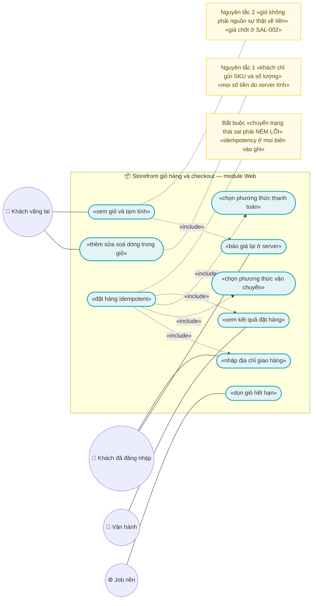
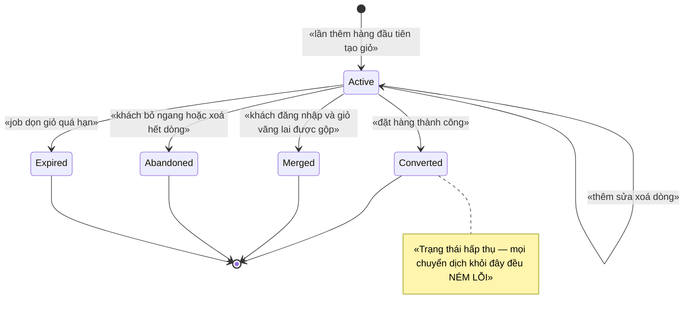
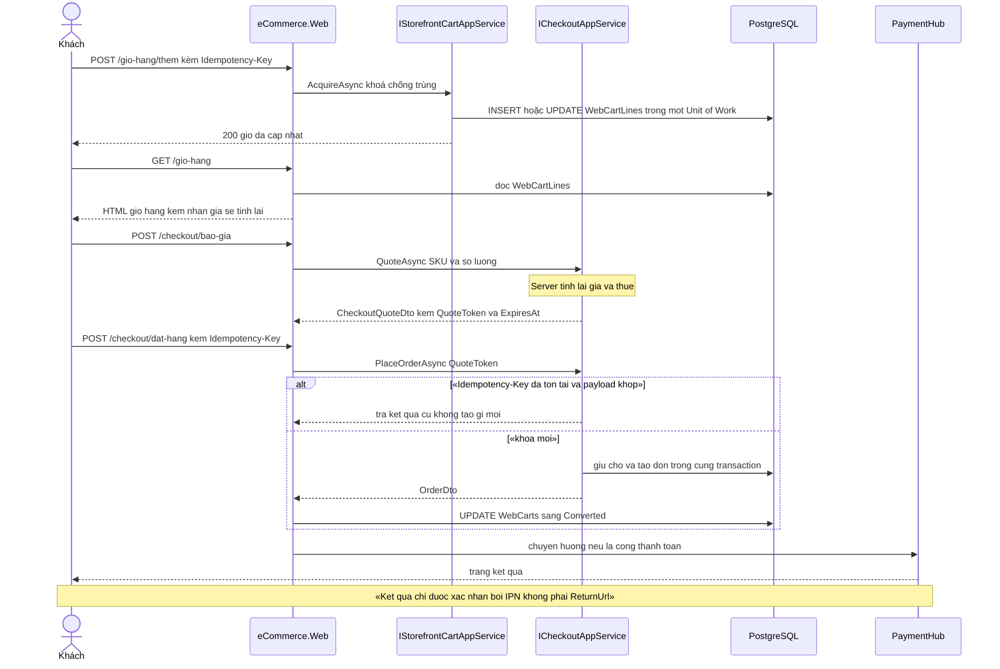

# `WEB-003` — Storefront: giỏ hàng và checkout

| Thuộc tính | Nội dung |
|---|---|
| **Mã** | `WEB-003` |
| **Module** | **Web** — render tại ✅ `src/eCommerce.Web` (Razor; đã kiểm 17/10/2026: `src/eCommerce.Web/Controllers/DatHangController.cs`). 📌 `modules/Web/eCommerce.Web.*` **vẫn chưa tách** — và **không cần** tách để feature chạy được. ⚠️ Dòng này trước đây ghi *"Cả hai đều CHƯA có trong code"* — **đã lỗi thời** |
| **Giai đoạn** | **GĐ1 — Bán được trên website** (`docs/implementation-plan.md:416`: *"WEB-003 · Storefront: giỏ hàng & checkout · Web"*) |
| **Ưu tiên** | **Must have** — không có giỏ hàng và checkout thì GĐ1 **không bán được** dù `WEB-002` đã xong |
| **Trạng thái** | 🟡 `Draft` — chờ review · ✅ **ĐÃ CÓ CODE** — `src/eCommerce.Web/Controllers/DatHangController.cs` (`/DatHang`: giỏ nhiều dòng, khoá checkout sinh ở GET, giỏ sống qua phiên); 📌 **§15.2 F1 nay đã lỗi thời** |
| **Người viết / người review** | *(điền)* / **Kiến trúc trưởng + BA + Kế toán** (feature có **tiền** và **state machine**) |
| **Phiên bản / ngày** | `v0.2 — 17/10/2026` (sửa dòng *"chưa có dòng code"* đã sai + đường dẫn theo cấu trúc `docs/features/<module>/`; trước: `v0.1 — 14/10/2026`) |
| **Tài liệu liên quan** | `SAL-002` (checkout & đặt hàng — **tài liệu nền của feature này**) · `SAL-003` (state machine 4 trục) · `SAL-001` (giỏ hàng) · `XC-001` (Money/làm tròn) · `XC-002` (outbox/inbox + idempotency) · `XC-003` (khoá phân tán) · `XC-004` (auth/permission/allowlist/tenant) · `XC-005` (log/metric) · `XC-006` (thuế GTGT) · `WEB-001` (UI admin: khung, đăng nhập, menu, phân quyền) · `WEB-002` (duyệt & chi tiết sản phẩm) · **`CUS-001`** (hồ sơ khách hàng & sổ địa chỉ) · **`ADDR-001`** (tra cứu ĐVHC 2 cấp/3 cấp cũ) · **`ADDR-002`** (mã địa chỉ theo hãng vận chuyển) · **`ADDR-004`** (sổ địa chỉ khách — *giao tới đâu*) · `SHP-001` (adapter GHN: tính phí & tạo vận đơn) · `SHP-002` (webhook vận đơn) · `SHP-003` (COD) · `SHP-004` (adapter GHTK) · **`PAY-001`** (cổng thanh toán VNPay) · `docs/structure-and-techstack.md` · `docs/implementation-plan.md` |

> 📌 **Cách đọc tài liệu này:** mọi khẳng định về code đều kèm **đường dẫn file thật** đã kiểm bằng `read`/`grep` trong repo
> tại thời điểm viết (14/10/2026). Chỗ nào **chưa có trong code** thì ghi rõ **"chưa có trong code — kế hoạch GĐx"**;
> chỗ nào **chưa kiểm chứng được** thì ghi rõ **"chưa kiểm chứng"**. Không có suy đoán nào được trình bày như sự thật.

---

## 0. Tóm tắt & quyết định thiết kế

**Tóm tắt:** `WEB-003` là **tầng trải nghiệm mua hàng** của website: **giỏ hàng** và **luồng checkout nhiều bước**
(địa chỉ giao hàng → phương thức vận chuyển → phương thức thanh toán → xác nhận → kết quả).
Đây là **tầng UI + app service mỏng**: nó **không** sở hữu tiền, **không** sở hữu tồn kho, **không** sở hữu đơn hàng.

Ba bất biến định hình toàn bộ thiết kế (kế thừa và **không** được phá):

1. **Server TÍNH LẠI toàn bộ giá**; client chỉ gửi *cái gì* (SKU + số lượng), **không** gửi *bao nhiêu tiền*
   (`SAL-002` §0.1 **ADR-01**, dòng 57).
2. **Giỏ hàng không phải nguồn sự thật về tiền** — giá trong giỏ chỉ là **bản chụp để hiển thị**;
   giá chốt vào `OrderLine` do `SAL-002` thực hiện (`SAL-002` §0.1 **ADR-02**, dòng 58).
3. **Idempotency ở MỌI biên vào** (`XC-002` **BR-XC-002-004**) và **state machine PHẢI NÉM LỖI**
   (`XC-002` **BR-XC-002-009**; bài học `SetPaidStatus()` của eShop).

**Vì sao phải viết tài liệu này trước khi code — 4 sự thật đã kiểm chứng trong repo:**

| # | Sự thật kiểm chứng được | Hệ quả bắt buộc |
|---|---|---|
| 1 | **Chưa có project Web nào.** `eCommerce.slnx` liệt kê **18 dòng `<Project Path=…>`** và **0** project Web (`eCommerce.slnx`); toàn repo có **0** file `.cshtml`/`.razor` (đo bằng `Get-ChildItem -Include *.cshtml,*.razor`) | `WEB-003` **chưa có trong code — kế hoạch GĐ1**. `WEB-001` (khung UI) và `WEB-002` phải xong **trước** |
| 2 | **Không có entity giỏ hàng.** Grep `Cart` trên toàn `src/` + `modules/` = **0** kết quả (chỉ có `CheckoutUrl` của `PaymentHub` — `modules/PaymentHub/eCommerce.PaymentHub.Domain/Payments/IPaymentProvider.cs:23`) | Mô hình giỏ phải **thiết kế mới** (§5.2.1–5.2.2) và **phải có `DbSet`** trên DbContext hợp nhất (`src/eCommerce.EntityFrameworkCore/eCommerceDbContext.cs:48-52`) |
| 3 | **Chưa có entity địa chỉ giao hàng, và chưa có module sở hữu nó.** Grep `Address` trong `src/`+`modules/` chỉ trả về `ClientIpAddress`/`IpAddresses` của **module Identity của ABP** (ví dụ `src/eCommerce.EntityFrameworkCore/Migrations/20261009102044_Added_Identity.cs:115,137`). `modules/` **chỉ có 3 module**: `ChannelHub`, `PaymentHub`, `Tax` — **không** có `modules/Customers` và **không** có `modules/AddressHub` | `SAL-002` §6.1 (dòng 503-504) tham chiếu `ShippingAddressId?`, và **thiết kế** địa chỉ **đã có tài liệu**: `Address` do **`AddressHub`** sở hữu (`ADDR-001`/`ADDR-002`/`ADDR-003`), `CUS-001` giữ **bảng liên kết** `CustomerAddressLink` (đúng `cus-001-…md:20`, `:55`) — nhưng **cả hai module chưa tồn tại trong code** ⇒ **chặn** bước "nhập địa chỉ" — xem §15.1 **Q3** |
| 4 | **Hạ tầng chung còn thiếu:** `shared/` **không tồn tại** (`Test-Path shared` = `False`) ⇒ `eCommerce.Kernel`/`Money` (`XC-001`) **chưa có**; grep `IIdempotencyGuard\|InboxRecords\|DeadLetterEvents\|ConfigureEventOutbox\|IHasEventOutbox` trong `src/`+`modules/` = **0** ⇒ `XC-002` **chưa có code** | `WEB-003` **phụ thuộc cứng** `XC-001` + `XC-002` + `SAL-002`. Ba điều kiện này nằm trong Definition of Ready (§14.4) |

**Phạm vi:**

- ✅ **Giỏ hàng storefront**: thêm / sửa số lượng / xoá dòng / xem giỏ / đếm số mặt hàng; giỏ **vãng lai** gắn với
  phiên (token trong cookie) và **gộp** vào giỏ của khách khi đăng nhập.
- ✅ **Vòng đời giỏ** (state machine) — nơi **chuyển trạng thái sai PHẢI NÉM LỖI** (§3).
- ✅ **Luồng checkout nhiều bước** phía server: địa chỉ → vận chuyển → thanh toán → xác nhận → kết quả.
- ✅ **Gọi `SAL-002`** để báo giá lại và **đặt hàng** (không tự tính tiền, không tự giữ kho).
- ✅ **Hiển thị tiền đúng `XC-001`**: `Money` + `Currency`, VND **0 chữ số thập phân**, tổng = **tổng các dòng đã làm tròn**.
- ✅ **Idempotency ở mọi biên vào** của luồng mua (§7.4) — kể cả **webhook hãng vận chuyển** (§7.2) dù route đó **không** thuộc storefront.
- ✅ **Mã lỗi, phân quyền, migration, test case, metric** theo đúng quy ước repo.

**Không nằm trong phạm vi:**

- ❌ **Tính giá / giảm giá / thuế / phí vận chuyển** — thuộc `PRC-001`/`PRC-002`/`XC-006`/`SHP-001`; `WEB-003` chỉ **hiển thị** kết quả `SAL-002` trả về.
- ❌ **Giữ chỗ tồn kho, TTL, job nhả kho** — thuộc `INV-002`; `WEB-003` **không** gọi thẳng kho.
- ❌ **Tạo đơn, chốt giá, phát `OrderPlacedEto`** — thuộc `SAL-002`; `WEB-003` là **bên gọi**.
- ❌ **4 trục trạng thái đơn + lịch sử** — thuộc `SAL-003`. `WEB-003` chỉ **hiển thị** theo `SAL-003` §10 (dòng 748-757).
- ❌ **Cổng thanh toán / IPN** — thuộc `PaymentHub` + `REC-001`. `WEB-003` chỉ **chuyển hướng** và **hiển thị kết quả**.
- ❌ **Webhook hãng vận chuyển** — thuộc `SHP-002`. `WEB-003` **không** nhận webhook (§0.1 **ADR-14**).
- ❌ **UI quản trị** (xem giỏ treo, phiên hết hạn) — thuộc `WEB-001`.
- ❌ **Voucher/coupon engine** — thuộc `PRO-001`/`PRO-002` (GĐ2, `docs/implementation-plan.md:422-423`). GĐ1 chỉ có ô nhập mã ở mức UI **nếu** `SAL-002` hỗ trợ `CouponCode` (`SAL-002` §6.1, dòng 503).
- ❌ **Đa tiền tệ hoạt động thật, đa ngôn ngữ** — GĐ1 chỉ **VND** + **tiếng Việt** (`XC-001` **BR-XC-001-009**).
- ❌ **Đăng ký/đăng nhập tài khoản khách** — thuộc `WEB-001`/`XC-004`.

### 0.1 Quyết định thiết kế (ADR ngắn)

| # | Quyết định | Phương án đã cân nhắc | Lý do chọn | Hệ quả |
|---|---|---|---|---|
| **ADR-01** | Storefront (giỏ + checkout) render **server-side bằng Razor MVC**, project `src/eCommerce.Web` | (a) Blazor WASM/SPA · (b) Razor MVC · (c) SPA riêng (Next.js) | Kế thừa **`WEB-002` ADR-01** (dòng 63): `docs/structure-and-techstack.md:123` đã chốt *"ABP **MVC/Razor Pages** + theme miễn phí … **Server-rendered ⇒ tốt cho SEO**"*. Checkout là luồng **có tiền** ⇒ càng ít logic ở client càng tốt | Mọi bước checkout **phải** chạy được **không cần JS**; JS chỉ là lớp tăng cường (đếm ngược giữ hàng, cập nhật số lượng). ⚠️ **chưa có gì trong code** (F1) |
| **ADR-02** | Giỏ hàng là **entity riêng của module Web** (`WebCarts` / `WebCartLines`), **KHÔNG** đọc bảng Catalog khi render giỏ | (a) Web tham chiếu `Product`/`ProductVariant` của app · (b) Web gọi `IProductAppService` của app · (c) **entity giỏ của Web + bản chụp tên/giá để hiển thị** | (a)/(b) **vi phạm** bất biến *module → app là CẤM* vì Catalog hiện ở `src/eCommerce.Domain/Entities/Catalog/Product.cs` (đúng **`WEB-002` §15.2 F3**, dòng 771). (c) giữ đúng chiều phụ thuộc | Giỏ phải lưu **bản chụp** `ProductNameSnapshot`/`UnitPriceSnapshot`/`Currency` **chỉ để hiển thị**; **cấm** dùng làm nguồn tiền (**BR-WEB-003-010**) |
| **ADR-03** | **Server tính lại giá** ở bước báo giá và **lần hai** ngay trước khi ghi; UI **không bao giờ** gửi trường tiền | (a) UI gửi `unitPrice` (mẫu phổ biến) · (b) server tính lại | Kế thừa **`SAL-002` ADR-01** (dòng 57). Client là **vùng không tin cậy** — sửa giá trong request là lỗ hổng kinh điển của checkout | DTO vào của `WEB-003` **không có** trường tiền nào; client gửi tiền ⇒ **bỏ qua + log `Warning`** (test `TC-WEB-003-03`) |
| **ADR-04** | **Idempotency ở MỌI biên vào GHI** của luồng mua: thêm vào giỏ, đặt hàng, callback thanh toán, webhook vận chuyển | (a) tin at-least-once là "hiếm" · (b) chỉ chống trùng ở HTTP · (c) **`IIdempotencyGuard` + unique index DB** | `XC-002` **BR-XC-002-004** (dòng 92): *"**Mọi** biên vào — HTTP webhook, consumer sự kiện, job định kỳ, callback thanh toán — **phải** idempotent"*. eShop **đã trả giá** (redelivery ⇒ trừ kho 2 lần) | Khoá phải **ổn định** và **lưu DB**; **cấm** `Guid.NewGuid()` mỗi lần (`XC-002` **BR-XC-002-007**) |
| **ADR-05** | **Cấm** dùng distributed lock cho đường ghi **trong một giỏ của một khách**; dùng **optimistic concurrency** (`ConcurrencyStamp`) | (a) lock mọi thao tác giỏ cho "an toàn" · (b) `SemaphoreSlim` trong tiến trình · (c) **`ConcurrencyStamp` + `UPDATE … WHERE`** | `XC-003` **D9** (dòng 52): lock cho việc trong 1 tiến trình là **chậm hơn + tạo ảo giác an toàn**; `XC-003` **D2** (dòng 45): **DB mới là hàng rào**. Giỏ thuộc **một** khách ⇒ tài nguyên **không** chia sẻ giữa các khách | Hai tab cùng sửa một giỏ ⇒ một thắng, tab kia nhận **409** + đọc lại; **không** dùng lock cho việc này |
| **ADR-06** | Distributed lock **chỉ** cho **job dọn giỏ hết hạn** và cho bước **chuyển giỏ → đơn** | (a) dùng lock mọi nơi · (b) chỉ 2 chỗ thật sự vượt tiến trình | `XC-003` **D9**; job dọn giỏ chạy trên **nhiều instance**; bước convert chạm **đơn + kho** (tài nguyên chia sẻ) | 2 khoá: `web:cart-sweep:{tenantId}` (**`SkipIfBusy`**) và `web:cart-convert:{tenantId}:{cartId}` (**ném lỗi** khi hết timeout). Đăng ký ở §8.2 |
| **ADR-07** | Giá hiển thị **bắt buộc** đi qua `Money` + `Currency`; **cấm** `==` trên tiền; **cấm** `double`/`float` | (a) render `decimal` trực tiếp · (b) `Money` | `XC-001` **D3** (dòng 41): so tiền bằng `==` **đã gây lỗi thật ở eShop** (`ActualTotalPrice == OriginalPaymentAmount` vỡ với VND/payOS) | ⚠️ **`Money` CHƯA tồn tại trong code**: `shared/` **không tồn tại**; grep `class Money` = **0** ⇒ **BR-WEB-003-008/009 chưa thực thi được** cho tới khi `XC-001` xong (§15.2 **F4**) |
| **ADR-08** | Mã lỗi của feature dùng dải **`eCommerce:Web:0010`–`0019`**, **không** tái dùng `0001`–`0004` của `WEB-002` | (a) dùng tiếp `0005…` · (b) dải riêng `0010…` | `WEB-002` §6.2 (dòng 417-420) đã chiếm `eCommerce:Web:0001`–`0004`. Hai feature **cùng module Web** ⇒ phải **không đụng số**, nếu không sẽ lặp lại **`XC-003` §15.2 F1/F2** (*cùng khái niệm, hai mã khác nhau*) | Dải `0010` để trống `0005`–`0009` cho `WEB-002` mở rộng; **cấm** khai lại mã đã có |
| **ADR-09** | Checkout là **wizard nhiều bước ở server** (state ở `WebCarts.Step`), **không** phải SPA đa bước | (a) SPA giữ state ở client · (b) wizard server-side | `ADR-01` (SEO + ít JS). Wizard client-side ⇒ **mất state** khi refresh, và **dễ** để client quyết định giá/bước | Mỗi bước là **một GET/POST** với `step` hợp lệ; nhảy bước sai ⇒ **NÉM** `eCommerce:Web:0010` |
| **ADR-10** | Giỏ vãng lai định danh bằng **token trong cookie `HttpOnly`** (`WebCarts.GuestToken`), **không** bằng `CustomerId` | (a) buộc đăng nhập mới mua · (b) session in-memory · (c) **token cookie + bản ghi DB** | (a) làm rơi tỉ lệ chuyển đổi và **mâu thuẫn** `SAL-002` **A4** (dòng 90: đặt hàng cho khách vãng lai). (b) mất giỏ khi restart/scale-out | Khi khách đăng nhập ⇒ **gộp** giỏ vãng lai vào giỏ của khách (**`Merged`**, §3). ⚠️ Việc cho khách vãng lai đặt hàng là **`SAL-002` Q2** — **đang `Open`** (dòng 966) ⇒ **chặn** phần "đặt hàng không cần đăng nhập" |
| **ADR-11** | **Không** hiển thị lời hứa "đổi COD được ngay"; COD chỉ được **chọn lúc đặt**; mọi thay đổi sau đó là **thao tác có kiểm soát** | (a) cho UI sửa COD tự do · (b) chỉ chọn lúc đặt + thao tác vận hành | ⚠️ **GHN đổi COD bắt buộc OTP** (`docs/implementation-plan.md:199`, `:426`; `docs/features/reporting/rep-003-bao-cao-ton-kho-hieu-suat-kenh.md:539`) ⇒ **không tự động hoá 100 %**; `SHP-001` cũng đã chốt **cấm** expose method/endpoint *đổi* COD (`shp-001-adapter-ghn-tinh-phi-van-don.md:8-9` — **ADR-07**, **BR-SHP-001-014**); `NOT-002` §15.2 còn ghi **cấm lưu OTP** (`docs/features/notifications/not-002-kenh-gui-email-sms-zalo-oa.md:92`) | UI checkout: COD chỉ là **lựa chọn phương thức**, kèm ghi chú "số tiền thu hộ do hệ thống tính"; **cấm** nút "sửa COD" trên storefront (**BR-WEB-003-018**) |
| **ADR-12** | **Địa chỉ MỚI chỉ nhập 2 cấp** (Tỉnh/Thành · Phường/Xã); **cấm** cho khách chọn cấp huyện. `WEB-003` **không** sở hữu mô hình địa chỉ — nó **gọi hợp đồng của `AddressHub`** | (a) `WEB-003` tự định nghĩa form địa chỉ · (b) cho khách chọn 3 cấp cho tiện · (c) **gọi `AddressLevelPolicy.ValidateAsync` của `AddressHub`** | ⚠️ **`ADDR-001` D3** (`addr-001-tra-cuu-don-vi-hanh-chinh-2-cap.md:51`) chốt: `District` **chỉ để TƯƠNG THÍCH** — *"cho chọn ⇒ **vi phạm pháp luật hiện hành** (không còn cấp huyện từ 01/07/2025)"*, và `AddressLevelPolicy` **phải từ chối** cấu hình cho phép cấp huyện cho **địa chỉ MỚI** (`ADDR-001` BR-006). Rủi ro 3 cấp của GHTK được xử lý ở **BIÊN GỬI** bởi pre-flight **fail-closed** của `SHP-004` (`shp-004-adapter-ghtk.md:10`, `:42`), **không** bằng cách cho khách nhập huyện | Storefront **chỉ** hiển thị Tỉnh/Thành + Phường/Xã (danh mục **`v2`**, `ADDR-001` D2); **cấm** tự dựng danh mục địa chỉ; **cấm** tra mã **thiếu** `schemaVersion` (**BR-WEB-003-019**). ⚠️ `modules/AddressHub` **chưa tồn tại** (F3) |
| **ADR-13** | **Toàn bộ ghi** trong luồng checkout nằm trong **MỘT** Unit of Work; **cấm** `autoSave: true` | (a) `autoSave: true` từng bước · (b) một UoW | Kế thừa **`SAL-002` ADR-10** (dòng 66): *"Hoặc phiên + giữ chỗ + dòng đơn cùng có, hoặc cùng không"*. ⚠️ Thói quen `autoSave: true` **đang tồn tại** trong repo — đo lại ngày 14/10/2026 bằng grep: `src/eCommerce.Application/Channels/ChannelAppService.cs:103,119,132,183` (đúng **`SAL-002` §15.2 F3**, dòng 981), **và cả trong module**: `modules/ChannelHub/eCommerce.ChannelHub.Application/Sync/ChannelShopSyncer.cs:97,110` · `…/Sync/ChannelTokenManager.cs:100,114` · `src/eCommerce.DbMigrator/eCommerceDataSeedContributor.cs:48` | `WEB-003` **cấm** `autoSave`; có test quét mã nguồn (`TC-WEB-003-21`) |
| **ADR-14** | Route webhook của **hãng vận chuyển** và **cổng thanh toán** **KHÔNG** nằm trên storefront; chúng thuộc host của module sở hữu | (a) đặt chung host cho tiện · (b) tách theo module | Webhook là **biên vào công khai**: nếu đặt ở storefront thì phải mở `[AllowAnonymous]` cho một route **có thể bị giả mạo** — ⚠️ **GHTK không có HMAC** (`docs/business-modules-proposal.md:547`; `shp-002-webhook-trang-thai-van-don.md:3-7`, `:649`, `:654-663`). Mở allowlist cho nó làm **tăng bề mặt tấn công** của cả site | `WEB-003` **không** nhận webhook. Nhưng **giá trị** của webhook vẫn chảy vào checkout ⇒ §7.2 ghi rõ nó là **biên vào bắt buộc idempotent** và **không** phải nguồn sự thật |

> **Phương án BỊ LOẠI (ghi lại để 6 tháng sau không hỏi lại):**
> (1) **SPA/Blazor WASM** — loại vì SEO + ít JS, xem ADR-01.
> (2) **Storefront query thẳng `CatProducts`/`CatProductVariants`** — loại vì vi phạm *module → app là CẤM*, xem ADR-02.
> (3) **Tin số tiền client gửi** — loại vì đây là lỗ hổng kinh điển của checkout, xem ADR-03.
> (4) **Đặt webhook hãng vận chuyển chung host storefront** — loại vì phải mở allowlist cho route có thể bị giả mạo, xem ADR-14.

---

## 1. Use Case Specification

| Thuộc tính | Nội dung |
|---|---|
| **Use Case ID** | `WEB-003` |
| **Use Case Name** | Mua hàng trên storefront: **giỏ hàng** và **checkout** |
| **Description** | *"Là khách mua hàng, tôi muốn bỏ hàng vào giỏ, xem tạm tính, nhập địa chỉ, chọn cách giao và cách trả tiền, rồi bấm **Đặt hàng** — để tôi nhận được một đơn hàng với **số tiền đúng**, và để tôi bấm hai lần hoặc mạng chập chờn cũng **không** tạo ra hai đơn."* |
| **Actor(s)** | **Khách vãng lai** (chưa đăng nhập) · **Khách đã đăng nhập** · **Nhân viên** (xem trước) · **Bot** (chỉ đọc — không được ghi) · **Job nền** (dọn giỏ hết hạn) · **Hệ thống** (Razor render, `SAL-002`, `PaymentHub`) |
| **Priority** | **Must have** |
| **Trigger** | (a) khách bấm **Thêm vào giỏ** ở trang chi tiết sản phẩm (`WEB-002` §10.2 — nút mua *"thuộc `WEB-003`"*, dòng 564); (b) khách mở `/gio-hang`; (c) khách bắt đầu checkout; (d) khách bấm **Đặt hàng**; (e) job định kỳ dọn giỏ hết hạn |
| **Pre-Condition(s)** | • **Tenant hiện tại** (`TenantId`) — hệ thống đang chạy **1 tenant** và `TenantId` **có thể là `NULL`** (`XC-004` §15.2 F1; `runtime-verification-report.md` C4) ⇒ **mọi** unique index của feature **phải** dùng `NULLS NOT DISTINCT` (`XC-004` **BR-XC-004-009**, dòng 74).<br>• **Kênh bán** = `web` — **hằng số**, **không** lấy từ input người dùng (`Order.ChannelCode` khai `IsRequired().HasMaxLength(32)`, `src/eCommerce.EntityFrameworkCore/eCommerceDbContext.cs:168`).<br>• **`WEB-001`** (khung UI + theme + đăng nhập) ✅ **đã có tài liệu** (`docs/features/web/web-001-ui-admin-khung-dang-nhap-phan-quyen.md`) nhưng ⚠️ **chưa có trong code** (F1).<br>• **`AddressHub`** (`ADDR-001`/`ADDR-002`) và **`CUS-001`** (sổ địa chỉ) ✅ **đã có tài liệu** nhưng ⚠️ **module chưa tồn tại trong code** ⇒ bước "nhập địa chỉ" **chưa** triển khai được (F3).<br>• **`WEB-002`** (trang chi tiết sản phẩm có nút mua) đã có — ⚠️ **chưa có trong code**.<br>• **`SAL-002`** (báo giá + giữ kho + tạo đơn) đã có — ⚠️ **chưa có dòng code nào** (`SAL-002` §14.5, dòng 952).<br>• **`XC-001` (`Money`) đã có** — ⚠️ **chưa có trong code** (`shared/` không tồn tại; xem §0 F4).<br>• **`XC-002` (`IIdempotencyGuard` + outbox) đã có** — ⚠️ **chưa có trong code** (grep = **0**).<br>• **Permission đã định nghĩa** trong `eCommercePermissionDefinitionProvider` — thiếu ⇒ **403 cho MỌI người** (`XC-004` **D2/BR-002**; tiền lệ Phase 0 C7 ở `docs/runtime-verification-report.md:27`).<br>• **Redis 7** sẵn sàng — **không** bắt buộc để đúng đắn (`AbortOnConnectFail = false`, `src/eCommerce.HttpApi.Host/eCommerceHttpApiHostModule.cs:141`). |
| **Post-Condition(s)** | • Giỏ ở trạng thái **hấp thụ** `Converted` (**`Placed`** theo `SAL-002` §3.1) hoặc vẫn `Active` nếu đặt hàng thất bại (**rollback toàn bộ**).<br>• **Đơn đã tồn tại** với `Number` duy nhất theo tenant (`OrdOrders` UNIQUE `(TenantId, Number)`, `eCommerceDbContext.cs:180`) — do `SAL-002` tạo, **không** do `WEB-003`.<br>• Trang kết quả hiển thị **số đơn**, **tổng tiền**, **hạn giữ hàng** — lấy **nguyên văn** từ `OrderDto` của `SAL-002`.<br>• Mọi số tiền hiển thị là **`decimal` đã làm tròn theo `Currency.Decimals`** (`XC-001` BR-001); **0** lần so tiền bằng `==`.<br>• **0** dòng log chứa PII (địa chỉ đầy đủ, số điện thoại đầy đủ) — `XC-005` **BR-XC-005-005** (dòng 79). |
| **Basic Flow** | 1. Khách bấm **Thêm vào giỏ** ⇒ `POST /gio-hang/them` kèm **`Idempotency-Key`**; hệ thống gọi `IIdempotencyGuard.AcquireAsync` **trước** mọi side effect.<br>2. Hệ thống **tra giá hiển thị** (giá niêm yết hoặc giá kênh — theo `WEB-002` **BR-WEB-002-008**) và ghi **bản chụp** vào `WebCartLines` **trong một UoW**.<br>3. Khách mở `/gio-hang` ⇒ hệ thống render giỏ **từ `WebCartLines`** (không query Catalog), hiển thị **"tạm tính"** kèm nhãn *"giá sẽ được tính lại khi đặt hàng"*.<br>4. Khách bấm **Tiến hành đặt hàng** ⇒ `WEB-003` gọi `SAL-002` **`QuoteAsync`** ⇒ nhận `CheckoutQuoteDto` (`Subtotal`, `DiscountTotal`, `TaxTotal`, `ShippingTotal`, `GrandTotal`, `QuoteToken`, `ExpiresAt`) — `SAL-002` §6.1, dòng 503.<br>5. Khách nhập **địa chỉ giao hàng** (2 cấp — ADR-12) và chọn **phương thức vận chuyển**.<br>6. Khách chọn **phương thức thanh toán** (COD / chuyển khoản / cổng thanh toán).<br>7. Khách bấm **Đặt hàng** ⇒ `POST /checkout/dat-hang` kèm **`Idempotency-Key`** (header) và `QuoteToken`.<br>8. `WEB-003` **gọi** `SAL-002` `PlaceOrderAsync`; **hệ thống tính lại giá lần hai** ở phía `SAL-002` (`SAL-002` Basic Flow bước 4, dòng 89).<br>9. Nếu `SAL-002` trả thành công ⇒ `WEB-003` chuyển giỏ sang **`Converted`** và hiển thị **trang kết quả**.<br>10. Nếu phương thức là **cổng thanh toán** ⇒ chuyển hướng sang `PaymentHub`; kết quả được xác nhận **bởi IPN** (`PaymentHub`/`REC-001`), **không** bởi `ReturnUrl` (`XC-004` **BR-XC-004-014**, dòng 74).<br>11. Job nền dọn giỏ `Active` quá `ExpiresAt` ⇒ `Expired` + log + metric (**`SkipIfBusy`**). |
| **Alternative Flow** | **A1: Khách vãng lai** — giỏ gắn `GuestToken` trong cookie `HttpOnly`; đặt hàng chỉ khả dụng nếu `SAL-002` **Q2** chốt cho phép (`SAL-002` §15.1 Q2, dòng 966 — **đang `Open`**).<br>**A2: Khách đăng nhập giữa luồng** — giỏ vãng lai **gộp** vào giỏ của khách ⇒ trạng thái **`Merged`**; **cấm** tạo hai giỏ `Active` cho cùng khách (**BR-WEB-003-002**).<br>**A3: Giá đã đổi** — `SAL-002` trả `eCommerce:Sales:0006` kèm bảng so sánh ⇒ UI hiển thị *"Giá đã thay đổi"* + nút **Xác nhận lại** (`SAL-002` §10, dòng 702); **cấm** tự đổi giá im lặng.<br>**A4: Hết hàng** — `SAL-002` trả `eCommerce:Inventory:0001` ⇒ UI **giữ nguyên** các dòng khác và **chỉ** báo dòng thiếu (`SAL-002` §10, dòng 703).<br>**A5: Khoá bận** — trả `eCommerce:Lock:0001` (`409`) ⇒ UI hiển thị *"Đang xử lý, vui lòng thử lại"* + nút thử lại — đây là **tình huống bình thường**, **không** log như lỗi hệ thống (`XC-003` §10, dòng 376-383).<br>**A6: Gia hạn giữ hàng** — UI hiển thị đồng hồ đếm ngược theo **giờ server**; hết giờ ⇒ trạng thái *"hết thời gian giữ hàng"* + nút **Đặt lại** (`SAL-002` §10, dòng 701). Gia hạn tối đa **1 lần** (`SAL-002` ADR-14, dòng 70) — ⚠️ `SAL-002` **Q4** **đang `Open`** (dòng 968). |
| **Exception Flow** | **E1:** chuyển trạng thái giỏ **không hợp lệ** (ví dụ `Converted → Active`) ⇒ **NÉM** `BusinessException` **`eCommerce:Web:0010`** (**BR-WEB-003-004/005**).<br>**E2:** dòng giỏ không hợp lệ (SKU ngừng bán, số lượng ≤ 0, vượt trần) ⇒ **`eCommerce:Web:0011`** (`400`).<br>**E3:** thiếu header **`Idempotency-Key`** ở biên vào bắt buộc ⇒ **`eCommerce:Web:0012`** (`400`) — **cấm** tự sinh khoá thay client (**BR-WEB-003-007**).<br>**E4:** cùng `Idempotency-Key` + **payload khác** ⇒ **NÉM** **`eCommerce:Messaging:0002`** (mã **dùng chung** của guard theo `XC-002` E1/BR-006, dòng 91-92, `:632`) — **cấm** coi là trùng và **cấm** ghi đè (**BR-WEB-003-006**).<br>**E5:** token giỏ không tồn tại/không hợp lệ ⇒ **`eCommerce:Web:0013`** (`404`) — **cấm** trả `403` để **không tiết lộ sự tồn tại** (`XC-004` **BR-XC-004-008**).<br>**E6:** giỏ ở trạng thái hấp thụ mà cố thao tác ⇒ **`eCommerce:Web:0014`** (`409`).<br>**E7:** giỏ rỗng khi bắt đầu checkout ⇒ **`eCommerce:Web:0015`** (`409`) — tương ứng `eCommerce:Sales:0008` (`SAL-002` §6.2, dòng 555) nhưng phát hiện **sớm ở tầng UI**.<br>**E8:** địa chỉ **không hợp lệ** theo `AddressLevelPolicy` của `AddressHub` (thiếu Phường/Xã; hoặc cố gửi cấp **huyện** cho địa chỉ **MỚI**) ⇒ **`eCommerce:Web:0016`** (`400`) — ⚠️ `ADDR-001` D3 **cấm** cấp huyện cho địa chỉ mới (ADR-12).<br>**E9:** hãng vận chuyển **chưa được cấu hình** ⇒ `SHP-002` trả **`eCommerce:Shipping:0007`** (`400`, `shp-002-webhook-trang-thai-van-don.md:571`) ⇒ `WEB-003` **không được** hiển thị phương thức đó như khả dụng ⇒ **`eCommerce:Web:0017`** (`409`).<br>**E10:** Redis **không kết nối được** ⇒ **fail-open**: luồng mua **vẫn chạy**; ràng buộc DB của `SAL-002` vẫn chặn oversell (`XC-003` D2; `SAL-002` E9, dòng 91). |
| **Business Rules** | • **BR-WEB-003-001**: DTO **vào** của mọi endpoint `WEB-003` **cấm** có trường tiền; client **chỉ** gửi `Sku` + `Quantity` (+ lựa chọn bước). Client gửi tiền ⇒ **bỏ qua + log `Warning`** (kế thừa `SAL-002` BR-SAL-002-001, dòng 92).<br>• **BR-WEB-003-002**: **Đúng một** giỏ `Active` cho mỗi `(TenantId, chủ sở hữu)` — chủ sở hữu là `CustomerId` **hoặc** `GuestToken`; đăng nhập ⇒ giỏ vãng lai **gộp** và chuyển `Merged`; **cấm** hai giỏ `Active` cùng chủ.<br>• **BR-WEB-003-003**: Mọi thao tác **ghi** giỏ **phải** nằm trong **một** Unit of Work; **cấm** `autoSave: true` trong luồng giỏ/checkout.<br>• **BR-WEB-003-004**: **Mọi** chuyển trạng thái giỏ **phải** qua phương thức chuyển trạng thái có guard của domain; **cấm** setter công khai trên `WebCarts.Status`.<br>• **BR-WEB-003-005**: Chuyển trạng thái **không có** trong bảng chuyển (§3) **PHẢI NÉM** `eCommerce:Web:0010` — **cấm** no-op im lặng (bài học `SetPaidStatus()`, `XC-002` BR-XC-002-009).<br>• **BR-WEB-003-006**: **Idempotency ở MỌI biên vào GHI**; cùng khoá + khác `PayloadHash` ⇒ **NÉM** `eCommerce:Messaging:0002` — **cấm** coi là trùng (`XC-002` BR-XC-002-005/006).<br>• **BR-WEB-003-007**: `Idempotency-Key` phải **ổn định** và **lưu DB**; **cấm** `Guid.NewGuid()` mỗi lần thử (`XC-002` BR-XC-002-007).<br>• **BR-WEB-003-008**: Mọi số tiền hiển thị **phải** đi qua `Money`/`Currency`; **cấm** `double`/`float` trong **mọi** DTO/ViewModel storefront (`XC-001` BR-008).<br>• **BR-WEB-003-009**: **Cấm** so sánh tiền bằng `==`; so bằng `ToMinorUnits()` (`XC-001` BR-003).<br>• **BR-WEB-003-010**: Tổng hiển thị ở giỏ/checkout **phải** bằng **tổng các dòng đã làm tròn** (**không** tính lại từ tổng gốc) — chênh **1–2 đồng** là **đúng**, không phải bug (`XC-001` BR-005; `SAL-002` §6.1 dòng 539-541).<br>• **BR-WEB-003-011**: Giá lưu trong `WebCartLines` **chỉ** để hiển thị; **cấm** dùng làm nguồn tiền khi đặt hàng — giá chốt do `SAL-002` tính lại (`SAL-002` ADR-01/02).<br>• **BR-WEB-003-012**: **Mọi** app service của module Web **phải** có `[Authorize]` ở **cấp class** (`XC-004` BR-XC-004-001; tiền lệ `src/eCommerce.Application/Channels/ChannelAppService.cs:27`).<br>• **BR-WEB-003-013**: Route **công khai** của storefront **chỉ** được dùng `[AllowAnonymous]` khi **nằm trong allowlist** và **có ghi lý do**; **cấm** `[AllowAnonymous]` ngoài allowlist (`XC-004` BR-XC-004-004). ⚠️ Repo hiện có **0** `[AllowAnonymous]` (grep trong `src/`+`modules/` = **0**) ⇒ **phải** mở rộng allowlist **trước**.<br>• **BR-WEB-003-014**: **Mọi** permission dùng trong `[Authorize]` **phải** được định nghĩa trong `eCommercePermissionDefinitionProvider`; **cấm** magic string (`XC-004` BR-XC-004-002/003). ⚠️ `eCommerce.Orders.Place` **chưa** được định nghĩa (`SAL-002` §9.1, dòng 672).<br>• **BR-WEB-003-015**: Mọi entity mới **phải** có `DbSet` trên `eCommerceDbContext` hợp nhất — thiếu ⇒ `IRepository<T>` **không** được đăng ký (`eCommerceDbContext.cs:48-52`).<br>• **BR-WEB-003-016**: Mọi **unique index có `TenantId`** **phải** dùng **`NULLS NOT DISTINCT`**; EF Core **không** mô hình hoá được ⇒ **SQL thô** trong migration (tiền lệ `src/eCommerce.EntityFrameworkCore/Migrations/20261013024226_Fix_NullableTenantId_UniqueIndexes.cs:42-85`).<br>• **BR-WEB-003-017**: Metric mới **phải** đăng ký trong `eCommerceMetricNames` (`shared/eCommerce.Kernel/Observability/eCommerceMetrics.cs:13-53`) **và** cập nhật `XC-005` §5.1 **trong cùng PR**; nhãn **chỉ** lấy từ `eCommerceMetricTags.Allowed`; 🚨 **cấm** nhãn `orderId`/`sku`/`userId`/`correlationId` (`eCommerceMetrics.cs:75-84`; `XC-005` BR-009).<br>• **BR-WEB-003-018**: **Cấm** hiển thị hoặc hứa "đổi COD được ngay" trên storefront; COD **chỉ** được chọn lúc đặt hàng — ⚠️ GHN đổi COD **bắt buộc OTP** (`docs/implementation-plan.md:426`).<br>• **BR-WEB-003-019**: Địa chỉ **MỚI** trên storefront **chỉ** nhập **2 cấp** (Tỉnh/Thành · Phường/Xã) và **phải** được kiểm hợp lệ qua hợp đồng của `AddressHub` (`AddressLevelPolicy.ValidateAsync` — `ADDR-001` §0 D5, dòng 53); **cấm** cho khách chọn cấp **huyện** (`ADDR-001` D3, dòng 51 — *"vi phạm pháp luật hiện hành"*); **cấm** `WEB-003` tự dựng danh mục ĐVHC; **cấm** tra cứu **thiếu** `schemaVersion` (`ADDR-001` D2, dòng 50 — mã `4` là *"Phường Ba Đình"* ở `v2` nhưng là *"Phường Trúc Bạch"* ở `v1`).<br>• **BR-WEB-003-020**: **Cấm** log/lưu PII thô (địa chỉ đầy đủ, số điện thoại đầy đủ, email đầy đủ); mọi payload lưu DB **phải** đi qua hàm che dữ liệu (`XC-005` BR-XC-005-005; tiền lệ `PaymentTransaction.MaskSensitiveData`, được nhắc ở `not-002-kenh-gui-email-sms-zalo-oa.md:92`). |
| **Non-Functional Requirement** | • **NFR-WEB-003-001**: TTFB trang **giỏ hàng** (≤ 20 dòng) p95 **< 300 ms**.<br>• **NFR-WEB-003-002**: `POST /gio-hang/them` p95 **< 200 ms**.<br>• **NFR-WEB-003-003**: Render trang checkout (không gọi API hãng đồng bộ) p95 **< 500 ms**.<br>• **NFR-WEB-003-004**: Đặt hàng end-to-end (≤ 5 dòng, 1 kho) p95 **< 2 s** — kế thừa `SAL-002` NFR-002 (dòng 773).<br>• **NFR-WEB-003-005**: **0** oversell: 2 khách cùng SKU, tồn = 1 ⇒ đúng **1** thành công (`SAL-002` NFR-003, dòng 774).<br>• **NFR-WEB-003-006**: Idempotent replay trả kết quả cũ trong **< 100 ms** (không tính lại giá).<br>• **NFR-WEB-003-007**: **0** `double`/`float` trong DTO/ViewModel storefront (test reflection).<br>• **NFR-WEB-003-008**: **0** so sánh `==` trên trường tiền (test quét mã nguồn).<br>• **NFR-WEB-003-009**: Cách ly tenant: tenant A **không** đọc/ghi được giỏ của tenant B (integration 2 tenant).<br>• **NFR-WEB-003-010**: **0** PII trong HTML công khai và trong log (test quét).<br>• **NFR-WEB-003-011**: Job dọn giỏ: **10.000** giỏ hết hạn trong **< 60 s**.<br>• **NFR-WEB-003-012**: Tỉ lệ bỏ giỏ **đo được** bằng metric `web_cart_abandoned_total` (§13).<br>• **NFR-WEB-003-013**: **0** chuyển trạng thái giỏ sai bị bỏ qua im lặng (mọi ca có test `TC-WEB-003-04`).<br>• **NFR-WEB-003-014**: **100 %** khoá phân tán của feature grep được bằng `ecommerce:web:` và khớp quy ước `XC-003` BR-002. |

---

## 2. Sơ đồ Use Case



### Chú giải

| Ký hiệu | Ý nghĩa |
|---|---|
| ⭕ Xanh lá | Actor (khách, vận hành, job nền) |
| 🟦 Bầu dục xanh dương | Use Case |
| 🟨 Khung vàng | Note (nguyên tắc bắt buộc) |
| `───` | Liên kết Actor ↔ Use Case |
| `-.«include».->` | Quan hệ bao hàm (bắt buộc xảy ra) |

---

## 3. Sơ đồ trạng thái (state machine) — vòng đời **GIỎ HÀNG**

> ⚠️ **Nói rõ phạm vi sở hữu:** `WEB-003` **KHÔNG** sở hữu vòng đời **phiên checkout** — đó là của `SAL-002`
> (§3.1/§3.2 của tài liệu đó, dòng 159-198, với 5 trạng thái `Started`/`Reserved`/`Placed`/`Expired`/`Rejected`),
> cũng **không** sở hữu vòng đời **giữ chỗ** (`INV-002`, `SAL-002` §3.3) hay **đơn hàng** (`SAL-003`, 4 trục).
> Vòng đời mà **feature này sở hữu** là **giỏ hàng storefront** — thứ quyết định khách còn mua tiếp được hay không.



**Bảng chuyển trạng thái & guard (mọi chuyển sai **phải NÉM LỖI**, không im lặng):**

| # | Từ → Sang | Guard (điều kiện cho phép) | Hành động kèm theo | Nếu guard sai thì? |
|---|---|---|---|---|
| 1 | `[*]` → `Active` | Chưa có giỏ `Active` cho `(TenantId, chủ sở hữu)`; có `GuestToken` **hoặc** `CustomerId` | `Insert WebCarts` (một UoW); nếu không có `GuestToken` ⇒ sinh token **mới** + ghi cookie `HttpOnly` | Đã có giỏ `Active` ⇒ **tái dùng** giỏ đó (không phải lỗi) |
| 2 | `Active` → `Active` | `Status = Active`; `ConcurrencyStamp` khớp; SKU còn bán; `1 ≤ Quantity ≤ maxQtyPerLine` | `Insert/Update/Delete WebCartLines`; `RecalculateTotal()` (**tổng các dòng — BR-010**) | SKU ngừng bán/số lượng sai ⇒ **`eCommerce:Web:0011`**; `ConcurrencyStamp` lệch ⇒ **`eCommerce:Web:0010`** |
| 3 | `Active` → `Converted` | `SAL-002.PlaceOrderAsync` trả **thành công** (`OrderId` khác null) | Ghi `OrderId` + `ConvertedAtUtc`; **KHÔNG** xoá dòng giỏ (giữ vết) | `SAL-002` ném lỗi ⇒ **rollback**, giỏ **vẫn** `Active` (**BR-WEB-003-003**) |
| 4 | `Active` → `Merged` | Khách vừa đăng nhập **và** tồn tại giỏ `Active` của `CustomerId` | Gộp dòng (cộng `Quantity` theo SKU); ghi `MergedIntoCartId`; **xoá `GuestToken`** | Không có giỏ đích ⇒ **gán `CustomerId`** cho giỏ vãng lai (chuyển chủ, **không** chuyển trạng thái) |
| 5 | `Active` → `Abandoned` | Khách bấm **Xoá giỏ** **hoặc** giỏ còn **0 dòng** sau thao tác | `AbandonedAtUtc`; metric `web_cart_abandoned_total` | — |
| 6 | `Active` → `Expired` | `now > ExpiresAt` **và** job đã giành được khoá `ecommerce:web:cart-sweep:{tenantId}` | `ExpiredAtUtc`; log `Information` + metric | Không giành được khoá ⇒ **`SkipIfBusy`** + log + metric (`XC-003` BR-XC-003-010) |
| 7 | `Abandoned` → `Active` | **CÓ** guard: khách quay lại **trong** cửa sổ hồi sinh (`now ≤ ExpiresAt`) | `Status = Active`; **giữ nguyên** `GuestToken`/`CustomerId` | Quá `ExpiresAt` ⇒ **`eCommerce:Web:0014`** — **cấm** hồi sinh giỏ đã hết hạn |
| 8 | `Converted` → bất kỳ | 🚫 **KHÔNG** có guard nào cho phép | — | **Trạng thái HẤP THỤ**: mọi chuyển dịch khỏi `Converted` ⇒ **NÉM `eCommerce:Web:0010`** |
| 9 | `Merged` / `Expired` → bất kỳ | 🚫 **KHÔNG** có guard nào cho phép | — | **NÉM `eCommerce:Web:0014`** — khách **phải** tạo giỏ mới |
| 10 | bất kỳ → `Converted` **khi** đang `Merged` | — | — | **NÉM `eCommerce:Web:0010`** — chống đặt hàng từ giỏ đã bị gộp |

**Ai được phép chuyển:**

| Chuyển dịch | Chủ thể |
|---|---|
| `[*]`→`Active`, `Active`→`Active`, `Active`→`Abandoned` | **Khách** qua `IStorefrontCartAppService` (route công khai trong allowlist — §9) |
| `Active`→`Merged` | **Hệ thống** khi khách đăng nhập (`ICurrentUser` chuyển từ null → có giá trị) |
| `Active`→`Converted` | **Hệ thống** sau khi `SAL-002.PlaceOrderAsync` thành công |
| `Active`→`Expired` | **job dọn giỏ** (module Web) — khoá `ecommerce:web:cart-sweep:{tenantId}` |
| `Abandoned`→`Active` | **Khách** (chỉ trong cửa sổ hồi sinh) |
| `Converted`/`Merged`/`Expired`→bất kỳ | **không ai** — hấp thụ |

> ⚠️ **Quy tắc bất di bất dịch:** guard sai **phải NÉM LỖI có mã**, không được *"bỏ qua im lặng"*.
> Lý do rất cụ thể: bài học `SetPaidStatus()` của eShop — guard no-op làm sự kiện **rơi mà không để lại dấu vết**
> (`XC-002` §0 bài học #4, dẫn lại ở `SAL-002` dòng 32 và `XC-003` **D10**, dòng 53).
> Trong `WEB-003`, một guard no-op ở nhánh 3 nghĩa là **giỏ đã chuyển `Converted` mà đơn không tồn tại** ⇒ khách
> không thể đặt lại.

---

## 4. Sequence Diagram & luồng dữ liệu

> 📌 **Ngân sách sơ đồ:** tài liệu này dùng **3 sơ đồ Mermaid** (§2, §3, §4.1) theo giới hạn chất lượng.
> Vì vậy **§4.2 DFD được trình bày bằng bảng**.

### 4.1 Sequence — từ "thêm vào giỏ" tới "đặt hàng thành công"



### 4.2 DFD — luồng dữ liệu từ Catalog tới trang kết quả (trình bày bằng bảng)

| Bước | Nguồn | Đích | Dữ liệu | Cơ chế / ràng buộc |
|---|---|---|---|---|
| 1 | `WEB-002` (read-model `WebSeoProducts` — **chưa có trong code**) | Razor trang chi tiết | tên sản phẩm + giá + mức tồn kho | Chỉ **đọc**; nút mua thuộc `WEB-003` (`WEB-002` §10.2, dòng 564) |
| 2 | Razor trang chi tiết | `WebCartLines` | `Sku`, `Quantity`, bản chụp tên/giá | `POST /gio-hang/them` + `IIdempotencyGuard` (**ADR-04**) |
| 3 | `WebCartLines` | Razor trang giỏ | tạm tính (**tổng các dòng — BR-010**) | **Không** query Catalog khi render giỏ (**ADR-02**) |
| 4 | Razor trang giỏ | `SAL-002` `QuoteAsync` | `Sku` + `Quantity` (**không** có tiền) | **ADR-03**; kết quả: `CheckoutQuoteDto` (`SAL-002` §6.1, dòng 503) |
| 5 | `SAL-002` | Razor trang checkout | `UnitPrice`, `DiscountAmount`, `TaxRate`, `TaxAmount`, `LineTotal`, `GrandTotal`, `Currency`, `QuoteToken` | Hiển thị **nguyên văn**; **cấm** tính lại ở UI |
| 6 | Razor trang checkout | `SAL-002` `PlaceOrderAsync` | `QuoteToken`, `PaymentMethod`, `ShippingAddressId?`, `Note?` + header `Idempotency-Key` | `SAL-002` §6.1, dòng 504 |
| 7 | `SAL-002` | `AbpEventOutbox` | `OrderPlacedEto` | **Cùng transaction** với đơn (`XC-002` BR-XC-002-001); ⚠️ outbox/inbox **chưa bật** trong code (grep = 0) |
| 8 | `SAL-002` | `WebCarts` | `OrderId` + `Status = Converted` | Chỉ **sau** khi `SAL-002` commit (**ADR-13**) |
| 9 | `PaymentHub` | Razor trang kết quả | kết quả thanh toán | **Chỉ** từ **IPN** — **cấm** tin `ReturnUrl` (`XC-004` BR-XC-004-014) |
| 10 | `SHP-002` (webhook hãng) | `SAL-003` (4 trục) | trạng thái vận đơn | ⚠️ **Không** thuộc `WEB-003` (**ADR-14**); xem §7.2 |

---

## 5. Mô hình dữ liệu

### 5.1 ERD

> 📌 Trình bày bằng **bảng quan hệ** (không dùng thêm sơ đồ Mermaid — xem ghi chú §4).

| Quan hệ | Bảng | Trạng thái trong code |
|---|---|---|
| `WebCart` 1—n `WebCartLine` | `WebCarts` → `WebCartLines` | ❌ **chưa có trong code** — feature này (GĐ1) |
| `WebCart` 1—1 phiên checkout | `WebCarts` → `OrdCheckoutSessions` | ❌ **cả hai chưa có** (`SAL-002` §5.2.1, dòng 366) |
| `WebCartLine` 1—1 `StockReservation` | `WebCartLines` → `InvStockReservations` | ❌ **cả hai chưa có** (`SAL-002` §5.2.3, dòng 412) |
| `WebCart` 1—1 `Order` (khi `Converted`) | `WebCarts` → `OrdOrders` | `OrdOrders` ✅ **đã có** (`eCommerceDbContext.cs:162-192`); `WebCarts` ❌ **chưa có** |
| `WebCartLine` → ảnh chụp sản phẩm | `CatProductVariants` → `WebCartLines` | `CatProductVariants` ✅ **đã có** (`eCommerceDbContext.cs:117-130`); **quan hệ logic qua bản chụp**, **không** FK cứng (khác module — **ADR-02**) |
| `Order` 1—n `OrderLine` | `OrdOrders` → `OrdOrderLines` | ✅ **đã có** (`eCommerceDbContext.cs:194-209`) |
| `Order` n—1 địa chỉ giao hàng | `OrdOrders` → `Address` | ❌ **cả hai chưa có**; `Address` thuộc **`AddressHub`** (`ADDR-001`/`ADDR-002`), **KHÔNG** thuộc `WEB-003` (xem §11) |
| `Cart` n—1 khách | `WebCarts` → `Customer` | ❌ **cả hai chưa có**; `Customer` thuộc **`CUS-001`** và là **tuỳ chọn** (`Order.CustomerId` là `Guid?` — `src/eCommerce.Domain/Entities/Orders/Order.cs:29`; `cus-001-…md:21`, `:57`) |

### 5.2 Bảng & cột (Data Dictionary)

#### 5.2.1 Bảng **MỚI của feature** (`WebCarts`) — ⚠️ **chưa có trong code — kế hoạch GĐ1**

**`WebCarts`** — giỏ hàng storefront, 1 dòng / 1 giỏ.

| Cột | Kiểu | Null? | Ý nghĩa | Ghi chú |
|---|---|---|---|---|
| `Id` | `uuid` | ✖ | khoá chính | `FullAuditedAggregateRoot<Guid>` |
| `TenantId` | `uuid` | ✔ | tenant sở hữu | `IMultiTenant`; **có thể `NULL`** ở chế độ 1 tenant (`XC-004` §15.2 F1) |
| `CustomerId` | `uuid` | ✔ | khách đã đăng nhập | `null` với giỏ vãng lai (**ADR-10**) |
| `GuestToken` | `varchar(64)` | ✔ | token giỏ vãng lai | Lưu **hash** của token cookie — **cấm** lưu token thô (**BR-020**) |
| `ChannelCode` | `varchar(32)` | ✖ | kênh phát sinh | `"web"` — **hằng số**, khớp `OrdOrders.ChannelCode` (`eCommerceDbContext.cs:168`) |
| `Status` | `int` | ✖ | `Active` · `Converted` · `Merged` · `Abandoned` · `Expired` | state machine §3 |
| `Step` | `int` | ✖ | bước wizard hiện tại (`Cart`/`Address`/`Shipping`/`Payment`/`Confirm`) | **ADR-09** — chỉ là **gợi ý UI**, **không** phải quyền |
| `Currency` | `char(3)` | ✖ | ISO-4217 | Mặc định `VND`; đúng `XC-001` §5.2 (⚠️ khác `OrdOrders.Currency varchar(8)` — xem **F6**) |
| `DisplayTotal` | `numeric(18,4)` | ✖ | **tạm tính để hiển thị** | ⚠️ **KHÔNG** phải nguồn tiền (**BR-WEB-003-011**) |
| `IdempotencyKey` | `varchar(128)` | ✔ | khoá của lần ghi **cuối cùng** | **BR-WEB-003-007** |
| `PayloadHash` | `varchar(64)` | ✔ | SHA-256 payload **chuẩn hoá** | phân biệt "trùng thật" và "xung đột khoá" (`XC-002` §6.4, dòng 704-710) |
| `OrderId` | `uuid` | ✔ | đơn đã tạo khi `Converted` | **không** FK cứng sang `OrdOrders` (cùng app nhưng giữ tách module) |
| `MergedIntoCartId` | `uuid` | ✔ | giỏ đích khi `Merged` | |
| `ExpiresAt` | `timestamptz` | ✖ | hạn của giỏ | **BẮT BUỘC** — cột `NOT NULL` là cách **cưỡng chế** ở tầng DB |
| `AbandonedAtUtc` / `ConvertedAtUtc` / `ExpiredAtUtc` | `timestamptz` | ✔ | mốc thời gian tương ứng | |
| `ConcurrencyStamp` | `varchar(40)` | ✖ | optimistic concurrency của ABP | ✅ **đã có sẵn** trên mọi bảng ABP (ví dụ `20261009070214_Initial.cs:27`) |

**Index & ràng buộc**

| Loại | Cột | Mục đích |
|---|---|---|
| **UNIQUE (filtered)** | `(TenantId, CustomerId) NULLS NOT DISTINCT WHERE "Status" = 0 AND "CustomerId" IS NOT NULL` | 🎯 **hàng rào BR-WEB-003-002** — một giỏ `Active` cho mỗi khách |
| **UNIQUE (filtered)** | `(TenantId, GuestToken) NULLS NOT DISTINCT WHERE "Status" = 0 AND "GuestToken" IS NOT NULL` | một giỏ `Active` cho mỗi phiên vãng lai |
| INDEX | `(TenantId, Status, ExpiresAt)` | job dọn giỏ hết hạn |
| INDEX | `(TenantId, OrderId)` | tra giỏ theo đơn |
| CHECK | `"Status" BETWEEN 0 AND 4` | chặn trạng thái lạ |
| ⚠️ **BẮT BUỘC** | — | Mọi unique index **có `TenantId`** **phải** dùng **`NULLS NOT DISTINCT`** — `XC-004` **BR-XC-004-009**; EF Core **không** diễn đạt được ⇒ **SQL thô** (tiền lệ `20261013024226_Fix_NullableTenantId_UniqueIndexes.cs`) |

#### 5.2.2 Bảng **MỚI của feature** (`WebCartLines`) — ⚠️ **chưa có trong code — kế hoạch GĐ1**

| Cột | Kiểu | Null? | Ý nghĩa | Ghi chú |
|---|---|---|---|---|
| `Id` | `uuid` | ✖ | khoá chính | `FullAuditedEntity<Guid>` |
| `TenantId` | `uuid` | ✔ | tenant | `IMultiTenant` |
| `CartId` | `uuid` | ✖ | FK → `WebCarts` | cascade delete theo aggregate |
| `Sku` | `varchar(64)` | ✖ | SKU | khớp `OrdOrderLines.Sku` (`eCommerceDbContext.cs:199`) |
| `ProductVariantId` | `uuid` | ✔ | biến thể | ⚠️ **không** FK cứng (khác module — **ADR-02**) |
| `ProductNameSnapshot` | `varchar(512)` | ✖ | tên hiển thị | **bản chụp** — **cấm** dùng làm dữ liệu bán |
| `UnitPriceSnapshot` | `numeric(18,4)` | ✖ | giá để **hiển thị** | ⚠️ **BR-WEB-003-011**: **cấm** dùng làm nguồn tiền |
| `Currency` | `char(3)` | ✖ | ISO-4217 | mặc định `VND` |
| `Quantity` | `int` | ✖ | số lượng | guard `1 ≤ Quantity ≤ maxQtyPerLine` |
| `LineDisplayTotal` | `numeric(18,4)` | ✖ | `UnitPriceSnapshot × Quantity` | ⚠️ **không** gồm thuế/giảm giá — thuế/giảm giá **chỉ** `SAL-002` biết |

**Index & ràng buộc**

| Loại | Cột | Mục đích |
|---|---|---|
| UNIQUE | `(CartId, Sku)` | một SKU một dòng trong giỏ — chống gộp dòng trùng |
| CHECK | `"Quantity" > 0` | bất biến ở tầng DB |
| CHECK | `"Currency" ~ '^[A-Z]{3}$'` *(khuyến nghị)* | chặn mã tiền tệ sai (`XC-001` §5.2) |

#### 5.2.3 Bảng **ĐÃ TỒN TẠI** mà feature này **đọc** (KHÔNG sửa cấu trúc)

| Bảng | Cột liên quan | Nguồn trong code | Ghi chú |
|---|---|---|---|
| `CatProductVariants` | `Sku`, `Price`, `Currency` (suy ra), `WeightInGrams`, `IsActive` | `src/eCommerce.Domain/Entities/Catalog/Product.cs:56-87`; mapping `eCommerceDbContext.cs:117-130` | ⚠️ **Nằm ở app** ⇒ module Web **cấm** tham chiếu (F3) ⇒ phải đi qua read-model/ETO (**ADR-02**) |
| `CatProducts` | `IsPublished`, `Slug`, `Name` | `Product.cs:10-53`; `eCommerceDbContext.cs:99-115` | điều kiện **bắt buộc**: chỉ bán sản phẩm đã publish |
| `OrdOrders` | `Number`, `ChannelCode`, `Currency`, `Subtotal`, `DiscountTotal`, `TaxTotal`, `ShippingTotal`, `GrandTotal`, `CustomerId` | `src/eCommerce.Domain/Entities/Orders/Order.cs:10-112`; `eCommerceDbContext.cs:162-192` | ⚠️ **`Order.SetStatus()` gán trực tiếp không guard** (`Order.cs:111`) — `SAL-002` **ADR-09** (dòng 65) và `SAL-003` xử lý; `WEB-003` **cấm** gọi |
| `OrdOrderLines` | `Sku`, `Quantity`, `UnitPrice`, `DiscountAmount`, `TaxAmount` | `Order.cs:118-149`; `eCommerceDbContext.cs:194-209` | ⚠️ **thiếu** `TaxRate`/`TaxClassificationId`/`NeedsClassification` (`SAL-002` §5.2.6, dòng 476-478) |
| `InvItems` | `OnHand`, `Reserved`, `Available` | `src/eCommerce.Domain/Entities/Inventory/StockLedger.cs:10-78`; `eCommerceDbContext.cs:132-142` | `WEB-003` **chỉ đọc để hiển thị mức còn hàng** — **cấm** ghi |
| `InvStockLedger` | append-only | `StockLedger.cs:84-135`; `eCommerceDbContext.cs:144-160` | ⚠️ **chưa** có cơ chế DB cưỡng chế append-only (`SAL-002` §15.4 **G1**) |

#### 5.2.4 Bảng **MỚI của `SAL-002`** mà `WEB-003` **gọi** (KHÔNG sở hữu)

| Bảng | Sở hữu | Trạng thái | Ghi chú |
|---|---|---|---|
| `OrdCheckoutSessions` | `SAL-002` | ❌ **chưa có trong code** (`SAL-002` §5.2.1, dòng 366) | `WEB-003` **chỉ** gọi qua app service — **cấm** đọc/ghi trực tiếp (**bất biến** *module sở hữu entity của mình*) |
| `OrdCheckoutSessionLines` | `SAL-002` | ❌ **chưa có** (`SAL-002` §5.2.2, dòng 394) | |
| `InvStockReservations` | `INV-002` | ❌ **chưa có** (`SAL-002` §5.2.3, dòng 412) | |

> 🔒 **Nhắc lại bất biến nền:** theo `eCommerceDbContext.cs:48-52`, entity **phải** có `DbSet` trên DbContext hợp nhất,
> nếu không `IRepository<T>` **không** được đăng ký và runtime ném
> *"The requested service 'IRepository<…, Guid>' has not been registered."*
> ⇒ Khi code feature này **bắt buộc** thêm `DbSet<WebCart>` + `DbSet<WebCartLine>` vào
> `src/eCommerce.EntityFrameworkCore/eCommerceDbContext.cs` và một hàm `ConfigureWebStorefront(builder)`
> theo đúng khuôn `ConfigureChannelHub()` / `ConfigureTax()` (`eCommerceDbContext.cs:76-78`).

---

## 6. Hợp đồng API

### 6.1 Application Service

| Mục | Giá trị |
|---|---|
| Interface giỏ | `IStorefrontCartAppService` (đặt tại `eCommerce.Web.Application.Contracts`) |
| Interface checkout | `IStorefrontCheckoutAppService` (đặt tại `eCommerce.Web.Application.Contracts`) |
| Implementation | `StorefrontCartAppService`, `StorefrontCheckoutAppService` (đặt tại `eCommerce.Web.Application`) |
| `[Authorize]` | **cấp CLASS** — `[Authorize]` trần (chỉ cần đăng nhập) cho **API nội bộ**; ⚠️ **`WEB-003` khác `WEB-002`**: phần lớn luồng mua là **route Razor công khai** (allowlist, §9), còn **app service** phục vụ preview/job/khách đã đăng nhập |
| Ghi chú | ⚠️ **Chưa có trong code** — kế hoạch GĐ1. Tiền lệ `[Authorize]` cấp class: `src/eCommerce.Application/Channels/ChannelAppService.cs:27` |

| Method | Input (DTO) | Output (DTO) | Ghi chú |
|---|---|---|---|
| `GetCartAsync` | — | `StorefrontCartDto` | đọc theo `GuestToken` cookie **hoặc** `ICurrentUser` |
| `AddLineAsync` | `AddCartLineDto` (**chỉ** `Sku`, `Quantity`) | `StorefrontCartDto` | bắt buộc header `Idempotency-Key`; **không** có trường tiền (**BR-WEB-003-001**) |
| `UpdateLineAsync` | `UpdateCartLineDto` (`LineId`, `Quantity`) | `StorefrontCartDto` | `Quantity = 0` ⇒ xoá dòng |
| `RemoveLineAsync` | `lineId` | `StorefrontCartDto` | |
| `ClearAsync` | — | `void` | ⇒ `Active → Abandoned` |
| `MergeGuestCartAsync` | — | `StorefrontCartDto` | gọi khi khách đăng nhập (**A2**) |
| `QuoteAsync` *(checkout)* | `CheckoutQuoteRequestDto` (`ShippingAddressId?`, `ShippingMethodCode?`, `CouponCode?`) | `CheckoutQuoteDto` | **uỷ quyền** cho `SAL-002`; **không** nhận tiền từ client |
| `PlaceOrderAsync` *(checkout)* | `PlaceOrderRequestDto` (`QuoteToken`, `PaymentMethod`, `ShippingAddressId?`, `Note?`) | `OrderResultDto` (`OrderId`, `Number`, `GrandTotal`, `Currency`, `ReservationExpiresAt`) | bắt buộc header `Idempotency-Key`; thiếu ⇒ **`eCommerce:Web:0012`** |
| `GetResultAsync` *(checkout)* | `orderId` | `OrderResultDto` | ⚠️ **chỉ** trả đơn thuộc **chính** người gọi — khác chủ ⇒ **404** (`XC-004` BR-XC-004-008) |

### 6.2 REST endpoint

| Method / Route | Kiểu | Authentication | Permission | Ghi chú |
|---|---|---|---|---|
| `GET /gio-hang` | Razor page | **Anonymous** (allowlist) | — | giỏ vãng lai dùng cookie; khách đã đăng nhập dùng `ICurrentUser` |
| `POST /gio-hang/them` | Razor handler | **Anonymous** (allowlist) | — | bắt buộc `Idempotency-Key`; chống CSRF (Antiforgery) |
| `POST /gio-hang/cap-nhat` | Razor handler | **Anonymous** (allowlist) | — | |
| `POST /gio-hang/xoa` | Razor handler | **Anonymous** (allowlist) | — | |
| `GET /checkout` | Razor page | **Anonymous** (allowlist) | — | bước 1: địa chỉ |
| `POST /checkout/bao-gia` | Razor handler | **Anonymous** (allowlist) | — | gọi `SAL-002.QuoteAsync` |
| `POST /checkout/dat-hang` | Razor handler | **Anonymous** (allowlist) | — | bắt buộc `Idempotency-Key` + Antiforgery |
| `GET /checkout/ket-qua/{orderId}` | Razor page | **Anonymous** (allowlist) + **kiểm chủ sở hữu** | — | khác chủ ⇒ **404** |
| `GET /api/app/storefront/cart` | API | **Bearer/SSO** | `eCommerce.Orders.Manage` (`eCommerceConsts.cs:45`) | cho UI nội bộ/preview |
| `POST /api/app/storefront/checkout/place-order` | API | **Bearer/SSO** | **`eCommerce.Orders.Place`** *(đề xuất — ⚠️ **CHƯA ĐỊNH NGHĨA**, `SAL-002` §9.1 dòng 672)* | ⚠️ dùng permission chưa định nghĩa ⇒ **`403` cho MỌI người** (`XC-004` D2; Phase 0 C7 ở `docs/runtime-verification-report.md:27`) |
| Webhook hãng vận chuyển / IPN cổng thanh toán | — | — | — | 🚫 **KHÔNG** nằm trên storefront (**ADR-14**) |

**Mã lỗi nghiệp vụ**

| Mã | HTTP | Khi nào | Thông điệp |
|---|---|---|---|
| `eCommerce:Web:0010` | `409` | Chuyển trạng thái giỏ **không có** trong bảng chuyển (§3) hoặc `ConcurrencyStamp` lệch | `Giỏ hàng vừa bị thay đổi ở nơi khác, vui lòng tải lại.` |
| `eCommerce:Web:0011` | `400` | Dòng giỏ không hợp lệ (SKU ngừng bán/bán hết, số lượng ≤ 0 hoặc vượt trần) | `Dòng hàng không hợp lệ: {chi tiết}.` |
| `eCommerce:Web:0012` | `400` | Thiếu header `Idempotency-Key` ở biên vào bắt buộc | `Thiếu mã chống trùng cho thao tác này.` |
| `eCommerce:Web:0013` | `404` | Token giỏ không tồn tại / không hợp lệ | `Không tìm thấy giỏ hàng.` |
| `eCommerce:Web:0014` | `409` | Giỏ ở **trạng thái hấp thụ** (`Converted`/`Merged`/`Expired`) | `Giỏ hàng đã kết thúc, vui lòng tạo giỏ mới.` |
| `eCommerce:Web:0015` | `409` | Giỏ **rỗng** khi bắt đầu checkout | `Giỏ hàng trống.` |
| `eCommerce:Web:0016` | `400` | Địa chỉ giao hàng thiếu cấp mà hãng yêu cầu | `Địa chỉ giao hàng chưa đầy đủ.` |
| `eCommerce:Web:0017` | `409` | Phương thức vận chuyển/thanh toán **chưa khả dụng** | `Phương thức này hiện chưa khả dụng.` |
| `eCommerce:Web:0018` | `503` | Không lấy được phí vận chuyển (hãng lỗi/timeout) | `Chưa tính được phí vận chuyển, vui lòng thử lại.` |
| `eCommerce:Web:0019` | `409` | Thao tác cần đăng nhập nhưng khách là vãng lai (⚠️ **phụ thuộc `SAL-002` Q2 — `Open`**) | `Vui lòng đăng nhập để tiếp tục.` |

> 📌 **Dùng lại (KHÔNG khai lại) — chống "hai nguồn sự thật cho một mã lỗi" (bài học `XC-003` §15.2 F1/F2, dòng 534-535):**
> `eCommerce:Inventory:0001` ✅ **đã có** (`src/eCommerce.Domain.Shared/eCommerceConsts.cs:79`) ·
> `eCommerce:Sales:0001`–`0009` (`SAL-002` §6.2, dòng 548-556) ·
> `eCommerce:Lock:0001` (`XC-003` §6.2, dòng 314) ·
> `eCommerce:Messaging:0002` (`XC-002` §6.2, dòng 632) ·
> `eCommerce:Shipping:0007` (`SHP-002` §6.2, dòng 571) ·
> `eCommerce:Order:0001`–`0008` (`SAL-003` §6.2, dòng 596-603).
> ⚠️ **Bốn mã** `eCommerce:Web:0001`–`0004` **đã bị `WEB-002` chiếm** (`web-002-storefront-duyet-chi-tiet-san-pham.md:417-420`) ⇒ `WEB-003` dùng dải `0010`–`0019` (**ADR-08**).

### 6.3 Cấu hình bắt buộc

| Khoá cấu hình | Kiểu | Mặc định | Ghi chú |
|---|---|---|---|
| `Web:Cart:GuestCartTtlMinutes` | `int` | **20160** (14 ngày) | TTL giỏ vãng lai — **chưa kiểm chứng** giá trị phù hợp (§15.5) |
| `Web:Cart:MaxLinesPerCart` | `int` | **50** | chống lạm dụng |
| `Web:Cart:MaxQuantityPerLine` | `int` | **999** | guard `eCommerce:Web:0011` |
| `Web:Checkout:QuoteTokenGraceSeconds` | `int` | **10** | khớp `guardBuffer` của `SAL-002` **ADR-11** (dòng 67) |
| `Web:Checkout:RequireLogin` | `bool` | **false** *(đề xuất)* | ⚠️ **chặn** bởi `SAL-002` **Q2** (`Open`) |
| `Web:Shipping:EnableCod` | `bool` | **true** | COD là phương thức **chọn lúc đặt** (**ADR-11**) |

> ⚠️ Cấu hình hiện **chưa có** trong `src/eCommerce.HttpApi.Host/appsettings.json` (file có 37 dòng, chỉ có
> `ConnectionStrings`, `Redis`, `ChannelHub`, `PaymentHub`, `Logging`) ⇒ phải bổ sung khi code.

---

## 7. Sự kiện, tích hợp ngoài & idempotency

### 7.1 Sự kiện phát ra (ETO)

| ETO | Khi nào phát | Trường tối thiểu | Ai tiêu thụ | Handler idempotent? |
|---|---|---|---|---|
| `WebCartConvertedEto` *(đề xuất — **chưa có trong code**)* | Sau khi giỏ chuyển `Converted` | `EventId`, `OccurredOn`, `AggregateId` (**`CartId`**), `AggregateVersion`, `TenantId`, `ChannelCode` (**`web`**), `CorrelationId`, `CartId`, `OrderId`, `CustomerId?` | Reporting/`REP-001`, Notifications (`NOT-001`) | ✅ `IIdempotencyGuard` khoá `WebCart:{cartId}:Converted` |
| `WebCartAbandonedEto` *(đề xuất)* | Khi giỏ `Abandoned`/`Expired` | như trên | Notifications (nhắc khách), Reporting | ✅ khoá `WebCart:{cartId}:Abandoned` |

> 🚨 **Sự thật kiểm chứng được:** phần lớn ETO mà `WEB-003` cần **không thuộc nó** —
> `OrderPlacedEto` thuộc `SAL-002` (`SAL-002` §7.1, dòng 586), `OrderStatusChangedEto` thuộc `SAL-003`,
> `ShipmentStatusChangedEto` thuộc `SHP-002` (`shp-002-…md:632`).
> Đồng thời **khuôn ETO của `XC-002` D11 chưa được hiện thực trong code**: 3 ETO hiện có **chỉ** có `TenantId`,
> **không** có `EventId`/`AggregateVersion`/`CorrelationId` — `modules/ChannelHub/eCommerce.ChannelHub.Application.Contracts/Events/ChannelEvents.cs:17-52`
> (đúng **`WEB-002` §15.2 F9**, dòng 777). ⇒ `WEB-003` **phụ thuộc `XC-002`** (khuôn ETO) và **`SAL-002`** (nguồn ETO).
> ⚠️ Outbox/inbox của ABP **chưa bật**: grep `ConfigureEventOutbox`/`IHasEventOutbox` trong `src/`+`modules/` = **0**.

### 7.2 Sự kiện / webhook **nhận vào** — 4 biên vào của chuỗi giá trị mua hàng

> 🚨 **`WEB-003` KHÔNG tự nhận webhook nào** (**ADR-14**). Bảng dưới **bắt buộc** có mặt vì đây là
> **chuỗi giá trị** mà trang kết quả của storefront phụ thuộc — và vì `XC-002` **BR-XC-002-004** (dòng 92)
> yêu cầu **mọi** biên vào của hệ thống phải idempotent.

| Nguồn | Loại | Xác thực | Chống trùng bằng | Nếu xử lý lỗi? | Thứ tự đến |
|---|---|---|---|---|---|
| **HTTP của khách** (thêm giỏ, đặt hàng) | `HTTP` | Antiforgery + cookie/`Bearer` | `IIdempotencyGuard` + unique `(TenantId, IdempotencyKey)` (**BR-WEB-003-006**) | trả lỗi có mã; **không** side effect một phần | ✅ **có thể sai** (double-submit) ⇒ khoá ổn định |
| **Cổng thanh toán** (IPN/callback) | `IPN` | **chữ ký** (VNPay/payOS/MoMo) — **cấm** tin `ReturnUrl` (`XC-004` BR-XC-004-014) | khoá ổn định `Pay:{tenantId}:{orderId}:{paymentAttemptNo}` **lưu DB** (`XC-002` §7.3, dòng 786) | DLQ + đối soát `querydr` (`REC-001`) | ✅ **có thể sai** (IPN trước/sau redirect) |
| **Webhook hãng vận chuyển** (GHN/GHTK) | `webhook` | ⚠️ **GHN**: chữ ký nếu có + IP allowlist + `HashToken` · 🚨 **GHTK**: **KHÔNG có HMAC** — chỉ IP allowlist + `HashToken` (`shp-002-…md:648-649`, `:654-663`) | `UNIQUE (TenantId, ProviderCode, ProviderEventId)` + `IIdempotencyGuard` (`shp-002-…md:648`) | lưu `ShipmentEvents` + `FailureCode`; job nhặt lại; **KHÔNG** rollback | ⚠️ **có thể sai** ⇒ `ProviderOccurredAtUtc` + guard |
| **Job định kỳ** (dọn giỏ) | `schedule` | nội bộ | `InboxRecords` khoá `{JobName}:{kỳ}` + **khoá phân tán** `SkipIfBusy` (`XC-002` §7.2, dòng 774) | retry nhịp sau; **0** dòng ⇒ ném lỗi | ❌ không cần |

> 🚨 **CẢNH BÁO BẢO MẬT ĐÃ BIẾT (kế thừa `SHP-002`) — ảnh hưởng trực tiếp tới trang kết quả của `WEB-003`:**
> **GHTK không có HMAC** trên webhook (`docs/business-modules-proposal.md:547`; `shp-002-…md:3-7`).
> ⇒ **Cấm** dùng webhook làm **nguồn sự thật** để kết luận *"đã giao"* hoặc *"đã thu COD"*
> (`SHP-002` **BR-SHP-002-004**, dòng 94). Trang kết quả/chi tiết đơn của storefront **phải** hiển thị trạng thái
> theo `SAL-003` (4 trục, `SAL-003` §10 dòng 751) và **không** được hiển thị *"đã thanh toán COD"* dựa trên webhook.
>
> 📌 **Chưa kiểm chứng:** tham số `hash` của GHTK được tính thế nào và **có bí mật hay không** — `SHP-002` §15.1 **Q1**
> (dòng 1049) đang **`Open`** và ghi rõ *"🔴 **CHẶN code**"*.

### 7.3 Gọi API ra ngoài

**Không áp dụng trực tiếp — lý do:** `WEB-003` **không** gọi NCC nào. Mọi lời gọi ra ngoài đi qua module sở hữu:

| Việc | Module sở hữu | `WEB-003` làm gì |
|---|---|---|
| Tính phí vận chuyển / tạo vận đơn | `SHP-001` (GĐ2) — ✅ **đã có tài liệu** (`shp-001-adapter-ghn-tinh-phi-van-don.md`), ⚠️ **chưa có code** | **Không** gọi; hiển thị phí do `SAL-002` trả về |
| Xác minh địa chỉ 2 cấp trước khi gửi hãng | `SHP-004` (GĐ2) — ✅ **đã có tài liệu** (`shp-004-adapter-ghtk.md`), pre-flight **fail-closed** | **Không** gọi; `WEB-003` **chỉ** thu **2 cấp** hợp lệ (**ADR-12**) |
| Thanh toán | `PaymentHub` | Chuyển hướng tới `CheckoutUrl` (`IPaymentProvider.cs:23`) — **không** tự ký |
| Thuế | `XC-006` / module Tax | **Không** gọi; hiển thị `TaxRate`/`TaxAmount` từ `QuoteAsync` |

> ⚠️ **Hệ quả quan trọng (kế thừa `SAL-002` §7.3, dòng 602):** vì storefront **không** gọi NCC đồng bộ,
> **không có** trường hợp *"đã trừ kho nhưng gọi NCC thất bại"* trong luồng này ⇒ **không cần saga/compensation**
> ở `WEB-003` (compensation thuộc `SAL-004`).

### 7.4 Idempotency — bảng khoá của `WEB-003`

| Biên vào | Khoá chống trùng | Cơ chế | Nếu trùng |
|---|---|---|---|
| Thêm/sửa/xoá dòng giỏ | `Cart:{tenantId}:{cartId}:{sku}:{quantity}` **(đề xuất)** | `IIdempotencyGuard` + `WebCarts.IdempotencyKey`/`PayloadHash` | khớp hash ⇒ **không** side effect, trả kết quả cũ |
| Đặt hàng | header `Idempotency-Key` **do client sinh một lần** | `SAL-002` lưu `(TenantId, IdempotencyKey)` trên `OrdCheckoutSessions` (`SAL-002` §5.2.1, dòng 388) | khớp hash ⇒ **200** kết quả cũ (`SAL-002` **A3**, dòng 90) |
| Job dọn giỏ | `{JobName}:{tenantId}:{kỳ}` với kỳ = `yyyyMMddHHmm` | `InboxRecords` + trạng thái **hấp thụ** của giỏ (§3 nhánh 6/9) | chạy lại **không** dọn hai lần |
| Cùng khoá + **khác** `PayloadHash` | — | — | **NÉM** `eCommerce:Messaging:0002` (`XC-002` E1, dòng 91) — **cấm** coi là trùng |

> 🚫 **Cấm** `Guid.NewGuid()` làm khoá cho mỗi lần thử (`XC-002` **BR-XC-002-007**, dòng 92).
> 📌 **Ví dụ ĐÚNG** (theo `XC-002` §6.4, dòng 733): `Webhook:Shopee:{shopId}:{orderSn}:OrderCreated` ·
> **Ví dụ SAI**: `Guid.NewGuid().ToString()`.

---

## 8. Bất biến & xử lý đồng thời

### 8.1 Bất biến

| # | Bất biến | Cơ chế bảo vệ | *"Bỏ lock đi, DB có chặn không?"* |
|---|---|---|---|
| 1 | **Đúng một** giỏ `Active` cho mỗi chủ sở hữu | UNIQUE filtered `NULLS NOT DISTINCT` trên `(TenantId, CustomerId)` / `(TenantId, GuestToken)` | ✅ **CÓ** |
| 2 | Giỏ **không bao giờ** hồi sinh từ `Converted`/`Merged`/`Expired` | Guard domain ném `eCommerce:Web:0010`/`0014` | ⚠️ **CHƯA** — chỉ guard tầng ứng dụng. **Khoảng trống G1** (§15.4) |
| 3 | Số tiền hiển thị **không** phải nguồn tiền | Giá chốt ở `SAL-002` tính lại **hai lần** (`SAL-002` Basic Flow bước 4) | ✅ **CÓ** — server tính lại, client không gửi tiền |
| 4 | Tổng hiển thị = **tổng các dòng đã làm tròn** | `WEB-003` **không** tính tổng; lấy `GrandTotal` từ `CheckoutQuoteDto` | ✅ **CÓ** |
| 5 | **Không** có 2 đơn cho cùng `Idempotency-Key` | UNIQUE `(TenantId, IdempotencyKey)` — `SAL-002` §5.2.1 | ✅ **CÓ** |
| 6 | **Không** bán vượt tồn | UNIQUE filtered trên giữ chỗ + (đề xuất) CHECK `OnHand >= 0 AND Reserved >= 0` — `SAL-002` §8.1 | ✅ **CÓ** (sau khi `SAL-002` migration #4 hoàn tất) |
| 7 | Mọi thao tác ghi **một** UoW | `IUnitOfWorkManager`; **cấm** `autoSave` (**BR-WEB-003-003**) | ❌ không phải ràng buộc DB — **test** `TC-WEB-003-21` |
| 8 | Tiền là `decimal` đã làm tròn; **0** so `==` | `Money` + `ToMinorUnits()` (`XC-001` BR-001/003) | ⚠️ **CHƯA** — `Money` **chưa có trong code** (F4) |
| 9 | Sổ cái kho **append-only** | Quy ước + review; ⚠️ **chưa** có cơ chế DB (`SAL-002` §15.4 **G1**) | ❌ **CHƯA** |
| 10 | **0** PII trong log/HTML công khai | Hàm che dữ liệu + test quét | ⚠️ phụ thuộc hàm che **chưa có** trong module Web |

> 📌 **Bất biến #2, #7, #8, #9 là các khoảng trống THẬT** — ghi rõ thay vì tuyên bố "đã bảo vệ" (theo thói quen
> của `SAL-002` §8.1, dòng 637-638).

### 8.2 Xử lý đồng thời

| # | Tình huống | Cơ chế | Vì sao đủ |
|---|---|---|---|
| 1 | Hai tab cùng sửa **một** giỏ | `ConcurrencyStamp` + `UPDATE … WHERE ConcurrencyStamp = @expected`; **0 dòng** ⇒ **NÉM** `eCommerce:Web:0010` | **ADR-05**: lock cho việc trong 1 khách là **thừa** (`XC-003` D9) |
| 2 | Khách bấm **Đặt hàng** 2 lần | `Idempotency-Key` + UNIQUE `(TenantId, IdempotencyKey)` | **ADR-04**; `SAL-002` **NFR-004** (20 retry ⇒ 1 đơn) |
| 3 | Hai instance cùng chuyển **cùng** giỏ sang `Converted` | Khoá `ecommerce:web:cart-convert:{tenantId}:{cartId}` (**ném lỗi** khi hết timeout **30 s**) + guard trạng thái | **ADR-06** — đây là tài nguyên **chia sẻ** (chạm đơn + kho) |
| 4 | Job dọn giỏ chạy trên nhiều instance | Khoá `ecommerce:web:cart-sweep:{tenantId}` + **`SkipIfBusy`** + log + metric | `XC-003` **D10/A1** (dòng 53, 70) |
| 5 | Khách **đăng nhập** giữa lúc job dọn chạy | `Merged` + `ConcurrencyStamp`; job chỉ dọn `Status = Active AND ExpiresAt <= now` | Bản ghi đã `Merged` **không** bị job nhặt |
| 6 | **Redis chết** | **Fail-open**: chạy tiếp + log `Error` + metric; ràng buộc DB là hàng rào cuối (`AbortOnConnectFail = false`, `eCommerceHttpApiHostModule.cs:141`) | Đúng `XC-003` **D2** |

**Khoá phân tán dùng trong feature** *(tên chính xác — theo quy ước `XC-003` §5; **cấm** viết literal trong code nghiệp vụ — `XC-003` BR-001)*

| Tên khoá **thật trong Redis** | Hàm sinh khoá (nguồn sự thật) | Phạm vi | Vì sao cần | TTL |
|---|---|---|---|---|
| `ecommerce:web:cart-sweep:{tenantId}` | `WebLockKeys.CartSweep(tenantId)` → `web:cart-sweep:{tenantId}` | theo tenant | Chống job dọn giỏ chạy chồng trên nhiều instance | **300 s** |
| `ecommerce:web:cart-convert:{tenantId}:{cartId}` | `WebLockKeys.CartConvert(tenantId, cartId)` → `web:cart-convert:{tenantId}:{cartId}` | theo giỏ | Chống 2 luồng cùng chuyển một giỏ sang `Converted` | **30 s** |

> ⚠️ **Quy ước tiền tố — đọc kỹ để không lặp lại lỗi của `XC-003` F5:** tên khoá do module sinh **KHÔNG** chứa
> tiền tố; tiền tố do ABP ghép qua `AbpDistributedLockOptions.KeyPrefix = "ecommerce:"`
> (`src/eCommerce.HttpApi.Host/eCommerceHttpApiHostModule.cs:115-128`). Thêm `ecommerce:` vào hàm sinh khoá ⇒ **tiền tố ĐÔI**.
> **Nhưng** cột "Tên khoá thật trong Redis" ở trên ghi **kèm** tiền tố — vì đó là chuỗi **thực tế** để vận hành tra cứu
> (đúng cách `WEB-002` §8.2 làm, dòng 501-512).
>
> 🚨 **XUNG ĐỘT QUY ƯỚC ĐÃ PHÁT HIỆN TRONG REPO (kế thừa, chưa sửa):** hiện **hai** quy ước cùng tồn tại —
> `ChannelHubConsts.LockKeys.ChannelTokenRefresh` sinh `channel:{channelCode}:{shopId}:token-refresh`
> (**KHÔNG** có `ecommerce:` — `modules/ChannelHub/eCommerce.ChannelHub.Domain/ChannelHubConsts.cs:22-31`),
> nhưng `TaxLockKeys.*` sinh `ecommerce:tax:…` (`SAL-002` §15.2 **F1**, dòng 979; `SHP-002` §8.2, dòng 732-743)
> và `eCommerceConsts.LockKeys.InventorySku` cũng **CÓ** (`src/eCommerce.Domain.Shared/eCommerceConsts.cs:103-104`).
> ⇒ **Ít nhất một trong hai đang tạo khoá SAI.** 🔴 **CHƯA KIỂM CHỨNG BẰNG `redis-cli MONITOR`**
> (cách duy nhất đã chứng minh hiệu quả ở `XC-003` §5.4, dòng 230-261) ⇒ xem §15.5.

**Idempotency key:** xem §7.4 — khoá **ổn định**, **cấm** `Guid.NewGuid()` cho mỗi lần xử lý (`XC-002` BR-XC-002-007).

---

## 9. Phân quyền

### 9.1 Bảng permission

| Permission | Nhóm | Method được gán | Vai trò mặc định | Trạng thái |
|---|---|---|---|---|
| `eCommerce.Orders.Place` | `Orders` | `PlaceOrderAsync` (API), các bước checkout xác thực | Nhân viên/chủ shop; khách vãng lai xem **`SAL-002` Q2** | ⚠️ **CHƯA ĐỊNH NGHĨA** — `eCommerceConsts.cs:42-46` **chỉ** có `Orders.Default` + `Orders.Manage`; `eCommercePermissionDefinitionProvider.cs:43-44` **chỉ** đăng ký 2 quyền đó (`SAL-002` §14.5, dòng 947) |
| `eCommerce.Orders.Manage` | `Orders` | `GetResultAsync` (API nội bộ) | Quản trị | ✅ **đã có** (`eCommerceConsts.cs:45`) |
| `eCommerce.Products.Default` | `Products` | chế độ **xem trước** (nhân viên) | Admin/nhân viên | ✅ **đã có** (`eCommerceConsts.cs:21`; provider `:28-31`) |
| `eCommerce.Inventory.Adjust` | `Inventory` | *(không gán cho `WEB-003`)* | Quản trị kho | ✅ **đã có** (`eCommerceConsts.cs:30`) |

> 🚨 **CẢNH BÁO BẮT BUỘC (`XC-004` D2 / BR-XC-004-002):** dùng `[Authorize(eCommerceConsts.Permissions.Orders.Place)]`
> **trước khi** thêm định nghĩa ⇒ **`403` cho MỌI người, kể cả admin**, và **không có lỗi biên dịch**.
> Đây **đúng** lỗi Phase 0 (C7 — `docs/runtime-verification-report.md:27`). Thêm định nghĩa permission là
> **điều kiện tiên quyết** trong Definition of Ready (§14.4), không phải việc làm sau.

### 9.2 Allowlist route công khai — ⚠️ điểm rủi ro đã kiểm chứng

| Route công khai | Kiểu | Lý do (bắt buộc ghi — `XC-004` BR-XC-004-004) | Ghi chú |
|---|---|---|---|
| `GET /gio-hang` | Anonymous | Khách **vãng lai** phải xem được giỏ của mình — không có tài khoản | dữ liệu **chỉ** thuộc `GuestToken` trong cookie |
| `POST /gio-hang/*` | Anonymous + **Antiforgery** | Khách vãng lai phải thêm được hàng | bắt buộc `Idempotency-Key` |
| `GET/POST /checkout*` | Anonymous | Khách vãng lai phải đặt được hàng | ⚠️ **chặn** bởi `SAL-002` **Q2** (`Open`) — xem §15.1 **Q2** |

> 🚨 **ĐIỂM RỦI RO ĐÃ KIỂM CHỨNG:** repo hiện có **0** `[AllowAnonymous]` (grep trong `src/` + `modules/` = **0**;
> `WEB-002` §15.2 **F6** cũng ghi nhận, dòng 774). `XC-004` Q1 chốt allowlist **CHỈ** gồm `/connect/*`,
> `/api/abp/application-configuration`, `/health-status`, Swagger **chỉ ở Development** (`WEB-002` §9, dòng 529-530).
> ⇒ Nếu code storefront mà **quên** mở rộng allowlist, **mọi trang giỏ/checkout trả 401** cho khách
> (không có lỗi biên dịch — đúng loại lỗi Phase 0). Phải: (a) sửa `XC-004` §Q1 **trước**, (b) có test `TC-WEB-003-22`.

### 9.3 Tenant & cách ly

| Mục | Nội dung |
|---|---|
| `TenantId` trên mọi bảng mới | ✖ **bắt buộc** (`IMultiTenant`) — `WebCarts`, `WebCartLines` |
| ⚠️ `TenantId` có thể là `NULL` | 🔴 `XC-004` §15.2 F1 + `docs/runtime-verification-report.md:23` (C4): hệ thống đang chạy **1 tenant** ⇒ **mọi unique index mới PHẢI dùng `NULLS NOT DISTINCT`** (**BR-WEB-003-016**) |
| Truy vấn | Query filter của ABP lọc theo tenant — ✅ đã hoạt động từ Phase 0 |
| Khách **khác chủ** truy cập giỏ/đơn | **404**, **không** `403` — **không** tiết lộ sự tồn tại (`XC-004` BR-XC-004-008) |
| `ChannelCode` | `"web"` cho luồng này; **không** tham gia quyết định phân quyền (`XC-004` Pre-condition) |

---

## 10. UI Mockup & mapping dữ liệu

### 10.1 Trang giỏ hàng `/gio-hang`

| Vùng UI | Dữ liệu hiển thị | Nguồn (DTO / trường) | Quy tắc bắt buộc |
|---|---|---|---|
| Danh sách dòng | ảnh, tên, SKU hiển thị, số lượng, tạm tính | `StorefrontCartDto.Lines[]` | `UnitPriceSnapshot` **chỉ để hiển thị** — phải có nhãn *"giá sẽ được tính lại khi đặt hàng"* (**BR-WEB-003-011**) |
| Ô số lượng | số nguyên | `Quantity` | tăng/giảm **không** reload toàn trang (progressive enhancement — **ADR-01**); vẫn phải hoạt động **không JS** |
| Nút xoá dòng | — | `LineId` | xoá dòng cuối ⇒ giỏ `Abandoned` (§3 nhánh 5) |
| Khối tạm tính | `DisplayTotal` + `Currency` | `StorefrontCartDto` | format `vi-VN`, **VND 0 chữ số thập phân** (`XC-001` §10, dòng 327) |
| Nút "Tiến hành đặt hàng" | — | — | giỏ rỗng ⇒ **`eCommerce:Web:0015`** |
| Thông báo lỗi khoá bận | mã `eCommerce:Lock:0001` | response | *"Đang xử lý, vui lòng thử lại"* + nút thử lại; **không** hiển thị lỗi hệ thống (`XC-003` §10) |

### 10.2 Bước 1 — địa chỉ giao hàng

| Vùng UI | Dữ liệu | Nguồn | Quy tắc |
|---|---|---|---|
| Họ tên, điện thoại | chuỗi | form | ⚠️ **cấm** log đầy đủ (**BR-WEB-003-020**) |
| Tỉnh/Thành · Phường/Xã | chọn **2 cấp** | hợp đồng tra cứu `AddressHub` — danh mục schema **`v2`** | ⚠️ `modules/AddressHub` **chưa tồn tại trong code** (F3) — chặn triển khai. **Cấm** tự dựng danh mục; **cấm** tra **thiếu** `schemaVersion` (`ADDR-001` D2) |
| Cấp **huyện** | 🚫 **KHÔNG hiển thị** | — | **ADR-12** — `ADDR-001` D3 (`:51`) **cấm** cấp huyện cho địa chỉ **MỚI** (*"vi phạm pháp luật hiện hành"*). Nếu khách là **khách cũ** có địa chỉ 3 cấp ⇒ chỉ **hiển thị lại** (chỉ đọc) và yêu cầu chọn lại địa chỉ 2 cấp |
| Ghi chú giao hàng | chuỗi ≤ 2048 | form | khớp `OrdOrders.Note` `HasMaxLength(2048)` (`eCommerceDbContext.cs:171`) |
| Lỗi địa chỉ không hợp lệ | mã `eCommerce:Web:0016` | response | chỉ rõ trường thiếu; **không** xoá dữ liệu đã nhập |

### 10.3 Bước 2 — phương thức vận chuyển

| Vùng UI | Dữ liệu | Nguồn | Quy tắc |
|---|---|---|---|
| Danh sách cách giao | mã + tên + phí + thời gian dự kiến | `CheckoutQuoteDto.ShippingTotal` | phí **do server tính** — **cấm** tính ở client (**ADR-03**) |
| Khi hãng chưa cấu hình | — | `eCommerce:Shipping:0007` | **KHÔNG** hiển thị phương thức đó như khả dụng ⇒ **`eCommerce:Web:0017`** (E9) |
| Không lấy được phí | — | `eCommerce:Web:0018` | hiển thị *"Chưa tính được phí vận chuyển"* + nút thử lại; **cấm** mặc định phí = 0 |

### 10.4 Bước 3 — phương thức thanh toán

| Vùng UI | Dữ liệu | Nguồn | Quy tắc |
|---|---|---|---|
| Chọn COD | cờ | `Web:Shipping:EnableCod` | ⚠️ **CHỈ chọn lúc đặt**; **cấm** nút "sửa tiền thu hộ" trên storefront — **GHN đổi COD bắt buộc OTP** (**BR-WEB-003-018**; `docs/implementation-plan.md:426`) |
| Chọn cổng thanh toán | danh sách provider | `PaymentHub` | chuyển hướng tới `CheckoutUrl` (`IPaymentProvider.cs:23`) |
| Cảnh báo COD | ghi chú tĩnh | — | *"Số tiền thu hộ do hệ thống tính; thay đổi sau khi gửi đơn cần nhân viên xử lý"* (kế thừa cảnh báo `SHP-003` — ⚠️ **tài liệu `SHP-003` chưa tồn tại**, xem §15.2 **F5**) |

### 10.5 Bước 4 — xác nhận & trang kết quả

| Vùng UI | Dữ liệu | Nguồn | Quy tắc |
|---|---|---|---|
| Bảng dòng hàng xác nhận | đơn giá, giảm giá, thuế suất, thành tiền | `CheckoutQuoteDto.Lines[]` | ⚠️ **Phải** hiển thị **tổng = tổng các dòng** (`XC-001` BR-005); chênh **1–2 đồng** là **đúng**, **không** phải bug (`SAL-002` §10, dòng 699) |
| Khối tổng kết | `Subtotal` · `DiscountTotal` · `TaxTotal` · `ShippingTotal` · `GrandTotal` | `CheckoutQuoteDto` | hiển thị `Currency` (VND, 0 chữ số); `CultureInfo("vi-VN")` |
| Đồng hồ giữ hàng | `ReservationExpiresAt` | `OrderResultDto` | đếm ngược **theo giờ server**; hết giờ ⇒ *"hết thời gian giữ hàng"* + nút **Đặt lại** (`SAL-002` §10, dòng 701) |
| Số đơn | `Number` | `OrderResultDto` | **hiển thị ngay**; **cấm** sinh số ở UI |
| Trạng thái đơn | **4 trục riêng biệt** | `SAL-003` §10 | ⚠️ **phải** hiển thị **đủ 4 trục**; ca COD hiển thị `Đã giao` + `Chưa thu tiền` **cùng lúc** — **bình thường** (`SAL-003` §10, dòng 751) |
| Khi giá đổi (`0006`) | bảng so sánh cũ/mới | `eCommerce:Sales:0006` | *"Giá đã thay đổi"* + nút **Xác nhận lại**; **không** hiển thị lỗi hệ thống |
| Khi hết hàng (`Inventory:0001`) | SKU + còn bao nhiêu | `BusinessException.WithData` | **không** rollback UI: giữ các dòng khác, **chỉ** báo dòng thiếu |
| Khi `409` do idempotency (`eCommerce:Messaging:0002`) | — | response | *"Yêu cầu không nhất quán"* — **lỗi lập trình phía client**, báo kỹ thuật, **không** bảo khách thử lại (`SAL-002` §10, dòng 705) |
| Mã tra cứu hỗ trợ | `CorrelationId` | response header | hiển thị khi có lỗi hệ thống (`XC-005` §10, dòng 307) |

### 10.6 ⚠️ Chênh lệch số liệu **phải** ghi rõ (thói quen tốt của tài liệu gốc)

| Chỗ | Chênh lệch | Vì sao | Cách xử lý |
|---|---|---|---|
| Tạm tính ở giỏ vs tổng ở checkout | **Có thể lệch** | Giỏ dùng `UnitPriceSnapshot` để hiển thị; checkout dùng giá **server tính lại** (thuế/giảm giá/phí ship) | Ghi rõ nhãn *"giá sẽ được tính lại"* ở giỏ; **không** coi là bug |
| Tổng `GrandTotal` vs `Subtotal × (1+thuế)` | Lệch **1–2 đồng** | Thuế làm tròn **theo từng dòng** (`XC-001` BR-005) | UI hiển thị **tổng = tổng các dòng**; **cấm** tính lại từ tổng gốc |
| Số mặt hàng trong giỏ vs số dòng đơn | **Có thể lệch** | Giỏ gộp theo `(CartId, Sku)`; `SAL-002` có thể tách theo kho (⚠️ GĐ1 **không** tách — `SAL-002` **Q5**, dòng 969) | Nếu `SAL-002` tách kho ⇒ phải hiển thị rõ "1 dòng giỏ → n dòng đơn" |
| Trạng thái đơn trên storefront vs admin | **Có thể lệch** trong cửa sổ trễ projection (`p95 ≤ 2 s`, `WEB-002` NFR-006) | storefront đọc read-model | Ghi rõ trong tài liệu vận hành; metric độ trễ (`WEB-002` §10.3) |

---

## 11. Migration & seed

| Mục | Nội dung |
|---|---|
| Migration **bắt buộc** #1 | `Add_Web_Cart` *(tên đề xuất)* — tạo `WebCarts` + `WebCartLines` + index/CHECK; **SQL thô** cho `NULLS NOT DISTINCT` trên `(TenantId, CustomerId)` và `(TenantId, GuestToken)` (tiền lệ: `src/eCommerce.EntityFrameworkCore/Migrations/20261013024226_Fix_NullableTenantId_UniqueIndexes.cs:42-85`) |
| Migration **KHÔNG thuộc `WEB-003`** | 🚫 `WEB-003` **không** tạo bảng địa chỉ. `Address` thuộc **`AddressHub`** (`ADDR-001`/`ADDR-002`/`ADDR-003`) và sổ địa chỉ khách thuộc **`CUS-001`** (bảng liên kết `CustomerAddressLink` — `cus-001-ho-so-khach-hang-so-dia-chi.md:20`, `:55`). `WEB-003` **chỉ gọi hợp đồng** (`AddressLevelPolicy.ValidateAsync`) — đúng bất biến *module sở hữu entity của mình* |
| Bảng tạo mới | `WebCarts`, `WebCartLines` (**2 bảng**) — **không** thêm bảng nào khác |
| Bảng **phải** thêm `DbSet` trên DbContext hợp nhất | ✅ **BẮT BUỘC**: `eCommerceDbContext` phải khai `DbSet<WebCart>` + `DbSet<WebCartLine>` — nếu không, `IRepository<T, Guid>` **KHÔNG được đăng ký** và runtime ném *"The requested service 'IRepository<…, Guid>' has not been registered"*. Đây là **lỗi thật đã gặp** và đã ghi rõ ở `eCommerceDbContext.cs:48-52` (**BR-WEB-003-015**) |
| Migration **bắt buộc kèm theo** *(thuộc `SAL-002`)* | 3 migration ở `SAL-002` §11 (dòng 718-720): `OrdCheckoutSessions`/`OrdCheckoutSessionLines`, `InvStockReservations`, `OrdOrderLines.TaxRate` snapshot. `WEB-003` **phụ thuộc** — **không** tự tạo |
| Migration **khuyến nghị** | CHECK `OnHand >= 0 AND Reserved >= 0` trên `InvItems` + trigger chặn `UPDATE/DELETE` trên `InvStockLedger` (`SAL-002` §11 #4/#5, dòng 721-722) |
| Seed | **Không** seed giỏ. Cấu hình cần đặt mặc định (§6.3): TTL giỏ vãng lai, trần dòng/số lượng, cờ `EnableCod` |
| Ảnh hưởng dữ liệu cũ | **Không backfill** (feature mới, chưa từng có giỏ) |
| Rollback | Drop 2 bảng mới ⇒ **an toàn** (không mất dữ liệu nguồn; chỉ mất giỏ đang dở ở thời điểm rollback) |
| ⚠️ Rủi ro `tenantId NULL` | **Bắt buộc** kiểm chứng bằng SQL thật: chèn 2 giỏ `Active` cùng `CustomerId` với `TenantId = NULL` ⇒ **phải** bị chặn (`XC-004` **TC-08** là mẫu) |
| ⚠️ Chưa kiểm chứng | Repo **chưa từng** dùng `.HasFilter(...)` **kèm** `NULLS NOT DISTINCT` (`SAL-002` §5.2.3 ghi chú, dòng 439-440) ⇒ **phải** chạy `dotnet ef migrations script` + `psql` kiểm DDL thật |
| ⚠️ Cảnh báo tái phát | Migration **do EF sinh tự động** sau này có thể **tạo lại** index và **mất** `NULLS NOT DISTINCT` — đã ghi cảnh báo trong chính migration `Fix_NullableTenantId_UniqueIndexes.cs:23-25` và `WEB-002` §11, dòng 588 |

---

## 12. Xử lý lỗi & trường hợp biên

| Tình huống | Nguyên nhân | Hành vi hệ thống | Phản hồi |
|---|---|---|---|
| Giỏ **rỗng** khi bắt đầu checkout | khách chưa thêm hàng | Từ chối; **không** gọi `QuoteAsync` | `409` `eCommerce:Web:0015` |
| Số lượng ≤ 0 hoặc vượt trần | client gửi sai | Guard domain ⇒ dịch thành mã nghiệp vụ | `400` `eCommerce:Web:0011` |
| SKU **ngừng bán** / không tồn tại | dữ liệu đổi sau khi thêm giỏ | **NÉM**; đề nghị xoá dòng | `400` `eCommerce:Web:0011` |
| **Thiếu `Idempotency-Key`** | client sai | **NÉM** — **cấm** tự sinh thay client | `400` `eCommerce:Web:0012` |
| **Cùng khoá + payload khác** | lỗi lập trình phía client | **NÉM**; **cấm** trả kết quả cũ | `409` `eCommerce:Messaging:0002` |
| Token giỏ **sai/không tồn tại** | cookie hỏng, bot | **404** — **cấm** `403` (không tiết lộ tồn tại) | `404` `eCommerce:Web:0013` |
| Thao tác trên giỏ **đã kết thúc** | tab cũ, back button | **NÉM**; đề nghị tạo giỏ mới | `409` `eCommerce:Web:0014` |
| **Chuyển trạng thái giỏ sai** | lập trình/UI sai | **NÉM**; **cấm** no-op | `409` `eCommerce:Web:0010` |
| **Hai tab cùng sửa** một giỏ | `ConcurrencyStamp` lệch | **NÉM**; UI tải lại | `409` `eCommerce:Web:0010` |
| Địa chỉ **thiếu cấp** hãng yêu cầu | ⚠️ GHTK cần 2 cấp | **NÉM**; giữ dữ liệu đã nhập | `400` `eCommerce:Web:0016` |
| Hãng vận chuyển **chưa cấu hình** | thiếu allowlist/token/ánh xạ | Không đưa ra như lựa chọn khả dụng | `409` `eCommerce:Web:0017` (nguồn: `eCommerce:Shipping:0007`) |
| **Không lấy được phí vận chuyển** | hãng lỗi/timeout | **Không** đặt hàng; **cấm** mặc định phí = 0 | `503` `eCommerce:Web:0018` |
| **Không đủ tồn** ở một dòng | hết hàng / tranh chấp | **NÉM** + **rollback toàn bộ** (0 đơn, 0 giữ chỗ) — do `SAL-002` | `400` `eCommerce:Inventory:0001` (mã **đã có**) |
| **Giá đã đổi quá ngưỡng** | giá đổi giữa chừng | **DỪNG**, trả báo giá mới + bảng so sánh | `409` `eCommerce:Sales:0006` |
| **`QuoteToken` hết hiệu lực** | khách để trang quá lâu | **DỪNG**; yêu cầu báo giá lại | `409` `eCommerce:Sales:0006` |
| **Giữ chỗ hết hạn lúc đặt hàng** | job nhả chỗ chạy song song | Double-check trong lock ⇒ **DỪNG**; **không** tạo đơn | `409` `eCommerce:Sales:0004` |
| Không giành được khoá trong **30 s** | instance khác đang chuyển giỏ | **NÉM** (không im lặng) | `409` `eCommerce:Lock:0001` |
| **Client gửi trường tiền** | client độc hại/lỗi | **Bỏ qua** + log `Warning`; dùng giá server | bình thường (`200`) |
| **Redis chết** | sự cố hạ tầng | **Fail-open**: chạy tiếp + log `Error` + metric; ràng buộc DB vẫn chặn | bình thường hoặc `409` |
| IPN cổng thanh toán **lệch tiền** | phí/số tiền sai, hoặc webhook giả | **KHÔNG** đánh dấu `Paid`; **NÉM** `eCommerce:Order:0008` (`SAL-003` §6.2, dòng 603) | `409` *(chi tiết chỉ ở log)* |
| Webhook **sai chữ ký/token** | giả mạo | Từ chối; ghi vết; metric | `403` `eCommerce:Shipping:0001`/`0002` |
| Webhook hãng **`Delivered`** khi đơn chưa giao | 🚨 GHTK **không có HMAC** | **Không** kết luận "đã giao"/"đã thu COD" — chờ **đối soát chủ động** (`SHP-002` **BR-004**) | `200` + ghi vết |
| **Thiếu `QuoteToken`** khi đặt hàng | UI sai | **NÉM** | `400` `eCommerce:Sales:0001` |
| Trùng `Order.Number` | sinh số trùng | Sinh lại, tối đa **3** lần; hết lượt ⇒ ném — do `SAL-002` | `500` `eCommerce:Sales:0005` |
| **Khách vãng lai** đặt hàng khi `SAL-002` Q2 chốt **không** cho phép | cấu hình | Chặn ở UI + server | `409` `eCommerce:Web:0019` |
| Log/lưu **PII thô** | lập trình sai | 🚨 sự cố bảo mật — chặn bằng test quét | — |
| Lỗi runtime (DB timeout) | hạ tầng | Rollback UoW + log có `CorrelationId` (`eCommerceHttpApiHostModule.cs:202`) | `500` + `CorrelationId` |

**Chiến lược transaction:**

| Mục | Quyết định |
|---|---|
| Phạm vi UoW | **Một** UoW cho mỗi thao tác ghi của `WEB-003`; `PlaceOrderAsync` có UoW **riêng** bên trong `SAL-002` (`SAL-002` §12, dòng 759) |
| Vị trí khoá | `await using` **bao ngoài** UoW ⇒ khoá được nhả **sau** khi transaction kết thúc (đúng `XC-003` §12, dòng 412-413) |
| **Cấm** | `autoSave: true` giữa luồng (**ADR-13**, `TC-WEB-003-21`) |
| Thứ tự ghi (convert) | Gọi `SAL-002.PlaceOrderAsync` **trước**; chỉ khi thành công mới `WebCarts → Converted` — **cấm** đổi trạng thái giỏ trước khi có `OrderId` |
| UoW riêng khi cần | Nếu phải ghi log lỗi/audit **không** bị rollback ⇒ `IUnitOfWorkManager.Begin(requiresNew: true)` |
| Rollback | Bất kỳ exception nào ⇒ **rollback toàn bộ**: giỏ **vẫn** `Active`, **0** đơn nửa vời |
| Sau commit | Chỉ **đọc** + trả DTO; **cấm** gọi NCC sau commit trong luồng này |
| Vô hiệu cache | **Sau** khi transaction commit — không để cache bị xoá rồi transaction rollback (`WEB-002` §12, dòng 620) |

---

## 13. Phi chức năng

| Mã | Yêu cầu | Ngưỡng đo được | Cách kiểm chứng |
|---|---|---|---|
| NFR-WEB-003-001 | TTFB trang giỏ | ≤ 20 dòng: p95 **< 300 ms** | benchmark + integration test (cần PostgreSQL) |
| NFR-WEB-003-002 | Thêm vào giỏ | p95 **< 200 ms** | benchmark |
| NFR-WEB-003-003 | Render trang checkout | p95 **< 500 ms** (không gọi hãng đồng bộ) | benchmark |
| NFR-WEB-003-004 | Đặt hàng end-to-end | p95 **< 2 s** | benchmark (kế thừa `SAL-002` NFR-002) |
| NFR-WEB-003-005 | Chống bán vượt | 2 khách cùng SKU, tồn = 1 ⇒ **0** oversell; **0** oversell **khi dừng Redis** | integration test 2 luồng (cần PostgreSQL + Redis) |
| NFR-WEB-003-006 | Idempotent replay | **< 100 ms**, không tính lại giá | benchmark |
| NFR-WEB-003-007 | Không `double`/`float` | **0** trong DTO/ViewModel Web | test reflection |
| NFR-WEB-003-008 | Không so tiền bằng `==` | **0** match khi quét mã nguồn | test quét |
| NFR-WEB-003-009 | Cách ly tenant | tenant A **không** đọc/ghi giỏ B | integration 2 tenant (cần PostgreSQL) |
| NFR-WEB-003-010 | Không lộ PII | **0** PII/địa chỉ đầy đủ/SĐT đầy đủ trong HTML công khai **và** log | test quét |
| NFR-WEB-003-011 | Job dọn giỏ | **10.000** giỏ **< 60 s** | integration test |
| NFR-WEB-003-012 | Quan sát tỉ lệ bỏ giỏ | tồn tại metric `web_cart_abandoned_total` | kiểm metric + `TC-WEB-003-27` |
| NFR-WEB-003-013 | Không nuốt lỗi trạng thái | **0** chuyển trạng thái sai bị bỏ qua | unit test `TC-WEB-003-04` |
| NFR-WEB-003-014 | Khoá đúng quy ước | `grep "ecommerce:web:"` liệt kê **đủ**; khoá thật khớp khi `MONITOR` | test quét mã nguồn + `redis-cli MONITOR` |

> ⚠️ **Metric:** **không có** metric nào cho storefront trong bảng đăng ký hiện tại —
> `shared/eCommerce.Kernel/Observability/eCommerceMetrics.cs:13-53` có **12 tên** và **0** tên storefront
> (đúng **`WEB-002` §15.2 F8**, dòng 776). `WEB-003` **phải** bổ sung vào **bảng đăng ký** đó (nguồn sự thật duy nhất,
> có test `TC-06` của `XC-005` đối chiếu) **trước** khi phát (**BR-WEB-003-017**):
>
> | Metric đề xuất | Loại | Nhãn (hữu hạn — chỉ từ `eCommerceMetricTags.Allowed`) |
> |---|---|---|
> | `web_cart_add_total` | Counter | `channel` |
> | `web_cart_abandoned_total` | Counter | `channel` |
> | `web_checkout_started_total` | Counter | `channel` |
> | `web_checkout_failed_total` | Counter | `channel` · `reason` |
> | `web_idempotent_replay_total` | Counter | `route` · `result` |
>
> 🚨 **Cấm** dùng `cartId`/`sku`/`orderId`/`correlationId` làm nhãn — `eCommerceMetrics.cs:81-84` liệt kê chúng trong
> `Forbidden`, và `XC-005` BR-XC-005-009 gọi đây là *"bẫy kinh điển"* (dòng 55).

---

## 14. Test cases & Acceptance Criteria

### 14.1 Danh sách test case

| ID | Mục tiêu | Loại | Input chính | Expected | Phủ |
|---|---|---|---|---|---|
| TC-WEB-003-01 | Thêm hàng tạo giỏ `Active` | Unit | giỏ chưa tồn tại | 1 giỏ `Active` + 1 dòng; `ExpiresAt != null` | BR-002 |
| TC-WEB-003-02 | Thêm **cùng SKU** hai lần ⇒ gộp dòng | Unit | 2 lần thêm `SKU-A` | **1** dòng, `Quantity = 2` | BR-002 |
| TC-WEB-003-03 | **Client gửi `unitPrice`** ⇒ bị bỏ qua | Unit | payload có `unitPrice = 1` | giá hiển thị = giá server tra; **có** log `Warning` | **BR-001** |
| TC-WEB-003-04 | Chuyển trạng thái **sai** ⇒ **NÉM** | Unit | `Converted → Active` · `Merged → Active` · `Expired → Active` | `BusinessException` `eCommerce:Web:0010`/`0014` | **BR-004/005** |
| TC-WEB-003-05 | `Abandoned → Active` **trong** cửa sổ hồi sinh | Unit | `now ≤ ExpiresAt` | chuyển thành công | §3 nhánh 7 |
| TC-WEB-003-06 | `Abandoned → Active` **quá** hạn | Unit (clock giả) | `now > ExpiresAt` | `eCommerce:Web:0014` | §3 nhánh 7 |
| TC-WEB-003-07 | **Hai tab** cùng sửa một giỏ | **Integration** | 2 request cùng `ConcurrencyStamp` | **1** thắng; luồng kia `eCommerce:Web:0010` | **BR-WEB-003-004**, NFR-013 |
| TC-WEB-003-08 | Trùng `Idempotency-Key` + payload **khớp** | Unit | 20 lần cùng khoá | **1** side effect; lần 2..20 trả kết quả cũ | **BR-006/007** |
| TC-WEB-003-09 | Trùng khoá + payload **khác** | Unit | khoá trùng, payload khác | `BusinessException` `eCommerce:Messaging:0002` | **BR-006** (`XC-002` E1) |
| TC-WEB-003-10 | **Thiếu** `Idempotency-Key` | Unit | header null | `eCommerce:Web:0012` | **BR-006** |
| TC-WEB-003-11 | Số lượng ≤ 0 / vượt trần | Unit | `Quantity = 0` · `Quantity = 100000` | `eCommerce:Web:0011` | BR-001 |
| TC-WEB-003-12 | **Gộp giỏ vãng lai** khi đăng nhập | Unit | giỏ vãng lai có `SKU-A` ×1 + giỏ khách có `SKU-A` ×2 | giỏ đích `SKU-A` ×3; giỏ vãng lai `Merged`; `GuestToken` bị xoá | **BR-002**, ADR-10 |
| TC-WEB-003-13 | Giỏ rỗng khi checkout | Unit | 0 dòng | `eCommerce:Web:0015` | §12 |
| TC-WEB-003-14 | Token giỏ sai ⇒ **404** không **403** | **Integration** | token lạ | `404` `eCommerce:Web:0013` | `XC-004` BR-008 |
| TC-WEB-003-15 | Truy cập giỏ của **khách khác** | **Integration** | token của khách B | `404` | NFR-009 |
| TC-WEB-003-16 | **Đặt hàng thành công** ⇒ giỏ `Converted` | **Integration** | `SAL-002` mock trả `OrderId` | giỏ `Converted` + `OrderId` khác null | §3 nhánh 3 |
| TC-WEB-003-17 | **`SAL-002` ném lỗi** ⇒ giỏ **vẫn** `Active` | **Integration** | `SAL-002` mock ném `Inventory:0001` | giỏ `Active`; **0** đơn | **BR-003**, ADR-13 |
| TC-WEB-003-18 | Trang giỏ **không** query Catalog | Unit (quét) | quét mã nguồn module Web | **0** tham chiếu `CatProducts`/`CatProductVariants` | **ADR-02** (bất biến module) |
| TC-WEB-003-19 | Giá hiển thị qua `Money` | Unit | `Snapshot = 1234.5` VND | hiển thị **1235** (away-from-zero), **0** chữ số thập phân | **BR-008**, `XC-001` |
| TC-WEB-003-20 | **Không** so tiền bằng `==` | Unit (quét) | quét `modules/Web` + `src/eCommerce.Web` | **0** match `==` trên trường tiền | **BR-009** |
| TC-WEB-003-21 | **Một UoW**, không `autoSave` | Unit (quét) | grep `autoSave` trong `Web/**` | **0** match | **BR-003**, ADR-13 |
| TC-WEB-003-22 | Route công khai **đã vào allowlist** | Unit (reflection) | quét route Razor public | route public **nằm trong** allowlist `XC-004` | **BR-013** |
| TC-WEB-003-23 | `[Authorize]` **cấp class** trên mọi app service mới | Unit (reflection) | quét `*AppService` | **100 %** có `[Authorize]` ở class | **BR-012** |
| TC-WEB-003-24 | Permission `Orders.Place` **đã định nghĩa** | Unit | so hằng số vs provider | **0** mồ côi (⇒ không có `403` toàn cục) | **BR-014** |
| TC-WEB-003-25 | **Unique index chặn trùng khi `TenantId = NULL`** | **Integration** | 2 giỏ `Active` cùng `CustomerId`, `TenantId = NULL` | DB **từ chối** | **BR-016**, `XC-004` BR-009 |
| TC-WEB-003-26 | Job dọn giỏ dùng **`SkipIfBusy`** + lock | **Integration** | 2 job cùng tenant | **1** job chạy; job kia **bỏ qua** + log + metric | §8.2, `XC-003` D10 |
| TC-WEB-003-27 | Metric mới **đã đăng ký** | Unit | so tên metric literal vs `eCommerceMetricNames.All` | **0** metric ngoài bảng đăng ký; **0** nhãn bị cấm | **BR-017**, `XC-005` BR-009 |
| TC-WEB-003-28 | **Không lộ PII** trong HTML/log | **Integration** | quét HTML + log | **0** địa chỉ đầy đủ / SĐT đầy đủ | **BR-020**, NFR-010 |

### 14.2 Fixture skeleton (xUnit)

> ⚠️ **LƯU Ý VỀ HẠ TẦNG TEST HIỆN CÓ (đã kiểm lại ngày 14/10/2026):**
> `test/eCommerce.Tests/` **chỉ** có xunit + coverlet + `Microsoft.NET.Test.Sdk`, **KHÔNG** có ABP test base và
> **KHÔNG** có project reference tới Web/EF Core.
> **NHƯNG** `test/eCommerce.IntegrationTests/` **ĐÃ TỒN TẠI** và có `Testcontainers.PostgreSql 4.16.0` +
> `Npgsql 10.0.3` + `Assets/schema.sql` (42.329 byte) — xem `test/eCommerce.IntegrationTests/eCommerce.IntegrationTests.csproj:12-21,28-32`.
> ⇒ **`WEB-002` §15.2 F11 (dòng 779) đã LỖI THỜI**: nó viết *"chưa có `test/eCommerce.IntegrationTests`"*.
> Đo lại bằng `Get-ChildItem`: `test/` có **9** file `.cs` và **67** khối `[Fact]/[Theory]`.
> ⇒ **Test "Integration" của `WEB-003` ĐÃ có nơi viết**, nhưng **vẫn** chưa có `eCommerceTestBase<T>` của ABP ⇒ **chưa kiểm chứng** được (xem §15.5).

```csharp
public class WebCartTests
{
    // TC-WEB-003-04 — chuyen trang thai SAI thi PHAI NEM (BR-WEB-003-005)
    [Theory]
    [InlineData(CartStatus.Converted, CartStatus.Active)]
    [InlineData(CartStatus.Merged,    CartStatus.Active)]
    [InlineData(CartStatus.Expired,   CartStatus.Active)]
    public void TC04_chuyen_trang_thai_sai_thi_nem(CartStatus tu, CartStatus sang)
    {
        var gio = TaoGio(tu);

        var ex = Assert.Throws<BusinessException>(() => gio.TransitionTo(sang));

        Assert.Equal("eCommerce:Web:0010", ex.Code);
    }

    // TC-WEB-003-12 — gop gio vang lai khi dang nhap (BR-WEB-003-002)
    [Fact]
    public void TC12_gop_gio_vang_lai_vao_gio_khach()
    {
        var khach = Guid.NewGuid();
        var gioVangLai = TaoGioVangLai(("SKU-A", 1));
        var gioKhach   = TaoGioKhach(khach, ("SKU-A", 2));

        gioVangLai.MergeInto(gioKhach);

        Assert.Equal(CartStatus.Merged, gioVangLai.Status);
        Assert.Null(gioVangLai.GuestToken);
        Assert.Equal(3, gioKhach.Lines.Single(x => x.Sku == "SKU-A").Quantity);
    }

    // TC-WEB-003-10 — thieu Idempotency-Key thi NEM (BR-WEB-003-006)
    [Fact]
    public async Task TC10_thieu_idempotency_key_thi_nem()
    {
        var sut = TaoCartAppService();

        var ex = await Assert.ThrowsAsync<BusinessException>(() =>
            sut.AddLineAsync(new AddCartLineDto { Sku = "SKU-A", Quantity = 1 }, idempotencyKey: null));

        Assert.Equal("eCommerce:Web:0012", ex.Code);
    }
}
```

### 14.3 Acceptance Criteria (Definition of Done)

- [ ] **28 test case** ở §14.1 pass, phủ **hết 20 BR** và **14 NFR**
- [ ] ⭐ **`TC-WEB-003-25` chứng minh DB chặn trùng khi `TenantId = NULL`** — **bắt buộc** (cần PostgreSQL)
- [ ] ⭐ **`TC-WEB-003-17` chứng minh `SAL-002` ném lỗi ⇒ giỏ KHÔNG chuyển `Converted`** — đây là **điều kiện sống còn** (chống "giỏ chết mà không có đơn")
- [ ] **`TC-WEB-003-22` chạy trong CI**: mọi route public nằm trong allowlist — chặn tái phát "quên allowlist ⇒ 401 cho khách"
- [ ] `WebCarts` + `WebCartLines` **có `DbSet`** trên `eCommerceDbContext` (**BR-015**)
- [ ] **0** `autoSave` trong luồng giỏ/checkout (**TC-21**, ADR-13)
- [ ] **0** `double`/`float` trong DTO/ViewModel Web (**TC-19/20**)
- [ ] **0** so sánh `==` trên trường tiền (**TC-20**)
- [ ] Mọi unique index mới có `TenantId` dùng **`NULLS NOT DISTINCT`** (**TC-25**)
- [ ] Permission `eCommerce.Orders.Place` **đã định nghĩa** trước khi dùng (**TC-24**)
- [ ] Metric mới **đã đăng ký** trong `eCommerceMetricNames` + cập nhật `XC-005` §5.1 **cùng PR** (`TC-27`)
- [ ] Trang kết quả hiển thị **đủ 4 trục trạng thái** theo `SAL-003` §10 — **không** gộp thành 1 nhãn
- [ ] **Không** có nút/nhãn nào hứa "đổi COD được ngay" (**BR-WEB-003-018**)
- [ ] Migration chạy được từ DB trống **và** trên DB đã có dữ liệu
- [ ] Không có literal khoá phân tán trong code nghiệp vụ (dùng consts — `XC-003` BR-001)
- [ ] **Tài liệu này cập nhật khớp code** sau khi triển khai

### 14.4 Definition of Ready (trước khi bắt đầu code)

- [x] ✅ Đã kiểm: **chưa có** project Web, **0** file `.cshtml`/`.razor`, **0** entity `Cart` (§15.2 **F1**)
- [x] ✅ Đã kiểm: **0** `[AllowAnonymous]` trong `src/`+`modules/` ⇒ phải mở rộng allowlist (**F2**)
- [x] ✅ Đã kiểm: **chưa có** entity địa chỉ giao hàng — `Address` chỉ có trong module Identity của ABP (**F3**)
- [x] ✅ Đã kiểm: `Money`/`Currency` **chưa tồn tại**; `shared/` **không tồn tại** (**F4**)
- [x] ✅ Đã kiểm: `IIdempotencyGuard`/`InboxRecords`/`DeadLetterEvents`/outbox **chưa có** (grep = **0**)
- [x] ✅ Đã kiểm (ngày **14/10/2026**, `Get-ChildItem docs/features`): **`SAL-001`** và **`SHP-003`** **KHÔNG có tài liệu**; **`WEB-001`/`SHP-001`/`SHP-004`/`CUS-001`/`ADDR-001`/`ADDR-002` ĐÃ CÓ tài liệu** (**F5**, **F10**)
- [ ] 🚧 **Phụ thuộc `XC-001` (`Money`)** — `shared/eCommerce.Kernel` **chưa tồn tại** ⇒ phải xong trước
- [ ] 🚧 **Phụ thuộc `XC-002` (outbox/inbox + `IIdempotencyGuard`)** — **chưa có trong code**
- [ ] 🚧 **Phụ thuộc `SAL-002` (báo giá + giữ kho + tạo đơn)** — `SAL-002` §14.5 xác nhận **chưa có dòng code nào**
- [ ] 🚧 **Phụ thuộc `WEB-001`** (khung UI + đăng nhập) — ✅ **đã có tài liệu**, ⚠️ **chưa có code** ⇒ phải code trước
- [ ] 🚧 **Phụ thuộc `AddressHub` (`ADDR-001`/`ADDR-002`, GĐ0) + `CUS-001` (sổ địa chỉ)** — ✅ **đã có tài liệu**, ⚠️ **module chưa tồn tại** ⇒ **chặn bước 1 checkout** (**F3**, **Q3**)
- [ ] 🚧 **Phụ thuộc `WEB-002`** (trang chi tiết có nút mua) — **chưa có trong code**
- [ ] **Chốt `Q1`** — ai sở hữu entity **giỏ hàng** (`SAL-001` hay `WEB-003`) — **chặn thiết kế §5**
- [ ] **Chốt `Q2`** — khách **vãng lai** có được đặt hàng không (phụ thuộc `SAL-002` Q2) — **chặn allowlist**
- [ ] **Chốt `Q3`** — bảng **địa chỉ giao hàng** thuộc `CUS-001` hay `WEB-003` — **chặn bước 1 checkout**
- [ ] **Chốt `Q5`** — quy ước **tiền tố khoá lock** (kế thừa `SAL-002` F1 / `SHP-002` F3) — **chặn §8.2**
- [ ] Thêm `DbSet` cho 2 bảng mới trên `eCommerceDbContext` (**bắt buộc**)
- [ ] Thêm permission `eCommerce.Orders.Place` vào `eCommerceConsts` + provider

---

## 15. Câu hỏi mở, giả định & lịch sử thay đổi

### 15.1 Câu hỏi mở

| # | Câu hỏi | Cần ai | Trạng thái | Ảnh hưởng |
|---|---|---|---|---|
| **Q1** | **Ai sở hữu entity GIỎ HÀNG** — `SAL-001` (Sales, `docs/implementation-plan.md:407`) hay **`WEB-003`** (Web)? `SAL-001` **không có tài liệu** trong `docs/features/` và **0 entity** trong code | **Kiến trúc trưởng** | ⬜ `Open` — 🚨 **chặn DoR** | Nếu `SAL-001` sở hữu ⇒ `WEB-003` **chỉ** là UI + app service gọi vào, **không** tạo `WebCarts`; nếu `WEB-003` sở hữu ⇒ cần **sửa `docs/implementation-plan.md:407`** để tránh **hai nguồn sự thật** (đúng loại lỗi `XC-003` F1) |
| **Q2** | Khách **vãng lai** (chưa đăng nhập) có được **đặt hàng** không? | Kiến trúc trưởng + Security | ⬜ `Open` — **kế thừa `SAL-002` Q2** (dòng 966), 🚨 *"chặn DoR"* | Nếu **có** ⇒ `/checkout/*` phải vào allowlist + rate limit + tra đơn bằng token một lần. Nếu **không** ⇒ bỏ `GuestToken` cho bước đặt hàng và dùng `eCommerce:Web:0019` |
| **Q3** | **Hợp đồng `.Contracts`** giữa storefront và miền địa chỉ: tên/namespace của `AddressLevelPolicy.ValidateAsync` + sổ địa chỉ khách, và **thứ tự GĐ** (`ADDR-001` thuộc **GĐ0**, `CUS-001` thuộc **GĐ1**) | Kiến trúc trưởng + BA | ⬜ `Open` **một phần** — ✅ **đã rõ ai sở hữu** (`Address` ∈ **`AddressHub`**; `CustomerAddressLink` ∈ **`CUS-001`** — `cus-001-…md:20`, `:55`; `WEB-003` **chỉ gọi**), nhưng **tên hợp đồng chưa chốt** và **cả hai module chưa có trong code** (`modules/` chỉ có `ChannelHub`, `PaymentHub`, `Tax`) | ⚠️ **Chặn bước 1 checkout** cho tới khi có hợp đồng. Nếu `AddressHub` (GĐ0) chưa xong ⇒ `WEB-003` **không** triển khai được, vì **cấm** tự dựng danh mục địa chỉ (**BR-WEB-003-019**) |
| **Q4** | Ngưỡng **trần** của giỏ (`MaxLinesPerCart`, `MaxQuantityPerLine`) và **TTL** giỏ vãng lai lấy bao nhiêu? | BA + Vận hành | ⬜ `Open` (đề xuất **50 dòng** · **999/dòng** · **14 ngày** trong §6.3) | Ảnh hưởng lạm dụng + chi phí lưu trữ |
| **Q5** | **Quy ước tiền tố khoá lock** — hàm sinh khoá của module có chứa `ecommerce:` hay không? Hiện **hai** quy ước cùng tồn tại | **Kiến trúc trưởng** | ⬜ `Open` — **kế thừa `SAL-002` §15.2 F1** (dòng 979) + `SHP-002` **F3** (dòng 732-743) | 🔴 Sai quy ước ⇒ khoá **không bảo vệ gì** và **không có lỗi biên dịch** (`XC-003` §15.2 F5, dòng 538) |
| **Q6** | Có **gia hạn giữ hàng** trên storefront không (nút "Gia hạn"), và hiển thị đếm ngược theo giờ server hay client? | BA + Kiến trúc trưởng | ⬜ `Open` — **kế thừa `SAL-002` Q4** (dòng 968) | Nếu **không** cho gia hạn ⇒ bỏ `ExtendReservationAsync` khỏi UI |
| **Q7** | Đơn COD hiển thị trên storefront tới mức nào (có hiện `CodAmount` không, hay chỉ "thanh toán khi nhận hàng")? | BA + Kế toán | ⬜ `Open` | ⚠️ Liên quan `SHP-003` — **tài liệu chưa tồn tại**; và ⚠️ GHTK **không có HMAC** ⇒ **cấm** kết luận "đã thu COD" từ webhook |
| **Q8** | Có cần **chống bot** ở route công khai của giỏ/checkout (rate limit/captcha) không? | Security + Kiến trúc trưởng | ⬜ `Open` | ⚠️ `Volo.Abp.OperationRateLimiting` là **PRO module** (`Directory.Packages.props:105`) ⇒ **không** dùng được ở gói miễn phí |
| **Q9** | Trang kết quả đặt hàng: hiển thị **QR/chuyển khoản** ở GĐ1 không, hay chỉ COD? | BA | ⬜ `Open` | Ảnh hưởng §10.4 và phạm vi `PaymentHub` |
| **Q10** | Có cho **sửa số lượng tại trang xác nhận** (bước 4) không, hay phải quay lại giỏ? | BA + UX | ⬜ `Open` (đề xuất: **quay lại giỏ** — đơn giản + tránh `QuoteToken` hết hạn) | Ảnh hưởng §3 nhánh 2 và số lần gọi `QuoteAsync` |

### 15.2 🚨 Sai lệch & thiếu hụt phát hiện được (nguồn gốc của tài liệu này)

| # | Vấn đề | Bằng chứng (đã kiểm bằng `read`/`grep`/`Get-ChildItem`) | Mức độ | Xử lý |
|---|---|---|---|---|
| **F1** | **Chưa có project Web / storefront**: `eCommerce.slnx` có **18** dòng `<Project Path=…>` và **0** project Web; **0** file `.cshtml`/`.razor`; **không** có `wwwroot`; **0** entity `Cart` trong `src/`+`modules/` | `eCommerce.slnx`; `Get-ChildItem -Include *.cshtml,*.razor` = 0; grep `Cart` = 0 (chỉ `CheckoutUrl` ở `modules/PaymentHub/eCommerce.PaymentHub.Domain/Payments/IPaymentProvider.cs:23`) | 🔴 **Cao** (feature **chưa có trong code**) | ⬜ **Chưa có trong code — kế hoạch GĐ1**. `WEB-001` dựng khung trước |
| **F2** | **0 `[AllowAnonymous]`** trong `src/`+`modules/` ⇒ mọi route giỏ/checkout công khai sẽ trả **401** cho khách nếu **quên** mở rộng allowlist | grep `AllowAnonymous` = **0**; `XC-004` Q1 allowlist rất hẹp; **`WEB-002` §15.2 F6** đã ghi nhận cùng vấn đề (dòng 774) | 🔴 **Cao** (lỗi im lặng, có tiền lệ Phase 0) | ⬜ Sửa `XC-004` §Q1 + test `TC-WEB-003-22` |
| **F3** | **Chưa có entity địa chỉ giao hàng VÀ chưa có module sở hữu nó trong code**: `SAL-002` §6.1 (dòng 503-504) tham chiếu `ShippingAddressId?` nhưng grep `Address` chỉ trả `ClientIpAddress`/`IpAddresses` của **module Identity của ABP** (`20261009102044_Added_Identity.cs:115,137`); `modules/` **chỉ có 3 module** (`ChannelHub`, `PaymentHub`, `Tax`) ⇒ **không** có `modules/AddressHub` và **không** có `modules/Customers` | grep `Address` trong `src/`+`modules/`; `Get-ChildItem modules -Directory`; `ADDR-002` cũng xác nhận cùng sự thật (`addr-002-…md:5-9`) | 🔴 **Cao** (chặn bước 1 checkout) | ⬜ Chốt **Q3** (hợp đồng `.Contracts`); **`WEB-003` KHÔNG tạo bảng địa chỉ** (§11) |
| **F4** | **`Money`/`Currency` chưa tồn tại**; `shared/` **không tồn tại** (`Test-Path shared` = `False`); **0** project tham chiếu `Kernel` | `Test-Path shared` = `False`; grep `Money` trong `src/`+`modules/` = **0**; `eCommerce.slnx` không có project Kernel | 🔴 **Cao** (**BR-WEB-003-008/009 chưa thực thi được**) | ⬜ Kế hoạch `XC-001`; đã ghi ở `SAL-002` §14.5 (dòng 939) và `WEB-002` §15.2 F4 |
| **F5** | **Hai tài liệu mà `WEB-003` phụ thuộc KHÔNG tồn tại** trong `docs/features/`: **`SAL-001`** (giỏ hàng — `docs/implementation-plan.md:407`) và **`SHP-003`** (COD, ⚠️ GHN đổi COD cần OTP — `docs/implementation-plan.md:426`). *(Ghi chú: `SHP-004` cũng xác nhận `SHP-003` chưa có tài liệu — `shp-004-adapter-ghtk.md:12`; và `SAL-006` (RMA) cũng chưa có — `shp-004-…md:40`.)* | `Get-ChildItem docs/features` ngày **14/10/2026**: **không** có `sal-001*` và **không** có `shp-003*`. Ngược lại, các tài liệu **ĐÃ CÓ**: `web-001-…`, `shp-001-…`, `shp-004-…`, `cus-001-…`, `addr-001-…`, `addr-002-…` | 🟠 **Trung bình–Cao** | ⬜ Viết `SAL-001` **trước** `WEB-003` (chốt **Q1**). `SHP-003` thuộc **GĐ2** (không chặn GĐ1) nhưng **cảnh báo OTP của nó vẫn phải tôn trọng** ở §10.4 (**BR-WEB-003-018**) |
| **F6** | **Hai kiểu cột tiền tệ** trong repo: `OrdOrders.Currency` là `varchar(8)` trong khi `XC-001` §5.2 quy định `char(3)` | `src/eCommerce.EntityFrameworkCore/eCommerceDbContext.cs:170` (`HasMaxLength(8)`) vs `XC-001` §5.2 (dòng 150); **`SAL-002` §15.2 F2** đã ghi nhận (dòng 980) | 🟡 **Thấp** | ⬜ Ghi nhận cho `XC-001`; `WEB-003` dùng `char(3)` cho bảng mới để **không** nhân thêm sai lệch |
| **F7** | **Hai hệ tiền tố khác nhau trong cùng một host**: cache `"eCommerce:"` vs lock `"ecommerce:"` | `src/eCommerce.HttpApi.Host/eCommerceHttpApiHostModule.cs:112` (cache) và `:127` (lock); **`WEB-002` §15.2 F10** (dòng 778) | 🟡 **Thấp** (dễ nhầm khi vận hành) | ⬜ Ghi nhận; nếu thống nhất ⇒ sửa **tài liệu trước** rồi mới sửa code |
| **F8** 🆕 | **`WEB-002` §15.2 F11 (dòng 779) ĐÃ LỖI THỜI**: nó viết *"chưa có `test/eCommerce.IntegrationTests`"*, nhưng project **đã tồn tại** kèm `Testcontainers.PostgreSql 4.16.0` + `Assets/schema.sql` (42.329 byte) | `test/eCommerce.IntegrationTests/eCommerce.IntegrationTests.csproj:12-21,28-32`; `Get-ChildItem test\eCommerce.IntegrationTests\Assets` | 🟡 **Thấp** (không sai dữ liệu, nhưng **dẫn sai quyết định** về phạm vi test) | ⬜ **Sửa `WEB-002` §15.2 F11** (và §14.2 ghi chú dòng 682-685) khi review. Đo lại: `test/` có **9** file `.cs`, **67** khối `[Fact]/[Theory]` |
| **F9** 🆕 | **`WEB-002` §15.2 F1 (dòng 769) và `SAL-002` §14.5 (dòng 942) ghi số project là 17**; đo lại ngày 14/10/2026 thấy **18** dòng `<Project Path=…>` trong `eCommerce.slnx` | `eCommerce.slnx` | 🟡 **Thấp** | ⬜ Số liệu **thay đổi theo thời gian** ⇒ mọi tài liệu nên ghi **lệnh đo** kèm số, **không** chỉ ghi số |
| **F10** 🆕 | 🚨 **Tài liệu trong `docs/features/` THAY ĐỔI NGAY TRONG LÚC viết tài liệu này** ⇒ mọi khẳng định dạng *"tài liệu X chưa tồn tại"* là **phụ thuộc thời điểm** và **phải kiểm lại trước khi review** | Lần liệt kê **đầu** trong cùng phiên có **32** file; lần liệt kê **cuối** có **41** file. Các file **xuất hiện giữa hai lần** (mtime `13/10/2026 15:07–15:09`): `web-001-…`, `cus-001-…`, `addr-001-…`, `addr-002-…`, `shp-001-…`, `shp-004-…`, `sal-004-…`, `rec-001-…`, `rec-003-…`, `rep-002-…`, `inv-001-…`, `acc-001-…`, `sign-001-…`, `chn-001-…`, `pro-002-…`. **Bản nháp đầu của `WEB-003` đã ghi SAI** *"`WEB-001`/`SHP-004` không có tài liệu"* và đã được **sửa lại** ở bản này | 🟠 **Trung bình** (chất lượng tài liệu, **không** ảnh hưởng code) | ✅ **Đã sửa trong `WEB-003`** (cập nhật §Header, **F3**, **F5**, **Q3**, §10.2, §11). ⬜ **Quy ước đề xuất**: mọi tài liệu ghi **ngày + lệnh** đã dùng để liệt kê, để review biết mức độ tươi của dữ liệu |

### 15.3 Giả định

| # | Giả định | Nếu SAI thì sao |
|---|---|---|
| 1 | Hệ thống chạy **1 tenant** và `TenantId` **có thể `NULL`** (`XC-004` §15.3) | Nếu luôn có tenant ⇒ `NULLS NOT DISTINCT` **vẫn** đúng, không cần đổi |
| 2 | **Catalog và Inventory được tách thành module** trước khi code `WEB-003` | Nếu **không** tách ⇒ `ADR-02` (bản chụp + ETO) là **bắt buộc**, không có phương án thay thế hợp lệ |
| 3 | `XC-001` (`Money`), `XC-002` (khuôn ETO + outbox + `IIdempotencyGuard`) và `SAL-002` **xong trước** `WEB-003` | Nếu chưa ⇒ **BR-WEB-003-006/007/008** và toàn bộ §7.4 **không** thực thi được ⇒ feature **không** đạt DoD |
| 4 | `PRC-002` (pipeline giá) xong **trước hoặc cùng lúc**: giá hiển thị là giá **đã tính** | Nếu chưa ⇒ phải dùng nhãn "giá niêm yết" (`WEB-002` **BR-WEB-002-008**) — **rủi ro nghiệp vụ** nếu khách hiểu là giá bán cuối |
| 5 | Một tenant ⇔ **một** tên miền công khai ở GĐ1 | Nếu nhiều domain ⇒ cookie `GuestToken` phải cấu hình `Domain`/`SameSite` theo domain đang phục vụ |
| 6 | Chỉ **VND** + **tiếng Việt** ở GĐ1 (`XC-001` BR-009) | Nếu cần đa tiền tệ ⇒ cột tiền tệ `char(3)` đã sẵn sàng nhưng **format** và **làm tròn** phải thiết kế lại |
| 7 | **Redis không bắt buộc** để đúng đắn (chỉ để giảm tranh chấp) | Nếu ai đó làm cho tính đúng **phụ thuộc** Redis ⇒ **vi phạm** `XC-003` **D2** — phải sửa thiết kế |
| 8 | Khách **không** sửa được số tiền (mọi tính toán ở server) là **chấp nhận được** về UX | Nếu cần hiển thị tức thời ở client ⇒ client có thể **tính nhẩm để hiển thị**, nhưng **bắt buộc** hiển thị lại số của server trước khi xác nhận (`SAL-002` §15.3 giả định 5) |

### 15.4 Khoảng trống đã ghi nhận (chưa sửa)

| # | Khoảng trống | Ảnh hưởng | Kế hoạch |
|---|---|---|---|
| **G1** | Vòng đời giỏ **chưa** có ràng buộc DB cho trạng thái hấp thụ (bất biến #2 §8.1) | Một đường code khác (job/script) có thể hồi sinh giỏ `Converted` ⇒ khách đặt lại trên giỏ đã chốt | `UPDATE … WHERE Status = @expected` + đếm **0 dòng ⇒ ném lỗi** (đúng `XC-002` BR-008); có test |
| **G2** | **Chưa có** `eCommerceTestBase<T>` của ABP ⇒ mọi test "Integration" của feature **chưa viết được** | `TC-WEB-003-07/14/15/16/17/25/26/28` **chưa** chạy được dù project integration **đã có** (F8) | Tạo test module khi có PostgreSQL — đúng ghi chú của `SAL-002` §15.4 **G5** (dòng 1006) |
| **G3** | Chưa có bảng **địa chỉ** + chưa xác minh **GHTK 2 cấp** | Bước 1 checkout **không** triển khai được (F3) | Chốt **Q3**; theo dõi việc hỏi GHTK (`docs/implementation-plan.md:321` còn treo) |
| **G4** | **Chưa có** metric nào cho storefront trong bảng đăng ký | `WEB-003` **không** phát được metric nào nếu không sửa `eCommerceMetrics.cs` | `BR-WEB-003-017`; thêm **cùng PR** với `XC-005` §5.1 |
| **G5** | `Order.SetStatus()` **không guard** (`src/eCommerce.Domain/Entities/Orders/Order.cs:111`) | Nếu `WEB-003` lỡ gọi ⇒ chuyển trạng thái đơn **im lặng** | Thuộc `SAL-003` (`SAL-002` §15.4 **G4**); `WEB-003` **cấm** gọi |
| **G6** | **Chưa có** hàm che dữ liệu nhạy cảm trong module Web | `BR-WEB-003-020` **chưa** thực thi được | Tái dùng cách tiếp cận `PaymentTransaction.MaskSensitiveData` (được `NOT-002` §15.2 ADR-12 nhắc, dòng 92) |

### 15.5 Chưa kiểm chứng được (ghi rõ, KHÔNG đoán)

| # | Nội dung | Vì sao chưa kiểm chứng được |
|---|---|---|
| 1 | **Khoá lock THẬT trong Redis** của module Web (có tiền tố đôi hay không) | Cần `redis-cli MONITOR` khi có Redis + code; `XC-003` §5.4 (dòng 230-261) là **cách duy nhất** đã chứng minh hiệu quả, nhưng máy viết tài liệu **không có Redis** |
| 2 | Cách ABP ghép `AbpDistributedCacheOptions.KeyPrefix` cho **cache** khi tạo chuỗi thật | Đã kiểm **giá trị cấu hình** (`eCommerceHttpApiHostModule.cs:112`) nhưng **chưa** bật Redis + `MONITOR`; **không** suy diễn từ lock sang cache (đúng `WEB-002` §15.4 mục 1) |
| 3 | Giá trị **TTL giỏ vãng lai** / **trần dòng** phù hợp | Là **mục tiêu thiết kế**, chưa có dữ liệu thật; phụ thuộc **Q4** |
| 4 | Ngưỡng hiệu năng NFR-WEB-003-001…006/011 | Chưa có code để đo |
| 5 | Cấu trúc payload địa chỉ **2 cấp của GHTK** | 🔴 **CHẶN**: `docs/business-modules-proposal.md:546` ghi *"GHTK vẫn dùng payload 3 cấp … **KHÔNG** tìm thấy cờ tương đương"* `is_new_to_address`; `docs/implementation-plan.md:321` còn treo việc gửi email hỏi NCC |
| 6 | Tham số `hash` của webhook GHTK có **bí mật** không | `SHP-002` §15.1 **Q1** (dòng 1049) đang **`Open`** và ghi *"🔴 **CHẶN code**"* |
| 7 | `hash` **có được tính** thế nào (URL/proxy/referrer có làm lộ không) | Cùng `SHP-002` Q1; ảnh hưởng **gián tiếp** tới `WEB-003` qua §7.2 |
| 8 | Hành vi thực tế của `IRepository<WebCart>` sau khi thêm `DbSet` | Chưa có entity ⇒ chưa chạy được |
| 9 | `RowVersion`/`ConcurrencyStamp` của `WebCarts` có được EF Core/Npgsql sinh đúng kiểu | Chưa có entity + chưa chạy migration |
| 10 | Hiệu lực thực tế của `NULLS NOT DISTINCT` **kèm** `.HasFilter(...)` trên PostgreSQL 16 của repo | Repo **chưa từng** dùng kết hợp này (`SAL-002` §5.2.3 ghi chú, dòng 439-440) |

### 15.6 Lịch sử thay đổi

| Phiên bản | Ngày | Người | Thay đổi |
|---|---|---|---|
| v0.1 | 14/10/2026 | *(điền)* | Bản nháp đầu — theo **đúng 16 mục** của `XC-003`. **Lập từ code thật**: xác nhận `WEB-003` **chưa có trong code** (F1); phát hiện **F3** (chưa có entity địa chỉ giao hàng **và** chưa có module sở hữu nó, dù `SAL-002` tham chiếu `ShippingAddressId`), **F5** (**`SAL-001`** và **`SHP-003`** không có tài liệu), **F8** (`WEB-002` §15.2 F11 **đã lỗi thời** — `test/eCommerce.IntegrationTests` **đã tồn tại**), **F9** (số project trong tài liệu cũ đã lệch), **F10** (🚨 tài liệu trong `docs/features/` **thay đổi ngay trong lúc viết** ⇒ bản nháp đầu đã **ghi sai** *"`WEB-001`/`SHP-004` không có tài liệu"* và **đã sửa lại**). **14 ADR** · **20 BR** · **14 NFR** · **28 test case** · **3 sơ đồ Mermaid**. Ghi rõ **6 khoảng trống G1–G6** và **10 mục chưa kiểm chứng** |
