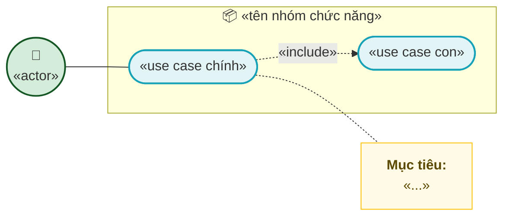
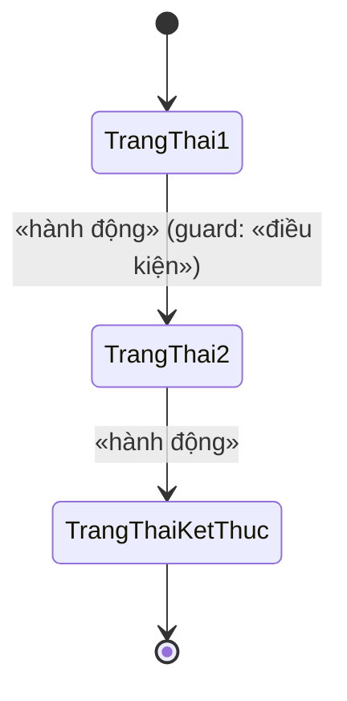
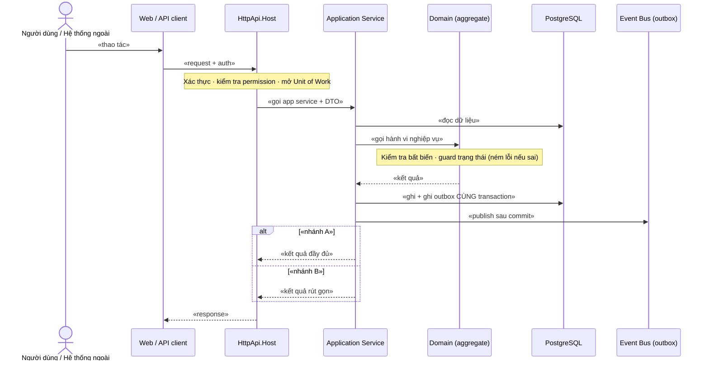
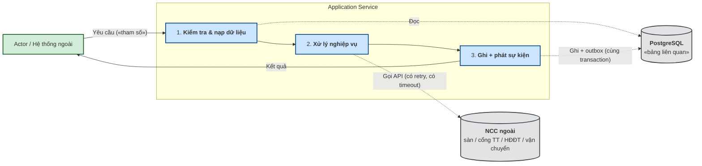
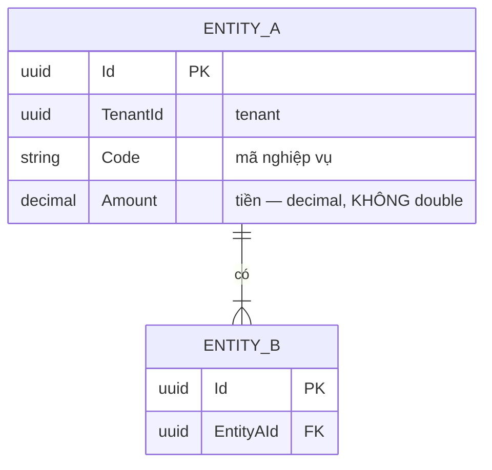

# `<MÃ>` — `<Tên feature>`

> **Mẫu tài liệu thiết kế feature.** Copy file này thành `docs/features/<mã>-<slug>.md` rồi điền.
> Hướng dẫn & quy ước: `docs/design-doc-guidelines.md`. Xoá các dòng *in nghiêng* là ghi chú hướng dẫn.

| Thuộc tính | Nội dung |
|---|---|
| **Mã** | `<MODULE>-<số 3 chữ số>` — ví dụ `SAL-003` |
| **Module** | `<tên module>` |
| **Giai đoạn** | `<GĐ0 / GĐ1 / GĐ2 / GĐ3 / GĐ4>` |
| **Ưu tiên** | `Must have / Should have / Could have` |
| **Trạng thái** | `Draft → In review → Approved → Implementing → Implemented → Changed` |
| **Người viết / người review** | `<tên>` / `<tên>` |
| **Phiên bản / ngày** | `v0.1 — <dd/mm/yyyy>` |
| **Tài liệu liên quan** | `<mã các feature phụ thuộc>` · `docs/implementation-plan.md` · `docs/structure-and-techstack.md` |

---

## 0. Tóm tắt & quyết định thiết kế

**Tóm tắt 3–5 câu:** *feature này giải quyết việc gì, cho ai, và giá trị mang lại.*

**Phạm vi:** *liệt kê rõ CÓ làm gì.*
**Không nằm trong phạm vi:** *liệt kê rõ KHÔNG làm gì (để tránh hiểu nhầm khi review).*

### 0.1 Quyết định thiết kế (ADR ngắn)

| # | Quyết định | Phương án đã cân nhắc | Lý do chọn | Hệ quả |
|---|---|---|---|---|
| D1 | `<chọn gì>` | `<A / B>` | `<lý do>` | `<đánh đổi>` |

> *Ghi lại cả phương án BỊ LOẠI và lý do — để 6 tháng sau không ai hỏi lại "sao không làm cách kia".*

---

## 1. Use Case Specification

| Thuộc tính | Nội dung |
|---|---|
| **Use Case ID** | `<MODULE>-<số>` |
| **Use Case Name** | `<tên>` |
| **Description** | *"Là một `<actor>`, tôi muốn `<hành động>` để `<mục đích>`."* |
| **Actor(s)** | `<vai trò người dùng + hệ thống>` |
| **Priority** | `Must / Should / Could` |
| **Trigger** | `<sự kiện kích hoạt>` |
| **Pre-Condition(s)** | • `<điều kiện>` |
| **Post-Condition(s)** | • `<trạng thái hệ thống sau khi xong>` |
| **Basic Flow** | 1. `<bước>`<br>2. `<bước>` |
| **Alternative Flow** | **A1: `<tên>`**<br>a. `<bước>` |
| **Exception Flow** | **E1: `<tên>`**<br>a. `<bước>` |
| **Business Rules** | • **BR-`<MÃ>`-001**: `<quy tắc, phát biểu kiểm chứng được>` |
| **Non-Functional Requirement** | • **NFR-`<MÃ>`-001**: `<ngưỡng cụ thể, đo được>` |

> *Lưu ý khác biệt so với tài liệu gốc: **PRECONDITION của ta luôn phải ghi rõ tenant + kênh** (`TenantId`, `ChannelCode`) nếu feature liên quan tới chúng — vì hệ thống là đa tenant và đa kênh.*
> *Mỗi BR/NFR phải **kiểm chứng được** (có test tương ứng ở §14). Nếu không viết được test thì chưa phải là BR.*

---

## 2. Sơ đồ Use Case

*Mermaid `flowchart LR`; actor màu xanh lá, use case xanh dương, note vàng; quan hệ `«include»` là đường chấm.*



### Chú giải

| Ký hiệu | Ý nghĩa |
|---|---|
| ⭕ Xanh lá | Actor |
| 🟦 Bầu dục xanh dương | Use Case |
| 🟨 Khung vàng | Note |
| `───` | Liên kết Actor ↔ Use Case |
| `-.«include».->` | Quan hệ bao hàm |

---

## 3. Sơ đồ trạng thái (state machine) — **BẮT BUỘC nếu feature có vòng đời**

> *Tài liệu gốc không có mục này. Ta cần nó vì đã học được: guard trạng thái im lặng (eShop) làm event rơi mà không để lại dấu vết, và state machine là nơi dễ phát sinh lỗi nghiệp vụ nhất.*



| # | Từ → Sang | Guard (điều kiện cho phép) | Hành động kèm theo | Nếu guard sai thì? |
|---|---|---|---|---|
| 1 | `<A>` → `<B>` | `<điều kiện>` | `<side effect: phát event / ghi ledger / gọi NCC>` | **`<ném lỗi / bỏ qua im lặng>`** |

> ⚠️ **Quy tắc bất di bất dịch #11: guard sai phải NÉM LỖI (hoặc ghi log có cấu trúc), không im lặng.**
> Phải ghi rõ **người/bước nào được phép chuyển** (người dùng? webhook? job?), và **trạng thái nào là hấp thụ (absorbing)**.
> Với đơn hàng: ghi rõ trạng thái trên **cả 4 trục** (thực hiện / tài chính / đối soát / phụ).

---

## 4. Sequence Diagram & luồng dữ liệu

### 4.1 Sequence (runtime)



### 4.2 DFD (luồng dữ liệu)



---

## 5. Mô hình dữ liệu

### 5.1 ERD



### 5.2 Bảng & cột (Data Dictionary)

**Bảng `<tên bảng>`** — *mục đích của bảng*

| Cột | Kiểu | Null? | Nguồn / ý nghĩa | Ghi chú |
|---|---|---|---|---|
| `Id` | `uuid` | ✖ | khoá chính | |
| `TenantId` | `uuid` | ✔ | tenant sở hữu | **bắt buộc nếu entity là `IMultiTenant`** |
| `Amount` | `numeric(18,4)` | ✖ | tiền | ⚠️ **decimal, không bao giờ `double`** |

**Index & ràng buộc** *(đây là phần hay bị bỏ sót nhất — phải liệt kê hết)*

| Loại | Cột | Mục đích |
|---|---|---|
| UNIQUE | `(TenantId, Code)` | chống trùng mã |
| UNIQUE **có filter** | `(TenantId, ChannelCode, ExternalOrderId) WHERE ExternalOrderId IS NOT NULL` | **idempotency webhook** |
| INDEX | `(TenantId, Status, CreatedAt)` | truy vấn danh sách |
| CHECK | `Amount >= 0` | bất biến ở tầng DB |

> *Quy ước: mọi index phục vụ idempotency/chống trùng **phải nêu rõ ở đây**, vì đó là hàng rào cuối cùng khi tầng ứng dụng sai.*

---

## 6. Hợp đồng API

### 6.1 Application Service

| Mục | Giá trị |
|---|---|
| Interface | `I<Ten>AppService` (đặt tại `<Module>.Contracts`) |
| Implementation | `<Ten>AppService` (đặt tại `<Module>.Application`) |
| `[Authorize]` | **cấp CLASS** + permission cụ thể ở từng method |

| Method | Input (DTO) | Output (DTO) | Ghi chú |
|---|---|---|---|
| `GetAsync` | `<Dto>` | `<Dto>` | |
| `CreateAsync` | `<Dto>` | `<Dto>` | |

### 6.2 REST endpoint

| Mục | Giá trị |
|---|---|
| Method / Route | `<VERB> /api/app/<route>` |
| Authentication | `Bearer (OpenIddict)` |
| Permission | `<mã permission>` |
| Content-Type | `application/json` |

**Request mẫu**

```json
{ }
```

**Response mẫu**

```json
{ }
```

**Mã lỗi nghiệp vụ**

| Mã | HTTP | Khi nào | Thông điệp |
|---|---|---|---|
| `<ERROR_CODE>` | `400 / 403 / 409` | `<điều kiện>` | `<thông điệp>` |

---

## 7. Sự kiện, tích hợp ngoài & idempotency — **BẮT BUỘC**

> *Tài liệu gốc không có mục này vì chạy stored procedure đồng bộ. Ta cần nó vì có webhook, event bus, outbox và NCC ngoài.*

### 7.1 Sự kiện phát ra (ETO)

| ETO | Khi nào phát | Trường dữ liệu | Ai tiêu thụ | Handler có idempotent? |
|---|---|---|---|---|
| `<Ten>Eto` | `<thời điểm>` | `<liệt kê trường>` | `<module/job>` | ✅/✖ `<cách chống trùng>` |

### 7.2 Sự kiện / webhook nhận vào

| Nguồn | Loại | Xác thực | Chống trùng bằng | Nếu xử lý lỗi? | Thứ tự đến |
|---|---|---|---|---|---|
| `<sàn / cổng TT / vận chuyển>` | `webhook / IPN / poll` | `<chữ ký HMAC? IP allowlist? OAuth?>` | `<unique index trên (EventId đối tác, TenantId, ...)>` | `<retry / DLQ / log>` | `<có thể sai thứ tự? cách xử lý>` |

> ⚠️ Ghi rõ nếu NCC **không** có chữ ký (ví dụ webhook GHTK chỉ có `hash` trên URL) ⇒ phải nêu biện pháp bù (IP allowlist, đối soát chủ động).

### 7.3 Gọi API ra ngoài

| NCC | Endpoint (base URL) | Auth | Timeout | Retry | Nếu thất bại |
|---|---|---|---|---|---|
| `<tên>` | `<...>` | `<...>` | `<...>` | `<số lần + backoff>` | `<đánh dấu lỗi + job thử lại>` |

> *Nếu endpoint có retry/timeout theo yêu cầu NCC (ví dụ một số API yêu cầu trả 200 trong 500ms), ghi rõ ở đây.*

---

## 8. Bất biến & xử lý đồng thời

> *Tài liệu gốc không có mục này. Ta cần vì đã gặp: hai luồng cùng trừ một SKU, webhook gửi trùng, refresh token bị rotate.*

| # | Bất biến / tình huống | Cơ chế bảo vệ |
|---|---|---|
| 1 | `<ví dụ: không bán vượt tồn kho>` | `<lock key + unique index + kiểm tra trong domain>` |
| 2 | `<ví dụ: webhook gửi trùng không tạo 2 đơn>` | `unique index (TenantId, ChannelCode, ExternalOrderId)` |
| 3 | `<ví dụ: chuyển trạng thái đồng thời>` | `<optimistic concurrency (RowVersion) / UPDATE ... WHERE status = ...>` |

**Khoá phân tán dùng trong feature** *(liệt kê chính xác tên khoá)*

| Tên khoá | Phạm vi | Vì sao cần |
|---|---|---|
| `ecommerce:<...>:{...}` | `<theo SKU / theo shop / theo tenant>` | `<chống race condition nào>` |

**Idempotency key** *(nếu gọi NCC)*

| Đối tượng | Cách sinh khoá | ⚠️ Lưu ý |
|---|---|---|
| `<giao dịch cổng TT>` | `<sinh từ mã nội bộ, KHÔNG phải Guid mới mỗi lần>` | Khoá phải **ổn định** qua các lần retry |

---

## 9. Phân quyền

| Permission | Nhóm | Method được gán | Vai trò mặc định |
|---|---|---|---|
| `<mã permission>` | `<nhóm>` | `<method>` | `<admin / nhân viên / ...>` |

> *Nhắc lại: **ABP không tự bảo vệ app service** ⇒ phải có `[Authorize]` cấp class; permission chưa định nghĩa thì luôn bị từ chối.*

---

## 10. UI Mockup & mapping dữ liệu

> *Nếu feature không có UI (thuần API/job), ghi rõ "Không có UI" và bỏ mục này.*

*Mô tả bố cục các vùng màn hình. (Tuỳ chọn: mockup HTML/CSS như tài liệu gốc, hoặc mô tả bằng bảng vùng/nội dung.)*

| Vùng UI | Dữ liệu hiển thị | Nguồn (DTO / trường) | Hành động |
|---|---|---|---|
| `<Header>` | `<...>` | `<...>` | `<...>` |
| `<Danh sách>` | `<...>` | `<...>` | `<nút/thao tác>` |

> Giữ thói quen tốt của tài liệu gốc: **nếu số liệu tổng hợp khác số dòng hiển thị (do bộ lọc), phải ghi rõ chênh lệch ở đâu** — đây là loại lỗi rất khó phát hiện khi test.

---

## 11. Migration & seed

| Mục | Nội dung |
|---|---|
| Migration | `<tên migration EF>` (ví dụ `Added_Inventory_Reservation`) |
| Bảng tạo mới | `<liệt kê>` |
| Seed | `<dữ liệu nền cần seed, có idempotent không>` |
| Ảnh hưởng dữ liệu cũ | `<có cần backfill không? cách làm?>` |
| Rollback | `<cách lùi nếu migration lỗi trên production>` |

---

## 12. Xử lý lỗi & trường hợp biên

> *Giữ đúng tinh thần tài liệu gốc: phân biệt **(a) không có dữ liệu — KHÔNG phải lỗi** với **(b) lỗi thật**.*

| Tình huống | Nguyên nhân | Hành vi hệ thống | Phản hồi tới client |
|---|---|---|---|
| `<Không có dữ liệu>` | `<điều kiện>` | `<trả rỗng>` | **không phải lỗi** |
| `<Thiếu/sai tham số>` | `<validation>` | `<từ chối>` | `<mã lỗi>` |
| `<Không có quyền>` | `<auth/permission>` | `<chặn>` | `403` |
| `<Vi phạm bất biến>` | `<ví dụ: hết tồn kho>` | `<ném BusinessException + rollback>` | `<mã lỗi nghiệp vụ>` |
| `<NCC ngoài lỗi/timeout>` | `<...>` | `<đánh dấu + job thử lại; KHÔNG rollback dữ liệu đã ghi>` | `<...>` |
| `<Lỗi runtime>` | `<DB, deadlock, timeout>` | `<rollback + log có CorrelationId>` | `<lỗi chung>` |

**Chiến lược transaction:** `<mở ở đâu (Unit of Work), phạm vi, rollback khi nào>`

---

## 13. Phi chức năng

| Mã | Yêu cầu | Ngưỡng đo được | Cách kiểm chứng |
|---|---|---|---|
| NFR-`<MÃ>`-001 | Hiệu năng | `<ví dụ: p95 < 300ms với 10k bản ghi>` | `<test tải / đo trong integration test>` |
| NFR-`<MÃ>`-002 | Bảo mật | `<ví dụ: mọi endpoint yêu cầu token + permission>` | `<test 401/403>` |
| NFR-`<MÃ>`-003 | Audit | `<ví dụ: mọi chuyển trạng thái ghi vào lịch sử>` | `<test đọc lại lịch sử>` |
| NFR-`<MÃ>`-004 | Observability | `<log có CorrelationId; có metric>` | `<kiểm tra log>` |
| NFR-`<MÃ>`-005 | Đa tenant/kênh | `<dữ liệu tenant A không thấy được từ tenant B>` | `<integration test 2 tenant>` |

---

## 14. Test cases & Acceptance Criteria

### 14.1 Danh sách test case

| ID | Mục tiêu | Loại | Input chính | Expected | Phủ BR/NFR |
|---|---|---|---|---|---|
| TC-01 | Happy path | Unit | `<...>` | `<...>` | |
| TC-02 | Từng nhánh guard trạng thái | Unit | `<...>` | `<...>` | BR-...-001 |
| TC-03 | Vi phạm bất biến | Unit | `<...>` | `<ném lỗi>` | |
| TC-04 | Hai luồng đồng thời | **Integration** | `<2 request song song>` | `<chỉ 1 thành công>` | NFR-...-001 |
| TC-05 | Webhook gửi trùng | **Integration** | `<cùng event 2 lần>` | `<chỉ xử lý 1 lần>` | BR-...-002 |
| TC-06 | Không có dữ liệu | Unit | `<...>` | `<rỗng, không lỗi>` | |
| TC-07 | Sai quyền | **Integration** | `<token thiếu permission>` | `403` | NFR-...-002 |
| TC-08 | Tenant cách ly | **Integration** | `<tenant B đọc dữ liệu tenant A>` | `<không thấy>` | NFR-...-005 |

### 14.2 Fixture skeleton (xUnit + ABP)

```csharp
public class <Ten>Tests : eCommerceTestBase<eCommerceEntityFrameworkCoreTestModule>
{
    private readonly I<Ten>AppService _sut;

    public <Ten>Tests()
    {
        _sut = GetRequiredService<I<Ten>AppService>();
    }

    [Fact]
    public async Task TC01_happy_path_<mo_ta>()
    {
        // Arrange
        // Act
        // Assert
    }

    [Fact]
    public async Task TC04_hai_luong_dong_thoi_chi_mot_thanh_cong()
    {
        // Integration: chạy 2 Task song song trên PostgreSQL thật (Testcontainers)
    }
}
```

### 14.3 Acceptance Criteria (Definition of Done)

- [ ] Happy path trả đúng kết quả
- [ ] **Mọi nhánh của state machine (§3) đều có test** — kể cả nhánh guard sai
- [ ] Mọi **BR** ở §1 được test phủ
- [ ] Mọi **NFR** ở §13 được kiểm chứng
- [ ] Idempotency: gửi trùng không gây tác dụng phụ (webhook/IPN/retry)
- [ ] Đồng thời: test 2 luồng song song pass; khoá phân tán (§8) hoạt động
- [ ] Cách ly tenant/kênh đúng
- [ ] `[Authorize]` + permission đúng; test 401/403
- [ ] Migration chạy được từ DB trống **và** trên DB đã có dữ liệu
- [ ] Seed idempotent
- [ ] Toàn bộ test pass trong CI
- [ ] **Tài liệu này đã cập nhật khớp với code thực tế** (nếu có sai khác khi code)

### 14.4 Definition of Ready (trước khi bắt đầu code)

- [ ] Tài liệu đã được **review và Approved**
- [ ] Mọi **câu hỏi mở (§15)** đã được trả lời
- [ ] Không còn phụ thuộc vào quyết định chưa chốt
- [ ] `BR`/`NFR` đã có mã và kiểm chứng được

---

## 15. Câu hỏi mở, giả định & lịch sử thay đổi

### 15.1 Câu hỏi mở

| # | Câu hỏi | Cần ai trả lời | Trạng thái | Ảnh hưởng nếu chưa trả lời |
|---|---|---|---|---|
| 1 | `<...>` | `<dev / BA / NCC / luật sư>` | `Open / Closed` | `<...>` |

### 15.2 Giả định

| # | Giả định | Nếu giả định SAI thì sao |
|---|---|---|
| 1 | `<...>` | `<...>` |

### 15.3 Lịch sử thay đổi

| Phiên bản | Ngày | Người | Thay đổi |
|---|---|---|---|
| v0.1 | `<dd/mm/yyyy>` | `<tên>` | Bản nháp đầu |
